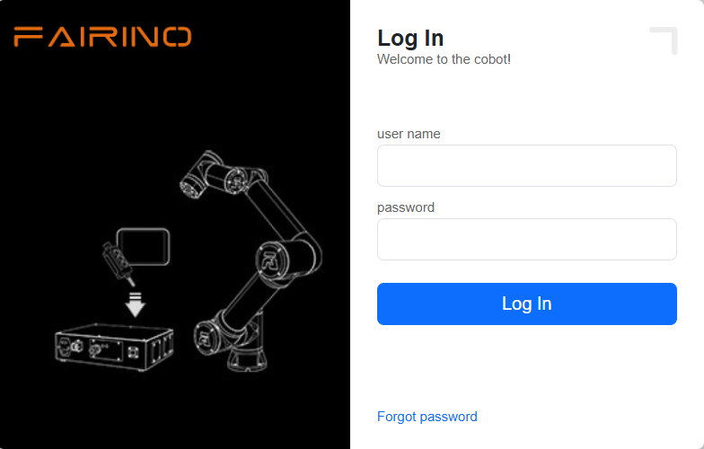
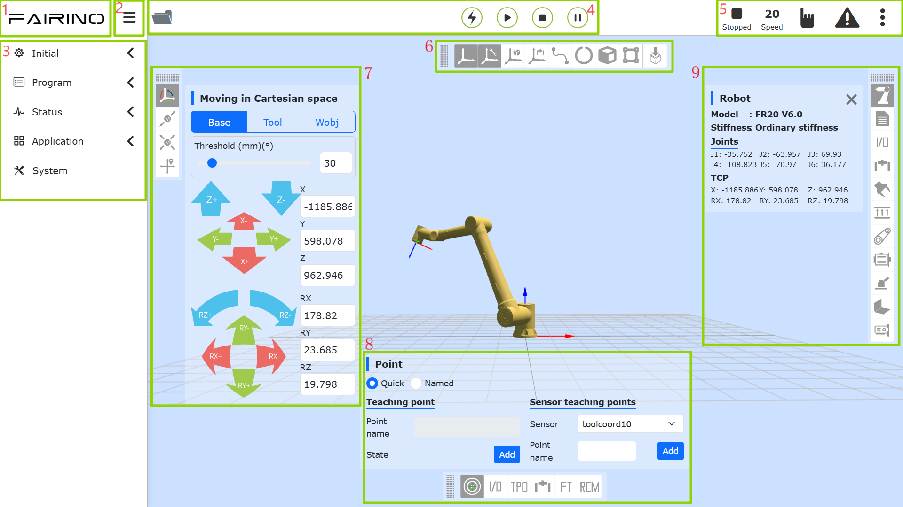

WebApp Acceso e inicio de sesión
=================================

.. toctree:: 
   :maxdepth: 6

Acceso e inicio de sesión de WebApp
-------------------------------------

1. Encender la caja de control y conectar el cable de red al PC;
2. Abrir el navegador Chrome en el PC y acceder a la dirección de destino 192.168.58.2;
3. Introducir el nombre de usuario y la contraseña y hacer clic en iniciar sesión para acceder a WebApp.

El usuario inicial es admin y la contraseña es 123.

.. centered:: Figura 2.1‑1 Interfaz de inicio de sesión

Conocimiento básico de la interfaz WebApp
------------------------------------------

Tras iniciar sesión correctamente, el sistema entra en la "interfaz inicial", que contiene principalmente:

1. LOGO de FAIRINO;
2. Botón de zoom de la barra de menú;
3. Barra de menú;
4. Área de control del robot
5. Área de estado del robot;
6. Robot simulado en 3D——operación de la escena 3D;
7. Robot simulado en 3D——operación del cuerpo del robot;
8. Funciones complementarias del robot;
9. Estado del robot y de las funciones complementarias.

Como se muestra en la figura siguiente del esquema de la interfaz inicial del sistema:

.. centered:: Figura 2.2‑1 Esquema de la interfaz inicial del sistema

Área de control
~~~~~~~~~~~~~~~~~

.. note:: 
   .. image:: teaching_pendant_software/064.png
      :width: 0.75in
      :height: 0.75in
      :align: left

   Nombre: **Botón de abrir programa de enseñanza**
   
   Función: Abrir los programas de enseñanza de programación de programas, programación gráfica y programación de gráficos de nodos

.. note:: 
   .. image:: teaching_pendant_software/003.png
      :width: 0.75in
      :height: 0.75in
      :align: left

   Nombre: **Botón de habilitación**
   
   Función: Habilitar el robot

.. note:: 
   .. image:: teaching_pendant_software/004.png
      :width: 0.75in
      :height: 0.75in
      :align: left

   Nombre: **Botón de inicio**
   
   Función: Cargar e iniciar la ejecución del programa de enseñanza

.. note:: 
   .. image:: teaching_pendant_software/005.png
      :width: 0.75in
      :height: 0.75in
      :align: left

   Nombre: **Botón de parada**
   
   Función: Detener la ejecución del programa de enseñanza actual

.. note:: 
   .. image:: teaching_pendant_software/006.png
      :width: 0.75in
      :height: 0.75in
      :align: left

   Nombre: **Botón de pausa/reanudación**
   
   Función: Pausar y reanudar el programa de enseñanza actual

.. important::
   La instrucción de pausa está al final del programa, no se puede realizar la comprobación

Barra de estado
~~~~~~~~~~~~~~~~

.. note:: 
   .. image:: teaching_pendant_software/011.png
      :width: 0.75in
      :height: 0.75in
      :align: left

   Nombre: **Estado de error de ejecución del robot**
   
   Función: El robot actual tiene un error de ejecución, se oculta cuando no hay error

.. note:: 
   .. image:: teaching_pendant_software/007.png
      :width: 0.75in
      :height: 0.75in
      :align: left

   Nombre: **Estado del robot**
   
   Función: Stopped-detenido, Running-en ejecución, Pause-pausado, Drag-arrastre

.. note:: 
   .. image:: teaching_pendant_software/010.png
      :width: 0.75in
      :height: 0.75in
      :align: left

   Nombre: **Sistema de coordenadas de herramienta del robot, sistema de coordenadas de pieza, sistema de coordenadas de eje extendido y número de carga**
   
   Función: Arriba a la izquierda——número del sistema de coordenadas de herramienta actual, arriba a la derecha——número del sistema de coordenadas de pieza actual, abajo a la izquierda——número del sistema de coordenadas de eje extendido actual, abajo a la derecha——número de carga actual

.. note:: 
   .. image:: teaching_pendant_software/009.png
      :width: 0.75in
      :height: 0.75in
      :align: left

   Nombre: **Porcentaje de velocidad de ejecución**
   
   Función: Velocidad de ejecución del robot en el modo actual

.. note:: 
   .. image:: teaching_pendant_software/012.png
      :width: 0.75in
      :height: 0.75in
      :align: left

   Nombre: **Modo automático**
   
   Función: Modo de funcionamiento automático del robot; al cambiar de modo manual a automático, el ajuste de velocidad global y al especificar la velocidad, la velocidad global se ajustará automáticamente a la velocidad especificada

.. note:: 
   .. image:: teaching_pendant_software/013.png
      :width: 0.75in
      :height: 0.75in
      :align: left

   Nombre: **Modo manual**
   
   Función: Modo manual del robot, para realizar operaciones de enseñanza del robot

.. note:: 
   .. image:: teaching_pendant_software/065.png
      :width: 0.75in
      :height: 0.75in
      :align: left

   Nombre: **Botón de plegado/despliegue del estado del robot**
   
   Función: Plegar/desplegar el sistema de coordenadas de herramienta, el sistema de coordenadas de pieza, el sistema de coordenadas de eje extendido, la carga, el estado de arrastre del robot, el modo local/remoto, el estado de conexión del robot, el modo BOOT y el contenido de la información de la cuenta

Hacer clic en el botón de plegado para ver el siguiente contenido de información de estado.

.. note:: 
   .. image:: teaching_pendant_software/008.png
      :width: 0.75in
      :height: 0.75in
      :align: left

   Nombre: **Número del sistema de coordenadas de herramienta**
   
   Función: Mostrar el número del sistema de coordenadas de herramienta aplicado actualmente

.. note:: 
   .. image:: teaching_pendant_software/027.png
      :width: 0.75in
      :height: 0.75in
      :align: left

   Nombre: **Número del sistema de coordenadas de pieza**
   
   Función: Mostrar el número del sistema de coordenadas de pieza aplicado actualmente
   
.. note:: 
   .. image:: teaching_pendant_software/028.png
      :width: 0.75in
      :height: 0.75in
      :align: left

   Nombre: **Número del sistema de coordenadas de eje extendido**
   
   Función: Mostrar el número del sistema de coordenadas de eje extendido aplicado actualmente

.. note:: 
   .. image:: teaching_pendant_software/066.png
      :width: 0.75in
      :height: 0.75in
      :align: left

   Nombre: **Carga**
   
   Función: Mostrar el peso de la carga aplicada actualmente y las coordenadas del centro de masa X, Y, Z

.. note:: 
   .. image:: teaching_pendant_software/014.png
      :width: 0.75in
      :height: 0.75in
      :align: left

   Nombre: **Estado de arrastre del robot**
   
   Función: El robot actual se puede arrastrar

.. note:: 
   .. image:: teaching_pendant_software/015.png
      :width: 0.75in
      :height: 0.75in
      :align: left

   Nombre: **Estado de arrastre del robot**
   
   Función: El robot actual no se puede arrastrar

.. note:: 
   .. image:: teaching_pendant_software/068.png
      :width: 0.75in
      :height: 0.75in
      :align: left

   Nombre: **Modo local del robot**
   
   Función: El robot actual se controla a través de la caja de control

.. note:: 
   .. image:: teaching_pendant_software/067.png
      :width: 0.75in
      :height: 0.75in
      :align: left

   Nombre: **Modo remoto del robot**
   
   Función: El robot actual solo se puede controlar a través del PLC

.. note:: 
   .. image:: teaching_pendant_software/017.png
      :width: 0.75in
      :height: 0.75in
      :align: left

   Nombre: **Estado de conexión**
   
   Función: Robot conectado

.. note:: 
   .. image:: teaching_pendant_software/016.png
      :width: 0.75in
      :height: 0.75in
      :align: left

   Nombre: **Estado de no conexión**
   
   Función: Robot no conectado

.. note:: 
   .. image:: teaching_pendant_software/018.png
      :width: 0.75in
      :height: 0.75in
      :align: left

   Nombre: **Información de la cuenta**
   
   Función: Mostrar el nombre de usuario y los permisos y cerrar la sesión del usuario