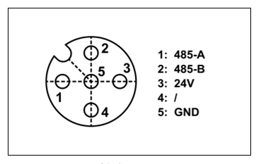
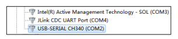
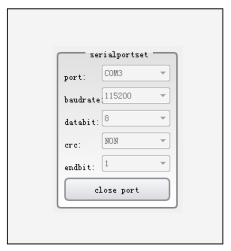
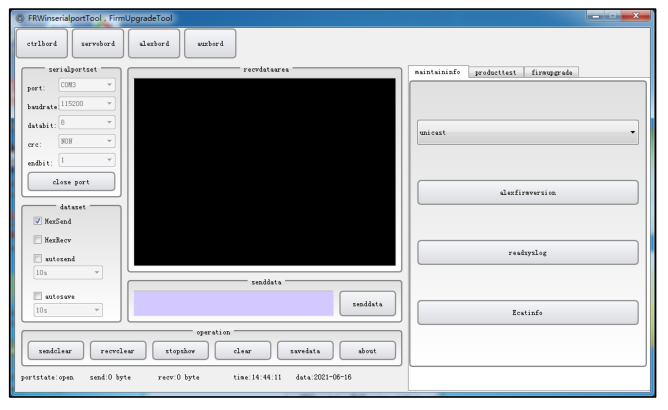
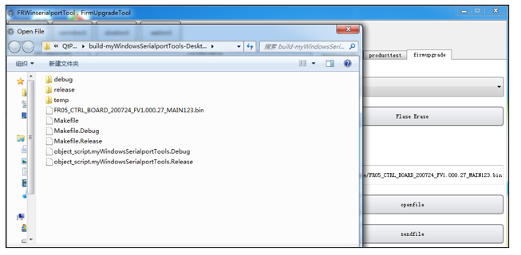
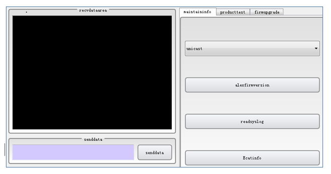
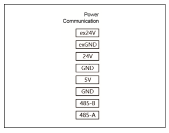

Apéndice
========

.. toctree:: 
  :maxdepth: 5

Apéndice 1: Errores del controlador de movimiento y formas de tratamiento
--------------------------------------------------------------------------

.. csv-table:: 
   :header: "Código de fallo principal", "Código de subfallo", "Descripción"
   :widths: 20, 10, 70

   "0-Sin fallo", "0", "Sin fallo"
   "1-Error de punto de instrucción", "1", "Error de punto de instrucción articular, reajustable"
   "1-Error de punto de instrucción", "2", "Error de punto objetivo de línea recta (incluida la inconsistencia de herramienta), reajustable"
   "1-Error de punto de instrucción", "3", "Error de punto intermedio de arco (incluida la inconsistencia de herramienta), reajustable"
   "1-Error de punto de instrucción", "4", "Error de punto objetivo de arco (incluida la inconsistencia de herramienta), reajustable"
   "1-Error de punto de instrucción", "5", "Distancia entre puntos de instrucción de arco demasiado pequeña, reajustable"
   "1-Error de punto de instrucción", "6", "Error del punto intermedio 1 de círculo completo/hélice (incluida la inconsistencia de herramienta), reajustable"
   "1-Error de punto de instrucción", "7", "Error del punto intermedio 2 de círculo completo/hélice (incluida la inconsistencia de herramienta), reajustable"
   "1-Error de punto de instrucción", "8", "Error del punto intermedio 3 de círculo completo/hélice (incluida la inconsistencia de herramienta), reajustable"
   "1-Error de punto de instrucción", "9", "Distancia entre puntos de instrucción de círculo completo/hélice demasiado pequeña, reajustable"
   "1-Error de punto de instrucción", "10", "Error de punto de instrucción TPD, reajustable"
   "1-Error de punto de instrucción", "11", "Herramienta de instrucción TPD inconsistente con la herramienta actual, reajustable"
   "1-Error de punto de instrucción", "12", "Desviación demasiado grande entre la instrucción actual TPD y el punto inicial de la siguiente instrucción, reajustable"
   "1-Error de punto de instrucción", "13", "Error de conmutación de herramienta interna/externa, reajustable"
   "1-Error de punto de instrucción", "14", "Error de punto de inicio de nueva hélice, reajustable"
   "1-Error de punto de instrucción", "15", "Error de punto de instrucción de nueva curva spline, reajustable"
   "1-Error de punto de instrucción", "17", "Instrucción articular PTP fuera de límite, reajustable"
   "1-Error de punto de instrucción", "18", "Instrucción articular TPD fuera de límite, reajustable"
   "1-Error de punto de instrucción", "19", "Instrucción articular emitida LIN/ARC fuera de límite, reajustable"
   "1-Error de punto de instrucción", "20", "Velocidad de instrucción excesiva en el espacio cartesiano, no reajustable"
   "1-Error de punto de instrucción", "21", "Instrucción de par fuera de límite en el espacio articular, reajustable"
   "1-Error de punto de instrucción", "22", "Instrucción articular JOG fuera de límite, reajustable"
   "1-Error de punto de instrucción", "23", "Velocidad de instrucción fuera de límite en el espacio articular del eje 1, reajustable"
   "1-Error de punto de instrucción", "24", "Velocidad de instrucción fuera de límite en el espacio articular del eje 2, reajustable"
   "1-Error de punto de instrucción", "25", "Velocidad de instrucción fuera de límite en el espacio articular del eje 3, reajustable"
   "1-Error de punto de instrucción", "26", "Velocidad de instrucción fuera de límite en el espacio articular del eje 4, reajustable"
   "1-Error de punto de instrucción", "27", "Velocidad de instrucción fuera de límite en el espacio articular del eje 5, reajustable"
   "1-Error de punto de instrucción", "28", "Velocidad de instrucción fuera de límite en el espacio articular del eje 6, reajustable"
   "1-Error de punto de instrucción", "29", "Velocidad de realimentación articular fuera de límite, no reajustable"
   "1-Error de punto de instrucción", "30", "Desviación demasiado grande entre instrucción y realimentación articular, no reajustable, requiere reinicio"
   "1-Error de punto de instrucción", "31", "Error de punto objetivo DMP (incluida la inconsistencia de herramienta), reajustable"
   "1-Error de punto de instrucción", "33", "Cambio de configuración articular de la siguiente instrucción (la siguiente instrucción tiene una pose singular, utilice la instrucción PTP o modifique el siguiente punto de instrucción), reajustable"
   "1-Error de punto de instrucción", "34", "Cambio de configuración articular de la instrucción actual (la siguiente instrucción tiene una pose singular, utilice la instrucción PTP o modifique el siguiente punto de instrucción), reajustable"
   "1-Error de punto de instrucción", "35", "Velocidad articular fuera de límite en la instrucción LIN, reajustable"
   "1-Error de punto de instrucción", "36", "Velocidad adaptativa de la instrucción LIN fuera del umbral, reajustable"
   "1-Error de punto de instrucción", "37", "Existe un punto inalcanzable en la trayectoria, reajustable"
   "1-Error de punto de instrucción", "38", "Existe un punto inalcanzable en la trayectoria- pose singular, reajustable"
   "1-Error de punto de instrucción", "49", "Error de instrucción, entre ARCSTART y ARCEND solo se permiten instrucciones LIN y ARC, reajustable"
   "1-Error de punto de instrucción", "50", "Error de instrucción, entre WEAVESTART y WEAVEEND solo se permiten instrucciones LIN y ARC, reajustable"
   "1-Error de punto de instrucción", "51", "Error de parámetros de soldadura oscilante, reajustable"
   "1-Error de punto de instrucción", "52", "Distancia entre puntos de instrucción de soldadura oscilante demasiado pequeña, reajustable"
   "1-Error de punto de instrucción", "53", "Existe un punto inalcanzable en la trayectoria oscilante- pose singular, reajustable"
   "1-Error de punto de instrucción", "54", "Existe un punto inalcanzable en la trayectoria oscilante- instrucción articular fuera de límite, reajustable"
   "1-Error de punto de instrucción", "55", "Existe un punto inalcanzable en la trayectoria oscilante- anomalía de planificación (coincidencia del ángulo entre la herramienta z y la dirección de avance x), reajustable"
   "1-Error de punto de instrucción", "56", "Existe un punto inalcanzable en la trayectoria oscilante- anomalía de planificación (error de punto de ruta de arco), reajustable"
   "1-Error de punto de instrucción", "65", "Desviación demasiado grande de la instrucción del sensor láser, reajustable"
   "1-Error de punto de instrucción", "66", "Interrupción de la instrucción del sensor láser, finalización anticipada del seguimiento de soldadura, reajustable"
   "1-Error de punto de instrucción", "81", "Velocidad de instrucción de eje externo fuera de límite, reajustable"
   "1-Error de punto de instrucción", "82", "Desviación demasiado grande entre instrucción y realimentación del eje externo, no reajustable, requiere retorno a cero o reinicio"
   "1-Error de punto de instrucción", "83", "Anomalía de comunicación de periféricos extendidos (eje externo/IO), reajustable"
   "1-Error de punto de instrucción", "84", "Anomalía de comunicación de periféricos extendidos (máquina de soldar), reajustable"
   "1-Error de punto de instrucción", "85", "Velocidad de instrucción fuera de límite en el espacio articular de la extensión 1, reajustable"
   "1-Error de punto de instrucción", "86", "Velocidad de instrucción fuera de límite en el espacio articular de la extensión 2, reajustable"
   "1-Error de punto de instrucción", "87", "Velocidad de instrucción fuera de límite en el espacio articular de la extensión 3, reajustable"
   "1-Error de punto de instrucción", "88", "Velocidad de instrucción fuera de límite en el espacio articular de la extensión 4, reajustable"
   "1-Error de punto de instrucción", "89", "Anomalía de comunicación de periféricos extendidos (UDP), reajustable"
   "1-Error de punto de instrucción", "90", "Anomalía de pérdida de paquetes de comunicación de periféricos extendidos (UDP), reajustable"
   "1-Error de punto de instrucción", "97", "Seguimiento de cinta transportadora- cambio de actitud demasiado grande entre el punto inicial y el punto de referencia, reajustable"
   "1-Error de punto de instrucción", "113", "Control de fuerza constante- dirección X supera la distancia máxima de ajuste, reajustable"
   "1-Error de punto de instrucción", "114", "Control de fuerza constante- dirección Y supera la distancia máxima de ajuste, reajustable"
   "1-Error de punto de instrucción", "115", "Control de fuerza constante- dirección Z supera la distancia máxima de ajuste, reajustable"
   "1-Error de punto de instrucción", "116", "Control de fuerza constante- dirección RX supera el ángulo máximo de ajuste, reajustable"
   "1-Error de punto de instrucción", "117", "Control de fuerza constante- dirección RY supera el ángulo máximo de ajuste, reajustable"
   "1-Error de punto de instrucción", "118", "Control de fuerza constante- dirección RZ supera el ángulo máximo de ajuste, reajustable"
   "1-Error de punto de instrucción", "119", "Error de datos del sensor externo, reajustable"
   "1-Error de punto de instrucción", "120", "Fallo del movimiento de exploración en hélice, reajustable"
   "1-Error de punto de instrucción", "121", "Fallo del movimiento de inserción rotativa, reajustable"
   "1-Error de punto de instrucción", "122", "Fallo del movimiento de inserción en línea recta, reajustable"
   "1-Error de punto de instrucción", "123", "Fallo del movimiento de localización de superficie, reajustable"
   "1-Error de punto de instrucción", "129", "Se supera el número máximo de puntos de registro de par, reajustable"
   "1-Error de punto de instrucción", "130", "Error de conmutación de velocidad, reajustable"
   "1-Error de punto de instrucción", "131", "Dirección de herramienta fuera de límite, reajustable"
   "1-Error de punto de instrucción", "132", "Momento fuera de límite, reajustable"
   "1-Error de punto de instrucción", "133", "Potencia fuera de límite, reajustable"
   "1-Error de punto de instrucción", "134", "Anomalía de diagnóstico STL-Flash, reajustable"
   "1-Error de punto de instrucción", "135", "Anomalía de diagnóstico STL-RAM, reajustable"
   "1-Error de punto de instrucción", "136", "Anomalía de diagnóstico STL-CPU, reajustable"
   "1-Error de punto de instrucción", "137", "Anomalía de datos de seguridad ECAT de la placa de seguridad II, reajustable"
   "1-Error de punto de instrucción", "138", "Anomalía de datos de seguridad ECAT del eje 1, reajustable"
   "1-Error de punto de instrucción", "139", "Anomalía de datos de seguridad ECAT del eje 2, reajustable"
   "1-Error de punto de instrucción", "140", "Anomalía de datos de seguridad ECAT del eje 3, reajustable"
   "1-Error de punto de instrucción", "141", "Anomalía de datos de seguridad ECAT del eje 4, reajustable"
   "1-Error de punto de instrucción", "142", "Anomalía de datos de seguridad ECAT del eje 5, reajustable"
   "1-Error de punto de instrucción", "143", "Anomalía de datos de seguridad ECAT del eje 6, reajustable"
   "1-Error de punto de instrucción", "145", "Anomalía de comunicación entre la placa de seguridad y la caja de control, reajustable"
   "1-Error de punto de instrucción", "146", "Error de seguimiento de foco, reajustable"
   "1-Error de punto de instrucción", "147", "Velocidad de actitud fuera de límite, reajustable"
   "1-Error de punto de instrucción", "148", "Anomalía de la palabra de estado articular, reajustable"
   "1-Error de punto de instrucción", "149", "Conflicto de función o configuración, reajustable"
   "2-Fallo del accionamiento", "1", "Fallo del accionamiento del eje 1, no reajustable"
   "2-Fallo del accionamiento", "2", "Fallo del accionamiento del eje 2, no reajustable"
   "2-Fallo del accionamiento", "3", "Fallo del accionamiento del eje 3, no reajustable"
   "2-Fallo del accionamiento", "4", "Fallo del accionamiento del eje 4, no reajustable"
   "2-Fallo del accionamiento", "5", "Fallo del accionamiento del eje 5, no reajustable"
   "2-Fallo del accionamiento", "6", "Fallo del accionamiento del eje 6, no reajustable"
   "3-Fallo de superación de límite suave", "1", "Fallo de superación de límite suave del eje 1, reajustable"
   "3-Fallo de superación de límite suave", "2", "Fallo de superación de límite suave del eje 2, reajustable"
   "3-Fallo de superación de límite suave", "3", "Fallo de superación de límite suave del eje 3, reajustable"
   "3-Fallo de superación de límite suave", "4", "Fallo de superación de límite suave del eje 4, reajustable"
   "3-Fallo de superación de límite suave", "5", "Fallo de superación de límite suave del eje 5, reajustable"
   "3-Fallo de superación de límite suave", "6", "Fallo de superación de límite suave del eje 6, reajustable"
   "4-Fallo de colisión", "1", "Fallo de colisión del eje 1, reajustable"
   "4-Fallo de colisión", "2", "Fallo de colisión del eje 2, reajustable"
   "4-Fallo de colisión", "3", "Fallo de colisión del eje 3, reajustable"
   "4-Fallo de colisión", "4", "Fallo de colisión del eje 4, reajustable"
   "4-Fallo de colisión", "5", "Fallo de colisión del eje 5, reajustable"
   "4-Fallo de colisión", "6", "Fallo de colisión del eje 6, reajustable"
   "4-Fallo de colisión", "7", "Fallo de colisión del extremo, reajustable"
   "4-Fallo de colisión", "8", "Fallo de colisión del eje externo, reajustable"
   "5-Error del número de esclavos activos", "1", "Error del número de esclavos activos, no reajustable"
   "6-Error de esclavo", "1", "Desconexión del esclavo, no reajustable"
   "6-Error de esclavo", "2", "Estado del esclavo inconsistente con el valor configurado, no reajustable"
   "6-Error de esclavo", "3", "Esclavo no configurado, no reajustable"
   "6-Error de esclavo", "4", "Error de configuración del esclavo, no reajustable"
   "6-Error de esclavo", "5", "Error de inicialización del esclavo, no reajustable"
   "6-Error de esclavo", "6", "Error de inicialización de la comunicación de buzón del esclavo, no reajustable"
   "7-Error de IO", "1", "Error de canal, reajustable"
   "7-Error de IO", "2", "Error de valor, reajustable"
   "7-Error de IO", "3", "Tiempo de espera agotado en WaitDI, reajustable"
   "7-Error de IO", "4", "Tiempo de espera agotado en WaitAI, reajustable"
   "7-Error de IO", "5", "Tiempo de espera agotado en WaitAxleDI, reajustable"
   "7-Error de IO", "6", "Tiempo de espera agotado en WaitAxleAI, reajustable"
   "7-Error de IO", "7", "Error de función ya configurada en el canal, reajustable"
   "7-Error de IO", "8", "Tiempo de espera agotado en el encendido del arco, reajustable"
   "7-Error de IO", "9", "Tiempo de espera agotado en el apagado del arco, reajustable"
   "7-Error de IO", "10", "Tiempo de espera agotado en la búsqueda de posición, reajustable"
   "7-Error de IO", "11", "Tiempo de espera agotado en la detección de IO de la cinta transportadora, reajustable"
   "7-Error de IO", "12", "Tiempo de espera agotado en WaitAuxDI, reajustable"
   "7-Error de IO", "13", "Tiempo de espera agotado en WaitAuxAI, reajustable"
   "7-Error de IO", "14", "Tiempo de espera agotado en la búsqueda de posición del alambre de soldadura, reajustable"
   "7-Error de IO", "15", "Parada de seguridad activada, reajustable"
   "7-Error de IO", "16", "Protección contra cortocircuito de 24V del módulo DO, no reajustable"
   "7-Error de IO", "17", "Protección de mantenimiento de posición (fallo del freno), no reajustable"
   "7-Error de IO", "18", "Tiempo de espera agotado en DI de la placa, reajustable"
   "7-Error de IO", "19", "Tiempo de espera agotado en AI de la placa, reajustable"
   "8-Error de pinza", "1", "Error de tiempo de espera agotado en el movimiento de la pinza, reajustable"
   "9-Error de archivo", "1", "Error de versión del archivo de configuración zbt, error de inicialización- no reajustable"
   "9-Error de archivo", "2", "Fallo de carga del archivo de configuración zbt, error de inicialización- no reajustable"
   "9-Error de archivo", "3", "Error de versión del archivo de configuración user, error de inicialización- no reajustable"
   "9-Error de archivo", "4", "Fallo de carga del archivo de configuración user, error de inicialización- no reajustable"
   "9-Error de archivo", "5", "Error de versión del archivo de configuración exaxis, error de inicialización- no reajustable"
   "9-Error de archivo", "6", "Fallo de carga del archivo de configuración exaxis, error de inicialización- no reajustable"
   "9-Error de archivo", "7", "Modelo de robot inconsistente, requiere reconfiguración- no reajustable"
   "9-Error de archivo", "8", "Error de versión del archivo de configuración dhpara, error de inicialización- no reajustable"
   "9-Error de archivo", "9", "Fallo de carga del archivo de configuración dhpara, error de inicialización- no reajustable"
   "9-Error de archivo", "10", "Modelo de robot no configurado- no reajustable"
   "9-Error de archivo", "11", "Error de versión del archivo de configuración load, error de inicialización- no reajustable"
   "9-Error de archivo", "12", "Fallo de carga del archivo de configuración load, error de inicialización- no reajustable"
   "9-Error de archivo", "13", "Error de versión del archivo de configuración speed, error de inicialización- no reajustable"
   "9-Error de archivo", "14", "Fallo de carga del archivo de configuración speed, error de inicialización- no reajustable"
   "9-Error de archivo", "15", "Error de versión del archivo de configuración weavepara, error de inicialización- no reajustable"
   "9-Error de archivo", "16", "Fallo de carga del archivo de configuración weavepara, error de inicialización- no reajustable"
   "9-Error de archivo", "17", "Error de versión del archivo de configuración interfere, error de inicialización- no reajustable"
   "9-Error de archivo", "18", "Fallo de carga del archivo de configuración interfere, error de inicialización- no reajustable"
   "9-Error de archivo", "19", "Error de versión del archivo de configuración dynamic, error de inicialización- no reajustable"
   "9-Error de archivo", "20", "Fallo de carga del archivo de configuración dynamic, error de inicialización- no reajustable"
   "10-Pose singular", "1", "Pose singular"
   "11-Error de comunicación del accionamiento", "1", "Error de comunicación del accionamiento del eje 1, no reajustable"
   "11-Error de comunicación del accionamiento", "2", "Error de comunicación del accionamiento del eje 2, no reajustable"
   "11-Error de comunicación del accionamiento", "3", "Error de comunicación del accionamiento del eje 3, no reajustable"
   "11-Error de comunicación del accionamiento", "4", "Error de comunicación del accionamiento del eje 4, no reajustable"
   "11-Error de comunicación del accionamiento", "5", "Error de comunicación del accionamiento del eje 5, no reajustable"
   "11-Error de comunicación del accionamiento", "6", "Error de comunicación del accionamiento del eje 6, no reajustable"
   "12-Límite suave del eje externo", "1", "Superación del límite suave del eje 1, reajustable"
   "12-Límite suave del eje externo", "2", "Superación del límite suave del eje 2, reajustable"
   "12-Límite suave del eje externo", "3", "Superación del límite suave del eje 3, reajustable"
   "12-Límite suave del eje externo", "4", "Superación del límite suave del eje 4, reajustable"
   "13-Error de configuración de parámetros", "1", "Número de herramienta fuera de límite, reajustable"
   "13-Error de configuración de parámetros", "2", "Error del umbral de finalización de posicionamiento, reajustable"
   "13-Error de configuración de parámetros", "3", "Error de nivel de colisión, reajustable"
   "13-Error de configuración de parámetros", "4", "Error de peso de carga, reajustable"
   "13-Error de configuración de parámetros", "5", "Error de centro de masa X de carga, reajustable"
   "13-Error de configuración de parámetros", "6", "Error de centro de masa Y de carga, reajustable"
   "13-Error de configuración de parámetros", "7", "Error de centro de masa Z de carga, reajustable"
   "13-Error de configuración de parámetros", "8", "Error de tiempo de filtrado DI, reajustable"
   "13-Error de configuración de parámetros", "9", "Error de tiempo de filtrado AxleDI, reajustable"
   "13-Error de configuración de parámetros", "10", "Error de tiempo de filtrado AI, reajustable"
   "13-Error de configuración de parámetros", "11", "Error de tiempo de filtrado AxleAI, reajustable"
   "13-Error de configuración de parámetros", "12", "Error de rango de nivel alto/bajo DI, reajustable"
   "13-Error de configuración de parámetros", "13", "Error de rango de nivel alto/bajo DO, reajustable"
   "13-Error de configuración de parámetros", "14", "Número de pieza fuera de límite, reajustable"
   "13-Error de configuración de parámetros", "15", "Número de eje externo fuera de límite, reajustable"
   "13-Error de configuración de parámetros", "16", "Error de canal del codificador de la cinta transportadora, reajustable"
   "13-Error de configuración de parámetros", "17", "Error del número de eje de pieza de la cinta transportadora, reajustable"
   "13-Error de configuración de parámetros", "18", "Error de modo de instalación FR30L- no montaje normal, reajustable"

Apéndice 2: Tabla de fallos de la caja de control de amplio voltaje
---------------------------------------------------------------------------------

.. list-table::
   :widths: 20 40 80
   :header-rows: 0
   :align: center

   * - **Código de fallo**
     - **Nombre del fallo**
     - **Método de tratamiento**

   * - 3
     - Desconexión de la MCU auxiliar
     - | 1. Volver a grabar el firmware de la MCU auxiliar
       | 2. Reparar la MCU auxiliar o sustituir la caja de control  

   * - 4
     - Entrada de parada de emergencia inconsistente entre la MCU principal y la auxiliar
     - | 1. Comprobar el arnés de parada de emergencia de la caja de botones o sustituir el componente de la caja de botones
       | 2. Comprobar los arneses de puente de parada de emergencia de los dos circuitos de los terminales de la caja de control  
       | 3. Si el fallo no se ha resuelto, reparar o sustituir la caja de control 

   * - 5
     - Entrada de seguridad inconsistente entre la MCU principal y la auxiliar
     - | 1. Comprobar los arneses de puente de seguridad de los dos circuitos de los terminales de la caja de control
       | 2. Si el fallo no se ha resuelto, reparar o sustituir la caja de control

   * - 6
     - Entrada de parada de emergencia de habilitación de tres posiciones inconsistente entre la MCU principal y la auxiliar
     - | 1. Comprobar el interruptor de habilitación de tres posiciones del teach pendant y el arnés del teach pendant
       | 2. Sustituir el componente del teach pendant
       | 3. Comprobar si WEB está en modo teach pendant y si está conectado el componente del teach pendant
       | 4. Si el fallo no se ha resuelto, reparar o sustituir la caja de control

   * - 7
     - Entrada y salida STO principal inconsistentes
     - | 1. Comprobar si el conector del cable de carga pesada de la caja de control y el arnés STO están bien conectados
       | 2. Comprobar si el accionamiento admite la función STO
       | 3. Configuración de caja de control con certificación de amplio voltaje + cuerpo no certificado, comprobar si se ha habilitado el modo de seguridad funcional
       | 4. La caja de control con certificación de amplio voltaje en modo certificado activa la función de detección de fallos STO; el cuerpo no certificado no admite el modo de seguridad funcional
       | 5. Si el fallo no se ha resuelto, reparar o sustituir la caja de control

   * - 8
     - Entrada y salida STO auxiliar inconsistentes
     - | 1. Comprobar si el conector del cable de carga pesada de la caja de control y el arnés STO están bien conectados
       | 2. Comprobar si el accionamiento admite la función STO
       | 3. Configuración de caja de control con certificación de amplio voltaje + cuerpo no certificado, comprobar si se ha habilitado el modo de seguridad funcional
       | 4. La caja de control con certificación de amplio voltaje en modo certificado activa la función de detección de fallos STO; el cuerpo no certificado no admite el modo de seguridad funcional
       | 5. Si el fallo no se ha resuelto, reparar o sustituir la caja de control

   * - 9
     - Entrada y salida inconsistentes del relé de 48V detectadas por la MCU principal
     - | 1. Comprobar la entrada y la realimentación del relé de guiado forzado de la caja de control
       | 2. Detectar si el relé de 48V de la caja de control presenta adherencia
       | 3. Detectar si el circuito de realimentación del relé de 48V de la caja de control es normal
       | 4. Si el fallo no se ha resuelto, reparar o sustituir la caja de control

   * - 10
     - Entrada y salida inconsistentes del relé de 48V detectadas por la MCU auxiliar
     - | 1. Comprobar la entrada y la realimentación del relé de guiado forzado de la caja de control
       | 2. Detectar si el relé de 48V de la caja de control presenta adherencia
       | 3. Detectar si el circuito de realimentación del relé de 48V de la caja de control es normal
       | 4. Si el fallo no se ha resuelto, reparar o sustituir la caja de control

   * - \
     - Caja de control sin alimentación, sin salida de 48V
     - | 1. Comprobar el circuito relacionado con el chip de protección contra cortocircuito de 24V, comprobar si hay cortocircuito en 24V
       | 2. Comprobar los arneses de puente de los terminales de entrada de parada de emergencia y entrada de seguridad
       | 3. Comprobar si la placa de alimentación de 24V de la caja de control emite 24V
       | 4. Si el fallo no se ha resuelto, reparar o sustituir la caja de control

   * - 46
     - Fallo de configuración anómala del tipo de robot
     - | 1. Sin cortar la alimentación, comprobar el número de versión del firmware del accionamiento que reporta el fallo
       | 2. Volver a configurar el tipo de robot
       | 3. Si el fallo no se ha resuelto, sustituir o reparar la placa de accionamiento

   * - 47
     - Fallo de detección de tensión del freno
     - | 1. Comprobar si el cableado del freno es anómalo
       | 2. Comprobar si el circuito del freno es anómalo

   * - 50
     - Fallo de instrucción de posición anómala
     - | 1. Comprobar si la instrucción de posición emitida por el host (controlador) es anómala (o cambio brusco de la instrucción de posición)

   * - 51
     - Fallo de comunicación del sensor de par
     - | 1. Comprobar si el cableado del sensor de par es anómalo
       | 2. Si el fallo no se ha resuelto, reparar o sustituir el sensor de par
       
Apéndice 3: Tabla de códigos de fallo del servomotor
------------------------------------------------------

.. list-table::
   :widths: 20 40 80
   :header-rows: 0
   :align: center

   * - **Código de fallo**
     - **Nombre del fallo**
     - **Método de tratamiento**

   * - 1
     - Fallo de sobrecorriente de software
     - | 1. Comprobar si la carga o la resistencia de la articulación aumenta o es anómala
       | 2. Si el fallo no se ha resuelto, reparar o sustituir la placa de accionamiento

   * - 2
     - Fallo de sobretensión
     - Reducir la velocidad o la aceleración de funcionamiento del robot

   * - 3
     - Fallo de subtensión
     - | 1. Comprobar si la salida de tensión de alimentación de 48V de la caja de control es anómala
       | 2. Comprobar si la placa de accionamiento y la carcasa de la articulación están en cortocircuito
       | 3. Si el fallo no se ha resuelto, reparar o sustituir la placa de accionamiento

   * - 4
     - Fallo de sobretemperatura
     - Reducir la carga del robot o disminuir la velocidad de funcionamiento del robot

   * - 5
     - Fallo de sobrecarga
     - Reducir la carga del robot o disminuir la velocidad de funcionamiento del robot

   * - 6
     - Fallo de sobrevelocidad
     - | 1. Comprobar si el componente de codificación magnética y el tornillo de fijación del eje del motor están flojos
       | 2. Volver a realizar la puesta a cero del codificador
       | 3. Si el fallo no se ha resuelto, reparar o sustituir el componente de codificación magnética

   * - 7
     - Fallo de parámetros anómalos
     - Reparar o sustituir la placa de accionamiento

   * - 8
     - Fallo de descontrol
     - | 1. Comprobar si el componente de codificación magnética y el tornillo de fijación del eje del motor están flojos
       | 2. Volver a realizar la puesta a cero del codificador
       | 3. Si el fallo no se ha resuelto, reparar o sustituir el componente de codificación magnética

   * - 9
     - Fallo de error de posición
     - | 1. Comprobar si la carga o la resistencia de la articulación aumenta o es anómala
       | 2. Si el fallo no se ha resuelto, reparar o sustituir la placa de accionamiento

   * - 10
     - Fallo de desbordamiento de posición
     - | 1. Comprobar si el límite duro está flojo
       | 2. Volver a realizar la puesta a cero del robot

   * - 11
     - Fallo de sobrecorriente de hardware
     - Reparar o sustituir la placa de accionamiento

   * - 12
     - Fallo de prohibición de accionamiento
     - No habilitado

   * - 13
     - Fallo de bloqueo del motor
     - | 1. Comprobar si el electroimán del freno está atraído
       | 2. Comprobar si se ha chocado con el límite duro
       | 3. Si el fallo no se ha resuelto, reparar o sustituir la placa de accionamiento

   * - 14
     - Fallo de alimentación de potencia
     - No habilitado

   * - 15
     - Fallo STO
     - No habilitado

   * - 16
     - Fallo de puesta a cero AD de corriente de fase
     - Reparar o sustituir la placa de accionamiento

   * - 17
     - Fallo de EEPROM
     - Reparar o sustituir la placa de accionamiento

   * - 18
     - Fallo de Hall
     - | 1. Comprobar si el arnés de Hall está bien conectado, si hay cortocircuito o circuito abierto
       | 2. Si el fallo no se ha resuelto, reparar o sustituir la articulación

   * - 19
     - Fallo del codificador
     - Reparar o sustituir el componente de codificación magnética

   * - 20
     - Fallo de puesta a cero del codificador
     - | 1. Volver a realizar la puesta a cero del codificador
       | 2. Si el fallo no se ha resuelto, reparar o sustituir el componente de codificación magnética
   
   * - 21
     - Fallo de pérdida de señal de fase Z del codificador
     - No habilitado

   * - 22
     - Fallo de conteo del codificador
     - No habilitado

   * - 23
     - Fallo de desbordamiento de datos multivuelta del codificador
     - No habilitado

   * - 24
     - Fallo de reloj externo
     - Reparar o sustituir la placa de accionamiento

   * - 25
     - Fallo de secuencia de fases UVW
     - No habilitado

   * - 26
     - Fallo de FPGA
     - No habilitado

   * - 27
     - Fallo de retorno a cero
     - No habilitado

   * - 28
     - Fallo del codificador magnético
     - | 1. Comprobar si el componente de codificación magnética y el tornillo de fijación del eje del motor están flojos
       | 2. Si el fallo no se ha resuelto, reparar o sustituir el componente de codificación magnética

   * - 29
     - Fallo de rotura de la línea de potencia del motor
     - | 1. Comprobar si la línea de potencia del motor está bien conectada, si hay cortocircuito o circuito abierto
       | 2. Si el fallo no se ha resuelto, reparar o sustituir la placa de accionamiento

   * - 30
     - Fallo de EtherCAT
     - | 1. Comprobar si el cable de red está bien conectado, si hay cortocircuito o circuito abierto
       | 2. Si el fallo no se ha resuelto, reparar o sustituir la placa de accionamiento

   * - 31
     - Fallo de EtherCAT_SM_DOG
     - | 1. Comprobar si el cable de red está bien conectado, si hay cortocircuito o circuito abierto
       | 2. Si el fallo no se ha resuelto, reparar o sustituir la placa de accionamiento

   * - 32
     - Fallo de EtherCAT_FATALSYNC
     - | 1. Comprobar si el cable de red está bien conectado, si hay cortocircuito o circuito abierto
       | 2. Si el fallo no se ha resuelto, reparar o sustituir la placa de accionamiento

   * - 33
     - Fallo de EtherCAT_SYNC
     - | 1. Comprobar si el cable de red está bien conectado, si hay cortocircuito o circuito abierto
       | 2. Si el fallo no se ha resuelto, reparar o sustituir la placa de accionamiento

   * - 34
     - Fallo de EtherCAT_RFT
     - | 1. Comprobar si el cable de red está bien conectado, si hay cortocircuito o circuito abierto
       | 2. Si el fallo no se ha resuelto, reparar o sustituir la placa de accionamiento

   * - 35
     - Fallo de dirección de eje del accionamiento
     - | 1. Volver a configurar la dirección de eje del accionamiento
       | 2. Si el fallo no se ha resuelto, reparar o sustituir la placa de accionamiento

   * - 36
     - Fallo de puesta a cero del robot
     - | 1. Volver a realizar la puesta a cero del robot
       | 2. Utilizar primero JLINK para borrar FLASH, luego volver a descargar el programa y realizar la puesta a cero
       | 3. Si el fallo no se ha resuelto, reparar o sustituir la placa de accionamiento

   * - 37
     - Fallo de comunicación del codificador
     - | 1. Comprobar si el arnés del codificador está bien conectado, si hay cortocircuito o circuito abierto 
       | 2. Si el fallo no se ha resuelto, reparar o sustituir el componente de codificación magnética

   * - 40
     - Fallo del módulo de codificación magnética- fallo de puesta a cero
     - | 1. Volver a realizar la puesta a cero del componente de codificación magnética
       | 2. Si el fallo no se ha resuelto, reparar o sustituir el componente de codificación magnética

   * - 41
     - Fallo del módulo de codificación magnética- fallo multivuelta
     - | 1. Comprobar si el componente de codificación magnética y el tornillo de fijación del eje del motor están flojos
       | 2. Si el fallo no se ha resuelto, reparar o sustituir el componente de codificación magnética

   * - 42
     - Fallo del módulo de codificación magnética- fallo del codificador magnético pequeño multivuelta
     - | 1. Comprobar si el chip del codificador magnético pequeño multivuelta es anómalo
       | 2. Si el fallo no se ha resuelto, reparar o sustituir el componente de codificación magnética

   * - 43
     - Fallo del módulo de codificación magnética- fallo del codificador magnético grande multivuelta
     - | 1. Comprobar si el chip del codificador magnético grande multivuelta es anómalo
       | 2. Si el fallo no se ha resuelto, reparar o sustituir el componente de codificación magnética

   * - 44
     - Fallo del módulo de codificación magnética- fallo del codificador magnético de una vuelta
     - | 1. Comprobar si el chip del codificador magnético de una vuelta es anómalo
       | 2. Si el fallo no se ha resuelto, reparar o sustituir el componente de codificación magnética

   * - 45
     - Fallo del módulo de codificación magnética- fallo del codificador óptico
     - | 1. Comprobar si el disco de codificación óptica está contaminado o no está bien adherido
       | 2. Si el fallo no se ha resuelto, reparar o sustituir el componente de codificación magnética

   * - 46
     - Fallo de configuración anómala del tipo de robot
     - | 1. Sin cortar la alimentación, comprobar el número de versión del firmware del accionamiento que reporta el fallo
       | 2. Volver a configurar el tipo de robot
       | 3. Si el fallo no se ha resuelto, sustituir o reparar la placa de accionamiento

   * - 47
     - Fallo de detección de tensión del freno
     - | 1. Comprobar si el cableado del freno es anómalo
       | 2. Comprobar si el circuito del freno es anómalo

   * - 50
     - Fallo de instrucción de posición anómala
     - | 1. Comprobar si la instrucción de posición emitida por el host (controlador) es anómala (o cambio brusco de la instrucción de posición)

   * - 51
     - Fallo de comunicación del sensor de par
     - | 1. Comprobar si el cableado del sensor de par es anómalo
       | 2. Si el fallo no se ha resuelto, reparar o sustituir el sensor de par

Apéndice 4: Actualización 485 de la placa terminal
---------------------------------------------------

Durante el uso en campo, es posible que se actualice el firmware para satisfacer nuevos requisitos, y se proporcionará un nuevo archivo de actualización (XX_XX_MAIN.bin), actualizando la placa terminal a través de la interfaz 485 (es necesario utilizar un módulo USB a 485). Los pasos de actualización son los siguientes:

**Step1: Cableado 485**, en el extremo del robot hay un conector de aviación de comunicación de 5 Pin, la distribución de los pines del conector de aviación y la descripción de los pines se muestran en la Figura 1. Conectar 485-A y 485-B del extremo del robot con A y B de la herramienta USB a 485 mediante cable de par trenzado.

.. centered:: Figura 18.3-1 Distribución de pines del conector de aviación

**Step2, Conexión de hardware**, conectar el extremo USB de la herramienta USB a 485 con el PC; en el administrador de dispositivos del PC, si se reconoce la herramienta USB&485, aparecerá la siguiente interfaz.

.. centered:: Figura 18.3-2 Descripción del reconocimiento del puerto USB&485

**Step3: Herramienta de actualización**, tras completar el cableado, abrir "Asistente de depuración de puerto serie FAIRINO", hacer clic en el botón "Placa terminal", en la función "Configuración de parámetros del puerto serie" seleccionar el puerto serie reconocido anteriormente, velocidad en baudios 115200, bits de datos 8, bit de paridad ninguno, bit de parada 1, y luego abrir el puerto serie; tras el éxito aparecerá el aviso "Puerto serie abierto correctamente".

.. centered:: Figura 18.3-3 Configuración de parámetros del puerto serie

**Step4: Actualización de firmware**, seleccionar "Placa terminal", hacer clic en "Actualización de firmware", como se muestra en la figura:

.. centered:: Figura 18.3-4 Actualización de firmware de la placa terminal

-  En primer lugar, hacer clic en "Flash擦除"(borrado de Flash); tras el borrado correcto, se mostrará en el área de recepción de datos el aviso de borrado correcto.

-  Abrir archivo (archivo a actualizar), seleccionar la ruta de almacenamiento, como se muestra a continuación; tras la selección, el nombre del archivo a actualizar aparecerá en el cuadro de visualización del nombre de archivo.

.. centered:: Figura 18.3-5 Selección del archivo de actualización

-  Hacer clic en "Enviar archivo"; cuando la barra de progreso muestre 100%, significa que se ha completado el envío del archivo de actualización.

**Step5: Verificación de la actualización**, reiniciar y encender el sistema, en la columna "Información de mantenimiento", seleccionar "Consultar información de versión del firmware de la placa terminal", en el "Área de recepción de datos" se mostrará la información de versión del firmware; si coincide con la información de versión del archivo actualizado, significa que la actualización se ha realizado correctamente; de lo contrario, la actualización ha fallado.

.. centered:: Figura 18.3-6 Consulta de información de versión del firmware

Apéndice 5: Actualización 485 de la caja de control
-----------------------------------------------------

En la placa de la caja de control del robot hay una interfaz "comunicación de alimentación"; conectar A y B de la herramienta USB&485 respectivamente a "485-A" y "485-B" de dicha interfaz.

Su proceso de actualización es el mismo que el de la placa terminal, seleccionando el software correspondiente; no se detalla aquí.

.. centered:: Figura 18.4-1 Interfaz de comunicación de alimentación

Apéndice 6: Lista de piezas de repuesto y piezas de desgaste
--------------------------------------------------------------

.. list-table::
   :widths: 40 40 20
   :header-rows: 0
   :align: center

   * - **Pieza**
     - **Número**
     - **Cantidad**

   * - Tornillo M8*30
     - 4.0.08.2006185
     - 4

   * - Pasador cilíndrico tipo A 8*20
     - 4.5.00.2013076
     - 2

   * - Fusible 5x206A
     - 
     - 1