Aplicación de herramientas
===========================

.. toctree:: 
   :maxdepth: 6

Embalaje del robot
------------------

En la barra de menú "Aplicaciones auxiliares"->"Aplicación de herramientas", hacer clic en el botón "Embalaje del robot" para entrar en la interfaz de embalaje con un solo clic del robot.

.. important:: 
   Antes de operar la función de embalaje, confirme primero el entorno y el estado alrededor del robot para evitar colisiones.
   
   Si es de fábrica, antes de salir de fábrica entre primero en Configuración del sistema-Configuración general y realice la restauración de la configuración de fábrica.

**Step1**: Antes de mover al punto de embalaje, mover primero el robot al punto cero.

**Step2**: Hacer clic en el botón "Mover al punto cero", confirmar que el punto cero mecánico del robot es correcto y que las muescas de cada articulación están alineadas como se muestra en los círculos naranjas de la figura.

**Step3**: Hacer clic en el botón "Mover al punto de embalaje", el robot se desplaza al punto de embalaje según los ángulos de cada eje del proceso de embalaje.

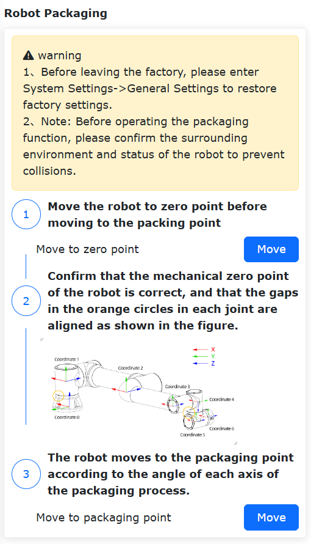

.. centered:: Figura 14.1‑1 Embalaje con un solo clic del robot

Copia de seguridad de datos
---------------------------

1. En la barra de menú "Aplicaciones auxiliares"->"Aplicación de herramientas", hacer clic en "Copia de seguridad de datos" para entrar en la interfaz de copia de seguridad de datos, como se muestra en la figura siguiente

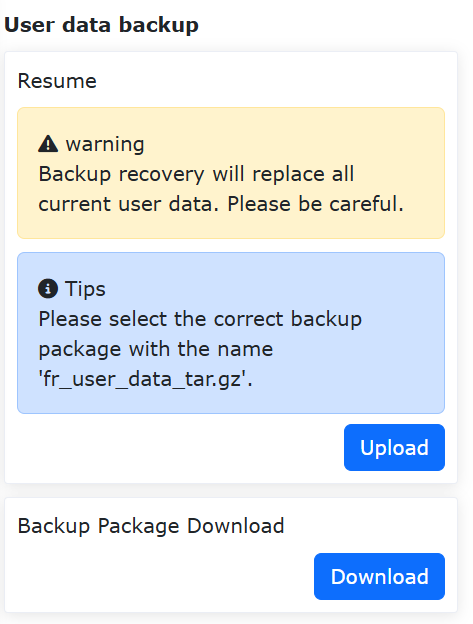

.. centered:: Figura 14.2‑1 Interfaz de copia de seguridad de datos

2. El paquete de copia de seguridad contiene los datos del sistema de coordenadas de herramienta, el archivo de configuración del sistema, los datos de puntos de enseñanza, los programas de usuario, los programas de plantilla y los archivos de configuración de usuario; cuando el usuario necesite trasladar los datos relacionados de este robot a otro robot para su uso, puede realizarlo rápidamente mediante esta función.

Función de verificación de integridad del paquete de copia de seguridad
~~~~~~~~~~~~~~~~~~~~~~~~~~~~~~~~~~~~~~~~~~~~~~~~~~~~~~~~~~~~~~~~~~~~~~~

Para evitar los riesgos de seguridad que puedan existir al importar el paquete de copia de seguridad debido a inconsistencias de configuración como el modo de instalación, se añade la función de verificación MD5 del paquete de copia de seguridad y la verificación de parámetros clave al importar el paquete de copia de seguridad.

Función de verificación MD5 del paquete de copia de seguridad
+++++++++++++++++++++++++++++++++++++++++++++++++++++++++++++

Para garantizar la integridad del paquete de copia de seguridad importado, tras la carga se realizará la verificación MD5 del paquete de copia de seguridad; si el paquete de copia de seguridad está dañado o ha sido modificado de forma anómala, la verificación MD5 fallará y se mostrará el siguiente aviso:

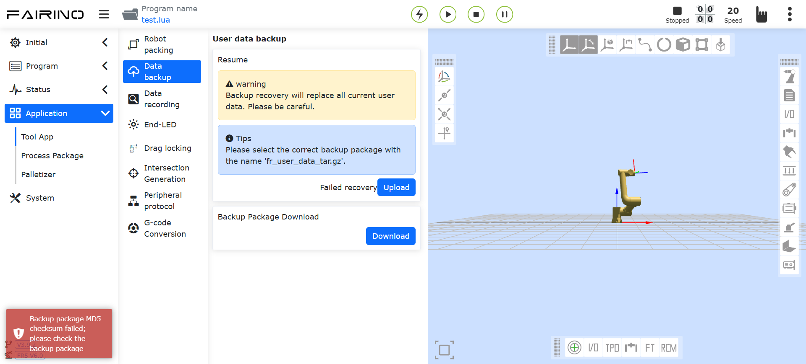

.. centered:: Figura 14.2‑2 Fallo de la verificación MD5

Función de verificación de parámetros clave del paquete de copia de seguridad
++++++++++++++++++++++++++++++++++++++++++++++++++++++++++++++++++++++++++++++

Al importar el paquete de copia de seguridad se añade la función de verificación; el paquete de copia de seguridad debe compararse con el robot al que se importa en cuanto a los parámetros clave, cuyos detalles se muestran en la tabla siguiente. Si estos parámetros no se configuran con precisión, existirán ciertos riesgos de seguridad; solo cuando sean completamente consistentes, el paquete de copia de seguridad podrá importarse correctamente.

Tabla de los 5 parámetros clave comparados:

.. list-table::
   :widths: 15 40 100
   :header-rows: 0
   :class: sheet-center

   * - **Número**
     - **Parámetro clave**
     - **Definición concreta**

   * - 1
     - ROBOT_TYPE
     - Modelo de robot

   * - 2
     - INSTALL_POS
     - Modo de instalación

   * - 3
     - INSTALL_YANGLE
     - Ángulo de inclinación de la base

   * - 4
     - INSTALL_ZANGLE
     - Ángulo de rotación de la base

   * - 5
     - NEW_TEACH_ENABLE
     - Configuración dinámica

Si no son consistentes, se mostrará un error; en este caso, es necesario comprobar si los parámetros clave del robot al que se importa son consistentes con el paquete de copia de seguridad.

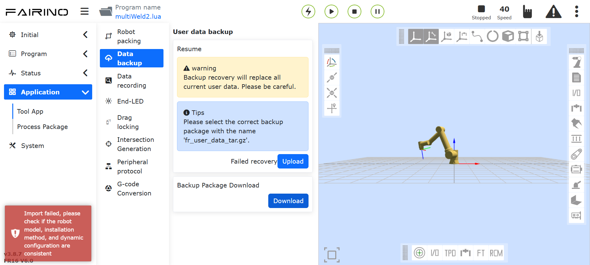

.. centered:: Figura 14.2‑3 Cuando los parámetros clave no son consistentes, la interfaz muestra un error

Función de reversión ante fallo/corte de energía anómalo
++++++++++++++++++++++++++++++++++++++++++++++++++++++++++++++++++++++++

En caso de anomalía durante la importación del paquete de copia de seguridad, o de corte de energía anómalo durante la restauración de datos, lo que provoque que la restauración de datos no se complete correctamente, para garantizar el funcionamiento normal del equipo, tras el reinicio de la alimentación el sistema restaurará automáticamente el estado anterior a la operación;

tras el reinicio de la alimentación, la interfaz mostrará: "La restauración de datos anterior no se completó y se ha restaurado automáticamente; reinicie la caja de control y vuelva a operar".

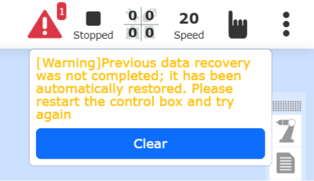

.. centered:: Figura 14.2‑4 Aviso de alarma de restauración tras reinicio por corte de energía

Compatibilidad de versiones del paquete de copia de seguridad
~~~~~~~~~~~~~~~~~~~~~~~~~~~~~~~~~~~~~~~~~~~~~~~~~~~~~~~~~~~~~

La importación actual del paquete de copia de seguridad para restaurar datos ya admite paquetes de copia de seguridad generados con versión de software ≥ v3.8.3; los paquetes de copia de seguridad de los controladores de las series QX y LA son compatibles.

Registro de datos de 10s
------------------------

En la barra de menú "Aplicaciones auxiliares"->"Aplicación de herramientas", hacer clic en "Registro de datos de 10s" para entrar en la interfaz de la función de registro de datos de 10s.

En primer lugar, seleccionar el tipo de registro, que se divide en registro de parámetros por defecto y registro de parámetros autoseleccionados; el registro de parámetros por defecto son los datos configurados automáticamente por el sistema para el registro, y en el registro de parámetros autoseleccionados el usuario puede seleccionar por sí mismo los datos de parámetros que desea registrar, con un número máximo de 15 parámetros. Tras seleccionar la lista de parámetros, seleccionar los parámetros a registrar y hacer clic en el botón "Mover a la derecha" para configurar los parámetros en la lista de parámetros. Hacer clic en "Iniciar registro" para que el robot comience a registrar datos, hacer clic en "Detener registro" para que el robot detenga el registro de datos, y hacer clic en "Descargar datos" para descargar los datos de los últimos 10s.

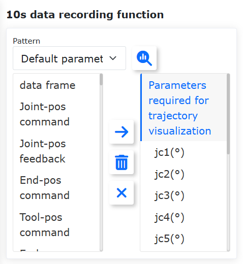

.. centered:: Figura 14.3‑1 Registro de datos de 10s

LED del extremo
---------------

En la barra de menú "Aplicaciones auxiliares"->"Aplicación de herramientas", hacer clic en "LED del extremo" para entrar en la interfaz de la función de configuración del color del LED del extremo.

El color del LED configurable puede ser verde, azul y cian claro; el usuario puede configurar el color del LED de los modos automático, manual y de arrastre según sus necesidades, y no se puede configurar el mismo color en modos diferentes.

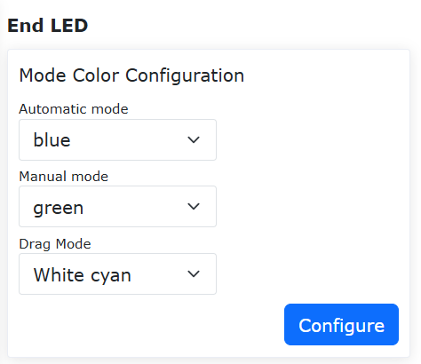

.. centered:: Figura 14.4‑1 Configuración del LED del extremo

Bloqueo de arrastre
-------------------

En la barra de menú "Aplicaciones auxiliares"->"Aplicación de herramientas", hacer clic en "Bloqueo de arrastre" para entrar en la interfaz de la función de configuración del bloqueo de la enseñanza por arrastre.

Para la enseñanza por arrastre se ha añadido la función de bloqueo de grados de libertad; cuando el interruptor de la función de enseñanza por arrastre se establece en estado habilitado, los parámetros de cada grado de libertad surten efecto cuando el usuario arrastra el robot. Por ejemplo, cuando los parámetros se configuran como X:10, Y:0, Z:10, RX:10, RY:10, RZ:10, al arrastrar el robot en modo de arrastre se puede limitar el robot a moverse solo en la dirección Y; si se necesita mantener la actitud del robot sin cambios durante el arrastre y mover solo en las direcciones X, Y, Z, se pueden configurar X, Y, Z como 0 y RX, RY, RZ como 10.

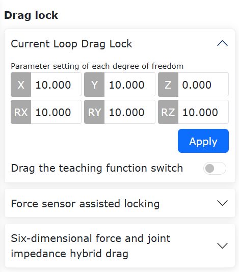

.. centered:: Figura 14.5‑1 Configuración del bloqueo de la enseñanza por arrastre

Función de bloqueo de arrastre FR3-WML/FR3-WMS/FR20/FR30
~~~~~~~~~~~~~~~~~~~~~~~~~~~~~~~~~~~~~~~~~~~~~~~~~~~~~~~~~~~~~~~~~~~~~~~~~~~~~~~~~~~~~~~~~~~~~~~~~~~~~~~~~~~~~~~~~~~~~~~~~~~~~~~~~~~~~~~~~~~~~~~~~~~~~

Descripción general
+++++++++++++++++++++++++++++++++++++++++++++++++++++

Esta función, orientada a las características dinámicas de los nuevos modelos, ajusta los parámetros de la función de bloqueo de arrastre del bucle de corriente, de modo que durante el arrastre el efector final se mantenga siempre estable e inmóvil en un determinado grado de libertad, sin moverse con la fuerza externa aplicada. La función de bloqueo de arrastre del bucle de corriente se extiende a los modelos FR3WMS/FR3-WML/FR20/FR30.

Se limita la pose del extremo en el modo de arrastre; cuando la dirección de arrastre de la fuerza externa no está en el grado de libertad limitado, el extremo del robot puede arrastrarse con normalidad; de lo contrario, se limita su movimiento.

Bloqueo de arrastre
+++++++++++++++++++++++++++++++++++++++++++++++++++++

Antes de configurar la función de bloqueo de arrastre, es necesario comprobar la configuración del modo de instalación, la carga y el sistema de coordenadas del robot, para garantizar que en el modo de arrastre normal el brazo mecánico no presente desplazamientos evidentes como elevación o caída sin fuerza externa.

En la barra de menú "Aplicaciones auxiliares"->"Aplicación de herramientas", hacer clic en "Bloqueo de arrastre" para entrar en la interfaz de la función de configuración del bloqueo de la enseñanza por arrastre. En la barra de menú "Bloqueo de arrastre del bucle de corriente", cuando el interruptor de la función de enseñanza por arrastre se establece en estado habilitado y se hace clic en aplicar, los parámetros de cada grado de libertad surten efecto cuando el usuario arrastra el robot, bloqueando el grado de libertad correspondiente.

A continuación se describen los elementos de configuración de la barra de menú "Bloqueo de arrastre del bucle de corriente":

(1) Configuración de los parámetros de cada grado de libertad: cuando los parámetros se configuran como X:10, Y:0, Z:10, RX:10, RY:10, RZ:10, al arrastrar el robot en modo de arrastre se puede limitar el robot a moverse solo en la dirección Y. Si se necesita mantener la actitud del robot sin cambios durante el arrastre y mover solo en las direcciones X, Y, Z, se pueden configurar X, Y, Z como 0 y RX, RY, RZ como 10; a medida que disminuye el parámetro, la fuerza de limitación sobre ese grado de libertad es menor, donde el valor máximo es 10, con la fuerza de limitación máxima; el mínimo es 0, sin fuerza de limitación.

(2) Interruptor de enseñanza por arrastre: activar la función de bloqueo de arrastre en el modo de arrastre.

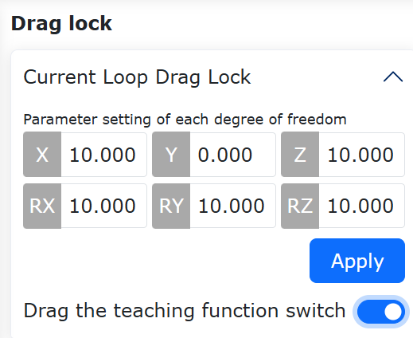

.. centered:: Figura 14.5‑1-2 Configuración del bloqueo de la enseñanza por arrastre

La configuración de parámetros debe cumplir las siguientes limitaciones:

(1) La configuración de parámetros está limitada al rango de 0~10; en algunos modelos (como FR20 y FR30), la configuración de parámetros está limitada al rango de 0~5. Por lo tanto, si se introduce un valor fuera del rango 0~10 en la configuración de parámetros, se convertirá al 0 o 10 más cercano; por ejemplo, si se configura 15, se convertirá en 10.   

Activación normal de la protección contra colisiones durante el arrastre asistido por sensor de fuerza
~~~~~~~~~~~~~~~~~~~~~~~~~~~~~~~~~~~~~~~~~~~~~~~~~~~~~~~~~~~~~~~~~~~~~~~~~~~~~~~~~~~~~~~~~~~~~~~~~~~~~~~~~~~~~~~~~~~~~~~~~~~~~~~~~~~~~~~~~~~~~~~~~~~~~~

Descripción general
++++++++++++++++++++++

Actualmente, los robots FR no pueden activar la protección contra colisiones cuando se utiliza el arrastre asistido por sensor de fuerza; se añade la posibilidad de activar la protección contra colisiones con el arrastre asistido por sensor de fuerza, aumentando la seguridad del robot y reduciendo el riesgo operativo.

Protección contra colisiones
++++++++++++++++++++++++++++++++++++++++++++

**Step1**: Hacer clic en "Aplicaciones auxiliares"->"Aplicación de herramientas"->"Bloqueo de arrastre" para entrar en la interfaz de configuración del bloqueo asistido por sensor de fuerza, y establecer "Interruptor de estado" y "Detección de colisión" como activados, como se muestra en la figura siguiente.

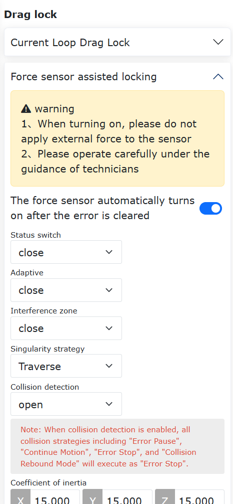

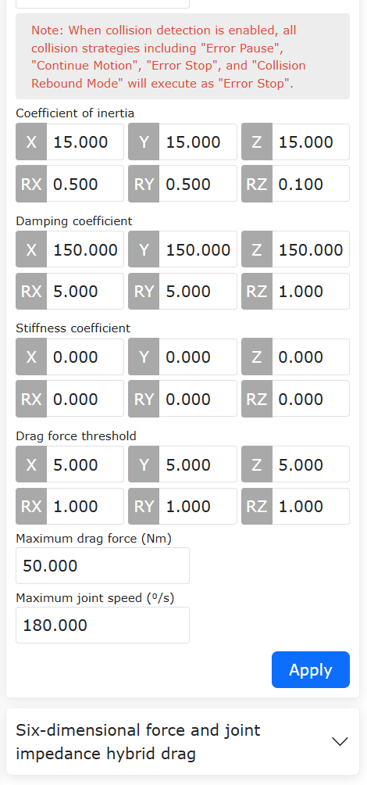

.. centered:: Figura 14.5‑2 Configuración del bloqueo asistido por sensor de fuerza

**Step2**: Arrastrar el robot; durante el movimiento del robot, aplicar una fuerza externa en la articulación para activar la protección contra colisiones; la interfaz web mostrará el error "Fallo de colisión del arrastre asistido por sensor de fuerza", y se podrá restaurar/cerrar rápidamente el arrastre asistido por sensor de fuerza mediante la interfaz web, como se muestra en la figura. Hacer clic en "Restaurar" para borrar el error y restaurar la activación del arrastre asistido por sensor de fuerza; hacer clic en "Cerrar" para borrar el error y mantener cerrado el arrastre asistido por sensor de fuerza.

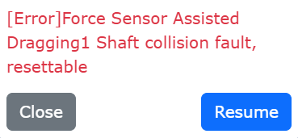

.. centered:: Figura 14.5‑3 Activación de colisión durante el arrastre asistido por sensor de fuerza

.. note:: 
   Con el arrastre asistido por sensor de fuerza, el robot en sí se encuentra en estado de parada; al arrastrar existe una diferencia entre la instrucción de par articular y la realimentación; se recomienda configurar el nivel de colisión en 7 o superior; si el nivel de colisión se configura demasiado bajo, se producirán falsos avisos de error de colisión durante el arrastre.

Calibración de parámetros del sensor de par articular en la máquina completa
++++++++++++++++++++++++++++++++++++++++++++++++++++++++++++++++++++++++++++++++++++++

Descripción general
************************

La sensibilidad del sensor de par articular se refiere a la capacidad de respuesta del sensor a los cambios de par y describe la relación proporcional entre la tensión de salida del sensor y el par articular real medido; la linealidad mide el grado de ajuste del modelo de regresión a los datos observados; el error de histéresis es la diferencia máxima entre las mediciones cuando los datos originales del sensor de par articular se miden en carrera directa (de menor a mayor) y en carrera inversa (de mayor a menor) bajo las mismas condiciones de prueba; la repetibilidad es la relación entre el resultado de la prueba actual y el resultado de la prueba anterior, utilizada para determinar la precisión de repetición del sensor de par articular.
El método de calibración de parámetros consiste en hacer que el robot ejecute una trayectoria predefinida y, mediante la obtención del par gravitatorio articular en diferentes actitudes y los datos originales del sensor de par articular, calcular la sensibilidad, la linealidad, el error de histéresis y la precisión de repetición del sensor de par articular.

Calibración de parámetros
********************************

**Step1**: Configurar el sistema de coordenadas de herramienta como "Tool0", hacer clic en "Aplicaciones auxiliares"->"Aplicación de herramientas"->"Bloqueo de arrastre", y en el módulo de arrastre de la máquina completa del sensor de par articular hacer clic en habilitar función.

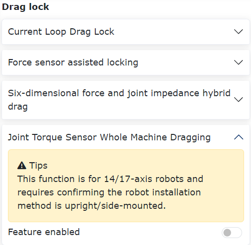

.. centered:: Figura 14.5‑4 Habilitación de la función

**Step2**: Tras hacer clic en "Habilitar función", realizar la calibración de sensibilidad; hacer clic en "Generar programa" para enviar el script Lua interno del controlador, cambiar el robot al modo automático y establecer la velocidad de funcionamiento en "10", hacer clic en "Ejecutar" y esperar el movimiento del robot.

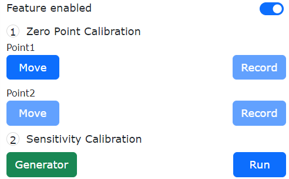

.. centered:: Figura 14.5‑5 Calibración de sensibilidad

.. note:: Si la sensibilidad del sensor de par articular ya se ha calibrado, se puede pasar directamente a la configuración de los parámetros de la función de arrastre.

**Step3**: Una vez que el robot haya completado la ejecución de la trayectoria predefinida, los resultados de calibración de sensibilidad, linealidad, error de histéresis y repetibilidad se mostrarán automáticamente en la interfaz web; hacer clic en "Configurar" para aplicarlos.

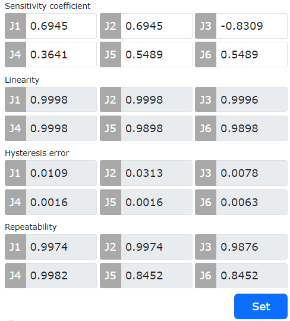

.. centered:: Figura 14.5‑6 Resultados de la calibración de parámetros

Estimación de fuerza externa y compensación de par basadas en el observador de momento
+++++++++++++++++++++++++++++++++++++++++++++++++++++++++++++++++++++++++++++++++++++++++++++++

Descripción general
*****************************************

Tras activar la función de compensación de par, el robot reduce el par de arrastre al realizar el arrastre en el bucle de corriente, mejorando la experiencia de arrastre.

Flujo de operación
*****************************************

**Step1**: Configurar la configuración dinámica como "Dinámica 2.0", hacer clic en "Aplicaciones auxiliares"->"Aplicación de herramientas"->"Bloqueo de arrastre", y en el módulo de compensación de par de doble codificador hacer clic en el interruptor de función para habilitarlo.

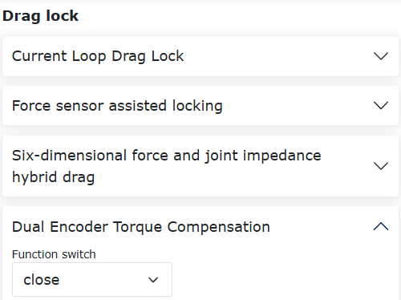

.. centered:: Figura 14.5‑7 Habilitación de la función

**Step2**: Establecer el "Interruptor de función" en "Activado" y configurar la ganancia de arrastre de cada eje en 0.5, hacer clic en "Configurar" para aplicarlo, como se muestra en la figura.

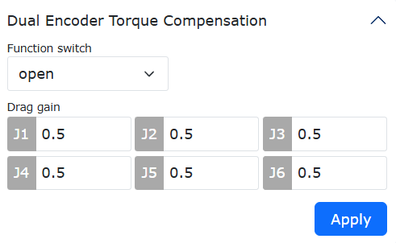

.. centered:: Figura 14.5‑8 Configuración de ganancia

.. note:: Rango de configuración de la ganancia de arrastre: 0-1; cuanto mayor es la ganancia, mayor es el par de compensación y más ligero es el arrastre en el bucle de corriente.

Función de optimización del arrastre asistido basada en el sensor de par articular
+++++++++++++++++++++++++++++++++++++++++++++++++++++++++++++++++++++++++++++++++++++++++++++++

Descripción general
*********************************

Este manual de usuario se utiliza para describir el método de uso de la función de optimización del arrastre asistido basada en el sensor de par articular, que abarca 3 modos de arrastre; en comparación con el método tradicional de enseñanza por arrastre, puede mejorar la suavidad del arrastre y reducir la fuerza de arrastre necesaria en cada articulación.

Función de optimización del arrastre asistido basada en el sensor de par articular
**************************************************************************************

Calibración de cero y calibración de sensibilidad
""""""""""""""""""""""""""""""""""""""""""""""""""""""""""""""""""""""""""""""""""

**Step1**: Si ya se han completado la calibración de cero y la calibración de sensibilidad (el indicador antes de la calibración es verde), no es necesario realizarlas de nuevo; solo cuando el arrastre presente una sensación de flotación se puede volver a realizar la calibración de cero, cuyo proceso se puede consultar más abajo.

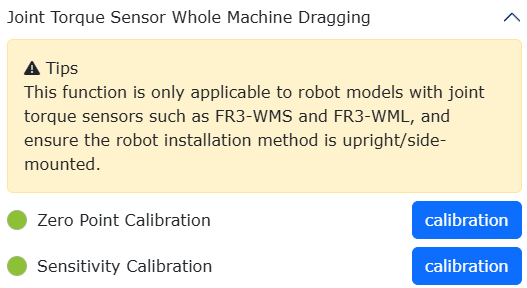

.. centered:: Figura 14.5‑9 Estado del indicador al completar la calibración de cero y sensibilidad del sensor de par articular

**Step2**: Calibración de cero. Hacer clic en "Aplicaciones auxiliares"→"Aplicación de herramientas"→"Bloqueo de arrastre" para entrar en el módulo "Arrastre de la máquina completa del sensor de par articular", hacer clic en el botón "Calibrar" de la calibración de cero para realizar la calibración de los datos de cero del sensor de par articular, como se muestra en la figura siguiente; cuando la calibración se complete aparecerá "√" y se actualizará el resultado de la calibración de cero.

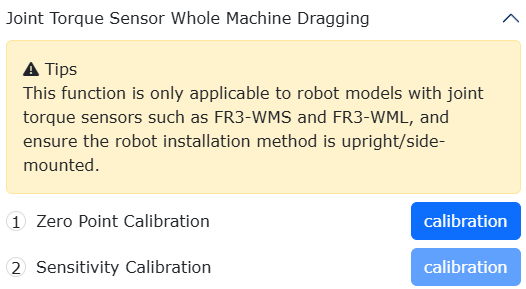

.. centered:: Figura 14.5‑10 Calibración de cero del sensor de par articular

**Step3**: Calibración de sensibilidad (tenga en cuenta que durante la calibración se recomienda utilizar solo el cuerpo del robot, sin ninguna carga). Cambiar el modo de movimiento del robot a "Modo automático" y establecer la velocidad de funcionamiento en "10%", hacer clic en el botón "Calibrar" de la calibración de sensibilidad y esperar a que el robot complete el movimiento. Una vez que el robot haya completado la ejecución de la trayectoria predefinida, los resultados de calibración del coeficiente de sensibilidad, la linealidad, el error de histéresis y la repetibilidad se mostrarán automáticamente en la interfaz web.

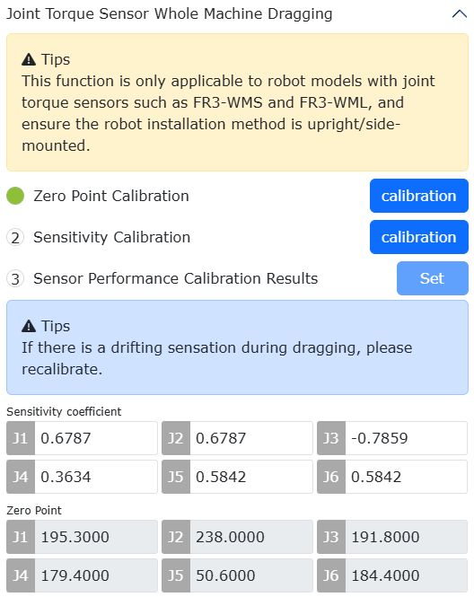

.. centered:: Figura 14.5‑11 Calibración de sensibilidad del sensor de par articular

**Step4**: Configurar la función de arrastre asistido. Hay 3 modos de arrastre en total; se pueden configurar una vez completadas la "Calibración de cero" y la "Calibración de sensibilidad"; si no se configura, el valor predeterminado es el "Modo tres", es decir, tras completar la calibración se puede realizar directamente la enseñanza por arrastre en el modo de arrastre.

Función de arrastre asistido- Modo uno
******************************************************************

**Step1**: Seleccionar el modo de arrastre como "Modo uno". Cuando el modo de movimiento del robot es "Modo manual", configurar el tamaño de la ventana deslizante, el coeficiente de ganancia y la velocidad articular, y hacer clic en "Configurar" para aplicarlo. En este momento, manteniendo pulsado el "Botón de arrastre" del extremo o en el modo de arrastre, se puede realizar la enseñanza por arrastre.

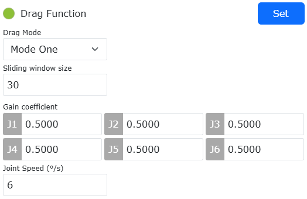

.. centered:: Figura 14.5‑12 Modo uno: configuración de parámetros

.. note:: 
   (1) El valor recomendado para el tamaño de la ventana deslizante es 30, con un valor máximo de 100;
   (2) El coeficiente de ganancia afecta la sensación durante el arrastre; cuanto mayor es el coeficiente, más sensible es el arrastre, pero es propenso a fenómenos de inestabilidad; se recomienda configurar J1-J6 en 0.5;
   (3) Se recomienda configurar la velocidad articular en 6°/s, lo que puede mitigar el fenómeno de sobrepaso en el posicionamiento.

Función de arrastre asistido- Modo dos
******************************************************************

**Step1**: Seleccionar el modo de arrastre como "Modo dos". Cuando el modo de movimiento del robot es "Modo manual", configurar el coeficiente de masa, el coeficiente de amortiguación, el coeficiente de rigidez y el umbral de control de fuerza, y hacer clic en "Configurar" para aplicarlo. En este momento, en el modo de posición se puede realizar la enseñanza por arrastre.

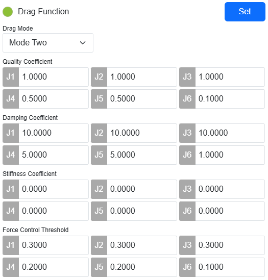

.. centered:: Figura 14.5‑13 Modo dos: configuración de parámetros

.. note:: 
   (1) El coeficiente de masa afecta la fuerza de inercia articular durante el arrastre; se recomienda configurar J1-J3 en 1.0, J4-J5 en 0.5 y J6 en 0.1;
   (2) El coeficiente de amortiguación afecta la sensación durante el arrastre; cuanto mayor es la amortiguación, más pesada es la sensación; se recomienda configurar J1-J3 en 10.0, J4-J5 en 5.0 y J6 en 1.0;
   (3) Los coeficientes de rigidez se configuran todos en 0;
   (4) El umbral de control de fuerza es el par de arranque durante el arrastre; se recomienda configurar J1-J3 en 0.3, J4-J5 en 0.2 y J6 en 0.1.

Función de arrastre asistido- Modo tres
******************************************************************

**Step1**: Seleccionar el modo de arrastre como "Modo tres". Cuando el modo de movimiento del robot es "Modo manual", configurar el coeficiente de ganancia de cada articulación y hacer clic en "Configurar" para aplicarlo. En este momento, manteniendo pulsado el "Botón de arrastre" del extremo o en el modo de arrastre, se puede realizar la enseñanza por arrastre.

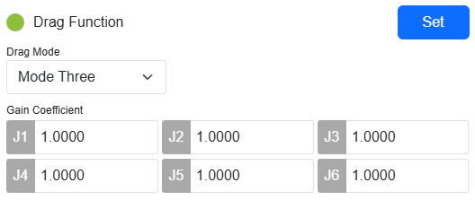

.. centered:: Figura 14.5‑14 Modo tres: configuración de parámetros

.. note:: 
   (1) El coeficiente de ganancia afecta la fuerza de arrastre articular durante el arrastre a baja velocidad; cuando el coeficiente está entre 0.1 y 1.0, a medida que aumenta el coeficiente, la resistencia durante el arrastre a baja velocidad se hace mayor. Cuando se necesite un posicionamiento preciso, se recomienda configurar el coeficiente de ganancia de J1-J6 en 1.0; cuando se considere la ligereza y suavidad del arrastre de la máquina completa, se recomienda configurar el coeficiente de ganancia de J1-J6 en 0.3.

Generación de puntos de intersección (movimiento de captación por láser)
-----------------------------------------------------------------------------------------------------

Durante el proceso de soldadura, el movimiento de captación por láser puede configurar la actitud, de modo que el robot pueda alcanzar la actitud esperada al llegar al punto de posición. Puede afrontar fácilmente escenarios especiales como soldaduras en ángulo y soldaduras de ranura.

Flujo de operación de la función de movimiento de captación por láser
~~~~~~~~~~~~~~~~~~~~~~~~~~~~~~~~~~~~~~~~~~~~~~~~~~~~~~~~~~~~~~~~~~~~~~~~~~~

**Step1**: Antes de utilizar el sensor láser, aplicar primero el sistema de coordenadas de herramienta "Antorcha de soldadura" al sistema de coordenadas de herramienta actual. Abrir la página de enseñanza, hacer clic sucesivamente en "Configuración inicial", "Básico", "Coordenadas de herramienta", seleccionar el nombre del sistema de coordenadas "Antorcha de soldadura" y aplicarlo; en la barra de estado del sistema, el sistema de coordenadas de herramienta se mostrará como Tool1.

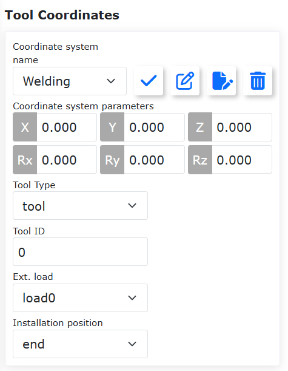

.. centered:: Figura 14.6‑1 Aplicación del sistema de coordenadas de la antorcha de soldadura

**Step2**: Escribir el programa Lua de movimiento de captación por láser. Hacer clic sucesivamente en "Programa de enseñanza"->"Programación de programas"->"Botón Nuevo", y crear el programa de usuario "testPointRecord.lua".

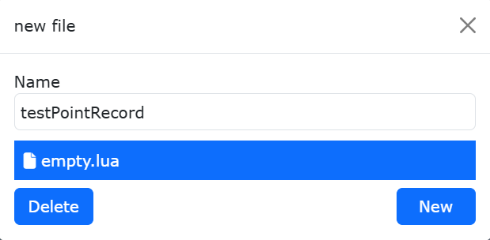

.. centered:: Figura 14.6‑2 Creación de un programa de movimiento de captación por láser

**Step3**: Configurar el punto de enseñanza de actitud de referencia (opcional). En el modo manual, arrastrar el robot hasta la actitud de soldadura deseada. En la página de enseñanza, hacer clic sucesivamente en "Registro de puntos de enseñanza", "Punto de registro con nombre" y guardar el punto de enseñanza de actitud "referencePoint".

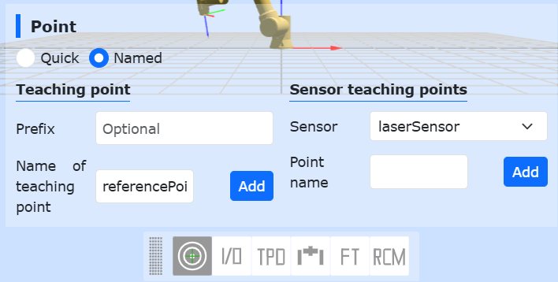

.. centered:: Figura 14.6‑3 Guardado del punto de enseñanza de referencia de actitud

**Step4**: Generar el programa de movimiento de captación por láser. Hacer clic sucesivamente en "Programa de enseñanza"->"Programación de programas"->"Instrucción de soldadura", "Seguimiento láser", desplazar el contenido hacia abajo hasta movimiento de captación del sensor, seleccionar el "Modo de movimiento", la "Velocidad de depuración" y el punto de referencia de actitud necesarios, y se generará el programa LUA de captación por láser correspondiente.

Si no se selecciona el punto de referencia de actitud, por defecto se mantiene la actitud en el momento de la captación para el movimiento; si se selecciona el punto de referencia de actitud, se ejecuta hasta el punto de captación por láser con la actitud de referencia.

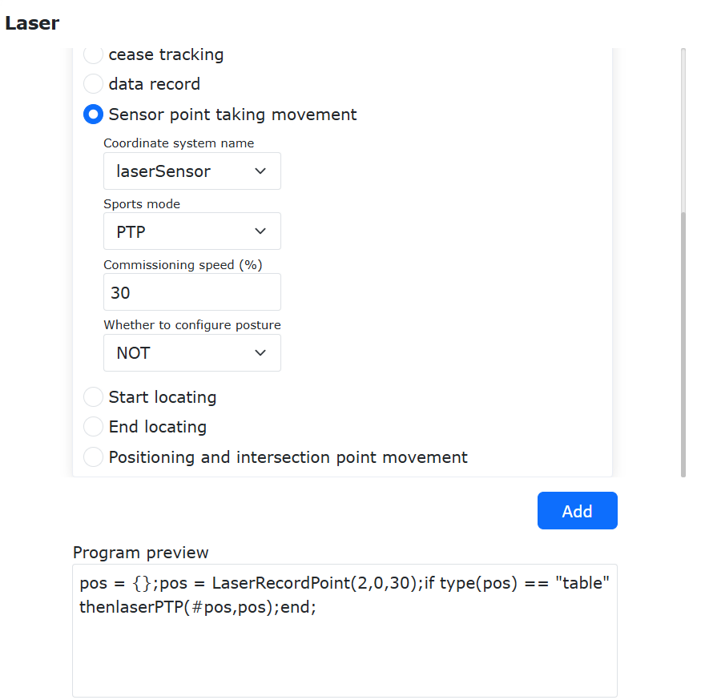

.. centered:: Figura 14.6‑4 Selección del punto de enseñanza de referencia de actitud

Ejecutar el movimiento de captación por láser. Arrastrar el robot para que el rayo del sensor láser apunte al punto de soldadura que se desea enseñar; el sensor láser obtendrá la posición de la soldadura y realizará la captación. Tras ejecutar el movimiento de captación por láser, la antorcha de soldadura se desplazará con la actitud de referencia hasta el punto señalado escaneado por el sensor láser.

.. figure:: application/014.png
   :align: center
   :width: 4in

.. centered:: Figura 14.6‑5 Obtención de la posición de la soldadura por láser

.. figure:: application/015.png
   :align: center
   :width: 4in

.. centered:: Figura 14.6‑6 La antorcha de soldadura apunta a la posición de la soldadura con la actitud de referencia

Búsqueda de posición de tres puntos y cuatro puntos para obtener las coordenadas del punto de intersección
~~~~~~~~~~~~~~~~~~~~~~~~~~~~~~~~~~~~~~~~~~~~~~~~~~~~~~~~~~~~~~~~~~~~~~~~~~~~~~~~~~~~~~~~~~~~~~~~~~~~~~~~~~~~~~~~

Cuando la posición de la soldadura en ángulo no es conveniente para la enseñanza directa, el robot colaborativo puede calcular la intersección de los puntos recogidos en los dos planos mediante la enseñanza manual o la búsqueda de posición de las posiciones de los planos de las placas a ambos lados de la soldadura en ángulo, para generar la posición donde se encuentra la soldadura en ángulo.

Para las soldaduras en ángulo recto, se puede utilizar el método de búsqueda de posición de tres puntos para obtener las coordenadas del punto de intersección; para las soldaduras en ángulo no recto, se utiliza el método de búsqueda de posición de cuatro puntos para obtener las coordenadas del punto de intersección.

Se proporcionan dos formas, mediante instrucción y mediante script Lua, para obtener las coordenadas del punto de intersección y realizar el movimiento de búsqueda de posición; al mismo tiempo se puede configurar la actitud de referencia, y el robot con la antorcha de soldadura puede desplazarse con la actitud del punto de enseñanza de referencia hasta el punto de intersección.

Obtención del punto de intersección mediante instrucción
++++++++++++++++++++++++++++++++++++++++++++++++++++++++++++++++++++++++

Obtención de las coordenadas del punto de intersección con tres puntos
************************************************************************************

**Step1**: Recoger tres puntos de contacto en los planos y guardarlos como puntos de enseñanza, configurar el punto de enseñanza de referencia;

.. centered:: Figura 14.6‑7 Selección de tres puntos de búsqueda de posición

Los puntos de contacto recogidos incluyen tres puntos, de los cuales dos están en el mismo plano y el otro en el plano vertical.

.. note:: Si no se selecciona el punto de referencia de actitud, la actitud del punto de intersección generado por defecto será la misma que la del punto P3; si se selecciona el punto de referencia de actitud, será la misma que la del punto de enseñanza de referencia.

**Step2**: En la página de enseñanza, hacer clic sucesivamente en "Aplicaciones auxiliares", "Aplicación de herramientas", "Generación de puntos de intersección", y encontrar el módulo de la función de obtención de coordenadas del punto de intersección con tres y cuatro puntos.

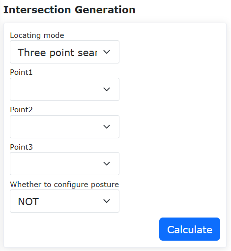

.. centered:: Figura 14.6‑8 Selección de los puntos de búsqueda de posición para obtener las coordenadas del punto de intersección

**Step3**: En el cuadro desplegable, seleccionar búsqueda de posición de tres puntos, seleccionar sucesivamente los tres puntos de contacto recogidos, hacer clic en calcular, comprobar si la visualización del punto de intersección generado en el modelo 3D es correcta, nombrar el punto de intersección y guardarlo;

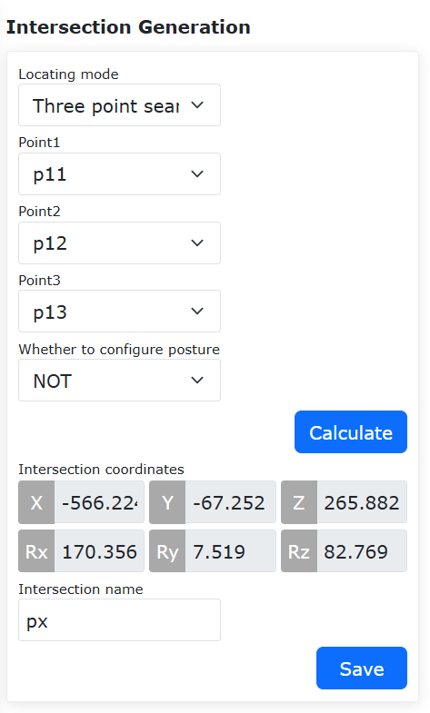

.. centered:: Figura 14.6‑9 Cálculo y guardado de las coordenadas del punto de intersección

**Step4**: Guardar el punto de enseñanza; se puede realizar el movimiento de enseñanza.

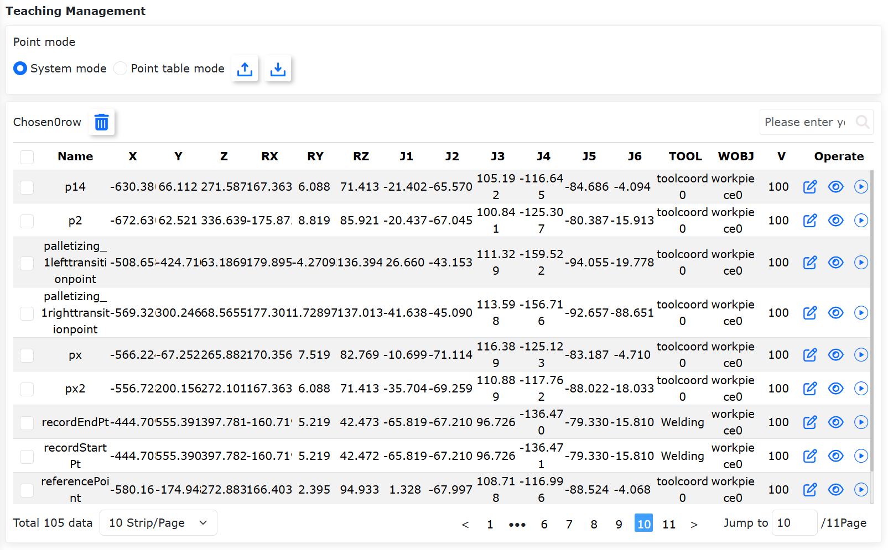

.. centered:: Figura 14.6‑10 Guardado de las coordenadas del punto de intersección como punto de enseñanza

Obtención de las coordenadas del punto de intersección con cuatro puntos
************************************************************************************

**Step1**: Recoger cuatro puntos de contacto en los planos y guardarlos como puntos de enseñanza, configurar el punto de enseñanza de referencia.

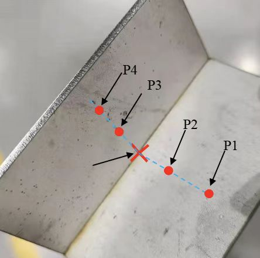

.. centered:: Figura 14.6‑11 Selección de cuatro puntos de búsqueda de posición

Los puntos de contacto recogidos incluyen cuatro puntos, de los cuales los dos primeros están en el mismo plano y los dos últimos en el plano vertical.

.. note:: Si no se selecciona el punto de referencia de actitud, la actitud del punto de intersección generado por defecto será la misma que la del punto P4; si se selecciona el punto de referencia de actitud, será la misma que la del punto de enseñanza de referencia.

**Step2**: En la página de enseñanza, hacer clic sucesivamente en "Configuración inicial", "Periféricos", "Seguimiento", "Sensor", y encontrar el módulo de la función de obtención de coordenadas del punto de intersección con tres y cuatro puntos.

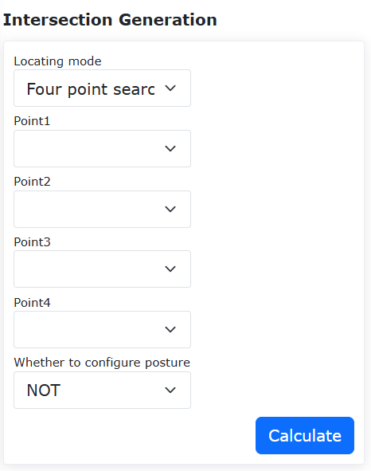

.. centered:: Figura 14.6‑12 Selección de los puntos de búsqueda de posición y del punto de referencia para obtener las coordenadas del punto de intersección

**Step3**: En el cuadro desplegable, seleccionar búsqueda de posición de cuatro puntos, seleccionar sucesivamente los cuatro puntos de contacto recogidos, hacer clic en calcular, comprobar si la visualización del punto de intersección generado en el modelo 3D es correcta, nombrar el punto de intersección y guardarlo;

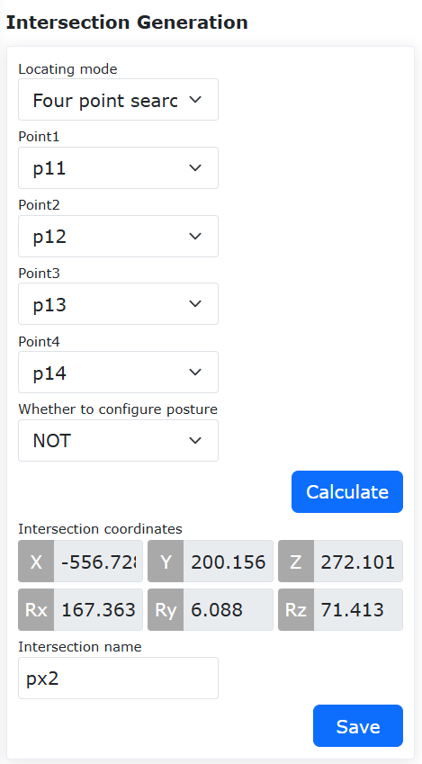

.. centered:: Figura 14.6‑13 Cálculo y guardado de las coordenadas del punto de intersección

**Step4**: Guardar el punto de enseñanza; se puede realizar el movimiento de enseñanza.

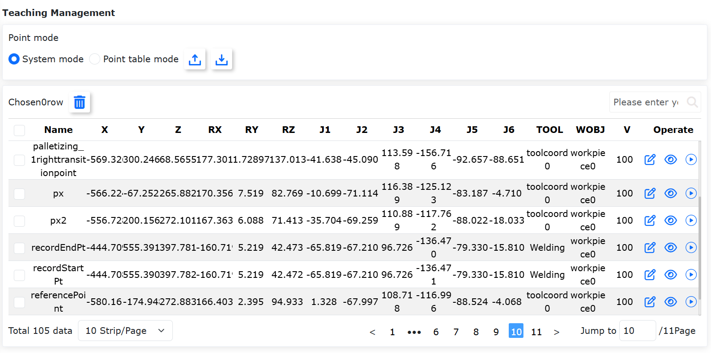

.. centered:: Figura 14.6‑14 Guardado de las coordenadas del punto de intersección como punto de enseñanza

Movimiento de búsqueda de posición para obtener el punto de intersección mediante script Lua
++++++++++++++++++++++++++++++++++++++++++++++++++++++++++++++++++++++++++++++++++++++++++++++++++++

Obtención de las coordenadas del punto de intersección con tres puntos
************************************************************************************

**Step1**: Recoger tres puntos de contacto en los planos y guardarlos como puntos de enseñanza, configurar el punto de enseñanza de referencia.

.. centered:: Figura 14.6‑15 Selección de tres puntos de búsqueda de posición

Los puntos de contacto recogidos incluyen tres puntos, de los cuales dos están en el mismo plano y el otro en el plano vertical.

.. note:: Si no se selecciona el punto de referencia de actitud, la actitud del punto de intersección generado por defecto será la misma que la del punto P3; si se selecciona el punto de referencia de actitud, será la misma que la del punto de enseñanza de referencia.

**Step2**: Escribir el programa Lua de movimiento de búsqueda de posición para obtener el punto de intersección con tres puntos. Hacer clic sucesivamente en "Programa de enseñanza"->"Programación de programas"->"Botón Nuevo", y crear el programa de usuario "test3point.lua".

.. centered:: Figura 14.6‑16 Creación de un programa de movimiento de búsqueda de posición para obtener el punto de intersección con tres puntos

**Step3**: Generar el programa de movimiento de búsqueda de posición para obtener el punto de intersección con tres puntos. Hacer clic sucesivamente en "Programa de enseñanza"->"Programación de programas"->"Instrucción de soldadura"->"Seguimiento láser", desplazar el contenido hacia abajo hasta movimiento de búsqueda de posición para obtener el punto de intersección, seleccionar el modo "Búsqueda de posición de tres puntos", seleccionar sucesivamente en el cuadro desplegable los puntos de contacto recogidos "Punto 1", "Punto 2", "Punto 3" y el punto de referencia de actitud, seleccionar el "Modo de movimiento" y la "Velocidad de depuración" necesarios, y hacer clic en los botones "Añadir" y "Aplicar" para generar el programa de movimiento de búsqueda de posición para obtener el punto de intersección con tres puntos correspondiente.

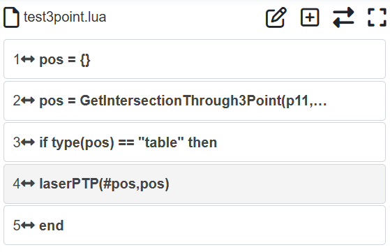

.. centered:: Figura 14.6‑17 Movimiento de búsqueda de posición para obtener el punto de intersección con tres puntos

**Step4**: En el modo automático, hacer clic en el botón de ejecutar para realizar automáticamente el cálculo del punto de intersección con tres puntos; el robot arrastra la antorcha de soldadura con la actitud de referencia hasta la posición del punto de intersección.

Obtención de las coordenadas del punto de intersección con cuatro puntos
************************************************************************************

**Step1**: Recoger cuatro puntos de contacto en los planos y guardarlos como puntos de enseñanza, configurar el punto de enseñanza de referencia.

.. centered:: Figura 14.6‑18 Selección de cuatro puntos de búsqueda de posición

Los puntos de contacto recogidos incluyen cuatro puntos, de los cuales dos están en el mismo plano y los dos últimos en otro plano.

.. note:: Si no se selecciona el punto de referencia de actitud, la actitud del punto de intersección generado por defecto será la misma que la del punto P4; si se selecciona el punto de referencia de actitud, será la misma que la del punto de enseñanza de referencia.

**Step2**: Escribir el programa Lua de movimiento de búsqueda de posición para obtener el punto de intersección con cuatro puntos. Hacer clic sucesivamente en "Programa de enseñanza"->"Programación de programas"->"Botón Nuevo", y crear el programa de usuario "test4point.lua".

.. centered:: Figura 14.6‑19 Creación de un programa de movimiento de búsqueda de posición para obtener el punto de intersección con cuatro puntos

**Step3**: Generar el programa de movimiento de búsqueda de posición para obtener el punto de intersección con cuatro puntos. Hacer clic sucesivamente en "Programa de enseñanza"->"Programación de programas"->"Instrucción de soldadura"->"Seguimiento láser"->desplazar el contenido hacia abajo hasta movimiento de búsqueda de posición para obtener el punto de intersección, seleccionar el modo "Búsqueda de posición de cuatro puntos", seleccionar sucesivamente en el cuadro desplegable los puntos de contacto recogidos "Punto 1", "Punto 2", "Punto 3", "Punto 4" y el punto de referencia de actitud, seleccionar el "Modo de movimiento" y la "Velocidad de depuración" necesarios, y hacer clic en los botones "Añadir" y "Aplicar" para generar el programa de movimiento de búsqueda de posición para obtener el punto de intersección con cuatro puntos correspondiente.

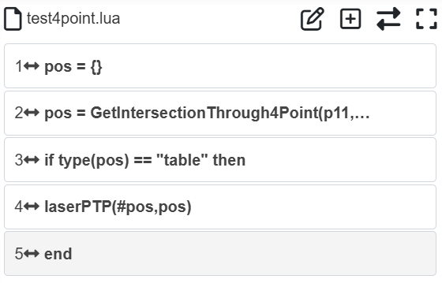

.. centered:: Figura 14.6‑20 Movimiento de búsqueda de posición para obtener el punto de intersección con cuatro puntos 

Protocolo de periféricos
---------------------------------

En la barra de menú "Aplicaciones auxiliares"->"Aplicación de herramientas", hacer clic en "Protocolo de periféricos" para entrar en la interfaz de la función de configuración del protocolo de periféricos.

Esta página es la página de configuración del protocolo de periféricos; el usuario puede configurar el protocolo según los periféricos que utilice actualmente.

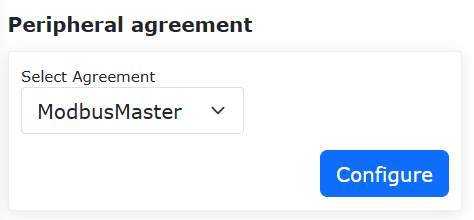

.. centered:: Figura 14.7‑1 Configuración del protocolo de periféricos

En la enseñanza de programas se añade la interfaz Lua de lectura y escritura de registros basada en la comunicación Modbus-rtu; los registros de entrada tienen la dirección 0x1000 y un número de 50 registros, con un total de 100 bytes de contenido de datos; los registros de retención tienen la dirección 0x2000 y un número de 50 registros, con un total de 100 bytes de contenido de datos.

::

   ModbusRegRead（fun_code，reg_add，reg_num）：leer registros；

   fun_code： código de función, 0x03-registro de retención, 0x04-registro de entrada

   reg_add： dirección del registro

   reg_num： número de registros

::

   ModbusRegWrite（fun_code，reg_add，reg_num，reg_value）：escribir registros；

   fun_code código de función, 0x06-registro individual, 0x10-varios registros

   reg_add： dirección del registro

   reg_num： número de registros

   reg_value： matriz de bytes

::

   ModbusRegGetData（reg_num）：obtener datos de los registros；

   reg_num： número de registros

   Descripción del valor de retorno:

   reg_value: variable de matriz

Captura de pantalla del ejemplo de programa:

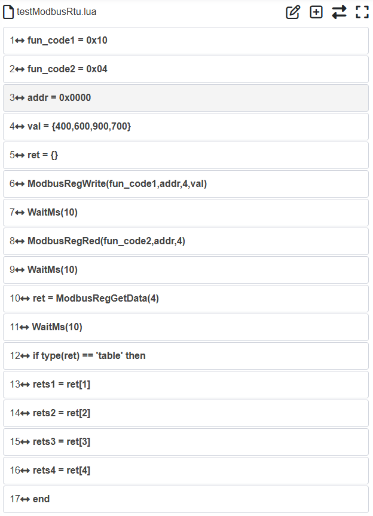

.. centered:: Figura 14.7‑2 Ejemplo de programa Lua de comunicación Modbus-rtu 

Función de conversión de código G a planificación de trayectoria del robot
-----------------------------------------------------------------------------------

Descripción general de la función
~~~~~~~~~~~~~~~~~~~~~~~~~~~~~~~~~~~~~~~~~

La función de conversión de código G generado por software CAD a planificación de trayectoria del robot consiste en utilizar software CAD para convertir rutas de líneas rectas, arcos, círculos completos y splines en archivos de código G con extensión ".gcode", donde el código G de las rutas de spline está compuesto por varios códigos de línea recta pequeños; el archivo de código G generado se puede importar en el lado Web para convertirlo y generar un archivo LUA.

Descripción de la función de conversión de código G a planificación de trayectoria del robot:

(1) El lado Web solo puede importar archivos de código G con extensión ".gcode"; tras una conversión exitosa se generará un archivo LUA con el mismo nombre que el archivo de código G. Si antes de la conversión ya existe un archivo LUA con el mismo nombre, la conversión fallará.

(2) Actualmente se pueden convertir las instrucciones de movimiento rápido G0, interpolación lineal G1, interpolación de arco en sentido horario G2 e interpolación de arco en sentido antihorario G3 del código G, donde G0 corresponde a la instrucción MoveJ, G1 corresponde a la instrucción MoveL, G2/G3 de arco corresponde a la instrucción MoveC, y G2/G3 de círculo completo corresponde a la instrucción Circle.

(3) Actualmente solo se puede convertir el código G de rutas de arco y círculo en el plano XY.

(4) La S que establece la velocidad del husillo en la instrucción de código G corresponde a la velocidad en la instrucción MoveJ; la unidad de la velocidad del husillo es revoluciones/minuto, que corresponde a milímetros/minuto de la velocidad de movimiento; la velocidad de avance F corresponde a la velocidad en MoveL, MoveC y Circle. La unidad de la velocidad de avance es milímetros/minuto, consistente con la unidad de la velocidad de movimiento. La configuración de velocidad en el código G no puede superar la velocidad máxima de movimiento del robot.

(5) Cuando el robot ejecute el archivo LUA generado por la conversión, es necesario cambiar el porcentaje de velocidad de la esquina superior derecha de la interfaz Web a 100.

Flujo de operación
~~~~~~~~~~~~~~~~~~~~~~~~~~~~~~

El cálculo de la actitud del robot en la ruta de trabajo se muestra en la figura siguiente.

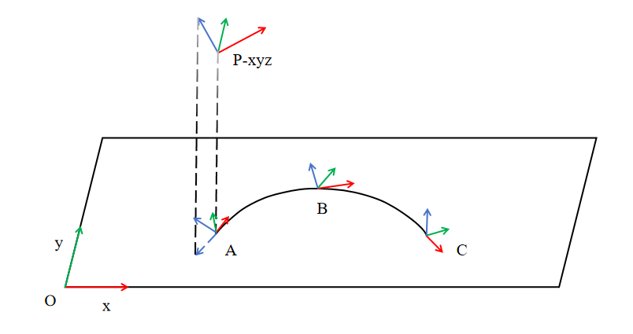

.. centered:: Figura 14.8-1 Esquema del cálculo de la actitud del robot

Donde P-xyz es la actitud del punto de enseñanza de actitud de referencia registrado, y O-xy es el sistema de coordenadas del plano CAD. La actitud del robot en el punto de inicio A es la actitud de referencia; según el ángulo entre el eje Z de la actitud de referencia y el plano del plano CAD, y el ángulo entre la proyección del eje Z en el plano del plano CAD y la tangente en el punto de inicio de la ruta, se calcula la actitud del robot en el punto intermedio B y en el punto final C de la ruta.

El flujo de operación de la función es el siguiente:

**Step 1**: Utilizar software CAD con función CAM para convertir la ruta de mecanizado en un archivo de código G, y utilizar un simulador de código G, como NC Viewer, para verificar si la ruta de la herramienta es correcta.

**Step 2**: Antes de la conversión de código G a planificación de trayectoria del robot, calibrar primero el sistema de coordenadas de herramienta y el sistema de coordenadas de pieza; tenga en cuenta que el sistema de coordenadas de pieza debe coincidir con el sistema de coordenadas de la máquina en el software CAD.

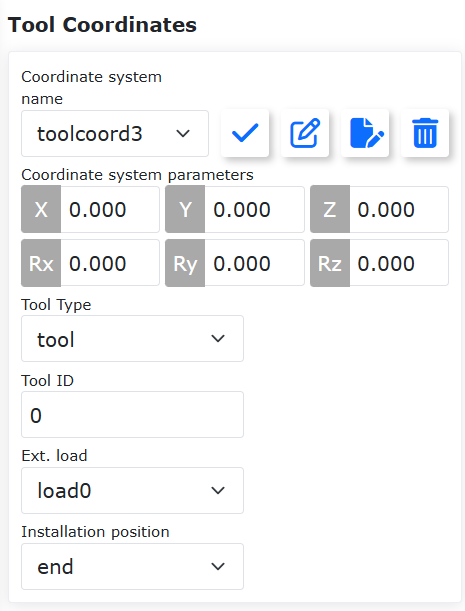

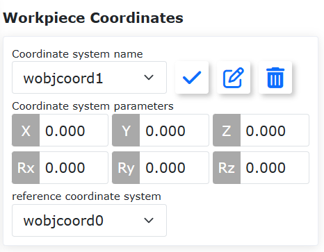

.. centered:: Figura 14.8-2 Interfaz de calibración de los sistemas de coordenadas de herramienta y de pieza

**Step 3**: Registrar un punto de enseñanza de actitud de referencia en el sistema de coordenadas de herramienta y el sistema de coordenadas de pieza calibrados; la actitud del robot en la ruta de trabajo se calculará utilizando la actitud del punto de referencia.

**Step 4**: Hacer clic sucesivamente en "Aplicaciones auxiliares", "Aplicación de herramientas", "Conversión de código G" para entrar en la interfaz de conversión de archivos de código G a archivos LUA de movimiento del robot.

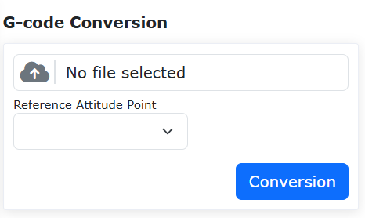

.. centered:: Figura 14.8-3 Interfaz de conversión de código G

**Step 5**: Hacer clic en el botón "Seleccionar archivo", encontrar el archivo de código G que se desea convertir; tenga en cuenta que la extensión del archivo de código G debe ser ".gcode"; para el punto de referencia de actitud, seleccionar el punto de enseñanza de actitud de referencia registrado en el Step2; tras una selección exitosa, debajo se mostrarán el sistema de coordenadas de herramienta y el sistema de coordenadas de pieza del punto de enseñanza seleccionado. Por último, hacer clic en el botón "Convertir"; tras una conversión exitosa se mostrará el aviso de conversión de código G correcta. Además, si ya existe un archivo LUA con el mismo nombre que el archivo de código G, al hacer clic en el botón "Convertir" se mostrará el aviso de que el nombre de archivo ya existe.

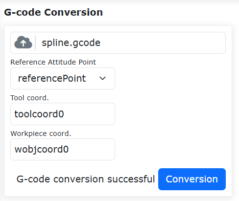

.. centered:: Figura 14.8-4 Interfaz de conversión de código G correcta

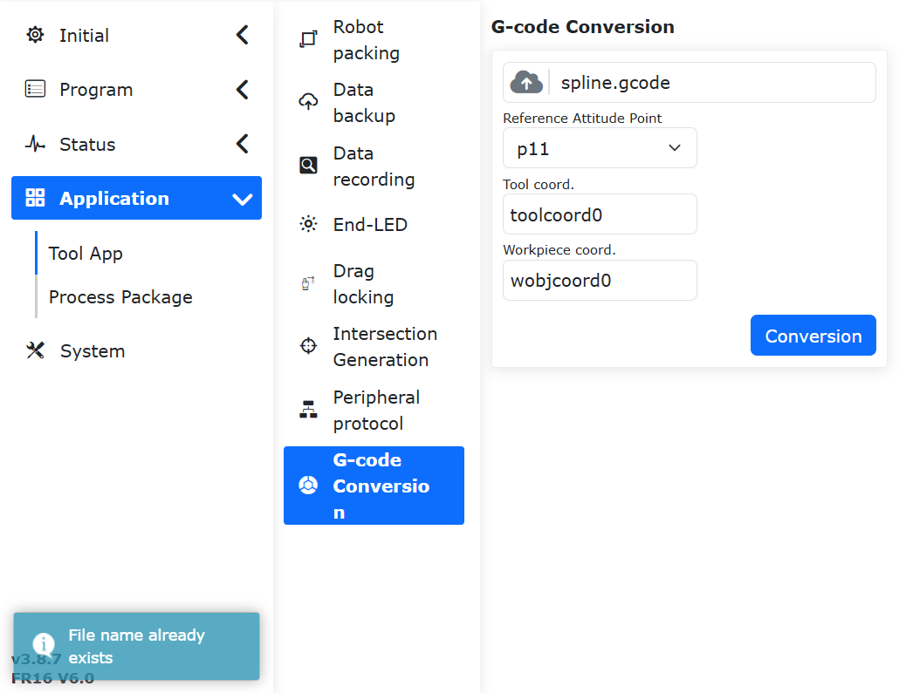

.. centered:: Figura 14.8-5 Interfaz de conversión de código G fallida

**Step 6**: Hacer clic en el botón "Enseñanza y programación"->"Programación de programas", abrir el archivo LUA generado tras la conversión de código G, cambiar el robot al modo automático y hacer clic en el botón de inicio; el robot podrá reproducir la ruta del archivo de código G.

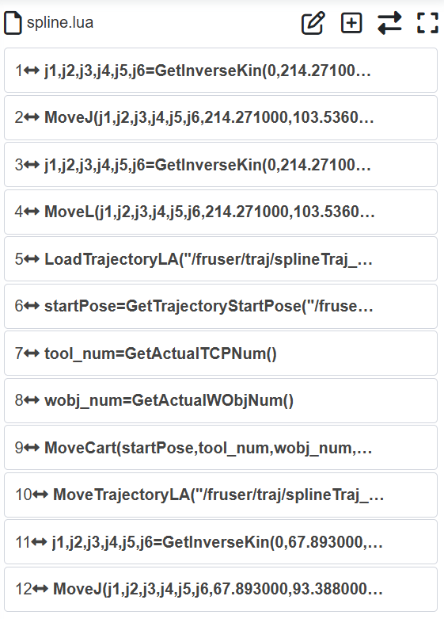

.. centered:: Figura 14.8-6 Apertura del archivo LUA generado tras la conversión