Básico
===============

.. toctree:: 
   :maxdepth: 6

Instalación
--------------

Configuración y visualización del modo de instalación del robot
~~~~~~~~~~~~~~~~~~~~~~~~~~~~~~~~~~~~~~~~~~~~~~~~~~~~~~~~~~~~~~~~~

En la página de enseñanza del lado Web, hacer clic en "Configuración inicial"→"Básico"→"Instalación", cuya disposición de página se muestra a continuación. La descripción concreta es la siguiente:

1. La instalación rápida se utiliza para las configuraciones de instalación habituales del brazo mecánico; de izquierda a derecha corresponden a: montaje normal, montaje lateral y montaje invertido. Al hacer clic en el botón correspondiente, la interfaz enviará y modificará automáticamente el ángulo de inclinación y de rotación de la base.
2. Si el modo de instalación requerido no se ajusta a la instalación rápida, se puede configurar estableciendo por cuenta propia el ángulo de inclinación y de rotación de la base.
3. Tanto si se utiliza la instalación rápida como si se establecen por cuenta propia el ángulo de inclinación y de rotación de la base, es necesario hacer clic en aplicar para que surta efecto.
   
.. note:: Asegúrese de que el modo de instalación configurado coincide con el del brazo mecánico real antes de realizar la operación de arrastre; de lo contrario, existirán riesgos de seguridad.

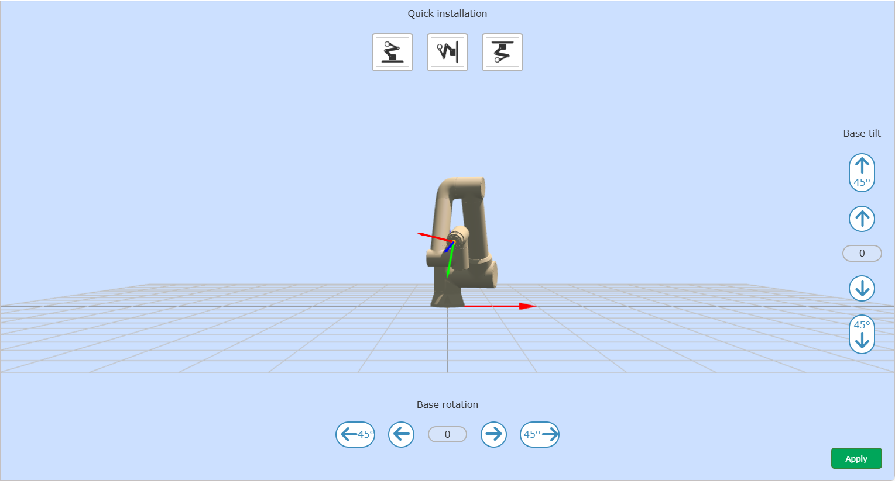
   
.. centered:: Figura 6.1‑1 Instalación libre de 360 grados

.. important:: 
   Una vez completada la instalación del robot, es obligatorio configurar correctamente el modo de instalación del robot; de lo contrario, se verán afectadas la función de arrastre y la función de detección de colisiones del robot.

Sistema de coordenadas
--------------------------------

Coordenadas de herramienta
~~~~~~~~~~~~~~~~~~~~~~~~~~~~~~~~~~~~~~~

En la barra de menú "Configuración inicial"->"Básico", hacer clic en "Coordenadas de herramienta" para entrar en la página de coordenadas de herramienta.

Las coordenadas de herramienta permiten la modificación, el borrado, el cambio de nombre y la aplicación de las coordenadas de herramienta. En la lista desplegable del sistema de coordenadas de herramienta, tras seleccionar el sistema de coordenadas correspondiente se mostrarán debajo los valores de coordenadas correspondientes (el nombre del sistema de coordenadas se puede personalizar), el tipo de herramienta y la posición de instalación (solo se muestra en el caso de herramientas de tipo sensor); tras seleccionar un sistema de coordenadas, hacer clic en el botón "Aplicar", y el sistema de coordenadas de herramienta en uso actualmente pasa a ser el seleccionado, como se muestra a continuación.

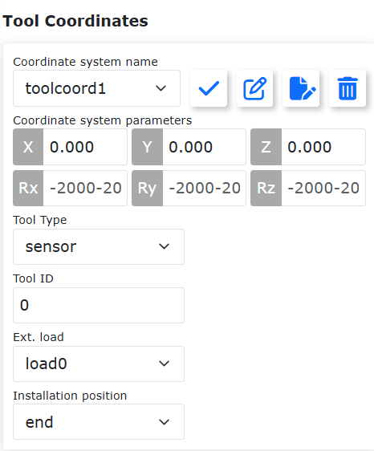
   
.. centered:: Figura 6.2‑1-1 Configuración de las coordenadas de herramienta

Hacer clic en el botón "Cambiar nombre" para cambiar el nombre del sistema de coordenadas; volver a hacer clic o aplicar para completar la modificación, como se muestra en la figura siguiente.

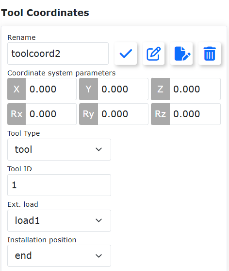

.. centered:: Figura 6.2‑1-2 Cambio de nombre del sistema de coordenadas

Hacer clic en el botón de importación situado después de "Modelo de herramienta"; aparecerá la ventana emergente de importación del modelo de herramienta; seleccionar el archivo de modelo de herramienta requerido (solo se admiten archivos con formato .stl y .dae); tras confirmar la importación, el extremo del robot del modelo 3D mostrará el modelo de herramienta; hacer clic en el botón de interruptor del modelo de herramienta de la barra de operación de la escena 3D para controlar su visualización y ocultación.

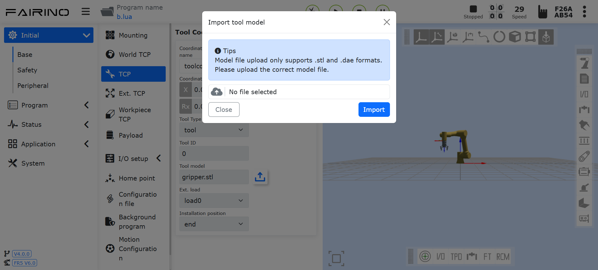

.. centered:: Figura 6.2-1-3 Importación del modelo de herramienta

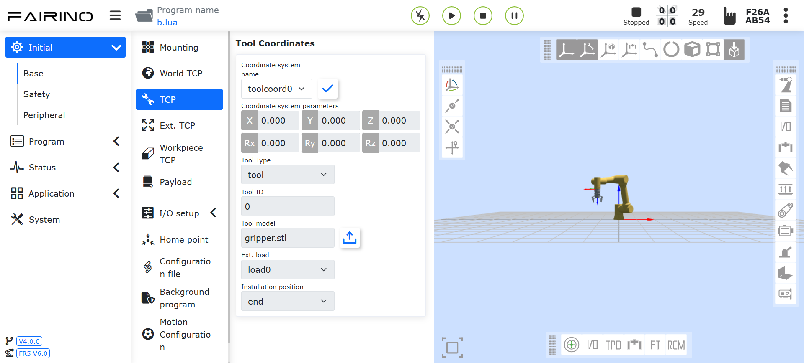

.. centered:: Figura 6.2-1-3 Carga del modelo de herramienta

Hacer clic en "Modificar" para volver a configurar, según las indicaciones, el sistema de coordenadas de herramienta de ese número. El método de calibración de herramienta se divide en el método de cuatro puntos y el método de seis puntos; el método de cuatro puntos solo calibra el TCP de la herramienta, es decir, la posición del punto central de la herramienta, y su actitud por defecto es consistente con la actitud del extremo; el método de seis puntos añade dos puntos sobre la base del método de cuatro puntos para calibrar la actitud de la herramienta. Aquí explicamos tomando como ejemplo el método de seis puntos.

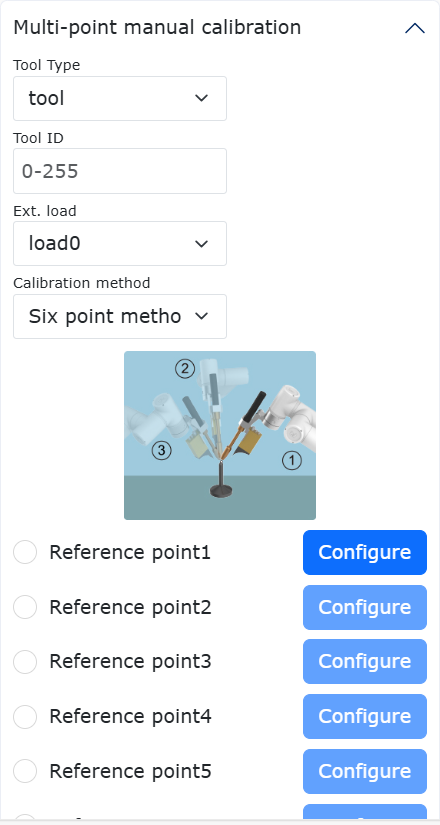

.. centered:: Figura 6.2‑2 Configuración de las coordenadas de herramienta

Seleccionar un punto fijo en el espacio del robot y desplazar la herramienta hasta el punto fijo con tres actitudes diferentes, configurando sucesivamente los puntos 1-3. Como se muestra en la parte superior izquierda de la figura siguiente. Desplazar la herramienta verticalmente hasta el punto fijo para configurar el punto 4, como se muestra en la parte superior derecha de la figura siguiente. Manteniendo esta actitud sin cambios, utilizar la base de coordenadas para desplazarse una cierta distancia en dirección horizontal y configurar el punto 5; esta dirección es la dirección positiva del eje X del sistema de coordenadas de herramienta configurado. Volver al punto fijo, desplazarse una cierta distancia verticalmente hacia arriba y configurar el punto 6; esta dirección es la dirección positiva del eje Z del sistema de coordenadas de herramienta, y la dirección positiva del eje Y del sistema de coordenadas de herramienta se determina mediante la regla de la mano derecha. Hacer clic en el botón calcular para calcular la pose de la herramienta; si es necesario volver a configurar, hacer clic en cancelar y en el botón modificar para repetir los pasos de creación del sistema de coordenadas de herramienta.

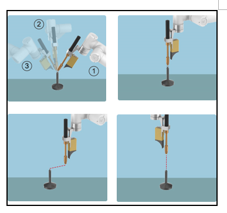

.. centered:: Figura 6.2‑3 Esquema del método de seis puntos

Tras completar el último paso, hacer clic en "Completar" para volver a la interfaz de coordenadas de herramienta; hacer clic en "Guardar" para almacenar el sistema de coordenadas de herramienta recién creado.

.. important:: 
   1. Tras instalar la herramienta en el extremo, es obligatorio realizar la calibración y la aplicación del sistema de coordenadas de herramienta; de lo contrario, la posición y la actitud del punto central de la herramienta no cumplirán los valores esperados cuando el robot ejecute las instrucciones de movimiento.
   2. El sistema de coordenadas de herramienta utiliza generalmente toolcoord1~toolcoord19; aplicar toolcoord0 significa que el centro de posición del TCP de la herramienta está en el centro de la brida del extremo; al calibrar el sistema de coordenadas de herramienta, primero es necesario aplicar el sistema de coordenadas de herramienta a toolcoord0 y, a continuación, seleccionar otro sistema de coordenadas de herramienta para calibrarlo y aplicarlo.

Coordenadas de herramienta externa
~~~~~~~~~~~~~~~~~~~~~~~~~~~~~~~~~~~~~~~

En la barra de menú "Configuración inicial"->"Básico", hacer clic en "Coordenadas de herramienta externa" para entrar en la interfaz del sistema de coordenadas de herramienta externa.

En la interfaz de configuración del sistema de coordenadas de herramienta externa se pueden realizar la modificación, el borrado y la aplicación de las coordenadas de herramienta externa.

En la lista desplegable del sistema de coordenadas de herramienta externa hay un total de 15 números, de etoolcoord0 a etoolcoord14; tras seleccionar el sistema de coordenadas correspondiente se mostrarán debajo los valores de coordenadas correspondientes; tras seleccionar un sistema de coordenadas, hacer clic en el botón "Aplicar", y el sistema de coordenadas de herramienta en uso actualmente pasa a ser el seleccionado, como se muestra en la figura siguiente.

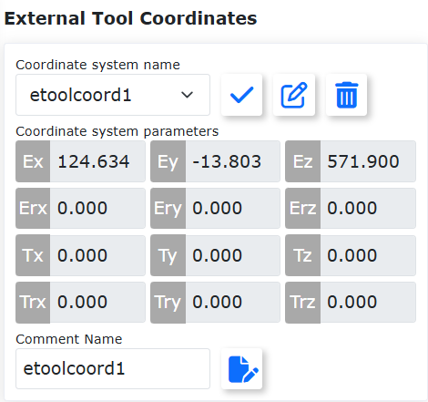

.. centered:: Figura 6.2‑4 Coordenadas de herramienta externa

Hacer clic en "Modificar" para volver a configurar, según las indicaciones, el sistema de coordenadas de herramienta de ese número, como se muestra en la figura siguiente.

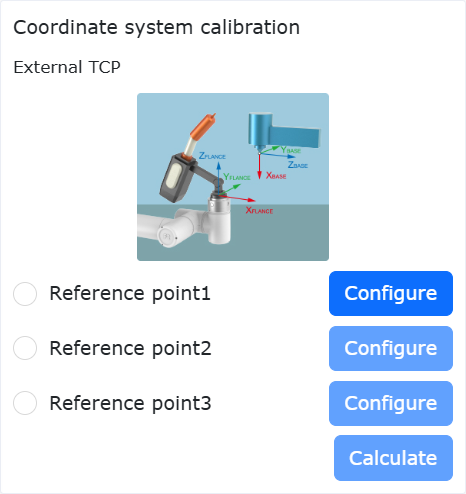

.. centered:: Figura 6.2‑5 Esquema del método de seis puntos

**1. Determinación del TCP externo mediante el método de tres puntos**

- **Configurar el punto 1**: desplazar el TCP de la herramienta ya medida hasta el TCP externo y hacer clic en el botón configurar punto 1;

- **Configurar el punto 2**: desplazarse desde el punto 1 una cierta distancia a lo largo del eje X del sistema de coordenadas TCF externo y hacer clic en el botón configurar punto 2;

- **Configurar el punto 3**: volver al punto 1, desplazarse desde el punto 1 una cierta distancia a lo largo del eje Z del sistema de coordenadas TCF externo y hacer clic en el botón configurar punto 3;

- **Calcular**: hacer clic en el botón calcular para obtener el TCF externo;

**2. Determinación del TCF de la herramienta mediante el método de seis puntos**

- **Configurar los puntos 1-4**: seleccionar un punto fijo en el espacio del robot y desplazar la herramienta hasta el punto seleccionado desde cuatro ángulos diferentes, configurando sucesivamente los puntos 1-4;

- **Configurar el punto 5**: volver al punto fijo y desplazarse una cierta distancia a lo largo del eje X del sistema de coordenadas TCF de la herramienta, haciendo clic en el botón configurar punto 5;

- **Configurar el punto 6**: volver al punto fijo y desplazarse una cierta distancia a lo largo del eje Y del sistema de coordenadas TCF de la herramienta, haciendo clic en el botón configurar punto 6;

- **Calcular**: hacer clic en el botón calcular para obtener el TCF de la herramienta;

Si es necesario volver a configurar, hacer clic en el botón cancelar para repetir los pasos de creación del sistema de coordenadas de herramienta.

Tras completar el último paso, hacer clic en "Completar" para volver a la interfaz de coordenadas de herramienta; hacer clic en "Guardar" para almacenar el sistema de coordenadas de herramienta recién creado.

.. important:: 
   1. Para utilizar una herramienta externa es obligatorio realizar la calibración y la aplicación del sistema de coordenadas de herramienta externa; de lo contrario, la posición y la actitud del punto central de la herramienta no cumplirán los valores esperados cuando el robot ejecute las instrucciones de movimiento.
   2. El sistema de coordenadas de herramienta externa utiliza generalmente etoolcoord1~etoolcoord14; aplicar etoolcoord0 significa que el centro de posición del TCP de la herramienta externa está en el centro de la brida del extremo; al calibrar el sistema de coordenadas de herramienta, primero es necesario aplicar el sistema de coordenadas de herramienta a etoolcoord0 y, a continuación, seleccionar otro sistema de coordenadas de herramienta para calibrarlo.

Coordenadas de pieza
~~~~~~~~~~~~~~~~~~~~~~~~~~

En la barra de menú "Configuración inicial"->"Básico", hacer clic en "Coordenadas de pieza" para entrar en la interfaz de coordenadas de pieza. Las coordenadas de pieza permiten la modificación, el borrado y la aplicación de las coordenadas de pieza. En la lista desplegable del sistema de coordenadas de pieza hay un total de 15 números; tras seleccionar el sistema de coordenadas correspondiente (wobjcoord0~
wobjcoord14) se mostrarán debajo, en "Coordenadas del sistema de coordenadas", los valores de coordenadas correspondientes; tras seleccionar un sistema de coordenadas, hacer clic en el botón "Aplicar", y el sistema de coordenadas de pieza en uso actualmente pasa a ser el seleccionado, como se muestra en la figura siguiente.

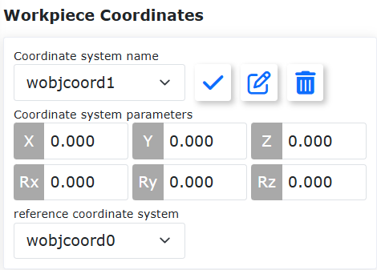

.. centered:: Figura 6.2‑6 Configuración de las coordenadas de pieza

El sistema de coordenadas de pieza se calibra generalmente sobre la base de la herramienta, por lo que es necesario establecer el sistema de coordenadas de pieza sobre la base de un sistema de coordenadas de herramienta ya establecido. Hacer clic en "Modificar" para volver a configurar, según las indicaciones, el sistema de coordenadas de pieza de ese número. Fijar la pieza y seleccionar el método de calibración "Origen-Eje X-Eje Z" u "Origen-Eje X-Plano XY+"; los dos primeros puntos de ambos métodos de calibración se seleccionan de forma idéntica y el tercer punto es diferente: con el primer método se calibra la dirección Z del sistema de coordenadas de pieza, y con el segundo método se calibra un punto del plano XY+; basta con calibrar según la figura. Hacer clic en el botón calcular para calcular la pose de la pieza; si es necesario volver a configurar, hacer clic en cancelar y en el botón modificar para repetir los pasos de creación del sistema de coordenadas de pieza.

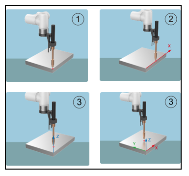

.. centered:: Figura 6.2‑7 Esquema del método de tres puntos

Tras completar el último paso, hacer clic en "Completar" para volver a la interfaz de coordenadas de pieza; hacer clic en "Guardar" para almacenar el sistema de coordenadas de pieza recién creado.

.. important:: 
   1. El sistema de coordenadas de pieza se calibra sobre la base de la herramienta, por lo que es necesario establecer el sistema de coordenadas de pieza sobre la base de un sistema de coordenadas de herramienta ya establecido.
   2. El sistema de coordenadas de pieza utiliza generalmente wobjcoord1~wobjcoord14; aplicar wobjcoord0 significa que el origen del sistema de coordenadas de pieza está en el origen de las coordenadas base; al calibrar el sistema de coordenadas de pieza, primero es necesario aplicar el sistema de coordenadas de pieza a wobjcoord0 y, a continuación, seleccionar otro sistema de coordenadas de pieza para calibrarlo y aplicarlo.

Carga
--------------

Extremo
~~~~~~~~~~~~~

En la barra de menú "Configuración inicial"->"Básico"->"Carga", hacer clic en "Identificación de trayectoria" para entrar en la interfaz de identificación de trayectoria.

Al configurar la carga del extremo, introduzca la masa de la herramienta de extremo utilizada y las coordenadas del centro de masa correspondientes en los cuadros de entrada "Masa de la carga" y "Coordenadas del centro de masa de la carga X, Y y Z" respectivamente, y aplíquelo.

.. important:: 
    La masa de la carga no puede superar el rango máximo de carga del robot. Para el rango de carga correspondiente a cada modelo de robot, consulte 2.1. Parámetros básicos; el rango de configuración de las coordenadas del centro de masa es de 0 a 1000, en unidades de mm.

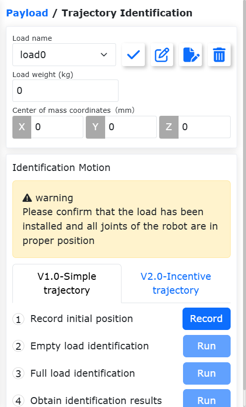

.. centered:: Figura 6.3‑1 Esquema de configuración de la carga

.. important:: 
   Tras instalar la carga en el extremo del robot, es obligatorio configurar correctamente el peso de la carga del extremo y las coordenadas del centro de masa; de lo contrario, se verán afectadas la función de arrastre y la función de detección de colisiones del robot.

Cuando el usuario no esté seguro de la masa o del centro de masa de la herramienta, puede hacer clic en "Identificación automática" para entrar en la función de identificación de carga y medir los datos de la herramienta.

Antes de realizar la medición, asegúrese de que la carga está instalada y seleccione la versión. Hacer clic en el botón "Medición de datos de herramienta" para entrar en la interfaz de prueba de movimiento de la carga.

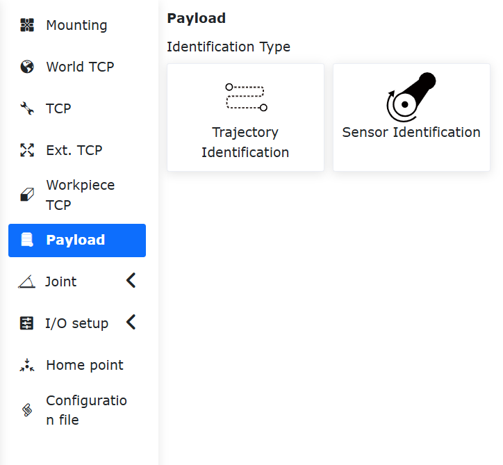

.. centered:: Figura 6.3‑2 Configuración de articulaciones para la identificación de carga

Hacer clic en "Iniciar identificación de carga" para realizar la prueba; en caso de emergencia, detenga el movimiento a tiempo.

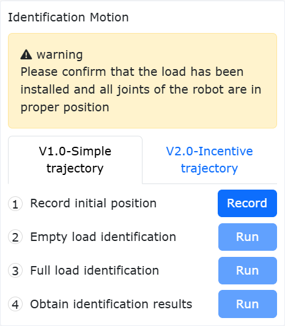

.. centered:: Figura 6.3‑3 Inicio de la identificación de carga

Tras finalizar el movimiento, hacer clic en el botón "Obtener resultado de identificación" para obtener los datos de herramienta calculados, que se mostrarán en la página; si es necesario aplicarlos a los datos de carga, basta con hacer clic en aplicar.

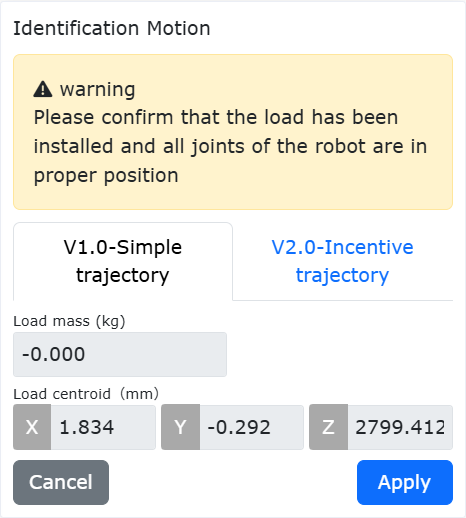

.. centered:: Figura 6.3‑4 Resultado de la identificación de carga

Articulación
--------------

Límite suave
~~~~~~~~~~~~~

En la barra de menú "Configuración inicial"->"Básico"->"Articulación", hacer clic en "Límite suave" para entrar en la interfaz de límite suave.

Dentro del recorrido del robot pueden existir otros equipos; el ángulo de límite puede aplicar un límite suave al robot, de modo que el movimiento del robot no supere un determinado valor de coordenadas, evitando colisiones del robot. La parada del robot al activarse el límite suave se activa automáticamente por el robot, sin distancia de parada.

El administrador puede utilizar los valores por defecto o introducir valores de ángulo. Al introducir valores de ángulo, se pueden limitar respectivamente los ángulos positivo y negativo de las articulaciones del robot; cuando el valor introducido supere los valores de ángulo de límite suave de las articulaciones del robot enumerados en la tabla de parámetros básicos del robot de 2.1-Parámetros básicos, el ángulo de límite se ajustará al valor máximo configurable. Cuando el robot informe de superación del límite de instrucción, será necesario entrar en el modo de arrastre y arrastrar las articulaciones del robot hasta situarlas dentro del ángulo de límite. La interfaz se muestra en la figura siguiente:

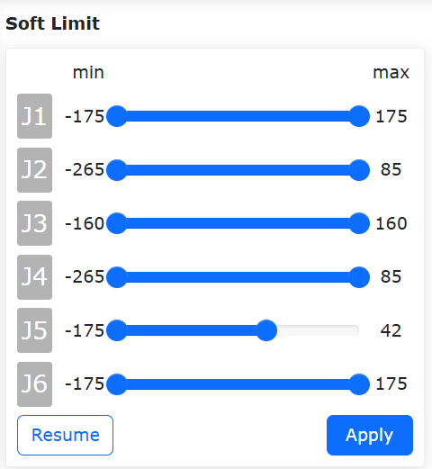

.. centered:: Figura 6.4‑1-1 Esquema del límite del robot

Protección de límite suave de articulación
+++++++++++++++++++++++++++++++++++++++++++++++++++++++++++++++++++++++

Descripción general
************************

La función de protección de límite suave de articulación es un mecanismo de protección activa que, mediante la monitorización en tiempo real del estado de movimiento de las articulaciones del brazo mecánico, limita dinámicamente que el operador supere el rango de límite suave configurado durante la enseñanza por arrastre. Esta función hace que el límite suave tenga también sentido en la enseñanza por arrastre, mejorando así la seguridad de la colaboración humano-máquina.

Protección de límite suave de articulación
************************************************

La función de protección de límite suave de articulación requiere que el paquete de software y la versión del firmware coincidan, para obtener la mejor experiencia.

Configuración del límite suave y activación/desactivación de la función
""""""""""""""""""""""""""""""""""""""""""""""""""""""""""""""""""""""""

**Step1**: Iniciar sesión en la interfaz web y hacer clic sucesivamente en "Configuración inicial"->"Básico"->"Articulación"->"Límite suave" para entrar en el módulo de configuración del límite suave del robot.

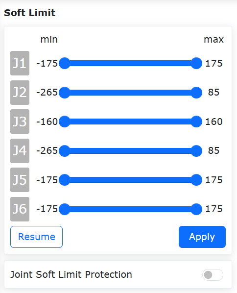

.. centered:: Figura 6.4‑1-2 Módulo de configuración del límite suave del robot

**Step2**: Basándose en el rango de trabajo real del robot, configurar razonablemente el límite suave de cada articulación. En este momento, es necesario comprobar si la posición angular actual de cada articulación del robot está dentro del rango de límite suave preestablecido; si lo está, se puede hacer clic en "Aplicar" para enviar el límite suave preestablecido; si no lo está, será necesario desplazar cada articulación hasta el rango preestablecido; de lo contrario, al hacer clic en "Aplicar" se mostrará el aviso de superación del límite, como se muestra en la figura siguiente. En este momento, se puede hacer jog de un solo eje en la dirección de entrada al rango de límite suave o arrastrar las articulaciones que superan el límite, para borrar el error.

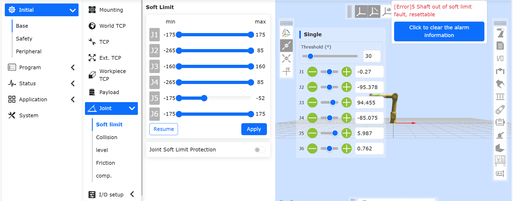

.. centered:: Figura 6.4‑1-3 Error cuando la posición angular real de cada articulación del robot supera el rango de límite suave configurado

**Step3**: Una vez configurado correctamente el rango de límite suave, hacer clic en el deslizador "Protección de límite suave de articulación" para activar esta función, como se muestra concretamente en la figura siguiente. En este momento, en el modo de arrastre, el límite suave configurado ejercerá una función limitante y, además, al arrastrar cerca del límite suave se percibirá resistencia.

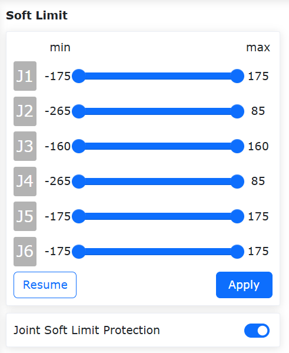

.. centered:: Figura 6.4‑1-4 Activación de la función de protección de límite suave de articulación

**Step4**: Si es necesario desactivar la función de protección de límite suave de articulación, se puede hacer clic en el deslizador "Protección de límite suave de articulación".

Nivel de colisión
~~~~~~~~~~~~~~~~~~~~~~~~~

En la barra de menú "Configuración inicial"->"Básico"->"Articulación", hacer clic en "Nivel de colisión" para entrar en la interfaz de nivel de colisión.

El nivel de colisión se divide en diez niveles; los niveles uno a tres tienen una detección más sensible y el robot debe funcionar a la velocidad recomendada. Asimismo, se puede seleccionar la configuración personalizada en porcentaje; el 100% corresponde al nivel diez. La estrategia de colisión permite configurar la forma de tratamiento tras la colisión del robot, dividida en parada con error y continuación del movimiento; el usuario puede configurarla según sus necesidades concretas de uso. Como se muestra en la figura siguiente:

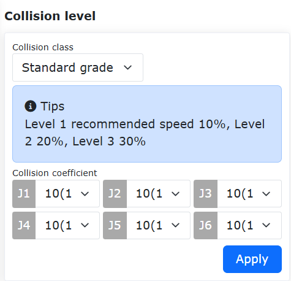

.. centered:: Figura 6.4‑2 Esquema del nivel de colisión

Estrategia de respuesta tras la colisión
+++++++++++++++++++++++++++++++++++++++++++++++++++++++++++++++++++++++

Sobre la base de la estrategia de colisión durante el movimiento original, se añaden el "Modo de par gravitatorio" y el "Modo de respuesta oscilante", con el objetivo de garantizar la seguridad de la colaboración humano-máquina.

Ambas estrategias, al activarse, pasan del modo automático o del modo manual al modo de arrastre; el modo de par gravitatorio se aleja del punto de colisión según la magnitud y la dirección de la fuerza de colisión, mientras que el modo de respuesta oscilante, tras alejarse del punto de colisión, regresa a la posición de colisión. Asimismo, se añade la detección de colisiones en estado estático.

Estrategia de colisión
+++++++++++++++++++++++++++++++++++++++++++++++++++++++++++++++++++++++

La instrucción FT_Guard se utiliza para realizar la detección de colisiones basada en el sensor de fuerza. Las estrategias de colisión anteriores eran "Parada por colisión", "Pausa por colisión" y "Continuar movimiento". Para evitar que tras la colisión el robot y el objeto generen una fuerza de compresión, se añaden las estrategias "Modo de par gravitatorio", "Modo de respuesta oscilante" y "Modo de rebote por colisión".

Las tres estrategias, al activarse, pasan del modo automático o del modo manual al modo de arrastre y, posteriormente, al modo manual. El modo de par gravitatorio se aleja del punto de colisión según la magnitud y la dirección de la fuerza de colisión; el modo de respuesta oscilante, tras alejarse del punto de colisión, regresa a la posición de colisión; el modo de rebote por colisión se aleja del punto de colisión acelerando según los parámetros configurados.

Modo de par gravitatorio
*********************************

El modo de par gravitatorio de la estrategia de colisión se configura con los siguientes pasos.

**Step1**: En la barra de menú "Configuración inicial"->"Básico"->"Articulación", hacer clic en "Nivel de colisión" para entrar en la interfaz correspondiente.

**Step2**: En la columna "Estrategia de colisión", hacer clic en el cuadro desplegable y seleccionar "Modo de par gravitatorio"; la interfaz se muestra en la figura siguiente; a continuación, hacer clic en el botón "Aplicar" y la función quedará activada.

.. note:: Durante el funcionamiento del robot, si la masa de la carga varía mucho, no se recomienda utilizar esta estrategia; si la velocidad de funcionamiento es demasiado alta, no se recomienda utilizar esta estrategia.

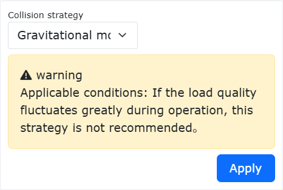

.. centered:: Figura 6.4-3 Modo de par gravitatorio de la estrategia de colisión

Modo de respuesta oscilante
*********************************

El modo de respuesta oscilante de la estrategia de colisión se configura con los siguientes pasos.

**Step1**: En la barra de menú "Configuración inicial"->"Básico"->"Articulación", hacer clic en "Nivel de colisión" para entrar en la interfaz correspondiente.

**Step2**: En la columna "Estrategia de colisión", hacer clic en el cuadro desplegable y seleccionar "Modo de respuesta oscilante"; la interfaz se muestra en la figura siguiente; a continuación, hacer clic en el botón "Aplicar" y la función quedará activada.

.. note:: Durante el funcionamiento del robot, si la velocidad de funcionamiento es demasiado alta, no se recomienda utilizar esta estrategia.

.. centered:: Figura 6.4-4 Modo de respuesta oscilante de la estrategia de colisión

Modo de rebote por colisión
*********************************

El modo de rebote por colisión de la estrategia de colisión se configura con los siguientes pasos.

**Step1**: En la barra de menú "Configuración del robot" de la configuración inicial, hacer clic en "Nivel de colisión" para entrar en la interfaz correspondiente.

**Step2**: En la columna "Estrategia de colisión", hacer clic en el cuadro desplegable y seleccionar "Modo de rebote por colisión"; configurar sucesivamente el tiempo de seguridad en 1000ms, la distancia de seguridad en 150mm, la velocidad de seguridad en 150mm/s y el coeficiente de seguridad de cada articulación en 5; la interfaz concreta se muestra en la figura siguiente.

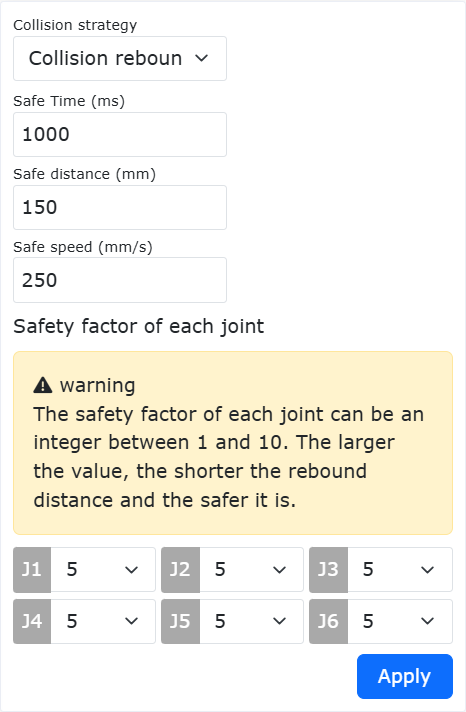

.. centered:: Figura 6.4-5 Modo de rebote por colisión de la estrategia de colisión

Significado de cada parámetro:
  - Tiempo de seguridad: indica el tiempo de duración en el modo de arrastre tras pasar del modo automático al modo de arrastre; el rango es [1000-2000]ms;
  - Distancia de seguridad: indica la posición a la que el robot se aleja del punto de colisión tras la colisión; el rango es [150-200]mm;
  - Velocidad de seguridad: indica la velocidad máxima del TCP a la que el robot se aleja del punto de colisión tras la colisión; tras superar el límite de velocidad, se restringe la fuerza de rebote; el rango es [50-250]mm/s;
  - Coeficiente de seguridad: indica la velocidad de atenuación de la fuerza de rebote; cuanto menor es el coeficiente, más rápida es la atenuación y más rápida es la velocidad de rebote, y viceversa; el rango es [1-10], adimensional.

Instrucción FT_Guard
**********************

La instrucción FT_Guard se utiliza para realizar la detección de colisiones del sensor de fuerza. En primer lugar, seleccionar la dirección de detección, pudiendo configurar también todas las direcciones. A continuación, obtener los datos actuales del sensor de fuerza como valor inicial y, después, establecer el umbral máximo y el umbral mínimo para determinar los límites superior e inferior de activación de la fuerza de colisión, completando así la configuración de la función de detección de colisiones. Tomando como ejemplo la configuración en la dirección Z, la configuración detallada se muestra en la figura siguiente.

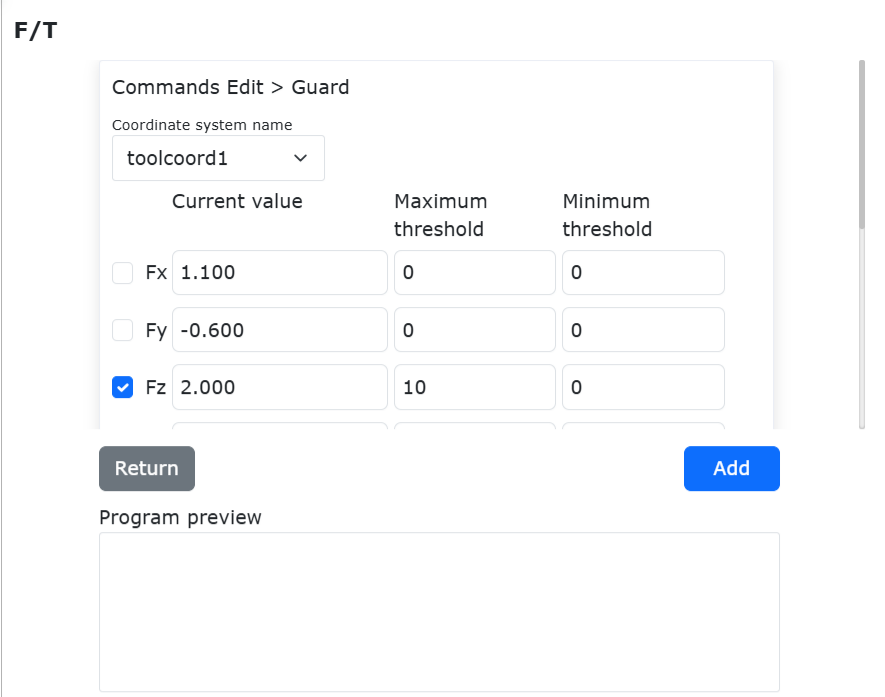

.. centered:: Figura 6.4-6 Configuración de parámetros de la instrucción FT_Guard

La instrucción FT_Guard se utiliza normalmente junto con instrucciones de movimiento, pudiendo utilizarse instrucciones como PTP o Lin; un ejemplo sencillo se muestra en la figura.

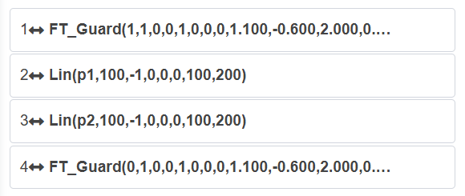

.. centered:: Figura 6.3-7 Ejemplo de combinación de FT_Guard con instrucciones de movimiento

La primera línea es para configurar la activación de la detección de colisiones del sensor de fuerza, y la última línea es para desactivar la función de detección de colisiones del sensor de fuerza.

Detección de colisiones en estado estático
+++++++++++++++++++++++++++++++++++++++++++++++++++++++++++++++++++++++

Los pasos para configurar la detección de colisiones en estado estático son los siguientes.

**Step1**: En la barra de menú "Configuración inicial"->"Básico"->"Articulación", hacer clic en "Nivel de colisión" para entrar en la interfaz correspondiente.

**Step2**: Activar el interruptor de la detección de colisiones en estado estático, como se muestra en la figura siguiente. Cuando se detecte una diferencia demasiado grande entre la instrucción de par articular y la realimentación de par, el robot entrará en el modo de arrastre para evitar generar una fuerza de compresión continua.

.. centered:: Figura 6.4-8 Detección de colisiones en estado estático

Función de detección de par antes del arrastre
++++++++++++++++++++++++++++++++++++++++++++++++++++++++++++++++++++++++++++++

Descripción general
***********************

Antes de que el robot entre en el modo de arrastre, es necesario realizar la detección de par. La función de esta función es evitar que, debido a que el operador haya configurado parámetros de carga erróneos o haya seleccionado un modo de instalación erróneo, el robot presente fenómenos anómalos como elevación o caída tras entrar en el modo de arrastre. Si se detecta que el par articular supera el rango permitido, el controlador informará inmediatamente de un error y prohibirá que el robot entre en el modo de arrastre.

Detección de par antes del arrastre
**************************************

**Step1**: Hacer clic en "Configuración inicial"->"Básico"-> "Articulación"->"Nivel de colisión" para entrar en la interfaz de configuración del nivel de colisión y activar la función de detección de par antes del arrastre, como se muestra en la figura.

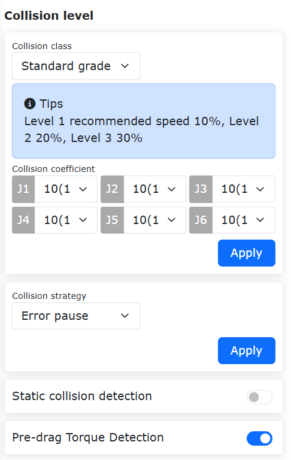

.. centered:: Figura 6.4-9 Activación de la función de detección de par antes del arrastre

**Step2**: Cambiar al modo de arrastre. La interfaz Web entra en el modo de arrastre haciendo clic en el área de estado del robot—estado de arrastre del robot, manteniendo pulsado el botón "Modo de enseñanza" de la caja de botones o manteniendo pulsado el botón de arrastre del extremo del robot; si el controlador informa de un error y el robot no cambia al modo de arrastre, como se muestra en la Figura 2-2, compruebe si la configuración de carga y el modo de instalación del robot son correctos.

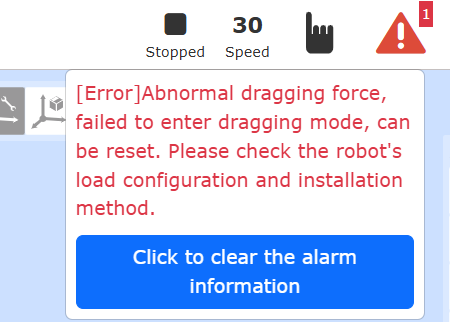

.. centered:: Figura 6.4-10 Par fuera de límite, el controlador informa de un error

**Step3**: Comprobar la configuración de carga y el modo de instalación. Hacer clic en "Configuración inicial"->"Básico"-> "Carga"->"Extremo" para comprobar si la configuración de carga del extremo de la interfaz web es igual a la carga realmente instalada; hacer clic en "Configuración inicial"->"Básico"-> "Instalación"->"Instalación libre" para comprobar si el modo de instalación de la interfaz web es igual al modo de instalación real.

Función de detección de falsos positivos
++++++++++++++++++++++++++++++++++++++++++++++++++++++++++++++++++++++++++++++

Descripción general
***********************

La optimización de la función de colisión consiste en añadir, sobre la base de la detección de colisiones, un interruptor de falsos positivos, que permite evitar el riesgo de falsos avisos de colisión.

Configuración del nivel de colisión
*****************************************

**Step1**: Iniciar sesión en la interfaz web y hacer clic sucesivamente en "Configuración inicial"→"Básico"→"Articulación"→"Nivel de colisión" para entrar en el módulo de configuración del nivel de colisión.

Cuanto mayor es el nivel de colisión, mayor es el par necesario cuando se produce la colisión y menos sensible es la respuesta a la colisión. Actualmente, los valores de par correspondientes a los niveles de colisión, como los 38.4NM del nivel 10, son el par teórico necesario para activar la colisión del eje 1.

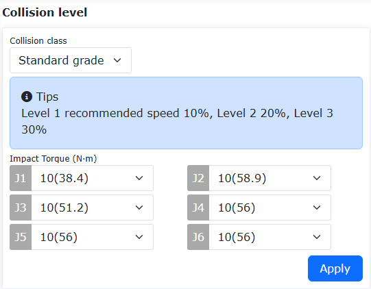

.. centered:: Figura 6.4-11 Módulo de configuración del nivel de colisión

**Step2**: Interruptor de detección de falsos positivos, activado por defecto. Si no se utiliza, se puede "Desactivar" el interruptor de detección, como se muestra en la figura siguiente.

.. centered:: Figura 6.4-12 Interruptor de detección de falsos positivos

Compensación de fricción
~~~~~~~~~~~~~~~~~~~~~~~~~~~~~~~~~~~~~~~

En la barra de menú "Configuración inicial"->"Básico"->"Articulación", hacer clic en "Compensación de fricción" para entrar en la interfaz de configuración de la compensación de fricción.

**Coeficiente de compensación de fricción**: el escenario de uso al que se dirige la compensación de fricción es únicamente el modo de arrastre; el rango configurable del coeficiente de compensación de fricción es de 0 a 1; cuanto mayor es el valor, mayor es la fuerza compensada durante el arrastre. El coeficiente de compensación de fricción debe configurarse de forma independiente para cada eje según el modo de instalación.

**Interruptor de compensación de fricción**: el usuario puede activar o desactivar la compensación de fricción según el robot real y sus hábitos de uso.

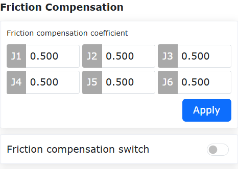

.. centered:: Figura 6.4-13 Configuración de la compensación de fricción

.. important:: 
   La función de compensación de fricción del robot debe utilizarse con precaución; configure un coeficiente de compensación razonable según la situación real; generalmente se recomienda el valor intermedio de alrededor de 0.5.

Función de ajuste del coeficiente de compensación de fricción
~~~~~~~~~~~~~~~~~~~~~~~~~~~~~~~~~~~~~~~~~~~~~~~~~~~~~~~~~~~~~~~~~~~~

Descripción general
++++++++++++++++++++++++
La función de ajuste del coeficiente de compensación de fricción se utiliza principalmente para ajustar el valor de la compensación de fricción interna del controlador.

En el modo de arrastre, el ajuste del coeficiente de compensación de fricción puede hacer que el arrastre del robot sea más ligero; en el modo automático, el ajuste del coeficiente de compensación de fricción puede mejorar la bondad de ajuste de las curvas de instrucción de par y de realimentación de par.

Ajuste del coeficiente de compensación de fricción
+++++++++++++++++++++++++++++++++++++++++++++++++++++++++++++

El coeficiente de compensación de fricción tiene un valor predeterminado de fábrica de 0.5, que es un parámetro general; el usuario puede ajustar la ganancia de fricción según la situación real para obtener una mejor experiencia.

Configuración del coeficiente de compensación de fricción
******************************************************************

**Step1**: Iniciar sesión en la interfaz web y hacer clic sucesivamente en "Configuración inicial"→"Básico"→"Articulación"→"Compensación de fricción" para entrar en el módulo de configuración de la compensación de fricción.

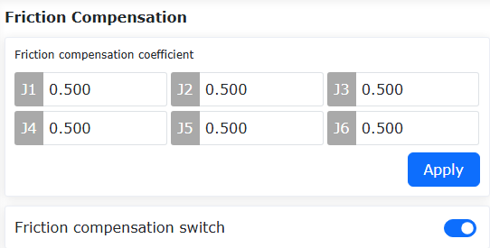

.. centered:: Figura 6.4-14 Módulo de configuración de la compensación de fricción

**Step2**: El coeficiente de compensación de fricción es por defecto 0.5; el estado de activación del interruptor de compensación de fricción se muestra en la figura. Tras activar la función, la sensación de arrastre es más suave en comparación con antes de activarla; si la función no está activada, la sensación de arrastre es más pesada.

**Step3**: Ajuste de parámetros; el rango del coeficiente de compensación de fricción es [0-1]. Si el arrastre con los parámetros resulta algo pesado, se pueden aumentar los parámetros de cada eje según la situación real; si durante el arrastre se produce un fenómeno de no poder detenerse o un fenómeno de vibración de la articulación, es necesario reducir los parámetros del eje correspondiente.

**Step4**: Si es necesario desactivar la función de compensación de fricción, se puede hacer seleccionando "Desactivar" en el interruptor de compensación.

Compensación de la fuerza de arrastre
~~~~~~~~~~~~~~~~~~~~~~~~~~~~~~~~~~~~~~~~~~~~~~~~~~~~~~~~~

Descripción general
+++++++++++++++++++++++++++++

La optimización de la fuerza de arrastre consiste en, sobre la base del arrastre actual en el bucle de corriente, compensar un determinado par según la tendencia de movimiento del robot, para superar los errores de par introducidos por un modelado inexacto, etc., haciendo que el arrastre del robot sea suave.

Optimización de la fuerza de arrastre del robot
++++++++++++++++++++++++++++++++++++++++++++++++++++++++++

La función de optimización de la fuerza de arrastre requiere que la versión del software y la versión del firmware coincidan, para obtener una mejor experiencia.

Configuración de la función de optimización de la fuerza de arrastre
*****************************************************************************************
**Step1**: Iniciar sesión en la interfaz web y hacer clic sucesivamente en "Configuración inicial"->"Básico"->"Articulación"->"Compensación de fricción" para entrar en el módulo de configuración de la compensación de la fuerza de arrastre, como se muestra en la figura.

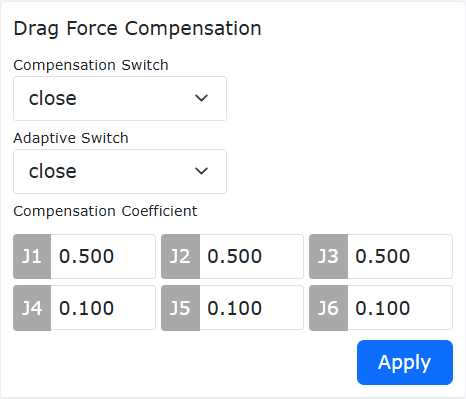

.. centered:: Figura 6.4-15 Módulo de configuración de la compensación de la fuerza de arrastre

**Step2**: Seleccionar "Activar" en el interruptor de compensación, seleccionar "Desactivar" en el interruptor adaptativo, configurar los parámetros como se muestra en la figura y hacer clic en "Aplicar"; la función se activa correctamente. Al pulsar el botón de arrastre se puede arrastrar el robot, y la sensación de arrastre es más suave en comparación con antes de activar la función.

**Step3**: Ajuste de parámetros; el rango del coeficiente de compensación es [0-1]. Si el arrastre con los parámetros resulta algo pesado, se pueden aumentar los parámetros del eje correspondiente; si durante el arrastre se produce un fenómeno de no poder detenerse o un fenómeno de vibración de la articulación, es necesario reducir los parámetros del eje correspondiente. Asimismo, durante el arrastre aparecerá una sensación de amortiguación, utilizada para decelerar y hacer que el robot se detenga.

**Step4**: Si es necesario desactivar la función de compensación de la fuerza de arrastre, se puede hacer seleccionando "Desactivar" en el interruptor de compensación.

Configuración de I/O
---------------------------------

Pausa del programa LUA
~~~~~~~~~~~~~~~~~~~~~~~~~~~~~

Durante la ejecución del programa LUA del robot, hacer clic en el botón "Pausa/Reanudar" para pausar la ejecución del programa LUA, y el estado de funcionamiento del robot pasa a ser "Pause". Al volver a hacer clic en dicho botón, el programa continúa ejecutándose desde la posición en que se pausó, y el estado de funcionamiento del robot vuelve a ser "Running".

Todos los programas en segundo plano iniciados también se pausarán y reanudarán de forma sincronizada en el proceso anterior. Los distintos tipos de instrucciones LUA presentan diferencias en su comportamiento durante la pausa:

**① Instrucciones de movimiento**: al pausar, el robot detiene inmediatamente el movimiento; al reanudar, el robot reanuda el movimiento y se desplaza hasta la posición objetivo de dicha instrucción.

**② Instrucciones lógicas como SetDO, GetDI, GetInverseKinRef, etc.**: si se activa la pausa del programa durante la ejecución de la instrucción, dicha instrucción, tras completar su ejecución, esperará a que el programa LUA salga del estado de pausa para ejecutar la siguiente instrucción.

**③ Instrucciones de espera como WaitDI, ModbusMasterWaitDI, etc.**: si se activa la pausa del programa durante la espera, el tiempo de pausa no ocupa el tiempo de espera agotado.

**④ Instrucciones de suspensión como sleep_ms, WaitMs, etc.**: si se activa la pausa del programa durante la suspensión, el tiempo de pausa no ocupa el tiempo de suspensión configurado.

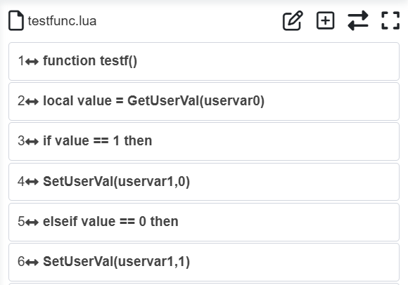

.. centered:: Figura 6.5‑1 Estado de pausa del programa LUA

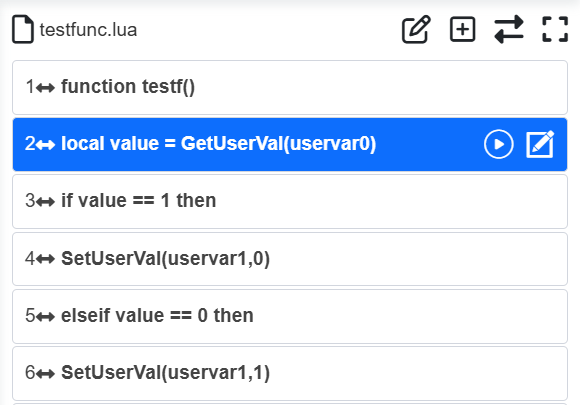

.. centered:: Figura 6.5‑2 Estado de ejecución del programa LUA

Configuración de I/O
~~~~~~~~~~~~~~~~~~~~~~~~~~~

Hacer clic en la barra de menú "Configuración inicial"->"Básico"->"Configuración de I/O", y hacer clic en los submenús "DI" y "DO" para entrar en las interfaces de configuración de DI y DO. Entre ellas, CI0-CI7 y CO0-CO7 de la caja de control son configurables, y DI0 y DI1 del extremo son configurables.

Configuración de DI
++++++++++++++++++++++++++++++++++

Cuando en producción el robot colaborativo necesita conectarse a periféricos o se detiene repentinamente por fallo u otros factores, es necesario emitir señales DO para realizar avisos sonoros y luminosos; las funciones configurables de entrada se muestran en la tabla siguiente:

.. centered:: Tabla 6.5‑1 Funciones configurables de entrada de la caja de control

.. list-table:: 
   :widths: 15 30 100
   :header-rows: 1
   :align: center

   * - Número de función
     - Nombre de la función
     - Descripción de la función
   * - 0
     - Ninguna
     - Ninguna
   * - 1
     - Señal de éxito de encendido del arco
     - La máquina de soldar enciende el arco correctamente y el robot emite la señal de encendido del arco a la máquina de soldar
   * - 2
     - Señal de preparación para soldadura
     - Señal de preparación correcta de la máquina de soldar del robot
   * - 3
     - Detección de cinta transportadora
     - Señal de configuración de DI del interruptor de detección de la cinta transportadora
   * - 4
     - Pausa
     - Señal de pausa del movimiento durante el proceso de soldadura del robot
   * - 5
     - Reanudar
     - Cuando durante el proceso de soldadura del robot se interrumpe accidentalmente el arco o el operador pausa activamente la soldadura, se activa la interrupción de la soldadura; tras la interrupción de la soldadura, cuando la señal de entrada externa a la máquina cambia de no válida a válida, el robot reanuda automáticamente la soldadura desde la posición en que se interrumpió
   * - 6
     - Inicio 
     - En las entradas configurables de la configuración de DI, seleccionar CIO como "Inicio" y hacer clic en "Aplicar". Si se selecciona "Activo por nivel alto" como estado válido de la entrada configurable, cuando el nivel de CI0 cambie de nivel bajo a nivel alto se activará la función "Inicio", pudiendo iniciar el programa abierto en la interfaz actual del programa de enseñanza; si no hay ninguna interfaz abierta, se ejecutará el último programa guardado; si se selecciona "Activo por nivel bajo" como estado válido de la entrada configurable, cuando el nivel de CI0 cambie de nivel alto a nivel bajo se activará la función "Inicio", pudiendo iniciar el programa abierto en la interfaz actual del programa de enseñanza; si no hay ninguna interfaz abierta, se ejecutará el último programa guardado
   * - 7
     - Detener  
     - Señal de detención del movimiento durante el proceso de soldadura del robot
   * - 8
     - Pausa/Reanudar
     - Tras el movimiento del robot, activa cíclicamente la señal de pausa/reanudación del movimiento
   * - 9
     - Inicio/Detención
     - Tras el movimiento del robot, activa cíclicamente la señal de inicio/detención del movimiento
   * - 10
     - Interruptor de arrastre por pedal
     - Señal de movimiento del interruptor de arrastre por pedal del robot
   * - 11
     - Mover al origen de trabajo
     - Tomando la pose actual del robot como origen de trabajo, señal de movimiento del robot hasta el origen de trabajo
   * - 12
     - Conmutación manual/automático (señal de pulso)
     - En las entradas configurables de la configuración de DI, seleccionar CIO como "Conmutación manual/automático (señal de pulso)" y hacer clic en "Aplicar". Si se selecciona "Activo por nivel alto" como estado válido de la entrada configurable, cuando el nivel de CI0 cambie de nivel bajo a nivel alto se activará la función "Conmutación manual/automático (señal de pulso)" y el robot cambiará una vez de estado de funcionamiento; si se selecciona "Activo por nivel bajo" como estado válido de la entrada configurable, cuando el nivel de CI0 cambie de nivel alto a nivel bajo se activará la función "Conmutación manual/automático (señal de pulso)" y el robot cambiará una vez de estado de funcionamiento
   * - 13
     - Éxito de búsqueda de posición del alambre de soldadura
     - Señal de éxito de búsqueda de posición del alambre de soldadura del robot
   * - 14
     - Interrupción del movimiento
     - Señal de interrupción del programa de movimiento del robot
   * - 15
     - Iniciar programa principal
     - Señal de inicio del programa principal del robot
   * - 16
     - Iniciar rebobinado
     - Tras la ejecución del programa del robot, señal de inicio del rebobinado del programa.
   * - 17
     - Confirmación de inicio
     - Señal de confirmación de inicio del programa del robot
   * - 18
     - Señal de detección láser X
     - Señal de detección X del sensor láser del robot
   * - 19
     - Señal de detección láser Y
     - Señal de detección Y del sensor láser del robot
   * - 20
     - Señal de entrada de parada de emergencia externa 1
     - Señal de entrada de parada de emergencia externa 1 del robot; ① solo se muestra en QX. ② en LA se puede configurar en la interfaz "Configuración inicial"->"Seguridad"->"Seguridad de I/O"->"Configuración de funciones de seguridad DIO"
   * - 21
     - Señal de entrada de parada de emergencia externa 2
     - Señal de entrada de parada de emergencia externa 2 del robot; ① solo se muestra en QX. ② en LA se puede configurar en la interfaz "Configuración inicial"->"Seguridad"->"Seguridad de I/O"->"Configuración de funciones de seguridad DIO"
   * - 22
     - Modo reducido de nivel uno
     - Modo reducido de nivel uno del robot; ① solo se muestra en QX. ② en LA se puede configurar en la interfaz "Configuración inicial"->"Seguridad"->"Seguridad de I/O"->"Configuración de funciones de seguridad DIO"
   * - 23
     - Modo reducido de nivel dos
     - Modo reducido de nivel dos del robot; ① solo se muestra en QX. ② en LA se puede configurar en la interfaz "Configuración inicial"->"Seguridad"->"Seguridad de I/O"->"Configuración de funciones de seguridad DIO"
   * - 24
     - Modo reducido de nivel tres (parada)
     - Modo reducido de nivel tres (parada) del robot; ① solo se muestra en QX. ② en LA se puede configurar en la interfaz "Configuración inicial"->"Seguridad"->"Seguridad de I/O"->"Configuración de funciones de seguridad DIO"
   * - 25
     - Reanudar soldadura
     - Señal de operación de reanudación de la soldadura tras producirse una interrupción de la soldadura en el robot
   * - 26
     - Terminar soldadura
     - Señal de operación de terminación de la soldadura durante el proceso de soldadura del robot
   * - 27
     - Activación de arrastre asistido
     - Señal de activación de la función de arrastre del sensor de fuerza configurada en la función DI de la caja de control
   * - 28
     - Desactivación de arrastre asistido
     - Señal de desactivación de la función de arrastre del sensor de fuerza configurada en la función DI de la caja de control
   * - 29
     - Activación/desactivación de arrastre asistido
     - Señal de activación/desactivación cíclica de la función de arrastre del sensor de fuerza configurada en la función DI de la caja de control
   * - 30
     - Borrar todos los errores
     - Borrar todas las señales de error activadas por el robot
   * - 31
     - Conmutación manual/automático (nivel alto/bajo)
     - En las entradas configurables de la configuración de DI, seleccionar CIO como "Conmutación manual/automático (nivel alto/bajo)" y hacer clic en "Aplicar". Si se selecciona "Activo por nivel alto" como estado válido de la entrada configurable, cuando CI0 cambie a nivel alto se activará la función "Conmutación manual/automático (nivel alto/bajo)" y el estado del robot cambiará a estado automático; si se selecciona "Activo por nivel bajo" como estado válido de la entrada configurable, cuando CI0 cambie a nivel bajo se activará la función "Conmutación manual/automático (nivel alto/bajo)" y el estado del robot cambiará a estado automático
   * - 32
     - Habilitar
     - Controlar la habilitación del robot
   * - 33
     - Deshabilitar
     - Controlar la deshabilitación del robot
   * - 34
     - Habilitar/Deshabilitar (flanco ascendente y descendente)
     - El flanco ascendente y el flanco descendente del estado válido de la señal de entrada activan respectivamente las acciones de habilitación y deshabilitación del robot

Añadir funciones configurables a CI del extremo
**********************************************************

Descripción general
""""""""""""""""""""""""""""""""""""""""

Sincronizar todas las funciones de CI de la caja de control del robot con el CI del extremo tiene como núcleo la construcción de un sistema de control con funciones lógicas equivalentes y posiciones físicas complementarias. Ambas interfaces son completamente equivalentes en funciones lógicas y pueden utilizarse en paralelo o de forma selectiva, permitiendo que el sistema de control del robot asigne de forma inteligente las rutas de señal según el escenario de la tarea, la disposición física de los equipos y los requisitos de fiabilidad.

Flujo de operación
""""""""""""""""""""""""""""""""""""""""""""""""""""""""""""""""""""""""""""""

**Step1**: Hacer clic sucesivamente en la barra de menú "Configuración inicial"-"Básico"-"Configuración de I/O"-"DI", etc., para entrar en la interfaz de configuración de DI, y seleccionar End DI0 y End DI1 para configurar las funciones de entrada del extremo del robot.

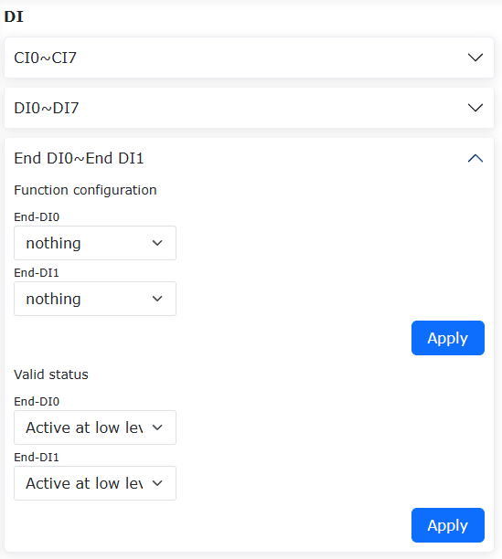

.. centered:: Figura 6.5‑3 Configuración de parámetros de DI del extremo

**Step2**: Las señales DI admitidas por el extremo del robot se muestran en la tabla siguiente; el usuario puede configurar las señales correspondientes según sus necesidades reales de uso.

.. centered:: Tabla 6.5‑2 Funciones configurables de entrada del extremo

.. list-table:: 
   :widths: 15 30 100 
   :header-rows: 1
   :align: center

   * - Número de función
     - Nombre de la función
     - Descripción de la función
   * - 0
     - Ninguna
     - Ninguna
   * - 1
     - Modo de arrastre
     - Señal de activación del modo de arrastre en el extremo del robot
   * - 2
     - Registro de puntos de enseñanza
     - Señal de activación del registro de puntos de enseñanza en el extremo del robot, que guarda los datos de posición actuales del robot
   * - 3
     - Conmutación manual/automático
     - Señal de activación de la conmutación manual/automático del robot
   * - 4
     - Inicio/detención del registro de trayectoria TPD
     - Tras iniciar el movimiento TPD el robot, señal de inicio/detención del registro de trayectoria
   * - 5
     - Pausa
     - Señal de pausa del movimiento del robot
   * - 6
     - Reanudar
     - Señal de reanudación del movimiento del robot
   * - 7
     - Inicio
     - Señal de inicio del programa del robot
   * - 8
     - Detener
     - Señal de detención del programa del robot
   * - 9
     - Pausa/Reanudar
     - Tras el movimiento del robot, activa cíclicamente la señal de pausa/reanudación del movimiento
   * - 10
     - Inicio/Detención
     - Tras el movimiento del robot, activa cíclicamente la señal de inicio/detención del movimiento
   * - 11
     - Activación de arrastre asistido
     - Señal de activación de la función de arrastre del sensor de fuerza configurada en la función DI de la caja de control
   * - 12
     - Desactivación de arrastre asistido
     - Señal de desactivación de la función de arrastre del sensor de fuerza configurada en la función DI de la caja de control
   * - 13
     - Activación/desactivación de arrastre asistido
     - Señal de activación/desactivación cíclica de la función de arrastre del sensor de fuerza configurada en la función DI de la caja de control
   * - 14
     - Señal de detección láser X
     - Señal de detección X del sensor láser del robot
   * - 15
     - Señal de detección láser Y
     - Señal de detección Y del sensor láser del robot
   * - 16
     - Mover al origen de trabajo
     - Señal de movimiento del robot hasta el origen de trabajo
   * - 17
     - Interrupción del movimiento
     - Señal de interrupción del programa de movimiento del robot
   * - 18
     - Iniciar programa principal
     - Señal de inicio del programa principal del robot
   * - 19
     - Iniciar rebobinado
     - Tras la ejecución del programa del robot, señal de inicio del rebobinado del programa
   * - 20
     - Confirmación de inicio
     - Señal de confirmación de inicio del programa del robot
   * - 21
     - Reanudar soldadura
     - Señal de operación de reanudación de la soldadura tras producirse una interrupción de la soldadura en el robot
   * - 22
     - Terminar soldadura
     - Señal de operación de terminación de la soldadura durante el proceso de soldadura del robot
   * - 23
     - Borrado de mensajes de error
     - Borrar todas las señales de error activadas por el robot
   * - 24
     - Conmutación manual/automático (nivel alto/bajo)
     - Cuando la entrada configurable selecciona "Activo por nivel alto", con la señal de entrada en nivel alto el robot cambia a automático; cuando la entrada configurable selecciona "Activo por nivel bajo", con la señal de entrada en nivel bajo el robot cambia a automático
   * - 25
     - Habilitar
     - Controlar la habilitación del robot
   * - 26
     - Deshabilitar
     - Controlar la deshabilitación del robot
   * - 27
     - Habilitar/Deshabilitar (flanco ascendente y descendente)
     - El flanco ascendente y el flanco descendente del estado válido de la señal de entrada activan respectivamente las acciones de habilitación y deshabilitación del robot
   * - 28
     - Señal de inicio/parada del seguimiento servo láser
     - Cuando el robot registra y realiza seguimiento láser al mismo tiempo y la función de inicio/parada por io está activada, se activa el CI del extremo correspondiente y comienza el seguimiento láser; al desactivar el CI del extremo correspondiente, finaliza el seguimiento

Entre ellas, la configuración predeterminada de la caja de control es: CO0 es 1-Error del robot, CO1 es 2-Robot en movimiento.

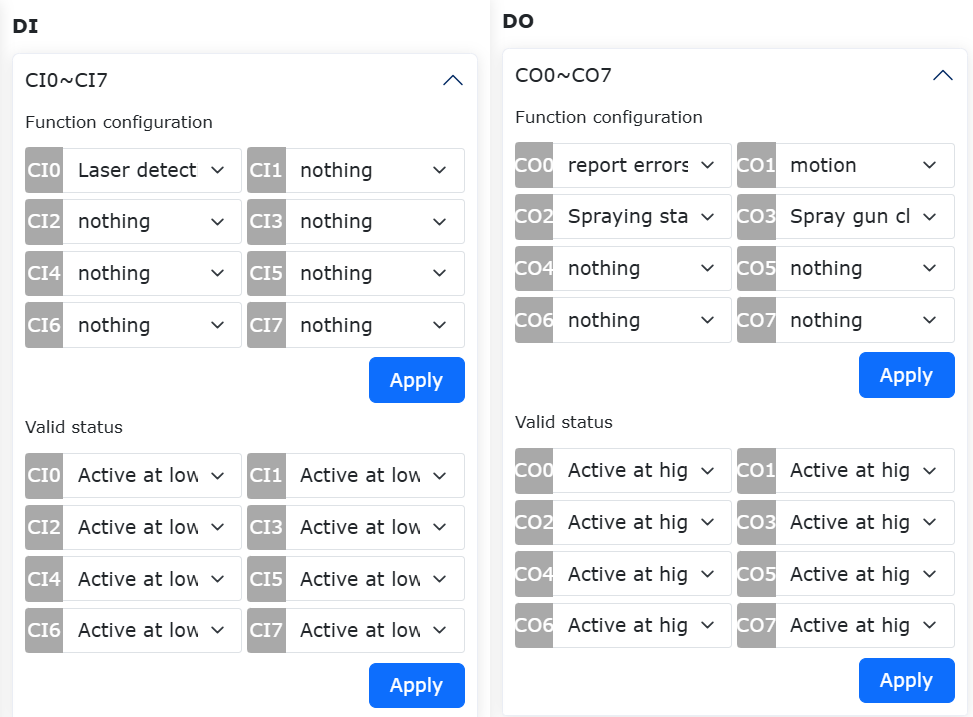

.. centered:: Figura 6.5‑3 Configuración de DI y DO de la caja de control

**Configuración predeterminada de DI del extremo**: DI0 enseñanza por arrastre, DI1 registro de puntos de enseñanza.

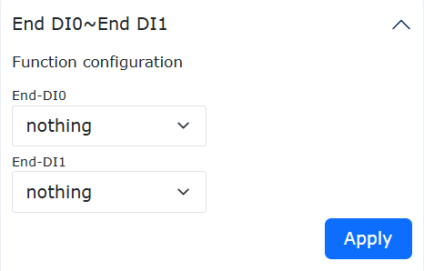

.. centered:: Figura 6.5‑4 Configuración de DI del extremo

Tras completar la configuración, se podrá consultar el estado DO de salida correspondiente en la página de I/O de la caja de control en el estado correspondiente.

.. important:: 
   Los DI y DO ya configurados no pueden utilizarse en la programación de programas.

**Configuración del modo reducido (nivel uno, nivel dos, nivel tres)**: los modos reducidos de nivel uno y nivel dos permiten configurar la velocidad articular y la velocidad del TCP del extremo; el modo reducido de nivel tres es de parada y no requiere configurar la velocidad.

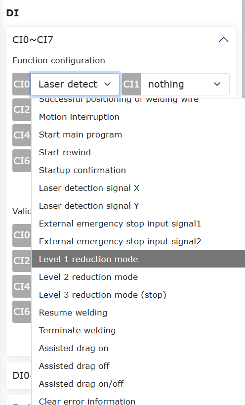

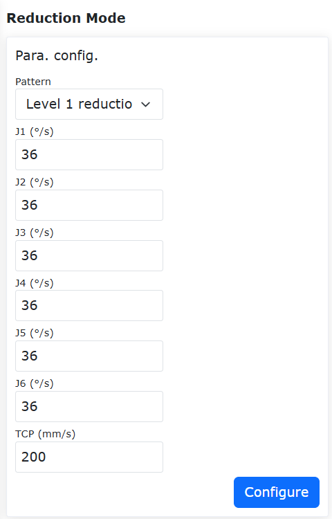

.. centered:: Figura 6.5‑5 Configuración del modo reducido

Configuración de DO
+++++++++++++++++++++++++

Las funciones configurables de salida se muestran en la tabla siguiente:

.. centered:: Tabla 6.5‑3 Funciones configurables de salida de la caja de control

.. list-table:: 
   :widths: 15 30 100
   :header-rows: 1
   :align: center

   * - Número de función
     - Nombre de la función
     - Descripción de la función
   * - 0
     - Ninguna
     - Ninguna
   * - 1
     - Error
     - Señal de error de salida DO
   * - 2
     - Movimiento
     - Señal de movimiento del robot
   * - 3
     - Inicio/parada de pulverización
     - Señal de operación de inicio/parada de pulverización del robot
   * - 4
     - Limpieza de pistola de pulverización
     - Señal de operación de limpieza de pistola de pulverización del robot
   * - 5
     - Encendido del arco
     - Puerto de salida DO del robot para controlar el encendido del arco de la máquina de soldar; cuando el programa del robot ejecuta la instrucción de encendido del arco, el puerto de salida DO correspondiente al encendido del arco de la máquina de soldar emite automáticamente un valor válido
   * - 6
     - Suministro de gas
     - Puerto de salida DO del robot para controlar el suministro de gas de la máquina de soldar; cuando el robot ejecuta la instrucción de suministro de gas de soldadura, el puerto de salida DO correspondiente al suministro de gas emite automáticamente un valor válido
   * - 7
     - Alimentación de alambre en sentido directo
     - Puerto de salida DO del robot para controlar la alimentación de alambre en sentido directo de la máquina de soldar; cuando el robot ejecuta la instrucción de alimentación de alambre en sentido directo, el puerto de salida DO correspondiente emite automáticamente un valor válido
   * - 8
     - Alimentación de alambre en sentido inverso
     - Puerto de salida DO del robot para controlar la alimentación de alambre en sentido inverso de la máquina de soldar; cuando el robot ejecuta la instrucción de alimentación de alambre en sentido inverso, el puerto de salida DO correspondiente emite automáticamente un valor válido
   * - 9
     - Puerto de entrada JOB 1
     - Señal del puerto de entrada JOB 1
   * - 10
     - Puerto de entrada JOB 2
     - Señal del puerto de entrada JOB 2
   * - 11
     - Puerto de entrada JOB 3
     - Señal del puerto de entrada JOB 3
   * - 12
     - Inicio/parada de la cinta transportadora
     - Señal de operación de inicio/parada del movimiento de la cinta transportadora
   * - 13
     - Pausa
     - Señal de pausa del movimiento del robot
   * - 14
     - Llegada al origen de trabajo
     - Señal de movimiento del robot hasta el origen de trabajo
   * - 15
     - Entrada en la zona de interferencia
     - Señal de movimiento del robot hasta la zona de interferencia
   * - 16
     - Control de inicio/parada de la búsqueda de posición del alambre de soldadura
     - Señal de operación de control de inicio/parada de la búsqueda de posición del alambre de soldadura del robot
   * - 17
     - Inicio del robot completado
     - Señal de inicio del robot completado
   * - 18
     - Inicio/parada del programa
     - Señal de inicio/parada del programa de movimiento del robot
   * - 19
     - Modo automático/manual
     - Señal de conmutación del modo manual/automático del robot
   * - 20
     - Señal de salida de parada de emergencia 1
     - Señal de salida de parada de emergencia 1 del robot; ① solo se muestra en QX. ② en LA se puede configurar en la interfaz "Configuración inicial"->"Seguridad"->"Seguridad de I/O"->"Configuración de funciones de seguridad DIO"
   * - 21
     - Señal de salida de parada de emergencia 2
     - Señal de salida de parada de emergencia 2 del robot; ① solo se muestra en QX. ② en LA se puede configurar en la interfaz "Configuración inicial"->"Seguridad"->"Seguridad de I/O"->"Configuración de funciones de seguridad DIO"
   * - 22
     - Ejecución/parada del programa de script Lua
     - Señal de ejecución/parada del programa de script Lua de movimiento del robot
   * - 23
     - Salida de estado de seguridad
     - Señal de salida de estado de seguridad del robot; ① solo se muestra en QX. ② en LA se puede configurar en la interfaz "Configuración inicial"->"Seguridad"->"Seguridad de I/O"->"Configuración de funciones de seguridad DIO"
   * - 24
     - Salida de estado de parada protectora
     - Señal de salida de estado de parada protectora del robot; ① solo se muestra en QX. ② en LA se puede configurar en la interfaz "Configuración inicial"->"Seguridad"->"Seguridad de I/O"->"Configuración de funciones de seguridad DIO"
   * - 25
     - Robot en movimiento
     - Señal de estado de robot en movimiento; ① solo se muestra en QX. ② en LA se puede configurar en la interfaz "Configuración inicial"->"Seguridad"->"Seguridad de I/O"->"Configuración de funciones de seguridad DIO"
   * - 26
     - Modo reducido del robot
     - Señal de modo reducido del robot; ① solo se muestra en QX. ② en LA se puede configurar en la interfaz "Configuración inicial"->"Seguridad"->"Seguridad de I/O"->"Configuración de funciones de seguridad DIO"
   * - 27
     - Modo no reducido del robot
     - Señal de modo no reducido del robot; ① solo se muestra en QX. ② en LA se puede configurar en la interfaz "Configuración inicial"->"Seguridad"->"Seguridad de I/O"->"Configuración de funciones de seguridad DIO"
   * - 28
     - Reservado
     - Reservado
   * - 29
     - Error de punto de instrucción
     - Señal de error de punto de instrucción articular
   * - 30
     - Error del accionamiento
     - Señal de error del accionamiento
   * - 31
     - Error de superación del límite suave
     - Señal de error de superación del límite suave del robot; es necesario ajustar el límite suave de la articulación correspondiente
   * - 32
     - Error de colisión
     - Señal de error de colisión del robot
   * - 33
     - Error del número de esclavos activos
     - Señal de anomalía de error del número de esclavos activos
   * - 34
     - Error de esclavo
     - Señal de error de anomalía del esclavo
   * - 35
     - Error de I/O
     - Señal de error de I/O
   * - 36
     - Error de pinza
     - Señal de anomalía de configuración relacionada con la pinza
   * - 37
     - Error de archivo
     - Señal de error de carga del archivo de configuración 
   * - 38
     - Error de pose singular
     - Señal de error de movimiento hasta una pose singular durante el movimiento del robot
   * - 39
     - Error de comunicación del accionamiento
     - Señal de error de anomalía de comunicación del accionamiento del robot
   * - 40
     - Error de parámetros
     - Error de rango de nivel alto/bajo de DO
   * - 41
     - Error de superación del límite suave del eje externo
     - Señal de fallo de superación del límite suave de los ejes externos 1-4
   * - 42
     - Advertencia de planificación y tiempo de espera agotado
     - Estado de alarma de planificación y tiempo de espera agotado del robot
   * - 43
     - Advertencia de puerta de seguridad
     - Estado de activación de la puerta de seguridad
   * - 44
     - Advertencia de movimiento
     - Estado de advertencia de movimiento
   * - 45
     - Advertencia de zona de interferencia
     - Estado de advertencia de entrada del robot en la zona de interferencia
   * - 46
     - Advertencia de pared de seguridad
     - Estado de advertencia de entrada del robot en la pared de seguridad
   * - 47
     - Habilitación del robot
     - Estado de habilitación del robot
   * - 48
     - Elevación automática por rotura de alambre en curso
     - Estado de elevación automática por rotura de alambre
   * - 49
     - Puerto de entrada JOB 4
     - Señal del puerto de entrada JOB 4
   * - 50
     - Puerto de entrada JOB 5
     - Señal del puerto de entrada JOB 5
   * - 51
     - Puerto de entrada JOB 6
     - Señal del puerto de entrada JOB 6
   * - 52
     - Puerto de entrada JOB 7
     - Señal del puerto de entrada JOB 7
   * - 53
     - Puerto de entrada JOB 8
     - Señal del puerto de entrada JOB 8
   * - 59
     - Robot en posición
     - Cuando el servo del robot está habilitado y no hay fallos ni alarmas, se emite la señal de estado
   * - 200
     - Ocupado
     - Función ya ocupada

Función configurable de nivel alto/bajo válido de DO de la caja de control
~~~~~~~~~~~~~~~~~~~~~~~~~~~~~~~~~~~~~~~~~~~~~~~~~~~~~~~~~~~~~~~~~~~~~~~~~~~~~~~~~~~~~~~~~~~~~~~~~~~

Descripción general
++++++++++++++++++++++++

Durante todo el proceso desde el encendido de la caja de control hasta la habilitación del robot, el DO se puede configurar con el estado de salida requerido según el escenario de uso concreto, lo que resulta más flexible y cómodo de utilizar.

Pasos de operación
++++++++++++++++++++++++

Entrar en Configuración inicial->Básico->Configuración de I/O->DO y configurar la salida DO de la caja de control durante el encendido con el nivel alto/bajo requerido.

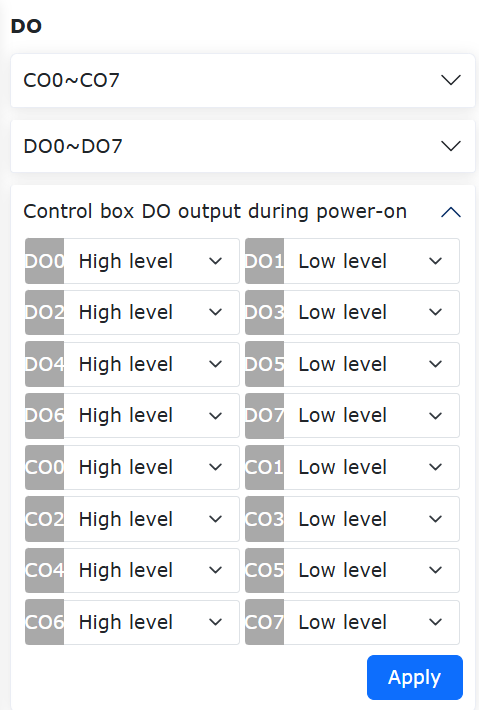

.. centered:: Figura 6.5‑6 Configuración de la salida DO de la caja de control durante el encendido

Configuración de alias de I/O
~~~~~~~~~~~~~~~~~~~~~~~~~~~~~~~~~~~~~~~~~~~~

Hacer clic en la barra de menú "Configuración inicial"->"Básico"->"Configuración de I/O", y hacer clic en el submenú "Alias" para entrar en la interfaz de configuración; configurar, según el escenario de uso real, los nombres con significado dados a las señales de IO de la caja de control y del extremo. Tras una configuración correcta, los módulos relacionados con el contenido de las señales de IO muestran el alias correspondiente; los módulos son los siguientes:

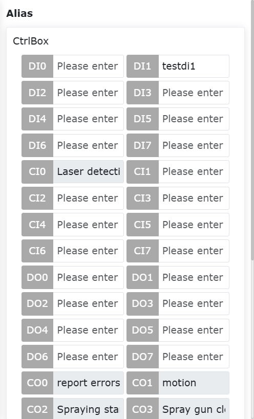

.. centered:: Figura 6.5‑7 Configuración de alias de IO

Filtrado de I/O
~~~~~~~~~~~~~~~~~~~~~~

Hacer clic en la barra de menú "Configuración inicial"->"Básico"->"Configuración de I/O", y hacer clic en el submenú "Filtrado" para entrar en la interfaz de configuración del tiempo de filtrado de IO; la interfaz de configuración del tiempo de filtrado incluye:

- Tiempo de filtrado de DI de la caja de control
- Tiempo de filtrado de DI de la placa del extremo
- Tiempo de filtrado de AI0 de la caja de control
- Tiempo de filtrado de AI1 de la caja de control
- Tiempo de filtrado de AI0 de la placa del extremo
- Tiempo de filtrado de DI de la caja de botones
- Tiempo de filtrado de DI extendido
- Tiempo de filtrado de AI0 extendido
- Tiempo de filtrado de AI1 extendido
- Tiempo de filtrado de AI2 extendido
- Tiempo de filtrado de AI3 extendido
- Tiempo de filtrado de Smart DI

El usuario puede consultar la tabla de valores de todos los parámetros de filtrado y configurar los parámetros correspondientes según sus necesidades; basta con seleccionar el parámetro correspondiente e introducir el valor del parámetro para configurarlo. Como se muestra en la figura siguiente:

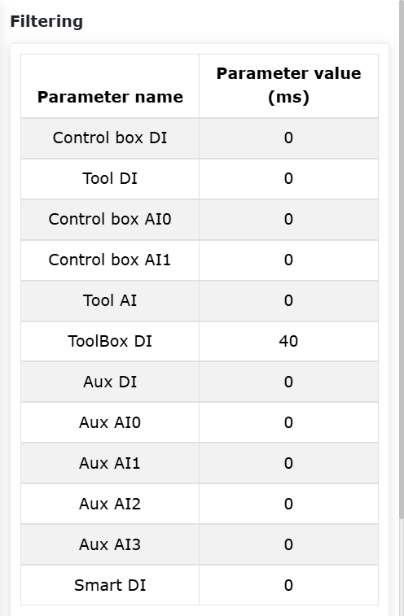

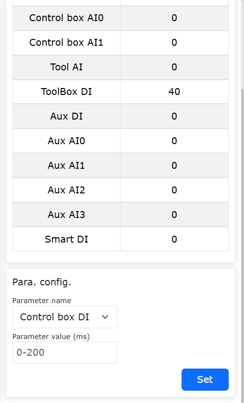

.. centered:: Figura 6.5‑8 Interfaz de filtrado

.. important:: 
   El rango del tiempo de filtrado de I/O es [0~200], en unidades de ms.

Configuración de reinicio de salidas
~~~~~~~~~~~~~~~~~~~~~~~~~~~~~~~~~~~~~~~~~~~~~~~~~

Hacer clic en la barra de menú "Configuración inicial"->"Básico"->"Configuración de I/O", y hacer clic en el submenú "Reinicio de salidas" para entrar en la interfaz de configuración; configurar, según la necesidad real de reinicio durante el uso, si las distintas salidas deben reiniciarse tras la detención/pausa. Actualmente, las salidas incluyen:

- DO de la caja de control
- AO de la caja de control
- DO de la placa del extremo
- AO de la placa del extremo
- DO extendido
- AO extendido
- DO de SmartTool

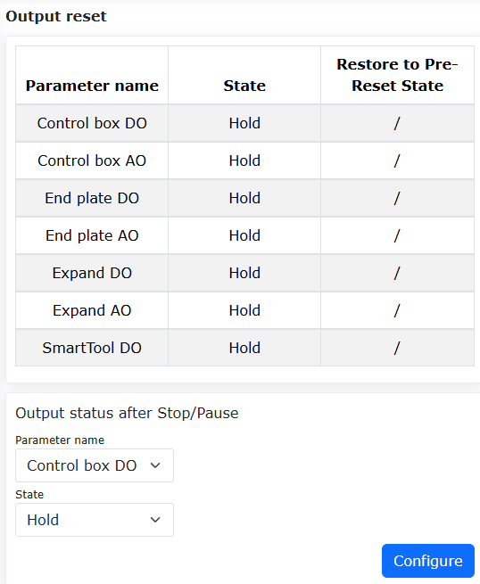

.. centered:: Figura 6.5‑9 Configuración de reinicio de salidas

Función configurable del estado de reinicio de DO en pausa/reanudación
~~~~~~~~~~~~~~~~~~~~~~~~~~~~~~~~~~~~~~~~~~~~~~~~~~~~~~~~~~~~~~~~~~~~~~~~~~~~~~~~~~~~~

Descripción general
++++++++++++++++++++++++
Esta función optimiza la función actual de reinicio de salidas, añadiendo en la configuración de I/O una opción configurable que puede establecerse en dos tipos: mantener o reiniciar; el reinicio a su vez se divide en restaurar al estado anterior al reinicio y no restaurar al estado anterior al reinicio. El usuario puede configurar distintas opciones según sus necesidades reales.

Flujo de operación
+++++++++++++++++++++++++++++++
**Step1**: Hacer clic sucesivamente en "Configuración inicial"-"Configuración de I/O"-"Reinicio de salidas" y configurar, según las necesidades reales de uso, el estado de salida de DO o AO tras la detención/pausa; el estado se puede configurar como "Mantener" o "Reiniciar", y solo cuando se configura como "Reiniciar" se puede configurar además "Restaurar al estado anterior al reinicio".

**Step2**: Configurar el estado como "Mantener"; al hacer clic en pausa durante la ejecución del programa lua y luego en reanudar, el estado de salida de DO/AO permanece invariable durante todo el proceso, en estado activado; al hacer clic en detener durante la ejecución del programa lua, el estado de salida de DO/AO permanece invariable; los parámetros de configuración se muestran en la figura siguiente.

.. centered:: Figura 6.5‑10 Estado configurado como "Mantener"
 
**Step3**: Configurar el estado como "Reiniciar" y "Restaurar al estado anterior al reinicio" como "No"; al hacer clic en pausa durante la ejecución del programa lua, el estado de salida de DO/AO se reiniciará, y al volver a hacer clic en reanudar, el estado de salida de DO/AO seguirá reiniciado; al hacer clic en detener durante la ejecución del programa lua, el estado de salida de DO/AO se reiniciará; los parámetros de configuración se muestran en la figura siguiente.

.. centered:: Figura 6.5‑11 Estado configurado como "Reiniciar"+"No"

**Step4**: Configurar el estado como "Reiniciar" y "Restaurar al estado anterior al reinicio" como "Sí"; al hacer clic en pausa durante la ejecución del programa lua, el estado de salida de DO/AO se reiniciará, y al volver a hacer clic en reanudar, el estado de salida de DO/AO se recargará; al hacer clic en detener durante la ejecución del programa lua, el estado de salida de DO/AO se reiniciará; los parámetros de configuración se muestran en la figura siguiente.

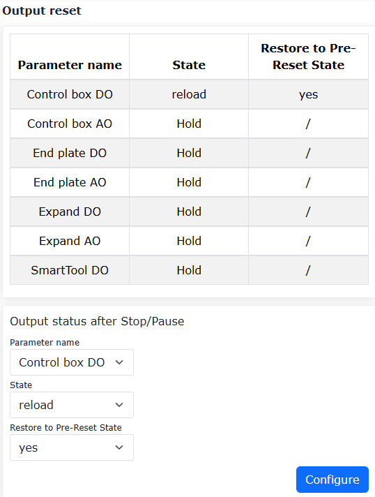

.. centered:: Figura 6.5‑12 Estado configurado como "Reiniciar"+"Sí"

Origen de trabajo
----------------------

En la barra de menú "Configuración inicial"->"Básico", hacer clic en "Origen de trabajo" para entrar en la interfaz de la función de configuración del origen de trabajo.

Esta página muestra el nombre y la información de posición de las articulaciones del origen de trabajo; el origen de trabajo se denomina con el nombre fijo pHome; hacer clic en "Configurar" para tomar la pose actual del robot como origen de trabajo; hacer clic en "Mover a este punto" y el robot se desplazará hasta el origen de trabajo. Además, en la configuración de DI se añade la opción configurable de mover al origen de trabajo, y en la configuración de DO se añade la opción configurable de llegada al origen de trabajo.

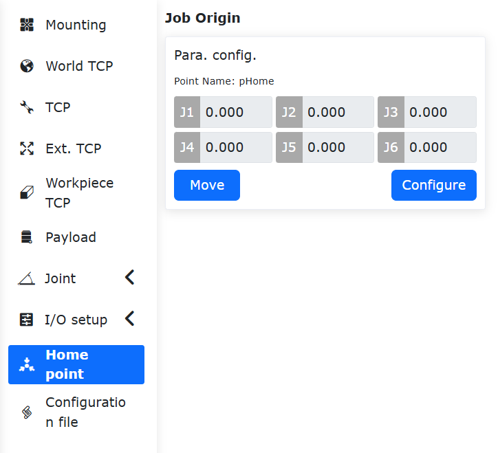

.. centered:: Figura 6.6‑1 Origen de trabajo

.. Importación y exportación de configuración
.. ~~~~~~~~~~~~~~~

.. En la barra de menú "Configuración del robot" de la "Configuración inicial", hacer clic en "Importación y exportación de configuración" para entrar en la interfaz de importación y exportación de configuración.

.. **Importar archivo de configuración del robot**: el usuario importa el archivo de configuración del robot denominado user.config, que contiene los distintos parámetros de la función de configuración del robot. Hacer clic en el botón "Seleccionar archivo", seleccionar el archivo de configuración ya modificado y cuyo contenido cumpla la especificación, y hacer clic en el botón "Importar"; cuando aparezca el aviso de importación completada, los parámetros del archivo habrán quedado configurados correctamente.

.. **Exportar archivo de configuración del robot**: hacer clic en el botón "Exportar" para exportar el archivo de configuración del robot user.config al equipo local.

.. **Importar base de datos del controlador**: el usuario importa el archivo de base de datos del controlador denominado fr_controller_data.db. Hacer clic en el botón "Seleccionar archivo", seleccionar el archivo de base de datos ya modificado y cuyo contenido cumpla la especificación, y hacer clic en el botón "Importar"; cuando aparezca el aviso de importación completada, los parámetros del archivo habrán quedado configurados correctamente.

.. **Base de datos del controlador**: hacer clic en el botón "Exportar" para exportar el archivo de base de datos del controlador del robot al equipo local.

.. .. image:: base/031.png
..    :width: 3in
..    :align: center

.. .. centered:: Figura 6.5-1 Importación y exportación de configuración

Función de calibración automática del TCP con sensor fotoeléctrico
-------------------------------------------------------------------

Descripción general
~~~~~~~~~~~~~~~~~~~~~~~~~~~~~~

Cuando la herramienta del robot sufre una colisión que provoca un desplazamiento de la posición del TCP, se puede activar la función de calibración automática del TCP basada en el sensor fotoeléctrico. Esta función, mediante el cálculo y la compensación automáticos de la desviación de posición, completa rápidamente la recalibración del sistema de coordenadas de herramienta, reduciendo en gran medida el tiempo de inactividad y mejorando la eficiencia de funcionamiento del equipo y la estabilidad de la producción.

Flujo de operación
~~~~~~~~~~~~~~~~~~~~~~~~~~~~~~

**Step1**: Colocar el sensor fotoeléctrico en el espacio de trabajo del robot y conectar los dos grupos de cables de señal marrón, azul y negro del dispositivo del sensor fotoeléctrico respectivamente a los dos grupos de puertos 24V, 0V y CI0, CI1 de la caja de control del robot (basta con cualquier puerto de entrada de señal digital configurable disponible) o a los dos grupos de puertos 24V, 0V y End-DI0, End-DI1 del extremo del robot.

**Step2**: Calibrar el sistema de coordenadas del sensor fotoeléctrico. El sistema de coordenadas del sensor fotoeléctrico es esencialmente un sistema de coordenadas de pieza, y su precisión tiene una influencia importante en la posterior calibración del TCP de la herramienta; se puede determinar de diversas formas:

- (1) Utilizar el método de calibración del sistema de coordenadas de pieza, con el origen en la intersección de los dos haces láser, siendo los dos haces láser los ejes X e Y respectivamente, y el eje Z perpendicular al sensor fotoeléctrico hacia el exterior;
- (2) Proporcionarlo mediante un equipo de medición externo (como una cámara);
- (3) Calibrar utilizando la configuración del dispositivo fotoeléctrico de la función de calibración automática fotoeléctrica; en esta opción es necesario utilizar una herramienta de dimensiones precisas conocidas y un sistema de coordenadas de pieza aproximadamente exacto y aplicarlo: primero hacer clic en "Configuración inicial"-"Coordenadas de herramienta", aplicar el sistema de coordenadas de herramienta 0, luego hacer clic en el botón "Calibración del sistema de coordenadas" del sistema de coordenadas de herramienta de dimensiones precisas (tomando como ejemplo el sistema de coordenadas 1), hacer clic en "Aplicar" y, a continuación, seleccionar "Función de calibración automática fotoeléctrica".

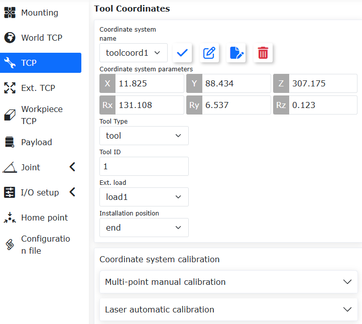

.. centered:: Figura 6.7-1 Selección de la calibración automática fotoeléctrica
 
Entrar en el contenido "Dispositivo fotoeléctrico configurado", realizar la configuración de la señal de activación de IO, configurar el punto central de enseñanza, configurar los parámetros de desviación y, a continuación, hacer clic en "Ejecutar" para calibrar el sistema de coordenadas del sensor; posteriormente, aplicar manualmente el resultado de la calibración al sistema de coordenadas de pieza.

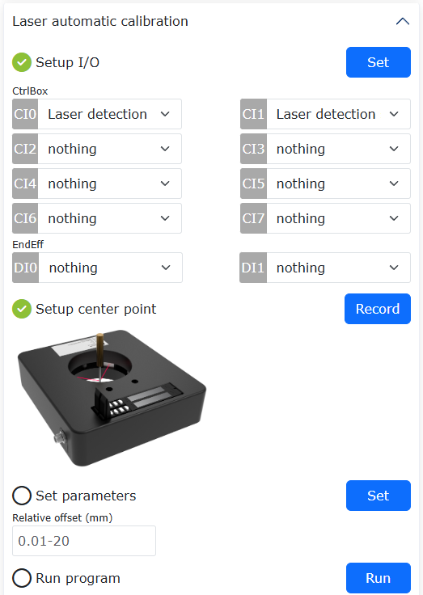

.. centered:: Figura 6.7-2 Calibración del sistema de coordenadas del sensor

**Step3**: Calibrar el sistema de coordenadas de herramienta. Mediante el Step2 ya se ha obtenido y aplicado el sistema de coordenadas de pieza preciso, y se conoce y aplica el sistema de coordenadas de herramienta anterior a la colisión: primero hacer clic en "Configuración inicial"-"Coordenadas de herramienta", aplicar el sistema de coordenadas de herramienta 0, luego hacer clic en el botón "Calibración del sistema de coordenadas" del sistema de coordenadas de herramienta anterior a la colisión (tomando como ejemplo el sistema de coordenadas 1), hacer clic en "Aplicar" y, a continuación, seleccionar "Función de calibración automática fotoeléctrica" y configurar los parámetros de calibración en "Parámetros de calibración fotoeléctrica configurados".

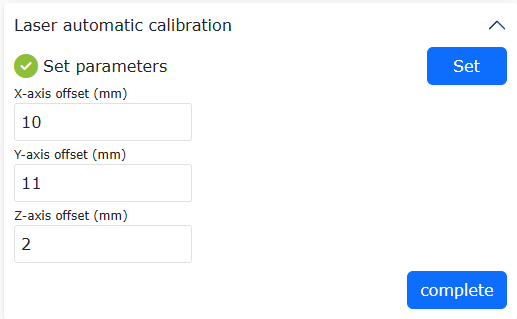

.. centered:: Figura 6.7-3 Configuración de los parámetros de calibración automática fotoeléctrica
 
Tras completar la configuración, hacer clic en el botón "Completar" para volver al menú del nivel superior y, a continuación, hacer clic en el botón "Calibrar" para realizar la calibración del TCP; una vez finalizada la calibración, hacer clic en el botón "Guardar" para guardar el resultado de la calibración.

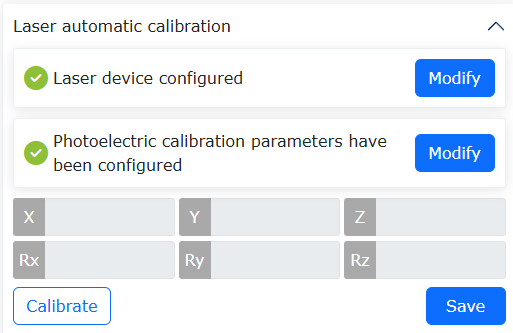

.. centered:: Figura 6.7-4 Calibración y guardado de la calibración automática fotoeléctrica

Calibración del TCP basada en la herramienta de placa plana
--------------------------------------------------------------------

Descripción general
~~~~~~~~~~~~~~~~~~~~~~~~~~~

Al utilizar el "método de cuatro puntos" para la calibración del TCP de la herramienta, es necesario controlar manualmente el movimiento del robot y lograr la coincidencia precisa punto a punto a simple vista; la eficiencia y la precisión de la calibración se ven afectadas por la destreza del operador.

El principio de la calibración del TCP basada en la herramienta de placa plana es el siguiente: se aprovecha el contacto múltiple de la herramienta del robot con cualquier posición de la placa plana y, mediante el establecimiento de un modelo de calibración, se resuelve el TCP de la herramienta. Todo el proceso de calibración se completa automáticamente, lo que puede mejorar la eficiencia de la calibración y reducir la dependencia de la mano de obra.

Flujo de operación de la función de calibración del TCP basada en la herramienta de placa plana
~~~~~~~~~~~~~~~~~~~~~~~~~~~~~~~~~~~~~~~~~~~~~~~~~~~~~~~~~~~~~~~~~~~~~~~~~~~~~~~~~~~~~~~~~~~~~~~~~~~~~~~~~~~~

Fijar la placa de calibración en el espacio de trabajo del robot; la placa no debe balancearse y su conductividad debe ser buena; colocar el extremo de la herramienta aproximadamente perpendicular a la placa de calibración y situado a 50mm por encima de la placa.

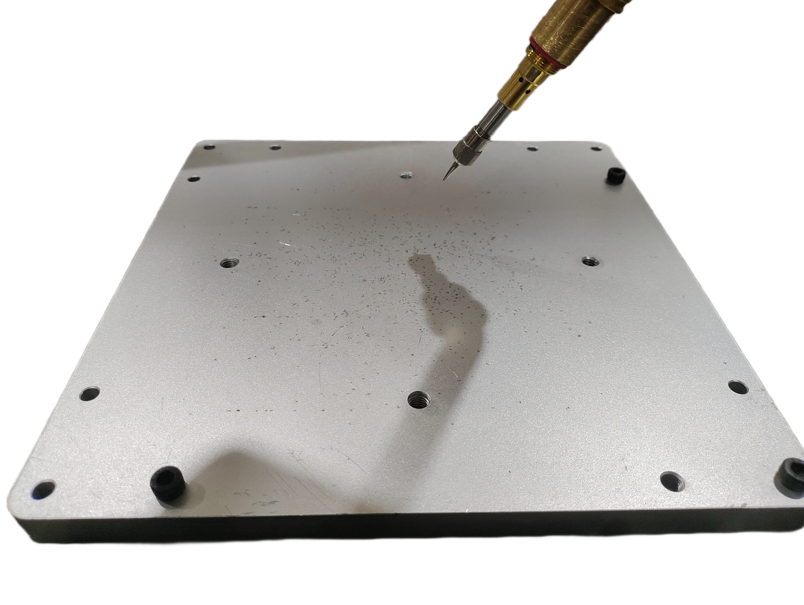

.. centered:: Figura 6.8‑1 Esquema de la disposición de la calibración

Hacer clic sucesivamente en "Programa de enseñanza"—"Programación de programas", seleccionar el archivo de calibración "FR_CalibrateTheToolTcpPlane.lua" y abrirlo.

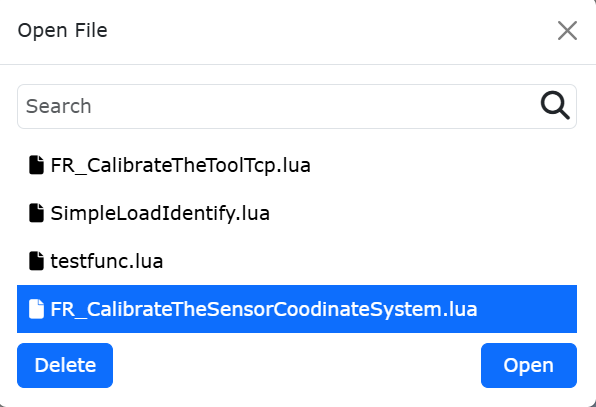

.. centered:: Figura 6.8‑2 Apertura del archivo de calibración

Hacer clic sucesivamente en "Configuración inicial"->"Básico"->"Sistema de coordenadas"—"Herramienta", y se entrará en la interfaz "Sistema de coordenadas actual". En "Nombre del sistema de coordenadas", seleccionar el sistema de coordenadas que se desea calibrar (tomando como ejemplo el sistema de coordenadas toolcord1) y hacer clic en el botón "Modificar" para entrar en la interfaz de selección del método de calibración del TCP.

.. centered:: Figura 6.8‑3 Configuración del sistema de coordenadas de herramienta

En el "Asistente de modificación", seleccionar "Calibración con herramienta de placa plana" para entrar en la interfaz de calibración con herramienta de placa plana.

.. centered:: Figura 6.8‑4 Selección del método de calibración

En la interfaz "Calibración con herramienta de placa plana", hacer clic en el botón "Entrar" para configurar la herramienta de placa plana; hacer clic en el botón "Registrar" para registrar el punto de referencia de calibración. Tras completar la configuración, hacer clic en el botón "Completar" y se volverá a la interfaz "Calibración con herramienta de placa plana".

.. centered:: Figura 6.8‑5 Configuración de la herramienta de placa plana

En la interfaz "Calibración con herramienta de placa plana", hacer clic en el botón "Ejecutar" y el robot realizará automáticamente la calibración del TCP de la herramienta; tras completar la calibración, se mostrarán las coordenadas del TCP de la herramienta; hacer clic en el botón "Guardar" y el resultado de la calibración se devolverá a la interfaz "Sistema de coordenadas de herramienta actual".

.. centered:: Figura 6.8‑6 Resultado de la calibración

En la interfaz "Sistema de coordenadas de herramienta actual", hacer clic en el botón "Aplicar" para guardar y aplicar el resultado de la calibración del TCP de la herramienta.

.. centered:: Figura 6.8‑7 Aplicación del resultado de la calibración

Función de seguimiento de arco por realimentación analógica de la caja de control
----------------------------------------------------------------------------------------

Descripción general
~~~~~~~~~~~~~~~~~~~~~~~~~~~~~

La función de seguimiento de arco por realimentación analógica de la caja de control recoge las señales analógicas de tensión y corriente de la máquina de soldar para realizar la compensación del seguimiento de arco; la implementación de la función se completa mediante la configuración de los canales AI y AO correspondientes a las señales analógicas de la caja de control.

.. centered:: Figura 6.9‑1 Topología de la función de seguimiento de arco basada en la comunicación por señal analógica
.. centered:: a representa el ordenador; b representa el robot y la caja de control; c representa la máquina de soldar

Flujo de configuración de AI analógica de la caja de control
~~~~~~~~~~~~~~~~~~~~~~~~~~~~~~~~~~~~~~~~~~~~~~~~~~~~~~~~~~~~

En la interfaz de control Web del robot, hacer clic sucesivamente en "Configuración inicial"->"Básico"->"Configuración de I/O"->"AI" para entrar en la interfaz "Configuración de AI".

En la columna "Canal de seguimiento de arco" de la interfaz "Configuración de AI", en los cuadros desplegables "AI de control de corriente de soldadura" y "AI de control de tensión de soldadura", seleccionar respectivamente "Ctrl-AI0" y "Ctrl-AI1" como canales analógicos de corriente y tensión, y hacer clic respectivamente en "Configurar" para completar la configuración de la AI analógica de la caja de control.

.. centered:: Figura 6.9‑2 Configuración del canal AI

En la columna "Gráfico de relación corriente-tensión analógica" de la configuración del canal AI mostrada en la figura anterior, la configuración de parámetros de las interfaces "A-V" y "V-V" debe referirse a la tabla/gráfico de recepción y salida analógica de la máquina de soldar utilizada.

Por ejemplo, configurar los límites inferior y superior de la corriente de soldadura de la AI analógica de corriente de la caja de control en 0A y 500A respectivamente; configurar los límites inferior y superior de la tensión de salida de la AI analógica de corriente de la caja de control en 0V y 5V respectivamente, como parámetros de configuración de la interfaz "A-V" de la columna "Gráfico de relación corriente-tensión analógica" de la configuración del canal AI; hacer clic en "Configurar" para completar la configuración del canal AI de corriente analógica de la caja de control.

.. centered:: Figura 6.9‑3 Configuración de la AI de corriente analógica de la caja de control

Por ejemplo, configurar los límites inferior y superior de la tensión de soldadura de la AI analógica de tensión de la caja de control en 0V y 50V respectivamente; configurar los límites inferior y superior de la tensión de salida de la AI analógica de tensión de la caja de control en 1.018V y 10V respectivamente, como parámetros de configuración de la interfaz "V-V" de la columna "Gráfico de relación corriente-tensión analógica" de la configuración del canal AI; hacer clic en "Configurar" para completar la configuración del canal AI de tensión analógica de la caja de control.

.. centered:: Figura 6.9‑4 Configuración de la AI de tensión analógica de la caja de control

Flujo de configuración de AO analógica de la caja de control
~~~~~~~~~~~~~~~~~~~~~~~~~~~~~~~~~~~~~~~~~~~~~~~~~~~~~~~~~~~~~

En la interfaz de control Web del robot, hacer clic sucesivamente en "Configuración inicial"->"Periféricos"->"Máquina de soldar" para entrar en la interfaz "Configuración de la máquina de soldar".

.. centered:: Figura 6.9‑5 Configuración de la máquina de soldar

En la columna "Configuración de I/O de la función de soldadura" de la interfaz "Configuración de la máquina de soldar", la configuración de parámetros de las interfaces "DI" y "DO" permite configurar personalizadamente los canales CI y CO de la caja de control; en el cuadro desplegable "Tipo de control", seleccionar "I/O del controlador" para entrar en el flujo de configuración del canal AO analógico del controlador.

En la columna "Gráfico de relación corriente-tensión analógica" de la interfaz "Configuración de la máquina de soldar", la configuración de parámetros de las interfaces "A-V" y "V-V" debe referirse a la tabla/gráfico de recepción y salida analógica de la máquina de soldar utilizada.

Por ejemplo, configurar los límites inferior y superior de la corriente de soldadura de la AO analógica de corriente de la caja de control en 0A y 495A respectivamente; configurar los límites inferior y superior de la tensión de salida de la AO analógica de corriente de la caja de control en 1V y 10V respectivamente, como parámetros de configuración de la corriente analógica en la configuración del canal AO de la caja de control,
y en el cuadro desplegable "AO de control de corriente de la máquina de soldar" seleccionar "Ctrl-AO0"; hacer clic en "Configurar" para completar la configuración del canal AO de corriente analógica de la caja de control.

.. centered:: Figura 6.9‑6 Configuración de la AO de corriente analógica de la caja de control

Por ejemplo, configurar los límites inferior y superior de la tensión de soldadura de la AO analógica de tensión de la caja de control en 10V y 45V respectivamente; configurar los límites inferior y superior de la tensión de salida de la AO analógica de tensión de la caja de control en 1V y 10V respectivamente, como parámetros de configuración de la tensión analógica en la configuración del canal AO de la caja de control.

Y en el cuadro desplegable "AO de control de tensión de la máquina de soldar" seleccionar "Ctrl-AO1"; hacer clic en "Configurar" para completar la configuración del canal AO de tensión analógica de la caja de control.

.. centered:: Figura 6.9‑7 Configuración de la AO de tensión analógica de la caja de control

Detección de colisiones del riel guía de cremallera recta
----------------------------------------------------------------------

Descripción general
~~~~~~~~~~~~~~~~~~~~~~~~~~~~~

La función de detección de colisiones del riel guía de cremallera recta se utiliza para, en funcionamiento asíncrono o síncrono, emitir una alarma y realizar una parada de emergencia cuando el riel o el robot colisionan con objetos del entorno. Mediante la monitorización del cambio de la realimentación de par del riel y la determinación, según el umbral configurado, de si se produce una colisión, el riel detiene inmediatamente el movimiento en caso de producirse, evitando así que el riel y el robot ejerzan una fuerza continua sobre el objeto golpeado, lo que permite mejorar aún más la seguridad de la colaboración humano-máquina.

Función de detección de colisiones del riel guía de cremallera recta
~~~~~~~~~~~~~~~~~~~~~~~~~~~~~~~~~~~~~~~~~~~~~~~~~~~~~~~~~~~~~~~~~~~~~~~~~~~~~~

La función de detección de colisiones del riel guía de cremallera recta requiere ejecutar el programa "Rail_Adaptation_Pro-gram.lua" tras la activación del riel, para garantizar que la función pueda adaptarse a los distintos rieles y situaciones de carga, obteniendo así el mejor rendimiento de detección de colisiones. Si no se realiza la adaptación, el rendimiento de detección de colisiones disminuirá notablemente y la fuerza externa necesaria para activar la colisión será mayor.

Configuración y habilitación de parámetros del riel guía de cremallera recta
+++++++++++++++++++++++++++++++++++++++++++++++++++++++++++++++++++++++++++++++++++++++++++

**Step1**: Iniciar sesión en la interfaz web y hacer clic sucesivamente en "Configuración inicial"→"Periféricos"→"Eje extendido" para entrar en el módulo de configuración del sistema de coordenadas de eje extendido, como se muestra en la figura.

.. centered:: Figura 6.10‑1 Módulo de configuración del sistema de coordenadas de eje extendido

**Step2**: Basándose en la situación real de funcionamiento del eje extendido y del robot, realizar la configuración de parámetros y la calibración según sea necesario. En la figura, hacer clic en editar, configurar el nombre del sistema de coordenadas del eje extendido como "exaxis1", seleccionar el esquema "0-Riel deslizante lineal de un grado de libertad" y seleccionar el número de eje extendido "1". Si el riel y el robot solo funcionan de forma asíncrona, no es necesario calibrar; si se requiere funcionamiento síncrono, es obligatorio calibrar; el flujo de calibración puede consultarse en el manual de usuario correspondiente o consultar a un profesional. Tras configurar los parámetros, hacer clic en "Guardar" y aplicar el sistema de coordenadas correspondiente, como se muestra concretamente en la Figura 2-2.

.. centered:: Figura 6.10‑2 Configuración de parámetros del sistema de coordenadas de eje extendido

**Step3**: Establecer la comunicación UDP entre el eje extendido y el robot, y asegurarse de que el programa PLC del eje extendido puede devolver al controlador del robot los datos de realimentación de par del motor de accionamiento del eje extendido tras el reductor. Hacer clic sucesivamente en "Configuración inicial"→"Periféricos"→"Eje extendido" para entrar en la página de configuración de la comunicación UDP, seleccionar el sistema de coordenadas configurado en el Step2 y aplicarlo; hacer clic en el icono "Editar" de la configuración de comunicación UDP para configurar y cargar la comunicación. Entre ellas, las direcciones IP del PLC y del ordenador portátil deben ser consistentes con el segmento de red del controlador, como se muestra concretamente en la Figura 2-3. Cabe señalar que es necesario asegurarse de que el programa PLC del eje extendido puede devolver al controlador del robot los datos de realimentación de par del motor de accionamiento del eje extendido tras el reductor, y que el período de muestreo debe ser preferiblemente de 1ms, sin superar como máximo 4ms; de lo contrario, la función de detección de colisiones dejará de ser válida.

.. centered:: Figura 6.10‑3 Página de configuración de la comunicación UDP

**Step4**: Realizar la configuración de parámetros del eje extendido UDP. La página de configuración de parámetros del eje extendido UDP se muestra en la Figura 2-4; el tipo de eje se selecciona como "Riel guía lineal", la dirección del eje como "Positiva", y el resto de parámetros deben configurarse según la situación real. Entre ellos, el paso y la resolución del codificador son fijos e invariables, y se ven afectados por el riel; los límites superiores de velocidad de funcionamiento y aceleración se ven afectados por el rendimiento del motor; los límites superiores utilizados en la prueba de esta función son los mostrados en la Figura 2-4; el usuario debe ponerse en contacto con un profesional al configurar límites superiores diferentes.

.. centered:: Figura 6.10‑4 Configuración de parámetros del eje extendido UDP

**Step5**: Habilitar el riel guía de cremallera recta y desplazar el riel hasta el punto de inicio. Habilitar el riel guía de cremallera recta mediante el botón "Quitar habilitación" de la Figura 2-4 o el botón "Habilitación del servo" de la Figura 2-5. Si el carro del riel está alejado del punto de inicio, se puede desplazar el carro hasta el punto de inicio mediante "Giro inverso" o "Giro directo" (tenga en cuenta que la velocidad de funcionamiento debe alejarse del 15%). Tras desplazarse hasta el punto de inicio, hacer clic en "Configuración de cero" y realizar el retorno a cero mediante "Retorno a cero en la posición actual".

.. centered:: Figura 6.10‑4 Habilitación y desplazamiento del riel guía de cremallera recta
 
Activación de la función de detección de colisiones del riel guía de cremallera recta
+++++++++++++++++++++++++++++++++++++++++++++++++++++++++++++++++++++++++++++++++++++++++++

**Step1**: Asegurarse de que tanto el riel como el robot tienen un modo de instalación de montaje normal. Antes de activar la función de detección de colisiones del riel guía de cremallera recta, es necesario comprobar si el modo de instalación es de montaje normal. En concreto, asegurarse primero de que el modo de instalación del riel y del robot es de montaje normal y, a continuación, hacer clic sucesivamente en "Configuración inicial"→"Básico"→"Instalación" para entrar en la página de instalación libre; si "Rotación de la base" e "Inclinación de la base" son ambos 0, el software está configurado como montaje normal; de lo contrario, deben cambiarse a 0; si no son 0, la interfaz mostrará un error, como se muestra concretamente en la Figura 2-6.

.. centered:: Figura 6.10‑6 Si el modo de instalación no es de montaje normal, se mostrará un error

**Step2**: Activar la función de detección de colisiones del riel guía de cremallera recta y configurar los parámetros. Hacer clic sucesivamente en "Configuración inicial"→"Básico"→"Articulación"→"Nivel de colisión" para entrar en la página de configuración del nivel de colisión. Hacer clic en el deslizador de la función "Detección de colisiones del riel guía de cremallera recta" y configurar el radio del engranaje y la masa del carro; el radio del engranaje se puede calcular a partir del paso y la relación de reducción, y la masa del carro no incluye el robot ni la carga del extremo que transporta. El nivel del riel tiene un total de 11 opciones; el Level1 es el que activa la colisión con mayor facilidad y el Level10 el que más difícilmente. Cuando el controlador acaba de encenderse y antes de ejecutar el programa de adaptación, el nivel de colisión debe configurarse primero como "Desactivado".

.. centered:: Figura 6.10‑7 Función de detección de colisiones del riel guía de cremallera recta

**Step3**: Ejecutar el programa "Rail_Adaptation_Program.lua" para adaptar el riel actual. Tras reiniciar el controlador, es necesario ejecutar el programa "Rail_Adaptation_Program.lua" (el objetivo es evitar que factores como el cambio de tipo de robot afecten a las características dinámicas del riel). Antes de ejecutar el programa, es necesario asegurarse de que el nivel de colisión del riel está "Desactivado"; en modo automático, ejecutar el programa lua con la velocidad de la interfaz al 100%; tras ejecutar un ciclo del programa, la adaptación habrá finalizado y se podrá detener la ejecución.

.. centered:: Figura 6.10‑8 Ejecución del programa "Rail_Adaptation_Program.lua" para adaptar el riel actual

**Step4**: Configurar razonablemente el nivel de colisión del riel y ejecutar la tarea. El usuario puede configurar razonablemente el nivel de colisión del riel según el rendimiento del accionamiento del motor y la velocidad de ejecución de la tarea. Si el riel y el robot funcionan de forma asíncrona, al colisionar con el robot o el riel se puede activar el "Fallo de colisión del eje 8, reajustable"; en este momento, el riel detiene el funcionamiento, como se muestra concretamente en la Figura 2-9. Si el riel y el robot funcionan de forma síncrona, la colisión con el robot puede activar la alarma y hacer que el riel detenga el funcionamiento, mientras que el robot reacciona según la estrategia de colisión configurada.

.. centered:: Figura 6.10‑9 El riel activa un fallo de colisión

Puesta a cero con carga del sensor de fuerza y parámetros de admitancia para la conformidad de actitud abierta
--------------------------------------------------------------------------------------------------------------------

Descripción general
~~~~~~~~~~~~~~~~~~~~~~~~~~~~~~

La función de puesta a cero con carga del sensor de fuerza se utiliza para que el robot, llevando un cabezal de cambio rápido y sin desmontarlo, pueda borrar rápidamente los datos de deriva de cero del sensor al cambiar la carga; los parámetros de admitancia para la conformidad de actitud abierta se utilizan para que el cliente ajuste la actitud según la magnitud del par real en el control de fuerza constante.

Puesta a cero con carga del sensor de fuerza
~~~~~~~~~~~~~~~~~~~~~~~~~~~~~~~~~~~~~~~~~~~~~~~~~~~~~~~~~~~~~~~~~

**Step1**: Instalar y activar el sensor de fuerza. En la barra de menú "Configuración inicial"->"Periféricos"->"Sensor de fuerza", hacer clic en "Dispositivo adaptado" para entrar en la interfaz de configuración. Tras completar la configuración del sensor de fuerza, seleccionar el número del sensor de fuerza configurado y hacer clic en el botón "Restablecer"; cuando la página muestre que el comando se ha enviado correctamente, hacer clic en el botón "Activar" y consultar el estado de activación en la tabla de información del sensor de fuerza para determinar si la activación se ha realizado correctamente; además, el sensor de fuerza tendrá un valor inicial; el usuario selecciona "Corrección de cero" y "Eliminar cero" según sus necesidades de uso, como se muestra en la figura. La corrección de cero del sensor de fuerza requiere asegurarse de que el sensor de fuerza está horizontal y verticalmente hacia abajo, y que no hay carga configurada bajo el sensor.

.. centered:: Figura 6.11‑1 Información de configuración del sensor de fuerza

**Step2**: Identificación de carga del sensor de fuerza. En la barra de menú "Configuración inicial"->"Básico"->"Carga", hacer clic en "Identificación automática" para entrar en la interfaz de carga del sensor de fuerza/par. Realizar la puesta a cero automática del sensor, registrar la posición inicial, cambiar el robot al modo automático y hacer clic en "Puesta a cero automática", como se muestra en la Figura 2-2.

.. centered:: Figura 6.11‑2 Identificación de carga del sensor de fuerza

**Step3**: Si se sustituye la carga real del extremo del sensor de fuerza, introducir en el módulo de configuración de carga el peso de la carga y las coordenadas del centro de masa, hacer clic en "Aplicar" para actualizar la configuración de carga y completar la puesta a cero con carga del sensor de fuerza.

Parámetros de admitancia para la conformidad de actitud abierta
~~~~~~~~~~~~~~~~~~~~~~~~~~~~~~~~~~~~~~~~~~~~~~~~~~~~~~~~~~~~~~~~

**Step1**: Hacer clic en "Configuración inicial"->"Básico"-> "Coordenadas de herramienta" para entrar en la interfaz de configuración del sistema de coordenadas de herramienta, seleccionar el "Nombre del sistema de coordenadas" y configurar los parámetros del sistema de coordenadas correspondientes a la herramienta del extremo, como se muestra en la Figura 3-1.

.. centered:: Figura 6.11‑3 Configuración del sistema de coordenadas de herramienta

**Step2**: Hacer clic en "Programa de enseñanza"->"Programación de programas", escribir el script lua de control de fuerza constante, seleccionar "Conjunto de control de fuerza"->"Control", añadir la instrucción de movimiento de control de fuerza, configurar la conformidad de actitud como "Activada", configurar el coeficiente de inercia y el coeficiente de amortiguación, y configurar el ángulo máximo de ajuste como el umbral del ángulo de conformidad de actitud, como se muestra en la Figura 3-2.

.. centered:: Figura 6.11‑4 Parámetros de admitancia para la conformidad de actitud abierta

**Step3**: En la interfaz web, hacer clic en "FT", configurar el sistema de coordenadas de referencia del sensor de fuerza, seleccionar el sistema de coordenadas de referencia como "Sistema de coordenadas personalizado" y configurar los parámetros del sistema de coordenadas correspondientes como "0", como se muestra en la Figura 3-3.

.. centered:: Figura 6.11‑4 Configuración del sistema de coordenadas de referencia del sensor de fuerza

**Step4**: Ejecutar el script y observar el efecto de conformidad de actitud; los parámetros de inercia regulan la respuesta de aceleración y la capacidad de resistencia a perturbaciones; cuanto mayor es la inercia, más evidente es el retardo del robot; el coeficiente de amortiguación afecta a la suavidad durante la conformidad de actitud; cuanto mayor es la amortiguación, más difícil es la conformidad de actitud.

Configuración de movimiento
---------------------------------------------

Hacer clic en la barra de menú "Configuración inicial"->"Básico" y hacer clic en el submenú "Configuración de movimiento" para entrar en la interfaz de configuración.

Modo de suavizado de aceleración
~~~~~~~~~~~~~~~~~~~~~~~~~~~~~~~~~~~~~~~~~~~~~~~~~~~~~~~~~~~~~~~~~~~~
La función "Modo de suavizado de aceleración" se dirige principalmente al blending entre las instrucciones PTP-PTP, LIN-LIN, ARC-ARC, LIN-ARC y ARC-LIN; el blending entre las demás instrucciones no surte efecto.

.. centered:: Figura 6.11‑4 Modo de suavizado de aceleración

Optimización de características de velocidad en forma de T + función de suavizado blending
~~~~~~~~~~~~~~~~~~~~~~~~~~~~~~~~~~~~~~~~~~~~~~~~~~~~~~~~~~~~~~~~~~~~~~~~~~~~~~~~~~~~~~~~~~~~~~~~~

Descripción general
++++++++++++++++++++++

Realizar blending entre dos tramos de trayectoria permite evitar el problema de arranques y paradas frecuentes provocado por la detención completa, mejorando así la eficiencia de movimiento del robot.

Esta función se dirige principalmente al blending entre las instrucciones PTP-PTP, LIN-LIN, ARC-ARC, LIN-ARC y ARC-LIN; el blending entre las demás instrucciones no surte efecto.

Flujo de operación
++++++++++++++++++++++

Dado que el modo de operación de cada instrucción es similar, este manual explica el método de operación de esta función tomando como ejemplo el blending entre PTP-PTP; esta función se puede implementar de dos formas: utilizando instrucciones Lua y utilizando el interruptor de configuración de movimiento.

Utilización del modo de instrucciones Lua
*****************************************************

**Step1**: Seleccionar los puntos de enseñanza sobre los que se desea ejecutar la función PTP; este manual utiliza "A0"~"A5" como nombres de los puntos de enseñanza.

**Step2**: Hacer clic en "Programa de enseñanza"—>"Programación de programas", seleccionar la instrucción "Punto a punto" de las "Instrucciones de movimiento", seleccionar el punto de enseñanza en "Edición de instrucción" y configurar la velocidad de depuración, seleccionar "Modo de suavizado de aceleración" en protección de movimiento y configurar el parámetro "Transición suave" en los puntos que requieran suavizado.

.. centered:: Figura 7.13-1 Configuración de la instrucción de blending PTP con suavizado de aceleración

**Step3**: Generar el programa Lua y ejecutarlo para implementar la función de blending PTP-PTP; este modo solo utiliza la velocidad en forma de T optimizada para el movimiento de las instrucciones entre AccSmoothStart() y AccSmoothEnd(), y utiliza la velocidad en forma de T original para el movimiento de las demás instrucciones.

.. centered:: Figura 7.13-2 Programa típico de blending entre PTP-PTP mediante el modo de instrucciones Lua

Utilización del modo de interruptor de configuración de movimiento
***********************************************************************************

**Step1**: Hacer clic en "Configuración inicial"—>"Seguridad"—>"Configuración de movimiento" y activar el interruptor de "Modo de suavizado de aceleración".

.. centered:: Figura 7.13-3 Configuración del interruptor del modo de suavizado de aceleración

**Step2**: Seleccionar los puntos de enseñanza sobre los que se desea ejecutar la función PTP-PTP; este manual utiliza "A0"~"A5" como nombres de los puntos de enseñanza.

**Step3**: Hacer clic en "Programa de enseñanza"—>"Programación de programas", seleccionar la instrucción "Punto a punto" de las "Instrucciones de movimiento", seleccionar el punto de enseñanza en "Edición de instrucción" y configurar la velocidad de depuración, seleccionar "Ninguna" en protección de movimiento y configurar el parámetro "Transición suave" en los puntos que requieran suavizado.

.. centered:: Figura 7.13-4 Configuración de la instrucción de blending PTP convencional

**Step4**: Generar el programa Lua y ejecutarlo para implementar la función de blending PTP-PTP; el programa típico es el mismo que el programa PTP convencional; este modo utiliza la velocidad en forma de T optimizada para el movimiento de todas las instrucciones.

.. centered:: Figura 7.13-5 Programa típico de blending entre PTP-PTP mediante el interruptor de configuración

Modo de tiempo óptimo añadido (configuración automática)
~~~~~~~~~~~~~~~~~~~~~~~~~~~~~~~~~~~~~~~~~~~~~~~~~~~~~~~~~~~~~~~~~~~~

El "Modo de tiempo óptimo" permite configurar sus distintos parámetros sin necesidad de depuración; esta función, según el estado de trabajo actual del robot, completa de forma adaptativa la configuración de parámetros del modo de tiempo óptimo, mejorando la eficiencia de depuración.

.. note:: Nota: el modo de tiempo óptimo añadido y el modo de suavizado de aceleración son funciones mutuamente excluyentes.

.. centered:: Figura 6.11‑4 Modo de tiempo óptimo añadido (configuración automática)

Función de parámetros adaptativos FIR + función de pausa/reanudación FIR
~~~~~~~~~~~~~~~~~~~~~~~~~~~~~~~~~~~~~~~~~~~~~~~~~~~~~~~~~~~~~~~~~~~~~~~~~~~~~~~~~~~~~

Descripción general
++++++++++++++++++++++

La función de configuración adaptativa de parámetros del modo de tiempo óptimo del robot permite configurar sus distintos parámetros sin necesidad de depuración; esta función, según el estado de trabajo actual del robot, completa de forma adaptativa la configuración de parámetros del modo de tiempo óptimo, mejorando la eficiencia de depuración.

Flujo de operación
++++++++++++++++++++++

El modo de uso de las instrucciones básicas de movimiento del robot PTP, LIN y ARC es similar; este ejemplo toma como ejemplo principal la instrucción de movimiento PTP en modo de tiempo óptimo.

**Step1**: En la interfaz de control Web del robot, hacer clic sucesivamente en "Configuración inicial"->"Seguridad"->"Configuración de movimiento" para entrar en la interfaz "Configuración de movimiento".

.. centered:: Figura 7.13-6 Interfaz de configuración de movimiento

**Step2**: En la interfaz "Configuración de movimiento", hacer clic en el interruptor "Modo de tiempo óptimo" para entrar en la interfaz "Modo de tiempo óptimo".

.. centered:: Figura 7.13-7 Interfaz del modo de tiempo óptimo

.. note:: En la columna "Configuración de parámetros" de la interfaz "Modo de tiempo óptimo", en la columna "Coeficiente de ajuste" se puede configurar de -100 a 100, expresado como proporción de escala, utilizado para controlar el grado de tiempo óptimo de la instrucción de movimiento; el valor predeterminado es 1.

**Step3**: Determinar los puntos de enseñanza sobre los que se desea ejecutar el movimiento PTP; este ejemplo utiliza "A0"~"A5" como nombres de los puntos de enseñanza.

**Step4**: En la interfaz de control Web del robot, hacer clic sucesivamente en "Programa de enseñanza"—>"Programación de programas" para entrar en la interfaz "Instrucciones de movimiento".

.. centered:: Figura 7.13-8 Interfaz de instrucciones de movimiento

**Step5**: En la interfaz "Instrucciones de movimiento", hacer clic en "Punto a punto" para entrar en la interfaz de edición de la instrucción "PTP"; seleccionar respectivamente el punto de enseñanza en el cuadro desplegable "Nombre del punto", configurar la proporción de velocidad deseada en la columna "Velocidad de depuración", seleccionar "Detener" en la columna "En este punto", seleccionar "No" en el cuadro desplegable "¿Desplazamiento?" y seleccionar "Ninguna" en la columna "Protección de movimiento"; a continuación, hacer clic en "Añadir".

.. centered:: Figura 7.13-9 Interfaz de edición de la instrucción de movimiento PTP

**Step6**: En la interfaz de edición de la instrucción de movimiento "PTP", hacer clic en "Aplicar" y se generará automáticamente el programa LUA correspondiente.

.. centered:: Figura 7.13-10 Programa LUA típico de movimiento PTP en modo de tiempo óptimo

.. note:: 
   El programa LUA típico de movimiento PTP en modo de tiempo óptimo no es diferente del programa LUA de movimiento PTP general; la diferencia radica en que en el Step2 ya se ha activado la función "Modo de tiempo óptimo".

   Una vez activado el interruptor de la función "Modo de tiempo óptimo", las instrucciones básicas de movimiento del robot PTP, LIN y ARC se encuentran en modo de tiempo óptimo; al desactivar el interruptor de la función "Modo de tiempo óptimo" en esta interfaz, se puede restaurar el estado de las instrucciones básicas de movimiento PTP, LIN y ARC.
   En esta interfaz no se puede activar simultáneamente el interruptor de la función "Modo de suavizado de aceleración".

Tiempo de filtrado del movimiento servo y ganancia de posición
~~~~~~~~~~~~~~~~~~~~~~~~~~~~~~~~~~~~~~~~~~~~~~~~~~~~~~~~~~~~~~~~~~~~

Descripción general
++++++++++++++++++++++++++++++++++++

La finalidad de las funciones de tiempo de filtrado del movimiento servo y de ganancia de posición es mejorar la suavidad y la precisión de la trayectoria de movimiento servo del robot. Por ejemplo, mediante el parámetro de tiempo de filtrado se puede suavizar la curva de velocidad del movimiento servo de tipo T en una curva de velocidad de movimiento servo de tipo S; mediante el parámetro de ganancia de posición se puede ajustar la capacidad de respuesta de la realimentación de posición articular del movimiento servo respecto a la instrucción.

Flujo de operación de la función de tiempo de filtrado global servo en el espacio cartesiano/articular
+++++++++++++++++++++++++++++++++++++++++++++++++++++++++++++++++++++++++++++++++++++++++++++++++++++++++++++++++++++++++++++

**Step1**: Configuración de movimiento. En la interfaz principal de WebApp, hacer clic en "Configuración inicial"->"Básico"->"Configuración de movimiento" para entrar en el área de instrucciones "Configuración de movimiento".

.. centered:: Figura 7.13-11 Área de instrucciones "Configuración de movimiento"

**Step2**: Configuración del filtrado de movimiento. En el área de instrucciones "Configuración de movimiento", hacer clic en el cuadro desplegable "Filtrado de movimiento" para entrar en el área de configuración "Configuración de parámetros", configurar el parámetro "Tiempo de filtrado" y hacer clic en el botón "Aplicar" para completar la configuración de la función de filtrado global del movimiento servo.

.. note:: Nota: cuando existen simultáneamente parámetros de tiempo de filtrado global y de instrucción, el tiempo de filtrado del movimiento servo es la suma de ambos.

.. centered:: Figura 7.13-12 Área de configuración "Filtrado de movimiento"

.. note:: Nota: el rango del parámetro de tiempo de filtrado global del movimiento servo es de 0~200 ms; el valor predeterminado de 0 indica que la función de filtrado global del movimiento servo está desactivada.

Flujo de operación de la función de movimiento por instrucción servo en el espacio cartesiano
+++++++++++++++++++++++++++++++++++++++++++++++++++++++++++++++++++++++++++++++++++++++++++++++++++++++++++++++++++++++++++++

**Step1**: Instrucción de movimiento servo. En la interfaz principal de WebApp, hacer clic en "Programa de enseñanza"->"Programación de programas" para entrar en el área de instrucciones "Instrucciones de movimiento".

.. centered:: Figura 7.13-13 Área de instrucciones "Instrucciones de movimiento"

**Step2**: Inicio del movimiento servo. En el área de instrucciones "Instrucciones de movimiento", hacer clic en el botón "Movimiento servo" para entrar en el área de configuración de instrucciones "servoMotion".

En la interfaz "Edición de instrucción" del área de configuración de instrucciones "servoMotion", hacer clic en el botón "Inicio del movimiento servo", configurar los parámetros "Tiempo de filtrado" y "Ganancia de posición" y hacer clic en el botón "Añadir"; en el cuadro de visualización "Vista previa del programa" se mostrará el programa LUA pregenerado.

.. image:: base/115.png
   :width: 6in
   :align: center

.. centered:: Figura 7.13-14 Inicio del movimiento servo

.. note:: Nota: el rango del parámetro "Tiempo de filtrado" es de 0~200 ms; el rango del parámetro "Ganancia de posición" es de -1~100; el valor predeterminado de -1 indica que es consistente con el incorporado en la versión actual de parámetros completos.

**Step3**: Movimiento servo en el espacio cartesiano. En la interfaz "Edición de instrucción" del área de configuración de instrucciones "servoMotion", hacer clic en el botón "Movimiento en el espacio cartesiano" y seleccionar el modo de movimiento en el cuadro desplegable "Modo de movimiento".

Y configurar los parámetros "Pose cartesiana", "Coeficiente de proporción", "Aceleración", "Velocidad", "Período de instrucción", "Tiempo de filtrado" y "Ampliación de proporción", y hacer clic en el botón "Añadir"; en el cuadro de visualización "Vista previa del programa" se mostrará el programa LUA pregenerado.

.. centered:: Figura 7.13-15 Movimiento en el espacio cartesiano

.. note:: Nota: en la figura, el parámetro "Tiempo de filtrado" mantiene el valor predeterminado.

**Step4**: Fin del movimiento servo. En la interfaz "Edición de instrucción" del área de configuración de instrucciones "servoMotion", hacer clic en el botón "Fin del movimiento servo" y hacer clic en el botón "Añadir"; en el cuadro de visualización "Vista previa del programa" se mostrará el programa LUA pregenerado.

.. centered:: Figura 7.13-16 Fin del movimiento servo

**Step5**: Programa LUA de movimiento servo en el espacio cartesiano. Hacer clic en el botón "Aplicar" y se generará automáticamente el programa LUA.

.. centered:: Figura 7.13-17 Programa LUA de movimiento servo en el espacio cartesiano

Flujo de operación de la función de movimiento por instrucción servo en el espacio articular
+++++++++++++++++++++++++++++++++++++++++++++++++++++++++++++++++++++++++++++++++++++++++++++++++++++++++++++++++++++++++++++

**Step1**: Instrucción de movimiento servo. En el área de instrucciones "Instrucciones de movimiento", hacer clic en el botón "Movimiento servo" para entrar en el área de configuración de instrucciones "servoMotion".

.. image:: base/119.png
   :width: 2in
   :align: center

.. centered:: Figura 7.13-18 Área de instrucciones "Instrucciones de movimiento"

**Step2**: Inicio del movimiento servo. En el área de instrucciones "Instrucciones de movimiento", hacer clic en el botón "Movimiento servo" para entrar en el área de configuración de instrucciones "servoMotion".

En la interfaz "Edición de instrucción" del área de configuración de instrucciones "servoMotion", hacer clic en el botón "Inicio del movimiento servo", configurar los parámetros "Tiempo de filtrado" y "Ganancia de posición" y hacer clic en el botón "Añadir"; en el cuadro de visualización "Vista previa del programa" se mostrará el programa LUA pregenerado.

.. centered:: Figura 7.13-19 Inicio del movimiento servo

.. note:: Nota: el rango del parámetro "Tiempo de filtrado" es de 0~200 ms; el rango del parámetro "Ganancia de posición" es de -1~100; el valor predeterminado de -1 indica que es consistente con el incorporado en la versión actual de parámetros completos.

**Step3**: Movimiento servo en el espacio articular. En la interfaz "Edición de instrucción" del área de configuración de instrucciones "servoMotion", hacer clic en el botón "Movimiento en el espacio articular".

Y configurar los parámetros "Posición articular", "Posición del eje extendido", "Aceleración", "Velocidad" y "Período de instrucción", y hacer clic en el botón "Añadir"; en el cuadro de visualización "Vista previa del programa" se mostrará el programa LUA pregenerado.

.. centered:: Figura 7.13-20 Movimiento en el espacio articular

**Step4**: Fin del movimiento servo. En la interfaz "Edición de instrucción" del área de configuración de instrucciones "servoMotion", hacer clic en el botón "Fin del movimiento servo" y hacer clic en el botón "Añadir"; en el cuadro de visualización "Vista previa del programa" se mostrará el programa LUA pregenerado.

.. centered:: Figura 7.13-21 Fin del movimiento servo

**Step5**: Programa LUA de movimiento servo en el espacio articular. Hacer clic en el botón "Aplicar" y se generará automáticamente el programa LUA.

.. centered:: Figura 7.13-22 Programa LUA de movimiento servo en el espacio articular