Programación de programas
=========================

.. toctree:: 
   :maxdepth: 6

Introducción
~~~~~~~~~~~~

Hacer clic en los comandos de la izquierda permite añadir nodos de programa al árbol de programa. Durante la ejecución del programa, el nodo de programa que se está ejecutando actualmente se resalta en verde.

En el modo manual, hacer clic en el primer icono a la derecha del nodo permite que el robot ejecute esa instrucción de forma individual; el segundo icono sirve para editar el contenido de ese nodo.

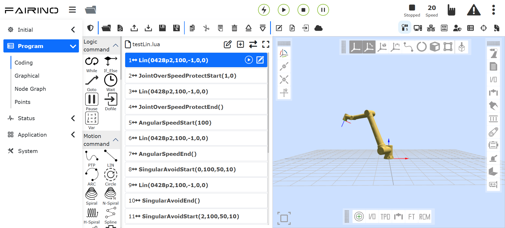

.. centered:: Figura 9.1-1 Interfaz del árbol de programa

Hacer clic en "⇄" para cambiar de modo, lo que permite convertir el texto del programa de enseñanza en estado de edición.

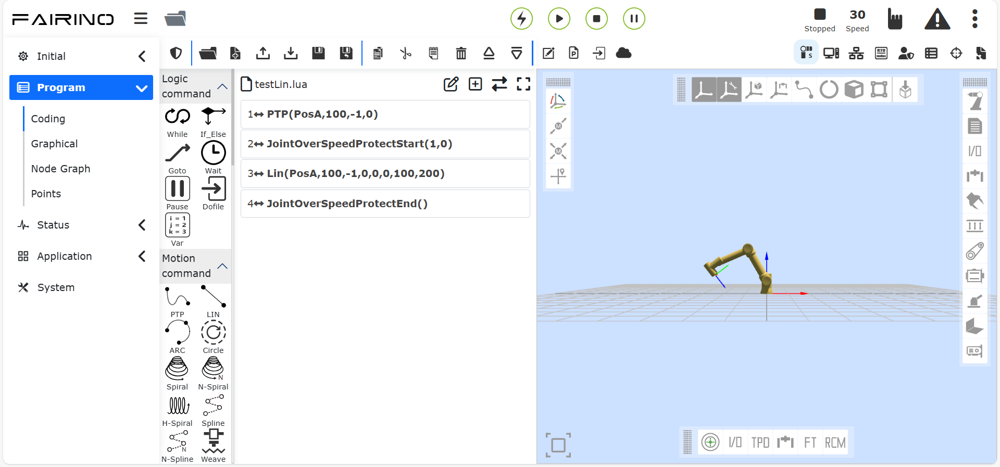

.. centered:: Figura 9.1‑2 Estado de edición del programa de enseñanza

Los iconos a la derecha del nombre del programa se describen a continuación:

.. note:: 
   .. image:: coding/003.png
      :height: 0.75in
      :align: left

   Nombre: **Expandir/Contraer**
   
   Función: Expandir/Contraer la interfaz del árbol de programa

.. note:: 
   .. image:: coding/004.png
      :height: 0.75in
      :align: left

   Nombre: **Añadir punto de enseñanza**
   
   Función: Añadir un punto de enseñanza local del programa actual

.. note:: 
   .. image:: coding/005.png
      :height: 0.75in
      :align: left

   Nombre: **Cambiar nombre**
   
   Función: Cambiar el nombre del programa actual

Barra de herramientas
~~~~~~~~~~~~~~~~~~~~~~

La barra de herramientas situada en la parte superior del árbol de programa se utiliza para modificar el árbol de programa.

.. note:: 
   .. image:: coding/006.png
      :height: 0.75in
      :align: left

   Nombre: **Abrir**
   
   Función: Abrir archivos de programas de usuario; admite la ordenación alfabética (A~Z o Z~A) o por hora de última modificación.

.. note:: 
   .. image:: coding/007.png
      :height: 0.75in
      :align: left

   Nombre: **Nuevo**
   
   Función: Seleccionar una plantilla para crear un nuevo archivo de programa
   
.. note:: 
   .. image:: coding/008.png
      :height: 0.75in
      :align: left

   Nombre: **Importar**
   
   Función: Importar archivos a la carpeta de programas de usuario

.. note:: 
   .. image:: coding/009.png
      :height: 0.75in
      :align: left

   Nombre: **Exportar**
   
   Función: Exportar el archivo de programa de usuario al equipo local.

.. note:: 
   .. image:: coding/010.png
      :height: 0.75in
      :align: left

   Nombre: **Guardar**
   
   Función: Guardar el contenido editado del archivo

.. note:: 
   .. image:: coding/011.png
      :height: 0.75in
      :align: left

   Nombre: **Guardar como**
   
   Función: Cambiar el nombre del archivo y guardarlo en la carpeta de programas de usuario o de programas de plantilla.

.. note:: 
   .. image:: coding/012.png
      :height: 0.75in
      :align: left

   Nombre: **Copiar**
   
   Función: Copiar un nodo y permitir utilizarlo para otras operaciones (por ejemplo, pegarlo en otra posición del árbol de programa).

.. note:: 
   .. image:: coding/013.png
      :height: 0.75in
      :align: left

   Nombre: **Pegar**
   
   Función: Permite pegar el nodo previamente cortado o copiado.

.. note:: 
   .. image:: coding/014.png
      :height: 0.75in
      :align: left

   Nombre: **Cortar**
   
   Función: Cortar un nodo y permitir utilizarlo para otras operaciones (por ejemplo, pegarlo en otra posición del árbol de programa).

.. note:: 
   .. image:: coding/015.png
      :height: 0.75in
      :align: left

   Nombre: **Eliminar**
   
   Función: Eliminar un nodo del árbol de programa.

.. note:: 
   .. image:: coding/016.png
      :height: 0.75in
      :align: left

   Nombre: **Subir**
   
   Función: Mover el nodo hacia arriba.

.. note:: 
   .. image:: coding/017.png
      :height: 0.75in
      :align: left

   Nombre: **Bajar**
   
   Función: Mover el nodo hacia abajo.

.. note:: 
   .. image:: coding/018.png
      :height: 0.75in
      :align: left

   Nombre: **Cambiar modo de edición**
   
   Función: Alternar entre el modo de árbol de programa y el modo de edición Lua.

Los iconos de la parte superior derecha se describen a continuación:

.. note:: 
   .. image:: coding/240.png
      :height: 0.75in
      :align: left

   Nombre: **Añadir/Editar programación de programas**
   
   Función: Añadir/Editar el contenido del comando del programa actual

.. note:: 
   .. image:: coding/245.png
      :height: 0.75in
      :align: left

   Nombre: **Punto de enseñanza local**
   
   Función: Punto de enseñanza que se aplica únicamente al programa actual

.. note:: 
   .. image:: coding/242.png
      :height: 0.75in
      :align: left

   Nombre: **Interfaz de subprograma NewDofile**
   
   Función: Cuando existe una instrucción NewDofile en el comando del programa actual, hacer clic para entrar y seleccionar el nombre del subprograma y ver su contenido.

.. note:: 
   .. image:: coding/244.png
      :height: 0.75in
      :align: left

   Nombre: **Copia de seguridad del programa de enseñanza actual**
   
   Función: Registrar el contenido modificado del programa actual

.. note:: 
   .. image:: coding/602.png
      :height: 0.75in
      :align: left

   Nombre: **Print registro de impresión**
   
   Función: Enviar información especificada a la ventana de impresión de WebApp, facilitando la depuración y la trazabilidad de datos

.. note:: 
   .. image:: coding/241.png
      :height: 0.75in
      :align: left

   Nombre: **Modelo de robot**
   
   Función: Volver a la interfaz del modelo 3D del robot

.. note:: 
   .. image:: coding/596.png
      :height: 0.75in
      :align: left

   Nombre: **Depuración de red Socket**
   
   Función: Interfaz de depuración de comunicación de red

.. note:: 
   .. image:: coding/243.png
      :height: 0.75in
      :align: left

   Nombre: **Configuración de Modbus TCP**
   
   Función: Configurar los parámetros de comunicación Modbus TCP

.. note:: 
   .. image:: coding/597.png
      :height: 0.75in
      :align: left

   Nombre: **Configuración de Modbus RTU**
   
   Función: Configurar los parámetros de comunicación Modbus RTU

.. note:: 
   .. image:: coding/598.png
      :height: 0.75in
      :align: left

   Nombre: **Gestión de programas en segundo plano**
   
   Función: Interfaz de configuración de programas en segundo plano

.. note:: 
   .. image:: coding/599.png
      :height: 0.75in
      :align: left

   Nombre: **Gestión de variables de usuario**
   
   Función: Interfaz de configuración de variables de usuario

.. note:: 
   .. image:: coding/600.png
      :height: 0.75in
      :align: left

   Nombre: **Puntos de enseñanza**
   
   Función: Interfaz de configuración de puntos de enseñanza

.. note:: 
   .. image:: coding/601.png
      :height: 0.75in
      :align: left

   Nombre: **Configuración del programa principal**
   
   Función: Configurar el programa principal

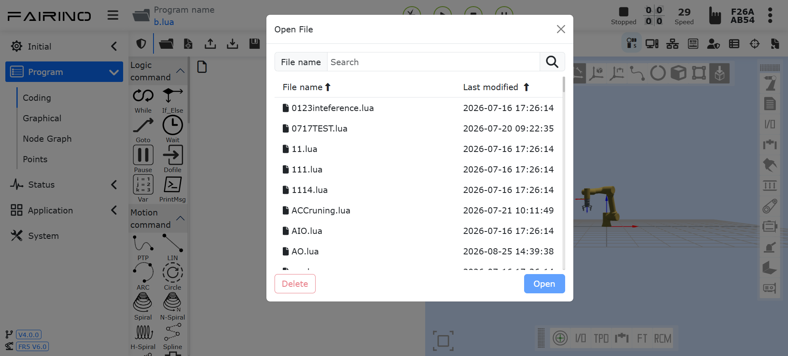

.. centered:: Figura 9.3-1 Ordenación de nombres de programa

Comandos de programa
~~~~~~~~~~~~~~~~~~~~~~~

La parte izquierda es principalmente el área de adición de comandos de programa; hacer clic en el icono situado encima de cada palabra clave permite entrar en la interfaz detallada de adición de comandos de programa de la derecha. La operación de añadir comandos de programa al archivo se divide principalmente en dos tipos:

- 1. Abrir la instrucción correspondiente y hacer clic en el botón aplicar para añadir esa instrucción al programa;
- 2. Hacer clic primero en el botón "Añadir"; en este momento el comando no se ha guardado en el archivo de programa y es necesario hacer clic además en "Aplicar" para guardar el comando en el archivo.

El segundo modo aparece principalmente en casos de envío de varias instrucciones del mismo tipo; para este tipo de comandos se ha añadido un botón de añadir y una función de visualización del contenido de las instrucciones ya añadidas; hacer clic en el botón añadir permite añadir una instrucción; el área de instrucciones añadidas muestra todas las instrucciones ya añadidas; hacer clic en "Aplicar" permite guardar las instrucciones añadidas en el archivo abierto a la derecha.

Interfaz de instrucciones lógicas
~~~~~~~~~~~~~~~~~~~~~~~~~~~~~~~~~~

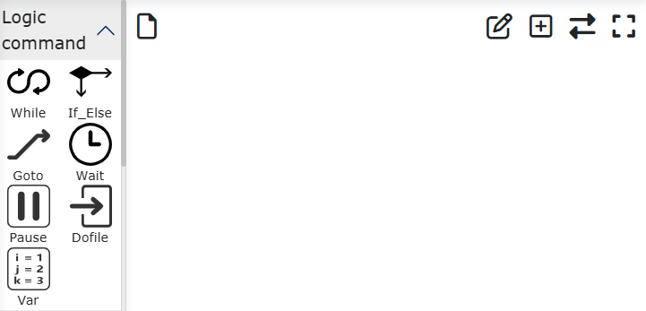

.. centered:: Figura 9.4 Interfaz de instrucciones lógicas

Comando de bucle
++++++++++++++++

Hacer clic en el icono "Bucle" para entrar en la interfaz de edición del comando While.

Seleccionar el escenario de bucle del comando While, cuyos escenarios son los siguientes:

- Bucle siempre
- Bucle de número finito de veces: introducir el número de repeticiones y el nombre de la variable
- Bucle cuando la expresión es verdadera: hacer clic en el cuadro de entrada para que aparezca el editor de expresiones y seleccionar la expresión correspondiente según la situación de uso

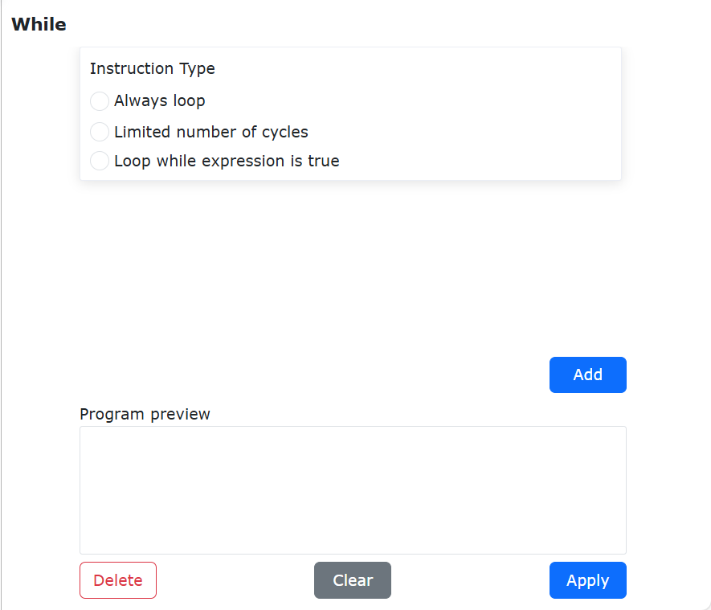

.. centered:: Figura 9.4-1-1 Interfaz de la instrucción While

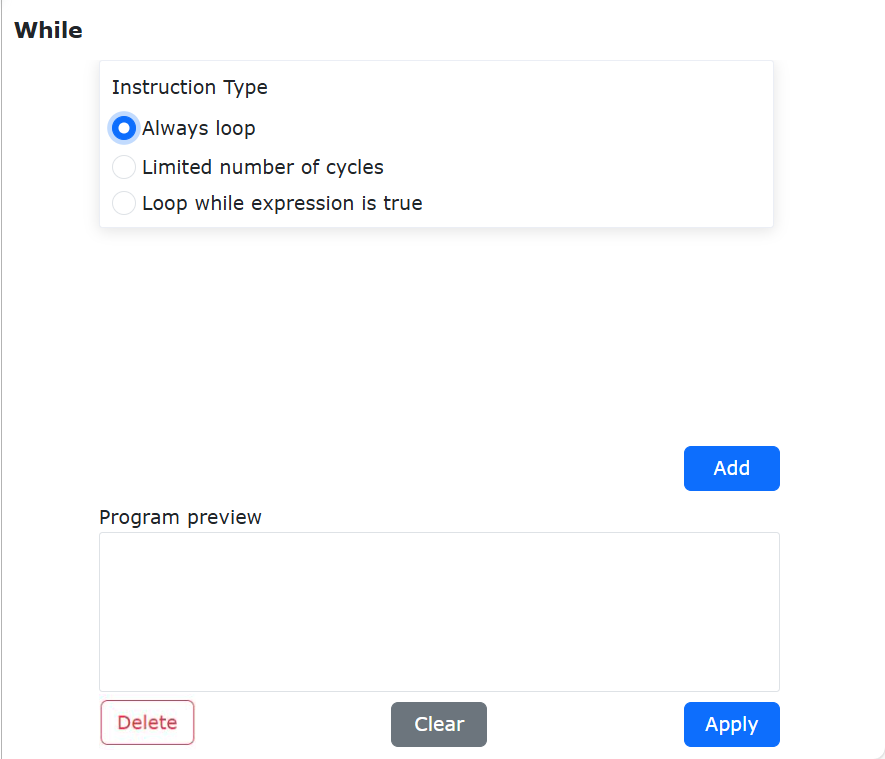

.. centered:: Figura 9.4-1-2 Instrucción While——Bucle siempre

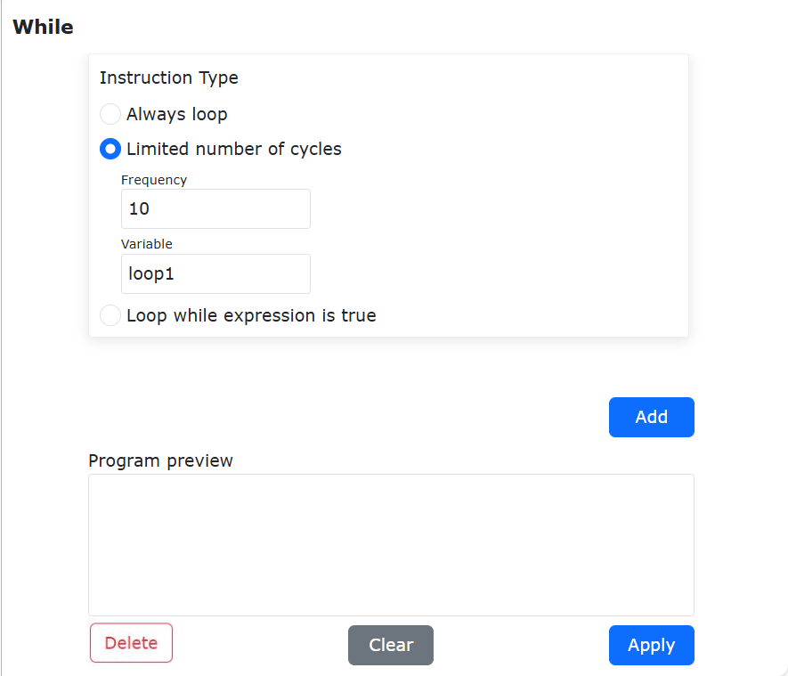

.. centered:: Figura 9.4-1-3 Instrucción While——Bucle de número finito de veces

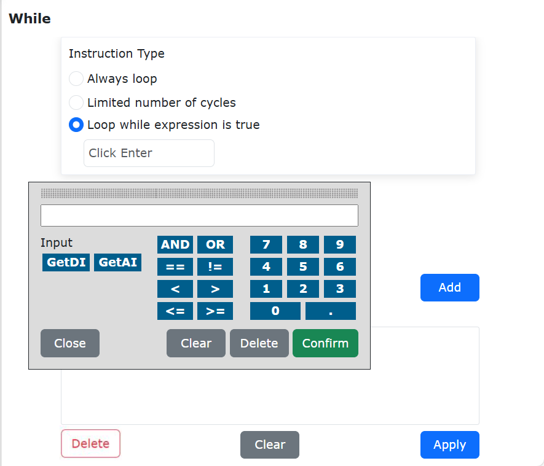

.. centered:: Figura 9.4-1-4 Instrucción While——Editor de expresiones

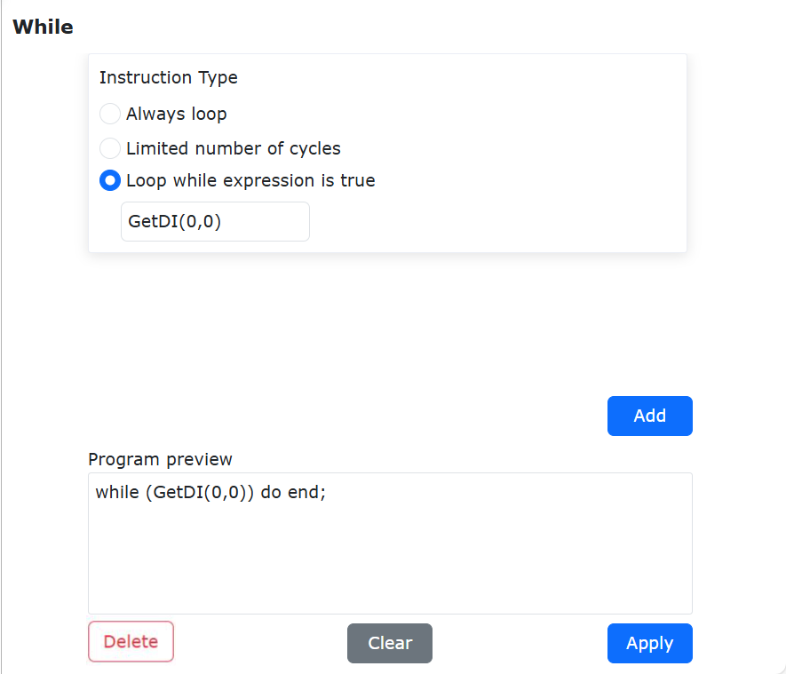

.. centered:: Figura 9.4-1-5 Instrucción While——Bucle cuando la expresión es verdadera

Para facilitar la operación, se puede introducir arbitrariamente el contenido do y editarlo en el programa sustituyéndolo por otras instrucciones insertadas.

Comando de juicio
++++++++++++++++++++++++++++

Hacer clic en el botón "Juicio" para entrar en la interfaz de edición del comando if…else.

Este comando incluye los siguientes botones:

- Añadir else if: cuando no existe la expresión "else", hacer clic en este botón para añadir la expresión "else if"
- Eliminar else if: cuando existe la expresión "else if", hacer clic en este botón para eliminar la expresión "else if"
- Añadir else: hacer clic en este botón para añadir la expresión "else"
- Eliminar else: hacer clic en este botón para eliminar la expresión "else"

Tras hacer clic en el botón correspondiente para añadir, hacer clic en el cuadro de entrada para que aparezca el editor de expresiones y seleccionar la expresión correspondiente según la situación de uso. Una vez completada la adición, hacer clic en "Añadir" y "Aplicar".

Esta instrucción requiere cierta base de programación; si necesita ayuda, póngase en contacto con nosotros.

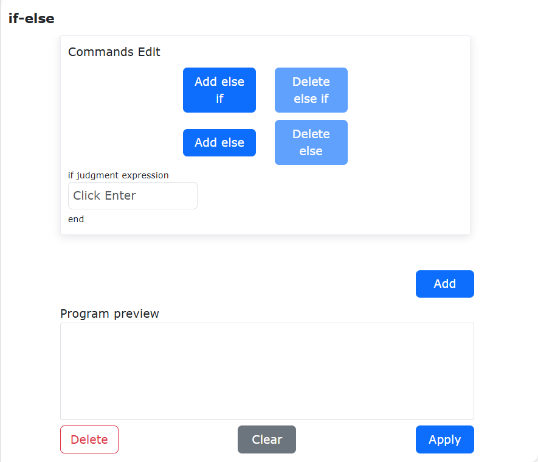

.. centered:: Figura 9.4-2 Interfaz de la instrucción if…else

Comando de salto
++++++++++++++++

Hacer clic en el botón "Salto" para entrar en la interfaz de edición del comando Goto.

La instrucción Goto es una instrucción de salto; introducir la sentencia en el cuadro de entrada de la derecha y, tras completar la edición, hacer clic en "Añadir" y "Aplicar". (Esta instrucción requiere cierta base de programación; si necesita ayuda, póngase en contacto con nosotros)

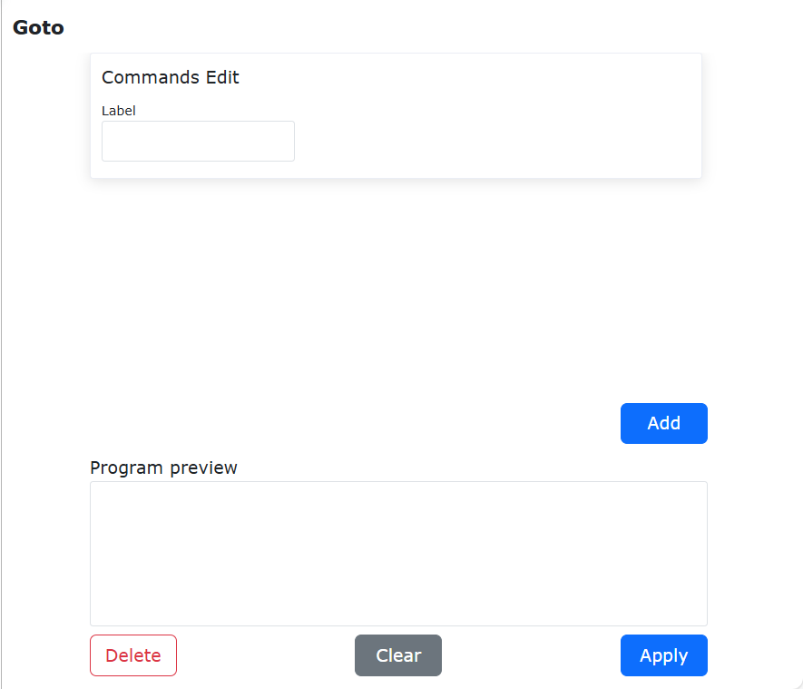

.. centered:: Figura 9.4-3 Interfaz de la instrucción Goto

Comando de espera
++++++++++++++++++++++++++++

Hacer clic en el icono "Espera" para entrar en la interfaz de edición del comando Wait.

Esta instrucción es una instrucción de retardo y se divide en tres partes: "WaitMs", "WaitDI" y "WaitAI".

La unidad de tiempo de espera de retardo de la instrucción "WaitTime" es el milisegundo; introducir el número de milisegundos que se desea esperar y hacer clic en "Añadir" y "Aplicar".

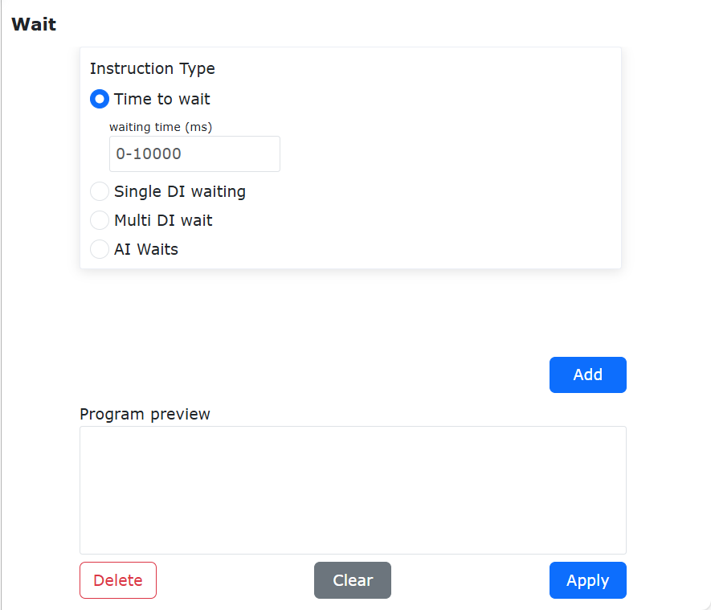

.. centered:: Figura 9.4-4 Interfaz de la instrucción WaitTime

La instrucción "WaitDI", es decir, espera de un solo DI: seleccionar el número de puerto IO que se desea esperar, el estado de espera, el tiempo máximo de espera y el modo de tratamiento del tiempo de espera agotado, y hacer clic en "Añadir" y "Aplicar".

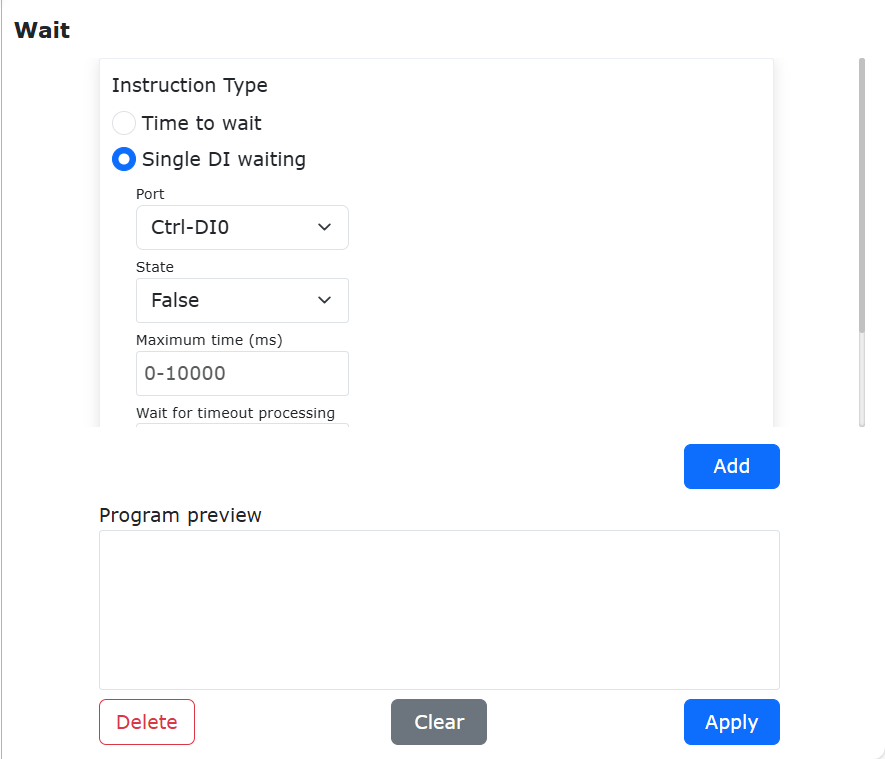

.. centered:: Figura 9.4-5 Interfaz de la instrucción WaitDI

La instrucción "WaitMultiDI", es decir, espera de múltiples DI: seleccionar primero la condición de cumplimiento de múltiples DI, a continuación marcar los puertos y estados DI que se desean esperar y, por último, configurar el tiempo máximo de espera y el modo de tratamiento del tiempo de espera agotado, y hacer clic en "Añadir" y "Aplicar".

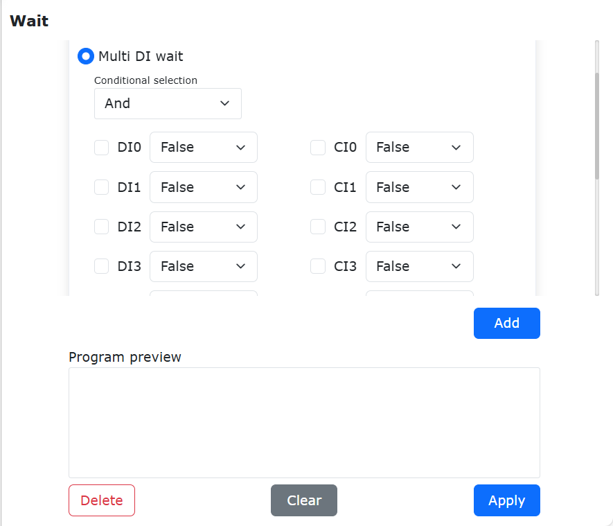

.. centered:: Figura 9.4-6 Interfaz de la instrucción WaitMultiDI

La instrucción "WaitAI": seleccionar la señal analógica que se desea esperar, el valor, el tiempo máximo de espera y el modo de tratamiento del tiempo de espera agotado, y hacer clic en "Añadir" y "Aplicar".

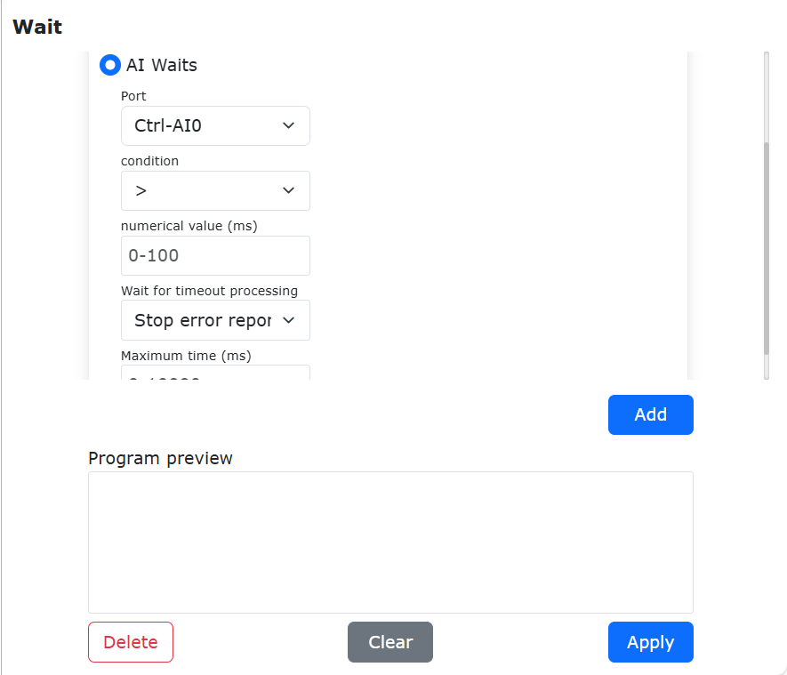

.. centered:: Figura 9.4-7 Interfaz de la instrucción WaitAI

Comando de pausa
++++++++++++++++

Hacer clic en el icono "Pausa" para entrar en la interfaz de edición del comando Pause.

Esta instrucción es una instrucción de pausa; al insertar esta instrucción en el programa, cuando el programa llegue a esta instrucción el robot entrará en estado de pausa; si se desea continuar la ejecución, basta con hacer clic en el botón "Pausa/Reanudar" del área de control.

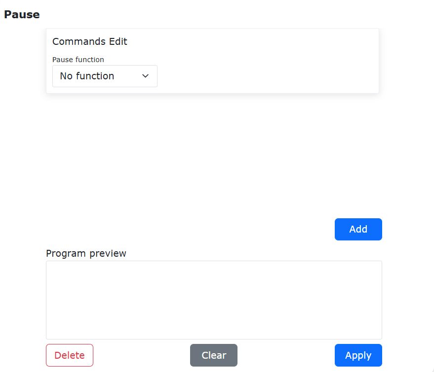

.. centered:: Figura 9.4-8 Interfaz de la instrucción Pause

Comando de subprograma
++++++++++++++++++++++++

Hacer clic en el icono "Subprograma" para entrar en la interfaz de edición del comando Dofile.

La instrucción Dofile llama a programas internos del controlador; para utilizar la instrucción Dofile es necesario guardar el subprograma llamado, mientras que el programa principal, si no ha cambiado, no necesita volver a guardarse. La instrucción Dofile admite llamadas de dos niveles; es necesario prestar atención a dos configuraciones de parámetros: una es en qué nivel se encuentra la llamada y otra es el número de ID de la llamada; en principio, un mismo programa no puede tener el mismo ID.

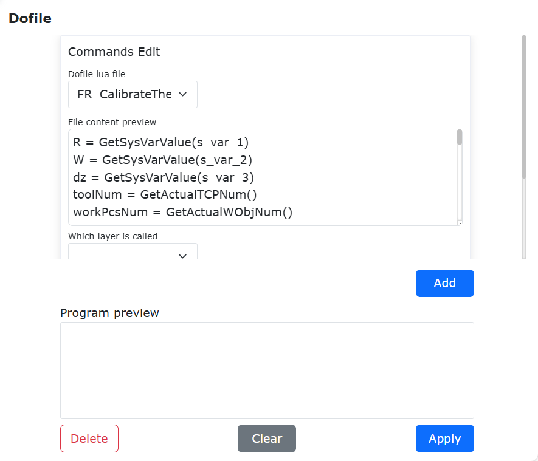

.. centered:: Figura 9.4-9 Interfaz de la instrucción Dofile

Comando de variable
++++++++++++++++++++++++

Hacer clic en el icono "Variable" para entrar en la interfaz de edición del comando Var.

Esta instrucción es una instrucción del sistema de variables y se divide en dos partes: definición de variables Lua, consulta de variables y cambio de nombre de variables Sys, obtención de valores y establecimiento de valores. La definición de variables Lua permite declarar una variable y asignarle un valor inicial, y se utiliza junto con instrucciones como while, if-else, etc.; la instrucción de consulta de variables Lua permite consultar en tiempo real el valor del nombre de variable introducido, mostrándolo en la barra de estado. El número de variables Sys es fijo; se les puede cambiar el nombre, obtener el valor de la variable y establecer el valor de la variable; el valor guardado en esta variable no se borra al apagar el sistema.

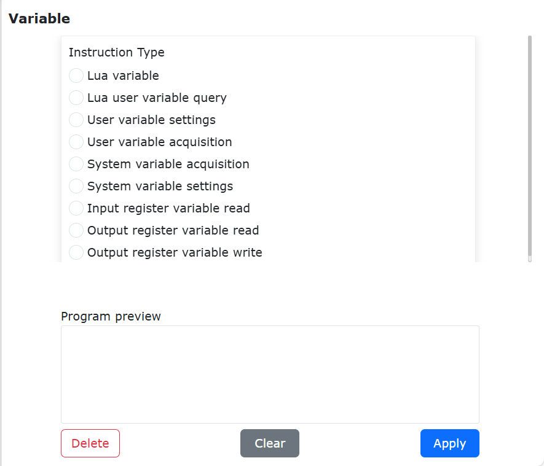

.. centered:: Figura 9.4-10 Interfaz de la instrucción Var

.. important:: El nombre de la variable debe comenzar por una letra o un guion bajo, y no puede comenzar por un número u otro carácter especial.

Interfaz de instrucciones de movimiento
~~~~~~~~~~~~~~~~~~~~~~~~~~~~~~~~~~~~~~~

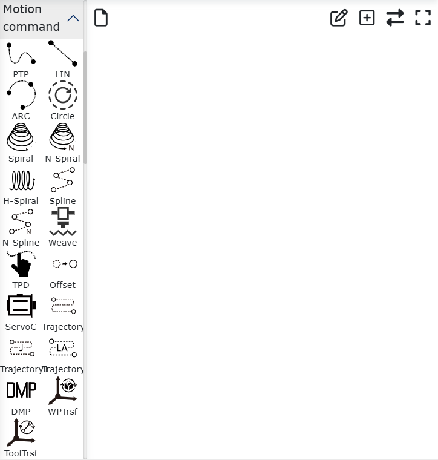

.. centered:: Figura 9.5 Interfaz de instrucciones de movimiento

Comando punto a punto
++++++++++++++++++++++++

Hacer clic en el icono "Punto a punto" para entrar en la interfaz de edición del comando PTP.

Se puede seleccionar el punto al que se desea llegar; la configuración del tiempo de transición suave permite que el movimiento de este punto al siguiente sea continuo; la configuración de desplazamiento permite seleccionar el desplazamiento basado en el sistema de coordenadas base y el desplazamiento basado en el sistema de coordenadas de herramienta, y aparece la configuración de los valores de desplazamiento x, y, z, rx, ry, rz; la ruta concreta de PTP es la ruta óptima planificada automáticamente por el controlador de movimiento; tras hacer clic en "Añadir" y "Aplicar" se puede guardar esta instrucción.

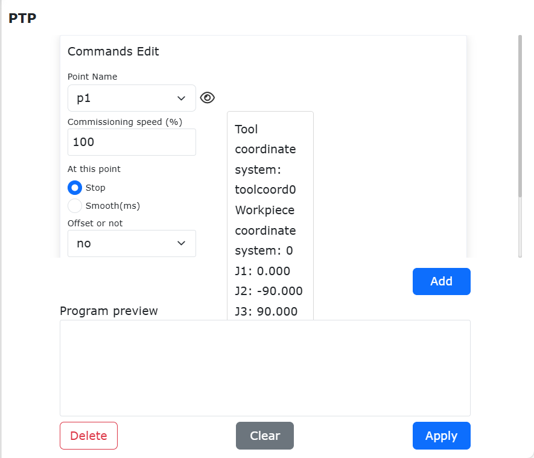

.. centered:: Figura 9.5-1 Interfaz de la instrucción PTP

Movimiento relativo punto a punto
******************************************
El robot se desplaza una cierta distancia de forma relativa desde la posición actual. En la página de adición de la instrucción PTP, seleccionar el nombre de punto "CurrentPos", seleccionar según la situación el sistema de coordenadas de desplazamiento como sistema de coordenadas base, sistema de coordenadas de herramienta o sistema de coordenadas de pieza, e introducir el valor de desplazamiento, es decir, el robot realiza un movimiento de desplazamiento determinado a lo largo del sistema de coordenadas establecido sobre la base de la posición actual. ("CurrentPos" es un punto del sistema y no requiere enseñanza)

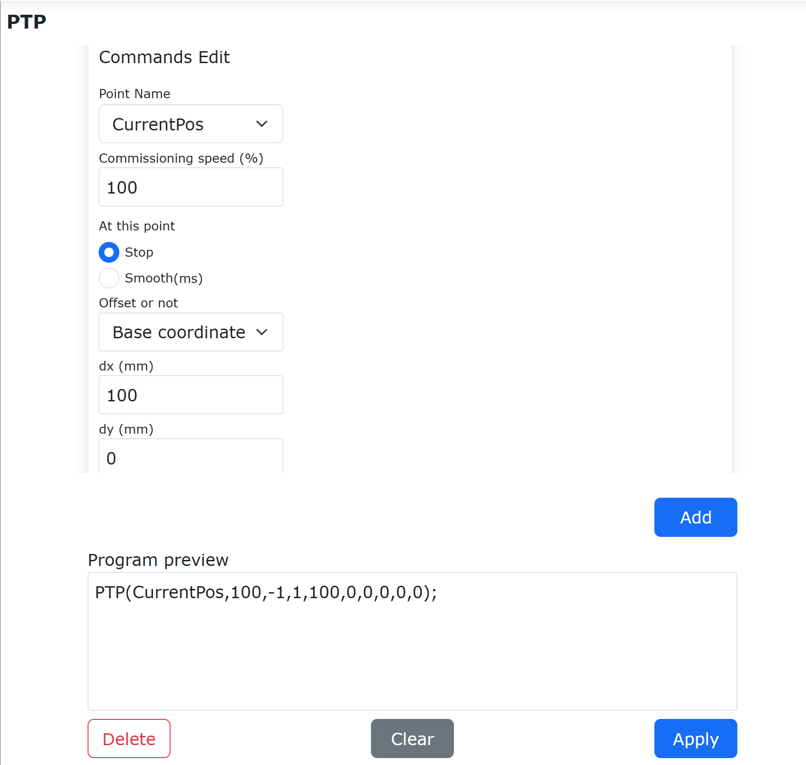

.. centered:: Figura 9.5-1-1 Instrucción de movimiento relativo PTP

Hacer clic en los botones "Añadir" y "Aplicar" para añadir una instrucción de movimiento relativo PTP del robot al programa lua. Cambiar el robot al modo automático y hacer clic en el botón de inicio; en el programa de ejemplo, el robot se desplazará desde la posición actual 100 mm en la dirección X+ del sistema de coordenadas base.

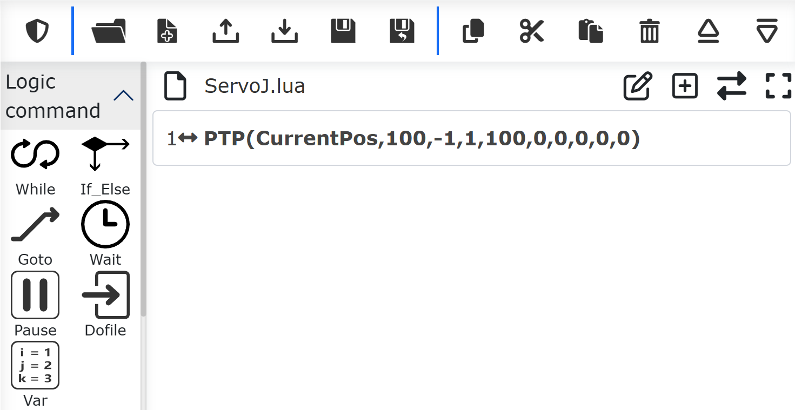

.. centered:: Figura 9.5-1-2 Adición de la instrucción de movimiento relativo PTP

Comando de línea recta
++++++++++++++++++++++++++++++++

Hacer clic en el icono "Línea recta" para entrar en la interfaz de edición del comando Lin.

La función de esta instrucción es similar a la de la instrucción "PTP", pero la ruta hasta el punto alcanzado por esta instrucción es una línea recta.

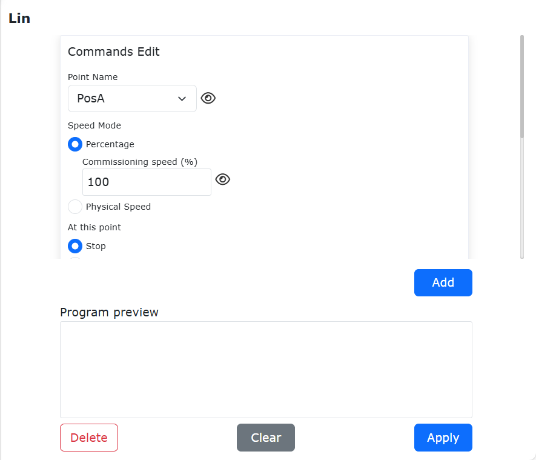

.. centered:: Figura 9.5-2 Interfaz de la instrucción Lin

Movimiento relativo en línea recta
******************************************
El robot se desplaza una cierta distancia de forma relativa en línea recta desde la posición actual. En la página de adición de la instrucción LIN, seleccionar el nombre de punto "CurrentPos", seleccionar según la situación el sistema de coordenadas de desplazamiento como sistema de coordenadas base, sistema de coordenadas de herramienta o sistema de coordenadas de pieza, e introducir el valor de desplazamiento, es decir, el robot realiza un movimiento de desplazamiento determinado a lo largo del sistema de coordenadas establecido sobre la base de la posición actual. ("CurrentPos" es un punto del sistema y no requiere enseñanza)

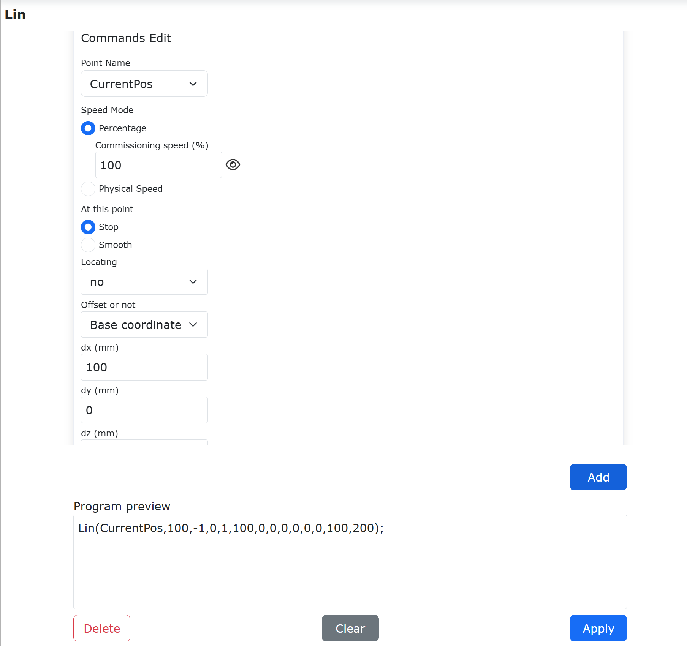

.. centered:: Figura 9.5-2-1 Instrucción de movimiento relativo LIN

Hacer clic en los botones "Añadir" y "Aplicar" para añadir una instrucción de movimiento relativo en línea recta del robot al programa lua. Cambiar el robot al modo automático y hacer clic en el botón de inicio; en el programa de ejemplo, el robot se desplazará desde la posición actual 100 mm en la dirección X+ del sistema de coordenadas base.

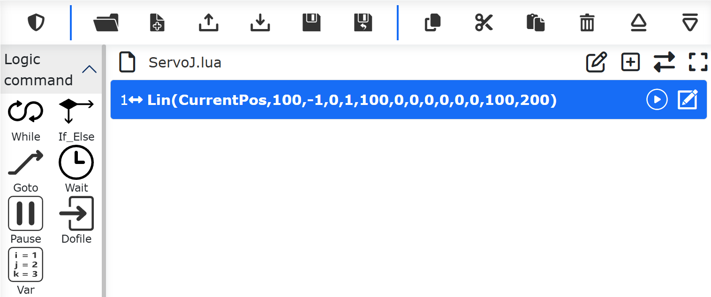

.. centered:: Figura 9.5-2-2 Adición de la instrucción de movimiento relativo LIN
 
El movimiento relativo en línea recta del robot admite funciones como suavizado, velocidad física y búsqueda de posición del alambre de soldadura.

.. important:: Cuando se selecciona el nombre de punto "seamPos", el comando de línea recta se aplica al uso del sensor láser en escenarios de soldadura. Debido al error acumulado de funcionamiento en el uso de la soldadura, se añaden "¿Desplazamiento?" y "Valor de desplazamiento".

   **¿Desplazamiento?**: No, desplazamiento del sistema de coordenadas base, desplazamiento del sistema de coordenadas de herramienta, desplazamiento de datos originales del láser;

   **Valor de desplazamiento**: ∆x, ∆y, ∆z, ∆rx, ∆ry, ∆rz, rango: -300~300;

   .. image:: coding/033.png
      :width: 6in
      :align: center

   .. centered:: Figura 9.5-2-3 Interfaz de la instrucción Lin (escenario de soldadura)

La instrucción LIN permite seleccionar el modo de velocidad de movimiento como "Porcentaje" o "Velocidad física":

- Porcentaje: introducir el porcentaje de velocidad de depuración; el robot se mueve según el porcentaje de la velocidad máxima; la velocidad real de movimiento del robot se convierte en: V = velocidad máxima del robot × porcentaje de velocidad global × porcentaje de velocidad de depuración. Al pasar el ratón sobre el pequeño ojo situado a la derecha del cuadro de entrada "Velocidad de depuración", se mostrará la velocidad física real del robot en modo manual y en modo automático con la velocidad de depuración configurada actualmente (unidad: mm/s).

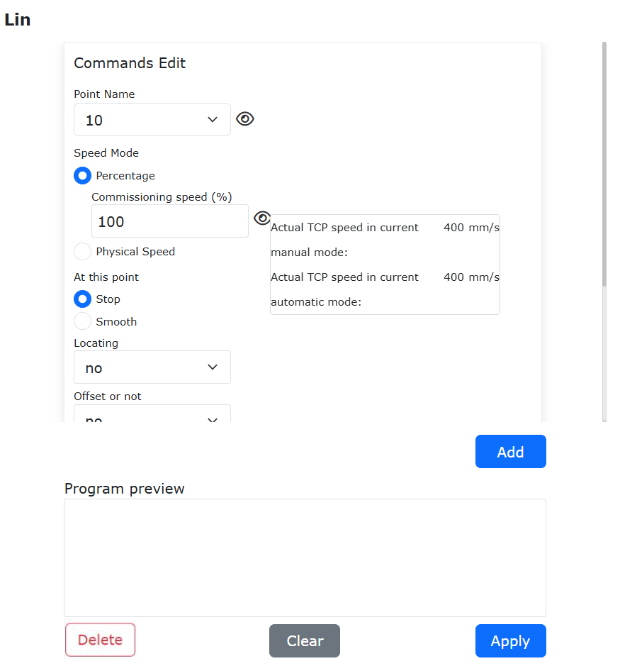

.. centered:: Figura 9.5-2-4 Introducir porcentaje y mostrar el valor de velocidad física real

- Velocidad física: la velocidad introducida es la velocidad real de funcionamiento del robot, en unidades de mm/s; la aceleración introducida suele configurarse como el doble de la velocidad. (La velocidad física máxima de la instrucción LIN está limitada por el porcentaje de velocidad global; si la velocidad máxima de funcionamiento del robot es 1000 mm/s y la velocidad global es del 50%, la velocidad física máxima de la instrucción LIN es 1000 × 50% = 500 mm/s).

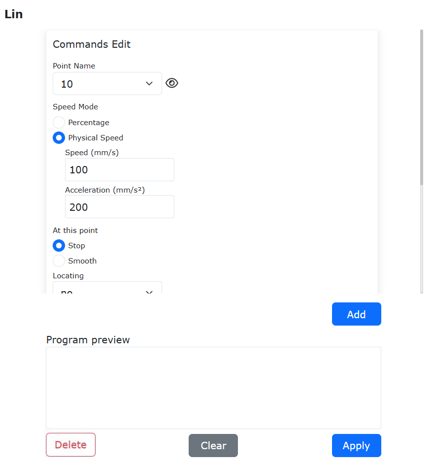

.. centered:: Figura 9.5-2-5 Introducir la velocidad física real

Función de tratamiento de sobrevelocidad articular de la instrucción LIN
*********************************************************************************

Al utilizar la instrucción de movimiento lineal en el espacio cartesiano LIN, la condición de planificación restringida es la velocidad lineal, pero en el funcionamiento real, debido a la influencia del espacio de trabajo, al cumplir el requisito de velocidad lineal la velocidad angular articular puede haber superado el límite. Esta función implementa estrategias de tratamiento opcionales para afrontar situaciones de sobrevelocidad articular en el movimiento LIN.

**Step1**: Hacer clic en el botón de la instrucción de movimiento en línea recta;

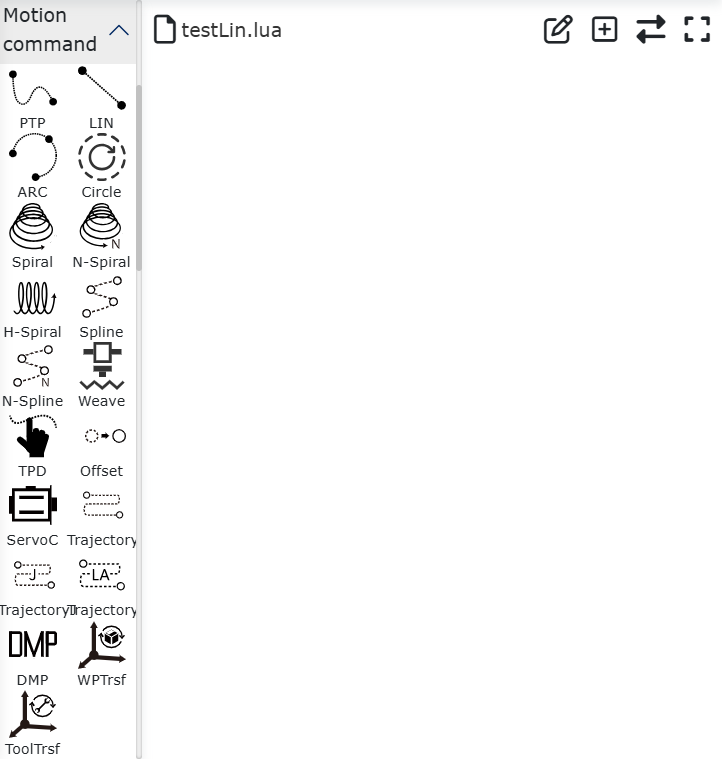

.. centered:: Figura 9.5-3-1 Hacer clic en el botón de la instrucción de movimiento en línea recta

**Step2**: Seleccionar el punto de ruta objetivo de la instrucción de movimiento en línea recta;

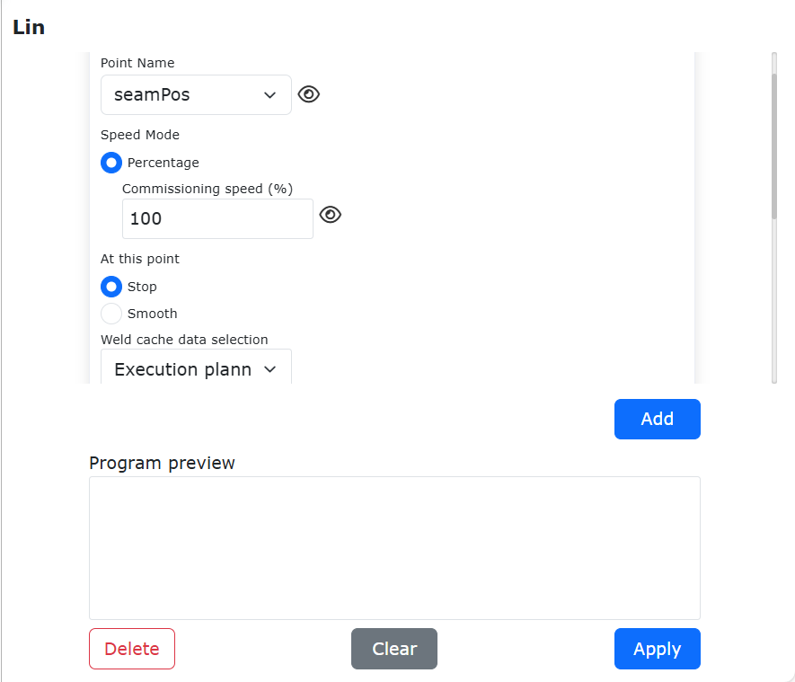

.. centered:: Figura 9.5-3-2 Seleccionar el punto de ruta objetivo del movimiento en línea recta

**Step3**: Activar el interruptor de protección contra sobrevelocidad articular;

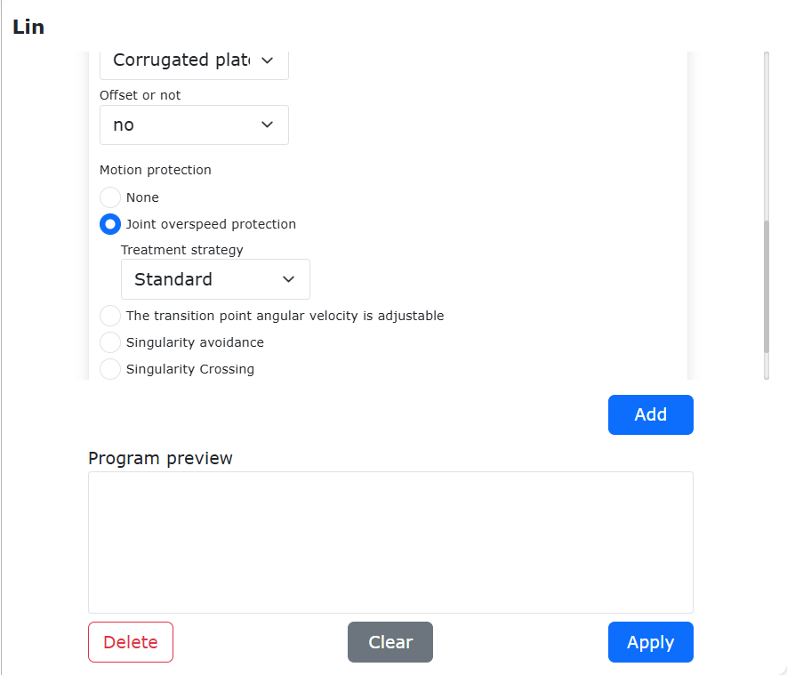

.. centered:: Figura 9.5-3-3 Botón de activación del interruptor de protección contra sobrevelocidad articular

**Step4**: Seleccionar la estrategia de tratamiento de sobrevelocidad articular (seleccionar error por sobrevelocidad o reducción adaptativa de velocidad; las demás son estrategias predeterminadas sin protección);

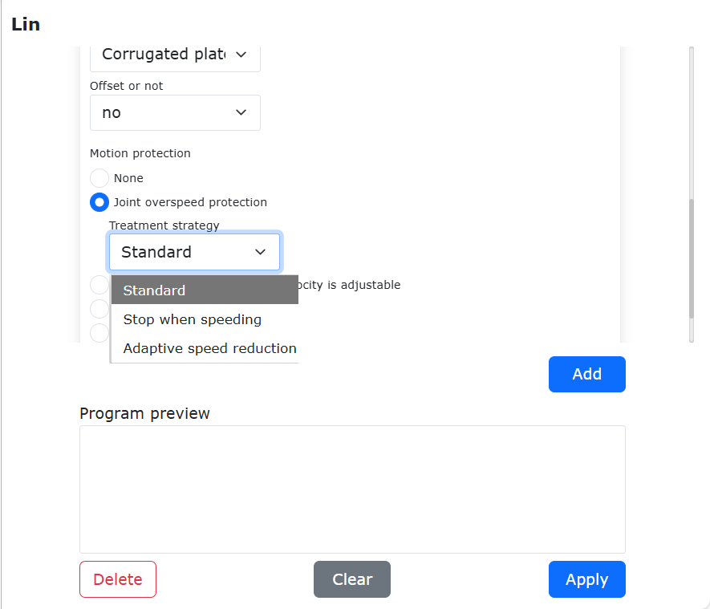

.. centered:: Figura 9.5-3-4 Estrategia de tratamiento de sobrevelocidad articular

**Step5**:
   Configurar la estrategia de tratamiento y los parámetros de la estrategia de tratamiento, y hacer clic en el botón añadir para añadir la instrucción lua;

   En la estrategia de reducción adaptativa de velocidad, el umbral de deceleración es el porcentaje de la reducción de velocidad lineal respecto a la velocidad lineal establecida; cuando el valor de deceleración supera el umbral establecido, el robot informa de un error y se detiene.

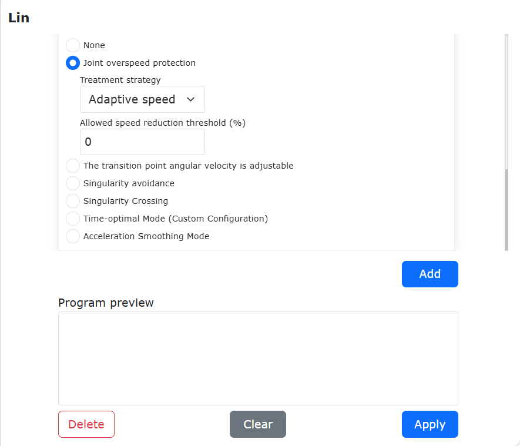

.. centered:: Figura 9.5-3-5 Selección y configuración de la estrategia de tratamiento de sobrevelocidad articular

**Step6**: La instrucción lua añadida tiene la forma mostrada en la figura;

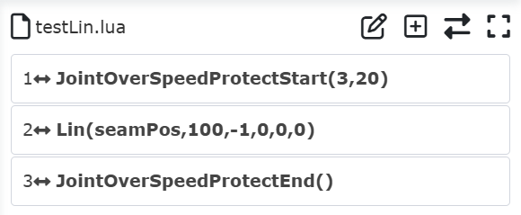

.. centered:: Figura 9.5-3-6 Instrucción lua

**Inicio de protección contra sobrevelocidad**: JointOverSpeedProtectStart（a，b）;
   a: número de estrategia (consultar el orden del cuadro desplegable)

   b: porcentaje de umbral (0~100, solo efectivo en la reducción adaptativa de velocidad)

**Fin de protección contra sobrevelocidad**: JointOverSpeedProtectEnd（）;

.. note:: Para la protección de movimiento "cruce de puntos singulares", consulte la descripción de la función de cruce de puntos singulares en modo automático.

Función de ajuste de la velocidad angular de transición de actitud de envolvente de esquina
************************************************************************************************************

Cuando durante el proceso de soldadura se encuentren piezas que requieran soldadura de envolvente de esquina, o en el caso de una planificación de línea recta específica (cambio de actitud grande y cambio de posición pequeño, pero que requiera una transición rápida sin poder acelerar la velocidad lineal), se puede utilizar esta función para completarlo.

**Step1**: Configurar el sistema de coordenadas de herramienta y calibrar las dimensiones y la actitud de la antorcha de soldadura.

.. note:: Los valores de la interfaz son solo ejemplos; prevalecerá el estado real de la herramienta.

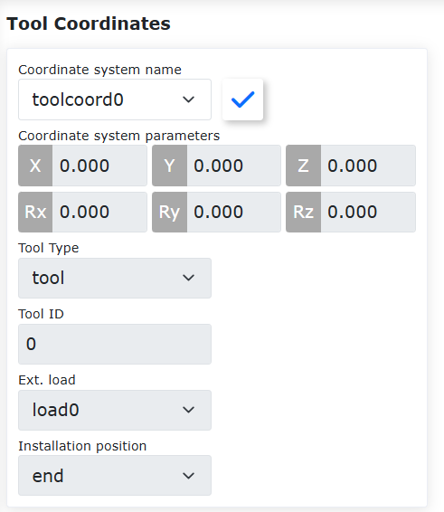

.. centered:: Figura 9.5-3-7 Configuración del sistema de coordenadas de herramienta

**Step2**: Hacer clic en "Programa de enseñanza", seleccionar "Programación de programas" y, en la categoría "Instrucciones de movimiento", seleccionar "Línea recta".

.. centered:: Figura 9.5-3-8 Interfaz de configuración de la instrucción de línea recta

**Step3**: Configurar el punto inicial de cada segmento de línea recta de la soldadura de envolvente de esquina como punto de transición, activar el botón "Velocidad angular de punto de transición ajustable" y configurar el porcentaje de aceleración máxima (por defecto, la velocidad angular máxima del 100% es 360°/s).

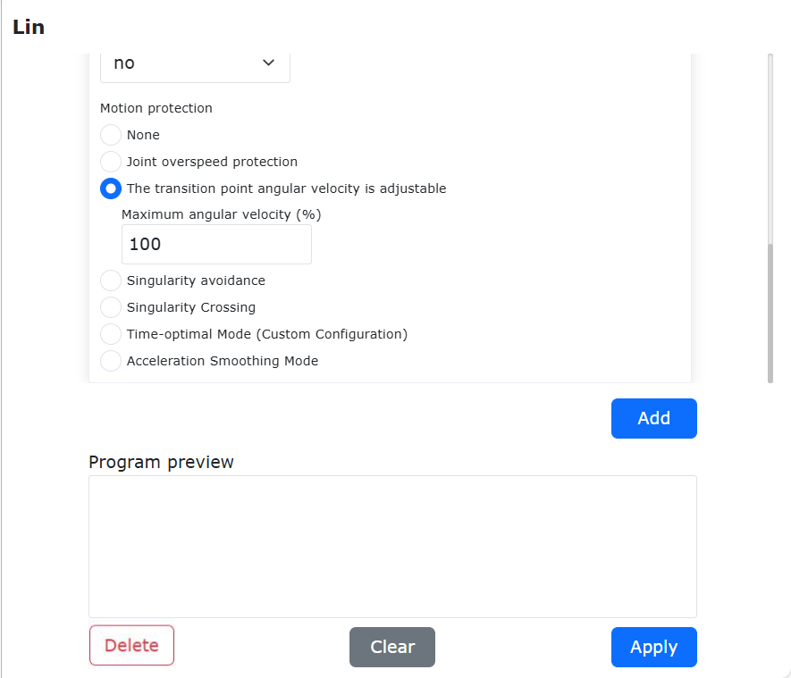

.. centered:: Figura 9.5-3-9 Interfaz de configuración de parámetros de ajuste de la velocidad angular del punto de transición

**Step4**: Hacer clic en el botón "Añadir" para generar la instrucción de línea recta que incluye el ajuste de la velocidad angular de la actitud de transición.

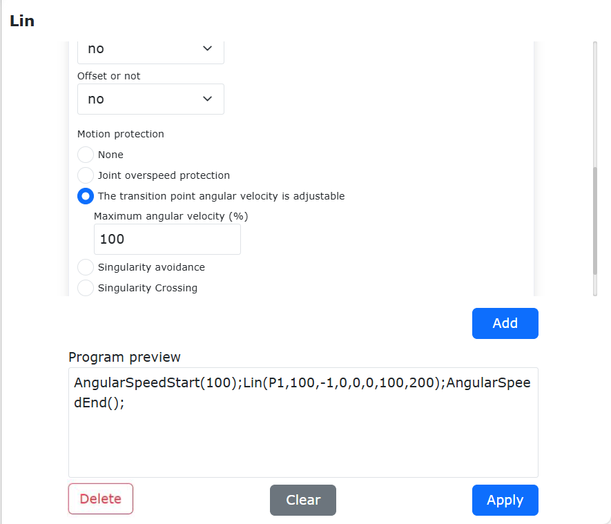

.. centered:: Figura 9.5-3-10 Adición de la instrucción de movimiento en línea recta con punto de transición

**Step5**: El robot completa la transición de actitud en el punto inicial, ejecuta normalmente la instrucción de línea recta hasta el punto final de ese segmento y desactiva el botón "Velocidad angular de punto de transición ajustable" para añadir el punto de ruta final.

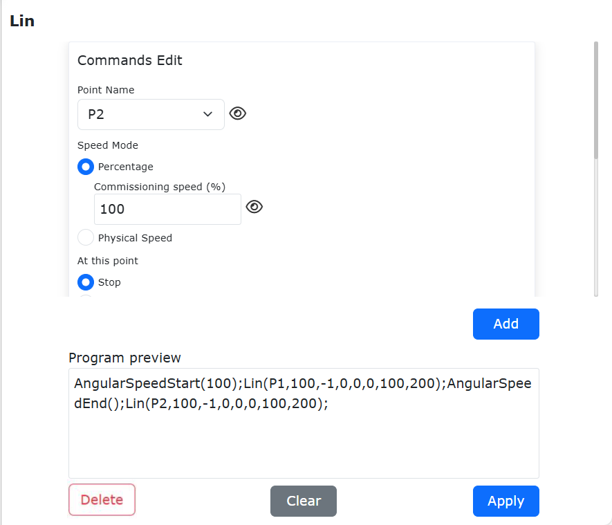

.. centered:: Figura 9.5-3-11 Inserción del punto final de la línea recta

**Step6**: Hacer clic en el botón "Aplicar" para generar la instrucción LUA correspondiente.

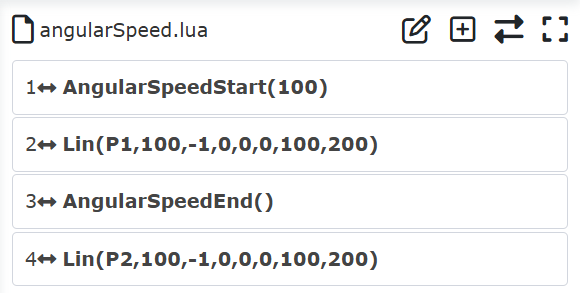

.. centered:: Figura 9.5-3-12 Generación de la instrucción LUA de línea recta con punto de transición

Un conjunto completo de soldadura de envolvente de esquina suele tener varios puntos de transición; en el caso de envolvente de esquina mostrado en la Figura 7, durante el proceso de soldadura hay dos puntos de transición de actitud con cambio de posición pequeño y cambio de actitud grande.

El punto 1 es el inicio de la primera etapa de soldadura, el punto 2 es el final de la primera etapa de soldadura;

El punto 3 es el inicio de la segunda etapa de soldadura, el punto 4 es el final de la segunda etapa de soldadura;

El punto 5 es el inicio de la tercera etapa de soldadura, el punto 6 es el final de la tercera etapa de soldadura.

La transición de actitud se produce desde el final de la etapa de soldadura anterior hasta el inicio de la siguiente etapa de soldadura, por lo que es necesario añadir la instrucción de ajuste de la velocidad angular de actitud en el punto inicial de la siguiente etapa de soldadura, de modo que durante la transición de actitud de envolvente de esquina la velocidad lineal máxima se mantenga invariable y la velocidad angular máxima aumente, haciendo que el proceso de soldadura de envolvente de esquina se ejecute de forma fluida.

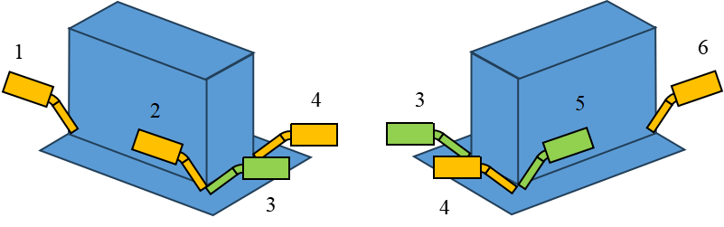

.. centered:: Figura 9.5-3-13 Ejemplo de flujo de soldadura de envolvente de esquina

Comando de arco
++++++++++++++++

Hacer clic en el icono "Arco" para entrar en la interfaz de edición del comando Arc.

La instrucción "Arc" es un movimiento en arco e incluye tres puntos: el primer punto es el punto inicial del arco, el segundo punto es el punto de transición intermedio del arco y el tercer punto es el punto final.

Tanto el punto de transición como el punto final permiten configurar si hay desplazamiento, pudiendo seleccionar desplazamiento basado en el sistema de coordenadas base, desplazamiento basado en el sistema de coordenadas de herramienta o desplazamiento basado en el sistema de coordenadas de pieza, y aparece la configuración de los valores de desplazamiento x, y, z, rx, ry, rz; el punto final permite configurar el radio de transición suave para lograr un efecto de movimiento continuo.

.. important::
   El movimiento en arco requiere añadir primero una instrucción PTP o Lin para desplazarse primero al punto inicial.

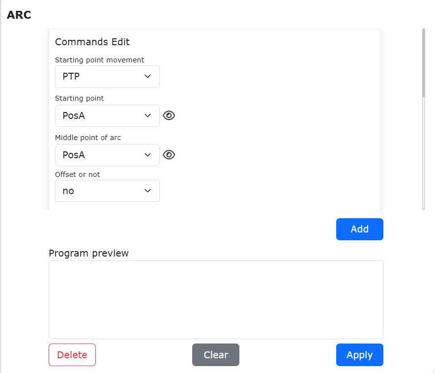

.. centered:: Figura 9.5-4 Interfaz de la instrucción Arc

La instrucción ARC permite seleccionar el modo de velocidad de movimiento como "Porcentaje" o "Velocidad física":

- Porcentaje: introducir el porcentaje de velocidad de depuración; el robot se mueve según el porcentaje de la velocidad máxima; la velocidad real de movimiento del robot se convierte en: V = velocidad máxima del robot × porcentaje de velocidad global × porcentaje de velocidad de depuración. Al pasar el ratón sobre el pequeño ojo situado a la derecha del cuadro de entrada "Velocidad de depuración", se mostrará la velocidad física real del robot en modo manual y en modo automático con la velocidad de depuración configurada actualmente (unidad: mm/s).

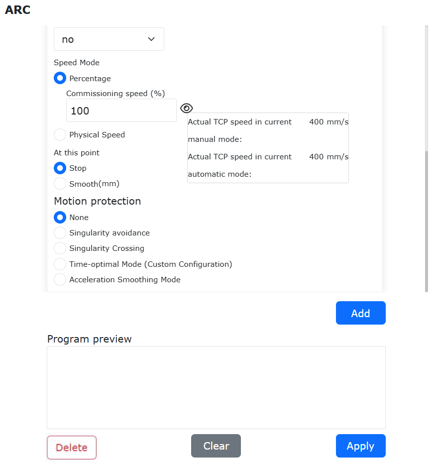

.. centered:: Figura 9.5-4-1 Introducir porcentaje y mostrar el valor de velocidad física real

- Velocidad física: la velocidad introducida es la velocidad real de funcionamiento del robot, en unidades de mm/s; la aceleración introducida suele configurarse como el doble de la velocidad. (La velocidad física máxima de la instrucción LIN está limitada por el porcentaje de velocidad global; si la velocidad máxima de funcionamiento del robot es 1000 mm/s y la velocidad global es del 50%, la velocidad física máxima de la instrucción LIN es 1000 × 50% = 500 mm/s).

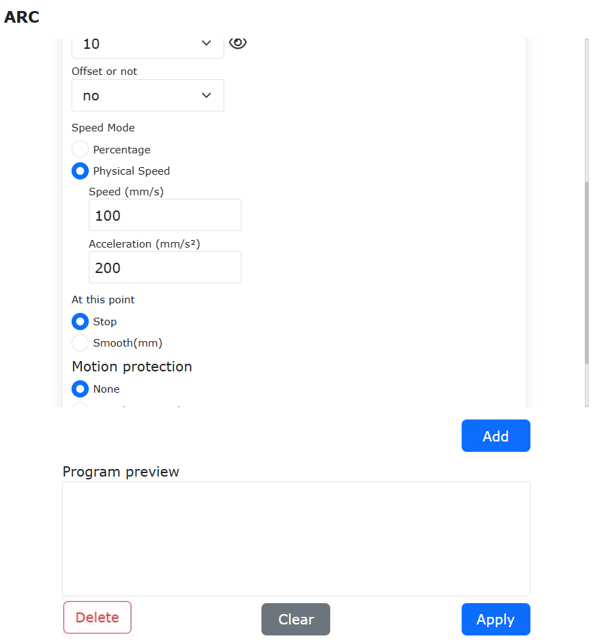

.. centered:: Figura 9.5-4-2 Introducir la velocidad física real

Comando de círculo completo
++++++++++++++++++++++++++++++++

Hacer clic en el icono "Círculo completo" para entrar en la interfaz de edición del comando Circle.

El robot colaborativo puede realizar un movimiento de trayectoria circular completa añadiendo la instrucción de círculo completo; antes de añadir la instrucción de círculo completo es necesario enseñar primero 3 puntos de ruta sobre la trayectoria circular completa. Suponiendo que los tres puntos de ruta sobre la trayectoria circular completa son "P1", "P2" y "P3", donde "P1" es el punto inicial de la trayectoria circular completa y "P2" y "P3" son respectivamente el punto intermedio 1 y el punto intermedio 2 de la trayectoria circular completa, desplazar el robot hasta los tres puntos mencionados y añadir los nombres de los puntos de enseñanza "P1", "P2" y "P3" respectivamente.

.. important::
   El movimiento de trayectoria circular completa requiere añadir primero una instrucción PTP o Lin para desplazarse primero al punto inicial.

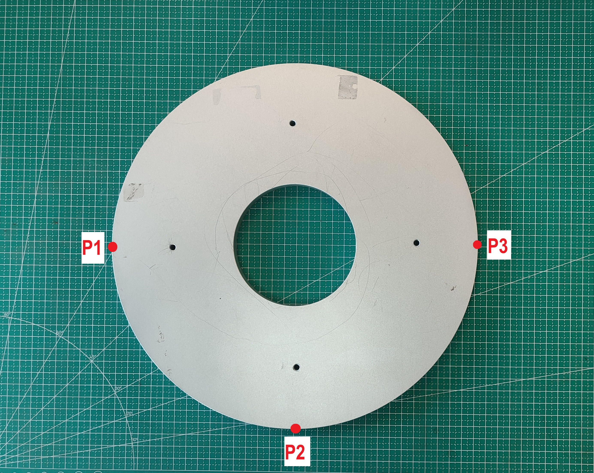

.. centered:: Figura 9.5-5 Trayectoria circular completa

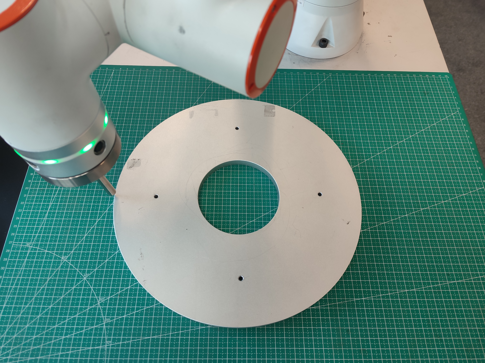

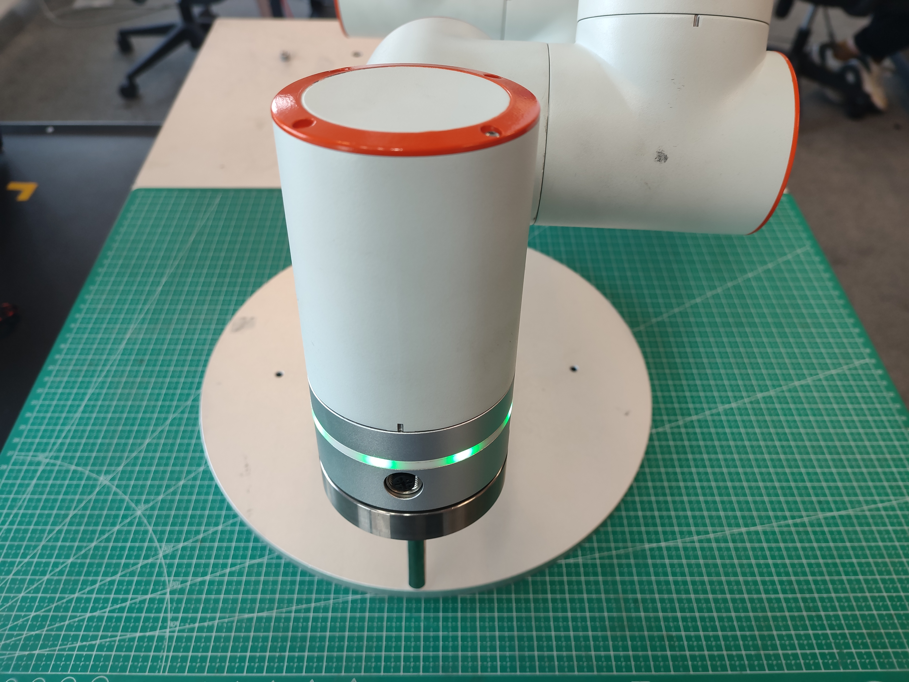

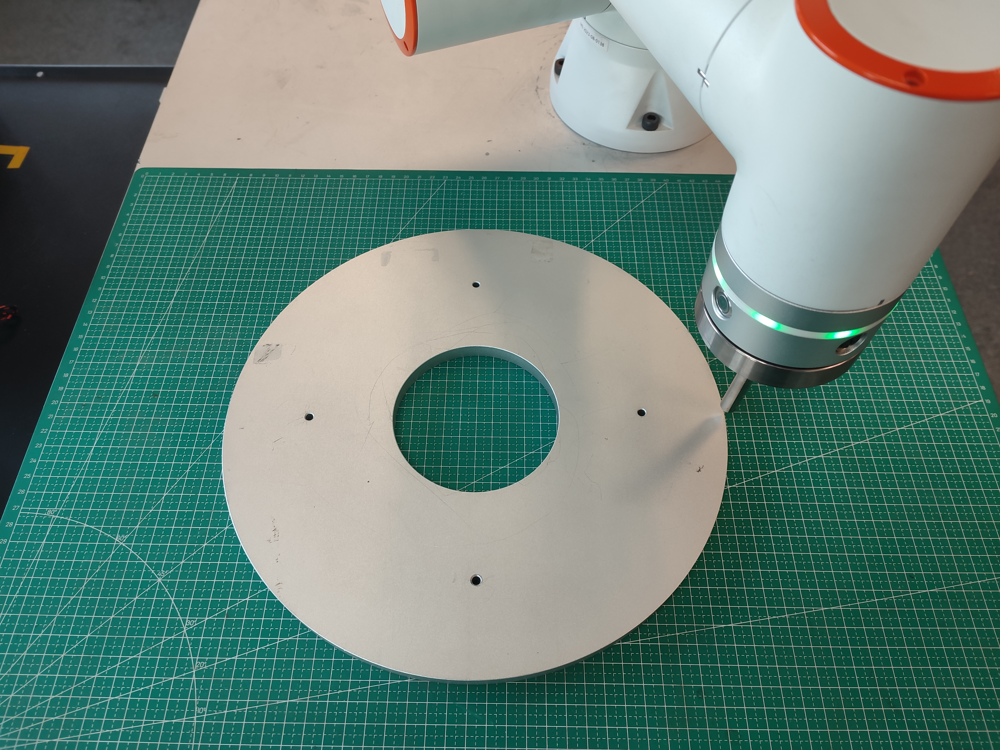

.. centered:: Figura 9.5-6 Enseñanza de los puntos "P1", "P2" y "P3"

Adición de la instrucción de círculo completo
*****************************************************

**Step1**: Crear el programa de usuario "testCircle.lua" y hacer clic en el botón "Círculo completo" para abrir la página de adición de la instrucción de círculo completo.

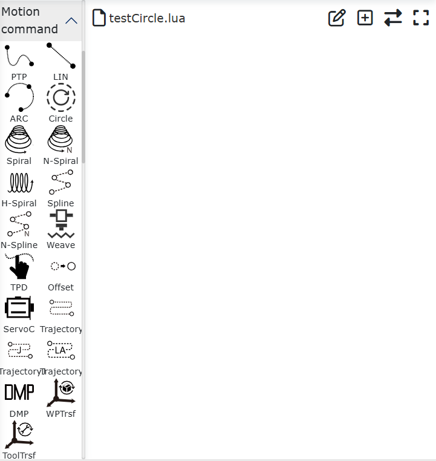

.. centered:: Figura 9.5-7 Botón de adición de la instrucción de círculo completo

**Step2**: En la página de adición de la instrucción de círculo completo, seleccionar el modo de movimiento del punto inicial y el punto inicial "P1".

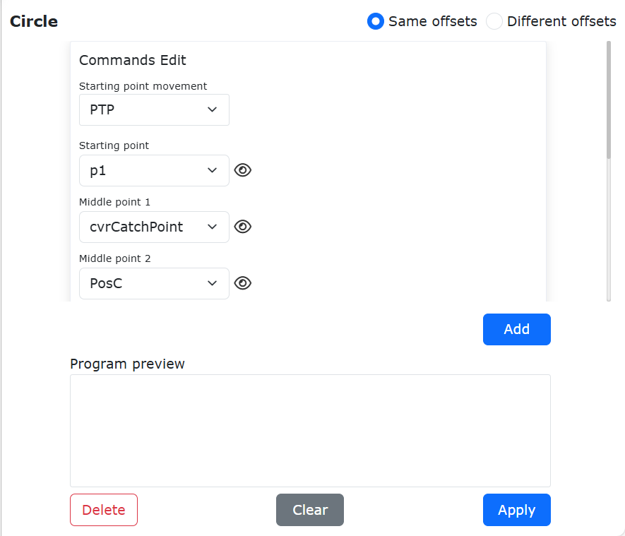

.. centered:: Figura 9.5-8 Modo de movimiento del punto inicial y punto inicial "P1"

**Step3**: En la página de adición de la instrucción de círculo completo, seleccionar "Punto intermedio 1 del círculo completo" como punto "P2" y "Punto intermedio 2 del círculo completo" como punto "P3".

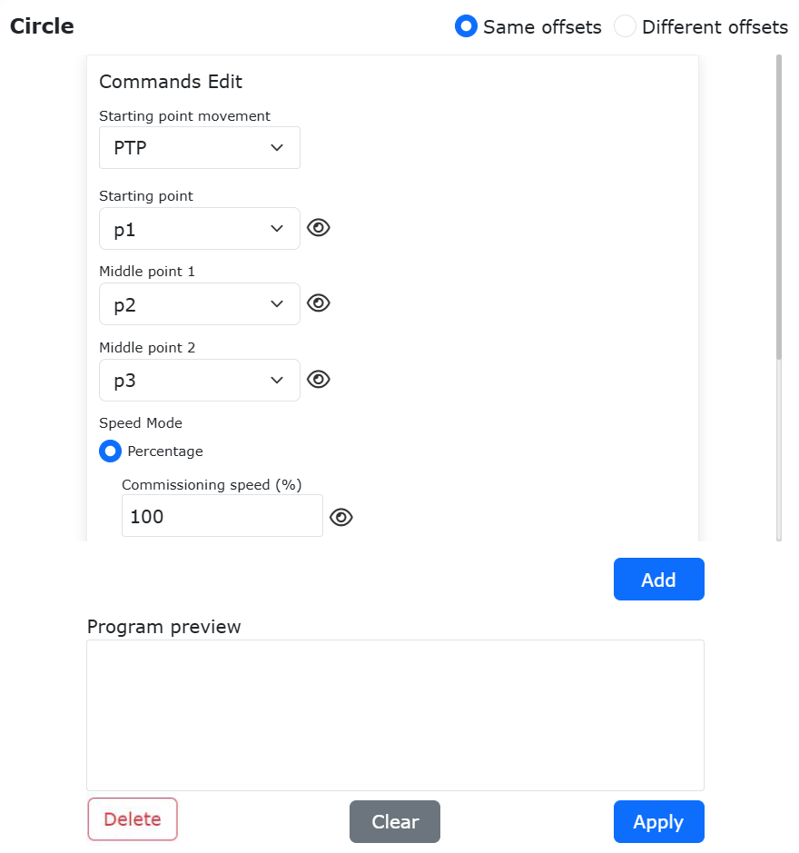

.. centered:: Figura 9.33-9 Selección del punto intermedio y del punto final del arco

**Step4**: Seleccionar el modo de velocidad e introducir el valor de velocidad.

La instrucción Circle permite seleccionar el modo de velocidad de movimiento como "Porcentaje" o "Velocidad física":

- Porcentaje: introducir el porcentaje de velocidad de depuración; el robot se mueve según el porcentaje de la velocidad máxima; la velocidad real de movimiento del robot se convierte en: V = velocidad máxima del robot × porcentaje de velocidad global × porcentaje de velocidad de depuración. Al pasar el ratón sobre el pequeño ojo situado a la derecha del cuadro de entrada "Velocidad de depuración", se mostrará la velocidad física real del robot en modo manual y en modo automático con la velocidad de depuración configurada actualmente (unidad: mm/s).

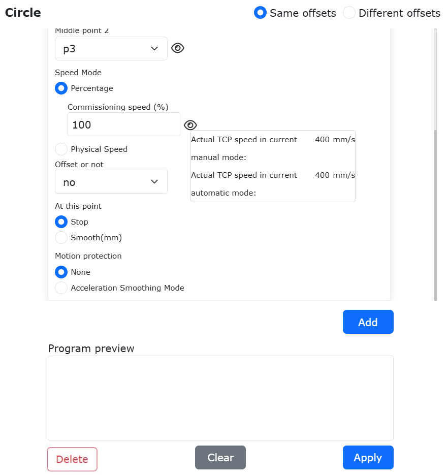

.. centered:: Figura 9.33-10 Introducir porcentaje y mostrar el valor de velocidad física real

- Velocidad física: la velocidad introducida es la velocidad real de funcionamiento del robot, en unidades de mm/s; la aceleración introducida suele configurarse como el doble de la velocidad. (La velocidad física máxima de la instrucción LIN está limitada por el porcentaje de velocidad global; si la velocidad máxima de funcionamiento del robot es 1000 mm/s y la velocidad global es del 50%, la velocidad física máxima de la instrucción LIN es 1000 × 50% = 500 mm/s).

.. centered:: Figura 9.33-11 Introducir la velocidad física real

**Step5**: Hacer clic sucesivamente en el botón "Añadir" y en el botón "Aplicar". En este momento "testCircle.lua" ya tiene añadida la instrucción de movimiento de círculo completo.

.. centered:: Figura 9.33-12 Adición de la instrucción de movimiento de círculo completo

**Step5**: En este momento "testCircle.lua" ya tiene añadida la instrucción de movimiento de círculo completo.

Cambiar el robot al modo automático y, siempre que se garantice la seguridad, iniciar el programa; el robot se desplazará según la trayectoria circular completa.

Desplazamiento de la trayectoria circular completa
*****************************************************

El movimiento de círculo completo del robot colaborativo admite el desplazamiento de la posición del punto intermedio 1 de la trayectoria circular completa y del punto intermedio 2 de la trayectoria circular completa; los tipos de desplazamiento incluyen los dos tipos siguientes:

**Mismo valor de desplazamiento para los dos puntos intermedios de la trayectoria circular completa**: el punto intermedio 1 de la trayectoria circular completa (punto "P2") y el punto intermedio 2 de la trayectoria circular completa (punto "P3") se desplazan con el mismo valor de desplazamiento ∆(dx, dy, dz, drx, dry, drz).

**Valores de desplazamiento diferentes para los dos puntos intermedios de la trayectoria circular completa**: el punto intermedio 1 de la trayectoria circular completa (punto "P2") y el punto intermedio 2 de la trayectoria circular completa (punto "P3") se desplazan respectivamente con dos valores de desplazamiento diferentes ∆1(dx1, dy1, dz1, drx1, dry1, drz1) y ∆2(dx2, dy2, dz2, drx2, dry2, drz2).

A continuación se demuestra respectivamente el uso de "Mismo valor de desplazamiento" y "Valores de desplazamiento diferentes".

1. Mismo valor de desplazamiento

Abrir la página de adición de la instrucción de círculo completo, seleccionar "Mismo valor de desplazamiento" en "Tipo de desplazamiento", seleccionar igualmente el modo de movimiento del punto inicial y el punto inicial "P1", y el punto intermedio 1 del círculo completo como punto "P2".

.. centered:: Figura 9.5-12 Mismo valor de desplazamiento del círculo completo

Seleccionar "P3" como punto intermedio 2 del círculo completo y "Desplazamiento del sistema de coordenadas base" en "¿Desplazamiento?".

.. note:: Puede seleccionar "Desplazamiento del sistema de coordenadas de herramienta" o "Desplazamiento del sistema de coordenadas de pieza" según la situación real de trabajo.

Introducir el valor de desplazamiento dx como 10 mm y hacer clic sucesivamente en los botones "Añadir" y "Aplicar" de la parte inferior de la página.

.. centered:: Figura 9.5-13 Configuración del valor de desplazamiento

En este momento, ya se ha añadido al programa "testCircle.lua" una instrucción de círculo completo con punto inicial "P1" y con los dos puntos intermedios "P2" y "P3" desplazados 10 mm a lo largo de la dirección del eje X del sistema de coordenadas base.

.. centered:: Figura 9.5-14 Programa con mismo valor de desplazamiento del círculo completo

Cambiar el robot al modo automático y, garantizando la seguridad, iniciar el programa; la trayectoria real de movimiento del robot pasa por el círculo que atraviesa "P1", "P2" y "P3", donde "P2" es el punto resultante de desplazar el punto "P2" original 10 mm en la dirección X, y "P3" es el punto resultante de desplazar el punto "P3" original 10 mm en la dirección X.

.. centered:: Figura 9.5-15 Trayectoria con mismo valor de desplazamiento X 10 mm

2. Valores de desplazamiento diferentes

Abrir la página de adición de la instrucción de círculo completo, seleccionar "Valores de desplazamiento diferentes" en "Tipo de desplazamiento", seleccionar igualmente el modo de movimiento del punto inicial y el punto inicial "P1", y el punto intermedio 1 del círculo completo como punto "P2", seleccionando "Desplazamiento del sistema de coordenadas base" en "¿Desplazamiento?".

.. note:: Puede seleccionar "Desplazamiento del sistema de coordenadas de herramienta" o "Desplazamiento del sistema de coordenadas de pieza" según la situación real de trabajo.

Introducir el valor de desplazamiento dy como 10 mm.

.. centered:: Figura 9.5-16 Valores de desplazamiento diferentes

Seleccionar "P3" como punto intermedio del círculo completo y "Desplazamiento del sistema de coordenadas base" en "¿Desplazamiento?".

.. note:: Puede seleccionar "Desplazamiento del sistema de coordenadas de herramienta" o "Desplazamiento del sistema de coordenadas de pieza" según la situación real de trabajo.

Introducir el valor de desplazamiento dx como 10 mm y hacer clic sucesivamente en los botones "Añadir" y "Aplicar" de la parte inferior de la página.

.. centered:: Figura 9.5-17 Configuración del desplazamiento del punto intermedio 2 con valores de desplazamiento diferentes

En este momento, ya se ha añadido al programa "testCircle.lua" una instrucción de círculo completo con punto inicial "P1", con el punto intermedio "P2" desplazado 10 mm en la dirección Y del sistema de coordenadas base y con "P3" desplazado 10 mm en la dirección del eje X del sistema de coordenadas base.

.. centered:: Figura 9.5-18 Programa con valores de desplazamiento diferentes para los dos puntos del círculo completo

Cambiar el robot al modo automático y, garantizando la seguridad, iniciar el programa; la trayectoria real de movimiento del robot pasa por el círculo que atraviesa "P1", "P2'" y "P3'", donde "P2'" es el punto resultante de desplazar el punto "P2" original 10 mm en la dirección Y, y "P3'" es el punto resultante de desplazar el punto "P3" original 10 mm en la dirección X.

.. centered:: Figura 9.5-19 Trayectoria con desplazamiento independiente de los dos puntos de la trayectoria circular completa

Comando de hélice
+++++++++++++++++++++++++++++++

Hacer clic en el icono "Hélice" para entrar en la interfaz de edición del comando Spiral.

La instrucción "Spiral" es un movimiento en hélice e incluye tres puntos; estos tres puntos forman un círculo; en la página de configuración del tercer punto se incluyen parámetros como el número de vueltas de la hélice, el ángulo de corrección de actitud, el incremento de radio y el incremento de dirección del eje de rotación. El número de vueltas de la hélice es el número de vueltas del movimiento de la hélice; el ángulo de corrección de actitud corrige la actitud al final de la hélice respecto a la actitud del primer punto de la hélice; el incremento de radio es el incremento del radio de cada vuelta; el incremento de dirección del eje de rotación es el incremento en la dirección del eje de la hélice.

Configurar si hay desplazamiento, pudiendo seleccionar "Desplazamiento basado en el sistema de coordenadas base", "Desplazamiento basado en el sistema de coordenadas de herramienta" o "Desplazamiento basado en el sistema de coordenadas de pieza"; este valor de desplazamiento surte efecto sobre toda la trayectoria de la hélice.

.. centered:: Figura 9.5-20 Interfaz de la instrucción Spiral

Comando de nueva hélice
+++++++++++++++++++++++++++++++

Hacer clic en el icono "Nueva hélice" para entrar en la interfaz de edición del comando N-Spiral.

La instrucción "N-Spiral" es una versión optimizada del movimiento en hélice; esta instrucción solo requiere un punto más la configuración de cada parámetro para realizar el movimiento en hélice. El robot toma la posición actual como punto inicial; el usuario configura la velocidad de depuración, si hay desplazamiento, el número de vueltas de la hélice, la inclinación de la hélice, el radio inicial, el incremento de radio, el incremento de dirección del eje de rotación y la dirección de rotación. El número de vueltas de la hélice es el número de vueltas del movimiento de la hélice; la inclinación de la hélice es el ángulo entre el eje Z de la herramienta y la dirección horizontal; el ángulo de corrección de actitud corrige la actitud al final de la hélice respecto a la actitud del primer punto de la hélice; el radio inicial es el tamaño del radio de la primera vuelta; el incremento de radio es el incremento del radio de cada vuelta; el incremento de dirección del eje de rotación es el incremento en la dirección del eje de la hélice; la dirección de rotación es en sentido horario o antihorario.

.. centered:: Figura 9.5-21 Interfaz de la instrucción N-Spiral

Función de velocidad uniforme por vuelta de la hélice
*****************************************************

Descripción general
""""""""""""""""""""
Al utilizar la instrucción de movimiento en hélice se puede configurar la velocidad de funcionamiento del movimiento en hélice, de modo que la velocidad de cada vuelta se mantenga en la velocidad de funcionamiento configurada.

Flujo de operación
""""""""""""""""""""""""""""""
**Step1**: Seleccionar el punto de enseñanza sobre el que se desea ejecutar el movimiento en hélice; este manual utiliza "P0" como nombre del punto de enseñanza.

**Step2**: Hacer clic en "Programa de enseñanza"—>"Programación de programas", seleccionar la instrucción "Nueva hélice", seleccionar "Velocidad física" en "Modo de velocidad" y configurar el valor de velocidad y el valor de aceleración; este valor de velocidad es la velocidad real de funcionamiento de la hélice; configurar además, según las necesidades reales, parámetros como "Número de vueltas de la hélice", "Inclinación de la hélice", "Radio inicial", "Incremento de radio", "Incremento de dirección del eje de rotación" y "Dirección de rotación", como se muestra en la Figura 2-1.

.. centered:: Figura 9.5-21-1 Configuración de parámetros de la nueva hélice

**Step3**: Añadir la instrucción de movimiento, generar el programa Lua y ejecutarlo; se puede realizar la función de ejecutar la hélice a la velocidad configurada, como se muestra en la Figura 2-2.

.. centered:: Figura 9.5-21-2 Programa típico de ejecución de la hélice a la velocidad configurada

Comando de hélice horizontal
+++++++++++++++++++++++++++++++

Hacer clic en el icono "Hélice horizontal" para entrar en la interfaz de edición del comando H-Spiral.

La instrucción "H-Spiral" es un movimiento en hélice en el espacio horizontal; esta instrucción se configura después de una instrucción de movimiento de un solo segmento (línea recta).

   - Radio de la hélice: 0~100mm
   - Velocidad angular de la hélice: 0~2rev/s
   - Dirección de rotación: hélice en sentido horario/antihorario
   - Inclinación de la hélice: 0~40°

.. centered:: Figura 9.5-22 Interfaz de la instrucción H-Spiral

Comando de spline
+++++++++++++++++++++++++++++++

Hacer clic en el icono "Spline" para entrar en la interfaz de edición del comando Spline.

Esta instrucción se divide en tres partes: inicio del grupo de splines, segmento de spline y fin del grupo de splines. El inicio del grupo de splines es el indicador de inicio del movimiento de spline; el segmento de spline incluye los segmentos SPL, SLIN y SCIRC; hacer clic en el icono correspondiente para entrar en la interfaz de adición de la instrucción; el fin del grupo de splines es el indicador de fin del movimiento de spline.

.. centered:: Figura 9.5-23 Interfaz de la instrucción Spline

Comando de nueva spline
+++++++++++++++++++++++++++++++

Hacer clic en el icono "Nueva spline" para entrar en la interfaz de edición del comando N-Spline.

Esta instrucción es una versión optimizada del algoritmo de la instrucción Spline y sustituirá en el futuro a la instrucción Spline actual.

Esta instrucción se divide en tres partes: inicio de trayectoria multipunto, segmento de trayectoria multipunto y fin de trayectoria multipunto. El inicio de trayectoria multipunto es el indicador de inicio del movimiento de trayectoria multipunto; el segmento de trayectoria multipunto sirve para configurar cada punto de trayectoria.

Hacer clic en el icono para entrar en la interfaz de adición de puntos; el fin de trayectoria multipunto es el indicador de fin del movimiento de trayectoria multipunto, donde se puede configurar el modo de control y la velocidad de depuración.

- Modo de control: punto de transición de arco / punto de ruta dado
- Tiempo medio de enlace global: tipo entero, mayor que 10, valor predeterminado 2000

.. centered:: Figura 9.5-24 Interfaz de la instrucción N-Spline

Comando de oscilación
+++++++++++++++++++++++++++++++

Hacer clic en el icono "Oscilación" para entrar en la interfaz de edición del comando Weave. La instrucción "Weave" incluye dos partes:

- Seleccionar el número de soldadura oscilante con los parámetros ya configurados; hacer clic en "Iniciar soldadura oscilante" y "Detener soldadura oscilante" y aplicar para añadir las instrucciones correspondientes al programa.

.. centered:: Figura 9.5-25 Interfaz de la instrucción Weave

- Hacer clic en "Configuración y prueba" para seleccionar el tipo de oscilación según el escenario de uso y configurar los parámetros de la soldadura oscilante; tras completar la configuración, se puede probar la trayectoria de soldadura oscilante mediante los botones de prueba de inicio de soldadura oscilante y prueba de detención de soldadura oscilante. Actualmente, los tipos de oscilación son:

   - Oscilación triangular (LIN/ARC)
   - Oscilación triangular tipo L vertical (LIN/ARC)
   - Oscilación circular- sentido horario (LIN)
   - Oscilación circular- sentido antihorario (LIN)
   - Oscilación sinusoidal (LIN/ARC)
   - Oscilación sinusoidal tipo L vertical (LIN/ARC)
   - Oscilación triangular para soldadura vertical

.. centered:: Figura 9.5-26 Interfaz de configuración y prueba de la instrucción Weave

Función de oscilación en diente de sierra inclinado
************************************************************************************

El uso de la función de oscilación en diente de sierra inclinado permite que el extremo de la herramienta del robot forme en el espacio cartesiano una trayectoria de oscilación en diente de sierra inclinado. La oscilación en diente de sierra inclinado se superpone a la planificación de línea recta; la inclinación está controlada por el parámetro de ángulo de azimut, que determina la inclinación del ángulo de azimut de la soldadura oscilante en el plano de soldadura oscilante especificado (unidad: deg);

cuando el valor es positivo, el punto final izquierdo se inclina hacia la dirección de avance; cuando es negativo, el punto final derecho se inclina hacia la dirección de avance; si es 90deg o -90deg, se puede oscilar a lo largo de la dirección de avance.

.. centered:: Figura 9.5-26-1 Influencia del ángulo de azimut de la oscilación

**Step1**: Editar y configurar el movimiento básico en línea recta.

.. centered:: Figura 9.5-26-2 Ejemplo de programa lua de movimiento básico en línea recta

**Step2**: Hacer clic para añadir la instrucción de oscilación.

.. centered:: Figura 9.5-26-3 Hacer clic para añadir la instrucción de oscilación

**Step3**: En la página de configuración de parámetros de la instrucción de oscilación, hacer clic en el botón "Configurar", seleccionar "Oscilación triangular" u "Oscilación sinusoidal" en el cuadro desplegable "Tipo de oscilación", introducir el "Ángulo de azimut de la dirección de oscilación" correspondiente y hacer clic en "Aplicar".

.. centered:: Figura 9.5-26-4 Configuración de parámetros de oscilación

**Step4**: Hacer clic en el botón "Iniciar oscilación" para añadir la instrucción de oscilación por encima del movimiento en línea recta; hacer clic en el botón "Finalizar oscilación" para añadir la instrucción de oscilación por debajo del movimiento en línea recta.

.. centered:: Figura 9.5-26-5 Programa lua tras añadir la instrucción de oscilación

**Step5**: Hacer clic en "Iniciar ejecución"; la trayectoria del extremo del robot se muestra en la figura.

.. centered:: Figura 9.5-26-6 Oscilación en diente de sierra (izquierda) Oscilación en diente de sierra inclinado (derecha)

Comando de reproducción de trayectoria
++++++++++++++++++++++++++++++++++++++++++++++++

Hacer clic en el botón "Reproducción de trayectoria" para entrar en la interfaz de edición del comando TPD.

En esta instrucción, el usuario debe disponer primero de una trayectoria registrada.

Acerca del registro de trayectoria: antes de prepararse para registrar la trayectoria, guardar primero el punto inicial de la trayectoria. Con el robot en modo de arrastre, introducir el nombre del archivo, seleccionar el período (suponiendo que el valor es x, es decir, se registra un punto cada x milisegundos; se recomienda registrar un punto cada 4 milisegundos), hacer clic en iniciar registro; el usuario puede arrastrar el robot según sus necesidades para realizar el movimiento especificado; tras completar el registro, hacer clic en detener registro para guardar la trayectoria de movimiento del robot anterior. Cuando un movimiento no pueda registrarse por completo, aparecerá un aviso de que se ha superado el límite de puntos de registro; el usuario deberá registrar el movimiento en varias veces.

Al realizar la programación de programas, primero hay que llegar al punto inicial de la trayectoria correspondiente con la instrucción PTP; a continuación, en la instrucción de reproducción de trayectoria TPD seleccionar la trayectoria, seleccionar si hay suavizado, configurar la velocidad de depuración y hacer clic sucesivamente en "Añadir" y "Aplicar" para insertar el programa. La instrucción de carga de trayectoria se utiliza principalmente para leer previamente el archivo de trayectoria y extraerlo como instrucción de trayectoria, aplicándose mejor en escenarios de seguimiento de cinta transportadora.

.. note:: 
   Para el funcionamiento detallado de TPD, consulte el módulo de descripción del funcionamiento de la función de enseñanza y programación (TPD).

.. centered:: Figura 9.5-27 Interfaz de la instrucción TPD

Función TPD de reproducción de la enseñanza de trayectoria del robot
*******************************************************************************

Descripción general
""""""""""""""""""""
La función TPD de reproducción de la enseñanza de trayectoria del robot permite que el robot recuerde con precisión y repita trayectorias complejas enseñadas, logrando así una producción automatizada de alta calidad y alta eficiencia en la fabricación industrial, y sustituyendo a los humanos en la realización de tareas de alto riesgo en entornos peligrosos.

Flujo de operación
""""""""""""""""""""""""""""""""""""""""""""""""""""
**Step1**: Configuración de parámetros de registro TPD. Hacer clic en "TPD" de la barra de estado de la parte inferior de la interfaz para entrar en la función TPD y configurar los parámetros de registro de trayectoria: establecer el nombre del archivo de trayectoria, el tipo de pose y el período de muestreo, y configurar DI y DO. Durante el proceso de registro de la trayectoria TPD, mediante la activación de DI, al reproducir TPD se emitirá el DO correspondiente.

.. centered:: Figura 9.5-27-1 Configuración de parámetros TPD

**Step2**: Cambiar al modo de arrastre. En el modo manual se puede cambiar al modo de enseñanza por arrastre de dos formas: una manteniendo pulsado el botón del extremo y otra mediante el botón de cambio al modo de arrastre de la interfaz; en la función de registro TPD se recomienda cambiar el robot al modo de enseñanza por arrastre desde la interfaz.

.. centered:: Figura 9.5-27-2 Configuración del modo de arrastre del robot

**Step3**: Iniciar el registro. Hacer clic en el botón "Iniciar registro" para comenzar el registro de trayectoria y arrastrar el robot para realizar la enseñanza de movimientos. Además, en la configuración de DI del extremo existe la opción de configuración "Inicio/detención del registro TPD"; mediante la configuración de esta función, el usuario puede activar por señal externa la función de registro de trayectoria "Iniciar registro"; tenga en cuenta que para iniciar el registro de trayectoria mediante señal externa es necesario configurar primero en la página la información de la trayectoria TPD.

**Step4**: Finalizar el registro. Tras completar la enseñanza de movimientos, hacer clic en el botón "Detener registro" para detener el registro de trayectoria y, a continuación, mediante el botón de cambio de la enseñanza por arrastre, hacer que el robot salga del modo de enseñanza por arrastre. Igual que en el paso 3, tras configurar la función "Inicio/detención del registro TPD", se puede activar la detención del registro mediante señal externa.

**Step5**: Edición de la trayectoria TPD. Hacer clic en "TPD" de la barra de estado de la parte inferior de la interfaz para entrar en la función de edición de trayectoria TPD; seleccionar primero la trayectoria que se desea editar y hacer clic en el botón "Obtener"; Start-index y End-index mostrarán el número de secuencia inicial y el número de secuencia final de la trayectoria, que se pueden ajustar arrastrando el control deslizante o introduciéndolos manualmente; a continuación, hacer clic en el botón "Reproducir" y el robot realizará el movimiento simulado en la interfaz (el robot real no se mueve); por último, hacer clic en el botón "Completar" para finalizar la edición de la trayectoria TPD.

.. centered:: Figura 9.5-27-3 Edición de la trayectoria TPD

**Step6**: Escribir el programa TPD de reproducción de la enseñanza de trayectoria. Hacer clic en "Programa de enseñanza"-"Reproducción de trayectoria"-"Carga de trayectoria", seleccionar la trayectoria que se desea reproducir y hacer clic en el botón "Añadir". Hacer clic en "Reproducción de trayectoria", seleccionar la misma trayectoria, configurar los parámetros correspondientes según las indicaciones de la interfaz y hacer clic en el botón "Añadir".

.. centered:: Figura 9.5-27-4 Configuración de carga de trayectoria TPD

.. centered:: Figura 9.5-27-5 Configuración de reproducción de trayectoria TPD

**Step7**: Generar el programa lua y ejecutarlo. Según el programa lua típico generado en el paso 6, ejecutar dicho programa para realizar la reproducción de la enseñanza de trayectoria.

.. centered:: Figura 9.5-27-6 Programa típico de reproducción de trayectoria TPD

Comando de desplazamiento de punto
++++++++++++++++++++++++++++++++++++++++++++++++

Hacer clic en el icono "Desplazamiento de punto" para entrar en la interfaz de edición del comando Offset.

Esta instrucción es una instrucción de desplazamiento global; introducir cada valor de desplazamiento y añadir al programa la instrucción de activación y la instrucción de desactivación; las instrucciones de movimiento entre el inicio y la desactivación se desplazarán basándose en el sistema de coordenadas base (o el sistema de coordenadas de pieza).

.. centered:: Figura 9.5-28 Interfaz de la instrucción Offset

Comando servo
+++++++++++++++++++++++++++++++++++++++++
Hacer clic en el icono "Servo" para entrar en la interfaz de edición del comando servoMotion. El movimiento servo incluye el movimiento servo en el espacio cartesiano y el movimiento servo en el espacio articular.

.. centered:: Figura 9.5-29-1 Interfaz de la instrucción de movimiento servo

Movimiento servo en el espacio cartesiano
*************************************************************
Instrucción de control servo ServoCart (movimiento en el espacio cartesiano): esta instrucción permite controlar el movimiento del robot mediante control de pose absoluta o mediante desplazamiento basado en la pose actual.

.. centered:: Figura 9.5-29-2 Interfaz de la instrucción ServoCart
 
Ejemplo de programa de control de pose absoluta:

.. centered:: Figura 9.5-29-3 Movimiento absoluto ServoCart

En este ejemplo, x, y, z, rx, ry, rz (posición cartesiana) son la posición actual del robot obtenida; además, el usuario puede controlar el movimiento del robot leyendo archivos de datos de trayectoria, enviando datos de trayectoria mediante comunicación socket, etc.

Ejemplo de programa de control basado en desplazamiento de la pose actual (desplazamiento del sistema de coordenadas base):

.. centered:: Figura 9.5-29-4 Movimiento relativo ServoCart

Movimiento servo en el espacio articular
********************************************************
Instrucción de control servo ServoJ (movimiento en el espacio articular): esta instrucción permite controlar el movimiento del robot mediante la posición articular absoluta del robot.

Hacer clic sucesivamente en "Programa de enseñanza", "Programación de programas", "Movimiento servo" y, en la página de la instrucción servoMotion, seleccionar "Movimiento en el espacio articular".

.. centered:: Figura 9.5-29-5 Edición de la instrucción ServoJ

La explicación de los parámetros de la instrucción es la siguiente:

- **Posición articular**: posición articular objetivo del movimiento ServoJ; el movimiento desde la posición actual hasta la posición objetivo debe completarse dentro del período de instrucción establecido; si la desviación entre la posición objetivo y la instrucción de posición actual es demasiado grande, el robot puede informar de errores como sobrevelocidad articular.
- **Posición del eje extendido**: posición objetivo del eje extendido del movimiento ServoJ.
- **Aceleración**: porcentaje de aceleración del movimiento ServoJ (aún no disponible).
- **Velocidad**: porcentaje de velocidad del movimiento ServoJ (aún no disponible; actualmente la velocidad real de funcionamiento del robot depende de la diferencia de posición entre dos instrucciones ServoJ y del período de instrucción).
- **Período de instrucción**: tiempo de ejecución de la distancia entre dos instrucciones ServoJ.

Introducir la posición objetivo, la velocidad, la aceleración y el período de instrucción correspondientes y hacer clic en los botones "Añadir" y "Aplicar" para añadir una instrucción ServoJ al programa LUA.

.. centered:: Figura 9.5-29-6 Adición de la instrucción ServoJ al programa lua

Durante el uso suele ser necesario enviar continuamente varias instrucciones ServoJ según el período de instrucción establecido; las posiciones articulares objetivo de estas instrucciones ServoJ forman una curva de movimiento continuo del robot, realizando un control flexible del movimiento del robot. El período de envío de las instrucciones debe coincidir con el período de instrucción establecido.

El control del movimiento ServoJ se puede realizar en el programa LUA mediante bucles o añadiendo continuamente varias instrucciones.

.. centered:: Figura 9.5-29-7 Ejemplo de movimiento continuo ServoJ

.. centered:: Figura 9.5-29-8 Ejemplo 1 de movimiento continuo ServoJ

Instrucción de depuración del eje extendido
***********************************************************

Descripción general
"""""""""""""""""""""""""""""""""""""""
La interfaz de instrucción de cinemática inversa GetInverseKinExaxis para la posición objetivo del eje extendido y la interfaz de instrucción ServoCart con posición de eje extendido admiten múltiples escenarios de uso simultáneo del eje extendido y el robot.

Flujo de operación
""""""""""""""""""""""""""""""""""""""""""""""""""""""

**Step1**: Los parámetros y valores de retorno de la interfaz de instrucción de cinemática inversa GetInverseKinExaxis se muestran en la tabla siguiente.

.. centered:: Tabla 9.5-1 Parámetros de GetInverseKinExaxis

.. list-table::
   :widths: 10 20 30 40
   :header-rows: 0
   :align: center

   * - **Número**
     - **Tipo de dato**
     - **Nombre de variable**
     - **Descripción detallada**

   * - 1
     - uint8_t
     - posMode
     - 0: pose absoluta, 1: pose relativa- sistema de coordenadas base, 2: pose relativa- sistema de coordenadas de herramienta

   * - 2
     - float
     - desePos[6]
     - Posición cartesiana del robot

   * - 3
     - float
     - exaxis[4]
     - Posición del eje extendido

   * - 4
     - int
     - toolNum
     - Número de herramienta [0-14]

   * - 5
     - int
     - workPieceNum
     - Número de pieza [0-14]

.. centered:: Tabla 9.5-2 Valores de retorno de GetInverseKinExaxis

.. list-table::
   :widths: 10 20 30 40
   :header-rows: 0
   :align: center

   * - **Número**
     - **Tipo de dato**
     - **Nombre de variable**
     - **Descripción detallada**

   * - 1
     - float
     - jointPos[6]
     - Posición articular

**Step2**: El formato de llamada de la instrucción de cinemática inversa GetInverseKinExaxis en el programa lua se muestra en la figura; basta con introducir los parámetros enumerados en la tabla para obtener los valores articulares correspondientes; para la llamada en el SDK es necesario consultar la descripción correspondiente del SDK.

.. centered:: Figura 9.5-29-9 Llamada de GetInverseKinExaxis en lua

**Step3**: La interfaz de instrucción ServoCart con posición de eje extendido se muestra en la tabla siguiente y no tiene valor de retorno.

.. centered:: Tabla 9.5-3 Parámetros de ServoCart

.. list-table::
   :widths: 10 20 30 40
   :header-rows: 0
   :align: center

   * - **Número**
     - **Tipo de dato**
     - **Nombre de variable**
     - **Descripción detallada**

   * - 1
     - uint8_t
     - posMode
     - 0: pose absoluta, 1: pose relativa- sistema de coordenadas base, 2: pose relativa- sistema de coordenadas de herramienta

   * - 2
     - float
     - desePos[6]
     - Posición cartesiana del robot

   * - 3
     - float
     - gain[6]
     - Coeficiente de proporción de pose, utilizado en el caso de pose relativa

   * - 4
     - float
     - exaxis[4]
     - Posición del eje extendido

   * - 5
     - float
     - acc
     - Proporción de aceleración, 0~100, por defecto 0

   * - 6
     - float
     - vel
     - Proporción de velocidad, 0~100, por defecto 0

   * - 7
     - float
     - interval
     - Período de instrucción [s]

   * - 8
     - float
     - filterTime
     - Tiempo de filtrado [s], temporalmente no disponible

   * - 9
     - float
     - posGain
     - Ampliador de proporción de la posición objetivo, temporalmente no disponible

**Step4**: El formato de llamada de la instrucción ServoCart con posición de eje extendido en el programa lua se muestra en la figura siguiente; basta con introducir los parámetros enumerados en la tabla para que el robot ejecute el movimiento ServoCart con posición de eje extendido; para la llamada en el SDK es necesario consultar la descripción correspondiente del SDK.

.. centered:: Figura 9.5-29-10 Llamada de ServoCart en lua

Comando de trayectoria
++++++++++++++++++++++++++++++++

Hacer clic en el icono "Trayectoria" para entrar en la interfaz de edición del comando Trajctory.

.. centered:: Figura 9.5-30 Interfaz de la instrucción Trajctory

Comando de trayectoria J
++++++++++++++++++++++++++++++++

Hacer clic en el icono "Trayectoria J" para entrar en la interfaz de edición del comando TrajctoryJ.

Las instrucciones Trajctory y TrajctoryJ son interfaces genéricas aplicables a trayectorias dadas directamente por la cámara; permiten que, cuando se dispone de un archivo de puntos de trayectoria discretos con un formato fijo, se pueda importar al sistema para que el robot se desplace según la trayectoria del archivo importado.

1. Función de importación de archivo de trayectoria: seleccionar un archivo del ordenador local para importarlo al sistema de control del robot.

2. Precarga de trayectoria: seleccionar el archivo de trayectoria ya importado para cargarlo mediante la instrucción.

3. Movimiento de trayectoria: enviar al robot el movimiento combinando el archivo de trayectoria precargado y la velocidad de depuración seleccionada.

4. Imprimir el número de punto de trayectoria: imprimir el número de punto de trayectoria durante la ejecución de la trayectoria por parte del robot, para poder consultar el progreso del movimiento actual.

.. centered:: Figura 9.5-31 Interfaz de la instrucción TrajctoryJ

Comando DMP
++++++++++++++++

Hacer clic en el icono "DMP" para entrar en la interfaz de edición del comando DMP.

DMP es un método de aprendizaje por imitación de trayectoria y requiere planificar previamente una trayectoria de referencia. En la interfaz de edición del comando, seleccionar el punto de enseñanza como nuevo punto inicial y hacer clic en "Añadir" y "Aplicar" para guardar esta instrucción. La ruta concreta de DMP es la nueva trayectoria que imita la trayectoria de referencia tomando el nuevo punto inicial.

.. centered:: Figura 9.5-32 Interfaz de la instrucción DMP

Comando de conversión de pieza
++++++++++++++++++++++++++++++++++++++++++++++++

Hacer clic en el icono "Conversión de pieza" para entrar en la interfaz de edición del comando WPTrsf.

Seleccionar el sistema de coordenadas de pieza sobre el que se desea realizar la conversión automática y hacer clic en "Añadir" y "Aplicar" para guardar esta instrucción; esta instrucción permite la conversión automática de los puntos del sistema de coordenadas de pieza al ejecutar internamente las instrucciones PTP y LIN. El área de ejemplo de uso muestra y sugiere la combinación correcta de uso de las instrucciones; las instrucciones concretas se pueden ajustar y combinar según el escenario real tras su adición.

.. centered:: Figura 9.5-33 Interfaz de la instrucción WPTrsf

Función de conversión de pieza y velocidad de seguridad
**************************************************************

Descripción general
""""""""""""""""""""""""""""""""""""""""

La función de conversión de pieza consiste en trasladar la trayectoria de movimiento PTP\LIN\ARC\CIR bajo el sistema de coordenadas de pieza actual para ejecutarla bajo el sistema de coordenadas de pieza objetivo.

La función de velocidad de seguridad consiste en la configuración abierta de los límites de velocidad en el espacio cartesiano\articular del robot, realizando la protección de velocidad del espacio de trabajo y del espacio articular.

Flujo de operación de la función de conversión de pieza
"""""""""""""""""""""""""""""""""""""""""""""""""""""""""""""""""""""""""""""""""""""""""""""""""""""""""""""""""""""""""""

**Step1**: Calibrar el sistema de coordenadas de pieza del robot mediante WebApp. Para los pasos concretos de esta función, consulte el manual de usuario del capítulo correspondiente.

**Step2**: Enseñanza de puntos. Enseñar mediante WebApp los puntos de movimiento PTP\LIN\ARC\CIR y escribir el programa LUA; para los pasos concretos de esta función, consulte el manual de usuario del capítulo correspondiente.

**Step3**: Configuración del sistema de coordenadas de pieza de conversión. En la interfaz principal de WebApp, hacer clic en "Programa de enseñanza"-"Programación de programas" para entrar en el área de instrucciones "Instrucciones de movimiento".

.. centered:: Figura 9.5-33-1 Área de instrucciones "Instrucciones de movimiento"

En el área de instrucciones "Instrucciones de movimiento", hacer clic en el botón "Conversión de pieza" para entrar en la interfaz de configuración de la instrucción "WPTrsf".

.. centered:: Figura 9.5-33-2 Configuración de la instrucción WPTrsf

En la interfaz de configuración de la instrucción "WPTrsf"->área de configuración "Edición de instrucción", seleccionar en el cuadro desplegable "Seleccionar sistema de coordenadas de pieza" el número del sistema de coordenadas de pieza de conversión objetivo y hacer clic en los botones "Añadir"-"Aplicar" para completar la configuración de la función de conversión de pieza.

**Step4**: Escribir el programa LUA de la función de conversión de pieza. Ajustar el orden de las instrucciones generadas en los pasos 2 y 3 y ejecutar dicho programa LUA para realizar la función de conversión de pieza.

.. centered:: Figura 9.5-33-3 Programa LUA de la función de conversión de pieza

Flujo de operación de la función de velocidad de seguridad
"""""""""""""""""""""""""""""""""""""""""""""""""""""""""""""""""""""""""""""""""""""""""""""""""""""""""""""""""""""""""""

En la interfaz principal de WebApp, hacer clic en "Configuración inicial"-"Seguridad"-"Velocidad de seguridad" para entrar en el área de configuración "Velocidad de seguridad".

.. centered:: Figura 9.5-33-4 Configuración de la instrucción de velocidad de seguridad

En el área de configuración "Velocidad de seguridad"->cuadro desplegable "Activación de función", se pueden seleccionar las opciones "No activar", "Activar en modo manual" y "Activar en todos los modos".

"Activar en modo manual" significa que se activa al cambiar al modo manual en WebApp; "Activar en todos los modos" significa que se activa al cambiar al modo manual, al modo automático y al modo de arrastre en WebApp.

En el área de configuración "Velocidad de seguridad" mostrada en la figura siguiente, en los cuadros de entrada "Velocidad límite del TCP", "Velocidad límite de J1", "Velocidad límite de J2", "Velocidad límite de J3", "Velocidad límite de J4", "Velocidad límite de J5" y "Velocidad límite de J6" se puede configurar respectivamente la protección de velocidad en el espacio cartesiano y en el espacio articular del robot.

Cabe señalar que las protecciones de velocidad anteriores se activan, durante el movimiento del robot, dando prioridad al valor mínimo de entre ellas.

En el área de configuración "Velocidad de seguridad"->cuadro desplegable "Modo tras sobrevelocidad", se pueden seleccionar las opciones "Parada con alarma", "Limitación automática de velocidad" y "Deshabilitar tras parada con alarma", como se muestra en la tabla siguiente.

.. centered:: Tabla 9.5-4 Selección de "Modo tras sobrevelocidad" según las distintas opciones de "Activación de función"

.. list-table::
   :widths: 25 25 25 25
   :header-rows: 0
   :align: center

   * - \
     - **Parada con alarma**
     - **Limitación automática de velocidad**
     - **Deshabilitar tras parada con alarma**

   * - **Activar en modo manual**
     - Compatible
     - Compatible
     - Compatible

   * - **Activar en todos los modos**
     - Compatible
     - No compatible
     - Compatible
			
"Parada con alarma": cuando tanto la instrucción articular como la velocidad de realimentación superan la velocidad de seguridad, WebApp muestra una advertencia de sobrevelocidad;

"Limitación automática de velocidad": cuando tanto la instrucción articular como la velocidad de realimentación superan la velocidad de seguridad, se reduce automáticamente la velocidad hasta situarla dentro de la velocidad de seguridad;

"Deshabilitar tras parada con alarma": cuando tanto la instrucción articular como la velocidad de realimentación superan la velocidad de seguridad, WebApp muestra una advertencia de sobrevelocidad y se deshabilitan todas las articulaciones del robot.

Comando de conversión de herramienta
++++++++++++++++++++++++++++++++++++++++++++++++

Hacer clic en el icono "Conversión de herramienta" para entrar en la interfaz de edición del comando ToolTrsf.

Tras añadir las instrucciones PTP y Lin, seleccionar el sistema de coordenadas de herramienta sobre el que se desea realizar la conversión automática y hacer clic en "Añadir" y "Aplicar" para guardar esta instrucción; las coordenadas cartesianas de los puntos de la instrucción se convierten automáticamente según el sistema de coordenadas de pieza configurado actualmente.

.. note:: El área de ejemplo de uso muestra y sugiere la combinación correcta de uso de las instrucciones; las instrucciones concretas se pueden ajustar y combinar según el escenario real tras su adición.

.. centered:: Figura 9.5-34 Interfaz de la instrucción ToolTrsf

Interfaz de instrucciones de control
~~~~~~~~~~~~~~~~~~~~~~~~~~~~~~~~~~~~~

.. centered:: Figura 9.6 Interfaz de instrucciones de control

Comando de IO digital
++++++++++++++++++++++++++++++++

Hacer clic en el icono "IO digital" para entrar en la interfaz de edición del comando IO.

La instrucción "IO" se divide en tres partes: establecer IO (SetDO/SPLCSetDO), obtener IO (GetDI/SPLCGetDI) y obtener DO (GetDO).

La instrucción "SetDO/SPLCSetDO" permite establecer el estado de la salida DO especificada, incluyendo 16 salidas digitales de la caja de control y 2 salidas digitales de la herramienta; en las opciones de estado, "False" es cerrado y "True" es abierto; en la opción de bloqueo, seleccionar "Bloqueante" significa establecer el estado DO después de que se detenga el movimiento, y seleccionar "No bloqueante" significa establecer el estado DO durante el movimiento anterior. En la opción de trayectoria suave, seleccionar "Break" significa establecer el estado DO después de finalizar el radio de transición suave, y seleccionar "Serious" significa establecer el estado DO durante el movimiento del radio de transición suave. Cuando esta instrucción se añade en un hilo auxiliar, es necesario seleccionar sí en la opción de si se aplica el hilo; cuando se utiliza esta instrucción en otros lugares, seleccionar no. Hacer clic en "Añadir" y "Aplicar".

.. centered:: Figura 9.6-1 Interfaz de la instrucción SetDO

En la instrucción "GetDI/SPLCGetDI", seleccionar el valor del número de puerto que se desea obtener; en la opción de bloqueo, seleccionar "Bloqueante" significa obtener el estado DI después de que se detenga el movimiento, y seleccionar "No bloqueante" significa obtener el estado DI durante el movimiento anterior. Cuando esta instrucción se añade en un hilo auxiliar, es necesario seleccionar sí en la opción de si se aplica el hilo; cuando se utiliza esta instrucción en otros lugares, seleccionar no. Tras completar la selección, hacer clic en los botones "Añadir" y "Aplicar".

.. centered:: Figura 9.6-2 Interfaz de la instrucción GetDI

En la instrucción "GetDO", seleccionar el valor del número de puerto que se desea obtener; en la opción de bloqueo, seleccionar "Bloqueante" significa obtener el estado DO después de que se detenga el movimiento, y seleccionar "No bloqueante" significa obtener el estado DO durante el movimiento anterior. Tras completar la selección, hacer clic en los botones "Añadir" y "Aplicar".

.. centered:: Figura 9.6-2-2 Interfaz de la instrucción GetDO

Comando AI analógica
++++++++++++++++++++++++++++++++

Hacer clic en el icono "AI analógica" para entrar en la interfaz de edición del comando AI.

En esta instrucción se distinguen tres partes: establecer salida analógica (SetAO/SPLCSetAO), obtener entrada analógica (GetAI/SPLCGetAI) y obtener salida analógica (GetAO).

En "SetAO/SPLCSetAO", seleccionar la salida analógica que se desea establecer e introducir el valor que se desea establecer, con un rango de 0 a 10; en la opción de bloqueo, seleccionar "Bloqueante" significa establecer el estado AO después de que se detenga el movimiento, y seleccionar "No bloqueante" significa establecer el estado AO durante el movimiento anterior. Cuando esta instrucción se añade en un hilo auxiliar, es necesario seleccionar sí en la opción de si se aplica el hilo; cuando se utiliza esta instrucción en otros lugares, seleccionar no. Hacer clic en "Añadir" y "Aplicar".

.. centered:: Figura 9.6-3 Interfaz de la instrucción SetAO

En "GetAI/SPLCGetAI", seleccionar la entrada analógica que se desea obtener; en la opción de bloqueo, seleccionar "Bloqueante" significa obtener el estado AI después de que se detenga el movimiento, y seleccionar "No bloqueante" significa obtener el estado AI durante el movimiento anterior. Cuando esta instrucción se añade en un hilo auxiliar, es necesario seleccionar sí en la opción de si se aplica el hilo; cuando se utiliza esta instrucción en otros lugares, seleccionar no. Hacer clic en "Añadir" y "Aplicar".

.. centered:: Figura 9.6-4 Interfaz de la instrucción GetAI

En "GetAO", seleccionar la entrada analógica que se desea obtener; en la opción de bloqueo, seleccionar "Bloqueante" significa obtener el estado AI después de que se detenga el movimiento, y seleccionar "No bloqueante" significa obtener el estado AI durante el movimiento anterior. Hacer clic en "Añadir" y "Aplicar".

.. centered:: Figura 9.6-4-2 Interfaz de la instrucción GetAO

Comando de IO virtual
++++++++++++++++++++++++++++++++

Hacer clic en el icono "IO virtual" para entrar en la interfaz de edición del comando Vir-IO.

Esta instrucción es un comando de control de IO virtual que permite establecer los estados simulados de DI y AI externas y obtener los estados simulados de DI y AI.

.. centered:: Figura 9.6-5 Interfaz de la instrucción Vir-IO

Comando de IO extendida
++++++++++++++++++++++++++++++++

Hacer clic en el icono "IO extendida" para entrar en la interfaz de edición del comando Aux-IO.

Aux-IO es la función de instrucción mediante la cual el robot controla IO extendidas externas comunicándose con el PLC; requiere que el robot establezca comunicación UDP con el PLC; sobre la base de las 16 entradas y salidas originales se pueden extender 128 entradas y salidas; el uso de esta instrucción es similar al uso de IO general descrito anteriormente. El uso de esta función tiene cierta dificultad técnica; póngase en contacto con nosotros para consultar antes de usarla.

.. centered:: Figura 9.6-6 Interfaz de la instrucción Aux-IO

Comando DO de movimiento
++++++++++++++++++++++++++++++++

Hacer clic en el icono "DO de movimiento" para entrar en la interfaz de edición del comando MoveDO.

Esta instrucción se divide en modo de salida continua y modo de salida única.

- Modo de salida continua: permite emitir continuamente señales DO durante el movimiento en línea recta según el intervalo establecido.

.. centered:: Figura 9.6-7 Interfaz de salida continua de la instrucción MoveDO

- Modo de salida única: permite elegir entre salida en el tramo de velocidad uniforme y configuración libre. El tiempo de activación de la salida tras el inicio del movimiento y el tiempo de desactivación de la salida antes del final del movimiento tienen un rango de [0, 1000].

.. centered:: Figura 9.6-8 Interfaz de salida única de la instrucción MoveDO

Comando AO de movimiento
++++++++++++++++++++++++++++++++

Hacer clic en el icono "AO de movimiento" para entrar en la interfaz de edición del comando MoveAO.

1. Descripción general

Cuando esta instrucción se utiliza junto con instrucciones de movimiento, permite emitir señales AO de forma proporcional según la velocidad real del TCP durante el movimiento.

2. Descripción de la instrucción AO de movimiento

La instrucción AO de movimiento se encuentra en el área de edición de instrucciones de enseñanza por simulación-programación de enseñanza; el icono es Instrucciones de control- AO de movimiento.

.. centered:: Figura 9.6-9 Instrucción AO de movimiento

.. centered:: Figura 9.6-10 Detalle de la instrucción AO de movimiento

- Número AO: seleccionar en la lista desplegable; Ctrl-AO0 corresponde a AO0 de la caja de control, Ctrl-AO1 corresponde a AO1 de la caja de control y End-AO0 corresponde a AO0 del extremo.
  
- Velocidad máxima del TCP: valor de velocidad máxima del TCP del robot; función: formar una proporción con la velocidad real del TCP.
  
- Porcentaje AO de la velocidad máxima del TCP: porcentaje AO correspondiente al valor de velocidad máxima del TCP del robot; función: establecer el valor límite superior de la salida AO.
  
- Porcentaje AO del valor de compensación de zona muerta: cuando la válvula proporcional tiene zona muerta, se puede configurar este parámetro para garantizar la salida AO; función: establecer el valor límite inferior de la salida AO.

.. important:: 
   Fórmula de cálculo: porcentaje AO de salida = velocidad real del TCP / velocidad máxima del TCP configurada * porcentaje AO de la velocidad máxima del TCP configurada.

   Las instrucciones de movimiento que acompañan a esta instrucción son: PTP/LIN/ARC/CIRCLE/SPLINE/NSPLINE/SERVOJ.

Comando de sistema de coordenadas
++++++++++++++++++++++++++++++++++++++++++++++++

Hacer clic en el icono "Sistema de coordenadas" para entrar en la interfaz de edición del comando ToolList.

Seleccionar el nombre del sistema de coordenadas de herramienta y hacer clic en "Aplicar" para añadir esta instrucción al programa; cuando el programa ejecute esta sentencia, se establecerá el sistema de coordenadas de herramienta del robot.

.. centered:: Figura 9.6-11 Interfaz de la instrucción ToolList

Comando de cambio de modo
++++++++++++++++++++++++++++++++++++++++++++++++

Hacer clic en el icono "Cambio de modo" para entrar en la interfaz de edición del comando Mode.

Esta instrucción permite cambiar el robot al modo manual; normalmente se añade al final de un programa para que, tras finalizar la ejecución del programa, el usuario pueda hacer que el robot cambie automáticamente al modo manual y arrastrarlo.

.. centered:: Figura 9.6-12 Interfaz de la instrucción Mode

Comando de nivel de colisión
++++++++++++++++++++++++++++++++++++++++++++++++

Hacer clic en el icono "Nivel de colisión" para entrar en la interfaz de edición del comando Collision.

Esta instrucción permite configurar el nivel de colisión; mediante esta instrucción se puede ajustar en tiempo real durante la ejecución del programa el nivel de colisión de cada eje, desplegando los escenarios de aplicación de forma más flexible.

.. centered:: Figura 9.6-13 Interfaz de la instrucción Collision

Comando de aceleración
++++++++++++++++++++++++++++++++

Hacer clic en el icono "Aceleración" para entrar en la interfaz de edición del comando Acc.

La instrucción Acc permite configurar de forma independiente la aceleración del robot; mediante el ajuste del factor de escala de aceleración de la instrucción de movimiento se puede aumentar o reducir el tiempo de aceleración/deceleración, logrando un tiempo de ciclo de acción del robot ajustable.

.. centered:: Figura 9.6-14 Interfaz de la instrucción Acc

Interfaz de instrucciones de periféricos 
~~~~~~~~~~~~~~~~~~~~~~~~~~~~~~~~~~~~~~~~~

.. centered:: Figura 9.7 Interfaz de instrucciones de periféricos  

Comando de pinza
++++++++++++++++

Hacer clic en el icono "Pinza" para entrar en la interfaz de edición del comando Gripper.

En esta instrucción se distinguen las instrucciones de control del movimiento de la pinza y las instrucciones de activación/restablecimiento de la pinza. En las instrucciones de control de la pinza se muestra el número de la pinza que ha completado la configuración y ha sido activada; el usuario puede, mediante el cuadro de edición o deslizando el control deslizante hasta el valor deseado, configurar la apertura/cierre, la velocidad de apertura/cierre y el par de apertura/cierre de la pinza, con valores en porcentaje; en la opción de bloqueo, seleccionar bloqueante significa que el movimiento de la pinza debe esperar a que finalice la ejecución de la instrucción de movimiento anterior, mientras que seleccionar no bloqueante significa que el movimiento de la pinza es paralelo a la instrucción de movimiento anterior. Hacer clic en los botones "Añadir" y "Aplicar" para guardar los valores configurados en el archivo de enseñanza. Las instrucciones de restablecimiento/activación de la pinza muestran el número de la pinza ya configurada y permiten añadir la instrucción de restablecimiento/activación al programa.

.. centered:: Figura 9.7-1 Interfaz de la instrucción Gripper

Comando de pistola de pulverización
++++++++++++++++++++++++++++++++++++++++++++++++

Hacer clic en el icono "Pistola de pulverización" para entrar en la interfaz de edición del comando Spray.

Esta instrucción es una instrucción relacionada con la pulverización y controla "Iniciar pulverización", "Detener pulverización", "Iniciar limpieza de pistola" y "Detener limpieza de pistola" de la pistola de pulverización. Al editar este comando de programa es necesario confirmar que el periférico de la pistola de pulverización ya está configurado; consulte el capítulo de periféricos del robot para más detalles.

.. centered:: Figura 9.7-2 Interfaz de la instrucción Spray

Comando de eje externo
++++++++++++++++++++++++++++++++

Hacer clic en el icono "Eje externo" para entrar en la interfaz de edición del comando EAxis. Seleccionar el modo de combinación:

- Controlador + servomotor (485)
- Controlador + PLC (UDP)

Seleccionar Controlador + PLC (UDP); esta instrucción está orientada a escenarios en los que se utiliza un eje externo y, combinada con la instrucción PTP, permite descomponer el movimiento de un punto en el espacio en la dirección del eje X en el movimiento del eje externo. Seleccionar el número de eje externo, seleccionar sincronizado como modo de movimiento, seleccionar el punto al que se desea llegar y hacer clic en "Añadir" y "Aplicar" para guardar esta instrucción.

.. centered:: Figura 9.7-3 Interfaz de la instrucción EAxis

Seleccionar Controlador + servomotor (485); esta instrucción permite configurar los parámetros del eje extendido. Configurar parámetros diferentes según los distintos modos de control. Para un eje extendido ya configurado se puede establecer su punto cero.

.. centered:: Figura 9.7-4 Interfaz de la instrucción de eje extendido

Comando de cinta transportadora
++++++++++++++++++++++++++++++++++++++++++++++++

Hacer clic en el icono "Cinta transportadora" para entrar en la interfaz de edición del comando Convey.

Esta instrucción incluye cuatro comandos: detección de posición en tiempo real, detección de IO en tiempo real, inicio de seguimiento y fin de seguimiento. Consulte el capítulo de periféricos del robot para más detalles.

.. centered:: Figura 9.7-5 Interfaz de la instrucción Conveyor
   
Función de movimiento de seguimiento en el lugar de la cinta transportadora
****************************************************************************************

Descripción general
"""""""""""""""""""""""""""""""""""
Esta función permite al robot identificar y seguir de forma sincronizada un objeto que se mueve sobre la cinta transportadora y, sin detener la cinta transportadora, realizar el movimiento de "quietud relativa" entre el robot y el objeto.

Flujo de operación
""""""""""""""""""""""""""""""""""""""""""""""""""""""""""""

**Step1**: Hacer clic en "Aplicaciones auxiliares"-"Paquete de proceso"-"Seguimiento de cinta transportadora" para configurar los parámetros de seguimiento de cinta transportadora, incluidos "Configuración de I/O", "Configuración de parámetros", "Compensación del punto de agarre" (solo es necesario configurar para la función "Seguimiento y agarre") y "Configuración del punto de referencia". Entre ellos, la posición del "Punto inicial a" en la "Configuración del punto de referencia" es la posición del objeto al inicio del movimiento de la cinta transportadora; la posición del "Punto final b" es la posición del objeto al final del movimiento de la cinta transportadora. Para los pasos detallados de operación, consulte el capítulo correspondiente.

**Step2**: El movimiento de seguimiento utiliza el sistema de coordenadas de pieza como sistema de coordenadas de la cinta transportadora, por lo que es necesario configurar el sistema de coordenadas de pieza. Hacer clic en "Configuración inicial"-"Básico", seleccionar "Sistema de coordenadas de pieza" y hacer clic para seleccionar un sistema de coordenadas de pieza distinto de "wobjcoord0" para calibrarlo; el método de calibración se describe en el capítulo correspondiente.

**Step3**: Hacer clic en "Programa de enseñanza"-"Programación de programas"-"Cinta transportadora" para entrar en la página de configuración de la función de cinta transportadora.

**Step4**: Hacer clic en el botón "Inicio de seguimiento", seleccionar "Seguimiento de movimiento" como modo de trabajo y hacer clic en el botón "Añadir".

.. centered:: Figura 9.7-5-1 Configuración de inicio de seguimiento

**Step5**: Hacer clic en el botón "Detección de I/O en tiempo real", configurar el tiempo máximo de espera y hacer clic en el botón "Añadir".

.. centered:: Figura 9.7-5-2 Configuración de detección de I/O en tiempo real

**Step6**: Hacer clic en el botón "Detección de posición en tiempo real", seleccionar "Seguimiento de movimiento" como modo de trabajo y hacer clic en el botón "Añadir".

.. centered:: Figura 9.7-5-3 Configuración de detección de posición en tiempo real

**Step7**: Hacer clic en el botón "Movimiento de seguimiento en el lugar"; los modos de trabajo son tres: "Tiempo", "Distancia" y "Tiempo + Distancia". Entre ellos, en el modo "Tiempo" es necesario configurar el tiempo de movimiento; calculado desde el inicio del seguimiento de la cinta transportadora, al cumplirse el tiempo establecido se detiene el movimiento de seguimiento; en el modo "Distancia" es necesario configurar la distancia de movimiento; calculada desde el inicio del seguimiento de la cinta transportadora, al cumplirse la distancia establecida se detiene el movimiento de seguimiento; en el modo "Tiempo + Distancia" es necesario configurar simultáneamente el tiempo de movimiento y la distancia de movimiento; calculados desde el inicio del seguimiento de la cinta transportadora, al cumplirse una de las dos condiciones, tiempo o distancia, se detiene el movimiento de seguimiento. Nota: por la seguridad del entorno de movimiento, la posición máxima de seguimiento de estos tres modos de movimiento no superará la posición del "Punto final b" de la calibración de la cinta transportadora. Hacer clic en el botón "Añadir".

.. centered:: Figura 9.7-5-4 Configuración de parámetros del movimiento de seguimiento en el lugar

**Step8**: Hacer clic en el botón "Fin de seguimiento" y hacer clic en el botón "Añadir".

.. centered:: Figura 9.7-5-5 Configuración de fin de seguimiento

**Step9**: El programa lua generado para el movimiento de seguimiento en el lugar de la cinta transportadora se muestra en la figura; ejecutar dicho programa permite realizar el movimiento de seguimiento en el lugar de la cinta transportadora.

.. centered:: Figura 9.7-5-6 Programa lua del movimiento de seguimiento en el lugar de la cinta transportadora

Comando de equipo de pulido
++++++++++++++++++++++++++++++++++++++++++++++++

Hacer clic en el icono "Equipo de pulido" para entrar en la interfaz de edición del comando Polish.

Esta instrucción permite configurar la velocidad de rotación, la fuerza de contacto, la distancia de extensión y el modo de control del equipo de pulido, etc.

.. centered:: Figura 9.7-6 Interfaz del comando Polish

Interfaz de instrucciones de soldadura
~~~~~~~~~~~~~~~~~~~~~~~~~~~~~~~~~~~~~~~

.. centered:: Figura 9.8 Interfaz de instrucciones de soldadura  

Comando de soldadura
++++++++++++++++++++++++++++++++

Hacer clic en el icono "Soldadura" para entrar en la interfaz de edición del comando Weld.

Esta instrucción se utiliza principalmente para periféricos de máquina de soldar; antes de añadir esta instrucción, confirme si la configuración de la máquina de soldar en los periféricos del usuario está completa; consulte el capítulo de periféricos del robot para más detalles.

- Rango de tensión de soldadura: 0~700V 
- Rango de corriente de soldadura: 0~1000A

.. important:: Al configurar la salida AO, la corriente de soldadura y la tensión de soldadura, es necesario seleccionar el tipo de I/O. Si se selecciona I/O del controlador, es necesario seleccionar la salida AO correspondiente.

.. centered:: Figura 9.8-1 Interfaz de la instrucción Weld

Comando de soldadura por segmentos
++++++++++++++++++++++++++++++++++++++++++++++++

Hacer clic en el icono "Soldadura por segmentos" para entrar en la interfaz de edición del comando Segment.

El robot colaborativo puede realizar operaciones de soldadura por segmentos añadiendo la instrucción de soldadura por segmentos; antes de añadir la instrucción de soldadura por segmentos es necesario seleccionar primero el modo de soldadura por segmentos y enseñar el punto inicial y el punto final. El modo de soldadura por segmentos se divide en actitud sin cambios y actitud cambiante; el robot, según el modo de soldadura por segmentos seleccionado, considera si cambia de actitud durante la trayectoria de soldadura.

Enseñar el punto inicial "segment01" y el punto final "segment02" y confirmar la posición del punto inicial y del punto final de la trayectoria de soldadura, como se muestra en la figura siguiente.

.. centered:: Figura 9.8-2-1 Punto inicial "segment01"

.. centered:: Figura 9.8-2-2 Punto final "segment02"

Adición de la instrucción de soldadura por segmentos
********************************************************

**Step1**: Crear el programa de usuario "testSegment1.lua" y hacer clic en el botón "Soldadura por segmentos" para abrir la página de adición de la instrucción de soldadura por segmentos.

.. centered:: Figura 9.8-2-3 Botón de adición de la instrucción de soldadura por segmentos

**Step2**: En la página de adición de la instrucción de soldadura por segmentos, seleccionar "segment01" como "Punto inicial" y "segment02" como "Punto final".

.. centered:: Figura 9.8-2-4 Punto inicial y punto final de la soldadura por segmentos

**Step3**: Configurar la velocidad de depuración, la longitud de ejecución, la longitud de no ejecución, el modo de función, la selección de oscilación y la regla de redondeo, y hacer clic sucesivamente en el botón "Añadir" y en el botón "Aplicar".

**Step4**: En este momento "testSegment1.lua" ya tiene añadida la instrucción de movimiento de soldadura por segmentos.

.. centered:: Figura 9.8-2-5 Adición de la instrucción de movimiento de soldadura por segmentos

Cambio de actitud de la trayectoria de movimiento de soldadura por segmentos
********************************************************************************************

El movimiento de soldadura por segmentos del robot colaborativo permite seleccionar el modo de soldadura por segmentos; los tipos de modo incluyen los dos siguientes:

**Actitud sin cambios**: el robot mantiene siempre la actitud del punto inicial de la trayectoria de soldadura durante el proceso de soldadura.

**Actitud cambiante**: el robot calcula la pose cartesiana y la posición articular de cada segmento de trayectoria durante el proceso de soldadura y cambia de actitud durante la ejecución de la soldadura por segmentos.

A continuación se demuestra respectivamente el uso de "Actitud sin cambios" y "Actitud cambiante".

1. Actitud sin cambios
   
Abrir la página de adición de la instrucción de soldadura por segmentos, seleccionar "Actitud sin cambios" en "Modo de soldadura por segmentos", seleccionar igualmente "segment01" como punto inicial y "segment02" como "Punto final", configurar la longitud de ejecución en 100 y la longitud de no ejecución en 50, seleccionar las demás configuraciones relacionadas y guardar el programa.

.. image:: coding/111.png
   :width: 6in
   :align: center

.. centered:: Figura 9.8-2-6 Modo de soldadura por segmentos con actitud sin cambios

2. Actitud cambiante
   
Abrir la página de adición de la instrucción de soldadura por segmentos, seleccionar "Actitud cambiante" en "Modo de soldadura por segmentos", seleccionar igualmente "segment01" como punto inicial y "segment02" como "Punto final", configurar la longitud de ejecución en 100 y la longitud de no ejecución en 50, seleccionar las demás configuraciones relacionadas y guardar el programa.

.. centered:: Figura 9.8-2-7 Modo de soldadura por segmentos con actitud cambiante

3. Tipos de ejecución de la soldadura por segmentos

Ejecutar el programa; las situaciones de ejecución de la soldadura por segmentos del robot son las siguientes:

1) Si en el modo de función se selecciona la función de ejecución del primer segmento, en la selección de oscilación se selecciona la oscilación del segmento de ejecución y la regla de redondeo es sin redondeo. Entonces el robot ejecuta alternativamente movimiento de oscilación durante 100 mm y movimiento en línea recta durante 50 mm, y se detiene al llegar al punto final;

.. centered:: Figura 9.8-2-8 Función de oscilación de ejecución del primer segmento sin redondeo

2) Si en el modo de función se selecciona la no ejecución de función del primer segmento, en la selección de oscilación se selecciona la no ejecución de oscilación del segmento y la regla de redondeo es sin redondeo. Entonces el robot ejecuta alternativamente movimiento de oscilación durante 50 mm y movimiento en línea recta durante 100 mm, y se detiene al llegar al punto final;

.. centered:: Figura 9.8-2-9 Función de oscilación de no ejecución del primer segmento sin redondeo

3) Si en el modo de función se selecciona la función de ejecución del primer segmento, en la selección de oscilación se selecciona la oscilación del segmento de ejecución y la regla de redondeo es redondeo. Entonces el robot ejecuta alternativamente movimiento de oscilación durante 100 mm y movimiento en línea recta durante 50 mm; tras finalizar el ciclo completo del último segmento, si la distancia restante es inferior a 150 mm, se detiene la oscilación;

.. centered:: Figura 9.8-2-10 Función de oscilación de ejecución del primer segmento con redondeo de ciclo

4) Si en el modo de función se selecciona la función de ejecución del primer segmento, en la selección de oscilación se selecciona la no ejecución de oscilación del segmento y la regla de redondeo es redondeo. Entonces el robot ejecuta alternativamente movimiento de oscilación durante 50 mm y movimiento en línea recta durante 100 mm; tras finalizar el ciclo completo del último segmento, si la distancia restante es inferior a 150 mm, se detiene la oscilación;

.. centered:: Figura 9.8-2-11 Función de oscilación de no ejecución del primer segmento con redondeo de ciclo

5) Si en el modo de función se selecciona la función de ejecución del primer segmento, en la selección de oscilación se selecciona la oscilación del segmento de ejecución y la regla de redondeo es redondeo de un solo segmento. Entonces el robot ejecuta alternativamente movimiento de oscilación durante 100 mm y movimiento en línea recta durante 50 mm; tras finalizar el ciclo del último segmento, si el siguiente segmento es de 100 mm de planificación de ejecución de oscilación y la distancia restante es inferior a 100 mm, se detiene la oscilación; si el siguiente segmento es de 50 mm de planificación de movimiento en línea recta y la distancia restante es inferior a 50 mm, se detiene el movimiento;

.. centered:: Figura 9.8-2-12 Función de oscilación de ejecución del primer segmento con redondeo de un solo segmento

6) Si en el modo de función se selecciona la función de ejecución del primer segmento, en la selección de oscilación se selecciona la no ejecución de oscilación del segmento y la regla de redondeo es redondeo de un solo segmento. Entonces el robot ejecuta alternativamente movimiento de oscilación durante 50 mm y movimiento en línea recta durante 100 mm; tras finalizar el ciclo del último segmento, si el siguiente segmento es de 50 mm de planificación de ejecución de oscilación y la distancia restante es inferior a 50 mm, se detiene la oscilación; si el siguiente segmento es de 100 mm de planificación de movimiento en línea recta y la distancia restante es inferior a 100 mm, se detiene el movimiento.

.. centered:: Figura 9.8-2-13 Función de oscilación de no ejecución del primer segmento con redondeo de un solo segmento

4. Comparación de actitudes
   
Al configurar distintos modos de soldadura por segmentos, la actitud del robot durante la ejecución de la trayectoria de soldadura también será diferente; la comparación de actitudes durante la ejecución es la siguiente:

.. centered:: Figura 9.8-2-14 Actitud inicial de la trayectoria de soldadura

.. centered:: Figura 9.8-2-15 Actitud sin cambios durante la ejecución

.. centered:: Figura 9.8-2-16 Actitud cambiante durante la ejecución

Escenario real de soldadura por segmentos
********************************************************
En un entorno de prueba real, el robot necesita instalar la antorcha de soldadura y otras configuraciones; según la instrucción de soldadura por segmentos creada, se realizan operaciones de soldadura sobre la placa de soldadura; la figura del escenario real es la siguiente:

.. centered:: Figura 9.8-2-17 Escenario real de soldadura por segmentos

Comando de seguimiento láser
++++++++++++++++++++++++++++++++++++++++++++++++

Hacer clic en el icono "Seguimiento láser" para entrar en la interfaz de edición del comando Laser.

Esta instrucción incluye tres partes: comandos láser, comandos de seguimiento y comandos de búsqueda de posición; antes de añadir esta instrucción, confirme si el sensor de seguimiento láser en los periféricos del usuario se ha configurado correctamente. Consulte el capítulo de periféricos del robot para más detalles.

En el módulo de carga de sensor, tras seleccionar la función correspondiente para mostrar la interfaz "Comando de sensor", configurar el comando de sensor:

**Ruineng/Chuangxiang**: introducir el tipo de soldadura, rango: entero de 0~49

.. centered:: Figura 9.8-3-1 Interfaz de la instrucción Laser (tipo de soldadura)

**Quanshi**: introducir el número de tarea, rango: entero de 0~255

.. centered:: Figura 9.8-3-2 Interfaz de la instrucción Laser (número de tarea)

Función de seguimiento de punto fijo del sensor láser
*******************************************************************

Descripción general
""""""""""""""""""""""""
Actualmente el seguimiento de punto fijo láser se implementa mediante el modo de eje extendido; se han añadido el modo de seguimiento por tiempo personalizado y el modo de seguimiento por activación IO, para adaptarse a múltiples escenarios de aplicación. Cuando se selecciona el modo de seguimiento por tiempo personalizado, es necesario establecer el tiempo de seguimiento: el programa inicia el seguimiento láser al comenzar la ejecución y sale del seguimiento al alcanzar el tiempo establecido; cuando se selecciona el modo de seguimiento por activación IO, al ejecutar el programa lua o el programa SDK se realiza el seguimiento al activarse la IO y se sale del seguimiento láser al desactivarse la IO.

Flujo de operación del seguimiento por tiempo personalizado
"""""""""""""""""""""""""""""""""""""""""""""""""""""""""""""""

**Step1**: Hacer clic en "Dispositivo adaptado" de "Configuración inicial"-"Periféricos"-"Sensor láser lineal" para entrar en la página de configuración; la página de configuración incluye "Configuración del sensor", "Configuración y carga de comunicación", "Cálculo de referencia", etc. Hacer clic en "Configuración del sensor" para configurar los parámetros de filtrado de la entrada del sensor; la diferencia máxima se configura según la situación real; seleccionar "Datos originales (sin transformación)" en procesamiento de datos; configurar el coeficiente de sensibilidad en la dirección X como 0, y las direcciones Y y Z según la situación real, recomendándose 1; hacer clic en "Configuración y carga de comunicación" para introducir los parámetros de comunicación correspondientes y conectar el sensor láser; para la configuración detallada, consulte la parte correspondiente del manual de usuario.

.. image:: coding/524.png
   :width: 6in
   :align: center

.. centered:: Figura 9.8-3-3 Configuración del sensor láser lineal

**Step2**: Calibrar el sistema de coordenadas de herramienta y el sistema de coordenadas del sensor láser; el sistema de coordenadas de herramienta se calibra con el "método de seis puntos" y el sistema de coordenadas del sensor láser con el "método de cinco puntos". El contenido de la calibración del sistema de coordenadas de herramienta y del sistema de coordenadas del sensor láser no es el punto central de la introducción de esta función; para los métodos de calibración detallados, consulte la parte correspondiente del manual de usuario.

**Step3**: Ajustar la posición de la pieza y del haz láser como se muestra en la figura siguiente, donde el rectángulo negro es la pieza y el segmento rojo es el haz láser; el haz láser debe ser perpendicular al borde de la pieza a seguir, la dirección de movimiento de la pieza debe ser paralela al haz láser y la pieza debe moverse a velocidad uniforme, recomendándose 15 mm/s; una velocidad demasiado alta provocará un deterioro del efecto de seguimiento.

.. centered:: Figura 9.8-3-4 Esquema de la posición relativa entre la pieza y el haz láser

**Step4**: Hacer clic en "Programa de enseñanza"-"Seguimiento láser"-"Registro de datos"; configurar la selección de función como "Registrar y reproducir simultáneamente", el tipo de movimiento de seguimiento de punto fijo como "Movimiento del robot" y el modo de activación del seguimiento de punto fijo como "Tiempo"; configurar la duración del seguimiento según las necesidades reales (en el manual se toma 21 s como ejemplo); la configuración del resto de parámetros es la misma que la del seguimiento láser al utilizar el eje extendido; hacer clic en el botón "Añadir" de la parte inferior.

.. centered:: Figura 9.8-3-5 Configuración de parámetros del seguimiento de duración personalizada

**Step5**: Hacer clic en "Programa de enseñanza"-"Seguimiento láser"-"Registro de datos"; configurar la selección de función como "Detener registro" y hacer clic en el botón añadir para generar el programa lua; al ejecutar dicho programa, el robot realizará el seguimiento durante 21 s y después saldrá del seguimiento.

.. centered:: Figura 9.8-3-6 Programa lua típico de seguimiento de duración personalizada

Flujo de operación del seguimiento por activación IO
""""""""""""""""""""""""""""""""""""""""""""""""""""""""""""
**Step1**: Hacer clic en "Dispositivo adaptado" de "Configuración inicial"-"Periféricos"-"Sensor láser lineal" para entrar en la página de configuración; la página de configuración incluye "Configuración del sensor", "Configuración y carga de comunicación", "Cálculo de referencia", etc.

Hacer clic en "Configuración del sensor" para configurar los parámetros de filtrado de la entrada del sensor; la diferencia máxima se configura según la situación real; seleccionar "Datos originales (sin transformación)" en procesamiento de datos; configurar el coeficiente de sensibilidad en la dirección X como 0, y las direcciones Y y Z según la situación real, recomendándose 1; hacer clic en "Configuración y carga de comunicación" para introducir los parámetros de comunicación correspondientes y conectar el sensor láser; para la configuración detallada, consulte la parte correspondiente del manual de usuario.

.. centered:: Figura 9.8-3-7 Configuración del sensor láser lineal

**Step2**: Calibrar el sistema de coordenadas de herramienta y el sistema de coordenadas del sensor láser; el sistema de coordenadas de herramienta se calibra con el "método de seis puntos" y el sistema de coordenadas del sensor láser con el "método de cinco puntos". El contenido de la calibración del sistema de coordenadas de herramienta y del sistema de coordenadas del sensor láser no es el punto central de la introducción de esta función; para los métodos de calibración detallados, consulte la parte correspondiente del manual de usuario.

**Step3**: Ajustar la posición de la pieza y del haz láser como se muestra en la figura siguiente, donde el rectángulo negro es la pieza y el segmento rojo es el haz láser; el haz láser debe ser perpendicular al borde de la pieza a seguir, la dirección de movimiento de la pieza debe ser paralela al haz láser y la pieza debe moverse a velocidad uniforme, recomendándose 15 mm/s; una velocidad demasiado alta provocará un deterioro del efecto de seguimiento.

.. centered:: Figura 9.8-3-8 Esquema de la posición relativa entre la pieza y el haz láser

**Step4**: Hacer clic en "Programa de enseñanza"-"Seguimiento láser"-"Registro de datos"; configurar la selección de función como "Registrar y reproducir simultáneamente", el tipo de movimiento de seguimiento de punto fijo como "Movimiento del robot" y el modo de activación del seguimiento de punto fijo como "IO"; el seguimiento comienza al activarse la IO y se detiene al desactivarse la IO; la configuración del resto de parámetros es la misma que la del seguimiento láser al utilizar el eje extendido; hacer clic en el botón "Añadir" de la parte inferior.

.. centered:: Figura 9.8-3-9 Configuración de parámetros del seguimiento por IO

**Step5**: Hacer clic en "Programa de enseñanza"-"Seguimiento láser"-"Registro de datos"; configurar la selección de función como "Detener registro" y hacer clic en el botón añadir para generar el programa lua; al ejecutar dicho programa, el seguimiento comienza al activarse la IO y se detiene al desactivarse la IO.

.. centered:: Figura 9.8-3-10 Programa lua típico de seguimiento por IO

Comando de registro láser
+++++++++++++++++++++++++++

Hacer clic en el icono "Registro láser" para entrar en la interfaz de edición del comando LT-Rec.

Esta instrucción permite extraer el punto inicial y el punto final del registro de seguimiento láser, de modo que el robot pueda desplazarse automáticamente hasta la posición inicial, siendo aplicable a situaciones en las que se comienza el movimiento desde el exterior de la pieza y se realiza el registro de seguimiento láser; además, el ordenador superior puede obtener la información del punto inicial y del punto final de los datos registrados para su uso en movimientos posteriores.

Se implementa la función de velocidad ajustable de reproducción del seguimiento láser, de modo que el robot puede registrar a una velocidad muy rápida y luego reproducir a la velocidad normal de soldadura, lo que permite aumentar la eficiencia de la operación.

.. centered:: Figura 9.8-4 Interfaz de la instrucción LT-Rec

Reproducción de trayectoria de escaneo láser superpuesta con oscilación
****************************************************************************************************************

Descripción general
""""""""""""""""""""""""""""""""""""""""""""""""
La función de reproducción de trayectoria de escaneo láser superpuesta con oscilación consiste en que el robot, sobre la base de reproducir la trayectoria de escaneo láser, superpone movimientos de oscilación triangular / oscilación triangular tipo L vertical / oscilación circular en sentido horario / oscilación circular en sentido antihorario / oscilación sinusoidal / oscilación sinusoidal tipo L vertical / oscilación triangular para soldadura vertical; admite el modo de oscilación convencional y el modo de oscilación en punto fijo y puede adaptarse al movimiento de ejes extendidos, como se muestra en la Tabla 1-1.

.. centered:: Tabla 9.8-1 Modos de oscilación superpuesta en la reproducción de trayectoria de escaneo láser

.. list-table::
   :widths: 40 30 30
   :header-rows: 0
   :align: center

   * - **Reproducción de trayectoria**
     - **Oscilación convencional**
     - **Oscilación en punto fijo**

   * - Robot
     - Yes
     - Yes

   * - Eje extendido
     - No
     - Yes

Reproducción de trayectoria de escaneo láser superpuesta con oscilación convencional
""""""""""""""""""""""""""""""""""""""""""""""""""""""""""""""""""""""""""""""""""""""""""""""""""""""""""""""""""""""""""""""""""""""""""""

**Step1**: Configurar el periférico del sensor láser lineal mediante WebApp. Para los pasos concretos de esta función, consulte el manual de usuario del capítulo correspondiente.

**Step2**: Calibrar el sistema de coordenadas de herramienta mediante WebApp. Para los pasos concretos de esta función, consulte el manual de usuario del capítulo correspondiente.

**Step3**: Calibrar el sistema de coordenadas del sensor mediante WebApp. Para los pasos concretos de esta función, consulte el manual de usuario del capítulo correspondiente.

**Step4**: Enseñar los puntos de movimiento mediante WebApp. Enseñar los puntos de movimiento de la reproducción de la trayectoria de escaneo láser de la pieza objetivo y escribir el programa LUA básico de movimiento, como LIN, del robot correspondiente; para los pasos concretos de esta función, consulte el manual de usuario del capítulo correspondiente.

**Step5**: Configurar el número de parámetros de oscilación mediante WebApp. Para los pasos concretos de esta función, consulte el manual de usuario del capítulo correspondiente.

**Step6**: Instrucción de registro láser. En la interfaz principal de WebApp, hacer clic en "Programa de enseñanza"-"Programación de programas" para entrar en el área de instrucciones "Instrucciones de soldadura".

.. centered:: Figura 9.8-4-1 Área de instrucciones "Instrucciones de soldadura"
 
**Step7**: Inicio del registro láser. En el área de instrucciones "Instrucciones de soldadura", hacer clic en el botón "Registro láser" para entrar en el área de configuración de la instrucción "LT-Rec".

En el área de configuración "Tipo de instrucción", hacer clic en el botón "Registro de datos de soldadura" y, en el cuadro desplegable "Selección de función", seleccionar la opción "Iniciar registro"; en el cuadro de entrada "Tiempo de retardo", configurar el tiempo de retardo del registro.

En el área de configuración de la instrucción "LT-Rec", hacer clic en el botón "Añadir"; el cuadro de visualización "Vista previa del programa" mostrará el programa LUA pregenerado; hacer clic en "Aplicar" para completar la operación de inicio del registro láser.

.. image:: coding/610.png
   :width: 6in
   :align: center

.. centered:: Figura 9.8-4-2 Inicio del registro láser

**Step8**: Detención del registro láser. En el área de configuración de la instrucción "LT-Rec", en el área de configuración "Tipo de instrucción", hacer clic en el botón "Registro de datos de soldadura" y, en el cuadro desplegable "Selección de función", seleccionar la opción "Detener registro"; en el cuadro de entrada "Tiempo de retardo", configurar el tiempo de retardo del registro.

En el área de configuración de la instrucción "LT-Rec", hacer clic en el botón "Añadir"; el cuadro de visualización "Vista previa del programa" mostrará el programa LUA pregenerado; hacer clic en "Aplicar" para completar la operación de detención del registro láser.

.. centered:: Figura 9.8-4-3 Detención del registro láser

**Step9**: Movimiento hasta el punto de soldadura. En el área de configuración de la instrucción "LT-Rec", en el área de configuración "Tipo de instrucción", hacer clic en el botón "Movimiento hasta el punto de soldadura" y, en el cuadro desplegable "Modo de movimiento", seleccionar la opción de modo de movimiento "PTP" o "LIN"; en el cuadro de entrada "Velocidad", configurar la velocidad de la instrucción; hacer clic en el botón "Punto inicial" o "Punto final" para seleccionar el punto de movimiento objetivo.

En el área de configuración de la instrucción "LT-Rec", hacer clic en el botón "Añadir"; el cuadro de visualización "Vista previa del programa" mostrará el programa LUA pregenerado; hacer clic en "Aplicar" para completar la operación de detención del registro láser.

.. centered:: Figura 9.8-4-4 Movimiento hasta el punto de soldadura

**Step10**: Reproducción de la trayectoria láser. En el área de configuración de la instrucción "LT-Rec", en el área de configuración "Tipo de instrucción", hacer clic en el botón "Registro de datos de soldadura" y, en el cuadro desplegable "Selección de función", seleccionar la opción "Reproducción de trayectoria"; en el cuadro de entrada "Tiempo de retardo", configurar el tiempo de retardo del registro; en el cuadro de entrada "Velocidad", configurar la velocidad de la instrucción.

En el área de configuración de la instrucción "LT-Rec", hacer clic en el botón "Añadir"; el cuadro de visualización "Vista previa del programa" mostrará el programa LUA pregenerado; hacer clic en "Aplicar" para completar la operación de reproducción de la trayectoria láser.

.. centered:: Figura 9.8-4-5 Reproducción de la trayectoria láser

**Step11**: Superposición de oscilación convencional. En el área de configuración de la instrucción "LT-Rec", en el área de configuración "Tipo de instrucción", hacer clic en el botón "Reproducción de seguimiento láser" y, en el cuadro desplegable "¿Superponer oscilación?", seleccionar la opción "Oscilación convencional"; en el cuadro desplegable "Seleccionar número", seleccionar el número de parámetros de oscilación ya configurado en el paso 5.

En el área de configuración de la instrucción "LT-Rec", hacer clic en el botón "Añadir"; el cuadro de visualización "Vista previa del programa" mostrará el programa LUA pregenerado; hacer clic en "Aplicar" para completar la operación de superposición de oscilación convencional.

.. centered:: Figura 9.8-4-6 Superposición de oscilación convencional

**Step12**: Escribir el programa LUA de reproducción de trayectoria de escaneo láser + oscilación convencional. Ajustar el orden de las instrucciones LUA generadas en los pasos 4 a 11 y ejecutar dicho programa LUA para realizar la función de reproducción de trayectoria de escaneo láser superpuesta con oscilación convencional.

.. centered:: Figura 9.8-4-7 Programa LUA de reproducción de trayectoria de escaneo láser superpuesta con oscilación convencional

Reproducción de trayectoria de escaneo láser superpuesta con oscilación en punto fijo
""""""""""""""""""""""""""""""""""""""""""""""""""""""""""""""""""""""""""""""""""""""""""""""""""""""""""""""""""""""""""""""""""""""""""""

**Step1**: Configurar el periférico del sensor láser lineal mediante WebApp. Para los pasos concretos de esta función, consulte el manual de usuario del capítulo correspondiente.

**Step2**: Configurar el periférico del eje extendido mediante WebApp. Para los pasos concretos de esta función, consulte el manual de usuario del capítulo correspondiente.

**Step3**: Calibrar el sistema de coordenadas de herramienta mediante WebApp. Para los pasos concretos de esta función, consulte el manual de usuario del capítulo correspondiente.

**Step4**: Calibrar el sistema de coordenadas del sensor mediante WebApp. Para los pasos concretos de esta función, consulte el manual de usuario del capítulo correspondiente.

**Step5**: Enseñar los puntos de movimiento mediante WebApp. Enseñar los puntos de movimiento de la reproducción de la trayectoria de escaneo láser de la pieza objetivo y escribir el programa LUA básico de movimiento del robot, como LIN, y del movimiento asíncrono del eje extendido correspondiente; para los pasos concretos de esta función, consulte el manual de usuario del capítulo correspondiente.

**Step6**: Configurar el número de parámetros de oscilación mediante WebApp. Para los pasos concretos de esta función, consulte el manual de usuario del capítulo correspondiente.

**Step7**: Instrucción de registro láser. En la interfaz principal de WebApp, hacer clic en "Programa de enseñanza"-"Programación de programas" para entrar en el área de instrucciones "Instrucciones de soldadura".

.. image:: coding/616.png
   :width: 4in
   :align: center

.. centered:: Figura 9.8-4-8 Área de instrucciones "Instrucciones de soldadura"

**Step8**: Inicio del registro láser. En el área de instrucciones "Instrucciones de soldadura", hacer clic en el botón "Registro láser" para entrar en el área de configuración de la instrucción "LT-Rec".

En el área de configuración "Tipo de instrucción", hacer clic en el botón "Registro de datos de soldadura" y, en el cuadro desplegable "Selección de función", seleccionar la opción "Iniciar registro"; en el cuadro de entrada "Tiempo de retardo", configurar el tiempo de retardo del registro.

En el área de configuración de la instrucción "LT-Rec", hacer clic en el botón "Añadir"; el cuadro de visualización "Vista previa del programa" mostrará el programa LUA pregenerado; hacer clic en "Aplicar" para completar la operación de inicio del registro láser.

.. centered:: Figura 9.8-4-9 Inicio del registro láser
 
**Step9**: Detención del registro láser. En el área de configuración de la instrucción "LT-Rec", en el área de configuración "Tipo de instrucción", hacer clic en el botón "Registro de datos de soldadura" y, en el cuadro desplegable "Selección de función", seleccionar la opción "Detener registro"; en el cuadro de entrada "Tiempo de retardo", configurar el tiempo de retardo del registro.

En el área de configuración de la instrucción "LT-Rec", hacer clic en el botón "Añadir"; el cuadro de visualización "Vista previa del programa" mostrará el programa LUA pregenerado; hacer clic en "Aplicar" para completar la operación de detención del registro láser.

.. image:: coding/618.png
   :width: 6in
   :align: center

.. centered:: Figura 9.8-4-10 Detención del registro láser
  
**Step10**: Movimiento hasta el punto de soldadura. En el área de configuración de la instrucción "LT-Rec", en el área de configuración "Tipo de instrucción", hacer clic en el botón "Movimiento hasta el punto de soldadura" y, en el cuadro desplegable "Modo de movimiento", seleccionar la opción de modo de movimiento "PTP" o "LIN"; en el cuadro de entrada "Velocidad", configurar la velocidad de la instrucción; hacer clic en el botón "Punto inicial" o "Punto final" para seleccionar el punto de movimiento objetivo.

En el área de configuración de la instrucción "LT-Rec", hacer clic en el botón "Añadir"; el cuadro de visualización "Vista previa del programa" mostrará el programa LUA pregenerado; hacer clic en "Aplicar" para completar la operación de detención del registro láser.

.. image:: coding/619.png
   :width: 6in
   :align: center

.. centered:: Figura 9.8-4-11 Movimiento hasta el punto de soldadura
  
**Step11**: Reproducción de la trayectoria láser. En el área de configuración de la instrucción "LT-Rec", en el área de configuración "Tipo de instrucción", hacer clic en el botón "Registro de datos de soldadura" y, en el cuadro desplegable "Selección de función", seleccionar la opción "Reproducción de trayectoria"; en el cuadro de entrada "Tiempo de retardo", configurar el tiempo de retardo del registro; en el cuadro de entrada "Velocidad", configurar la velocidad de la instrucción.

En el área de configuración de la instrucción "LT-Rec", hacer clic en el botón "Añadir"; el cuadro de visualización "Vista previa del programa" mostrará el programa LUA pregenerado; hacer clic en "Aplicar" para completar la operación de reproducción de la trayectoria láser.

.. image:: coding/620.png
   :width: 6in
   :align: center

.. centered:: Figura 9.8-4-12 Reproducción de la trayectoria láser
  
**Step12**: Superposición de oscilación en punto fijo. En el área de configuración de la instrucción "LT-Rec", en el área de configuración "Tipo de instrucción", hacer clic en el botón "Reproducción de seguimiento láser" y, en el cuadro desplegable "¿Superponer oscilación?", seleccionar la opción "Oscilación en punto fijo"; en el cuadro desplegable "Seleccionar número", seleccionar el número de parámetros de oscilación ya configurado en el paso 6.

En el cuadro desplegable "Referencia de oscilación", seleccionar la opción "Punto de referencia"; en el cuadro desplegable "Punto de referencia", seleccionar el punto de referencia.

En el área de configuración de la instrucción "LT-Rec", hacer clic en el botón "Añadir"; el cuadro de visualización "Vista previa del programa" mostrará el programa LUA pregenerado; hacer clic en "Aplicar" para completar la operación de superposición de oscilación convencional.

.. centered:: Figura 9.8-4-13 Superposición de oscilación en punto fijo con referencia de oscilación como punto de referencia

.. note:: Nota: cuando en el cuadro desplegable "Referencia de oscilación" se selecciona la opción "Punto de referencia", la dirección de avance del robot es la dirección de la línea que une el punto actual con el punto de referencia, y el punto actual y el punto de referencia deben estar en el mismo sistema de coordenadas de herramienta y de pieza.

Cuando en el cuadro desplegable "Referencia de oscilación" se selecciona la opción "Sistema de coordenadas de herramienta", la dirección de avance del robot es la dirección del eje X del sistema de coordenadas de herramienta actual.

.. centered:: Figura 9.8-4-14 Superposición de oscilación en punto fijo con referencia de oscilación como sistema de coordenadas de herramienta
 
**Step13**: Escribir el programa LUA de reproducción de trayectoria de escaneo láser + oscilación en punto fijo. Ajustar el orden de las instrucciones LUA generadas en los pasos 5 a 13 y ejecutar dicho programa LUA para realizar la función de reproducción de trayectoria de escaneo láser superpuesta con oscilación en punto fijo.

.. note:: Nota: en comparación con el programa LUA, el programa LUA de reproducción de trayectoria de escaneo láser superpuesta con oscilación en punto fijo no incluye la instrucción MoveLTR() y, además, el último parámetro de tiempo de oscilación de la instrucción OriginPointWeaveStartt() generada por defecto debe modificarse a cualquier valor entero no negativo > 0; durante el funcionamiento del robot, el controlador convertirá automáticamente este parámetro en el tiempo real de ejecución de la trayectoria reproducida.

.. centered:: (a) Referencia de oscilación como punto de referencia

.. centered:: (b) Referencia de oscilación como sistema de coordenadas de herramienta

.. centered:: Figura 9.8-4-15 Programa LUA de reproducción de trayectoria de escaneo láser superpuesta con oscilación en punto fijo

Comando de búsqueda de posición del alambre de soldadura
++++++++++++++++++++++++++++++++++++++++++++++++++++++++++++++++

Hacer clic en el icono "Búsqueda de posición del alambre de soldadura" para entrar en la interfaz de edición del comando W-Search.

Esta instrucción es la instrucción de búsqueda de posición del alambre de soldadura e incluye tres instrucciones: inicio de búsqueda de posición, fin de búsqueda de posición y cálculo del valor de desplazamiento; esta instrucción se aplica generalmente en escenarios de soldadura y requiere el uso combinado de la máquina de soldar con las IO del robot y las instrucciones de movimiento.

.. centered:: Figura 9.8-5 Interfaz de la instrucción W-Search

En la escritura del programa, normalmente se configura primero la instrucción de inicio de búsqueda de posición, después se añaden dos instrucciones LIN para determinar la dirección de búsqueda de posición; tras el éxito de la búsqueda de posición se obtiene el valor de desplazamiento calculado y este valor de desplazamiento se aplica mediante la instrucción de desplazamiento global a la instrucción de movimiento de soldadura real; un ejemplo de programa es el siguiente.

.. centered:: Figura 9.8-5-1 Ejemplo de W-Search (1D)

Comando de seguimiento de arco
++++++++++++++++++++++++++++++++

Hacer clic en el icono "Seguimiento de arco" para entrar en la interfaz de edición del comando Weld-Trc.

Esta instrucción permite al robot realizar el seguimiento de soldadura utilizando la detección de desviación de la soldadura para compensar la trayectoria; se puede utilizar un sensor de arco para detectar la desviación de la soldadura.

**Step1**: Modo de establecimiento de la corriente de referencia de compensación superior e inferior: retroalimentación; configurar el inicio del conteo de la corriente de referencia superior e inferior y el conteo de la corriente de referencia superior e inferior.

.. centered:: Figura 9.8-6-1 Interfaz de la instrucción Weld-Trc- retroalimentación

**Step2**: Modo de establecimiento de la corriente de referencia de compensación superior e inferior: constante; configurar la corriente de referencia superior e inferior.

.. centered:: Figura 9.8-6-2 Interfaz de la instrucción Weld-Trc- constante

**Step3**: Página de interacción de parámetros de compensación izquierda y derecha

.. centered:: Figura 9.8-6-3 Interfaz de la instrucción Weld-Trc- parámetros de compensación izquierda y derecha

Composición del sistema de seguimiento de arco del robot
+++++++++++++++++++++++++++++++++++++++++++++++++++++++++++++++++++++++

Durante el proceso de soldadura con seguimiento de arco del robot colaborativo, la máquina de soldar realimenta al robot las señales de corriente y tensión de soldadura en tiempo real; el robot compensa la posición de la trayectoria de soldadura según los valores de corriente y tensión de soldadura realimentados en tiempo real, realizando el efecto de seguimiento de arco. La realimentación de las señales de corriente y tensión entre la máquina de soldar y el robot puede realizarse de las cuatro formas siguientes; las dos primeras requieren un PLC adicional para la transferencia de datos, mientras que las dos últimas conectan directamente la máquina de soldar con la caja de control del robot:

①Comunicación CANopen u otro bus: si su máquina de soldar admite protocolos de comunicación de bus como CANopen, EtherCAT, ModbusTCP, etc. (como OTC NBC-500RP, Megmeet serie A2, etc.), el PLC y la máquina de soldar pueden comunicarse directamente mediante los protocolos de comunicación correspondientes; la señal de corriente de soldadura correspondiente se puede transmitir directamente al PLC mediante la comunicación y, a continuación, el PLC la realimenta al robot mediante comunicación UDP.

.. centered:: Figura 9.8-6-4 Topología de la composición del sistema de seguimiento de arco del robot (comunicación de bus entre PLC y máquina de soldar)
.. centered:: a- ordenador; b- robot y caja de control; c- PLC y módulo de comunicación de bus; d- máquina de soldar

②PLC + IO analógica: el PLC también puede recoger directamente señales analógicas y convertir las señales analógicas en valores de corriente según una determinada relación de conversión para realimentarlos al robot; si su máquina de soldar dispone de un canal de salida analógica de corriente de soldadura en tiempo real, se puede conectar directamente dicho canal al módulo de entrada analógica del PLC; si su máquina de soldar no dispone de un canal de salida analógica de corriente de soldadura en tiempo real, se puede conectar externamente un sensor de corriente Hall; el sensor recoge la señal de corriente de soldadura en tiempo real y convierte la señal de corriente de soldadura en una señal analógica que se emite al módulo de entrada analógica del PLC.

.. centered:: Figura 9.8-6-5 Topología de la composición del sistema de seguimiento de arco del robot (PLC recoge señal analógica)
.. centered:: a- ordenador; b- robot y caja de control; c- PLC y módulo de entrada analógica; d- máquina de soldar y sensor de corriente Hall

③AI de la caja de control: entre los puertos IO de la caja de control del robot hay dos entradas analógicas (0 ~ 10V); si su máquina de soldar dispone de un canal de salida analógica de corriente de soldadura en tiempo real, se puede conectar directamente dicho canal al puerto de entrada analógica de la caja de control; si su máquina de soldar no dispone de un canal de salida analógica de corriente de soldadura en tiempo real, se puede conectar externamente un sensor de corriente Hall; el sensor recoge la señal de corriente de soldadura en tiempo real y convierte la señal de corriente de soldadura en una señal analógica que se emite al canal de entrada analógica de la caja de control. El valor de entrada analógica y el valor real de corriente de soldadura suelen tener una relación lineal; la configuración detallada de parámetros se realiza en el apartado "Configuración del canal de seguimiento de arco" más adelante.

.. centered:: Figura 9.8-6-6 Topología de la composición del sistema de seguimiento de arco del robot (AI de la caja de control recoge señal analógica)
.. centered:: a- ordenador; b- robot y caja de control; c- máquina de soldar y sensor de corriente Hall

④Comunicación Ethernet: si su máquina de soldar admite comunicación ModbusTCP, el robot puede controlar directamente la soldadura mediante ModbusTCP y leer los valores de realimentación de corriente y tensión en tiempo real. La comunicación ModbusTCP entre el robot y la máquina de soldar utiliza el protocolo abierto de periféricos de la caja de control; consulte "8.6.6. Protocolo de comunicación digital (Modbus TCP)".

.. centered:: Figura 9.8-6-7 Topología de la composición del sistema de seguimiento de arco del robot (comunicación ModbusTCP)
.. centered:: a- ordenador; b- robot y caja de control; c- máquina de soldar

Modelos de máquina de soldar y configuración
********************************************************

.. centered:: Tabla 9.8-1 Modelos de máquina de soldar y configuración

.. list-table::
   :widths: 70
   :header-rows: 0
   :align: center

   * - **Modelos de máquina de soldar actualmente probados y compatibles**

   * - Máquina de soldar Megmeet ArtsenII CM350
  
.. centered:: Tabla 9.8-2 Configuración de funciones de la máquina de soldar

.. list-table::
   :widths: 100 100
   :header-rows: 0
   :align: center

   * - **Número de función**
     - **Parámetro de configuración**

   * - F18
     - 20

   * - F19
     - 56

Modelos de PLC y configuración
****************************************
.. centered:: Tabla 9.8-3 Modelos de PLC y configuración

.. list-table::
   :widths: 70
   :header-rows: 0
   :align: center

   * - **Modelos de PLC actualmente probados y compatibles**

   * - Inovance Easy521
  
.. centered:: Tabla 9.8-4 Configuración clave del PLC

.. list-table::
   :widths: 70 70
   :header-rows: 0
   :align: center

   * - **Elemento de configuración**
     - **Contenido de la configuración**

   * - Protocolo de comunicación
     - CANOPEN

   * - Fuente de muestreo de corriente de realimentación
     - Datos de realimentación CANOPEN de la máquina de soldar

   * - Período de sincronización
     - 2ms

:download:`Adjunto: programa PLC <../_static/_doc/MEGMEET PLC PROGRAME.zip>`

Función de seguimiento de arco
*************************************

**1) Introducción a los parámetros de la interfaz de función**

.. centered:: Figura 9.8-7-1 Escenario típico de seguimiento de arco

El escenario típico de la función de seguimiento de arco incluye: a. pieza de soldadura (ranura de soldadura en ángulo recto o ángulo agudo), b. antorcha de soldadura, e. línea central de la ranura.

La función de seguimiento de arco puede, mediante la información de corriente de soldadura recogida y los parámetros de oscilación configurados en el robot, realizar el seguimiento de la ranura de soldadura en: c. dirección superior-inferior (profundidad) y d. dirección izquierda-derecha (central).

**2) Configuración de comunicación**

①Comunicación CANopen u otro bus:

Abrir WebApp y hacer clic sucesivamente en "Configuración inicial"->"Configuración de periféricos de usuario"->"Configuración de la máquina de soldar".

.. centered:: Figura 9.8-7-2 Abrir la configuración de la máquina de soldar

Seleccionar el tipo de control como "Protocolo de comunicación digital" y configurar los parámetros de comunicación UDP; el significado de cada parámetro es el siguiente:

**Dirección IP**: dirección IP del extremo PLC de la comunicación UDP;

**Número de puerto**: número de puerto de comunicación UDP del extremo PLC;

**Período de comunicación**: período de comunicación UDP entre el robot y el PLC, por defecto 2 ms;

**Período de detección de pérdida de paquetes, número de pérdidas de paquetes**: cuando el número de paquetes perdidos dentro del período de detección de pérdida de paquetes supera el valor establecido, el robot informa del error "Anomalía de pérdida de paquetes de comunicación UDP" y la comunicación se corta automáticamente.

**Duración de confirmación de interrupción de comunicación**: si el robot no recibe un paquete completo de datos de realimentación del PLC dentro de esta duración, informa de la alarma de error "Interrupción de comunicación UDP" y corta la comunicación UDP.

**Reconexión automática tras interrupción de comunicación**: indica si el robot vuelve a conectarse automáticamente tras detectar una interrupción de la comunicación UDP;

**Período de reconexión, número de reconexiones**: tras habilitar la reconexión automática tras interrupción de comunicación UDP y detectar una interrupción de la comunicación UDP, el robot se reconecta con el período establecido; cuando el número de reconexiones alcanza el valor máximo establecido y aún no se ha conectado correctamente, el robot informa de la alarma de error "Interrupción de comunicación UDP" y corta la comunicación UDP.

Tras configurar los parámetros anteriores, hacer clic sucesivamente en los botones "Configurar" y "Cargar".

.. centered:: Figura 9.8-7-3 Selección del tipo de control
   
②PLC + IO analógica:

Igual que en "①Comunicación CANopen u otro bus", el programa del PLC convierte los datos de entrada analógica en datos de corriente y tensión del protocolo de comunicación UDP y los envía al robot.

③AI de la caja de control:

No requiere configuración de comunicación; solo es necesario conectar correctamente las líneas IO de la caja de control y de la máquina de soldar. Las líneas analógicas de realimentación de corriente y tensión de soldadura en tiempo real de la máquina de soldar se introducen en AI0 y AI1 de la caja de control del robot.

④Comunicación Ethernet:

Conectar correctamente el cable de red entre el robot y la máquina de soldar y hacer clic sucesivamente en WebApp en "Configuración inicial", "Periféricos", "Caja de control", "Protocolo abierto de periféricos". Cargar el protocolo de comunicación de la máquina de soldar en el robot y hacer clic sucesivamente en los botones "Configurar" y "Cargar"; el robot establecerá la conexión de comunicación ModbusTCP con la máquina de soldar.

.. centered:: Figura 9.8-7-4 Establecimiento de la comunicación Ethernet para el seguimiento de arco

.. note:: El efecto del seguimiento de arco depende de una realimentación rápida de datos de corriente y tensión de soldadura en tiempo real; si la frecuencia de realimentación es lenta, puede provocar el fallo del seguimiento de soldadura. Por lo tanto, al utilizar ModbusTCP para la comunicación con la máquina de soldar, es necesario configurar razonablemente el período de comunicación en el protocolo; se recomienda un período de comunicación inferior a 10 ms.

**3) Configuración de canales**

①Comunicación CANopen u otro bus:

Hacer clic sucesivamente en "Configuración inicial"->"Periféricos"->"Máquina de soldar"->"Protocolo de comunicación digital (UDP)".

.. centered:: Figura 9.8-7-5 Selección del tipo de control de la máquina de soldar como "Protocolo de comunicación digital (UDP)"

En la parte inferior de la página, encontrar "Canal de seguimiento de arco" y seleccionar el canal AI extendido correspondiente según la configuración real; por defecto, el canal AI de corriente de soldadura es "Aux-AI0" y el canal AI de tensión de soldadura es Aux-AI1; hacer clic en el botón "Configurar".

.. note:: 
   El protocolo de comunicación UDP entre el robot y el PLC se describe en el "Anexo 1: Protocolo de comunicación UDP del robot"; en el protocolo, los datos que el PLC realimenta al robot incluyen los canales de entrada de realimentación de corriente y tensión de soldadura reales con números 74~77;
   
   Durante el proceso de soldadura, el PLC recoge la señal de corriente de soldadura en tiempo real mediante buses como CANOpen y realimenta al robot los valores reales de corriente y tensión de soldadura mediante los bytes 74~77 para el seguimiento de arco.

.. centered:: Figura 9.8-7-6 Configuración del canal de seguimiento de arco por comunicación de bus

②PLC + IO analógica:

La configuración es la misma que en "①Comunicación CANopen u otro bus"; el usuario, en el programa del PLC, convierte la entrada analógica leída mediante conversión numérica en los valores reales de realimentación de corriente y tensión de soldadura y los asigna a los canales de entrada de realimentación de corriente y tensión de soldadura reales con números 74~77 del paquete de datos de realimentación del PLC al robot del protocolo de comunicación UDP entre el robot y el PLC.

③AI de la caja de control:

Hacer clic sucesivamente en "Configuración inicial"->"Periféricos"->"Máquina de soldar", "I/O del controlador".

.. centered:: Figura 9.8-7-7 Selección del tipo de control de la máquina de soldar como "I/O del controlador"

En la parte inferior de la página, encontrar "Canal de seguimiento de arco", seleccionar "Ctrl-AI0" como AI de corriente de soldadura y "Ctrl-AI1" como AI de tensión de soldadura, y hacer clic en el botón "Configurar". La entrada analógica de 0~10V de la caja de control y los valores reales de corriente y tensión realimentados suelen tener una relación lineal, por lo que es necesario configurar los valores reales de corriente y tensión de soldadura correspondientes a las distintas entradas analógicas.

En la columna "Gráfico de relación corriente-tensión analógica" de la configuración del canal AI, la configuración de parámetros de las interfaces "A-V" y "V-V" debe referirse a la tabla/gráfico de recepción y salida analógica de la máquina de soldar utilizada.

Por ejemplo, configurar los límites inferior y superior de la corriente de soldadura de la AI analógica de corriente de la caja de control en 0A y 500A respectivamente; configurar los límites inferior y superior de la tensión de salida de la AI analógica de corriente de la caja de control en 0V y 5V respectivamente, como parámetros de configuración de la interfaz "A-V" de la columna "Gráfico de relación corriente-tensión analógica" de la configuración del canal AI; hacer clic en "Configurar" para completar la configuración del canal AI de corriente analógica de la caja de control.

.. centered:: Figura 9.8-7-8 Configuración de la AI de corriente analógica de la caja de control
 
Por ejemplo, configurar los límites inferior y superior de la tensión de soldadura de la AI analógica de tensión de la caja de control en 0V y 50V respectivamente; configurar los límites inferior y superior de la tensión de salida de la AI analógica de tensión de la caja de control en 1.018V y 10V respectivamente, como parámetros de configuración de la interfaz "V-V" de la columna "Gráfico de relación corriente-tensión analógica" de la configuración del canal AI; hacer clic en "Configurar" para completar la configuración del canal AI de tensión analógica de la caja de control.

.. centered:: Figura 9.8-7-9 Configuración de la AI de tensión analógica de la caja de control

④Comunicación Ethernet:

Hacer clic sucesivamente en "Configuración inicial", "Periféricos", "Máquina de soldar", "Protocolo de comunicación digital (Modbus TCP)".

.. centered:: Figura 9.8-7-10 Selección del tipo de control de la máquina de soldar como "Protocolo de comunicación digital (Modbus TCP)"

En la parte inferior de la página, encontrar "Canal de seguimiento de arco", seleccionar "Ethernet" como AI de corriente de soldadura y "Ethernet" como AI de tensión de soldadura, y hacer clic en el botón "Configurar".

.. centered:: Figura 9.8-7-11 Configuración del canal de seguimiento de arco por comunicación Ethernet

**4) Introducción al uso de las instrucciones de función**

La función de seguimiento de arco puede adaptarse al movimiento de soldadura oscilante; tras el encendido del arco en la soldadura oscilante se inserta la instrucción de inicio de seguimiento de arco y, antes del apagado del arco en la soldadura oscilante, se inserta la instrucción de fin de seguimiento de arco.

.. centered:: Figura 9.8-7-12 Programa típico de ejemplo de seguimiento de arco

**5) Introducción a los parámetros de la interfaz de función**

.. centered:: Tabla 9.8-5 Módulo de compensación superior e inferior del seguimiento de arco

.. list-table::
   :widths: 70 70 70
   :header-rows: 0
   :align: center

   * - **Nombre del parámetro**
     - **Significado**
     - **Observaciones**

   * - Tiempo de retardo del seguimiento de arco
     - Tiempo de retardo de la corriente de realimentación
     - Por defecto 0 ms, no ajustar

   * - Compensación de desviación superior e inferior
     - Interruptor de compensación superior e inferior
     - Se puede seleccionar "Activar" o "Desactivar"

   * - Coeficiente de ajuste superior e inferior
     - Coeficiente de relación entre la corriente y la distancia de compensación (ajuste de sensibilidad)
     - Cuando la soldadura tiende a un estado de transición de cortocircuito, la relación señal-ruido de la corriente disminuye gradualmente; se recomienda reducir la sensibilidad

   * - Tiempo de inicio de compensación superior e inferior
     - Período de inicio más rápido de la compensación superior e inferior
     - Relacionado con la frecuencia de oscilación; es mejor activarlo cuando la corriente se estabiliza 3~4 s después del encendido del arco. Si la frecuencia de oscilación es 1 Hz, el parámetro puede ser 4; si la frecuencia es 2 Hz, el parámetro puede ser 8, y así sucesivamente

   * - Cantidad máxima de compensación superior e inferior por vez
     - Cantidad máxima de compensación de cada período de compensación superior e inferior
     - Configurado según el escenario de soldadura; cuanto más rápida es la frecuencia de oscilación, menor es la cantidad de compensación

   * - Cantidad máxima total de compensación superior e inferior
     - Cantidad máxima de compensación acumulada de un proceso completo de soldadura
     - Configurado según el escenario de soldadura; cuanto mayor es la desviación de la soldadura, mayor es el valor correspondiente

   * - Selección del sistema de coordenadas superior e inferior
     - Sistema de coordenadas en el que se aplica el valor de compensación
     - Si existe oscilación de soldadura, se puede seleccionar "Oscilación"; de lo contrario, seleccionar "Herramienta" o "Base"

   * - Modo de establecimiento de la corriente de referencia superior e inferior
     - Selección del modo de obtención de la corriente de referencia
     - Se puede seleccionar "Retroalimentación" para obtenerla leyendo la corriente de realimentación; o "Constante" para obtenerla introduciendo directamente el valor de corriente

   * - Inicio del conteo de muestreo de la corriente de referencia superior e inferior
     - Número de períodos de retardo para iniciar la recogida de la corriente de referencia
     - Relacionado con la frecuencia de oscilación; es mejor activarlo cuando la corriente se estabiliza 3~4 s después del encendido del arco. Si la frecuencia de oscilación es 1 Hz, el parámetro puede ser 4; si la frecuencia es 2 Hz, el parámetro puede ser 8, y así sucesivamente

   * - Conteo de muestreo de la corriente de referencia superior e inferior
     - Modo de retroalimentación de la corriente de referencia; período estadístico de recogida de la corriente de referencia
     - Por defecto 1cyc

   * - Corriente de referencia superior e inferior
     - Modo de corriente de referencia constante; valor de la corriente de referencia
     - Se puede introducir manualmente para alcanzar la altura de compensación esperada

.. centered:: Tabla 9.8-6 Módulo de compensación izquierda y derecha del seguimiento de arco

.. list-table::
   :widths: 70 70 70
   :header-rows: 0
   :align: center

   * - **Nombre del parámetro**
     - **Significado**
     - **Descripción del parámetro**

   * - Tiempo de retardo del seguimiento de arco
     - Tiempo de retardo de la corriente de realimentación
     - Por defecto 0 ms, no ajustar

   * - Compensación de desviación izquierda y derecha
     - Interruptor de compensación izquierda y derecha
     - Se puede seleccionar "Activar" o "Desactivar"

   * - Coeficiente de ajuste izquierda y derecha
     - Coeficiente de relación entre la corriente y la distancia de compensación (ajuste de sensibilidad)
     - Cuando la soldadura tiende a un estado de transición de cortocircuito, la relación señal-ruido de la corriente disminuye gradualmente; se recomienda reducir la sensibilidad

   * - Tiempo de inicio de compensación izquierda y derecha
     - Período de inicio más rápido de la compensación izquierda y derecha
     - Relacionado con la frecuencia de oscilación; es mejor activarlo cuando la corriente se estabiliza 3~4 s después del encendido del arco. Si la frecuencia de oscilación es 1 Hz, el parámetro puede ser 4; si la frecuencia es 2 Hz, el parámetro puede ser 8, y así sucesivamente

   * - Cantidad máxima de compensación izquierda y derecha por vez
     - Cantidad máxima de compensación de cada período de compensación izquierda y derecha
     - Configurado según el escenario de soldadura; cuanto más rápida es la frecuencia de oscilación, menor es la cantidad de compensación

   * - Cantidad máxima total de compensación izquierda y derecha
     - Cantidad máxima de compensación acumulada de un proceso completo de soldadura
     - Configurado según el escenario de soldadura; cuanto mayor es la desviación de la soldadura, mayor es el valor correspondiente

**6) Ámbito de aplicación**

.. centered:: Tabla 9.8-7 Compensación superior e inferior activada, compensación izquierda y derecha desactivada

.. list-table::
   :widths: 70 70
   :header-rows: 0
   :align: center

   * - **Parámetro clave**
     - **Rango del parámetro**

   * - Frecuencia de oscilación Hz
     - 0 (sin oscilación de soldadura), 0,5 a 2 (con oscilación de soldadura)

   * - Amplitud de oscilación mm
     - 0 (sin oscilación de soldadura), 3 a 7 (con oscilación de soldadura)

   * - Tensión establecida V
     - >17

   * - Corriente establecida A
     - >160
  
.. centered:: Tabla 9.8-8 Compensación superior e inferior desactivada, compensación izquierda y derecha activada

.. list-table::
   :widths: 70 70
   :header-rows: 0
   :align: center

   * - **Parámetro clave**
     - **Rango del parámetro**

   * - Frecuencia de oscilación Hz
     - 0,5 a 2

   * - Amplitud de oscilación mm
     - 3 a 7

   * - Tensión establecida V
     - >17

   * - Corriente establecida A
     - >160
  
.. centered:: Tabla 9.8-9 Compensación superior e inferior y compensación izquierda y derecha activadas

.. list-table::
   :widths: 70 70
   :header-rows: 0
   :align: center

   * - **Parámetro clave**
     - **Rango del parámetro**

   * - Frecuencia de oscilación Hz
     - 0,5 a 2

   * - Amplitud de oscilación mm
     - 3 a 7

   * - Tensión establecida V
     - >19

   * - Corriente establecida A
     - >210

**7) Precauciones**

1) La función de seguimiento de arco con compensación izquierda y derecha solo puede adaptarse a trayectorias en línea recta combinadas con oscilación triangular o sinusoidal simétrica.
2) Con la función de compensación, la posición inicial de la soldadura debe estar necesariamente con precisión por encima de la soldadura (el eje de la antorcha de soldadura debe estar en el centro de la soldadura en ángulo); la antorcha de soldadura no debe estar demasiado cerca de la soldadura; de lo contrario, existe el riesgo de golpear la antorcha de soldadura.
3) El material a ambos lados de la ranura de la pieza debe ser uniforme.
4) Las dimensiones y la actitud del sistema de coordenadas de pieza deben calibrarse con precisión mediante el método de 6 puntos.
5) Cuanto mayor es la desviación entre la trayectoria establecida y la soldadura, mayores deben ser la cantidad máxima de compensación por vez y la cantidad máxima total de compensación.
6) La desviación entre la trayectoria establecida y el punto final de la soldadura no debe ser superior a 100 mm/m; una desviación demasiado grande puede provocar que el alambre de soldadura o incluso la antorcha de soldadura golpeen la pieza, haciendo que la posición de soldadura se desvíe de la trayectoria preestablecida (oscilación insuficiente), lo que provocará que la función de seguimiento de arco no funcione correctamente.
7) Si se selecciona una corriente y tensión establecidas pequeñas para la soldadura, los coeficientes de ajuste superior-inferior e izquierda-derecha del seguimiento de arco deben reducirse correspondientemente, para reducir la compensación inestable provocada por las irregularidades de la corriente de realimentación.
8) Al seleccionar distintos sistemas de coordenadas para el seguimiento de arco, puede ser necesario ajustar el signo de los coeficientes de compensación superior-inferior e izquierda-derecha; además de determinarlo mediante la dirección del sistema de coordenadas correspondiente, también se puede determinar mediante soldadura de prueba. Si tras enseñar la trayectoria de soldadura oscilante en una placa inclinada (figura izquierda) y activar el seguimiento de arco, la trayectoria de soldadura (figura derecha) se desplaza siguiendo la dirección de descenso del gradiente de inclinación del plano de oscilación y, al finalizar, la altura de la antorcha de soldadura es cercana a la inicial, entonces el signo de los coeficientes de ajuste es correcto.

.. centered:: Figura 9.8-7-13 Configuración de la trayectoria de oscilación inclinada (izquierda); cuando el signo es correcto, trayectoria de soldadura (derecha)

Comando de ajuste de actitud
+++++++++++++++++++++++++++++++

Hacer clic en el icono "Ajuste de actitud" para entrar en la interfaz de edición del comando Adjust.

Esta instrucción está orientada al escenario de ajuste adaptativo de la actitud de la antorcha de soldadura en el seguimiento de soldadura; tras registrar tres puntos de actitud correspondientes, se añade la instrucción de ajuste adaptativo de actitud según la dirección real de movimiento del robot. Consulte el capítulo de periféricos del robot para más detalles.

.. centered:: Figura 9.8-8 Interfaz de la instrucción Adjust

Interfaz de instrucciones de control de fuerza 
~~~~~~~~~~~~~~~~~~~~~~~~~~~~~~~~~~~~~~~~~~~~~~

.. centered:: Figura 9.9 Interfaz de instrucciones de control de fuerza 

Comando de conjunto de control de fuerza
++++++++++++++++++++++++++++++++++++++++++++++

Hacer clic en el icono "Conjunto de control de fuerza" para entrar en la interfaz de edición del comando F/T.

Esta instrucción incluye ocho instrucciones: FT_Guard (detección de colisiones), FT_Control (control de fuerza constante), FT_Compliance (control de conformidad), FT_Spiral (inserción en hélice), FT_Rot (inserción rotativa), FT_Lin (inserción en línea recta), FT_FindSurface (localización de superficie) y FT_CalCenter (localización de centro); consulte el capítulo de periféricos del robot para más detalles.

.. centered:: Figura 9.9-1 Interfaz de la instrucción F/T

Optimización del paquete de proceso de ensamblaje por control de fuerza
*****************************************************************************************

Descripción general
""""""""""""""""""""""""""""""""""""
Las funciones de inserción en hélice e inserción en línea recta por control de fuerza se utilizan generalmente para acciones de búsqueda de orificio e inserción en ensamblaje; la función de localización de superficie se utiliza generalmente para buscar la posición de una superficie en el espacio cartesiano; según el escenario de aplicación se configuran los parámetros de movimiento correspondientes y la estrategia de tratamiento cuando no se detecta fuerza externa; cuando al finalizar la fuerza externa detectada no alcanza el umbral establecido, el usuario puede elegir por sí mismo detener todo el programa (función configurada como "Error", la interfaz muestra un error en rojo) o elegir continuar el movimiento (función configurada como "Advertencia", la interfaz muestra una advertencia en amarillo).

Flujo de operación de la función de optimización de inserción en hélice por control de fuerza
"""""""""""""""""""""""""""""""""""""""""""""""""""""""""""""""""""""""""""""""""""""""""""""""""""""""""""""""""""""""""""""""""""""""""""""""""""""""""""""""""""""""""""""""""""
**Step1**: Hacer clic sucesivamente en "Programa de enseñanza"->"Programación de programas"->"Conjunto de control de fuerza"-instrucción "Rot"; configurar los parámetros de movimiento correspondientes según el escenario de aplicación real; la estrategia de tratamiento cuando no se detecta fuerza externa se puede configurar como "Error" o "Advertencia". Cuando se configura como "Error", si el robot detecta que la fuerza externa es siempre inferior al umbral establecido y ya se ha alcanzado el ángulo de rotación establecido, la interfaz mostrará un error y se detendrá la ejecución de los programas posteriores; cuando se configura como "Advertencia", si el robot detecta que la fuerza externa es siempre inferior al umbral establecido y ya se ha alcanzado el ángulo de rotación establecido, la interfaz mostrará una advertencia y continuará la ejecución de los programas posteriores.

.. centered:: Figura 9.9-2 Configuración de parámetros de inserción rotativa por control de fuerza

**Step2**: La función de inserción rotativa por control de fuerza debe combinarse con la función "FT_Control" para el movimiento; configurando los mismos parámetros de movimiento y con la estrategia de tratamiento cuando no se detecta fuerza externa configurada como "Error" o "Advertencia", los programas lua típicos se muestran respectivamente en las figuras.

.. centered:: Figura 9.9-3 Programa lua típico configurado como "Error"

.. centered:: Figura 9.9-4 Programa lua típico configurado como "Advertencia"

Flujo de operación de la función de optimización de inserción en línea recta por control de fuerza
"""""""""""""""""""""""""""""""""""""""""""""""""""""""""""""""""""""""""""""""""""""""""""""""""""""""""""""""""""""""""""""""""""""""""""""""""""""""""""""""""""""""""""""""""""

**Step1**: Hacer clic sucesivamente en "Programa de enseñanza"-"Programación de programas"-"Conjunto de control de fuerza"-instrucción "Lin"; configurar los parámetros de movimiento correspondientes según el escenario de aplicación real; la estrategia de tratamiento cuando no se detecta fuerza externa se puede configurar como "Error" o "Advertencia". Cuando se configura como "Error", si el robot detecta que la fuerza externa es siempre inferior al umbral establecido y ya se ha alcanzado la distancia de inserción establecida, la interfaz mostrará un error y se detendrá la ejecución de los programas posteriores; cuando se configura como "Advertencia", si el robot detecta que la fuerza externa es siempre inferior al umbral establecido y ya se ha alcanzado la distancia de inserción establecida, la interfaz mostrará una advertencia y continuará la ejecución de los programas posteriores. Como se muestra en la Figura 3-1.

.. centered:: Figura 9.9-5 Configuración de parámetros de inserción en línea recta por control de fuerza

**Step2**: La función de inserción en línea recta por control de fuerza debe combinarse con la función "FT_Control" para el movimiento; configurando los mismos parámetros de movimiento y con la estrategia de tratamiento cuando no se detecta fuerza externa configurada como "Error" o "Advertencia", los programas lua típicos se muestran respectivamente en las Figuras 3-2 y 3-3.

.. centered:: Figura 9.9-6 Programa lua típico configurado como "Error"

.. centered:: Figura 9.9-6 Programa lua típico configurado como "Advertencia"

Flujo de operación de la función de optimización de localización de superficie por control de fuerza
"""""""""""""""""""""""""""""""""""""""""""""""""""""""""""""""""""""""""""""""""""""""""""""""""""""""""""""""""""""""""""""""""""""""""""""""""""""""""""""""""""""""""""""""""""

**Step1**: Hacer clic sucesivamente en "Programa de enseñanza"-"Programación de programas"-"Conjunto de control de fuerza"-instrucción "FindSurface"; configurar los parámetros de movimiento correspondientes según el escenario de aplicación real; la estrategia de tratamiento cuando no se detecta fuerza externa se puede configurar como "Error" o "Advertencia". Cuando se configura como "Error", si el robot detecta que la fuerza externa es siempre inferior al umbral establecido y ya se ha alcanzado la distancia de exploración establecida, la interfaz mostrará un error y se detendrá la ejecución de los programas posteriores; cuando se configura como "Advertencia", si el robot detecta que la fuerza externa es siempre inferior al umbral establecido y ya se ha alcanzado la distancia de exploración establecida, la interfaz mostrará una advertencia y continuará la ejecución de los programas posteriores. Como se muestra en la Figura 4-1.

.. centered:: Figura 9.9-7 Configuración de parámetros de localización de superficie por control de fuerza

**Step2**: La función de localización de superficie por control de fuerza debe combinarse con la función "FT_Control" para el movimiento; configurando los mismos parámetros de movimiento y con la estrategia de tratamiento cuando no se detecta fuerza externa configurada como "Error" o "Advertencia", los programas lua típicos se muestran respectivamente en las Figuras 4-2 y 4-3.

.. centered:: Figura 9.9-8 Programa lua típico configurado como "Error"

.. centered:: Figura 9.9-9 Programa lua típico configurado como "Advertencia"

Comando de registro de par
++++++++++++++++++++++++++++++++

Hacer clic en el icono "Registro de par" para entrar en la interfaz de edición del comando Torque.

Esta instrucción es una instrucción de registro de par que permite el registro en tiempo real del par para la detección de colisiones. Hacer clic en el botón "Iniciar registro de par" para registrar continuamente las situaciones de colisión durante la ejecución de las instrucciones de movimiento; el par en tiempo real registrado se utiliza como valor teórico para el juicio de detección de colisiones, con el fin de reducir la probabilidad de falsos avisos de error. Cuando se supera el rango del umbral establecido, se registra la duración de la detección de colisión. Hacer clic en el botón "Detener registro de par" para detener el registro. Hacer clic en "Restablecer registro de par" para que el estado vuelva al estado predeterminado.

.. centered:: Figura 9.9-5 Interfaz de la instrucción Torque

Interfaz de instrucciones de visión
~~~~~~~~~~~~~~~~~~~~~~~~~~~~~~~~~~~~~

.. centered:: Figura 9.10 Interfaz de instrucciones de visión 

Comando de visión 3D
++++++++++++++++++++++++++++++++

Hacer clic en el icono "Visión 3D" para entrar en la interfaz de edición del comando 3D.

Esta instrucción es una instrucción de generación de ejemplos de programas de visión 3D; el usuario puede utilizar el programa generado como referencia para comunicarse con otros dispositivos de visión; incluye dos casos de referencia de programa: calibración de cámara y agarre por cámara.

.. centered:: Figura 9.10-1 Interfaz de la instrucción 3D

Interfaz de instrucciones de paletizado
~~~~~~~~~~~~~~~~~~~~~~~~~~~~~~~~~~~~~~~~

.. centered:: Figura 9.11 Interfaz de instrucciones de paletizado 

Comando de movimiento matricial
++++++++++++++++++++++++++++++++++++++++++++++++

Hacer clic en el icono "Movimiento matricial" para entrar en la interfaz de edición del comando Pallet.

Esta instrucción es una instrucción de generación de programas de paletizado.

.. centered:: Figura 9.11-1 Interfaz de la instrucción Pallet

Esta función, mediante el establecimiento de las coordenadas de tres puntos y valores como filas, columnas, capas y altura de capa, controla el movimiento regular del brazo robótico, siendo aplicable a las aplicaciones de paletizado habituales. El primer paso es seleccionar el modo de movimiento del robot, "PTP" o "Line"; el segundo paso es establecer la ruta de movimiento del robot, "recorrido de principio a fin" o "recorrido en zigzag"; el tercer paso es establecer el modo de apilado, "apilar" o "desapilar".

.. centered:: Figura 9.11‑2 Movimiento matricial

El cuarto paso es enseñar tres puntos según la ruta: el primer punto es el inicio de la primera fila, y la actitud del brazo durante todo el proceso de movimiento viene determinada por este punto; el segundo punto es el final de la primera fila; el tercer punto es el final de la última fila. El quinto paso es establecer el número de filas y columnas; el sexto paso es establecer el número de capas y la altura de cada capa.

.. centered:: Figura 9.11‑3 Movimiento matricial

Interfaz de instrucciones de comunicación
~~~~~~~~~~~~~~~~~~~~~~~~~~~~~~~~~~~~~~~~~~

.. centered:: Figura 9.12 Interfaz de instrucciones de comunicación

Comando Modbus
++++++++++++++++

Hacer clic en el icono "Mobus" para entrar en la interfaz de edición del comando Modbus.

La función de esta instrucción es la función de bus basada en el protocolo ModbusTCP; el usuario puede, mediante las instrucciones correspondientes, controlar la comunicación del robot con el cliente o servidor ModbusTCP (comunicación entre maestro y esclavo) y realizar operaciones de lectura y escritura sobre bobinas, entradas discretas y registros.

.. centered:: Figura 9.12-1 Interfaz de maestro de la instrucción modbus

.. centered:: Figura 9.12-2 Interfaz de esclavo de la instrucción modbus

Para más funciones de operación de ModbusTCP, póngase en contacto con nosotros para consultar.

Comando Xmlrpc
++++++++++++++++

Hacer clic en el icono "Xmlroc" para entrar en la interfaz de edición del comando Xmlrpc.

XML-RPC es un método de llamada a procedimiento remoto que utiliza xml a través de sockets para transmitir datos entre programas. Mediante este método, el controlador del robot puede llamar a funciones de programa/servicio remotos (con parámetros) y obtener datos estructurados de retorno. El controlador del robot se encarga de todos los detalles de la redacción de los mensajes de cliente XML-RPC y del procesamiento de la conversión entre tipos de datos y XML.

.. centered:: Figura 9.12-3 Interfaz de la instrucción Xmlrpc

.. important:: 
  1) El controlador actúa como cliente y se conecta al puerto personalizado remoto;

  2) El controlador actúa como cliente y llama a la función remota;

  3) Admite la llamada a distintas funciones remotas;

  4) Admite la entrada de parámetros de matriz de cadenas y el retorno de resultados de matriz de caracteres; el número de elementos de la matriz se puede personalizar;

  Admite la entrada de parámetros de matriz de tipo double y el retorno de resultados de matriz de tipo double; el número de elementos de la matriz se puede personalizar;

::

   XmlrpcClientCall(serverUrl，methodName，tableType，param)

   serverUrl url del servidor, por ejemplo: "http://192.168.58.29:50000/RPC2"

   methodName nombre de la función llamada, "example.add"

   tableType 1-matriz de tipo double, 2-matriz de tipo string

   param parámetros de la función llamada

::

   XmlrpcClientCall(error， result)

   error 0-sin error, 1-error

   result si el parámetro de entrada es una matriz de tipo double, result es una matriz de tipo double,

   si el parámetro de entrada es una matriz de tipo string, result es una matriz de tipo string

Interfaz de instrucciones auxiliares
~~~~~~~~~~~~~~~~~~~~~~~~~~~~~~~~~~~~~~

.. centered:: Figura 9.13 Interfaz de instrucciones auxiliares

Comando de hilo auxiliar
++++++++++++++++++++++++++++++++

Hacer clic en el icono "Hilo auxiliar" para entrar en la interfaz de edición del comando Thread.

El comando Thread es una función de hilo auxiliar; el usuario puede definir un hilo auxiliar que se ejecute simultáneamente con el hilo principal; el hilo auxiliar se utiliza principalmente para el intercambio de datos con dispositivos externos y admite comunicación socket, obtención del estado DI del robot, establecimiento del estado DO del robot, obtención de información de estado del robot e intercambio de datos con el hilo principal; el hilo principal utiliza los datos obtenidos por el hilo auxiliar para el juicio de la lógica de control del movimiento del robot; captura de pantalla de ejemplo de programa de usuario:

.. centered:: Figura 9.13-1 Ejemplo de programa Thread

Comando de llamada a función
++++++++++++++++++++++++++++++++

Hacer clic en el icono "Llamada a función" para entrar en la interfaz de edición del comando Function.

Esta instrucción es una función de interfaz de llamada a función, que ofrece al cliente las funciones de interfaz del robot para su selección y le indica los parámetros necesarios de dicha función, facilitando al cliente la escritura de instrucciones de script; se irán añadiendo más funciones sucesivamente.

.. centered:: Figura 9.13-2 Interfaz de la instrucción Function

Comando de tabla de puntos
++++++++++++++++++++++++++++++++

Hacer clic en el icono "Tabla de puntos" para entrar en la interfaz de edición del comando PT-Mode.

Esta instrucción se utiliza principalmente para el cambio de modo entre el modo de sistema y el modo de tabla de puntos; mediante el cambio de tabla de puntos se aplican los puntos de enseñanza de distintas tablas de puntos. Para más detalles, consulte el capítulo 11——Puntos de enseñanza.

.. centered:: Figura 9.13-3 Interfaz de la instrucción de tabla de puntos

Verificación de programa de enseñanza no guardado
~~~~~~~~~~~~~~~~~~~~~~~~~~~~~~~~~~~~~~~~~~~~~~~~~~~~~~~~~

En la página de enseñanza de programas, tras abrir/crear un programa, si el programa de enseñanza ha sufrido modificaciones y no se ha guardado.

Si se hace clic en operaciones de archivo relacionadas como "Abrir", "Nuevo", "Exportar", "Cambiar nombre", etc., se activará la ventana emergente "¿Guardar este programa?", que muestra "El programa actual ha cambiado, ¿desea guardar los cambios de este programa?", como se muestra en la figura siguiente.

.. centered:: Figura 9.14-1 Verificación de programa no guardado en la página actual

**Step1**: Hacer clic en el botón "No guardar"; el programa vuelve a los datos anteriores a la modificación y continúa ejecutando la operación de archivo relacionada anterior.

**Step2**: Hacer clic en el botón "Guardar"; el programa lua no guardado se guarda correctamente y continúa ejecutando la operación de archivo relacionada anterior.

Si se abandona la página de enseñanza de programas y se cambia a otra página, también se activa el aviso "¿Guardar este programa?" y se permanece en la página actual de programa de enseñanza, como se muestra en la figura siguiente.

.. centered:: Figura 9.14-2 Verificación de programa no guardado al cambiar de página

**Step1**: Hacer clic en el botón "No guardar"; se salta a la página seleccionada anteriormente.

**Step2**: Hacer clic en el botón "Guardar"; el programa lua no guardado se guarda correctamente y se salta a la página seleccionada anteriormente.

Cifrado de programas de enseñanza
~~~~~~~~~~~~~~~~~~~~~~~~~~~~~~~~~~~~~~~~~~~~~~~~~~~~

Los programas de enseñanza se dividen en estado cifrado y no cifrado. El nivel de cifrado se divide en cifrado de nivel uno y cifrado de nivel dos, donde el cifrado de nivel uno tiene el mayor grado de protección y el de nivel dos le sigue.
Todos los programas de enseñanza se muestran y configuran en forma de tabla en "Configuración del sistema--Información personalizada" para la información de cifrado de programas. A la derecha de la tabla se incluye la descripción del nivel de cifrado.

.. centered:: Figura 9.15-1 Cifrado de programas de enseñanza

Cuando el programa está en estado de cifrado de nivel uno, tras abrir dicho programa:
Los iconos de botón correspondientes de la barra de operaciones, como "Exportar", "Guardar", "Guardar como", "Copiar", "Cortar", "Pegar", "Eliminar", "Subir", "Bajar" y "Cambio de modo de edición", se vuelven grises; hacer clic en los iconos no tiene efecto y se muestra un aviso de que el programa actual está en estado cifrado.
El icono "Cambiar nombre" del programa se oculta.
La barra de adición de instrucciones y el área de edición de programas se vuelven invisibles y se muestra un aviso de que se encuentra bloqueado por cifrado de nivel uno.

.. centered:: Figura 9.15-2 Interfaz de cifrado de nivel uno del programa

Cuando el programa está en estado de cifrado de nivel dos, tras abrir dicho programa en la página "Enseñanza de programas":
Los iconos de botón correspondientes de la barra de operaciones, como "Guardar", "Copiar", "Cortar", "Pegar", "Eliminar", "Subir" y "Bajar", se vuelven grises. Hacer clic en los iconos no tiene efecto y se muestra un aviso de que el programa actual está en estado cifrado.
El icono "Cambiar nombre" del programa se oculta.
La barra de adición de instrucciones se vuelve invisible y se muestra un aviso de que se encuentra bloqueado por cifrado de nivel dos.
El área de edición de programas permite navegar y leer el programa con normalidad.

.. centered:: Figura 9.15-3 Interfaz de cifrado de nivel dos del programa

Tanto el cifrado de nivel uno como el de nivel dos permiten utilizar la función "Exportar"; al importar se realiza una operación de verificación; si existe un programa con el mismo nombre que sea un archivo cifrado, se interrumpe la operación de importación y se avisa de que no se puede importar ni sobrescribir el programa cifrado.

.. centered:: Figura 9.15-4 Importación de programa

Puntos de enseñanza locales
~~~~~~~~~~~~~~~~~~~~~~~~~~~~~~~~~

Los puntos de enseñanza locales están vinculados al programa de enseñanza actual. Al añadir comandos de programa, solo se pueden aplicar al programa de enseñanza actual y no se pueden utilizar en otros programas de enseñanza.

**Añadir**: Hacer clic en el icono "Añadir punto de enseñanza local" situado en el extremo derecho del nombre del archivo de programa para añadir puntos de enseñanza locales. (Para el registro detallado de los puntos de enseñanza locales, consulte el registro de puntos de enseñanza en la operación del robot)

.. centered:: Figura 9.16-1 Añadir punto de enseñanza local

**Eliminar**: Tras hacer clic en la columna del número de la tabla para seleccionar el punto de enseñanza local que se desea eliminar, hacer clic en el icono "Eliminar" de la esquina superior derecha del título de puntos de enseñanza locales para eliminar el punto de enseñanza local.

.. centered:: Figura 9.16-2 Eliminar punto de enseñanza local

**Ejecutar**: Hacer clic en el icono "Iniciar ejecución" de la barra de operaciones de datos de la tabla de puntos de enseñanza locales para ejecutar de forma individual el punto de enseñanza local y desplazar el robot hasta la posición de dicho punto.

.. centered:: Figura 9.16-3 Ejecutar punto de enseñanza local

**Detalle**: Hacer clic en el icono "Detalle" de la barra de operaciones de datos de la tabla de puntos de enseñanza locales para consultar el detalle del punto de enseñanza local.

.. centered:: Figura 9.16-4 Detalle del punto de enseñanza local

Copia de seguridad del programa actual
~~~~~~~~~~~~~~~~~~~~~~~~~~~~~~~~~~~~~~~~~~~~~~~~~~~~

Tras modificar el programa de enseñanza y hacer clic en guardar, se activa la función "Copia de seguridad" del programa actual (tiempo de copia de seguridad: 1 año), que guarda y muestra a la derecha el contenido inicial del programa actual para facilitar la comparación por parte del usuario del contenido modificado.
El usuario puede seleccionar la fecha para consultar el contenido de la copia de seguridad del programa correspondiente; hacer clic en el icono "Eliminar" de la esquina superior derecha permite eliminar el contenido de la copia de seguridad del programa actual. El contenido de la copia de seguridad del programa actual solo se puede consultar, no modificar.

.. centered:: Figura 9.17 Copia de seguridad del programa actual

Comunicación Modbus TCP
~~~~~~~~~~~~~~~~~~~~~~~~~~~~~~~~~~~~

ModbusTCP es un protocolo de comunicación habitual en la producción industrial; el robot colaborativo FAIRINO ofrece dos modos, maestro ModbusTCP y esclavo ModbusTCP, para comunicarse con sus dispositivos.

El robot colaborativo admite como máximo 8 maestros ModbusTCP comunicándose simultáneamente con dispositivos externos, y cada maestro admite como máximo 128 registros; el esclavo ModbusTCP del robot colaborativo dispone de 128 bobinas, 128 entradas discretas, 64 registros de retención y 64 registros de entrada (los tipos de datos de los registros de retención y de los registros de entrada incluyen sin signo, con signo y de coma flotante); además, algunas direcciones de los registros de entrada del esclavo ModbusTCP del robot colaborativo están dedicadas a la realimentación de información como la posición articular y la velocidad de movimiento del robot actual, y algunas direcciones de los registros de bobina están dedicadas a funciones como controlar el inicio del programa, la detención del programa y el establecimiento de DO de la caja de control del robot.

El esclavo ModbusTCP del robot solo admite el establecimiento de conexión con un maestro; el robot puede actuar simultáneamente como maestro y como esclavo para comunicarse con distintos dispositivos. A continuación se describe el método de uso detallado.
 
Maestro ModbusTCP
+++++++++++++++++

Antes de utilizar el robot colaborativo como maestro ModbusTCP para comunicarse con sus dispositivos, compruebe primero la conexión de red entre su dispositivo y el robot y confirme que la interfaz de red está en el mismo segmento de red.

El uso del maestro ModbusTCP del robot consta de los siguientes pasos:

- Añadir maestro;
- Añadir registros;
- Prueba de comunicación;
- Escribir el programa de usuario;
- Ejecutar el programa de usuario.

Añadir maestro ModbusTCP
****************************************

Abrir WebApp y hacer clic sucesivamente en "Enseñanza por simulación", "Enseñanza de programas" y crear el programa de usuario "testModbusMaster.lua".

.. centered:: Figura 9.18-1 Creación del programa de usuario del maestro ModbusTCP

Hacer clic en el botón "Configuración de ModbusTCP" para abrir la página de configuración de la función ModbusTCP.

.. centered:: Figura 9.18-2 Abrir la configuración de ModbusTCP

Hacer clic sucesivamente en "Configuración de maestro" y "Añadir maestro Modbus" para completar la adición de un maestro ModbusTCP.

.. centered:: Figura 9.18-3 Añadir "maestro ModbusTCP"

Según la situación de su dispositivo, introducir sucesivamente "Nombre", "ip del esclavo", "Número de puerto", "Número de esclavo", "Período de comunicación" y "Tiempo de espera agotado"; el significado concreto de los parámetros anteriores es el siguiente:

**Nombre**: nombre del maestro ModbusTCP del robot; el robot admite como máximo la creación de 8 maestros para establecer conexión con los esclavos correspondientes; a los distintos maestros se les puede asignar un nombre único para distinguirlos, como "PLC", "Cámara", "Tarjeta de adquisición de datos", "FRRobot1", etc.;

**ip del esclavo**: dirección IP del esclavo al que se desea conectar el maestro ModbusTCP del robot;

.. note:: Primero hay que conectar mediante cable de red el robot y el dispositivo esclavo, y garantizar que las direcciones IP del robot y del dispositivo esclavo estén en el mismo segmento de red.

**Número de puerto**: número de puerto del esclavo ModbusTCP al que se desea conectar;

**Número de esclavo**: número de esclavo ModbusTCP al que se desea conectar;

**Período de comunicación**: período (ms) con el que el maestro ModbusTCP del robot consulta el estado del esclavo; este período solo afecta a la velocidad de actualización de los datos de los registros del esclavo que se visualizan en la página "Configuración de ModbusTCP", y no afecta a la velocidad de lectura o escritura de los valores de los registros del esclavo ModbusTCP en el programa lua del usuario.

**Tiempo de espera agotado**: cuando se llama a la interfaz de lectura/escritura de ModbusTCP para realizar una operación, si el sistema, tras superar el tiempo de espera agotado, aún no se ha conectado correctamente, informa del error de Modbus no conectado. Unidad: ms; rango válido: 100-60000.

.. centered:: Figura 9.18-4 Configuración de parámetros del maestro ModbusTCP

Tras introducir correctamente los parámetros anteriores, el maestro ModbusTCP del robot establece automáticamente la conexión con el esclavo configurado; tras una conexión correcta, se enciende el indicador "Estado de conexión" de la página.

.. note:: 
   Si ya ha confirmado que ha configurado correctamente los parámetros relacionados del maestro ModbusTCP, pero el robot no se ha conectado correctamente con su dispositivo, compruebe las siguientes configuraciones:
   
   ①La conexión de red física entre el robot y el dispositivo esclavo;

   ②Las direcciones IP de los dos puertos físicos de red del teach pendant y de la caja de control del robot son diferentes; confirme si se ha conectado al puerto de red correcto;

   ③Confirme si el puerto de red del robot y el puerto de red del dispositivo esclavo están en el mismo segmento de red; por ejemplo, si la dirección IP del robot es 192.168.58.2, la dirección IP del dispositivo esclavo debe ser 192.168.58.0~192.168.58.255 y no puede ser igual a la dirección IP del robot;
   
   ④Compruebe si el número de puerto del dispositivo esclavo es igual al número de puerto configurado. Si el indicador de estado de conexión está parpadeando, significa que la dirección del registro de ese maestro es incorrecta; compruebe si el tipo y la dirección del registro son correctos.

.. centered:: Figura 9.18-5 Estado de conexión del maestro ModbusTCP

Con esto hemos completado la creación de un maestro ModbusTCP del robot; si vuelve a hacer clic en "Añadir maestro Modbus", podrá crear de nuevo un nuevo maestro ModbusTCP; el robot admite como máximo 8 maestros comunicándose simultáneamente con dispositivos externos; haciendo doble clic en el botón "Eliminar" de la esquina superior derecha del maestro Modbus se puede eliminar dicho maestro Modbus.

.. centered:: Figura 9.18-6 Añadir de nuevo un maestro ModbusTCP

Añadir registros al maestro ModbusTCP
***********************************************

Hacer clic en el botón "Añadir registro de maestro" para añadir un registro a dicho maestro.

.. centered:: Figura 9.18-7 Añadir registro al maestro ModbusTCP

Seleccionar sucesivamente el tipo de registro del maestro, introducir el número de dirección y el nombre; el significado de cada parámetro es el siguiente:

**Tipo**: tipo de registro; DI- entrada discreta; DO- bobina; AI sin signo- registro de entrada sin signo (0-65535); AI con signo- registro de entrada con signo (-32768-32767); AI de coma flotante- registro de entrada de coma flotante (la longitud de datos del registro de coma flotante es de 32 bits y ocupa dos registros con signo o sin signo); AO sin signo- registro de retención sin signo (0-65535); AI con signo- registro de retención con signo (-32768-32767); AI de coma flotante- registro de retención de coma flotante (la longitud de datos del registro de coma flotante es de 32 bits y ocupa dos registros con signo o sin signo); los registros de coma flotante de AI y AO se muestran en big-endian;

**Número de dirección**: dirección del registro del esclavo ModbusTCP que se desea leer o escribir;

**Nombre**: alias del registro; el maestro ModbusTCP del robot puede configurar como máximo 128 registros diferentes; a cada registro se le puede asignar un nombre diferente según su significado real para distinguirlo, como "Inicio", "Servo en posición", "Nivel de líquido", etc.

.. centered:: Figura 9.18-8 Configuración de parámetros del registro del maestro ModbusTCP

Volver a hacer clic en el botón "Añadir registro de maestro" para añadir otro registro de maestro; haciendo doble clic en el botón "Eliminar" de la derecha del registro se puede eliminar dicho registro; en la figura siguiente se ha añadido un registro de cada tipo.

.. note:: Si tras añadir el registro del maestro el indicador de estado de conexión del maestro parpadea, significa que la dirección de dicho registro del maestro no se puede leer; compruebe si el tipo y la dirección de dicho registro son correctos.

.. centered:: Figura 9.18-9 Añadir varios registros de maestro

Prueba de comunicación del maestro ModbusTCP
***************************************************************

Antes de la prueba de comunicación, compruebe primero si el indicador "Estado de conexión" del maestro ModbusTCP está encendido de forma fija; si el indicador está encendido de forma fija, significa que la conexión actual se ha realizado correctamente.

Los registros del maestro Modbus del robot disponen de un cuadro de valor "Valor de dirección" para mostrar el valor actual del registro; los registros de tipo DI (entrada discreta) y AI (registro de entrada) son de solo lectura y su valor de dirección correspondiente es un cuadro de valor gris no editable.

Cuando cambia el valor de la dirección correspondiente del esclavo, el valor de dirección del registro correspondiente del maestro del robot muestra sincronizadamente el valor actual; por su parte, DO (bobina) y AO (registro de retención) son registros de lectura y escritura, por lo que su dirección es un cuadro de valor blanco editable; se puede tanto leer el valor del registro correspondiente del esclavo ModbusTCP como modificar el valor de dicho registro en la página de configuración del maestro Modbus del robot.

.. centered:: Figura 9.18-10 Valor de dirección del maestro Modbus

1. Monitorización del valor de los registros de tipo DI y AI del maestro

En el dispositivo esclavo ModbusTCP externo, establecer el valor de la dirección 255 del registro DI (entrada discreta) en 1, cambiar el valor de la dirección 257 del registro AI (registro de entrada) a 123, el valor de la dirección del registro 258 a -123 y el valor de la dirección del registro 259 a 123.3. En este momento, el valor de dirección del registro correspondiente en la página de configuración del maestro Modbus del robot se mostrará de forma correspondiente.

.. note:: 
   Dado que el registro con la dirección 259 es un registro de coma flotante, en realidad ocupa dos registros de 16 bits, 259 y 260, para almacenar un número de coma flotante; por lo tanto, no se puede configurar por separado otro registro para operar con el registro AI 260, de lo contrario se producirá un error de valor.

.. centered:: Figura 9.18-11 El maestro Modbus muestra los valores de los registros DI y AI

2. Escritura del valor de los registros de tipo DO y AO del maestro

En la página de configuración del maestro Modbus del robot, introducir 1 en el cuadro de entrada del valor de la dirección 255 del registro de tipo DO (bobina) denominado "Inicio"; introducir respectivamente 65535, -32768 y 128.78 en los cuadros de entrada de los valores de dirección de los registros 260, 261 y 262 de tipo AO (registro de retención) denominados "Posición objetivo A", "Posición objetivo B" y "Posición objetivo C"; en este momento, la dirección del registro correspondiente del esclavo Modbus ya tiene escrito el valor correspondiente.

.. centered:: Figura 9.18-12 El maestro Modbus escribe en los registros DO y AO

3. Monitorización del valor de los registros de tipo DO y AO del maestro

Al cambiar el valor de DO (bobina) y AO (registro de retención) en el esclavo ModbusTCP, el valor de dirección del registro de la página de configuración del maestro ModbusTCP no se actualiza inmediatamente; es necesario hacer clic en el botón "Actualizar" de la esquina superior derecha de la configuración del maestro para que se actualicen los valores de dirección de los registros DO y AO de la página.

.. centered:: Figura 9.18-13 Actualizar los valores de dirección de DO y AO del maestro ModbusTCP

Escribir el programa del maestro ModbusTCP
++++++++++++++++++++++++++++++++++++++++++++

Hacer clic sucesivamente en "Instrucciones de comunicación" para abrir la página de adición de instrucciones de comunicación.

.. centered:: Figura 9.18-14 Abrir la página de adición de instrucciones de comunicación

Hacer clic en "Modbus".

.. centered:: Figura 9.18-15 Seleccionar Modbus

Hacer clic en "Modbus_TCP".

.. centered:: Figura 9.18-16 Seleccionar Modbus_TCP
   
Seleccionar "Maestro (cliente)" para abrir la página de adición de instrucciones del maestro ModbusTCP.

.. centered:: Figura 9.18-17 Adición de instrucciones del maestro ModbusTCP

1. Escribir una única salida digital DO (bobina)

Seleccionar "Nombre del maestro Modbus" como el maestro "PLC" añadido anteriormente en la página de configuración del maestro Modbus, el nombre DO como "Inicio", el número de registros como 1 y el valor del registro como 1; hacer clic en el botón "Escribir salida digital". Por último, desplazarse hasta la parte inferior de la página y hacer clic en el botón "Aplicar".

.. centered:: Figura 9.18-18 Añadir escritura de una única salida digital

En este momento, en el programa del robot "testModbusMaster.lua" ya se ha añadido una instrucción del maestro Modbus del robot para escribir una única salida digital; cambiar el robot al modo automático y hacer clic en el botón de inicio; el robot escribirá el valor de dirección del registro de bobina "Inicio" correspondiente al maestro "PLC" como 1.

.. centered:: Figura 9.18-19 Programa LUA de escritura de una única bobina

2. Escribir varias salidas digitales DO (bobinas)

Abrir la página de adición de instrucciones del maestro ModbusTCP, seleccionar "Nombre del maestro Modbus" como el maestro "PLC" añadido anteriormente en la página de configuración del maestro Modbus, el nombre DO como "Inicio", el número de registros como 5 y el valor del registro como 1,0,1,0,1; el número de valores de registro debe corresponder al número de registros configurado, y los distintos valores de registro deben separarse con comas en inglés; hacer clic en el botón "Escribir salida digital". Por último, desplazarse hasta la parte inferior de la página y hacer clic en el botón "Aplicar".

.. centered:: Figura 9.18-20 Configuración de escritura de varias salidas digitales

En este momento, en el programa del robot "testModbusMaster.lua" ya se ha añadido una instrucción del maestro Modbus del robot para escribir varias salidas digitales; cambiar el robot al modo automático y hacer clic en el botón de inicio; el robot escribirá respectivamente los valores del registro de bobina "Inicio" correspondiente al maestro "PLC" y de las 4 bobinas siguientes como 1, 0, 1, 0, 1.
   

.. centered:: Figura 9.18-21 Programa LUA de escritura de varias bobinas

3. Leer una única salida digital DO (bobina)
   
Abrir la página de adición de instrucciones del maestro ModbusTCP, seleccionar "Nombre del maestro Modbus" como el maestro "PLC" añadido anteriormente en la página de configuración del maestro Modbus, el nombre DO como "Inicio", el número de registros como 1; no es necesario rellenar el valor del registro; hacer clic en "Leer salida digital". Por último, desplazarse hasta la parte inferior de la página y hacer clic en el botón "Aplicar".
   

.. centered:: Figura 9.18-22 Configuración de lectura de una única salida digital

En este momento, en el programa del robot "testModbusMaster.lua" ya se ha añadido una instrucción del maestro Modbus del robot para leer una única salida digital.
      

.. centered:: Figura 9.18-23 Programa de lectura de una única bobina

Normalmente, tras leer un registro Modbus, el valor leído se almacena en una variable, por lo que es necesario definir una variable para almacenar el valor leído. Hacer clic en el botón "Cambiar modo" para cambiar el programa lua del robot a estado editable y, antes de la instrucción "ModbusMasterReadDO", escribir y añadir la variable de valor de retorno "startValue"; el valor leído tras ejecutar el programa se almacenará en "startValue".
      

.. centered:: Figura 9.18-24 Lectura de una única salida digital y almacenamiento en variable

El valor de los registros de tipo bobina solo puede ser 0 o 1; en el programa del robot se pueden realizar distintas operaciones según el valor del registro. Hacer clic en el botón "Cambiar modo" para cambiar el programa de enseñanza del robot a modo no editable y añadir dos instrucciones de movimiento articular para desplazarse respectivamente a dos puntos diferentes "P1" y "P2".
      

.. centered:: Figura 9.18-25 Añadir instrucciones de movimiento a distintos puntos

Volver a cambiar el programa a modo editable y escribir la condición de juicio del valor de bobina "startValue": cuando el valor de "startValue" sea 1, el robot se desplazará al punto "P1"; de lo contrario, el robot se desplazará al punto "P2".
      

.. centered:: Figura 9.18-26 Desplazarse a distintos puntos según el valor de la bobina

Por último, volver a cambiar el programa del robot a modo no editable, cambiar el robot al modo automático y, tras confirmar la seguridad, iniciar la ejecución del programa. Dado que las dos primeras líneas del programa establecen el valor DO de la bobina denominada "Inicio" en 1, tras ejecutar el programa el robot se desplazará al punto "P1".
      

.. centered:: Figura 9.18-27 Leer el valor del registro de una única bobina y moverse

4. Leer varias salidas digitales DO (bobinas)

Abrir la página de adición de instrucciones del maestro ModbusTCP, seleccionar "Nombre del maestro Modbus" como el maestro "PLC" añadido anteriormente en la página de configuración del maestro Modbus, el nombre DO como "Inicio", el número de registros como 6; no es necesario rellenar el valor del registro; hacer clic en "Leer salida digital". Por último, desplazarse hasta la parte inferior de la página y hacer clic en el botón "Aplicar".
      

.. centered:: Figura 9.18-28 Configuración de lectura de varias salidas digitales

En este momento, en el programa del robot "testModbusMaster.lua" ya se ha añadido una instrucción del maestro Modbus del robot para leer varias salidas digitales.
         

.. centered:: Figura 9.18-29 Programa de lectura de varias salidas digitales

Hacer clic en el botón "Cambiar modo" para cambiar el programa lua del robot a estado editable; dado que la cantidad leída es 6, es necesario escribir y añadir 6 variables de valor de retorno "value1,value2,value3,value4,value5,value6" antes de la instrucción "ModbusMasterReadDO"; los 6 valores de registro leídos tras ejecutar el programa se almacenarán respectivamente en las 6 variables anteriores; asimismo, puede juzgar los valores de "value1"~"value6" para que el robot realice distintas acciones.
         

.. centered:: Figura 9.18-30 Lectura de varias salidas digitales y almacenamiento en variables

5. Leer entrada digital DI (entrada discreta)

Abrir la página de adición de instrucciones del maestro ModbusTCP, seleccionar "Nombre del maestro Modbus" como el maestro "PLC" añadido anteriormente en la página de configuración del maestro Modbus, el nombre DI como "Servo en posición" y el número de registros como 2; hacer clic en "Leer entrada digital". Por último, desplazarse hasta la parte inferior de la página y hacer clic en el botón "Aplicar".
         

.. centered:: Figura 9.18-31 Configuración de lectura de entrada digital

En este momento, en el programa del robot "testModbusMaster.lua" ya se ha añadido una instrucción del maestro Modbus del robot para leer entradas digitales.
            

.. centered:: Figura 9.18-32 Instrucción de programa de lectura de entrada digital

Hacer clic en el botón "Cambiar modo" para cambiar el programa lua del robot a estado editable y, antes de la instrucción "ModbusMasterReadDO", escribir las variables de valor de retorno "state1,state2"; los dos valores de entrada digital leídos tras ejecutar el programa se almacenarán respectivamente en las variables "state1" y "state2"; puede juzgar el valor de las variables para controlar que el robot realice distintas operaciones.
            

.. centered:: Figura 9.18-33 Lectura de entrada digital y almacenamiento en variables

6. Operaciones de lectura y escritura de entrada analógica AI (registro de entrada) y salida analógica AO (registro de retención)

Las operaciones de lectura y escritura de entrada analógica AI (registro de entrada) y salida analógica AO (registro de retención) son básicamente iguales a las operaciones de entrada digital DI (entrada discreta) y salida digital DO (bobina); la diferencia es que el rango de datos de estas últimas se limita a 0 o 1, mientras que el rango de datos de las primeras es mayor; por lo tanto, para las operaciones concretas se puede consultar la escritura de programas de entrada digital y salida digital; aquí solo se muestran ejemplos de programa de lectura de entrada analógica AI y de lectura/escritura de salida analógica AO.
            

.. centered:: Figura 9.18-34 Lectura de entrada analógica AI
            

.. centered:: Figura 9.18-35 Lectura/escritura de salida analógica AO

7. Esperar entrada digital

Abrir la página de adición de instrucciones del maestro ModbusTCP, encontrar "Configuración de espera de entrada digital", es decir, la configuración de espera de entrada discreta DI; seleccionar el nombre DI como el registro "Servo en posición" configurado, el estado de espera como "True" y el tiempo de espera agotado como 5000 ms. Hacer clic en el botón "Añadir" y, por último, hacer clic en el botón "Aplicar".
            

.. centered:: Figura 9.18-36 Añadir instrucción de espera de entrada DI

En este momento, en el programa del robot "testModbusMaster.lua" ya se ha añadido una instrucción del maestro Modbus del robot para esperar la entrada digital DI; tras iniciar el programa, el robot esperará continuamente a que el valor del registro "Servo en posición" del maestro "PLC" cambie a true, es decir, al valor 1; dado que el tiempo de espera agotado configurado es de 5 s, cuando el robot haya esperado 5 s y la señal "Servo en posición" siga siendo 0, el programa del robot informará de un error de tiempo de espera agotado y el programa se detendrá automáticamente.
            

.. centered:: Figura 9.18-37 Programa de espera de entrada digital DI

8. Esperar entrada analógica

Abrir la página de adición de instrucciones del maestro ModbusTCP, encontrar "Configuración de espera de entrada analógica", es decir, la configuración de espera del registro de entrada AI; seleccionar el nombre AI como el registro "Nivel de líquido" configurado, el estado de espera como ">", el valor del registro como 255 y el tiempo de espera agotado como 5000 ms. Hacer clic en el botón "Añadir" y, por último, hacer clic en el botón "Aplicar".
            

.. centered:: Figura 9.18-38 Añadir espera de entrada analógica

En este momento, en el programa del robot "testModbusMaster.lua" ya se ha añadido una instrucción del maestro Modbus del robot para esperar el valor del registro de entrada AI; tras iniciar el programa, el robot esperará continuamente a que el valor del registro "Nivel de líquido" del maestro "PLC" sea mayor que 255; dado que el tiempo de espera agotado configurado es de 5 s, cuando el robot haya esperado 5 s y la señal "Nivel de líquido" siga sin ser mayor que 255, el programa del robot informará de un error de tiempo de espera agotado y el programa se detendrá automáticamente.
            

.. centered:: Figura 9.18-39-1 Programa de espera del registro de entrada AI

Abrir la página de adición de instrucciones del maestro ModbusTCP, encontrar "Configuración de espera de entrada analógica", es decir, la configuración de espera del registro de entrada AI; seleccionar el nombre AI como el registro "Nivel de líquido" configurado, el estado de espera como "=", el valor del registro como 255 y el tiempo de espera agotado como 5000 ms. Hacer clic en el botón "Añadir" y, por último, hacer clic en el botón "Aplicar".
            

.. centered:: Figura 9.18-39-2 Añadir espera de entrada analógica

En este momento, en el programa del robot "test.lua" ya se ha añadido una instrucción del maestro Modbus del robot para esperar el valor del registro de entrada AI; tras iniciar el programa, el robot esperará continuamente a que el valor del registro "Nivel de líquido" del maestro "PLC" sea igual a 255; dado que el tiempo de espera agotado configurado es de 5 s, cuando el robot haya esperado 5 s y la señal "Nivel de líquido" siga sin ser igual a 255, el programa del robot informará de un error de tiempo de espera agotado y el programa se detendrá automáticamente.

Esclavo ModbusTCP
++++++++++++++++++

El esclavo ModbusTCP del robot ofrece cuatro tipos de registros: entrada digital general (bobina), salida digital general (entrada discreta), entrada analógica general (registro de retención) y salida analógica general (registro de entrada); entre ellos, la entrada digital general y la entrada analógica general se utilizan principalmente para que el robot lea los datos del maestro ModbusTCP externo y controle así el funcionamiento del robot, mientras que la salida digital general y la salida analógica general se utilizan principalmente para que el robot envíe señales de datos al dispositivo maestro ModbusTCP externo, y el dispositivo maestro externo lea los valores de los registros correspondientes para controlar el funcionamiento de su dispositivo. Además de las entradas y salidas generales anteriores, el robot ofrece también algunas "entradas digitales funcionales (bobinas)" para que el dispositivo maestro externo controle el inicio del programa, la detención del programa y otras operaciones del robot, y ofrece algunos registros de entrada para mostrar la información de estado actual del robot, incluida la posición cartesiana actual del robot, el estado de funcionamiento actual del robot, etc. (para la definición concreta, consulte el Anexo 1: Tabla de mapeo de direcciones del esclavo ModbusTCP). El proceso de uso del esclavo ModbusTCP del robot incluye principalmente: ① configuración de parámetros; ② prueba de comunicación; ③ escritura del programa.

Configuración de los parámetros de comunicación del esclavo ModbusTCP
*******************************************************************************

Abrir WebApp y hacer clic sucesivamente en "Enseñanza por simulación", "Enseñanza de programas" y crear el programa de usuario "testModbusSlave.lua".
            

.. centered:: Figura 9.18-40 Creación del programa de usuario del esclavo ModbusTCP

Hacer clic en el botón "Configuración de ModbusTCP" para abrir la página de configuración de la función ModbusTCP.
            

.. centered:: Figura 9.18-41 Abrir la configuración de ModbusTCP

Hacer clic sucesivamente en "Configuración de esclavo" e introducir la IP del esclavo del robot, el número de puerto y el número de esclavo; "IP" es la dirección ip del esclavo del robot; el robot colaborativo FAIRINO dispone de dos puertos de red, el del teach pendant y el de la caja de control, con direcciones IP diferentes; introducir la dirección IP correcta según el puerto de red al que se conecte el dispositivo externo al esclavo del robot (se recomienda utilizar el puerto de red de la caja de control); tras cambiar la dirección IP, el número de puerto o el número de esclavo del esclavo ModbusTCP del robot, es necesario reiniciar el robot para que surta efecto.
            

.. centered:: Figura 9.18-42 Configuración del esclavo ModbusTCP

Tras completar la configuración de los parámetros del esclavo ModbusTCP y reiniciar el robot, el dispositivo maestro externo puede establecer conexión con el esclavo del robot mediante los parámetros configurados; tras una conexión correcta, se encenderá el indicador "Estado de conexión" de la página de configuración del esclavo del robot.
            

.. centered:: Figura 9.18-43 Indicador de estado de conexión del esclavo

Prueba de comunicación del esclavo ModbusTCP
*************************************************************

1. Entrada digital general (bobina)

El esclavo ModbusTCP del robot ofrece 128 registros de bobina, cuyas direcciones de registro son 100~127.

.. note:: Para la definición concreta, consulte el Anexo 1: Tabla de mapeo de direcciones del esclavo ModbusTCP.

Los registros generales del esclavo ModbusTCP del robot permiten establecer alias; cambiar el nombre del registro de bobina DI0 del esclavo del robot a "A en posición" y el nombre de DI1 a "B en posición"; según la tabla de mapeo de direcciones, las direcciones Modbus de bobina de "A en posición" y "B en posición" son 100 y 101 respectivamente; en el dispositivo maestro ModbusTCP externo, poner a 1 las direcciones de los registros de bobina 100 y 101 del esclavo del robot; en este momento, en la página de monitorización del esclavo ModbusTCP del robot se encienden los indicadores de los dos registros.
            

.. centered:: Figura 9.18-44 Monitorización del estado de las bobinas del esclavo ModbusTCP

2. Salida digital general (entrada discreta)

El esclavo ModbusTCP del robot ofrece 128 registros de entrada discreta, cuyas direcciones de registro son 100~127.

.. note:: Para la definición concreta, consulte el Anexo 1: Tabla de mapeo de direcciones del esclavo ModbusTCP.

Asimismo, los registros de entrada discreta del esclavo ModbusTCP del robot también permiten establecer alias; hacer clic en "Salida digital general (entrada discreta)" para cambiar el nombre del registro de entrada discreta DO0 del esclavo del robot a "A inicio" y el nombre de DO1 a "B inicio"; según la tabla de mapeo de direcciones, las direcciones Modbus de entrada discreta de "A inicio" y "B inicio" son 100 y 101 respectivamente; hacer clic en el indicador de entrada discreta correspondiente a "A inicio"; el indicador se enciende, el valor de la dirección del registro correspondiente 100 pasa a ser 1 y desde el dispositivo maestro ModbusTCP externo se puede leer el valor de dicho registro.

.. centered:: Figura 9.18-45 Control de la entrada discreta del esclavo ModbusTCP

3. Entrada analógica (registro de retención)

El robot ofrece 64 registros de retención de tres tipos: sin signo, con signo y de coma flotante; las direcciones de AI0~AI63 son 100~195.

.. note:: 
   Para la definición concreta, consulte el Anexo 1: Tabla de mapeo de direcciones del esclavo ModbusTCP; el rango de datos de los registros sin signo es 0~65535, el de los registros con signo es -32768~32767 y los registros de coma flotante se muestran en big-endian.
   
   Cambiar los nombres de AI0 y AI1 a "Tensión" y "Corriente" respectivamente; consultando la tabla de mapeo de direcciones del esclavo ModbusTCP se obtiene que las direcciones de ambos registros son 100 y 101 respectivamente; por lo tanto, cuando el dispositivo maestro conectado modifica el valor de la dirección de los registros de retención 100 y 101, los valores de dirección de los registros "Tensión" y "Corriente" de la página de monitorización del esclavo ModbusTCP del robot se actualizan sincronizadamente; la entrada analógica del robot se utiliza principalmente para que el robot lea las señales de valor del dispositivo maestro externo.

.. centered:: Figura 9.18-46 Monitorización de la entrada analógica del esclavo ModbusTCP

4. Salida analógica (registro de entrada)

El robot ofrece 64 registros de entrada de tres tipos: sin signo, con signo y de coma flotante; las direcciones de AO0~AO63 son 100~195.
   
.. note:: 
   Para la definición concreta, consulte el Anexo 1: Tabla de mapeo de direcciones del esclavo ModbusTCP; el rango de datos de los registros sin signo es 0~65535, el de los registros con signo es -32768~32767 y los registros de coma flotante se muestran en big-endian.
   
   Cambiar los nombres de AO0 y AO1 a "Posición objetivo A" y "Posición objetivo B" respectivamente, con valores de registro de entrada de 2000 y 1500; consultando la tabla de mapeo de direcciones del esclavo ModbusTCP se obtiene que las direcciones de ambos registros son 100 y 101 respectivamente; por lo tanto, cuando el dispositivo maestro conectado lee los valores de dirección de los registros de entrada 100 y 101, obtiene los valores configurados; la salida analógica del esclavo del robot se utiliza principalmente para que el robot transmita señales de valor al dispositivo maestro externo.

.. centered:: Figura 9.18-47 Modificación de la entrada analógica del esclavo Modbus

Escritura del programa del esclavo ModbusTCP
+++++++++++++++++++++++++++++++++++++++++++++++++++++++++++++++

Hacer clic sucesivamente en "Todo", "Instrucciones de comunicación" para abrir la página de adición de instrucciones de comunicación.

.. centered:: Figura 9.18-48 Abrir la página de adición de instrucciones de comunicación

Hacer clic en "Modbus".

.. centered:: Figura 9.18-49 Seleccionar Modbus

Hacer clic en "Modbus_TCP".

.. centered:: Figura 9.18-50 Seleccionar Modbus_TCP

Seleccionar "Esclavo" para abrir la página de adición de instrucciones del esclavo ModbusTCP.

.. centered:: Figura 9.18-51 Adición de instrucciones del esclavo ModbusTCP

1. Escribir una única salida digital DO (entrada discreta)

Seleccionar el nombre DO como "A inicio", el número de registros como 1 y el valor del registro como 0; hacer clic en "Escribir una única salida digital". Por último, desplazarse hasta la parte inferior de la página y hacer clic en el botón "Aplicar".

.. centered:: Figura 9.18-52 Añadir instrucción de escritura de una única salida digital

En este momento, en el programa del robot "testModbusSlave.lua" ya se ha añadido una instrucción del esclavo Modbus del robot para escribir una única salida digital; cambiar el robot al modo automático y hacer clic en el botón de inicio; el robot escribirá el valor de dirección de la salida digital correspondiente al nombre "A inicio" como 0.
   

.. centered:: Figura 9.18-53 Programa LUA de escritura de una única salida digital

2. Escribir varias salidas digitales DO (entradas discretas)

Abrir la página de adición de instrucciones del esclavo ModbusTCP, encontrar "Configuración de salida digital", seleccionar el nombre DO como "A inicio", el número de registros como 5 y el valor del registro como 1,0,1,0,1; el número de valores de registro debe corresponder al número de registros configurado, y los distintos valores de registro deben separarse con comas en inglés; hacer clic en "Escribir salida digital". Por último, desplazarse hasta la parte inferior de la página y hacer clic en el botón "Aplicar".
   

.. centered:: Figura 9.18-54 Configuración de escritura de varias salidas digitales

En este momento, en el programa del robot "testModbusSlave.lua" ya se ha añadido una instrucción del esclavo Modbus del robot para escribir varias salidas digitales; cambiar el robot al modo automático y hacer clic en el botón de inicio; el robot escribirá respectivamente los valores del registro de entrada discreta "A inicio" del esclavo y de los 4 registros de entrada discreta siguientes como 1, 0, 1, 0, 1.
      

.. centered:: Figura 9.18-55 Programa LUA de escritura de varias salidas digitales

3. Leer una única salida digital DO (entrada discreta)

Abrir la página de adición de instrucciones del maestro ModbusTCP, encontrar "Configuración de salida digital", el nombre DO como "A inicio", el número de registros como 1; no es necesario rellenar el valor del registro; hacer clic en "Leer salida digital". Por último, desplazarse hasta la parte inferior de la página y hacer clic en el botón "Aplicar".
      

.. centered:: Figura 9.18-56 Configuración de lectura de una única salida digital

En este momento, en el programa del robot "testModbusSlave.lua" ya se ha añadido una instrucción del esclavo Modbus del robot para leer una única salida digital.
         

.. centered:: Figura 9.18-57 Programa de lectura de una única salida digital

Normalmente, tras leer un registro Modbus, el valor leído se almacena en una variable, por lo que es necesario definir una variable para almacenar el valor leído. Hacer clic en el botón "Cambiar modo" para cambiar el programa lua del robot a estado editable y, antes de la instrucción "ModbusSlaveReadDO", escribir y añadir la variable de valor de retorno "AStartValue"; el valor leído tras ejecutar el programa se almacenará en "AStartValue".
         

.. centered:: Figura 9.18-58 Lectura de una única salida digital y almacenamiento en variable

El valor de los registros de tipo bobina solo puede ser 0 o 1; en el programa del robot se pueden realizar distintas operaciones según el valor del registro. Hacer clic en el botón "Cambiar modo" para cambiar el programa de enseñanza del robot a modo no editable y añadir dos instrucciones de movimiento articular para desplazarse respectivamente a dos puntos diferentes "P1" y "P2".
         

.. centered:: Figura 9.18-59 Añadir instrucciones de movimiento a distintos puntos

Volver a cambiar el programa a modo editable y escribir la condición de juicio del valor de salida digital "AStartValue": cuando el valor de "AStartValue" sea 1, el robot se desplazará al punto "P1"; de lo contrario, el robot se desplazará al punto "P2".
         

.. centered:: Figura 9.18-60 Desplazarse a distintos puntos según el valor de la salida digital

Por último, volver a cambiar el programa del robot a modo no editable, cambiar el robot al modo automático y, tras confirmar la seguridad, iniciar la ejecución del programa. Dado que la segunda línea del programa establece el valor DO de la salida digital denominada "A inicio" en 1, tras ejecutar el programa el robot se desplazará al punto "P1".
         

.. centered:: Figura 9.18-61 Leer el valor del registro de una única bobina y moverse

4. Leer varias salidas digitales DO (entradas discretas)

Abrir la página de adición de instrucciones del maestro ModbusTCP, encontrar "Configuración de salida digital", seleccionar el nombre DO como "A inicio", el número de registros como 2; no es necesario rellenar el valor del registro; hacer clic en "Leer salida digital". Por último, desplazarse hasta la parte inferior de la página y hacer clic en el botón "Aplicar".
         

.. centered:: Figura 9.18-62 Configuración de lectura de varias salidas digitales

En este momento, en el programa del robot "testModbusSlave.lua" ya se ha añadido una instrucción del esclavo Modbus del robot para leer varias salidas digitales.
            

.. centered:: Figura 9.18-63 Programa de lectura de varias salidas digitales

Hacer clic en el botón "Cambiar modo" para cambiar el programa lua del robot a estado editable; dado que la cantidad leída es 2, es necesario escribir y añadir 2 variables de valor de retorno "value1,value2" antes de la instrucción "ModbusSlaveReadDO"; los 2 valores de registro de salida digital leídos tras ejecutar el programa se almacenarán respectivamente en las 2 variables anteriores; asimismo, puede juzgar los valores de "value1" y "value6" para que el robot realice distintas acciones.
            

.. centered:: Figura 9.18-64 Lectura de varias salidas digitales y almacenamiento en variables

5. Leer entrada digital DI (bobina)

Abrir la página de adición de instrucciones del esclavo ModbusTCP, encontrar "Configuración de entrada digital", seleccionar el nombre DI como "A en posición" y el número de registros como 2; hacer clic en "Leer entrada digital". Por último, desplazarse hasta la parte inferior de la página y hacer clic en el botón "Aplicar".
            

.. centered:: Figura 9.18-65 Configuración de lectura de entrada digital

En este momento, en el programa del robot "testModbusSlave.lua" ya se ha añadido una instrucción del esclavo Modbus del robot para leer entradas digitales.
               

.. centered:: Figura 9.18-66 Instrucción de programa de lectura de entrada digital

Hacer clic en el botón "Cambiar modo" para cambiar el programa lua del robot a estado editable y, antes de la instrucción "ModbusSlaveReadDI", escribir las variables de valor de retorno "AState,BState"; los dos valores de entrada digital leídos tras ejecutar el programa se almacenarán respectivamente en las variables "AState" y "BState"; puede juzgar el valor de las variables para controlar que el robot realice distintas operaciones.
              

.. centered:: Figura 9.18-67 Programa de lectura de entrada digital

6. Operaciones de lectura y escritura de salida analógica AO (registro de entrada) y entrada analógica AI (registro de retención)

Las operaciones de lectura y escritura de salida analógica (registro de entrada) y entrada analógica (registro de retención) son básicamente iguales a las operaciones de salida digital (entrada discreta) y entrada digital (bobina); la diferencia es que el rango de datos de estas últimas se limita a 0 o 1, mientras que el rango de datos de las primeras es mayor; por lo tanto, para las operaciones concretas se puede consultar la escritura de programas de salida digital y entrada digital; aquí solo se muestran ejemplos de programa de lectura de entrada analógica y de lectura/escritura de salida analógica.
              

.. centered:: Figura 9.18-68 Lectura de entrada analógica
              

.. centered:: Figura 9.18-69 Lectura/escritura de salida analógica

7. Esperar entrada digital

Abrir la página de adición de instrucciones del esclavo ModbusTCP, encontrar "Configuración de espera de entrada digital", seleccionar el nombre DI como el registro "A en posición" configurado, el estado de espera como "True" y el tiempo de espera agotado como 5000 ms. Hacer clic en el botón "Añadir" y, por último, hacer clic en el botón "Aplicar".
              

.. centered:: Figura 9.18-70 Añadir instrucción de espera de entrada digital

En este momento, en el programa del robot "testModbusSlave.lua" ya se ha añadido una instrucción del esclavo Modbus del robot para esperar la entrada digital; tras iniciar el programa, el robot esperará continuamente a que el valor del registro de bobina "A en posición" del esclavo cambie a true, es decir, al valor 1; dado que el tiempo de espera agotado configurado es de 5 s, cuando el robot haya esperado 5 s y la señal "A en posición" siga siendo 0, el programa del robot informará de un error de tiempo de espera agotado y el programa se detendrá automáticamente.
              

.. centered:: Figura 9.18-71 Programa de espera de entrada digital

8. Esperar entrada analógica

Abrir la página de adición de instrucciones del esclavo ModbusTCP, encontrar "Configuración de espera de entrada analógica", seleccionar el nombre AI como el registro "Tensión" configurado, el estado de espera como ">", el valor del registro como 255 y el tiempo de espera agotado como 5000 ms. Hacer clic en el botón "Añadir" y, por último, hacer clic en el botón "Aplicar".

.. centered:: Figura 9.18-72 Añadir instrucción de espera de entrada analógica

En este momento, en el programa del robot "testModbusSlave.lua" ya se ha añadido una instrucción del esclavo Modbus del robot para esperar el valor de entrada analógica; tras iniciar el programa, el robot esperará continuamente a que el valor del registro "Tensión" del esclavo sea mayor que 255; dado que el tiempo de espera agotado configurado es de 5 s, cuando el robot haya esperado 5 s y la señal "Tensión" siga sin ser mayor que 255, el programa del robot informará de un error de tiempo de espera agotado y el programa se detendrá automáticamente.
              

.. centered:: Figura 9.18-73 Programa de espera del registro de entrada analógica

Abrir la página de adición de instrucciones del esclavo ModbusTCP, encontrar "Configuración de espera de entrada analógica", es decir, la configuración de espera del registro de entrada AI; seleccionar el nombre AI como el registro "Nivel de líquido" configurado, el estado de espera como "=", el valor del registro como 255 y el tiempo de espera agotado como 5000 ms. Hacer clic en el botón "Añadir" y, por último, hacer clic en el botón "Aplicar".
            

.. centered:: Figura 9.18-73-2 Añadir espera de entrada analógica

En este momento, en el programa del robot "test.lua" ya se ha añadido una instrucción del esclavo Modbus del robot para esperar el valor del registro de entrada AI; tras iniciar el programa, el robot esperará continuamente a que el valor del registro "Nivel de líquido" sea igual a 255; dado que el tiempo de espera agotado configurado es de 5 s, cuando el robot haya esperado 5 s y la señal "Nivel de líquido" siga sin ser igual a 255, el programa del robot informará de un error de tiempo de espera agotado y el programa se detendrá automáticamente.

Realimentación de estado y control del robot desde el esclavo ModbusTCP
*******************************************************************************************

Las direcciones de registro de entrada 310~473 del esclavo ModbusTCP del robot colaborativo se utilizan para realimentar el estado en tiempo real del robot (para la definición concreta de direcciones, consulte el Anexo 1: Tabla de mapeo de direcciones del esclavo ModbusTCP); basta con que el dispositivo maestro lea el valor del registro correspondiente para obtener los datos de estado en tiempo real del robot correspondientes.

Las direcciones de registro de bobina 300~599 del esclavo ModbusTCP del robot colaborativo se utilizan para que el dispositivo maestro controle el robot (para la definición concreta de direcciones, consulte el Anexo 1: Tabla de mapeo de direcciones del esclavo ModbusTCP); tomando como ejemplo la dirección de bobina 502, la función de esta dirección es "Iniciar programa".

Cuando el robot está en modo automático y el dispositivo maestro cambia el valor de la dirección 502 de 0 a 1, el robot comienza automáticamente a ejecutar el programa configurado actualmente; tomando como ejemplo la dirección de bobina 300, se utiliza para controlar la salida DO0 de la caja de control del robot; cuando el maestro externo cambia la dirección de bobina 300 de 0 a 1, la salida DO0 de la caja de control se activa automáticamente; asimismo, cuando el maestro externo cambia la dirección de bobina 300 de 1 a 0, la salida DO0 de la caja de control se desactiva. En la página de configuración del esclavo ModbusTCP, hacer clic en "Entradas digitales funcionales (bobinas)" para monitorizar todas las entradas digitales funcionales actuales.
              

.. centered:: Figura 9.18-74 Entradas digitales funcionales del esclavo del robot
                 

.. centered:: Figura 9.18-74 Tabla de mapeo de direcciones del esclavo Modbus

Anexo 1: :download:`Tabla de mapeo de direcciones del esclavo Modbus <../_static/_doc/ModbusTCP Slave station address mapping table.xlsx>`

Programas en segundo plano del robot
~~~~~~~~~~~~~~~~~~~~~~~~~~~~~~~~~~~~~~~~~~~~~~~~~~~

Función de programas en segundo plano del robot
+++++++++++++++++++++++++++++++++++++++++++++++++++++++++++++

El programa en segundo plano del robot es un programa de control utilizado para procesar relaciones lógicas de señales que puede ejecutarse en segundo plano mientras el programa de movimiento en primer plano del robot se está ejecutando; ambos son independientes entre sí en su relación de ejecución.

El programa en segundo plano puede monitorizar el estado de ejecución del primer plano y también puede enviar señales de control al primer plano. El programa en segundo plano también puede, mediante comunicación de I/O, conectarse con dispositivos externos para monitorizar y controlar los dispositivos periféricos del robot. Las instrucciones ejecutables de los programas lógicos en segundo plano son diferentes de las de los programas de enseñanza en primer plano: no pueden controlar ningún eje de movimiento. Por lo tanto, al programar no pueden contener ninguna instrucción de movimiento de ejes del robot. Solo se conservan las funciones de control lógico y las funciones de comunicación de I/O.

Al utilizar programas en segundo plano, el programa se escanea de principio a fin de forma cíclica y repetida. El período de ejecución de los programas en segundo plano dentro del sistema es de 1 milisegundo; se pueden añadir funciones de retardo en el programa en segundo plano para controlar el período de ejecución. El proceso de ejecución de los programas en segundo plano no se ve afectado por paradas de emergencia, pausas ni alarmas.

.. note:: Se pueden ejecutar como máximo 8 programas en segundo plano simultáneamente.

Tras cortar la alimentación, en el siguiente encendido el programa lógico en segundo plano se cargará automáticamente y se ejecutará según el estado configurado.

Interfaz de instrucciones en segundo plano
+++++++++++++++++++++++++++++++++++++++++++++++++++++++

La parte izquierda de la interfaz es principalmente el área de adición de comandos de programa; hacer clic en el icono situado encima de cada palabra clave permite entrar en la interfaz detallada de adición de comandos de programa de la derecha.

.. centered:: Figura 9.19-1-1 Interfaz de programas en segundo plano

Interfaz de instrucciones lógicas
********************************************************************************

El modo de uso de las instrucciones lógicas es el mismo que el de los programas en primer plano e incluye juicio, variable e impresión.

Interfaz de instrucciones de control
********************************************************************************

Instrucciones de control de ejecución
""""""""""""""""""""""""""""""""""""""""""""""""""""""""""""""
Se utilizan para controlar el programa en primer plano e incluyen instrucciones de ejecución, instrucciones de pausa, instrucciones de reanudación e instrucciones de detención;

.. centered:: Figura 9.19-1-2 Instrucciones de control de programas en segundo plano

DelayMS
""""""""""""""""""""""""""""""""""""""""""""""""""""""""""""""

DelayMS es una instrucción de retardo exclusiva de los programas en segundo plano; su tiempo de espera está en unidades de milisegundos.

.. centered:: Figura 9.19-1-3 Instrucción DelayMS

DIO en segundo plano
""""""""""""""""""""""""""""""""""""""""""""""""""""""""""""""

Esta parte de instrucciones se utiliza para controlar las IO de la caja de control en los programas en segundo plano, incluidos el establecimiento de DO, la obtención de DI y la lectura del estado DO. Para garantizar la ejecución cíclica de los programas en segundo plano, se recomienda utilizar el modo no bloqueante en las instrucciones de los programas en segundo plano.

.. centered:: Figura 9.19-1-4 Interfaz de instrucciones DIO en segundo plano

AIO en segundo plano
""""""""""""""""""""""""""""""""""""""""""""""""""""""""""""""

Esta parte de instrucciones se utiliza para controlar las señales analógicas AO y AI en los programas en segundo plano, incluidos el establecimiento de AO, la obtención de AI y la lectura del estado AO. Para garantizar la ejecución cíclica de los programas en segundo plano, se recomienda utilizar el modo no bloqueante en las instrucciones de los programas en segundo plano.

.. centered:: Figura 9.19-1-5 Interfaz de instrucciones AIO en segundo plano

IO extendida en segundo plano
""""""""""""""""""""""""""""""""""""""""""""""""""""""""""""""

Esta parte de instrucciones se utiliza para controlar las señales de IO extendidas en los programas en segundo plano, incluidos el establecimiento o la lectura de AuxDO, AuxAO, AuxDI y AuxAI. Para garantizar la ejecución cíclica de los programas en segundo plano, se recomienda utilizar el modo no bloqueante en las instrucciones de los programas en segundo plano, o la opción de instrucción de aplicar hilo.

.. centered:: Figura 9.19-1-6 Interfaz de instrucciones de IO extendida en segundo plano

Interfaz de instrucciones de comunicación
********************************************************************************

Instrucciones Modbus
""""""""""""""""""""""""""""""""""""""""""""""""""""""""""""""

El modo de uso de esta parte de instrucciones es el mismo que el de los programas en primer plano; basadas en la función de bus del protocolo ModbusTCP/RTU, el usuario puede, mediante las instrucciones correspondientes, realizar operaciones de lectura y escritura sobre bobinas, entradas discretas y registros.

.. centered:: Figura 9.19-1-7 Interfaz de instrucciones Modbus en segundo plano

Instrucciones de placa
""""""""""""""""""""""""""""""""""""""""""""""""""""""""""""""

El modo de uso de esta parte de instrucciones es el mismo que el de los programas en primer plano; tras establecer comunicación con la placa, se pueden establecer u obtener mediante las instrucciones de placa en segundo plano los DO, AO, DI y AI del esclavo.

.. centered:: Figura 9.19-1-8 Instrucciones de placa

Instrucciones Socket
""""""""""""""""""""""""""""""""""""""""""""""""""""""""""""""

El modo de uso de esta parte de instrucciones es el mismo que el de los programas en primer plano; en los programas en segundo plano solo se pueden utilizar las instrucciones de envío y recepción Socket. Al utilizarlas, tenga en cuenta que las instrucciones de envío y recepción Socket tienen carácter bloqueante: si se llaman en un programa en segundo plano, bloquearán la ejecución de otras instrucciones del mismo programa y afectarán además a las operaciones del programa en primer plano sobre los datos del mismo Socket. Se recomienda utilizar las instrucciones Socket de forma independiente en un mismo programa en primer plano o en segundo plano, para evitar afectar a otras instrucciones.

.. centered:: Figura 9.19-1-9 Instrucciones socket en segundo plano

Guardado de programas en segundo plano del robot
**************************************************************

La creación, edición y guardado de programas en segundo plano solo pueden realizarse en la interfaz de programas en segundo plano.

**Step1**: Abrir la interfaz de programas en segundo plano del robot. Abrir la página de enseñanza y hacer clic sucesivamente en "Programa de enseñanza", "Programación de programas". Seleccionar en la parte superior izquierda la instrucción de programas en segundo plano para entrar en la interfaz de programas en segundo plano.

**Step2**: En modo manual, abrir el archivo de programa de enseñanza en segundo plano. Hacer clic en "Nuevo" para crear un nuevo archivo de programa de enseñanza, editar el programa y hacer clic en "Guardar" para guardar el archivo.

.. note:: El período de ejecución de los programas en segundo plano es de 1 milisegundo; en el programa se puede utilizar la función de retardo proporcionada, como en la línea 4 del programa de la figura siguiente, para añadir un retardo de 1 segundo y controlar el período de ejecución.

.. centered:: Figura 9.19-2 Creación y guardado del archivo de programa en segundo plano

Gestión de programas en segundo plano del robot
******************************************************

Los programas en segundo plano guardados correctamente se pueden crear, pausar, reanudar y eliminar en la interfaz de gestión de programas en segundo plano. La interfaz de gestión de programas en segundo plano permite ver de forma intuitiva el estado de ejecución de todos los programas en segundo plano ya creados. El verde indica que se está ejecutando y el rojo indica estado de pausa.

**Step1**: Crear un programa en segundo plano. Hacer clic en el botón de gestión de programas en segundo plano, seleccionar en el cuadro desplegable el programa en segundo plano ya guardado y hacer clic en "Iniciar ejecución" para ejecutar el programa en segundo plano correspondiente.

.. centered:: Figura 9.19-3 Creación de un programa en segundo plano

**Step2**: Reanudar y pausar programas en segundo plano. En la interfaz de gestión de programas en segundo plano, hacer clic en los botones "Reanudar" y "Pausar" del programa de monitorización para reanudar y pausar el programa en segundo plano correspondiente. Hacer clic en el botón "Eliminar" para eliminar el programa en segundo plano correspondiente.

.. centered:: Figura 9.19-4 Pausa, reanudación y eliminación de programas en segundo plano

Uso de variables de usuario del robot
+++++++++++++++++++++++++++++++++++++++++++++++++++++

.. note:: El robot colaborativo incorpora la función de variables de usuario, aplicable al intercambio de datos entre programas en segundo plano y programas en primer plano del robot, o entre distintos programas en segundo plano.

Gestión de variables de usuario del robot
*******************************************************

Antes de utilizar las variables de usuario, se pueden cambiar sus nombres según se prefiera. Abrir la página de enseñanza y hacer clic sucesivamente en "Programa de enseñanza", "Programación de programas", "Gestión de variables de usuario"; esta página se puede utilizar tanto en programas en primer plano como en programas en segundo plano. Hacer clic en el nombre de la variable para cambiar directamente el nombre de la variable.

.. centered:: Figura 9.19-5 Gestión de variables de usuario

Uso de variables de usuario del robot
*******************************************

Cuando se utilizan variables de usuario en programas en primer y segundo plano, solo se pueden manejar mediante las interfaces de lectura y escritura de variables de usuario.

**Step1**: En modo manual, abrir el archivo de programa de enseñanza. Abrir la página de enseñanza, hacer clic sucesivamente en "Programa de enseñanza", "Programación de programas" y hacer clic en "Nuevo" para crear un nuevo archivo de programa de enseñanza.

.. centered:: Figura 9.19-6 Creación de un nuevo archivo de programa de enseñanza

**Step2**: Utilizar la interfaz de lectura de variables de usuario. Hacer clic en la instrucción "Variable", seleccionar "Variable de usuario", hacer clic en el cuadro desplegable de obtención del valor de variable, seleccionar la variable de usuario que se desea leer y hacer clic en los botones "Añadir" y "Aplicar" para escribir el programa de la interfaz de lectura de variables de usuario.

.. centered:: Figura 9.19-7 Uso de la interfaz de lectura de variables de usuario

**Step3**: Utilizar la interfaz de escritura de variables de usuario. Hacer clic en la instrucción "Variable", seleccionar "Variable de usuario", hacer clic en el cuadro desplegable de establecimiento del valor de variable, seleccionar la variable de usuario que se desea establecer y rellenar el valor de establecimiento correspondiente; este valor admite constantes y valores de variable. Hacer clic en los botones "Añadir" y "Aplicar" para escribir el programa de la interfaz de escritura de variables de usuario.

.. centered:: Figura 9.19-8 Uso de la interfaz de escritura de variables de usuario

Pulido de fuerza constante transversal en dirección XY
~~~~~~~~~~~~~~~~~~~~~~~~~~~~~~~~~~~~~~~~~~~~~~~~~~~~~~~~~~~~~~~~~~~~~~~~~~~~~~~~~

Descripción general
+++++++++++++++++++++++

El principio del pulido de fuerza constante transversal en dirección XY es el siguiente: el pulido de fuerza constante transversal consiste en aplicar una herramienta de pulido (como una muela, un disco de pulido, etc.) con una fuerza constante sobre una superficie de pieza especificada y controlar el movimiento de la herramienta a lo largo de la dirección XY, de modo que en el punto de contacto se mantenga siempre una fuerza de pulido constante.

Flujo de operación de la función de pulido de fuerza constante transversal en dirección XY
++++++++++++++++++++++++++++++++++++++++++++++++++++++++++++++++++++++++++++++++++++++++++++++++++++++++++++++

Para el pulido de fuerza constante con sensor de fuerza es necesario instalar la herramienta de pulido bajo el sensor de fuerza y configurar el sistema de coordenadas de herramienta; hacer clic sucesivamente en "Configuración inicial"->"Básico"->"Sistema de coordenadas"->"Herramienta" para entrar en la interfaz "Configuración del sistema de coordenadas de herramienta". En "Nombre del sistema de coordenadas", seleccionar el sistema de coordenadas que se desea configurar (tomando como ejemplo el sistema de coordenadas toolcoord0) y configurarlo según las dimensiones de la herramienta del extremo.

.. centered:: Figura 9.20-1 Configuración del sistema de coordenadas de herramienta

Configuración del sistema de coordenadas de referencia del control de fuerza. En la interfaz web, hacer clic sucesivamente en "FT"->"Sistema de coordenadas de referencia", seleccionar "Sistema de coordenadas personalizado" y configurar todos los parámetros como "0". Cuando el sensor de fuerza está funcionando, los distintos sistemas de coordenadas de referencia afectan a la magnitud de la fuerza externa obtenida por el sensor.

.. centered:: Figura 9.20-2 Configuración del sistema de coordenadas de referencia

Fijar la placa que se desea pulir en el espacio de trabajo del robot; la placa no debe balancearse; colocar el extremo de la herramienta aproximadamente perpendicular a la placa de pulido y enseñar los puntos inicial y final.

.. centered:: Figura 9.20-3 Esquema de la disposición del pulido

Hacer clic sucesivamente en "Programa de enseñanza"->"Programación de programas"->"Conjunto de control de fuerza" y añadir la instrucción "FT_Control". La instrucción "FT_Control" es una instrucción de movimiento de control de fuerza que permite al robot moverse en las proximidades de una fuerza establecida.

.. centered:: Figura 9.20-4 Añadir instrucción de control de fuerza

.. centered:: Figura 9.20-5 Ejemplo de instrucción de pulido por control de fuerza

Función concreta de los parámetros:

**Nombre del sistema de coordenadas**: nombre correspondiente al configurar el sistema de coordenadas del sensor;

**Marcar detección de dirección de fuerza**: configurar el umbral de detección: seleccionar la dirección de la fuerza de control; en el pulido transversal, marcar Fx, Fy y configurar la fuerza constante esperada correspondiente;

**Parámetros PID**: configurar los coeficientes de proporción PID de fuerza y par; generalmente se configura F_P_gain como 0.001;

**Distancia máxima de ajuste**: distancia máxima de movimiento correspondiente a las direcciones X, Y, Z;

**Ángulo máximo de ajuste**: ángulo máximo de rotación correspondiente a RX, RY, RZ;

**Radio del disco de pulido**: determinado por el radio de la herramienta de pulido real del extremo.

Función de evitación automática de puntos singulares en la trayectoria
~~~~~~~~~~~~~~~~~~~~~~~~~~~~~~~~~~~~~~~~~~~~~~~~~~~~~~~~~~~~~~~~~~~~~~~~~~~~~~~~~~~~

Descripción general
+++++++++++++++++++++++

Cuando el robot, en una trayectoria de instrucción LIN o ARC, se encuentra con un rango singular por el que no puede pasar, informa de un error indicando que la siguiente pose es singular o mostrando una advertencia de singularidad. Si se desea poder alcanzar el siguiente punto de ruta que pasará por el rango singular, se puede utilizar esta función para evitar el punto singular mediante el espacio articular o el espacio cartesiano y alcanzar la siguiente pose objetivo.

.. centered:: Figura 9.21-1 Esquema simplificado de los puntos singulares del robot

La figura anterior es el esquema de los puntos singulares del robot; las singularidades del robot incluyen tres tipos: hombro, codo y muñeca; en la figura, A es el centro de la muñeca WCP (Wrist Center Point) de la articulación 5, utilizado para determinar la singularidad de hombro; B es el rango de singularidad de hombro, con forma de cilindro, cuyo radio es la longitud del parámetro DH d4 del robot; cuando el WCP entra en el cilindro B, el robot entra en estado singular; C es el límite de singularidad de codo del robot; cuando J3=0 o 180°, el robot se encuentra en estado de punto singular de codo; D es el espacio interior del robot; en cualquier posición del espacio interior, cuando J5=0 o 180°, se encuentra en estado de singularidad de muñeca.

.. note:: La singularidad es una característica de movimiento determinada por la estructura física del robot; en el funcionamiento real debe evitarse en la medida de lo posible; la evitación mediante algoritmos provocará cambios en la pose y la velocidad del extremo e incluso en la configuración de la estructura; es necesario considerar si los efectos secundarios de la evitación afectan a los requisitos antes de elegir.

Flujo de operación de la función de evitación automática de puntos singulares en la trayectoria
+++++++++++++++++++++++++++++++++++++++++++++++++++++++++++++++++++++++++++++++++++++++++++++++++++++++++++++++

En el programa recién creado, hacer clic para añadir una instrucción de movimiento de tipo LIN/ARC del robot.

.. centered:: Figura 9.21-2 Añadir instrucción de movimiento LIN/ARC

Hacer clic en la instrucción "Línea recta", seleccionar el punto de ruta que pasa por el punto singular del robot y, en la subopción "Protección de movimiento" de la interfaz de configuración de parámetros de la instrucción, hacer clic en el botón "Evitación de puntos singulares".

.. centered:: Figura 9.21-3 Activar la función de evitación de puntos singulares

Los parámetros de "Evitación de puntos singulares" incluyen los parámetros relacionados "Modo de protección", "Ajuste de singularidad de hombro", "Ajuste de singularidad de codo" y "Ajuste de singularidad de muñeca". Entre ellos, el "Modo de protección" se divide en "Modo articular" y "Modo cartesiano", lo que significa que el robot puede atravesar la singularidad desde el espacio articular o rodear la singularidad desde el espacio cartesiano; los parámetros de "Ajuste de singularidad" especifican el rango de determinación de la singularidad y la desviación máxima de evitación de la singularidad; para la singularidad de hombro y de codo la unidad es mm, y para la singularidad de muñeca la unidad es °.

.. note:: El espacio articular selecciona la trayectoria más cercana entre articulaciones, por lo que no se producirán situaciones de límite; la evitación en el espacio cartesiano puede provocar situaciones de límite articular, que deben tenerse en cuenta y ajustarse durante la enseñanza.

Tras seleccionar y configurar los parámetros de evitación de puntos singulares, hacer clic en el botón "Añadir" para añadir la instrucción y, a continuación, hacer clic en "Aplicar" para añadir la instrucción lua al programa.

.. centered:: Figura 9.21-4 Configuración de los parámetros de evitación de puntos singulares y adición de la instrucción lua

Un programa lua típico de movimiento de evitación de singularidad LIN tras completar la enseñanza es el siguiente:

.. centered:: Figura 9.21-5 Programa lua que incluye la instrucción de evitación de puntos singulares

El efecto de evitación logrado es el siguiente; el rojo es la línea de trayectoria del extremo del robot:

.. centered:: Figura 9.21-6 Ejemplo de trayectoria de evitación de singularidad de hombro (arriba: espacio cartesiano, abajo: espacio articular)

.. centered:: Figura 9.21-7 Ejemplo de trayectoria de evitación de singularidad de codo (arriba: espacio cartesiano, abajo: espacio articular)

.. centered:: Figura 9.21-8 Ejemplo de trayectoria de evitación de singularidad de muñeca (espacio articular)

Actualmente esta función admite la evitación de un solo tipo de punto singular al pasar por el movimiento LIN/ARC; si los puntos inicial y final del movimiento se encuentran dentro del rango de singularidad establecido, o si durante el movimiento se pasa por más de un tipo de singularidad o incluso se producen dos o más singularidades simultáneamente, la interfaz mostrará la ventana emergente "[Advertencia] Pose singular", indicando que la situación singular actual no puede evitarse.

.. centered:: Figura 9.21-9 Advertencia de que la situación singular actual no puede evitarse

Función de cruce de puntos singulares en modo automático
~~~~~~~~~~~~~~~~~~~~~~~~~~~~~~~~~~~~~~~~~~~~~~~~~~~~~~~~~~~~~~~~~~~~~~~~~~~~~~~~~~~~

Descripción general
++++++++++++++++++++

Cuando el robot ejecuta una instrucción LIN o ARC y pasa por un punto singular, la velocidad del robot sufrirá un cambio brusco, lo que provocará inestabilidad en el control del movimiento e incluso daños en el equipo. Mediante la función de cruce de puntos singulares, el robot puede atravesar el punto singular de forma suave; este manual explica el método de uso de la función de cruce de puntos singulares en modo automático tomando como ejemplo la instrucción LIN que pasa por la singularidad de muñeca.

Flujo de operación
+++++++++++++++++++++++++

1. Enseñar los dos puntos de control de movimiento en los que el robot ejecuta la instrucción LIN (en este manual se denominan respectivamente wristlin1 y wristlin2).

2. Hacer clic sucesivamente en "Programa de enseñanza"—>"Programación de programas", seleccionar la instrucción "Punto a punto" de las "Instrucciones de movimiento" y añadir el primer punto de movimiento.

.. centered:: Figura 9.22-1 Añadir el primer punto de movimiento

3. Seleccionar la instrucción "Línea recta" de las "Instrucciones de movimiento", añadir el segundo punto de movimiento, seleccionar "Cruce de puntos singulares" en "Protección de movimiento" y configurar respectivamente el rango de ajuste de la singularidad de hombro, de la singularidad de codo y de la singularidad de muñeca.

.. centered:: Figura 9.22-2 Configuración de los parámetros de cruce de puntos singulares

4. Generar el programa lua y ejecutarlo; programa típico de instrucción LIN de cruce de puntos singulares en modo automático.

.. centered:: Figura 9.22-3 Instrucción LIN típica de cruce de puntos singulares

5. Observar el resultado del movimiento del robot; además, se puede ajustar la velocidad de movimiento del robot y el rango de configuración de singularidad para obtener distintas precisiones e impactos de movimiento.

Tabla comparativa de precisión e impacto
+++++++++++++++++++++++++++++++++++++++++++

1. La singularidad de muñeca es el tipo de singularidad que el robot activa con mayor facilidad; se han elaborado tablas comparativas de precisión e impacto para las instrucciones LIN y ARC de singularidad de muñeca, cuyas tablas comparativas de las instrucciones LIN/ARC son las siguientes (〇 indica que se ha activado la advertencia de colisión).
   
.. centered:: Tabla 9.22-3-1 Error de la instrucción LIN de singularidad de muñeca (unidad: mm)

.. list-table::
   :widths: 35 20 20 20 20 20 20
   :header-rows: 0
   :class: sheet-center

   * - **Rango de singularidad/velocidad de interfaz**
     - **2**
     - **20**
     - **40**
     - **60**
     - **80**
     - **100**

   * - 2 mm
     - 0.19					
     - 0.20
     - 0.20 
     - 0.21 
     - 〇  
     - 〇  

   * - 4 mm
     - 0.14					
     - 0.14
     - 0.14
     - 0.14
     - 0.14  
     - 0.14  

   * - 6 mm
     - 0.40				
     - 0.40
     - 0.41
     - 0.41
     - 0.42  
     - 0.42  

   * - 8 mm
     - 0.82				
     - 0.83
     - 0.83
     - 0.84
     - 0.83  
     - 0.84  

   * - 10 mm
     - 1.38				
     - 1.38
     - 1.39
     - 1.39
     - 1.39
     - 1.41  
   
.. centered:: Tabla 9.22-3-2 Aceleración lineal de la instrucción LIN de singularidad de muñeca (unidad: m/s\ :sup:`3`)

.. list-table::
   :widths: 35 20 20 20 20 20 20
   :header-rows: 0
   :class: sheet-center

   * - **Rango de singularidad/velocidad de interfaz**
     - **2**
     - **20**
     - **40**
     - **60**
     - **80**
     - **100**

   * - 2 mm
     - 0.605						
     - 12.040
     - 11.370
     - 2743.000		
     - 〇  
     - 〇  

   * - 4 mm
     - 0.916								
     - 34.620
     - 110.900	
     - 241.300	
     - 303.900  
     - 400.700  

   * - 6 mm
     - 0.906									
     - 59.700
     - 139.600
     - 343.700
     - 445.600  
     - 582.900  

   * - 8 mm
     - 1.073									
     - 67.480
     - 199.600
     - 438.300
     - 553.400 
     - 623.900  

   * - 10 mm
     - 1.013								
     - 69.490
     - 195.800	
     - 556.600
     - 649.300
     - 953.300  
   
.. centered:: Tabla 9.22-3-3 Aceleración angular de la instrucción LIN de singularidad de muñeca (unidad: °/s\ :sup:`3`)

.. list-table::
   :widths: 35 20 20 20 20 20 20
   :header-rows: 0
   :class: sheet-center

   * - **Rango de singularidad/velocidad de interfaz**
     - **2**
     - **20**
     - **40**
     - **60**
     - **80**
     - **100**

   * - 2 mm
     - 1122									
     - 25140
     - 24780
     - 54890		
     - 〇  
     - 〇  

   * - 4 mm
     - 305													
     - 9035
     - 26030
     - 39330
     - 60510
     - 80330

   * - 6 mm
     - 219													
     - 8161
     - 19450
     - 84700
     - 109300
     - 143400 

   * - 8 mm
     - 478												
     - 6651
     - 19780
     - 121600
     - 150500
     - 162100 

   * - 10 mm
     - 281											
     - 5296
     - 14470
     - 161600
     - 177300
     - 256000
   
.. centered:: Tabla 9.22-3-4 Error de la instrucción ARC de singularidad de muñeca (unidad: mm)

.. list-table::
   :widths: 35 20 20 20 20 20 20
   :header-rows: 0
   :class: sheet-center

   * - **Rango de singularidad/velocidad de interfaz**
     - **2**
     - **20**
     - **40**
     - **60**
     - **80**
     - **100**

   * - 2 mm
     - 1.06									
     - 1.06
     - 1.05
     - 1.05		
     - 〇  
     - 〇  

   * - 4 mm
     - 1.58													
     - 1.59
     - 1.60
     - 1.62
     - 〇  
     - 〇 

   * - 6 mm
     - 3.31																	
     - 3.34
     - 3.35
     - 3.32
     - 3.39
     - 3.33 

   * - 8 mm
     - 5.81																
     - 5.83
     - 5.87
     - 5.87
     - 5.87
     - 5.96 

   * - 10 mm
     - 9.06															
     - 9.09
     - 9.12
     - 9.17
     - 9.17
     - 9.22
   
.. centered:: Tabla 9.22-3-5 Aceleración lineal de la instrucción ARC de singularidad de muñeca (unidad: m/s\ :sup:`3`)

.. list-table::
   :widths: 35 20 20 20 20 20 20
   :header-rows: 0
   :class: sheet-center

   * - **Rango de singularidad/velocidad de interfaz**
     - **2**
     - **20**
     - **40**
     - **60**
     - **80**
     - **100**

   * - 2 mm
     - 13.970									
     - 643.000	
     - 2230.000	
     - 3408.000	
     - 〇  
     - 〇  

   * - 4 mm
     - 0.635															
     - 24.850
     - 42.480
     - 76.990
     - 〇  
     - 〇 

   * - 6 mm
     - 3.000																					
     - 19.960
     - 45.350
     - 57.120
     - 77.050
     - 59.800	 

   * - 8 mm
     - 1.494																					
     - 27.830
     - 90.290
     - 124.200
     - 148.400
     - 168.000

   * - 10 mm
     - 0.460																				
     - 31.870
     - 112.600
     - 211.000
     - 229.300
     - 117.500
   
.. centered:: Tabla 9.22-3-6 Aceleración angular de la instrucción ARC de singularidad de muñeca (unidad: °/s\ :sup:`3`)

.. list-table::
   :widths: 35 20 20 20 20 20 20
   :header-rows: 0
   :class: sheet-center

   * - **Rango de singularidad/velocidad de interfaz**
     - **2**
     - **20**
     - **40**
     - **60**
     - **80**
     - **100**

   * - 2 mm
     - 3378									
     - 85380
     - 228600	
     - 351900
     - 〇  
     - 〇  

   * - 4 mm
     - 1098																
     - 31360
     - 71460
     - 104800
     - 〇  
     - 〇 

   * - 6 mm
     - 390																							
     - 15770
     - 43650
     - 79330
     - 93930
     - 124200 

   * - 8 mm
     - 315																							
     - 10270
     - 28770
     - 57000
     - 75840
     - 94050

   * - 10 mm
     - 504																						
     - 6108
     - 21470
     - 34920
     - 47280
     - 97160

2. Dado que la singularidad de hombro y la singularidad de codo corresponden respectivamente al límite de trabajo mínimo y al límite de trabajo máximo del robot, no se puede utilizar la precisión como indicador de medida. Por lo tanto, se han elaborado la tabla comparativa de impacto de la singularidad de hombro y la tabla comparativa de impacto de la singularidad de codo, cuyas tablas son las siguientes (〇 indica que se ha activado la advertencia de colisión).
   
.. centered:: Tabla 9.22-3-7 Aceleración lineal de la singularidad de hombro (unidad: m/s\ :sup:`3`)

.. list-table::
   :widths: 35 20 20 20 20 20 20
   :header-rows: 0
   :class: sheet-center

   * - **Rango de singularidad/velocidad de interfaz**
     - **2**
     - **20**
     - **40**
     - **60**
     - **80**
     - **100**

   * - 40 mm
     - 1.166														
     - 99.730
     - 253.200	
     - 273.500
     - 〇  
     - 〇  

   * - 70 mm
     - 1.047																				
     - 92.440
     - 328.900
     - 634.500
     - 878.400  
     - 1499.000	 

   * - 100 mm
     - 1.060																													
     - 90.250
     - 273.900
     - 506.600
     - 926.300
     - 1555.000	 

.. centered:: Tabla 9.22-3-8 Aceleración angular de la singularidad de hombro (unidad: °/s\ :sup:`3`)

.. list-table::
   :widths: 35 20 20 20 20 20 20
   :header-rows: 0
   :class: sheet-center

   * - **Rango de singularidad/velocidad de interfaz**
     - **2**
     - **20**
     - **40**
     - **60**
     - **80**
     - **100**

   * - 40 mm
     - 396															
     - 89.83
     - 824
     - 348
     - 〇  
     - 〇  

   * - 70 mm
     - 428																									
     - 121
     - 681
     - 167
     - 1783 
     - 35690 

   * - 100 mm
     - 440																																
     - 151
     - 473
     - 246
     - 1495
     - 39280

.. centered:: Tabla 9.22-3-9 Aceleración lineal de la singularidad de codo (unidad: m/s\ :sup:`3`)

.. list-table::
   :widths: 35 20 20 20 20 20 20
   :header-rows: 0
   :class: sheet-center

   * - **Rango de singularidad/velocidad de interfaz**
     - **2**
     - **20**
     - **40**
     - **60**
     - **80**
     - **100**

   * - 40 mm
     - 0.905																		
     - 14.430
     - 52.080
     - 87.380
     - 129.400  
     - 657.000  

   * - 70 mm
     - 1.144																														
     - 24.320
     - 79.580
     - 270.300
     - 793.300 
     - 1478.000 

   * - 100 mm
     - 1.852																																							
     - 27.930
     - 112.700
     - 328.100
     - 583.000
     - 758.600

.. centered:: Tabla 9.22-3-10 Aceleración angular de la singularidad de codo (unidad: °/s\ :sup:`3`)

.. list-table::
   :widths: 35 20 20 20 20 20 20
   :header-rows: 0
   :class: sheet-center

   * - **Rango de singularidad/velocidad de interfaz**
     - **2**
     - **20**
     - **40**
     - **60**
     - **80**
     - **100**

   * - 40 mm
     - 347																						
     - 128
     - 148
     - 142
     - 63
     - 38050 

   * - 70 mm
     - 424																																				
     - 132
     - 141
     - 21780
     - 56190
     - 95610 

   * - 100 mm
     - 46																																													
     - 1443
     - 6194
     - 19940
     - 35170
     - 46770

Función de planificación de trayectoria con previsión en tiempo real
~~~~~~~~~~~~~~~~~~~~~~~~~~~~~~~~~~~~~~~~~~~~~~~~~~~~~~~~~~~~~~~~~~~~~~~~~~~~~~~~~~~~~

Descripción general
++++++++++++++++++++

La planificación de trayectoria con previsión en tiempo real consiste en ajustar dinámicamente parámetros de movimiento como la velocidad y la aceleración del robot basándose en la información de la ruta actual y futura, para garantizar la suavidad, continuidad y precisión del movimiento. Mediante la predicción de la posición y la actitud futuras del robot, el control con previsión puede responder antes de los puntos clave de la ruta, evitando así la inestabilidad del movimiento o los errores de trayectoria provocados por cambios bruscos de velocidad y aceleración.

Flujo de operación
++++++++++++++++++++

**Step1**: Preparar un archivo de puntos de trayectoria en formato "txt", donde cada punto de trayectoria se representa mediante una pose cartesiana.
   
**Step2**: Hacer clic sucesivamente en "Programa de enseñanza"->"Programación de programas", seleccionar la instrucción "Previsión de trayectoria" de las "Instrucciones de movimiento" y realizar la importación y eliminación del archivo de trayectoria en "Configuración de instrucción".

.. centered:: Figura 9.23-1 Importación y eliminación de archivo de trayectoria

**Step3**: Seleccionar el archivo de trayectoria que se desea ejecutar y añadir la instrucción "Precarga de trayectoria": en primer lugar, en "Método de ajuste de curva" seleccionar el método de ajuste de los puntos de trayectoria, incluidos "Conexión por líneas rectas", "Ajuste por líneas rectas", "Curva B-spline", "Método de optimización polinómica", etc.; cuando se selecciona "Ajuste por líneas rectas" es necesario configurar además el límite de error, mientras que los demás métodos no requieren esta configuración; a continuación, configurar el método de suavizado y la precisión de suavizado; por último, configurar la velocidad máxima, la aceleración máxima y la aceleración máxima (jerk) máximas durante la ejecución, y seleccionar mediante "Movimiento a velocidad uniforme" si se activa la previsión a velocidad uniforme; cuando se activa, el robot realizará la previsión a velocidad uniforme.

.. centered:: Figura 9.23-2 Configuración de parámetros de precarga de trayectoria "Ajuste por líneas rectas"

.. centered:: Figura 9.23-3 Configuración de parámetros de precarga de trayectoria

**Step4**: Añadir la instrucción "Movimiento de trayectoria" y generar el programa lua; mediante la ejecución del programa lua se puede realizar la planificación de trayectoria con previsión en tiempo real del archivo de trayectoria importado; el programa típico de planificación de trayectoria con previsión en tiempo real se muestra en la figura siguiente.

.. centered:: Figura 9.23-4 Programa típico de planificación de trayectoria con previsión en tiempo real (curva B-spline)

**Step5**: Para la línea de comando "LoadTrajectory" del programa lua, hacer clic en el botón de edición para modificar los parámetros de configuración y lograr distintos efectos de planificación de trayectoria.

.. centered:: Figura 9.23-5 Modificación de los parámetros de configuración

Función de seguimiento de arco con amplitud de oscilación de variación monótona gradual
~~~~~~~~~~~~~~~~~~~~~~~~~~~~~~~~~~~~~~~~~~~~~~~~~~~~~~~~~~~~~~~~~~~~~~~~~~~~~~~~~~~~~~~~~~~~~

El movimiento de oscilación permite dos modos de conmutación de la amplitud de oscilación: "cambio brusco" y "variación gradual".

El modo "cambio brusco" se refiere al modo en que los parámetros de oscilación del segmento anterior y los del segmento siguiente se conmutan directamente; se puede realizar configurando dos movimientos de oscilación adyacentes pero con parámetros diferentes, o enviando en tiempo real un nuevo número de oscilación durante la ejecución del movimiento de oscilación (consulte la parte del manual correspondiente a la función; no se detalla aquí).

El modo "variación gradual" se refiere a que, en el movimiento de oscilación del segmento actual, la amplitud de oscilación establecida en el inicio varía gradualmente hasta la amplitud de oscilación establecida en el final.

El modo de conmutación gradual de los parámetros de oscilación solo es compatible con el movimiento de oscilación en línea recta.

Introducción
+++++++++++++++++++++

La trayectoria del movimiento de oscilación con amplitud de variación monótona gradual se muestra en la figura siguiente.

Donde la línea azul es la dirección del movimiento de oscilación, a es la amplitud de oscilación del punto inicial y b es la amplitud de oscilación del punto final; la amplitud de oscilación varía gradualmente durante el movimiento.

.. note:: Tenga en cuenta que actualmente solo se admite la oscilación gradual cuyo punto inicial y punto final son del mismo tipo, con amplitud de oscilación diferente (de a a b) y el resto de parámetros idénticos; antes de ejecutar la oscilación se recomienda verificar los parámetros de oscilación.

El flujo de operación para configurar un segmento de oscilación con amplitud gradual es el siguiente:

**Step 1**: Hacer clic en "Programa de enseñanza", "Programación de programas", seleccionar y hacer clic en el botón "Oscilación" de las "Instrucciones de movimiento" para entrar en la página de configuración de la instrucción de oscilación.

.. centered:: Figura 9.24-1 Hacer clic en el botón de la función de oscilación

**Step 2**: En la edición de la instrucción, seleccionar el número de parámetros de oscilación del inicio de la oscilación y hacer clic en "Iniciar oscilación" y, a continuación, hacer clic en el botón "Añadir".
   

.. centered:: Figura 9.24-2 Añadir los parámetros de oscilación inicial

**Step 3**: Seleccionar el número objetivo de la variación gradual de oscilación, marcar "Inicio de variación gradual de oscilación" y hacer clic en el botón "Añadir".
   

.. centered:: Figura 9.24-3 Añadir los parámetros de oscilación gradual

**Step 4**: Tras añadir el movimiento en línea recta correspondiente, marcar "Fin de variación gradual de oscilación" y hacer clic en añadir; a continuación, marcar "Detener oscilación" y añadir, completando así la configuración de un segmento de movimiento de oscilación con amplitud gradual; hacer clic en "Aplicar" para añadirlo al programa LUA.
   

.. centered:: Figura 9.24-4 Instrucción LUA para realizar un segmento completo de movimiento de oscilación con amplitud gradual

Función de seguimiento de arco con desplazamiento
~~~~~~~~~~~~~~~~~~~~~~~~~~~~~~~~~~~~~~~~~~~~~~~~~~~~~~~~~~~~~~~~

Durante el proceso de soldadura con seguimiento de arco, el robot, por defecto, ajusta el centro de oscilación de la antorcha de soldadura según la información de corriente para mantenerlo alineado con el centro de la ranura de la pieza; sin embargo, en algunos procesos se desea que el centro de oscilación de la antorcha de soldadura tenga un determinado desplazamiento respecto al centro de la ranura de la pieza.
   

.. centered:: Figura 9.25-1 Escenario típico de seguimiento de arco con desplazamiento

El escenario típico de la función de seguimiento de arco con desplazamiento incluye: a. pieza de soldadura (ranura de soldadura en ángulo recto o ángulo agudo), b. antorcha de soldadura, e. línea central de la ranura. La función de seguimiento de arco realiza el seguimiento de la ranura de soldadura en: c. dirección superior-inferior (profundidad) y d. dirección izquierda-derecha (central), f. distancia de desplazamiento del seguimiento en dirección izquierda-derecha.

Para realizar el seguimiento de arco con desplazamiento se pueden elegir dos modos de configuración del desplazamiento izquierdo-derecho: el modo de ajuste "Muestreo" y el modo "Porcentaje".

Seguimiento de arco con desplazamiento por muestreo
++++++++++++++++++++++++++++++++++++++++++++++++++++++++++

El método de muestreo consiste en, tras el encendido del arco en la soldadura oscilante, recoger los valores de corriente izquierdo y derecho de la oscilación en un determinado período como referencia; en el proceso de soldadura posterior, se comparan la corriente muestreada y la corriente de referencia para obtener la dirección de seguimiento.

El método de muestreo requiere enseñar desde la posición inicial de la soldadura oscilante hasta el valor de desplazamiento requerido; el valor de desplazamiento no debe ser mayor que la amplitud de oscilación, y la soldadura debe cubrir la ranura de unión.

El flujo de configuración de la instrucción de desplazamiento por muestreo es el siguiente:
   

.. centered:: Figura 9.25-2 Hacer clic en el botón de la instrucción de seguimiento de arco

**Step 1**: Hacer clic en "Programa de enseñanza", "Programación de programas", seleccionar y hacer clic en el botón "Seguimiento de arco" de las "Instrucciones de soldadura" para entrar en la página de configuración de la instrucción de seguimiento de arco.
   

.. centered:: Figura 9.25-3 Página de configuración del seguimiento de arco con desplazamiento por muestreo

**Step 2**: El seguimiento de arco con desplazamiento actúa sobre la compensación izquierda y derecha; hacer clic en la subpágina "Compensación izquierda y derecha", seleccionar "Muestreo" en el cuadro desplegable de modo de desplazamiento, configurar el período de inicio del muestreo (el período de inicio del muestreo debe ser menor que el tiempo de inicio de la compensación izquierda y derecha), seleccionar "Inicio" como tipo de instrucción y hacer clic en el botón añadir para generar la instrucción LUA.
   

.. centered:: Figura 9.25-4 Añadir la instrucción de fin de seguimiento de arco con desplazamiento por muestreo

**Step 3**: Tras añadir la instrucción de movimiento de oscilación, hacer clic para seleccionar el tipo de instrucción de seguimiento de arco "Fin" y hacer clic en añadir para generar la instrucción LUA correspondiente.

Seguimiento de arco con desplazamiento porcentual
+++++++++++++++++++++++++++++++++++++++++++++++++++++++++++++++++++++++++++++++++

El desplazamiento porcentual consiste en, durante el proceso de seguimiento de arco, aplicar una ganancia porcentual a la corriente muestreada de entrada, de modo que las corrientes del ciclo de oscilación izquierdo y derecho presenten una desviación, y el robot compense automáticamente la señal desviada.

.. note:: Tenga en cuenta que cuanto menor es la amplitud de oscilación y mayor es el ángulo de la ranura, menor es la desviación de corriente izquierda y derecha y menor debe ser el porcentaje de ajuste. Se recomienda ajustar con intervalos de 1%.

El flujo de configuración de la instrucción de desplazamiento porcentual es el siguiente:
   

.. centered:: Figura 9.25-5 Hacer clic en el botón de la instrucción de seguimiento de arco

**Step 1**: Hacer clic en "Programa de enseñanza", "Programación de programas", seleccionar y hacer clic en el botón "Seguimiento de arco" de las "Instrucciones de soldadura" para entrar en la página de configuración de la instrucción de seguimiento de arco.
   

.. centered:: Figura 9.25-6 Página de configuración del seguimiento de arco con desplazamiento por muestreo

**Step 2**: El seguimiento de arco con desplazamiento actúa sobre la compensación izquierda y derecha; hacer clic en la subpágina "Compensación izquierda y derecha", seleccionar "Porcentaje" en el cuadro desplegable de modo de desplazamiento, configurar el valor porcentual (un valor positivo aplica ganancia a la corriente de la primera mitad del ciclo y compensa en la dirección de la segunda mitad del ciclo; un valor negativo hace lo contrario), seleccionar "Inicio" como tipo de instrucción y hacer clic en el botón añadir para generar la instrucción LUA.
   

.. centered:: Figura 9.25-7 Añadir la instrucción de fin de seguimiento de arco con desplazamiento porcentual

**Step 3**: Tras añadir la instrucción de movimiento de oscilación, hacer clic para seleccionar el tipo de instrucción de seguimiento de arco "Fin" y hacer clic en añadir para generar la instrucción LUA correspondiente.

La estructura típica de un programa LUA de seguimiento con desplazamiento es la siguiente:
   

.. centered:: Figura 9.25-8 Programa LUA típico de seguimiento de arco con desplazamiento

Función de umbral personalizado de detección de colisiones
~~~~~~~~~~~~~~~~~~~~~~~~~~~~~~~~~~~~~~~~~~~~~~~~~~~~~~~~~~~~~

Descripción general
++++++++++++++++++++++++

La función de umbral personalizado de detección de colisiones es una mejora de la función actual de establecimiento manual del nivel de colisión. Si el establecimiento del nivel de colisión actual no satisface el escenario de uso, el usuario puede, según la situación real, configurar un umbral personalizado de detección de colisiones. El umbral de detección de colisiones se divide en umbral de detección articular y umbral de detección del TCP.

Descripción de la configuración de la función
++++++++++++++++++++++++++++++++++++++++++++++++++++++++++

**Step1**: Hacer clic en "Programa de enseñanza", seleccionar "Programación de programas" y abrir la interfaz correspondiente.

**Step2**: Hacer clic en el botón "Nuevo" de la parte superior, introducir "example", seleccionar "empty.lua" y crear un nuevo script lua, como se muestra en la figura.
   

.. centered:: Figura 9.26-1 Crear un nuevo script lua

Descripción de la configuración de la función de umbral de detección articular
*********************************************************************************************************

Descripción de la configuración de parámetros
""""""""""""""""""""""""""""""""""""""""""""""""""""

**Step1**: En la interfaz de instrucciones de control, seleccionar la función "Detección de colisiones", como se muestra en la Figura 2. Hacer clic en "Activar detección de colisiones" y, en la barra de estado de detección, seleccionar "Solo articular". Según las necesidades reales, modificar los valores de entrada de J1-J6; el rango de valores es, en unidades de NM. En este modo, la modificación del umbral del TCP en la dirección X-RZ no surte efecto. Según las necesidades reales, seleccionar "No bloqueante" o "Bloqueante" en la opción de bloqueo. Hacer clic en el botón añadir y la instrucción de activación queda añadida.

**Step2**: Hacer clic en "Desactivar detección de colisiones" y hacer clic en el botón añadir; la instrucción de desactivación queda añadida. La interfaz de vista previa del programa se muestra en la Figura 3; hacer clic en el botón "Aplicar" para completar la adición de la función.

.. note:: La función de umbral personalizado de detección de colisiones es un conjunto de instrucciones; tras activarla es necesario desactivarla a tiempo.

**Step3**: Dentro de la función de detección de colisiones, añadir las instrucciones de movimiento correspondientes, como se muestra en la Figura 4.
   

.. centered:: Figura 9.26-2 Interfaz de configuración del umbral de detección articular
   

.. centered:: Figura 9.26-3 Interfaz de vista previa del programa
   

.. centered:: Figura 9.26-4 Interfaz de ejemplo del script lua

Descripción de la configuración de la función de umbral de detección del TCP
**********************************************************************************************

Descripción de la configuración de parámetros
""""""""""""""""""""""""""""""""""""""""""""""""""""

**Step1**: En la interfaz de instrucciones de control, seleccionar la función "Detección de colisiones", como se muestra en la Figura 5. Hacer clic en "Activar detección de colisiones" y, en la barra de estado de detección, seleccionar "Solo TCP". Según las necesidades reales, modificar los valores de entrada de la dirección X-RZ; el rango de valores es, en unidades de N. En este modo, la modificación del umbral articular de J1-J6 no surte efecto. Según las necesidades reales, seleccionar "No bloqueante" o "Bloqueante" en la opción de bloqueo. Hacer clic en el botón añadir y la instrucción de activación queda añadida.

**Step2**: Hacer clic en "Desactivar detección de colisiones" y hacer clic en el botón añadir; la instrucción de desactivación queda añadida. La interfaz de vista previa del programa se muestra en la Figura 6; hacer clic en el botón "Aplicar" para completar la adición de la función.

.. note:: La función de umbral personalizado de detección de colisiones es un conjunto de instrucciones; tras activarla es necesario desactivarla a tiempo.
   

.. centered:: Figura 9.26-5 Interfaz de configuración del umbral de detección del TCP
   

.. centered:: Figura 9.26-6 Interfaz de vista previa del programa

**Step3**: Dentro de la función de detección de colisiones, añadir las instrucciones de movimiento correspondientes, como se muestra en la Figura 7.
   

.. centered:: Figura 9.26-7 Interfaz de ejemplo del script lua

Descripción de la configuración de la función de umbral de detección articular y del TCP
*********************************************************************************************

Descripción de la configuración de parámetros
""""""""""""""""""""""""""""""""""""""""""""""""""""""""""""""""

**Step1**: En la interfaz de instrucciones de control, seleccionar la función "Detección de colisiones", como se muestra en la Figura 8. Hacer clic en "Activar detección de colisiones" y, en la barra de estado de detección, seleccionar "Articular y TCP". Según las necesidades reales, modificar los valores de entrada de J1-J6 y de la dirección X-RZ. El rango de valores de J1-J6 es, en unidades de NM; los valores de entrada de la dirección X-RZ son, en unidades de N. Según las necesidades reales, seleccionar "No bloqueante" o "Bloqueante" en la opción de bloqueo. Hacer clic en el botón añadir y la instrucción de activación queda añadida.
   

.. centered:: Figura 9.26-8 Interfaz de configuración del umbral de detección articular y del TCP
 
**Step2**: Hacer clic en "Desactivar detección de colisiones" y hacer clic en el botón añadir; la instrucción de desactivación queda añadida. La interfaz de vista previa del programa se muestra en la Figura 9; hacer clic en el botón "Aplicar" para completar la adición de la función.

.. note:: La función de umbral personalizado de detección de colisiones es un conjunto de instrucciones; tras activarla es necesario desactivarla a tiempo.
   

.. centered:: Figura 9.26-9 Interfaz de vista previa del programa

**Step3**: Dentro de la función de detección de colisiones, añadir las instrucciones de movimiento correspondientes, como se muestra en la Figura 10.
   

.. centered:: Figura 9.26-10 Interfaz de ejemplo del script lua

Configuración recomendada del umbral de detección
*********************************************************************

Umbral de detección articular
""""""""""""""""""""""""""""""""

El umbral de detección articular recomendado equivale a establecer el nivel de colisión en 10. Cuanto mayor es el valor, menos sensible es la detección de colisiones; el rango de valores es, en unidades de NM. Los datos de la tabla son solo de referencia; los valores reales deben ajustarse según la velocidad de funcionamiento y la carga del robot.

.. centered:: Tabla 9.26-1 Umbral articular recomendado

.. list-table::
   :widths: 30 20 20 20 20 20 20
   :header-rows: 0
   :class: sheet-center
   :align: center

   * - **Tipo de robot**
     - **J1**
     - **J2**
     - **J3**
     - **J4**
     - **J5**
     - **J6**

   * - **FR3**
     - 0.4					
     - 0.7
     - 0.6 
     - 0.3 
     - 0.3 
     - 0.3 

   * - **FR3-WMS**
     - 0.4					
     - 0.7
     - 0.6 
     - 0.3 
     - 0.3 
     - 0.3 

   * - **FR3-WML**
     - 0.4					
     - 0.7
     - 0.6 
     - 0.3 
     - 0.3 
     - 0.3 

   * - **FR3-C**
     - 0.4					
     - 0.7
     - 0.6 
     - 0.3 
     - 0.3 
     - 0.3 

   * - **FR5**
     - 0.6					
     - 1
     - 0.8 
     - 0.3 
     - 0.3 
     - 0.3 

   * - **FR10**
     - 2.5					
     - 3.6
     - 0.8 
     - 0.6 
     - 0.6 
     - 0.6  

   * - **FR16**
     - 2.5					
     - 3.6
     - 0.8 
     - 0.6 
     - 0.6 
     - 0.6 

   * - **FR20**
     - 5					
     - 8
     - 4.5
     - 0.9 
     - 0.9
     - 0.9 

   * - **FR30**
     - 5					
     - 8
     - 4.5
     - 0.9 
     - 0.9
     - 0.9 

Umbral de detección del TCP
""""""""""""""""""""""""""""""""

Cuanto mayor es el valor del umbral de detección del TCP, menos sensible es la detección de colisiones; el rango de valores es, en unidades de N. Los datos de la tabla son solo de referencia; los valores reales deben ajustarse según la velocidad de funcionamiento y la carga del robot.

.. centered:: Tabla 9.26-2 Umbral de detección del TCP

.. list-table::
   :widths: 30 20 20 20 20 20 20
   :header-rows: 0
   :class: sheet-center
   :align: center

   * - **Tipo de robot**
     - **X**
     - **Y**
     - **Z**
     - **RX**
     - **RY**
     - **RZ**

   * - **FR3**
     - 300					
     - 300
     - 300
     - 20 
     - 20
     - 20

   * - **FR3-WMS**
     - 300					
     - 300
     - 300
     - 20 
     - 20
     - 20

   * - **FR3-WML**
     - 300					
     - 300
     - 300
     - 20 
     - 20
     - 20

   * - **FR3-C**
     - 300					
     - 300
     - 300
     - 20 
     - 20
     - 20

   * - **FR5**
     - 300					
     - 300
     - 300
     - 20 
     - 20
     - 20

   * - **FR10**
     - 500					
     - 500
     - 500
     - 35 
     - 35
     - 35 

   * - **FR16**
     - 500					
     - 500
     - 500
     - 35 
     - 35
     - 35 

   * - **FR20**
     - 800					
     - 800
     - 800
     - 60 
     - 60
     - 60 

   * - **FR30**
     - 800					
     - 800
     - 800
     - 60 
     - 60
     - 60 

Optimización de características de velocidad en forma de T + función de suavizado blending
~~~~~~~~~~~~~~~~~~~~~~~~~~~~~~~~~~~~~~~~~~~~~~~~~~~~~~~~~~~~~~~~~~~~~~~~~~~~~~~~~~~~~~~~~~~~~~~

Descripción general
++++++++++++++++++++++++++++

Realizar blending entre dos tramos de trayectoria permite evitar el problema de arranques y paradas frecuentes provocado por la detención completa, mejorando así la eficiencia de movimiento del robot. Esta función se dirige principalmente al blending entre las instrucciones PTP, LIN, ARC y CIRCLE, que se puede implementar de dos formas: mediante el modo de instrucciones Lua y mediante el modo de interruptor de configuración de movimiento.

Flujo de operación
++++++++++++++++++++++++++++

Blending PTP-PTP
***************************************

Utilización del modo de instrucciones Lua
""""""""""""""""""""""""""""""""""""""""""""

**Step1**: Seleccionar los puntos de enseñanza sobre los que se desea ejecutar la función PTP-PTP; este manual utiliza "A0"~"A5" como nombres de los puntos de enseñanza.

**Step2**: Hacer clic en "Programa de enseñanza"—>"Programación de programas", seleccionar la instrucción "Punto a punto" de las "Instrucciones de movimiento", seleccionar el punto de enseñanza en "Edición de instrucción" y configurar la velocidad de depuración, seleccionar "Modo de suavizado de aceleración" en protección de movimiento y configurar el parámetro "Transición suave" en los puntos que requieran suavizado.
   

.. centered:: Figura 9.27-1 Configuración de la instrucción de blending de la instrucción PTP con suavizado de aceleración

**Step3**: Añadir varias instrucciones PTP, generar el programa Lua y ejecutarlo para implementar la función de blending PTP-PTP; este modo solo utiliza la velocidad en forma de T optimizada para el movimiento de las instrucciones entre AccSmoothStart() y AccSmoothEnd(), y utiliza la velocidad en forma de T original para el movimiento de las demás instrucciones.
   

.. centered:: Figura 9.27-2 Programa típico de blending entre PTP-PTP mediante el modo de instrucciones Lua

Utilización del modo de interruptor de configuración de movimiento
"""""""""""""""""""""""""""""""""""""""""""""""""""""""""""""""""""""""""""""""""""""""

**Step1**: Hacer clic en "Configuración inicial"—>"Seguridad"—>"Configuración de movimiento" y activar el interruptor de "Modo de suavizado de aceleración".
   

.. centered:: Figura 9.27-3 Configuración del interruptor del modo de suavizado de aceleración

**Step2**: Seleccionar los puntos de enseñanza sobre los que se desea ejecutar la función PTP-PTP; este manual utiliza "A0"~"A5" como nombres de los puntos de enseñanza.

**Step3**: Hacer clic en "Programa de enseñanza"—>"Programación de programas", seleccionar la instrucción "Punto a punto" de las "Instrucciones de movimiento", seleccionar el punto de enseñanza en "Edición de instrucción" y configurar la velocidad de depuración, seleccionar "Ninguna" en protección de movimiento y configurar el parámetro "Transición suave" en los puntos que requieran suavizado.
   

.. centered:: Figura 9.27-4 Configuración de la instrucción de blending de la instrucción PTP convencional

**Step4**: Añadir varias instrucciones PTP, generar el programa Lua y ejecutarlo para implementar la función de blending PTP-PTP; el programa típico es el mismo que el programa PTP-PTP convencional; este modo utiliza la velocidad en forma de T optimizada para el movimiento de todas las instrucciones.
   

.. centered:: Figura 9.27-5 Programa típico de blending entre PTP-PTP mediante el interruptor de configuración

Blending PTP-LIN
***************************************

Utilización del modo de instrucciones Lua
""""""""""""""""""""""""""""""""""""""""""""

**Step1**: Seleccionar los puntos de enseñanza sobre los que se desea ejecutar la función PTP-LIN; este manual utiliza "A0"~"A5" como nombres de los puntos de enseñanza.

**Step2**: Hacer clic en "Programa de enseñanza"—>"Programación de programas", seleccionar la instrucción "Punto a punto" de las "Instrucciones de movimiento", seleccionar el punto de enseñanza en "Edición de instrucción" y configurar la velocidad de depuración, seleccionar "Modo de suavizado de aceleración" en protección de movimiento y configurar el parámetro "Transición suave" en los puntos que requieran suavizado.
   

.. centered:: Figura 9.27-6 Configuración de la instrucción de blending de la instrucción PTP con suavizado de aceleración

**Step3**: Añadir varias instrucciones PTP y LIN, generar el programa Lua y ejecutarlo para implementar la función de blending PTP-LIN; este modo solo utiliza la velocidad en forma de T optimizada para el movimiento de las instrucciones entre AccSmoothStart() y AccSmoothEnd(), y utiliza la velocidad en forma de T original para el movimiento de las demás instrucciones.
   

.. centered:: Figura 9.27-7 Programa típico de blending entre PTP-LIN mediante el modo de instrucciones Lua

Utilización del modo de interruptor de configuración de movimiento
"""""""""""""""""""""""""""""""""""""""""""""""""""""""""""""""""""""""

**Step1**: Hacer clic en "Configuración inicial"—>"Seguridad"—>"Configuración de movimiento" y activar el interruptor de "Modo de suavizado de aceleración".
   

.. centered:: Figura 9.27-8 Configuración del interruptor del modo de suavizado de aceleración

**Step2**: Seleccionar los puntos de enseñanza sobre los que se desea ejecutar la función PTP-LIN; este manual utiliza "A0"~"A5" como nombres de los puntos de enseñanza.

**Step3**: Hacer clic en "Programa de enseñanza"—>"Programación de programas", seleccionar la instrucción "Punto a punto" de las "Instrucciones de movimiento", seleccionar el punto de enseñanza en "Edición de instrucción" y configurar la velocidad de depuración, seleccionar "Ninguna" en protección de movimiento y configurar el parámetro "Transición suave" en los puntos que requieran suavizado.
   

.. centered:: Figura 9.27-9 Configuración de la instrucción de blending de la instrucción PTP convencional

**Step4**: Añadir varias instrucciones PTP y LIN, generar el programa Lua y ejecutarlo para implementar la función de blending PTP-LIN; el programa típico es el mismo que el programa PTP-LIN convencional; este modo utiliza la velocidad en forma de T optimizada para el movimiento de todas las instrucciones.
   

.. centered:: Figura 9.27-10 Programa típico de blending entre PTP-LIN mediante el interruptor de configuración

Blending PTP-ARC
***************************************

Utilización del modo de instrucciones Lua
""""""""""""""""""""""""""""""""""""""""""""

**Step1**: Seleccionar los puntos de enseñanza sobre los que se desea ejecutar la función PTP-ARC; este manual utiliza "A0"~"A8" como nombres de los puntos de enseñanza.

**Step2**: Hacer clic en "Programa de enseñanza"—>"Programación de programas", seleccionar la instrucción "Punto a punto" de las "Instrucciones de movimiento", seleccionar el punto de enseñanza en "Edición de instrucción" y configurar la velocidad de depuración, seleccionar "Modo de suavizado de aceleración" en protección de movimiento y configurar el parámetro "Transición suave" en los puntos que requieran suavizado.
   

.. centered:: Figura 9.27-11 Configuración de la instrucción de blending de la instrucción PTP con suavizado de aceleración

**Step3**: Añadir varias instrucciones PTP y ARC, generar el programa Lua y ejecutarlo para implementar la función de blending PTP-ARC; este modo solo utiliza la velocidad en forma de T optimizada para el movimiento de las instrucciones entre AccSmoothStart() y AccSmoothEnd(), y utiliza la velocidad en forma de T original para el movimiento de las demás instrucciones.
   

.. centered:: Figura 9.27-12 Programa típico de blending entre PTP-ARC mediante el modo de instrucciones Lua

Utilización del modo de interruptor de configuración de movimiento
"""""""""""""""""""""""""""""""""""""""""""""""""""""""""""""""""""""""

**Step1**: Hacer clic en "Configuración inicial"—>"Seguridad"—>"Configuración de movimiento" y activar el interruptor de "Modo de suavizado de aceleración".
   

.. centered:: Figura 9.27-13 Configuración del interruptor del modo de suavizado de aceleración

**Step2**: Seleccionar los puntos de enseñanza sobre los que se desea ejecutar la función PTP-ARC; este manual utiliza "A0"~"A8" como nombres de los puntos de enseñanza.

**Step3**: Hacer clic en "Programa de enseñanza"—>"Programación de programas", seleccionar la instrucción "Punto a punto" de las "Instrucciones de movimiento", seleccionar el punto de enseñanza en "Edición de instrucción" y configurar la velocidad de depuración, seleccionar "Ninguna" en protección de movimiento y configurar el parámetro "Transición suave" en los puntos que requieran suavizado.
   

.. centered:: Figura 9.27-14 Configuración de la instrucción de blending de la instrucción PTP convencional

**Step4**: Añadir varias instrucciones PTP y ARC, generar el programa Lua y ejecutarlo para implementar la función de blending PTP-ARC; el programa típico es el mismo que el programa PTP-ARC convencional; este modo utiliza la velocidad en forma de T optimizada para el movimiento de todas las instrucciones.
   

.. centered:: Figura 9.27-15 Programa típico de blending entre PTP-ARC mediante el interruptor de configuración
   
Blending PTP-CIRCLE
***************************************

Utilización del modo de instrucciones Lua
""""""""""""""""""""""""""""""""""""""""""""

**Step1**: Seleccionar los puntos de enseñanza sobre los que se desea ejecutar la función PTP-CIRCLE; este manual utiliza "A0"~"A8" como nombres de los puntos de enseñanza.

**Step2**: Hacer clic en "Programa de enseñanza"—>"Programación de programas", seleccionar la instrucción "Punto a punto" de las "Instrucciones de movimiento", seleccionar el punto de enseñanza en "Edición de instrucción" y configurar la velocidad de depuración, seleccionar "Modo de suavizado de aceleración" en protección de movimiento y configurar el parámetro "Transición suave" en los puntos que requieran suavizado.
   

.. centered:: Figura 9.27-16 Configuración de la instrucción de blending de la instrucción PTP con suavizado de aceleración

**Step3**: Añadir varias instrucciones PTP y CIRCLE, generar el programa Lua y ejecutarlo para implementar la función de blending PTP-CIRCLE; este modo solo utiliza la velocidad en forma de T optimizada para el movimiento de las instrucciones entre AccSmoothStart() y AccSmoothEnd(), y utiliza la velocidad en forma de T original para el movimiento de las demás instrucciones.
   

.. centered:: Figura 9.27-17 Programa típico de blending entre PTP-CIRCLE mediante el modo de instrucciones Lua

Utilización del modo de interruptor de configuración de movimiento
"""""""""""""""""""""""""""""""""""""""""""""""""""""""""""""""""""""""

**Step1**: Hacer clic en "Configuración inicial"—>"Seguridad"—>"Configuración de movimiento" y activar el interruptor de "Modo de suavizado de aceleración".
   

.. centered:: Figura 9.27-18 Configuración del interruptor del modo de suavizado de aceleración

**Step2**: Seleccionar los puntos de enseñanza sobre los que se desea ejecutar la función PTP-CIRCLE; este manual utiliza "A0"~"A8" como nombres de los puntos de enseñanza.

**Step3**: Hacer clic en "Programa de enseñanza"—>"Programación de programas", seleccionar la instrucción "Punto a punto" de las "Instrucciones de movimiento", seleccionar el punto de enseñanza en "Edición de instrucción" y configurar la velocidad de depuración, seleccionar "Ninguna" en protección de movimiento y configurar el parámetro "Transición suave" en los puntos que requieran suavizado.
   

.. centered:: Figura 9.27-19 Configuración de la instrucción de blending de la instrucción PTP convencional

**Step4**: Añadir varias instrucciones PTP y CIRCLE, generar el programa Lua y ejecutarlo para implementar la función de blending PTP-CIRCLE; el programa típico es el mismo que el programa PTP-CIRCLE convencional; este modo utiliza la velocidad en forma de T optimizada para el movimiento de todas las instrucciones.
   

.. centered:: Figura 9.27-20 Programa típico de blending entre PTP-CIRCLE mediante el interruptor de configuración
   
Blending LIN-PTP
***************************************

Utilización del modo de instrucciones Lua
""""""""""""""""""""""""""""""""""""""""""""

**Step1**: Seleccionar los puntos de enseñanza sobre los que se desea ejecutar la función LIN-PTP; este manual utiliza "A0"~"A5" como nombres de los puntos de enseñanza.

**Step2**: Hacer clic en "Programa de enseñanza"—>"Programación de programas", seleccionar la instrucción "Línea recta" de las "Instrucciones de movimiento", seleccionar el punto de enseñanza en "Edición de instrucción" y configurar la velocidad de depuración, seleccionar "Modo de suavizado de aceleración" en protección de movimiento y configurar los parámetros "Radio de transición" y "Modo de transición" en los puntos que requieran suavizado; el modo de transición puede ser "Transición en esquina" o "Transición inscrita".
   

.. centered:: Figura 9.27-21 Configuración de la instrucción de blending de la instrucción LIN con suavizado de aceleración

**Step3**: Añadir varias instrucciones LIN y PTP, generar el programa Lua y ejecutarlo para implementar la función de blending LIN-PTP; este modo solo utiliza la velocidad en forma de T optimizada para el movimiento de las instrucciones entre AccSmoothStart() y AccSmoothEnd(), y utiliza la velocidad en forma de T original para el movimiento de las demás instrucciones.
   

.. centered:: Figura 9.27-22 Programa típico de blending entre LIN-PTP mediante el modo de instrucciones Lua

Utilización del modo de interruptor de configuración de movimiento
"""""""""""""""""""""""""""""""""""""""""""""""""""""""""""""""""""""""

**Step1**: Hacer clic en "Configuración inicial"—>"Seguridad"—>"Configuración de movimiento" y activar el interruptor de "Modo de suavizado de aceleración".
   

.. centered:: Figura 9.27-23 Configuración del interruptor del modo de suavizado de aceleración

**Step2**: Seleccionar los puntos de enseñanza sobre los que se desea ejecutar la función LIN-PTP; este manual utiliza "A0"~"A5" como nombres de los puntos de enseñanza.

**Step3**: Hacer clic en "Programa de enseñanza"—>"Programación de programas", seleccionar la instrucción "Línea recta" de las "Instrucciones de movimiento", seleccionar el punto de enseñanza en "Edición de instrucción" y configurar la velocidad de depuración, seleccionar "Ninguna" en protección de movimiento y configurar los parámetros "Radio de transición" y "Modo de transición" en los puntos que requieran suavizado; el modo de transición puede ser "Transición en esquina" o "Transición inscrita".
   

.. centered:: Figura 9.27-24 Configuración de la instrucción de blending de la instrucción LIN convencional

**Step4**: Generar el programa Lua y ejecutarlo para implementar la función de blending LIN-PTP; el programa típico es el mismo que el programa LIN-PTP convencional; este modo utiliza la velocidad en forma de T optimizada para el movimiento de todas las instrucciones.
   

.. centered:: Figura 9.27-25 Programa típico de blending entre LIN-PTP mediante el interruptor de configuración
   
Blending LIN-LIN
***************************************

Utilización del modo de instrucciones Lua
""""""""""""""""""""""""""""""""""""""""""""

**Step1**: Seleccionar los puntos de enseñanza sobre los que se desea ejecutar la función LIN-LIN; este manual utiliza "A0"~"A5" como nombres de los puntos de enseñanza.

**Step2**: Hacer clic en "Programa de enseñanza"—>"Programación de programas", seleccionar la instrucción "Línea recta" de las "Instrucciones de movimiento", seleccionar el punto de enseñanza en "Edición de instrucción" y configurar la velocidad de depuración, seleccionar "Modo de suavizado de aceleración" en protección de movimiento y configurar los parámetros "Radio de transición" y "Modo de transición" en los puntos que requieran suavizado; el modo de transición puede ser "Transición en esquina" o "Transición inscrita".
   

.. centered:: Figura 9.27-26 Configuración de la instrucción de blending de la instrucción LIN con suavizado de aceleración

**Step3**: Añadir varias instrucciones LIN y LIN, generar el programa Lua y ejecutarlo para implementar la función de blending LIN-LIN; este modo solo utiliza la velocidad en forma de T optimizada para el movimiento de las instrucciones entre AccSmoothStart() y AccSmoothEnd(), y utiliza la velocidad en forma de T original para el movimiento de las demás instrucciones.
   

.. centered:: Figura 9.27-27 Programa típico de blending entre LIN-LIN mediante el modo de instrucciones Lua

Utilización del modo de interruptor de configuración de movimiento
"""""""""""""""""""""""""""""""""""""""""""""""""""""""""""""""""""""""

**Step1**: Hacer clic en "Configuración inicial"—>"Seguridad"—>"Configuración de movimiento" y activar el interruptor de "Modo de suavizado de aceleración".
   

.. centered:: Figura 9.27-28 Configuración del interruptor del modo de suavizado de aceleración

**Step2**: Seleccionar los puntos de enseñanza sobre los que se desea ejecutar la función LIN-LIN; este manual utiliza "A0"~"A5" como nombres de los puntos de enseñanza.

**Step3**: Hacer clic en "Programa de enseñanza"—>"Programación de programas", seleccionar la instrucción "Línea recta" de las "Instrucciones de movimiento", seleccionar el punto de enseñanza en "Edición de instrucción" y configurar la velocidad de depuración, seleccionar "Ninguna" en protección de movimiento y configurar los parámetros "Radio de transición" y "Modo de transición" en los puntos que requieran suavizado; el modo de transición puede ser "Transición en esquina" o "Transición inscrita".
   

.. centered:: Figura 9.27-29 Configuración de la instrucción de blending de la instrucción LIN convencional

**Step4**: Generar el programa Lua y ejecutarlo para implementar la función de blending LIN-LIN; el programa típico es el mismo que el programa LIN-LIN convencional; este modo utiliza la velocidad en forma de T optimizada para el movimiento de todas las instrucciones.
   

.. centered:: Figura 9.27-30 Programa típico de blending entre LIN-LIN mediante el interruptor de configuración
   
Blending LIN-ARC
***************************************

Utilización del modo de instrucciones Lua
""""""""""""""""""""""""""""""""""""""""""""

**Step1**: Seleccionar los puntos de enseñanza sobre los que se desea ejecutar la función LIN-ARC; este manual utiliza "A0"~"A8" como nombres de los puntos de enseñanza.

**Step2**: Hacer clic en "Programa de enseñanza"—>"Programación de programas", seleccionar la instrucción "Línea recta" de las "Instrucciones de movimiento", seleccionar el punto de enseñanza en "Edición de instrucción" y configurar la velocidad de depuración, seleccionar "Modo de suavizado de aceleración" en protección de movimiento y configurar los parámetros "Radio de transición" y "Modo de transición" en los puntos que requieran suavizado; el modo de transición puede ser "Transición en esquina" o "Transición inscrita".
   

.. centered:: Figura 9.27-31 Configuración de la instrucción de blending de la instrucción LIN con suavizado de aceleración

**Step3**: Añadir varias instrucciones LIN y ARC, generar el programa Lua y ejecutarlo para implementar la función de blending LIN-ARC; este modo solo utiliza la velocidad en forma de T optimizada para el movimiento de las instrucciones entre AccSmoothStart() y AccSmoothEnd(), y utiliza la velocidad en forma de T original para el movimiento de las demás instrucciones.
   

.. centered:: Figura 9.27-32 Programa típico de blending entre LIN-ARC mediante el modo de instrucciones Lua

Utilización del modo de interruptor de configuración de movimiento
"""""""""""""""""""""""""""""""""""""""""""""""""""""""""""""""""""""""

**Step1**: Hacer clic en "Configuración inicial"—>"Seguridad"—>"Configuración de movimiento" y activar el interruptor de "Modo de suavizado de aceleración".
   

.. centered:: Figura 9.27-33 Configuración del interruptor del modo de suavizado de aceleración

**Step2**: Seleccionar los puntos de enseñanza sobre los que se desea ejecutar la función LIN-ARC; este manual utiliza "A0"~"A8" como nombres de los puntos de enseñanza.

**Step3**: Hacer clic en "Programa de enseñanza"—>"Programación de programas", seleccionar la instrucción "Línea recta" de las "Instrucciones de movimiento", seleccionar el punto de enseñanza en "Edición de instrucción" y configurar la velocidad de depuración, seleccionar "Ninguna" en protección de movimiento y configurar los parámetros "Radio de transición" y "Modo de transición" en los puntos que requieran suavizado; el modo de transición puede ser "Transición en esquina" o "Transición inscrita".
   

.. centered:: Figura 9.27-34 Configuración de la instrucción de blending de la instrucción LIN convencional

**Step4**: Generar el programa Lua y ejecutarlo para implementar la función de blending LIN-LIN; el programa típico es el mismo que el programa LIN-LIN convencional; este modo utiliza la velocidad en forma de T optimizada para el movimiento de todas las instrucciones.
   

.. centered:: Figura 9.27-35 Programa típico de blending entre LIN-ARC mediante el interruptor de configuración
   
Blending LIN-CIRCLE
***************************************

Utilización del modo de instrucciones Lua
""""""""""""""""""""""""""""""""""""""""""""

**Step1**: Seleccionar los puntos de enseñanza sobre los que se desea ejecutar la función LIN-CIRCLE; este manual utiliza "A0"~"A8" como nombres de los puntos de enseñanza.

**Step2**: Hacer clic en "Programa de enseñanza"—>"Programación de programas", seleccionar la instrucción "Línea recta" de las "Instrucciones de movimiento", seleccionar el punto de enseñanza en "Edición de instrucción" y configurar la velocidad de depuración, seleccionar "Modo de suavizado de aceleración" en protección de movimiento y configurar los parámetros "Radio de transición" y "Modo de transición" en los puntos que requieran suavizado; el modo de transición puede ser "Transición en esquina" o "Transición inscrita".
   

.. centered:: Figura 9.27-36 Configuración de la instrucción de blending de la instrucción LIN con suavizado de aceleración

**Step3**: Añadir varias instrucciones LIN y CIRCLE, generar el programa Lua y ejecutarlo para implementar la función de blending LIN-CIRCLE; este modo solo utiliza la velocidad en forma de T optimizada para el movimiento de las instrucciones entre AccSmoothStart() y AccSmoothEnd(), y utiliza la velocidad en forma de T original para el movimiento de las demás instrucciones.
   

.. centered:: Figura 9.27-37 Programa típico de blending entre LIN-CIRCLE mediante el modo de instrucciones Lua

Utilización del modo de interruptor de configuración de movimiento
"""""""""""""""""""""""""""""""""""""""""""""""""""""""""""""""""""""""

**Step1**: Hacer clic en "Configuración inicial"—>"Seguridad"—>"Configuración de movimiento" y activar el interruptor de "Modo de suavizado de aceleración".
   

.. centered:: Figura 9.27-38 Configuración del interruptor del modo de suavizado de aceleración

**Step2**: Seleccionar los puntos de enseñanza sobre los que se desea ejecutar la función LIN-CIRCLE; este manual utiliza "A0"~"A8" como nombres de los puntos de enseñanza.

**Step3**: Hacer clic en "Programa de enseñanza"—>"Programación de programas", seleccionar la instrucción "Línea recta" de las "Instrucciones de movimiento", seleccionar el punto de enseñanza en "Edición de instrucción" y configurar la velocidad de depuración, seleccionar "Ninguna" en protección de movimiento y configurar los parámetros "Radio de transición" y "Modo de transición" en los puntos que requieran suavizado; el modo de transición puede ser "Transición en esquina" o "Transición inscrita".
   

.. centered:: Figura 9.27-39 Configuración de la instrucción de blending de la instrucción LIN convencional

**Step4**: Añadir varias instrucciones LIN y CIRCLE, generar el programa Lua y ejecutarlo para implementar la función de blending LIN-CIRCLE; el programa típico es el mismo que el programa LIN-ARC convencional; este modo utiliza la velocidad en forma de T optimizada para el movimiento de todas las instrucciones.
   

.. centered:: Figura 9.27-40 Programa típico de blending entre LIN-CIRCLE mediante el interruptor de configuración
   
Blending ARC-PTP
***************************************

Utilización del modo de instrucciones Lua
""""""""""""""""""""""""""""""""""""""""""""

**Step1**: Seleccionar los puntos de enseñanza sobre los que se desea ejecutar la función ARC-PTP; este manual utiliza "A0"~"A9" como nombres de los puntos de enseñanza.

**Step2**: Hacer clic en "Programa de enseñanza"—>"Programación de programas", seleccionar la instrucción "Arco" de las "Instrucciones de movimiento", seleccionar el punto de enseñanza en "Edición de instrucción" y configurar la velocidad de depuración, seleccionar "Modo de suavizado de aceleración" en protección de movimiento y configurar el parámetro "Transición suave" en los puntos que requieran suavizado.
   

.. centered:: Figura 9.27-41 Configuración de la instrucción de blending de la instrucción ARC con suavizado de aceleración

**Step3**: Añadir varias instrucciones ARC y PTP, generar el programa Lua y ejecutarlo para implementar la función de blending ARC-PTP; este modo solo utiliza la velocidad en forma de T optimizada para el movimiento de las instrucciones entre AccSmoothStart() y AccSmoothEnd(), y utiliza la velocidad en forma de T original para el movimiento de las demás instrucciones.
   

.. centered:: Figura 9.27-42 Programa típico de blending entre ARC-PTP mediante el modo de instrucciones Lua

Utilización del modo de interruptor de configuración de movimiento
"""""""""""""""""""""""""""""""""""""""""""""""""""""""""""""""""""""""

**Step1**: Hacer clic en "Configuración inicial"—>"Seguridad"—>"Configuración de movimiento" y activar el interruptor de "Modo de suavizado de aceleración".
   

.. centered:: Figura 9.27-43 Configuración del interruptor del modo de suavizado de aceleración

**Step2**: Seleccionar los puntos de enseñanza sobre los que se desea ejecutar la función ARC-PTP; este manual utiliza "A0"~"A9" como nombres de los puntos de enseñanza.

**Step3**: Hacer clic en "Programa de enseñanza"—>"Programación de programas", seleccionar la instrucción "Arco" de las "Instrucciones de movimiento", seleccionar el punto de enseñanza en "Edición de instrucción" y configurar la velocidad de depuración, seleccionar "Ninguna" en protección de movimiento y configurar el parámetro "Transición suave" en los puntos que requieran suavizado.
   

.. centered:: Figura 9.27-44 Configuración de la instrucción de blending de la instrucción ARC convencional

**Step4**: Añadir varias instrucciones ARC y PTP, generar el programa Lua y ejecutarlo para implementar la función de blending ARC-PTP; el programa típico es el mismo que el programa ARC-PTP convencional; este modo utiliza la velocidad en forma de T optimizada para el movimiento de todas las instrucciones.
   

.. centered:: Figura 9.27-45 Programa típico de blending entre ARC-PTP mediante el interruptor de configuración
   
Blending ARC-LIN
***************************************

Utilización del modo de instrucciones Lua
""""""""""""""""""""""""""""""""""""""""""""

**Step1**: Seleccionar los puntos de enseñanza sobre los que se desea ejecutar la función ARC-LIN; este manual utiliza "A0"~"A9" como nombres de los puntos de enseñanza.

**Step2**: Hacer clic en "Programa de enseñanza"—>"Programación de programas", seleccionar la instrucción "Arco" de las "Instrucciones de movimiento", seleccionar el punto de enseñanza en "Edición de instrucción" y configurar la velocidad de depuración, seleccionar "Modo de suavizado de aceleración" en protección de movimiento y configurar el parámetro "Transición suave" en los puntos que requieran suavizado.
   

.. centered:: Figura 9.27-46 Configuración de la instrucción de blending de la instrucción ARC con suavizado de aceleración

**Step3**: Añadir varias instrucciones ARC y LIN, generar el programa Lua y ejecutarlo para implementar la función de blending ARC-LIN; este modo solo utiliza la velocidad en forma de T optimizada para el movimiento de las instrucciones entre AccSmoothStart() y AccSmoothEnd(), y utiliza la velocidad en forma de T original para el movimiento de las demás instrucciones.
   

.. centered:: Figura 9.27-47 Programa típico de blending entre ARC-LIN mediante el modo de instrucciones Lua

Utilización del modo de interruptor de configuración de movimiento
"""""""""""""""""""""""""""""""""""""""""""""""""""""""""""""""""""""""

**Step1**: Hacer clic en "Configuración inicial"—>"Seguridad"—>"Configuración de movimiento" y activar el interruptor de "Modo de suavizado de aceleración".
   

.. centered:: Figura 9.27-48 Configuración del interruptor del modo de suavizado de aceleración

**Step2**: Seleccionar los puntos de enseñanza sobre los que se desea ejecutar la función ARC-LIN; este manual utiliza "A0"~"A9" como nombres de los puntos de enseñanza.

**Step3**: Hacer clic en "Programa de enseñanza"—>"Programación de programas", seleccionar la instrucción "Arco" de las "Instrucciones de movimiento", seleccionar el punto de enseñanza en "Edición de instrucción" y configurar la velocidad de depuración, seleccionar "Ninguna" en protección de movimiento y configurar el parámetro "Transición suave" en los puntos que requieran suavizado.
   

.. centered:: Figura 9.27-49 Configuración de la instrucción de blending de la instrucción ARC convencional

**Step4**: Añadir varias instrucciones ARC y LIN, generar el programa Lua y ejecutarlo para implementar la función de blending ARC-LIN; el programa típico es el mismo que el programa ARC-LIN convencional; este modo utiliza la velocidad en forma de T optimizada para el movimiento de todas las instrucciones.
   

.. centered:: Figura 9.27-50 Programa típico de blending entre ARC-LIN mediante el interruptor de configuración
   
Blending ARC-ARC
***************************************

Utilización del modo de instrucciones Lua
""""""""""""""""""""""""""""""""""""""""""""

**Step1**: Seleccionar los puntos de enseñanza sobre los que se desea ejecutar la función ARC-ARC; este manual utiliza "A0"~"A12" como nombres de los puntos de enseñanza.

**Step2**: Hacer clic en "Programa de enseñanza"—>"Programación de programas", seleccionar la instrucción "Arco" de las "Instrucciones de movimiento", seleccionar el punto de enseñanza en "Edición de instrucción" y configurar la velocidad de depuración, seleccionar "Modo de suavizado de aceleración" en protección de movimiento y configurar el parámetro "Transición suave" en los puntos que requieran suavizado.
   

.. centered:: Figura 9.27-51 Configuración de la instrucción de blending de la instrucción ARC con suavizado de aceleración

**Step3**: Añadir varias instrucciones ARC, generar el programa Lua y ejecutarlo para implementar la función de blending ARC-ARC; este modo solo utiliza la velocidad en forma de T optimizada para el movimiento de las instrucciones entre AccSmoothStart() y AccSmoothEnd(), y utiliza la velocidad en forma de T original para el movimiento de las demás instrucciones.
   

.. centered:: Figura 9.27-52 Programa típico de blending entre ARC-ARC mediante el modo de instrucciones Lua

Utilización del modo de interruptor de configuración de movimiento
"""""""""""""""""""""""""""""""""""""""""""""""""""""""""""""""""""""""

**Step1**: Hacer clic en "Configuración inicial"—>"Seguridad"—>"Configuración de movimiento" y activar el interruptor de "Modo de suavizado de aceleración".
   

.. centered:: Figura 9.27-53 Configuración del interruptor del modo de suavizado de aceleración

**Step2**: Seleccionar los puntos de enseñanza sobre los que se desea ejecutar la función ARC-ARC; este manual utiliza "A0"~"A12" como nombres de los puntos de enseñanza.

**Step3**: Hacer clic en "Programa de enseñanza"—>"Programación de programas", seleccionar la instrucción "Arco" de las "Instrucciones de movimiento", seleccionar el punto de enseñanza en "Edición de instrucción" y configurar la velocidad de depuración, seleccionar "Ninguna" en protección de movimiento y configurar el parámetro "Transición suave" en los puntos que requieran suavizado.
   

.. centered:: Figura 9.27-54 Configuración de la instrucción de blending de la instrucción ARC convencional

**Step4**: Añadir varias instrucciones ARC, generar el programa Lua y ejecutarlo para implementar la función de blending ARC-ARC; el programa típico es el mismo que el programa ARC-ARC convencional; este modo utiliza la velocidad en forma de T optimizada para el movimiento de todas las instrucciones.
   

.. centered:: Figura 9.27-55 Programa típico de blending entre ARC-ARC mediante el interruptor de configuración
   
Blending ARC-CIRCLE
***************************************

Utilización del modo de instrucciones Lua
""""""""""""""""""""""""""""""""""""""""""""

**Step1**: Seleccionar los puntos de enseñanza sobre los que se desea ejecutar la función ARC-CIRCLE; este manual utiliza "A0"~"A12" como nombres de los puntos de enseñanza.

**Step2**: Hacer clic en "Programa de enseñanza"—>"Programación de programas", seleccionar la instrucción "Arco" de las "Instrucciones de movimiento", seleccionar el punto de enseñanza en "Edición de instrucción" y configurar la velocidad de depuración, seleccionar "Modo de suavizado de aceleración" en protección de movimiento y configurar el parámetro "Transición suave" en los puntos que requieran suavizado.
   

.. centered:: Figura 9.27-56 Configuración de la instrucción de blending de la instrucción ARC con suavizado de aceleración

**Step3**: Añadir varias instrucciones ARC y CIRCLE, generar el programa Lua y ejecutarlo para implementar la función de blending ARC-CIRCLE; este modo solo utiliza la velocidad en forma de T optimizada para el movimiento de las instrucciones entre AccSmoothStart() y AccSmoothEnd(), y utiliza la velocidad en forma de T original para el movimiento de las demás instrucciones.
   

.. centered:: Figura 9.27-57 Programa típico de blending entre ARC-CIRCLE mediante el modo de instrucciones Lua

Utilización del modo de interruptor de configuración de movimiento
"""""""""""""""""""""""""""""""""""""""""""""""""""""""""""""""""""""""

**Step1**: Hacer clic en "Configuración inicial"—>"Seguridad"—>"Configuración de movimiento" y activar el interruptor de "Modo de suavizado de aceleración".
   

.. centered:: Figura 9.27-58 Configuración del interruptor del modo de suavizado de aceleración

**Step2**: Seleccionar los puntos de enseñanza sobre los que se desea ejecutar la función ARC-CIRCLE; este manual utiliza "A0"~"A12" como nombres de los puntos de enseñanza.

**Step3**: Hacer clic en "Programa de enseñanza"—>"Programación de programas", seleccionar la instrucción "Arco" de las "Instrucciones de movimiento", seleccionar el punto de enseñanza en "Edición de instrucción" y configurar la velocidad de depuración, seleccionar "Ninguna" en protección de movimiento y configurar el parámetro "Transición suave" en los puntos que requieran suavizado.
   

.. centered:: Figura 9.27-59 Configuración de la instrucción de blending de la instrucción ARC convencional

**Step4**: Añadir varias instrucciones ARC y CIRCLE, generar el programa Lua y ejecutarlo para implementar la función de blending ARC-CIRCLE; el programa típico es el mismo que el programa ARC-CIRCLE convencional; este modo utiliza la velocidad en forma de T optimizada para el movimiento de todas las instrucciones.
   

.. centered:: Figura 9.27-60 Programa típico de blending entre ARC-CIRCLE mediante el interruptor de configuración
   
Blending CIRCLE-PTP
***************************************

Utilización del modo de instrucciones Lua
""""""""""""""""""""""""""""""""""""""""""""

**Step1**: Seleccionar los puntos de enseñanza sobre los que se desea ejecutar la función CIRCLE-PTP; este manual utiliza "A0"~"A9" como nombres de los puntos de enseñanza.

**Step2**: Hacer clic en "Programa de enseñanza"—>"Programación de programas", seleccionar la instrucción "Círculo completo" de las "Instrucciones de movimiento", seleccionar el punto de enseñanza en "Edición de instrucción" y configurar la velocidad de depuración, seleccionar "Modo de suavizado de aceleración" en protección de movimiento y configurar el parámetro "Transición suave" en los puntos que requieran suavizado.
   

.. centered:: Figura 9.27-61 Configuración de la instrucción de blending de la instrucción CIRCLE con suavizado de aceleración

**Step3**: Añadir varias instrucciones CIRCLE y PTP, generar el programa Lua y ejecutarlo para implementar la función de blending CIRCLE-PTP; este modo solo utiliza la velocidad en forma de T optimizada para el movimiento de las instrucciones entre AccSmoothStart() y AccSmoothEnd(), y utiliza la velocidad en forma de T original para el movimiento de las demás instrucciones.
   

.. centered:: Figura 9.27-62 Programa típico de blending entre CIRCLE-PTP mediante el modo de instrucciones Lua

Utilización del modo de interruptor de configuración de movimiento
"""""""""""""""""""""""""""""""""""""""""""""""""""""""""""""""""""""""

**Step1**: Hacer clic en "Configuración inicial"—>"Seguridad"—>"Configuración de movimiento" y activar el interruptor de "Modo de suavizado de aceleración".
   

.. centered:: Figura 9.27-63 Configuración del interruptor del modo de suavizado de aceleración

**Step2**: Seleccionar los puntos de enseñanza sobre los que se desea ejecutar la función CIRCLE-PTP; este manual utiliza "A0"~"A9" como nombres de los puntos de enseñanza.

**Step3**: Hacer clic en "Programa de enseñanza"—>"Programación de programas", seleccionar la instrucción "Círculo completo" de las "Instrucciones de movimiento", seleccionar el punto de enseñanza en "Edición de instrucción" y configurar la velocidad de depuración, seleccionar "Ninguna" en protección de movimiento y configurar el parámetro "Transición suave" en los puntos que requieran suavizado.
   

.. centered:: Figura 9.27-64 Configuración de la instrucción de blending de la instrucción CIRCLE convencional

**Step4**: Añadir varias instrucciones CIRCLE y PTP, generar el programa Lua y ejecutarlo para implementar la función de blending CIRCLE-PTP; el programa típico es el mismo que el programa CIRCLE-PTP convencional; este modo utiliza la velocidad en forma de T optimizada para el movimiento de todas las instrucciones.
   

.. centered:: Figura 9.27-65 Programa típico de blending entre CIRCLE-PTP mediante el interruptor de configuración
   
Blending CIRCLE-LIN
***************************************

Utilización del modo de instrucciones Lua
""""""""""""""""""""""""""""""""""""""""""""

**Step1**: Seleccionar los puntos de enseñanza sobre los que se desea ejecutar la función CIRCLE-LIN; este manual utiliza "A0"~"A12" como nombres de los puntos de enseñanza.

**Step2**: Hacer clic en "Programa de enseñanza"—>"Programación de programas", seleccionar la instrucción "Círculo completo" de las "Instrucciones de movimiento", seleccionar el punto de enseñanza en "Edición de instrucción" y configurar la velocidad de depuración, seleccionar "Modo de suavizado de aceleración" en protección de movimiento y configurar el parámetro "Transición suave" en los puntos que requieran suavizado.
   

.. centered:: Figura 9.27-66 Configuración de la instrucción de blending de la instrucción CIRCLE con suavizado de aceleración

**Step3**: Añadir varias instrucciones CIRCLE y LIN, generar el programa Lua y ejecutarlo para implementar la función de blending CIRCLE-LIN; este modo solo utiliza la velocidad en forma de T optimizada para el movimiento de las instrucciones entre AccSmoothStart() y AccSmoothEnd(), y utiliza la velocidad en forma de T original para el movimiento de las demás instrucciones.
   

.. centered:: Figura 9.27-67 Programa típico de blending entre CIRCLE-LIN mediante el modo de instrucciones Lua

Utilización del modo de interruptor de configuración de movimiento
"""""""""""""""""""""""""""""""""""""""""""""""""""""""""""""""""""""""

**Step1**: Hacer clic en "Configuración inicial"—>"Seguridad"—>"Configuración de movimiento" y activar el interruptor de "Modo de suavizado de aceleración".
   

.. centered:: Figura 9.27-68 Configuración del interruptor del modo de suavizado de aceleración

**Step2**: Seleccionar los puntos de enseñanza sobre los que se desea ejecutar la función CIRCLE-LIN; este manual utiliza "A0"~"A12" como nombres de los puntos de enseñanza.

**Step3**: Hacer clic en "Programa de enseñanza"—>"Programación de programas", seleccionar la instrucción "Círculo completo" de las "Instrucciones de movimiento", seleccionar el punto de enseñanza en "Edición de instrucción" y configurar la velocidad de depuración, seleccionar "Ninguna" en protección de movimiento y configurar el parámetro "Transición suave" en los puntos que requieran suavizado.
   

.. centered:: Figura 9.27-69 Configuración de la instrucción de blending de la instrucción CIRCLE convencional

**Step4**: Añadir varias instrucciones CIRCLE y LIN, generar el programa Lua y ejecutarlo para implementar la función de blending CIRCLE-LIN; el programa típico es el mismo que el programa CIRCLE-LIN convencional; este modo utiliza la velocidad en forma de T optimizada para el movimiento de todas las instrucciones.
   

.. centered:: Figura 9.27-70 Programa típico de blending entre CIRCLE-LIN mediante el interruptor de configuración
   
Blending CIRCLE-ARC
***************************************

Utilización del modo de instrucciones Lua
""""""""""""""""""""""""""""""""""""""""""""

**Step1**: Seleccionar los puntos de enseñanza sobre los que se desea ejecutar la función CIRCLE-ARC; este manual utiliza "A0"~"A12" como nombres de los puntos de enseñanza.

**Step2**: Hacer clic en "Programa de enseñanza"—>"Programación de programas", seleccionar la instrucción "Círculo completo" de las "Instrucciones de movimiento", seleccionar el punto de enseñanza en "Edición de instrucción" y configurar la velocidad de depuración, seleccionar "Modo de suavizado de aceleración" en protección de movimiento y configurar el parámetro "Transición suave" en los puntos que requieran suavizado.
   

.. centered:: Figura 9.27-71 Configuración de la instrucción de blending de la instrucción CIRCLE con suavizado de aceleración

**Step3**: Añadir varias instrucciones CIRCLE y ARC, generar el programa Lua y ejecutarlo para implementar la función de blending CIRCLE-ARC; este modo solo utiliza la velocidad en forma de T optimizada para el movimiento de las instrucciones entre AccSmoothStart() y AccSmoothEnd(), y utiliza la velocidad en forma de T original para el movimiento de las demás instrucciones.
   

.. centered:: Figura 9.27-72 Programa típico de blending entre CIRCLE-ARC mediante el modo de instrucciones Lua

Utilización del modo de interruptor de configuración de movimiento
"""""""""""""""""""""""""""""""""""""""""""""""""""""""""""""""""""""""

**Step1**: Hacer clic en "Configuración inicial"—>"Seguridad"—>"Configuración de movimiento" y activar el interruptor de "Modo de suavizado de aceleración".
   

.. centered:: Figura 9.27-73 Configuración del interruptor del modo de suavizado de aceleración

**Step2**: Seleccionar los puntos de enseñanza sobre los que se desea ejecutar la función CIRCLE-ARC; este manual utiliza "A0"~"A12" como nombres de los puntos de enseñanza.

**Step3**: Hacer clic en "Programa de enseñanza"—>"Programación de programas", seleccionar la instrucción "Círculo completo" de las "Instrucciones de movimiento", seleccionar el punto de enseñanza en "Edición de instrucción" y configurar la velocidad de depuración, seleccionar "Ninguna" en protección de movimiento y configurar el parámetro "Transición suave" en los puntos que requieran suavizado.
   

.. centered:: Figura 9.27-74 Configuración de la instrucción de blending de la instrucción CIRCLE convencional

**Step4**: Añadir varias instrucciones CIRCLE y ARC, generar el programa Lua y ejecutarlo para implementar la función de blending CIRCLE-ARC; el programa típico es el mismo que el programa CIRCLE-ARC convencional; este modo utiliza la velocidad en forma de T optimizada para el movimiento de todas las instrucciones.
   

.. centered:: Figura 9.27-75 Programa típico de blending entre CIRCLE-ARC mediante el interruptor de configuración
   
Blending CIRCLE-CIRCLE
***************************************

Utilización del modo de instrucciones Lua
""""""""""""""""""""""""""""""""""""""""""""

**Step1**: Seleccionar los puntos de enseñanza sobre los que se desea ejecutar la función CIRCLE-CIRCLE; este manual utiliza "A0"~"A12" como nombres de los puntos de enseñanza.

**Step2**: Hacer clic en "Programa de enseñanza"—>"Programación de programas", seleccionar la instrucción "Círculo completo" de las "Instrucciones de movimiento", seleccionar el punto de enseñanza en "Edición de instrucción" y configurar la velocidad de depuración, seleccionar "Modo de suavizado de aceleración" en protección de movimiento y configurar el parámetro "Transición suave" en los puntos que requieran suavizado.
   

.. centered:: Figura 9.27-76 Configuración de la instrucción de blending de la instrucción CIRCLE con suavizado de aceleración

**Step3**: Añadir varias instrucciones CIRCLE, generar el programa Lua y ejecutarlo para implementar la función de blending CIRCLE-CIRCLE; este modo solo utiliza la velocidad en forma de T optimizada para el movimiento de las instrucciones entre AccSmoothStart() y AccSmoothEnd(), y utiliza la velocidad en forma de T original para el movimiento de las demás instrucciones.
   

.. centered:: Figura 9.27-77 Programa típico de blending entre CIRCLE-CIRCLE mediante el modo de instrucciones Lua

Utilización del modo de interruptor de configuración de movimiento
"""""""""""""""""""""""""""""""""""""""""""""""""""""""""""""""""""""""

**Step1**: Hacer clic en "Configuración inicial"—>"Seguridad"—>"Configuración de movimiento" y activar el interruptor de "Modo de suavizado de aceleración".
   

.. centered:: Figura 9.27-78 Configuración del interruptor del modo de suavizado de aceleración

**Step2**: Seleccionar los puntos de enseñanza sobre los que se desea ejecutar la función CIRCLE-CIRCLE; este manual utiliza "A0"~"A12" como nombres de los puntos de enseñanza.

**Step3**: Hacer clic en "Programa de enseñanza"—>"Programación de programas", seleccionar la instrucción "Círculo completo" de las "Instrucciones de movimiento", seleccionar el punto de enseñanza en "Edición de instrucción" y configurar la velocidad de depuración, seleccionar "Ninguna" en protección de movimiento y configurar el parámetro "Transición suave" en los puntos que requieran suavizado.
   

.. centered:: Figura 9.27-79 Configuración de la instrucción de blending de la instrucción CIRCLE convencional

**Step4**: Añadir varias instrucciones CIRCLE, generar el programa Lua y ejecutarlo para implementar la función de blending CIRCLE-CIRCLE; el programa típico es el mismo que el programa CIRCLE-CIRCLE convencional; este modo utiliza la velocidad en forma de T optimizada para el movimiento de todas las instrucciones.
   

.. centered:: Figura 9.27-80 Programa típico de blending entre CIRCLE-CIRCLE mediante el interruptor de configuración
   
Blending del movimiento asíncrono del eje extendido
************************************************************

Utilización del modo de instrucciones Lua
""""""""""""""""""""""""""""""""""""""""""""

**Step1**: Seleccionar los puntos de enseñanza sobre los que se desea ejecutar la función de blending del movimiento asíncrono del eje extendido; este manual utiliza "A0"~"A5" como nombres de los puntos de enseñanza.

**Step2**: Hacer clic en "Programa de enseñanza"—>"Programación de programas", seleccionar la instrucción "Eje extendido" de las "Instrucciones de periféricos", seleccionar "Asíncrono" en "Modo de movimiento", seleccionar el punto de enseñanza y configurar la velocidad de depuración, seleccionar "Modo de suavizado de aceleración" en protección de movimiento y configurar el parámetro "Transición suave" en los puntos que requieran suavizado.
   

.. centered:: Figura 9.27-81 Configuración de la instrucción de blending del movimiento asíncrono del eje extendido

**Step3**: Añadir instrucciones de movimiento, generar el programa Lua y ejecutarlo para implementar la función de blending del movimiento asíncrono del eje extendido; este modo solo utiliza la planificación de velocidad en forma de S y realiza blending para el movimiento de las instrucciones entre AccSmoothStart() y AccSmoothEnd(), y utiliza la planificación de velocidad en forma de T para el movimiento de las demás instrucciones.
   

.. centered:: Figura 9.27-82 Programa típico de blending del movimiento asíncrono del eje extendido mediante el modo de instrucciones Lua

Utilización del modo de interruptor de configuración de movimiento
"""""""""""""""""""""""""""""""""""""""""""""""""""""""""""""""""""""""""""""

**Step1**: Hacer clic en "Configuración inicial"—>"Seguridad"—>"Configuración de movimiento" y activar el interruptor de "Modo de suavizado de aceleración".
   

.. centered:: Figura 9.27-83 Configuración del interruptor del modo de suavizado de aceleración

**Step2**: Seleccionar los puntos de enseñanza sobre los que se desea ejecutar la función de blending del movimiento asíncrono del eje extendido; este manual utiliza "A0"~"A5" como nombres de los puntos de enseñanza.

**Step3**: Hacer clic en "Programa de enseñanza"—>"Programación de programas", seleccionar la instrucción "Eje extendido" de las "Instrucciones de periféricos", seleccionar "Asíncrono" en "Modo de movimiento", seleccionar el punto de enseñanza y configurar la velocidad de depuración, seleccionar "Ninguna" en protección de movimiento y configurar el parámetro "Transición suave" en los puntos que requieran suavizado.
   

.. centered:: Figura 9.27-84 Configuración de la instrucción de blending del movimiento asíncrono del eje extendido convencional

**Step4**: Añadir varias instrucciones de movimiento, generar el programa Lua y ejecutarlo para implementar la función de blending del movimiento asíncrono del eje extendido; el programa típico es el mismo que el programa de movimiento del eje extendido convencional; este modo utiliza la planificación de velocidad en forma de S y realiza blending para todos los movimientos.
   

.. centered:: Figura 9.27-85 Programa típico de blending del movimiento asíncrono del eje extendido mediante el interruptor de configuración
   
Blending del movimiento síncrono del eje extendido
*********************************************************************

Utilización del modo de instrucciones Lua
""""""""""""""""""""""""""""""""""""""""""""

**Step1**: Seleccionar los puntos de enseñanza sobre los que se desea ejecutar la función de blending del movimiento síncrono del eje extendido; este manual utiliza "A0"~"A5" como nombres de los puntos de enseñanza.

**Step2**: Hacer clic en "Programa de enseñanza"—>"Programación de programas", seleccionar la instrucción "Eje extendido" de las "Instrucciones de periféricos", seleccionar "Síncrono" en "Modo de movimiento", seleccionar el punto de enseñanza y configurar la velocidad de depuración, seleccionar "Modo de suavizado de aceleración" en protección de movimiento y configurar el parámetro "Transición suave" en los puntos que requieran suavizado.
   

.. centered:: Figura 9.27-86 Configuración de la instrucción de blending del movimiento síncrono del eje extendido

**Step3**: Añadir instrucciones de movimiento, generar el programa Lua y ejecutarlo para implementar la función de blending del movimiento síncrono del eje extendido; este modo solo utiliza la planificación de velocidad en forma de S y realiza blending para el movimiento de las instrucciones entre AccSmoothStart() y AccSmoothEnd(), y utiliza la planificación de velocidad en forma de T para el movimiento de las demás instrucciones.
   

.. centered:: Figura 9.27-87 Programa típico de blending del movimiento síncrono del eje extendido mediante el modo de instrucciones Lua

Utilización del modo de interruptor de configuración de movimiento
"""""""""""""""""""""""""""""""""""""""""""""""""""""""""""""""""""""""""""""""

**Step1**: Hacer clic en "Configuración inicial"—>"Seguridad"—>"Configuración de movimiento" y activar el interruptor de "Modo de suavizado de aceleración".
   

.. centered:: Figura 9.27-88 Configuración del interruptor del modo de suavizado de aceleración

**Step2**: Seleccionar los puntos de enseñanza sobre los que se desea ejecutar la función de blending del movimiento síncrono del eje extendido; este manual utiliza "A0"~"A5" como nombres de los puntos de enseñanza.

**Step3**: Hacer clic en "Programa de enseñanza"—>"Programación de programas", seleccionar la instrucción "Eje extendido" de las "Instrucciones de periféricos", seleccionar "Síncrono" en "Modo de movimiento", seleccionar el punto de enseñanza y configurar la velocidad de depuración, seleccionar "Ninguna" en protección de movimiento y configurar el parámetro "Transición suave" en los puntos que requieran suavizado.
   

.. centered:: Figura 9.27-89 Configuración de la instrucción de blending del movimiento síncrono del eje extendido convencional

**Step4**: Añadir varias instrucciones de movimiento, generar el programa Lua y ejecutarlo para implementar la función de blending del movimiento síncrono del eje extendido; el programa típico es el mismo que el programa de movimiento del eje extendido convencional; este modo utiliza la planificación de velocidad en forma de S y realiza blending para todos los movimientos.
   

.. centered:: Figura 9.27-90 Programa típico de blending del movimiento síncrono del eje extendido mediante el interruptor de configuración
   
Función de ángulo de inclinación lateral de oscilación
~~~~~~~~~~~~~~~~~~~~~~~~~~~~~~~~~~~~~~~~~~~~~~~~~~~~~~~

Descripción general
++++++++++++++++++++++++++++

La función de ángulo de inclinación lateral de oscilación del robot permite que la herramienta del extremo del robot, durante el movimiento de oscilación, gire un ángulo de oscilación personalizado alrededor de la dirección Rx del sistema de coordenadas de oscilación, logrando reducir la diferencia de longitud de contacto entre la soldadura en ángulo y los materiales conectados a ambos lados en operaciones como la soldadura de solape.

Flujo de operación
++++++++++++++++++++++++++++

En la interfaz de control Web del robot, hacer clic sucesivamente en "Programa de enseñanza"->"Edición de programas" para entrar en la interfaz "Instrucciones de movimiento", como se muestra en la figura siguiente.
   

.. centered:: Figura 9.28-1 Interfaz de instrucciones de movimiento

En la interfaz "Instrucciones de movimiento", hacer clic en "Oscilación" para entrar en la interfaz de edición de la instrucción "Weave".
   

.. centered:: Figura 9.28-2 Interfaz de edición de la instrucción Weave

En la interfaz de edición de la instrucción "Weave", hacer clic en el cuadro desplegable "Seleccionar número" para seleccionar la configuración de parámetros de oscilación de distintos números; hacer clic en el "botón" situado a la derecha del cuadro desplegable "Seleccionar número" para modificar la configuración de parámetros de oscilación de dicho número.
   

.. centered:: Figura 9.28-3 Configuración de parámetros de oscilación

En la columna "Ángulo de inclinación lateral de la dirección de oscilación" de la configuración de parámetros de oscilación se puede introducir el ángulo de rotación personalizado alrededor de la dirección Rx del sistema de coordenadas de oscilación; hacer clic en "Configurar" para completar la configuración de parámetros de oscilación.

.. note:: Nota: el parámetro "Ángulo de inclinación lateral de la dirección de oscilación" es aplicable a "Oscilación triangular", "Oscilación sinusoidal", "Oscilación circular- sentido horario" y "Oscilación circular- sentido antihorario" del parámetro "Tipo de oscilación".

A continuación se toma como ejemplo el movimiento Lin para realizar la función de ángulo de inclinación lateral de oscilación:

**Step1**: En la interfaz de edición de la instrucción "Weave", en el cuadro desplegable "Seleccionar número" de la interfaz "Edición de instrucción", seleccionar el número de configuración con los parámetros de ángulo de inclinación lateral de oscilación ya configurados; en la columna "Tipo de instrucción", hacer clic en "Iniciar oscilación" y hacer clic en "Añadir", lo que indica la activación de la función de oscilación.
   

.. centered:: Figura 9.28-4 Añadir inicio de oscilación

**Step2**: En la interfaz "Instrucciones de movimiento", hacer clic en "Línea recta" para crear el movimiento lineal Lin; este paso es una instrucción de movimiento básica y no se detalla.

**Step3**: En la interfaz de edición de la instrucción "Weave", en la columna "Tipo de instrucción", hacer clic en "Finalizar oscilación" y hacer clic en "Añadir", lo que indica la desactivación de la función de oscilación.
   

.. centered:: Figura 9.28-5 Añadir detención de oscilación

**Step4**: Tras completar los pasos 1 a 3, en la columna "Vista previa del programa" de la interfaz de edición de la instrucción "Weave" se puede comprobar si los pasos 1 a 3 se han configurado correctamente.
   

.. centered:: Figura 9.28-6 Vista previa del programa de oscilación

**Step5**: Tras comprobar en la columna "Vista previa del programa" que la configuración del programa es correcta, hacer clic en "Aplicar" y se generará automáticamente el programa LUA ejecutable.
   

.. centered:: Figura 9.28-7 Programa típico LUA de movimiento de oscilación

Función de variación gradual de los parámetros del proceso de soldadura (corriente, tensión, velocidad de avance a lo largo de la soldadura)
~~~~~~~~~~~~~~~~~~~~~~~~~~~~~~~~~~~~~~~~~~~~~~~~~~~~~~~~~~~~~~~~~~~~~~~~~~~~~~~~~~~~~~~~~~~~~~~~~~~~~~~~~~~~~~~~~~~~~~~~~~~~~~~~~~~~~~~~~~~~~~~~~~~~~~~~~~~~~~~~~~~

Descripción general
+++++++++++++++++++++++++

La función de variación gradual de los parámetros del proceso de soldadura (corriente, tensión y velocidad de avance a lo largo de la soldadura) permite personalizar el rango de variación de los parámetros del proceso durante la soldadura.

Flujo de variación gradual de los parámetros de corriente y tensión
++++++++++++++++++++++++++++++++++++++++++++++++++++++++++++++++++++++++++++++

Variación gradual del parámetro de corriente
*************************************************************************

En la interfaz de control Web del robot, hacer clic sucesivamente en "Programa de enseñanza"->"Programación de programas" para entrar en la interfaz "Instrucciones de soldadura", como se muestra en la figura siguiente.
   

.. centered:: Figura 9.29-1 Interfaz de instrucciones de soldadura

En la interfaz "Instrucciones de soldadura", hacer clic en "Soldadura" para entrar en la interfaz de configuración de la instrucción "Weld".
   

.. centered:: Figura 9.29-2 Interfaz de configuración de la instrucción Weld

En la columna "Tipo de instrucción" de la interfaz de configuración de la instrucción "Weld", hacer clic en "Inicio de variación gradual de la corriente de soldadura" y configurar los parámetros "Corriente inicial", "Corriente final", "AO de control de corriente de soldadura" y "Selección de suavizado".

Por ejemplo, configurar "Corriente inicial" como 260 A, "Corriente final" como 220 A, "AO de control de corriente de soldadura" como canal analógico de la caja de control "Ctrl-AO0" y "Selección de suavizado" como "Break"; hacer clic en "Añadir" y la configuración queda completada; en la columna "Vista previa del programa", comprobar si existe una configuración errónea de los parámetros de la instrucción.
   

.. centered:: Figura 9.29-3 Parámetros de la instrucción de inicio de variación gradual de la corriente de soldadura

En la columna "Tipo de instrucción" de la interfaz de configuración de la instrucción "Weld", hacer clic en "Fin de variación gradual de la corriente de soldadura"; no es necesario configurar parámetros; hacer clic en "Añadir" y la configuración queda completada; en la columna "Vista previa del programa", comprobar si existe una configuración errónea de los parámetros de la instrucción.
   

.. centered:: Figura 9.29-4 Parámetros de la instrucción de fin de variación gradual de la corriente de soldadura

Tras configurar los parámetros de la instrucción "Inicio de variación gradual de la corriente de soldadura" y de la instrucción "Fin de variación gradual de la corriente de soldadura", hacer clic en "Aplicar" y se generará automáticamente el programa LUA ejecutable.

.. note:: Al configurar los parámetros de la instrucción "Inicio de variación gradual de la corriente de soldadura" y de la instrucción "Fin de variación gradual de la corriente de soldadura" es necesario configurar instrucciones de movimiento; se toma como ejemplo un programa LUA típico de una instrucción de movimiento de seguimiento de arco combinada con la variación gradual del parámetro de corriente.
   

.. centered:: Figura 9.29-5 Programa LUA típico de seguimiento de arco con variación gradual del parámetro de corriente

Variación gradual del parámetro de tensión
********************************************************

En la columna "Tipo de instrucción" de la interfaz de configuración de la instrucción "Weld", hacer clic en "Inicio de variación gradual de la tensión de soldadura" y configurar los parámetros "Tensión inicial", "Tensión final", "AO de control de tensión de soldadura" y "Selección de suavizado".

Por ejemplo, configurar "Tensión inicial" como 25 V, "Tensión final" como 22 V, "AO de control de tensión de soldadura" como canal analógico de la caja de control "Ctrl-AO1" y "Selección de suavizado" como "Break"; hacer clic en "Añadir" y la configuración queda completada; en la columna "Vista previa del programa", comprobar si existe una configuración errónea de la instrucción, como se muestra en la figura siguiente.
   

.. centered:: Figura 9.29-6 Parámetros de la instrucción de inicio de variación gradual de la tensión de soldadura

En la columna "Tipo de instrucción" de la interfaz de configuración de la instrucción "Weld", hacer clic en "Fin de variación gradual de la tensión de soldadura"; no es necesario configurar parámetros; hacer clic en "Añadir" y la configuración queda completada; en la columna "Vista previa del programa", comprobar si existe una configuración errónea de la instrucción.
   

.. centered:: Figura 9.29-7 Parámetros de la instrucción de fin de variación gradual de la tensión de soldadura

Tras configurar los parámetros de la instrucción "Inicio de variación gradual de la tensión de soldadura" y de la instrucción "Fin de variación gradual de la tensión de soldadura", hacer clic en "Aplicar" y se generará automáticamente el programa LUA ejecutable.
   

.. centered:: Figura 9.29-8 Programa LUA típico de seguimiento de arco con variación gradual del parámetro de tensión

Flujo de variación gradual del parámetro de velocidad de avance
+++++++++++++++++++++++++++++++++++++++++++++++++++++++++++++++++++++++++++

En la interfaz de control Web del robot, hacer clic sucesivamente en "Programa de enseñanza"->"Programación de programas" para entrar en la interfaz "Instrucciones de movimiento".
   

.. centered:: Figura 9.29-9 Interfaz de instrucciones de movimiento

En la interfaz "Instrucciones de movimiento", hacer clic en "Oscilación" para entrar en la interfaz de configuración de la instrucción "Weave".
   

.. centered:: Figura 9.29-10 Interfaz de configuración de la instrucción Weave

En la columna "Tipo de instrucción" de la interfaz de configuración de la instrucción "Weave", hacer clic en "Inicio de variación gradual de oscilación" y configurar los parámetros "Velocidad inicial", "Velocidad final" y "Modo de variación gradual".

Por ejemplo, configurar "Modo de variación gradual" como "Oscilación + velocidad de avance", "Velocidad inicial" como 24 cm/min y "Velocidad final" como 30 cm/min; hacer clic en "Añadir" y la configuración queda completada; en la columna "Vista previa del programa", comprobar si existe una configuración errónea de la instrucción.
   

.. centered:: Figura 9.29-11 Parámetros de la instrucción de inicio de variación gradual de oscilación + velocidad de avance

En la columna "Tipo de instrucción" de la interfaz de la instrucción "Weave", hacer clic en "Fin de variación gradual de oscilación"; no es necesario configurar parámetros; hacer clic en "Añadir" y la configuración queda completada; en la columna "Vista previa del programa", comprobar si existe una configuración errónea de la instrucción.
   

.. centered:: Figura 9.29-12 Parámetros de la instrucción de fin de variación gradual de oscilación + velocidad de avance

Tras configurar los parámetros de la instrucción "Inicio de variación gradual de oscilación" y de la instrucción "Fin de variación gradual de oscilación", hacer clic en "Aplicar" y se generará automáticamente el programa LUA ejecutable.

.. note:: Al configurar los parámetros de la instrucción "Inicio de variación gradual de oscilación" y de la instrucción "Fin de variación gradual de oscilación" es necesario configurar instrucciones de movimiento; se toma como ejemplo un programa LUA típico de una instrucción de movimiento de seguimiento de arco combinada con la variación gradual del parámetro de velocidad de avance.
   

.. centered:: Figura 9.29-13 Programa LUA típico de seguimiento de arco con variación gradual del parámetro de velocidad de avance

.. note:: En la interfaz de configuración de la instrucción "Weld" y en la interfaz de configuración de la instrucción "Weave", al configurar los parámetros de las instrucciones de variación gradual de los parámetros del proceso de soldadura es necesario determinar primero el modo de comunicación entre la caja de control y la máquina de soldar; para la comunicación analógica y la comunicación digital, hacer clic respectivamente en "I/O del controlador" o "Protocolo de comunicación digital".

Función de variación gradual del tiempo de permanencia de la oscilación
+++++++++++++++++++++++++++++++++++++++++++++++++++++++++++++++++++++++++++++++++++

Descripción general
***********************************

Para las condiciones de trabajo en las que la amplitud de oscilación y el tiempo de permanencia al inicio y al final de la oscilación no son consistentes en la oscilación triangular, la oscilación triangular tipo L vertical, la oscilación sinusoidal y la oscilación sinusoidal tipo L vertical, esta función hace que la amplitud de oscilación y el tiempo de permanencia varíen gradualmente desde el valor establecido al inicio hasta el valor establecido al final.

Para las condiciones de trabajo en las que la amplitud de oscilación, el tiempo de permanencia y la velocidad de avance al inicio y al final de la oscilación no son consistentes en la oscilación triangular y la oscilación sinusoidal, esta función hace que la amplitud de oscilación, el tiempo de permanencia y la velocidad de avance varíen gradualmente desde el valor establecido al inicio hasta el valor establecido al final.

Flujo de operación
***********************************

**Step1**: Configuración de los parámetros de oscilación. Hacer clic en "Programa de enseñanza"-"Programación de programas"-botón "Oscilación", seleccionar el número de oscilación inicial y configurar los parámetros de oscilación; a continuación, seleccionar el número de oscilación final y configurar los parámetros de oscilación; tenga en cuenta que: entre los parámetros de oscilación inicial y los parámetros de oscilación final solo pueden ser diferentes la amplitud de oscilación, el tiempo de permanencia izquierdo de oscilación y el tiempo de permanencia derecho de oscilación; el resto de parámetros deben ser idénticos.
   

.. centered:: Figura 9.29-14 Configuración de los parámetros de oscilación

**Step2**: Configuración del modo de variación gradual. Hacer clic en "Inicio de variación gradual de oscilación" y configurar el modo de variación gradual correspondiente: el modo de variación gradual de la oscilación triangular, la oscilación triangular tipo L vertical, la oscilación sinusoidal y la oscilación sinusoidal tipo L vertical se puede configurar como "Oscilación"; el modo de variación gradual de la oscilación triangular y la oscilación sinusoidal también se puede configurar como "Oscilación + velocidad de avance", y es necesario configurar además la velocidad inicial y la velocidad final durante la oscilación.
   

.. centered:: Figura 9.29-15 Configuración del modo de variación gradual "Oscilación"
   

.. centered:: Figura 9.29-16 Configuración del modo de variación gradual "Oscilación + velocidad de avance"

**Step3**: Escribir el programa de variación gradual de oscilación. Hacer clic en "Iniciar oscilación", seleccionar el número de oscilación inicial y añadir; a continuación, hacer clic en "Inicio de variación gradual de oscilación", configurar el número de oscilación final y el modo de variación gradual y añadir; después, hacer clic sucesivamente en "Fin de variación gradual de oscilación" y "Detener oscilación" y añadir; por último, añadir manualmente en el programa lua la posición del punto inicial y la posición del punto final de la oscilación, con lo que se genera el programa lua típico.
   

.. centered:: Figura 9.29-17 Programa típico de variación gradual del tiempo de permanencia de la oscilación

Función de oscilación en punto fijo
+++++++++++++++++++++++++++++++++++++++++++++++++++++++

Descripción general
***********************************

Para la oscilación triangular, la oscilación triangular tipo L vertical, la oscilación circular en sentido horario, la oscilación circular en sentido antihorario, la oscilación sinusoidal, la oscilación sinusoidal tipo L vertical y la oscilación triangular para soldadura vertical, se añade la función de oscilación en punto fijo: el extremo del robot solo realiza la oscilación sin avanzar. Tenga en cuenta que: esta función requiere calibrar primero las coordenadas del punto central de la herramienta (TCP).

Flujo de operación
***********************************

**Step1**: Configuración de los parámetros de oscilación. Hacer clic en "Programa de enseñanza"-"Programación de programas"-botón "Oscilación" y editar el número de oscilación para configurar los parámetros de oscilación; tenga en cuenta que: si se desea que el tiempo real de oscilación en punto fijo coincida con el tiempo de oscilación en punto fijo establecido, no se puede establecer el tiempo de permanencia.
   

.. centered:: Figura 9.29-18 Configuración de los parámetros de oscilación
 
**Step2**: Configuración de los parámetros de oscilación en punto fijo. Hacer clic en "Programa de enseñanza"-"Programación de programas"-"Oscilación"-botón "Inicio de oscilación en punto fijo", configurar los parámetros de referencia de oscilación y tiempo de oscilación y hacer clic en "Añadir"; a continuación, hacer clic en el botón "Fin de oscilación en punto fijo" y hacer clic en "Añadir". Entre ellos, la referencia de oscilación puede ser de dos tipos: "Sistema de coordenadas de herramienta" y "Punto de referencia"; cuando se selecciona "Sistema de coordenadas de herramienta" como referencia de oscilación, se toma la dirección X del sistema de coordenadas de herramienta del punto actual como dirección de avance y la dirección Y del sistema de coordenadas de herramienta del punto actual como dirección de oscilación; cuando se selecciona "Punto de referencia" como referencia de oscilación, se toma la línea que une el punto actual con el punto de referencia como dirección de avance, y la dirección de oscilación la determina el algoritmo de oscilación. Tenga en cuenta que: el punto de referencia y la posición actual deben tener el mismo sistema de coordenadas de herramienta y sistema de coordenadas de pieza. Las dos referencias de oscilación se muestran respectivamente en las figuras.
   

.. centered:: Figura 9.29-19 Referencia de oscilación "Sistema de coordenadas de herramienta"
   

.. centered:: Figura 9.29-20 Referencia de oscilación "Punto de referencia"

**Step3**: Escribir el programa de oscilación en punto fijo. Los programas lua generados con las dos referencias de oscilación se muestran respectivamente en las figuras; ejecutar dicho programa lua permite realizar la función de oscilación en punto fijo.
   

.. centered:: Figura 9.29-21 Programa de oscilación en punto fijo con referencia de oscilación "Sistema de coordenadas de herramienta"
   

.. centered:: Figura 9.29-22 Programa de oscilación en punto fijo con referencia de oscilación "Punto de referencia"

Función de oscilación en punto fijo con láser
+++++++++++++++++++++++++++++++++++++++++++++++++++++++

Descripción general
***********************************

La función de oscilación en punto fijo con láser es la combinación de la función de oscilación en punto fijo del robot y la función de seguimiento láser: sobre la base de la oscilación en punto fijo original del robot, se puede ajustar la posición de oscilación mediante la función de seguimiento láser, y puede adaptarse al movimiento de ejes extendidos. Esta función solo es efectiva para los tipos "Oscilación triangular" y "Oscilación sinusoidal".

Flujo de operación de la función de láser + oscilación en punto fijo
****************************************************************************

**Step1**: Configurar la comunicación láser. Para los pasos concretos de operación, consulte el manual de usuario del capítulo correspondiente. Si se realiza una aplicación como soldadura real, tenga en cuenta:

   - (1) El sensor láser lineal debe incorporar un dispositivo de protección para evitar la influencia de la luz intensa y las escorias de soldadura;
   - (2) El punto de identificación de recogida de datos del láser lineal debe mantener una cierta distancia respecto al punto de soldadura, para reducir la influencia de la luz intensa de la soldadura en la calidad de la recogida de datos del láser.

**Step2**: Calibrar el sistema de coordenadas de herramienta del robot y el sistema de coordenadas del láser. Para los pasos concretos de operación, consulte el manual de usuario del capítulo correspondiente.

**Step3**: Ajustar la posición de la pieza y del haz láser. Como se muestra en la figura siguiente, donde el rectángulo negro es la pieza y el segmento rojo es el haz láser; el haz láser perpendicular al borde de la pieza a seguir garantiza un mejor efecto de seguimiento.
   

.. centered:: Figura 9.29-23 Esquema de la pieza y el haz láser

**Step4**: Configuración de los parámetros de oscilación. Hacer clic en "Programa de enseñanza"-"Programación de programas"-botón "Oscilación" y editar el número de oscilación para configurar los parámetros de oscilación; tenga en cuenta: (1) la función de láser + oscilación en punto fijo solo es efectiva para los tipos "Oscilación triangular" y "Oscilación sinusoidal"; (2) si se desea que el tiempo real de oscilación en punto fijo coincida con el tiempo de oscilación en punto fijo establecido, no se pueden establecer los tiempos de permanencia izquierdo y derecho; (3) para garantizar el efecto de seguimiento láser, los tiempos de permanencia izquierdo y derecho deben ser iguales.
   

.. centered:: Figura 9.29-24 Configuración de los parámetros de oscilación

**Step5**: Configuración de los parámetros de oscilación en punto fijo. Hacer clic en "Programa de enseñanza"-"Programación de programas"-"Oscilación"-botón "Inicio de oscilación en punto fijo", configurar los parámetros de referencia de oscilación y tiempo de oscilación y hacer clic en "Añadir"; a continuación, hacer clic en el botón "Fin de oscilación en punto fijo" y hacer clic en "Añadir". Entre ellos, la referencia de oscilación puede ser de dos tipos: "Sistema de coordenadas de herramienta" y "Punto de referencia"; cuando se selecciona "Sistema de coordenadas de herramienta" como referencia de oscilación, se toma la dirección X del sistema de coordenadas de herramienta del punto actual como dirección de avance y la dirección Y del sistema de coordenadas de herramienta del punto actual como dirección de oscilación; cuando se selecciona "Punto de referencia" como referencia de oscilación, se toma la línea que une el punto actual con el punto de referencia como dirección de avance, y la dirección de oscilación la determina el algoritmo de oscilación. Tenga en cuenta que: el punto de referencia y la posición actual deben tener el mismo sistema de coordenadas de herramienta y sistema de coordenadas de pieza.
   

.. centered:: Figura 9.29-25 Referencia de oscilación "Sistema de coordenadas de herramienta"
   

.. centered:: Figura 9.29-26 Referencia de oscilación "Punto de referencia"

**Step6**: Añadir la instrucción de seguimiento láser. Hacer clic sucesivamente en "Programa de enseñanza"-"Programación de programas"-botón "Seguimiento láser", hacer clic en "Iniciar seguimiento" y seleccionar el sistema de coordenadas del láser calibrado en el paso 2 (en este manual se toma toolcoord5 como ejemplo); por último, hacer clic en "Detener seguimiento".
   

.. centered:: Figura 9.29-27 Configuración del seguimiento láser

**Step7**: Escribir el programa lua de láser + oscilación en punto fijo. Ajustar el orden de las instrucciones generadas en los pasos 5 y 6; los programas lua generados con las dos referencias de oscilación en punto fijo se muestran respectivamente en las figuras siguientes; el tiempo de ejecución del programa solo está relacionado con el tiempo establecido de oscilación en punto fijo y no tiene relación con la velocidad de la interfaz. Ejecutar dicho programa lua permite realizar la función de láser + oscilación en punto fijo.
   

.. centered:: Figura 9.29-28 Programa 1 de láser + oscilación en punto fijo
   

.. centered:: Figura 9.29-29 Programa 2 de láser + oscilación en punto fijo

Flujo de operación de la función de láser + eje extendido + oscilación en punto fijo
****************************************************************************************

**Step1**: Configurar la comunicación láser. Para los pasos concretos de operación, consulte el manual de usuario del capítulo correspondiente. Si se realiza una aplicación como soldadura real, tenga en cuenta:

   - (1) El sensor láser lineal debe incorporar un dispositivo de protección para evitar la influencia de la luz intensa y las escorias de soldadura;
   - (2) El punto de identificación de recogida de datos del láser lineal debe mantener una cierta distancia respecto al punto de soldadura, para reducir la influencia de la luz intensa de la soldadura en la calidad de la recogida de datos del láser.

**Step2**: Configurar la comunicación del eje extendido. Para los pasos concretos de operación, consulte el manual de usuario del capítulo correspondiente.

**Step3**: Calibrar el sistema de coordenadas de herramienta del robot y el sistema de coordenadas del láser. Para los pasos concretos de operación, consulte el manual de usuario del capítulo correspondiente.

**Step4**: Ajustar la posición de la pieza y del haz láser. Como se muestra en la figura siguiente, donde el rectángulo negro es la pieza y el segmento rojo es el haz láser; el haz láser perpendicular al borde de la pieza a seguir garantiza un mejor efecto de seguimiento.
   

.. centered:: Figura 9.29-30 Esquema de la posición relativa entre la pieza y el haz láser

**Step5**: Configuración de los parámetros de oscilación. Hacer clic en "Programa de enseñanza"-"Programación de programas"-botón "Oscilación" y editar el número de oscilación para configurar los parámetros de oscilación; tenga en cuenta: (1) la función de láser + eje extendido + oscilación en punto fijo solo es efectiva para los tipos "Oscilación triangular" y "Oscilación sinusoidal"; (2) si se desea que el tiempo real de oscilación en punto fijo coincida con el tiempo de oscilación en punto fijo establecido, no se pueden establecer los tiempos de permanencia izquierdo y derecho; (3) para garantizar el efecto de seguimiento láser, los tiempos de permanencia izquierdo y derecho deben ser iguales.
   

.. centered:: Figura 9.29-31 Configuración de los parámetros de oscilación

**Step6**: Configuración de los parámetros de oscilación en punto fijo. Hacer clic en "Programa de enseñanza"-"Programación de programas"-"Oscilación"-botón "Inicio de oscilación en punto fijo", configurar los parámetros de referencia de oscilación y tiempo de oscilación y hacer clic en "Añadir"; a continuación, hacer clic en el botón "Fin de oscilación en punto fijo" y hacer clic en "Añadir". Entre ellos, la referencia de oscilación puede ser de dos tipos: "Sistema de coordenadas de herramienta" y "Punto de referencia"; cuando se selecciona "Sistema de coordenadas de herramienta" como referencia de oscilación, se toma la dirección X del sistema de coordenadas de herramienta del punto actual como dirección de avance y la dirección Y del sistema de coordenadas de herramienta del punto actual como dirección de oscilación; cuando se selecciona "Punto de referencia" como referencia de oscilación, se toma la línea que une el punto actual con el punto de referencia como dirección de avance, y la dirección de oscilación la determina el algoritmo de oscilación. Tenga en cuenta que: el punto de referencia y la posición actual deben tener el mismo sistema de coordenadas de herramienta y sistema de coordenadas de pieza.
   

.. centered:: Figura 9.29-32 Referencia de oscilación "Sistema de coordenadas de herramienta"
   

.. centered:: Figura 9.29-33 Referencia de oscilación "Punto de referencia"

**Step7**: Añadir la instrucción de movimiento del eje extendido. Hacer clic sucesivamente en "Programa de enseñanza"-"Programación de programas"-botón "Eje extendido", hacer clic en "Instrucciones de movimiento", seleccionar "Asíncrono" como modo de movimiento, seleccionar el punto inicial y el punto final del movimiento y hacer clic en el botón "Añadir".
   

.. centered:: Figura 9.29-34 Añadir movimiento del eje extendido

**Step8**: Añadir la instrucción de seguimiento láser. Hacer clic sucesivamente en "Programa de enseñanza"-"Programación de programas"-botón "Seguimiento láser", hacer clic en "Iniciar seguimiento" y seleccionar el sistema de coordenadas del láser calibrado en el paso 3 (en este manual se toma toolcoord5 como ejemplo); por último, hacer clic en "Detener seguimiento".
   

.. centered:: Figura 9.29-35 Configuración del seguimiento láser

**Step9**: Escribir el programa lua de láser + eje extendido + oscilación en punto fijo. Ajustar el orden de las instrucciones generadas en los pasos 5, 6 y 7; los programas lua generados con las dos referencias de oscilación en punto fijo se muestran respectivamente en las Figuras 3-7 y 3-8; el tiempo de ejecución del programa solo está relacionado con el tiempo establecido de oscilación en punto fijo y no tiene relación con la velocidad de la interfaz. Ejecutar dicho programa lua permite realizar la función de láser + eje extendido + oscilación en punto fijo.
   

.. centered:: Figura 9.29-36 Programa 1 de láser + eje extendido + oscilación en punto fijo
   

.. centered:: Figura 9.29-37 Programa 2 de láser + eje extendido + oscilación en punto fijo

Comunicación ModbusRTU del robot
~~~~~~~~~~~~~~~~~~~~~~~~~~~~~~~~~~~~~~~~~~~~~~~~~~~~~~~

Descripción general
++++++++++++++++++++++++++++

ModbusRTU es un protocolo de comunicación habitual en la producción industrial; el robot colaborativo FAIRINO ofrece dos modos, maestro ModbusRTU y esclavo ModbusRTU, para comunicarse con sus dispositivos. El robot colaborativo admite como máximo 8 maestros ModbusRTU comunicándose simultáneamente con dispositivos externos, y cada maestro admite como máximo 128 registros; el esclavo ModbusRTU del robot colaborativo dispone de 64 bobinas, 64 entradas discretas, 32 registros de retención y 32 registros de entrada (los tipos de datos de los registros de retención y de los registros de entrada incluyen con signo y de coma flotante).

Además, algunas direcciones de los registros de entrada del esclavo ModbusRTU del robot colaborativo están dedicadas a la realimentación de información como la posición articular y la velocidad de movimiento del robot actual, y algunas direcciones de los registros de bobina están dedicadas a funciones como controlar el inicio del programa, la detención del programa y el establecimiento de DO de la caja de control del robot; el esclavo ModbusRTU del robot solo admite el establecimiento de conexión con un maestro. A continuación se describe el método de uso detallado. 

Descripción de las operaciones relacionadas con el maestro ModbusRTU del robot
++++++++++++++++++++++++++++++++++++++++++++++++++++++++++++++++++++++++++++++++++++

Antes de utilizar el robot colaborativo como maestro ModbusRTU para comunicarse con sus dispositivos, compruebe primero la conexión hardware 485 entre su dispositivo y el robot. El uso del maestro ModbusRTU del robot consta de los siguientes pasos: ① añadir maestro; ② añadir registros; ③ prueba de comunicación; ④ escribir el programa de usuario; ⑤ ejecutar el programa de usuario;

Añadir maestro ModbusRTU
*******************************************
Abrir WebApp y hacer clic sucesivamente en "Enseñanza por simulación", "Enseñanza de programas" y crear el programa de usuario "testModbusRTUMaster.lua".
   

.. centered:: Figura 9.30-1 Creación del programa de usuario del maestro ModbusRTU

Hacer clic en el botón "Configuración de ModbusRTU" para abrir la página de configuración de la función ModbusRTU.
   

.. centered:: Figura 9.30-2 Abrir la configuración de ModbusRTU

Hacer clic sucesivamente en "Configuración de maestro" y "Añadir maestro Modbus" para completar la adición de un maestro ModbusRTU.
   

.. centered:: Figura 9.30-3 Añadir "maestro ModbusRTU"

Según la situación de su dispositivo esclavo, seleccionar sucesivamente "Velocidad en baudios", "Bits de datos", "Paridad" y "Bits de parada"; el significado concreto de los parámetros anteriores es el siguiente:

**Velocidad en baudios**: velocidad en baudios utilizada por ModbusRTU para la comunicación; compatible con: 9600, 14400, 19200, 38400, 56000, 67600, 115200, 128000; por defecto 115200; configurar igual que el esclavo.

**Bits de datos**: actualmente solo se admite la configuración en 8 bits; configurar igual que el esclavo.

**Paridad**: modo de paridad; compatible con None, Odd, Even; por defecto None; configurar igual que el esclavo;

**Bits de parada**: compatible con 0,5, 1, 1,5, 2; por defecto 1; configurar igual que el esclavo.
   

.. centered:: Figura 9.30-4 Configuración de parámetros del maestro ModbusRTU

Tras introducir correctamente los parámetros anteriores, el maestro ModbusRTU del robot puede comunicarse con el esclavo. (Si ya ha confirmado que ha configurado correctamente los parámetros relacionados del maestro ModbusRTU, pero el robot se comunica correctamente con su dispositivo, compruebe las siguientes configuraciones:

①La conexión física 485 entre el robot y el dispositivo esclavo; ② comprobar la configuración de comunicación del dispositivo esclavo; se recomienda probar primero con un asistente de depuración de puerto serie si el enlace de comunicación es correcto. Por ejemplo, configurar en el PC los mismos parámetros ModbusRTU que el robot, crear un registro en la interfaz web del robot y realizar la operación 0x03 de lectura de registro de retención, y comprobar si el asistente de depuración de puerto serie puede recibir datos. Como se muestra en la figura siguiente, mediante la instrucción 0x03 se lee el registro de la dirección 0x1000 y el PC puede recibir datos con normalidad, lo que indica que la configuración de comunicación es correcta.
   

.. centered:: Figura 9.30-5 Verificación del estado de conexión Modbus

Con esto hemos completado la creación de un maestro ModbusRTU del robot; si vuelve a hacer clic en "Añadir maestro Modbus", podrá crear de nuevo un nuevo maestro ModbusRTU (Figura 2-6); el robot admite como máximo 8 maestros comunicándose simultáneamente con dispositivos externos; haciendo doble clic en el botón "Eliminar" de la esquina superior derecha del maestro Modbus se puede eliminar dicho maestro Modbus.
   

.. centered:: Figura 9.30-6 Añadir de nuevo un maestro ModbusRTU

Añadir registros al maestro ModbusRTU
*******************************************

Hacer clic en el botón "Añadir registro de maestro" para añadir un registro a dicho maestro.
   

.. centered:: Figura 9.30-7 Añadir registro al maestro ModbusRTU

Seleccionar sucesivamente el tipo de registro del maestro, introducir el número de dirección y el nombre; el significado de cada parámetro es el siguiente:

**Tipo**: código de función modbus; 0x01- lectura de bobina; 0x02- lectura de entrada discreta; 0x03 - lectura de registro de retención (con signo -32768-32767); 0x03- lectura de registro de retención (la longitud de datos del registro de coma flotante es de 32 bits y ocupa dos registros, 4 bytes); 0x04 - lectura de registro de entrada (con signo -32768-32767); 0x04- lectura de registro de entrada (la longitud de datos del registro de coma flotante es de 32 bits y ocupa dos registros, 4 bytes); 0x05- escritura de una única bobina; 0x06- escritura de un único registro de retención; 0x0F- escritura de varias bobinas; 0x03 - lectura de registro de retención (con signo -32768-32767); 0x03- lectura de registro de retención (la longitud de datos del registro de coma flotante es de 32 bits y ocupa dos registros, 4 bytes); los registros de coma flotante de lectura y escritura se muestran en big-endian.

**Dirección del registro**: dirección del registro del esclavo ModbusRTU que se desea leer o escribir;

**Número de registros**: número de registros que se deben manejar en la lectura o escritura múltiple (en 0x05 y 0x06 el número solo puede ser 1); se admite como máximo la operación de 12 registros.

**Valor de dirección**: valor mostrado en la lectura, o valor de la operación de escritura (al escribir varios valores, separarlos con comas en inglés ",")
   

.. centered:: Figura 9.30-8 Configuración de parámetros del registro del maestro ModbusRTU

Volver a hacer clic en el botón "Añadir registro de maestro" para añadir otro registro de maestro; haciendo doble clic en el botón "Eliminar" de la derecha del registro se puede eliminar dicho registro; en la figura siguiente se muestran los registros de los códigos de función compatibles.
   

.. centered:: Figura 9.30-9 Añadir varios registros de maestro

Prueba de comunicación del maestro ModbusRTU
**********************************************************

Los registros del maestro Modbus del robot disponen de un cuadro de valor "Valor de dirección" para mostrar el valor actual del registro; los registros de tipo 0x01, 0x02, 0x03 y 0x04 son de solo lectura y su valor de dirección correspondiente es un cuadro de valor gris no editable; cuando cambia el valor de la dirección correspondiente del esclavo, el maestro del robot puede, haciendo clic en el botón de lectura, leer el valor de dirección del registro correspondiente y mostrar sincronizadamente el valor actual. Los códigos de función 0x05, 0x06, 0x0F y 0x10 son operaciones de escritura y su dirección es un cuadro de valor blanco editable; se puede modificar el valor de dicho registro en la página de configuración del maestro Modbus del robot.
   

.. centered:: Figura 9.30-10 Valor de dirección del maestro Modbus

Prueba de lectura de registros del maestro
""""""""""""""""""""""""""""""""""""""""""""""""
En el dispositivo esclavo ModbusRTU externo, leer continuamente 10 bobinas de la dirección 0x4000, leer continuamente 12 entradas discretas de la dirección 0x3000, leer continuamente dos registros de retención de la dirección 0x2010 con int16 y leer un número de coma flotante del registro de entrada de la dirección 0x1029. En este momento, el valor de dirección del registro correspondiente en la página de configuración del maestro Modbus del robot se mostrará de forma correspondiente; la trama de datos enviada se muestra en la figura siguiente (dado que el registro con la dirección 0x1029 se configura con modo de lectura de coma flotante, en realidad lee dos registros de 16 bits, 0x1029 y 0x102A, para almacenar un número de coma flotante, pero basta con configurar la cantidad de lectura en 1).
   

.. centered:: Figura 9.30-11 El maestro Modbus muestra los valores de registro leídos (captura de pantalla de la trama de instrucción)

Prueba de escritura de registros del maestro
""""""""""""""""""""""""""""""""""""""""""""""""

En la página de configuración del maestro ModbusRTU del robot, escribir una única bobina en la dirección 0x1000 con valor 1; escribir un único registro en la dirección 0x1001 con valor 2001; escribir 5 bobinas en la dirección 0x2000 con valores 1,1,0,1,1; escribir 2 registros de retención en la dirección 0x2010 con tipo de dato int16 y valores 3001 y 3002; escribir un registro de retención de coma flotante (en realidad dos registros de 16 bits) en la dirección 0x1029 con valor 21.55; la dirección del registro correspondiente del esclavo Modbus ya tiene escrito el valor correspondiente.
   

.. centered:: Figura 9.30-12 Operación de escritura del maestro ModbusRTU (captura de pantalla de la trama de instrucción)

Escribir el programa del maestro ModbusRTU
************************************************

Abrir la página de adición de instrucciones de comunicación.
   

.. centered:: Figura 9.30-13 Abrir la página de adición de instrucciones de comunicación

Hacer clic en "Modbus".
   

.. centered:: Figura 9.30-14 Seleccionar Modbus

Hacer clic en "Modbus_RTU", seleccionar "Maestro (cliente)" y abrir la página de adición de instrucciones del maestro ModbusRTU.
   

.. centered:: Figura 9.30-15 Seleccionar Modbus_RTU

Escribir una única bobina
""""""""""""""""""""""""""""""

Seleccionar "Escribir registro", código de función 0x05- bobina única, dirección de registro/bobina 0x1000, valor de registro/cantidad de bobinas 1, matriz de bytes {1}, y hacer clic en el botón "Añadir". Por último, desplazarse hasta la parte inferior de la página y hacer clic en el botón "Aplicar" (Figura 2-16).
   

.. centered:: Figura 9.30-16 Escritura de una única bobina

En este momento, en el programa del robot "testModbusRTUSlave.lua" ya se ha añadido una instrucción del maestro Modbus del robot para escribir una única salida digital; cambiar el robot al modo automático y hacer clic en el botón de inicio; el robot escribirá el valor de dirección del registro de bobina 0x1000 correspondiente del maestro como 1.
   

.. centered:: Figura 9.30-17 Programa LUA de escritura de una única bobina

Escribir varias bobinas
""""""""""""""""""""""""""""""""""""""""""""
Seleccionar "Escribir registro", código de función 0x0F- varias bobinas, dirección de registro/bobina 0x1010, valor de registro/cantidad de bobinas 3, matriz de bytes {1,0,1}, y hacer clic en el botón "Añadir". Por último, desplazarse hasta la parte inferior de la página y hacer clic en el botón "Aplicar" (Figura 2-18).
   

.. centered:: Figura 9.30-18 Escritura de varias bobinas

En este momento, en el programa del robot "testModbusRTUSlave.lua" ya se ha añadido una instrucción del maestro Modbus del robot para escribir una única salida digital; cambiar el robot al modo automático y hacer clic en el botón de inicio; el robot escribirá el valor de dirección del registro de bobina 0x1000 correspondiente del maestro como 1.
   

.. centered:: Figura 9.30-19 Programa LUA de escritura de varias bobinas

Leer bobinas y entradas discretas
""""""""""""""""""""""""""""""""""

Seleccionar "Instrucción de lectura de registro", código de función 0x01- bobina (si se necesita leer entradas discretas, seleccionar 0x02- entrada discreta), dirección de registro/bobina 0x2000, cantidad de registro/bobinas 3, y hacer clic en el botón "Añadir". Al mismo tiempo, seleccionar "Datos de lectura de registro", cantidad de registro/bobina/entrada discreta 3, y hacer clic en el botón "Añadir". Por último, desplazarse hasta la parte inferior de la página y hacer clic en el botón "Aplicar" (Figura 2-20).
   

   

.. centered:: Figura 9.30-20 Lectura de bobinas

En este momento, en el programa del robot "testModbusRTUSlave.lua" ya se han añadido dos instrucciones del maestro Modbus del robot para leer bobinas.
   

.. centered:: Figura 9.30-21 Programa de lectura de una única bobina

Normalmente, tras leer un registro Modbus, el valor leído se almacena en una variable, por lo que es necesario definir una variable para almacenar el valor leído. Hacer clic en el botón "Cambiar modo" para cambiar el programa lua del robot a estado editable y, antes de la instrucción "ModbusRegRead", escribir y añadir las variables de valor de retorno "value1", "value2" y "value3"; el valor leído tras ejecutar el programa se almacenará en "value1", "value2" y "value3".
   

.. centered:: Figura 9.30-22 Lectura de varios valores de bobina y almacenamiento en variables

El valor de los registros de tipo bobina y entrada discreta solo puede ser 0 o 1; en el programa del robot se pueden realizar distintas operaciones según el valor del registro.

Leer registros de retención y registros de entrada
""""""""""""""""""""""""""""""""""""""""""""""""""""""""""""
Seleccionar "Instrucción de lectura de registro", código de función 0x03- bobina (si se necesita leer registros de entrada, seleccionar 0x04- registro de entrada), dirección de registro/bobina 0x4000, cantidad de registro/bobinas 5, y hacer clic en el botón "Añadir". Al mismo tiempo, seleccionar "Datos de lectura de registro", cantidad de registro/bobina/entrada discreta 5, y hacer clic en el botón "Añadir". Por último, desplazarse hasta la parte inferior de la página y hacer clic en el botón "Aplicar" (Figura 2-23).
   

   

.. centered:: Figura 9.30-23 Lectura de registros de retención

En este momento, en el programa del robot "testModbusRTUSlave.lua" ya se han añadido dos instrucciones del maestro Modbus del robot para leer bobinas.
   

.. centered:: Figura 9.30-24 Programa de lectura de una única bobina

Normalmente, tras leer un registro Modbus, el valor leído se almacena en una variable, por lo que es necesario definir una variable para almacenar el valor leído. Hacer clic en el botón "Cambiar modo" para cambiar el programa lua del robot a estado editable y, antes de la instrucción "ModbusRegRead", escribir y añadir las variables de valor de retorno "value1", "value2", "value3", "value4" y "value5"; el valor leído tras ejecutar el programa se almacenará en "value1", "value2", "value3", "value4" y "value5".
   

.. centered:: Figura 9.30-25 Lectura de varios valores de registro de retención y almacenamiento en variables

Descripción de las operaciones relacionadas con el esclavo ModbusRTU del robot
+++++++++++++++++++++++++++++++++++++++++++++++++++++++++++++++++++++++++++++++++++++++++++++++++++++++++++++++

El esclavo ModbusRTU del robot ofrece cuatro tipos de registros: entrada digital general (bobina), salida digital general (entrada discreta), entrada analógica general (registro de retención) y salida analógica general (registro de entrada); entre ellos, la entrada digital general y la entrada analógica general se utilizan principalmente para que el robot lea los datos del maestro ModbusRTU externo y controle así el funcionamiento del robot, mientras que la salida digital general y la salida analógica general se utilizan principalmente para que el robot envíe señales de datos al dispositivo maestro ModbusRTU externo, y el dispositivo maestro externo lea los valores de los registros correspondientes para controlar el funcionamiento de su dispositivo.

Además de las entradas y salidas generales anteriores, el robot ofrece también algunas "entradas digitales funcionales (bobinas)" para que el dispositivo maestro externo controle el inicio del programa, la detención del programa y otras operaciones del robot, y ofrece algunos registros de entrada para mostrar la información de estado actual del robot, incluida la posición cartesiana actual del robot, el estado de funcionamiento actual del robot, etc. (para la definición concreta, consulte el Anexo 1: Tabla de mapeo de direcciones del esclavo ModbusRTU). El proceso de uso del esclavo ModbusRTU del robot incluye principalmente: ① configuración de parámetros; ② prueba de comunicación; ③ escritura del programa.

Configuración de los parámetros de comunicación del esclavo ModbusRTU
************************************************************************************

Abrir WebApp y hacer clic sucesivamente en "Enseñanza por simulación", "Enseñanza de programas" y crear el programa de usuario "testModbusRTUSlave.lua".
   

.. centered:: Figura 9.30-26 Creación del programa de usuario del esclavo ModbusRTU

Hacer clic en el botón "Configuración de ModbusRTU" para abrir la página de configuración de la función ModbusRTU.
   

.. centered:: Figura 9.30-27 Abrir la configuración de ModbusRTU

Hacer clic sucesivamente en "Configuración de esclavo" e introducir la velocidad en baudios, los bits de datos, la paridad, los bits de parada y el número de esclavo del esclavo del robot; "Velocidad en baudios", "Bits de datos", "Paridad" y "Bits de parada" son la configuración de parámetros del robot como esclavo ModbusRTU. El "Número de esclavo" es el número de dispositivo esclavo al que el maestro externo envía las instrucciones.
   

.. centered:: Figura 9.30-28 Configuración del esclavo ModbusRTU

Prueba de comunicación del esclavo ModbusRTU
*******************************************************

Entrada digital general (bobina)
"""""""""""""""""""""""""""""""""""""""""""""""
El esclavo ModbusRTU del robot ofrece 64 registros de bobina, cuyas direcciones de registro son 0x4000~0x403F (para la definición concreta, consulte el Anexo 1: Tabla de mapeo de direcciones del esclavo ModbusRTU). Los registros generales del esclavo ModbusRTU del robot permiten establecer alias; cambiar el nombre del registro de bobina DI0 del esclavo del robot a "A en posición" y el nombre de DI1 a "B en posición"; según la tabla de mapeo de direcciones, las direcciones Modbus de bobina de "A en posición" y "B en posición" son 0x4000 y 0x4001 respectivamente; en el dispositivo maestro ModbusRTU externo, poner a 1 las direcciones de los registros de bobina 0x4000 y 0x4001 del esclavo del robot; en este momento, en la página de monitorización del esclavo ModbusRTU del robot se encienden los indicadores de los dos registros.
   

.. centered:: Figura 9.30-29 Monitorización del estado de las bobinas del esclavo ModbusRTU (captura de pantalla de la trama de instrucción)

Salida digital general (entrada discreta)
"""""""""""""""""""""""""""""""""""""""""""""""

El esclavo ModbusRTU del robot ofrece 64 registros de entrada discreta, cuyas direcciones de registro son 0x3000-0x303F (para la definición concreta, consulte el Anexo 1: Tabla de mapeo de direcciones del esclavo ModbusRTU). Asimismo, los registros de entrada discreta del esclavo ModbusRTU del robot también permiten establecer alias; hacer clic en "Salida digital general (entrada discreta)" para cambiar el nombre del registro de entrada discreta DO0 del esclavo del robot a "A inicio" y el nombre de DO1 a "B inicio"; según la tabla de mapeo de direcciones, las direcciones Modbus de entrada discreta de "A inicio" y "B inicio" son 0x3000 y 0x3001 respectivamente; hacer clic en el indicador de entrada discreta correspondiente a "A inicio"; el indicador se enciende, el valor de la dirección del registro correspondiente 0x3000 pasa a ser 1 y desde el dispositivo maestro ModbusRTU externo se puede leer el valor de dicho registro.
   

.. centered:: Figura 9.30-30 Control de la entrada discreta del esclavo ModbusRTU

Entrada analógica (registro de retención)
""""""""""""""""""""""""""""""""""""""""""""
El robot ofrece 32 registros de retención de tres tipos: sin signo, con signo y de coma flotante; las direcciones de AI0~AI32 son 0x2000-0x202F (para la definición concreta, consulte el Anexo 1: Tabla de mapeo de direcciones del esclavo ModbusRTU); el rango de datos de los registros con signo es -32768~32767 y los registros de coma flotante se muestran en big-endian. Cambiar los nombres de AI0 y AI1 a "Tensión" y "Corriente" respectivamente; consultando la tabla de mapeo de direcciones del esclavo ModbusRTU se obtiene que las direcciones de ambos registros son 0x2000 y 0x2001 respectivamente; por lo tanto, cuando el dispositivo maestro conectado modifica el valor de la dirección de los registros de retención 0x2000 y 0x2001, los valores de dirección de los registros "Tensión" y "Corriente" de la página de monitorización del esclavo ModbusRTU del robot se actualizan sincronizadamente; la entrada analógica del robot se utiliza principalmente para que el robot obtenga las señales de valor del dispositivo maestro externo.
   

.. centered:: Figura 9.30-31 Monitorización de la entrada analógica del esclavo ModbusRTU (captura de pantalla de la trama de instrucción)

Salida analógica (registro de entrada)
""""""""""""""""""""""""""""""""""""""""""""
El robot ofrece 64 registros de entrada de tres tipos: sin signo, con signo y de coma flotante; las direcciones de AO0~AO63 son 0x1000-0x100F y 0x104D-0x106C (para la definición concreta, consulte el Anexo 1: Tabla de mapeo de direcciones del esclavo ModbusRTU); el rango de datos de los registros con signo es -32768~32767 y los registros de coma flotante se muestran en big-endian. Cambiar los nombres de AO0 y AO1 a "Posición objetivo A" y "Posición objetivo B" respectivamente, con valores de registro de entrada de 2000 y 1500; consultando la tabla de mapeo de direcciones del esclavo ModbusRTU se obtiene que las direcciones de ambos registros son 0x1000 y 0x1001 respectivamente; por lo tanto, cuando el dispositivo maestro conectado lee los valores de dirección de los registros de entrada 0x1000 y 0x1001, obtiene los valores configurados; la salida analógica del esclavo del robot se utiliza principalmente para que el robot transmita señales de valor al dispositivo maestro externo.
   

.. centered:: Figura 9.30-32 Modificación de la entrada analógica del esclavo Modbus

Escritura del programa del esclavo ModbusRTU
**************************************************

Abrir la página de adición de instrucciones de comunicación.
   

.. centered:: Figura 9.30-33 Abrir la página de adición de instrucciones de comunicación

Hacer clic en "Modbus".
   

.. centered:: Figura 9.30-34 Seleccionar Modbus

Hacer clic en "Modbus_RTU", seleccionar "Esclavo" y abrir la página de adición de instrucciones del esclavo ModbusRTU.
   

.. centered:: Figura 9.30-35 Seleccionar Modbus_RTU, esclavo

Escribir una única salida digital DO (entrada discreta)
""""""""""""""""""""""""""""""""""""""""""""""""""""""""

Seleccionar el nombre DO como "A inicio", el número de registros como 1 y el valor del registro como 0; hacer clic en "Escribir una única salida digital". Por último, desplazarse hasta la parte inferior de la página y hacer clic en el botón "Aplicar".
   

.. centered:: Figura 9.30-36 Añadir instrucción de escritura de una única salida digital y aplicar la instrucción de escritura de una única salida digital

En este momento, en el programa del robot "testModbusRTUSlave.lua" ya se ha añadido una instrucción del esclavo Modbus del robot para escribir una única salida digital; cambiar el robot al modo automático y hacer clic en el botón de inicio; el robot escribirá el valor de dirección de la salida digital correspondiente al nombre "A inicio" como 0.
   

.. centered:: Figura 9.30-37 Programa LUA de escritura de una única salida digital

Escribir varias salidas digitales DO (entradas discretas)
""""""""""""""""""""""""""""""""""""""""""""""""""""""""""""

Abrir la página de adición de instrucciones del esclavo ModbusRTU, encontrar "Configuración de salida digital", seleccionar el nombre DO como "A inicio", el número de registros como 5 y el valor del registro como 1,0,1,0,1; el número de valores de registro debe corresponder al número de registros configurado, y los distintos valores de registro deben separarse con comas en inglés; hacer clic en "Escribir salida digital". Por último, desplazarse hasta la parte inferior de la página y hacer clic en el botón "Aplicar".
   

.. centered:: Figura 9.30-38 Configuración de escritura de varias salidas digitales y aplicación de la escritura de varias salidas digitales

En este momento, en el programa del robot "testModbusRTUSlave.lua" ya se ha añadido una instrucción del esclavo Modbus del robot para escribir varias salidas digitales; cambiar el robot al modo automático y hacer clic en el botón de inicio; el robot escribirá respectivamente los valores del registro de entrada discreta "A inicio" del esclavo y de los 4 registros de entrada discreta siguientes como 1, 0, 1, 0, 1.
   

.. centered:: Figura 9.30-39 Programa LUA de escritura de varias salidas digitales

Leer una única salida digital DO (entrada discreta)
""""""""""""""""""""""""""""""""""""""""""""""""""""""

Abrir la página de adición de instrucciones del maestro ModbusRTU, encontrar "Configuración de salida digital", el nombre DO como "A inicio", el número de registros como 1; no es necesario rellenar el valor del registro; hacer clic en "Leer salida digital". Por último, desplazarse hasta la parte inferior de la página y hacer clic en el botón "Aplicar".
   

.. centered:: Figura 9.30-40 Configuración de lectura de una única salida digital y aplicación de la lectura de una única salida digital

En este momento, en el programa del robot "testModbusRTUSlave.lua" ya se ha añadido una instrucción del esclavo Modbus del robot para leer una única salida digital.
   

.. centered:: Figura 9.30-41 Programa de lectura de una única salida digital

Normalmente, tras leer un registro Modbus, el valor leído se almacena en una variable, por lo que es necesario definir una variable para almacenar el valor leído. Hacer clic en el botón "Cambiar modo" para cambiar el programa lua del robot a estado editable y, antes de la instrucción "ModbusSlaveReadDO_RTU", escribir y añadir la variable de valor de retorno "AStartValue"; el valor leído tras ejecutar el programa se almacenará en "AStartValue".
   

.. centered:: Figura 9.30-42 Lectura de una única salida digital y almacenamiento en variable

El valor de los registros de tipo bobina solo puede ser 0 o 1; en el programa del robot se pueden realizar distintas operaciones según el valor del registro.

Leer varias salidas digitales DO (entradas discretas)
""""""""""""""""""""""""""""""""""""""""""""""""""""""

Abrir la página de adición de instrucciones del maestro ModbusRTU, encontrar "Configuración de salida digital", seleccionar el nombre DO como "A inicio", el número de registros como 2; no es necesario rellenar el valor del registro; hacer clic en "Leer salida digital". Por último, desplazarse hasta la parte inferior de la página y hacer clic en el botón "Aplicar".
   

.. centered:: Figura 9.30-43 Configuración de lectura de varias salidas digitales y aplicación de la lectura de varias salidas digitales

En este momento, en el programa del robot "testModbusRTUSlave.lua" ya se ha añadido una instrucción del esclavo Modbus del robot para leer varias salidas digitales.
   

.. centered:: Figura 9.30-44 Programa de lectura de varias salidas digitales

Hacer clic en el botón "Cambiar modo" para cambiar el programa lua del robot a estado editable; dado que la cantidad leída es 2, es necesario escribir y añadir 2 variables de valor de retorno "value1,value2" antes de la instrucción "ModbusSlaveReadDO_RTU"; los 2 valores de registro de salida digital leídos tras ejecutar el programa se almacenarán respectivamente en las 2 variables anteriores; asimismo, puede juzgar los valores de "value1" y "value2" para que el robot realice distintas acciones.
   

.. centered:: Figura 9.30-45 Lectura de varias salidas digitales y almacenamiento en variables

Leer entrada digital DI (bobina)
"""""""""""""""""""""""""""""""""""""""""""

Abrir la página de adición de instrucciones del esclavo ModbusRTU, encontrar "Configuración de entrada digital", seleccionar el nombre DI como "A en posición" y el número de registros como 2; hacer clic en "Leer entrada digital". Por último, desplazarse hasta la parte inferior de la página y hacer clic en el botón "Aplicar".
   

.. centered:: Figura 9.30-46 Configuración de lectura de entrada digital y aplicación de la lectura de entrada digital

En este momento, en el programa del robot "testModbusRTUSlave.lua" ya se ha añadido una instrucción del esclavo Modbus del robot para leer entradas digitales.
   

.. centered:: Figura 9.30-47 Instrucción de programa de lectura de entrada digital

Hacer clic en el botón "Cambiar modo" para cambiar el programa lua del robot a estado editable y, antes de la instrucción "ModbusSlaveReadDI_RTU", escribir las variables de valor de retorno "AState,BState"; los dos valores de entrada digital leídos tras ejecutar el programa se almacenarán respectivamente en las variables "AState" y "BState"; puede juzgar el valor de las variables para controlar que el robot realice distintas operaciones.
   

.. centered:: Figura 9.30-48 Programa de lectura de entrada digital

Operaciones de lectura y escritura de salida analógica AO (registro de entrada) y entrada analógica AI (registro de retención)
""""""""""""""""""""""""""""""""""""""""""""""""""""""""""""""""""""""""""""""""""""""""""""""""""""""""""""""""""""""""""""""""""""""""""""

Las operaciones de lectura y escritura de salida analógica (registro de entrada) y entrada analógica (registro de retención) son básicamente iguales a las operaciones de salida digital (entrada discreta) y entrada digital (bobina); la diferencia es que el rango de datos de estas últimas se limita a 0 o 1, mientras que el rango de datos de las primeras es mayor; por lo tanto, para las operaciones concretas se puede consultar la escritura de programas de salida digital y entrada digital; aquí solo se muestran ejemplos de programa de lectura de entrada analógica y de lectura/escritura de salida analógica.
   

.. centered:: Figura 9.30-49 Lectura de entrada analógica
   

.. centered:: Figura 9.30-50 Lectura/escritura de salida analógica

Esperar entrada digital
""""""""""""""""""""""""""""""""""""""""""""""""""""""
Abrir la página de adición de instrucciones del esclavo ModbusRTU, encontrar "Configuración de espera de entrada digital", seleccionar el nombre DI como el registro "A en posición" configurado, el estado de espera como "True" y el tiempo de espera agotado como 5000 ms. Hacer clic en el botón "Añadir" y, por último, hacer clic en el botón "Aplicar".
   

.. centered:: Figura 9.30-51 Añadir instrucción de espera de entrada digital

En este momento, en el programa del robot "testModbusRTUSlave.lua" ya se ha añadido una instrucción del esclavo Modbus del robot para esperar la entrada digital; tras iniciar el programa, el robot esperará continuamente a que el valor del registro de bobina "A en posición" del esclavo cambie a true, es decir, al valor 1; dado que el tiempo de espera agotado configurado es de 5 s, cuando el robot haya esperado 5 s y la señal "A en posición" siga siendo 0, el programa del robot informará de un error de tiempo de espera agotado y el programa se detendrá automáticamente.
   

.. centered:: Figura 9.30-52 Programa de espera de entrada digital

Esperar entrada analógica
""""""""""""""""""""""""""""""""""""
Abrir la página de adición de instrucciones del esclavo ModbusRTU, encontrar "Configuración de espera de entrada analógica", seleccionar el nombre AI como el registro "Corriente" configurado, el estado de espera como ">", el valor del registro como 255 y el tiempo de espera agotado como 5000 ms. Hacer clic en el botón "Añadir" y, por último, hacer clic en el botón "Aplicar".
   

.. centered:: Figura 9.30-53 Añadir instrucción de espera de entrada analógica

En este momento, en el programa del robot "testModbusRTUSlave.lua" ya se ha añadido una instrucción del esclavo Modbus del robot para esperar el valor de entrada analógica; tras iniciar el programa, el robot esperará continuamente a que el valor del registro "Corriente" del esclavo sea mayor que 255; dado que el tiempo de espera agotado configurado es de 5 s, cuando el robot haya esperado 5 s y la señal "Corriente" siga sin ser mayor que 255, el programa del robot informará de un error de tiempo de espera agotado y el programa se detendrá automáticamente.
   

.. centered:: Figura 9.30-54 Programa de espera del registro de entrada analógica

Abrir la página de adición de instrucciones del esclavo ModbusRTU, encontrar "Configuración de espera de entrada analógica", es decir, la configuración de espera del registro de entrada AI; seleccionar el nombre AI como el registro "Nivel de líquido" configurado, el estado de espera como "=", el valor del registro como 255 y el tiempo de espera agotado como 5000 ms. Hacer clic en el botón "Añadir" y, por último, hacer clic en el botón "Aplicar".
            

.. centered:: Figura 9.30-54-2 Añadir espera de entrada analógica

En este momento, en el programa del robot "test.lua" ya se ha añadido una instrucción del esclavo Modbus Rtu del robot para esperar el valor del registro de entrada AI; tras iniciar el programa, el robot esperará continuamente a que el valor del registro "Nivel de líquido" sea igual a 255; dado que el tiempo de espera agotado configurado es de 5 s, cuando el robot haya esperado 5 s y la señal "Nivel de líquido" siga sin ser igual a 255, el programa del robot informará de un error de tiempo de espera agotado y el programa se detendrá automáticamente.

Realimentación de estado y control del robot desde el esclavo ModbusRTU
***********************************************************************************
Las direcciones de registro de entrada 0x1010-0x104C del esclavo ModbusRTU del robot colaborativo se utilizan para realimentar el estado en tiempo real del robot (para la definición concreta de direcciones, consulte el Anexo 1: Tabla de mapeo de direcciones del esclavo ModbusRTU); basta con que el dispositivo maestro lea el valor del registro correspondiente para obtener los datos de estado en tiempo real del robot correspondientes.

Las direcciones de registro de bobina 0x4040-0x405C del esclavo ModbusRTU del robot colaborativo se utilizan para que el dispositivo maestro controle el robot (para la definición concreta de direcciones, consulte el Anexo 1: Tabla de mapeo de direcciones del esclavo ModbusRTU); tomando como ejemplo la dirección de bobina 0x4054, la función de esta dirección es "Iniciar programa"; cuando el robot está en modo automático y el dispositivo maestro cambia el valor de la dirección 0x4054 de 0 a 1, el robot comienza automáticamente a ejecutar el programa configurado actualmente; tomando como ejemplo la dirección de bobina 0x4040, se utiliza para controlar la salida DO0 de la caja de control del robot; cuando el maestro externo cambia la dirección de bobina 0x4040 de 0 a 1, la salida DO0 de la caja de control se activa automáticamente; asimismo, cuando el maestro externo cambia la dirección de bobina 0x4040 de 1 a 0, la salida DO0 de la caja de control se desactiva. En la página de configuración del esclavo ModbusRTU, hacer clic en "Entradas digitales funcionales (bobinas)" para monitorizar todas las entradas digitales funcionales actuales.
   

.. centered:: Figura 9.30-55 Entradas digitales funcionales del esclavo del robot

Anexo 1: Tabla de mapeo de direcciones del esclavo Modbus Rtu

.. list-table::
   :widths: 15 20 25 15 20 10
   :header-rows: 0
   :align: center

   * - **Dirección emitida por el controlador de terceros**
     - **Tipo**
     - **Nombre**
     - **Tipo de dato**
     - **Código de función**
     - **Lectura/Escritura**

   * - 0x3000
     - Salida digital general (discreta)
     - DO0
     - BOOL 
     - 0x02 
     - Solo lectura  

   * - 0x3001
     - Salida digital general (discreta)
     - DO1
     - BOOL 
     - 0x02 
     - Solo lectura  

   * - 0x3002
     - Salida digital general (discreta)
     - DO2
     - BOOL 
     - 0x02 
     - Solo lectura  

   * - 0x3003
     - Salida digital general (discreta)
     - DO3
     - BOOL 
     - 0x02 
     - Solo lectura  

   * - ...
     - Salida digital general (discreta)
     - ...
     - BOOL 
     - 0x02 
     - Solo lectura  

   * - 0x303F
     - Salida digital general (discreta)
     - DO127
     - BOOL 
     - 0x02 
     - Solo lectura  

   * - 0x4000
     - Entrada digital general (bobina)
     - DI0
     - BOOL 
     - 0x01、0x05、0x0F 
     - Lectura/escritura  

   * - 0x4001
     - Entrada digital general (bobina)
     - DI1
     - BOOL 
     - 0x01、0x05、0x0F 
     - Lectura/escritura  

   * - 0x4002
     - Entrada digital general (bobina)
     - DI2
     - BOOL 
     - 0x01、0x05、0x0F 
     - Lectura/escritura  

   * - 0x4003
     - Entrada digital general (bobina)
     - DI3
     - BOOL 
     - 0x01、0x05、0x0F 
     - Lectura/escritura  

   * - ...
     - Entrada digital general (bobina)
     - ...
     - BOOL 
     - 0x01、0x05、0x0F 
     - Lectura/escritura  

   * - 0x403F
     - Entrada digital general (bobina)
     - DI64
     - BOOL 
     - 0x01、0x05、0x0F 
     - Lectura/escritura  

   * - 0x4040
     - Control del robot
     - DO0 de la caja de control
     - BOOL 
     - 0x01、0x05、0x0F 
     - Lectura/escritura  

   * - 0x4041
     - Control del robot
     - DO1 de la caja de control
     - BOOL 
     - 0x01、0x05、0x0F 
     - Lectura/escritura  

   * - 0x4042
     - Control del robot
     - DO2 de la caja de control
     - BOOL 
     - 0x01、0x05、0x0F 
     - Lectura/escritura  

   * - 0x4043
     - Control del robot
     - DO3 de la caja de control
     - BOOL 
     - 0x01、0x05、0x0F 
     - Lectura/escritura  

   * - 0x4044
     - Control del robot
     - DO4 de la caja de control
     - BOOL 
     - 0x01、0x05、0x0F 
     - Lectura/escritura  

   * - 0x4045
     - Control del robot
     - DO5 de la caja de control
     - BOOL 
     - 0x01、0x05、0x0F 
     - Lectura/escritura  

   * - 0x4046
     - Control del robot
     - DO6 de la caja de control
     - BOOL 
     - 0x01、0x05、0x0F 
     - Lectura/escritura  

   * - 0x4047
     - Control del robot
     - DO7 de la caja de control
     - BOOL 
     - 0x01、0x05、0x0F 
     - Lectura/escritura  

   * - 0x4048
     - Control del robot
     - CO0 de la caja de control
     - BOOL 
     - 0x01、0x05、0x0F 
     - Lectura/escritura  

   * - 0x4049
     - Control del robot
     - CO1 de la caja de control
     - BOOL 
     - 0x01、0x05、0x0F 
     - Lectura/escritura  

   * - 0x404A
     - Control del robot
     - CO2 de la caja de control
     - BOOL 
     - 0x01、0x05、0x0F 
     - Lectura/escritura  

   * - 0x404B
     - Control del robot
     - CO3 de la caja de control
     - BOOL 
     - 0x01、0x05、0x0F 
     - Lectura/escritura  

   * - 0x404C
     - Control del robot
     - CO4 de la caja de control
     - BOOL 
     - 0x01、0x05、0x0F 
     - Lectura/escritura  

   * - 0x404D
     - Control del robot
     - CO5 de la caja de control
     - BOOL 
     - 0x01、0x05、0x0F 
     - Lectura/escritura  

   * - 0x404E
     - Control del robot
     - CO6 de la caja de control
     - BOOL 
     - 0x01、0x05、0x0F 
     - Lectura/escritura  

   * - 0x404F
     - Control del robot
     - CO7 de la caja de control
     - BOOL 
     - 0x01、0x05、0x0F 
     - Lectura/escritura  

   * - 0x4050
     - Control del robot
     - DO0 de la herramienta
     - BOOL 
     - 0x01、0x05、0x0F 
     - Lectura/escritura  

   * - 0x4051
     - Control del robot
     - DO1 de la herramienta
     - BOOL 
     - 0x01、0x05、0x0F 
     - Lectura/escritura  

   * - 0x4052
     - Control del robot
     - Pausa
     - BOOL 
     - 0x01、0x05、0x0F 
     - Lectura/escritura  

   * - 0x4053
     - Control del robot
     - Reanudar
     - BOOL 
     - 0x01、0x05、0x0F 
     - Lectura/escritura  

   * - 0x4054
     - Control del robot
     - Inicio
     - BOOL 
     - 0x01、0x05、0x0F 
     - Lectura/escritura  

   * - 0x4055
     - Control del robot
     - Detener
     - BOOL 
     - 0x01、0x05、0x0F 
     - Lectura/escritura  

   * - 0x4056
     - Control del robot
     - Mover al origen de trabajo
     - BOOL 
     - 0x01、0x05、0x0F 
     - Lectura/escritura  

   * - 0x4057
     - Control del robot
     - Conmutación manual/automático
     - BOOL 
     - 0x01、0x05、0x0F 
     - Lectura/escritura  

   * - 0x4058
     - Control del robot
     - Iniciar programa principal
     - BOOL 
     - 0x01、0x05、0x0F 
     - Lectura/escritura  

   * - 0x4059
     - Control del robot
     - Modo reducido de nivel uno
     - BOOL 
     - 0x01、0x05、0x0F 
     - Lectura/escritura  

   * - 0x405A
     - Control del robot
     - Modo reducido de nivel dos
     - BOOL 
     - 0x01、0x05、0x0F 
     - Lectura/escritura  

   * - 0x405B
     - Control del robot
     - Modo reducido de nivel tres (parada)
     - BOOL 
     - 0x01、0x05、0x0F 
     - Lectura/escritura  

   * - 0x405C
     - Control del robot
     - Borrar todos los fallos
     - BOOL 
     - 0x01、0x05、0x0F 
     - Lectura/escritura  

   * - 0x405D
     - Control del robot
     - Reservado
     - BOOL 
     - 0x01、0x05、0x0F 
     - Lectura/escritura  

   * - 0x405E
     - Control del robot
     - Reservado
     - BOOL 
     - 0x01、0x05、0x0F 
     - Lectura/escritura  

   * - 0x1000
     - Entrada analógica
     - AO0
     - INT16 
     - 0x04
     - Solo lectura  

   * - 0x1001
     - Entrada analógica
     - AO1
     - INT16 
     - 0x04
     - Solo lectura  

   * - 0x1002
     - Entrada analógica
     - AO2
     - INT16 
     - 0x04
     - Solo lectura  

   * - ...
     - Entrada analógica
     - ...
     - INT16 
     - 0x04
     - Solo lectura  

   * - 0x100F
     - Entrada analógica
     - AO15
     - INT16 
     - 0x04
     - Solo lectura  

   * - 0x1010
     - Estado del robot
     - Estado de habilitación 0- no habilitado, 1- habilitado
     - UINT16 
     - 0x04
     - Solo lectura  

   * - 0x1011
     - Estado del robot
     - Modo del robot, 1- modo manual, 0- modo automático
     - UINT16 
     - 0x04
     - Solo lectura  

   * - 0x1012
     - Estado del robot
     - Estado de funcionamiento del robot 1- parado, 2- en ejecución, 3- pausado, 4- arrastre
     - UINT16 
     - 0x04
     - Solo lectura  

   * - 0x1013
     - Estado del robot
     - Número de herramienta
     - UINT16 
     - 0x04
     - Solo lectura  

   * - 0x1014
     - Estado del robot
     - Número de pieza
     - UINT16 
     - 0x04
     - Solo lectura  

   * - 0x1015
     - Estado del robot
     - Estado de parada de emergencia 0- sin parada de emergencia, 1- parada de emergencia
     - UINT16 
     - 0x04
     - Solo lectura  

   * - 0x1016
     - Estado del robot
     - Fallo de superación del límite suave
     - UINT16 
     - 0x04
     - Solo lectura  

   * - 0x1017
     - Estado del robot
     - Código de fallo principal
     - UINT16 
     - 0x04
     - Solo lectura  

   * - 0x1018
     - Estado del robot
     - Código de subfallo
     - UINT16 
     - 0x04
     - Solo lectura  

   * - 0x1019
     - Estado del robot
     - Detección de colisiones, 1- colisión, 0- sin colisión
     - UINT16 
     - 0x04
     - Solo lectura  

   * - 0x101A
     - Estado del robot
     - Señal de movimiento en posición
     - UINT16 
     - 0x04
     - Solo lectura  

   * - 0x101B
     - Estado del robot
     - Señal de parada de seguridad SI0
     - UINT16 
     - 0x04
     - Solo lectura  

   * - 0x101C
     - Estado del robot
     - Señal de parada de seguridad SI1
     - UINT16 
     - 0x04
     - Solo lectura  

   * - 0x101D
     - Estado del robot
     - Entrada analógica AI0 de la caja de control
     - UINT16 
     - 0x04
     - Solo lectura  

   * - 0x101E
     - Estado del robot
     - Entrada analógica AI1 de la caja de control
     - UINT16 
     - 0x04
     - Solo lectura  

   * - 0x101F
     - Estado del robot
     - Entrada analógica AI0 de la herramienta
     - UINT16 
     - 0x04
     - Solo lectura  

   * - 0x1020
     - Estado del robot
     - Salida analógica AO0 de la caja de control
     - UINT16 
     - 0x04
     - Solo lectura  

   * - 0x1021
     - Estado del robot
     - Salida analógica AO1 de la caja de control
     - UINT16 
     - 0x04
     - Solo lectura  

   * - 0x1022
     - Estado del robot
     - Salida analógica AO0 de la herramienta
     - UINT16 
     - 0x04
     - Solo lectura  

   * - 0x1023
     - Estado del robot
     - Entrada digital de la caja de control Bit0-Bit7 corresponde a DI0-DI7 Bit8-Bit15 corresponde a CI0-CI7
     - UINT16 
     - 0x04
     - Solo lectura  

   * - 0x1024
     - Estado del robot
     - Entrada digital del extremo de la herramienta Bit0-Bit15 corresponde a DI0-DI15
     - UINT16 
     - 0x04
     - Solo lectura  

   * - 0x1025
     - Estado del robot
     - Salida digital de la caja de control Bit0-Bit7 corresponde a DO0-DO7 Bit8-Bit15 corresponde a CO0-CO7
     - UINT16 
     - 0x04
     - Solo lectura  

   * - 0x1026
     - Estado del robot
     - Salida digital del extremo de la herramienta Bit0-Bit15 corresponde a DO0-DO15
     - UINT16 
     - 0x04
     - Solo lectura  

   * - 0x1027
     - Estado del robot
     - Velocidad del TCP
     - FLOAT32 (visualización big-endian) 
     - 0x04
     - Solo lectura  

   * - 0x1028
     - Estado del robot
     - Velocidad del TCP
     - FLOAT32 (visualización big-endian) 
     - 0x04
     - Solo lectura  

   * - 0x1029
     - Estado del robot
     - Posición de la articulación 1
     - FLOAT32 (visualización big-endian) 
     - 0x04
     - Solo lectura  

   * - 0x102A
     - Estado del robot
     - Posición de la articulación 1
     - FLOAT32 (visualización big-endian) 
     - 0x04
     - Solo lectura  

   * - 0x102B
     - Estado del robot
     - Posición de la articulación 2
     - FLOAT32 (visualización big-endian) 
     - 0x04
     - Solo lectura  

   * - 0x102C
     - Estado del robot
     - Posición de la articulación 2
     - FLOAT32 (visualización big-endian) 
     - 0x04
     - Solo lectura  

   * - 0x102D
     - Estado del robot
     - Posición de la articulación 3
     - FLOAT32 (visualización big-endian) 
     - 0x04
     - Solo lectura  

   * - 0x102E
     - Estado del robot
     - Posición de la articulación 3
     - FLOAT32 (visualización big-endian) 
     - 0x04
     - Solo lectura  

   * - 0x102F
     - Estado del robot
     - Posición de la articulación 4
     - FLOAT32 (visualización big-endian) 
     - 0x04
     - Solo lectura  

   * - 0x1030
     - Estado del robot
     - Posición de la articulación 4
     - FLOAT32 (visualización big-endian) 
     - 0x04
     - Solo lectura  

   * - 0x1031
     - Estado del robot
     - Posición de la articulación 5
     - FLOAT32 (visualización big-endian) 
     - 0x04
     - Solo lectura  

   * - 0x1032
     - Estado del robot
     - Posición de la articulación 5
     - FLOAT32 (visualización big-endian) 
     - 0x04
     - Solo lectura  

   * - 0x1033
     - Estado del robot
     - Posición de la articulación 6
     - FLOAT32 (visualización big-endian) 
     - 0x04
     - Solo lectura  

   * - 0x1034
     - Estado del robot
     - Posición de la articulación 6
     - FLOAT32 (visualización big-endian) 
     - 0x04
     - Solo lectura  

   * - 0x1035
     - Estado del robot
     - Velocidad de la articulación 1
     - FLOAT32 (visualización big-endian) 
     - 0x04
     - Solo lectura  

   * - 0x1036
     - Estado del robot
     - Velocidad de la articulación 1
     - FLOAT32 (visualización big-endian) 
     - 0x04
     - Solo lectura  

   * - 0x1037
     - Estado del robot
     - Velocidad de la articulación 2
     - FLOAT32 (visualización big-endian) 
     - 0x04
     - Solo lectura  

   * - 0x1038
     - Estado del robot
     - Velocidad de la articulación 2
     - FLOAT32 (visualización big-endian) 
     - 0x04
     - Solo lectura  

   * - 0x1039
     - Estado del robot
     - Velocidad de la articulación 3
     - FLOAT32 (visualización big-endian) 
     - 0x04
     - Solo lectura  

   * - 0x103A
     - Estado del robot
     - Velocidad de la articulación 3
     - FLOAT32 (visualización big-endian) 
     - 0x04
     - Solo lectura  

   * - 0x103B
     - Estado del robot
     - Velocidad de la articulación 4
     - FLOAT32 (visualización big-endian) 
     - 0x04
     - Solo lectura  

   * - 0x103C
     - Estado del robot
     - Velocidad de la articulación 4
     - FLOAT32 (visualización big-endian) 
     - 0x04
     - Solo lectura  

   * - 0x103D
     - Estado del robot
     - Velocidad de la articulación 5
     - FLOAT32 (visualización big-endian) 
     - 0x04
     - Solo lectura  

   * - 0x103E
     - Estado del robot
     - Velocidad de la articulación 5
     - FLOAT32 (visualización big-endian) 
     - 0x04
     - Solo lectura  

   * - 0x103F
     - Estado del robot
     - Velocidad de la articulación 6
     - FLOAT32 (visualización big-endian) 
     - 0x04
     - Solo lectura  

   * - 0x1040
     - Estado del robot
     - Velocidad de la articulación 6
     - FLOAT32 (visualización big-endian) 
     - 0x04
     - Solo lectura  

   * - 0x1041
     - Estado del robot
     - Posición X del TCP
     - FLOAT32 (visualización big-endian) 
     - 0x04
     - Solo lectura  

   * - 0x1042
     - Estado del robot
     - Posición X del TCP
     - FLOAT32 (visualización big-endian) 
     - 0x04
     - Solo lectura  

   * - 0x1043
     - Estado del robot
     - Posición Y del TCP
     - FLOAT32 (visualización big-endian) 
     - 0x04
     - Solo lectura  

   * - 0x1044
     - Estado del robot
     - Posición Y del TCP
     - FLOAT32 (visualización big-endian) 
     - 0x04
     - Solo lectura  

   * - 0x1045
     - Estado del robot
     - Posición Z del TCP
     - FLOAT32 (visualización big-endian) 
     - 0x04
     - Solo lectura  

   * - 0x1046
     - Estado del robot
     - Posición Z del TCP
     - FLOAT32 (visualización big-endian) 
     - 0x04
     - Solo lectura  

   * - 0x1047
     - Estado del robot
     - Posición RX del TCP
     - FLOAT32 (visualización big-endian) 
     - 0x04
     - Solo lectura  

   * - 0x1048
     - Estado del robot
     - Posición RX del TCP
     - FLOAT32 (visualización big-endian) 
     - 0x04
     - Solo lectura  

   * - 0x1049
     - Estado del robot
     - Posición RY del TCP
     - FLOAT32 (visualización big-endian) 
     - 0x04
     - Solo lectura  

   * - 0x104A
     - Estado del robot
     - Posición RY del TCP
     - FLOAT32 (visualización big-endian) 
     - 0x04
     - Solo lectura  

   * - 0x104B
     - Estado del robot
     - Posición RZ del TCP
     - FLOAT32 (visualización big-endian) 
     - 0x04
     - Solo lectura  

   * - 0x104C
     - Estado del robot
     - Posición RZ del TCP
     - FLOAT32 (visualización big-endian) 
     - 0x04
     - Solo lectura  

   * - 0x104D
     - Entrada analógica
     - AO16
     - FLOAT32 (visualización big-endian) 
     - 0x04
     - Solo lectura  

   * - 0x104E
     - Entrada analógica
     - AO16
     - FLOAT32 (visualización big-endian) 
     - 0x04
     - Solo lectura  

   * - 0x104F
     - Entrada analógica
     - AO17
     - FLOAT32 (visualización big-endian) 
     - 0x04
     - Solo lectura  

   * - 0x1050
     - Entrada analógica
     - AO17
     - FLOAT32 (visualización big-endian) 
     - 0x04
     - Solo lectura  

   * - ...
     - Entrada analógica
     - ...
     - FLOAT32 (visualización big-endian) 
     - 0x04
     - Solo lectura  

   * - 0x106B
     - Entrada analógica
     - AO31
     - FLOAT32 (visualización big-endian) 
     - 0x04
     - Solo lectura  

   * - 0x106C
     - Entrada analógica
     - AO31
     - FLOAT32 (visualización big-endian) 
     - 0x04
     - Solo lectura  

   * - 0x2000
     - Salida analógica
     - AI0
     - INT16 
     - 0x03、0x06、0x10
     - Lectura/escritura  

   * - 0x2001
     - Salida analógica
     - AI1
     - INT16 
     - 0x03、0x06、0x10
     - Lectura/escritura  

   * - 0x2002
     - Salida analógica
     - AI2
     - INT16 
     - 0x03、0x06、0x10
     - Lectura/escritura  

   * - ...
     - Salida analógica
     - ...
     - INT16 
     - 0x03、0x06、0x10
     - Lectura/escritura  

   * - 0x200F
     - Salida analógica
     - AI15
     - INT16 
     - 0x03、0x06、0x10
     - Lectura/escritura  

   * - 0x2010
     - Salida analógica
     - AI16
     - FLOAT32(visualización big-endian) 
     - 0x03、0x06、0x10
     - Lectura/escritura  

   * - 0x2011
     - Salida analógica
     - AI16
     - FLOAT32(visualización big-endian) 
     - 0x03、0x06、0x10
     - Lectura/escritura  

   * - 0x2012
     - Salida analógica
     - AI17
     - FLOAT32(visualización big-endian) 
     - 0x03、0x06、0x10
     - Lectura/escritura  

   * - 0x2013
     - Salida analógica
     - AI17
     - FLOAT32(visualización big-endian) 
     - 0x03、0x06、0x10
     - Lectura/escritura  

   * - ...
     - Salida analógica
     - ...
     - FLOAT32(visualización big-endian) 
     - 0x03、0x06、0x10
     - Lectura/escritura  

   * - 0x202E
     - Salida analógica
     - AI31
     - FLOAT32(visualización big-endian) 
     - 0x03、0x06、0x10
     - Lectura/escritura  

   * - 0x202F
     - Salida analógica
     - AI31
     - FLOAT32(visualización big-endian) 
     - 0x03、0x06、0x10
     - Lectura/escritura  

Protección de la función de conformidad de actitud basada en el sensor de fuerza de seis ejes
~~~~~~~~~~~~~~~~~~~~~~~~~~~~~~~~~~~~~~~~~~~~~~~~~~~~~~~~~~~~~~~~~~~~~~~~~~~~~~~~~~~~~~~~~~~~~~~~~~~~~~~~~~~~~~~~~~~~~~~

Descripción general
++++++++++++++++++++++++++

Actualmente, la función de conformidad de actitud de los robots FR bajo FT_Control de fuerza constante no limita el ángulo máximo de ajuste; tras recibir un par externo el sensor de fuerza de seis ejes, el extremo del robot se desplaza continuamente, lo que fácilmente puede provocar situaciones peligrosas en estas condiciones.

Sobre la base de la función de conformidad de actitud de FT_Control se añade la limitación del ángulo máximo de ajuste, estableciendo un umbral personalizado para hacer la función de conformidad de actitud más suave.

Flujo de operación
++++++++++++++++++++++++++++++++++++++++

**Step1**: Hacer clic en "Configuración inicial"->"Básico"-> "Coordenadas de herramienta" para entrar en la interfaz de configuración del sistema de coordenadas de herramienta, seleccionar el "Nombre del sistema de coordenadas" y configurar los parámetros del sistema de coordenadas correspondientes a la herramienta del extremo.
   

.. centered:: Figura 9.31-1 Configuración del sistema de coordenadas de herramienta

**Step2**: Hacer clic en "Programa de enseñanza"->"Programación de programas", escribir el script lua de control de fuerza constante, seleccionar "Conjunto de control de fuerza"->"Control", añadir la instrucción de movimiento de control de fuerza, configurar la conformidad de actitud como "Activada" y configurar el ángulo máximo de ajuste como el umbral del ángulo de conformidad de actitud.
   

.. centered:: Figura 9.31-2 Instrucción de movimiento de control de fuerza

**Step3**: En la interfaz web, hacer clic en "FT", configurar el sistema de coordenadas de referencia del sensor de fuerza de seis ejes, seleccionar el sistema de coordenadas de referencia como "Sistema de coordenadas personalizado" y configurar los parámetros del sistema de coordenadas correspondientes.
Si el ajuste del ángulo de conformidad de actitud gira alrededor del sistema de coordenadas de herramienta, configurar los parámetros del sistema de coordenadas de referencia como "0"; si el ajuste del ángulo de conformidad de actitud gira alrededor del sistema de coordenadas de la brida del extremo, configurar los parámetros del sistema de coordenadas de referencia como los parámetros del sistema de coordenadas correspondientes a la herramienta del extremo.
   

.. centered:: Figura 9.31-3 Configuración del sistema de coordenadas de referencia del sensor de fuerza de seis ejes

**Step4**: Ejecutar el script y observar el efecto de conformidad de actitud; el ángulo de ajuste de conformidad de actitud bajo fuerza constante se limitará al rango del ángulo máximo de ajuste personalizado.

Función de la interfaz de comunicación Socket
~~~~~~~~~~~~~~~~~~~~~~~~~~~~~~~~~~~~~~~~~~~~~~~~~~~~~~~~~~~~~~~~~~~~~

Configuración de Socket
++++++++++++++++++++++++++++++++++

Al utilizar la función de la interfaz de comunicación Socket, tras el encendido y arranque del robot es necesario entrar primero en la página web para configurar el protocolo Socket; la configuración se guarda ante corte de energía.

Hacer clic en "Programa de enseñanza"-"Programación de programas" y hacer clic en "Depuración de red Socket" del menú de la esquina superior derecha para entrar en la interfaz de configuración de Socket. Hacer clic en "Añadir Socket" para configurar los parámetros de Socket; se pueden añadir como máximo cuatro Socket.

.. centered:: Figura 9.32-1 Interfaz de depuración de red Socket

.. centered:: Figura 9.32-2 Interfaz de parámetros de configuración de Socket

Configuración de los parámetros de comunicación
**********************************************************

El protocolo de comunicación admite UDP, servidor TCP y cliente TCP.

El tipo de datos admite ASCII y HEX; tras configurar el tipo de datos, todo el envío y recepción de datos de dicha conexión Socket se procesa según el tipo configurado.

Mecanismo de detección de latido
********************************************
El mecanismo de detección de latido solo es aplicable al servidor TCP y al cliente TCP.

El mecanismo de detección de latido utiliza el mecanismo Keepalive para detectar y mantener el estado activo de la conexión y evitar que las conexiones inactivas durante mucho tiempo se interrumpan inesperadamente. Incluye principalmente los siguientes parámetros:

- Intervalo de sondeo: tiempo de inactividad tras el cual se empiezan a enviar paquetes de sondeo keepalive, en segundos;
- Tiempo de sondeo: intervalo de envío de los paquetes de sondeo, en segundos;
- Número de sondeos: número máximo de veces que se envían paquetes de sondeo.

Mecanismo de reconexión tras desconexión
********************************************
El mecanismo de reconexión tras desconexión solo es aplicable al cliente TCP.

Tras activar el mecanismo de reconexión tras desconexión, al activar el cliente TCP y detectar la desconexión del servidor, se iniciará activamente el mecanismo de reconexión tras desconexión; si tras alcanzar el número máximo de reconexiones sigue sin conectarse, se desconectará. Incluye principalmente los siguientes parámetros:

- Intervalo de reconexión: tiempo de intervalo de reconexión, en ms; se recomienda un tiempo de nivel de segundos;
- Número máximo de reconexiones: número máximo de veces que se reconecta.
  
Análisis de protocolo personalizado
********************************************
Tras activar el análisis de protocolo personalizado, los datos enviados y recibidos se encapsulan o analizan según el contenido de la configuración del protocolo.

El protocolo personalizado se puede generar automáticamente según los parámetros de configuración; en modo ASCII se admite el uso combinado de cabecera de trama, contador de trama, longitud de datos y cola de trama. Se pueden utilizar separadores para dividir los datos. En modo HEX se admite el uso combinado de cabecera de trama, contador de trama, longitud de datos, método de verificación y cola de trama.

.. centered:: Figura 9.32-3 Configuración de protocolo personalizado en modo ASCII

.. centered:: Figura 9.32-4 Configuración de protocolo personalizado en modo HEX

Tras configurar el protocolo personalizado, hacer clic en el botón "Generar" y se generará automáticamente el archivo lua correspondiente; el archivo lua admite funciones de importación y exportación. Se puede modificar personalmente el tipo de protocolo en el código del archivo para una configuración flexible.

Conexión Socket
++++++++++++++++++++++++++++++++++++++++++

Visualización de la conexión en la interfaz
********************************************
Tras configurar la información de Socket se puede establecer dicha conexión Socket; el estado de la conexión incluye los tres estados siguientes:

- Blanco: conexión establecida.

.. centered:: Figura 9.32-5 Estado no conectado

- Amarillo: el servidor TCP espera conexión o el cliente TCP solicita conexión.

.. centered:: Figura 9.32-6 Estado de espera de conexión

- Verde: conexión correcta.

.. centered:: Figura 9.32-7 Estado de conexión correcta

Módulo de instrucciones de conexión
********************************************

Hacer clic en "Programa de enseñanza"-"Programación de programas"-"Instrucciones de comunicación", seleccionar la instrucción "Socket" y se pueden generar las instrucciones de abrir conexión Socket y cerrar conexión Socket, para la programación en lua. En SocketID solo se pueden seleccionar conexiones Socket ya configuradas.

.. centered:: Figura 9.32-8 Módulo de instrucciones de conexión Socket

Explicación detallada de las instrucciones:

- Instrucción de abrir conexión: OpenSockeConnect(id);
- Parámetro id: ID de socket ya configurado; valor de retorno 0 si se realiza correctamente;
- Instrucción de cerrar conexión: CloseSockeConnect(id);
- Parámetro id: ID de socket ya configurado; valor de retorno 0 si se realiza correctamente.

Comunicación Scoket
+++++++++++++++++++++++++++++++++++++++++

Prueba de comunicación
***********************************
La interfaz ofrece una prueba de comunicación para realizar pruebas de envío y recepción de datos, como se muestra en la figura siguiente.

.. centered:: Figura 9.32-9 Prueba de comunicación
 
El envío de datos desde la interfaz adopta por defecto el modo bloqueante, esperando a que finalice el movimiento para enviar los datos. La recepción de datos tiene por defecto un tiempo de espera agotado de 5 segundos; tras superarlo se informa de un error y se detiene. Los parámetros anteriores se pueden ajustar al enviar el módulo de instrucciones.

Módulo de instrucciones de comunicación
*************************************************

Hacer clic en "Programa de enseñanza"-"Programación de programas"-"Instrucciones de comunicación", seleccionar la instrucción "Socket" y se pueden generar instrucciones de comunicación Socket para el envío y recepción de datos, para la programación en lua. En SocketID solo se pueden seleccionar conexiones Socket ya configuradas para enviar datos.

.. centered:: Figura 9.32-10 Envío de datos Socket

Los parámetros de la instrucción son respectivamente el Socket ID, los datos a enviar y si se espera a que finalice el movimiento.

Explicación detallada de las instrucciones:

- Instrucción de envío: SocketSend(id,data,block);
- Parámetros: id, ID de socket ya conectado; data: datos a enviar, en forma de cadena; el contenido de los datos debe coincidir con el tipo de datos configurado, como "hello" o "FA54DE"; block: si se bloquea el movimiento, 0: esperar a que finalice el movimiento para enviar, 1: enviar inmediatamente. Valor de retorno 0 si se realiza correctamente.

La recepción de datos se muestra en la figura siguiente.

.. centered:: Figura 9.32-11 Recepción de datos Socket

Los parámetros de la instrucción son respectivamente el Socket ID, el tiempo de espera agotado de recepción en milisegundos y el estado tras el tiempo de espera agotado.

Explicación detallada de las instrucciones:

- Instrucción de recepción: SocketReceive(id,timeout,stopStartegy);
- Parámetros: id, ID de socket ya conectado; timeout: tiempo de espera agotado de recepción; stopStartegy: estrategia tras el tiempo de espera agotado, 0: informar de error y detener tras el tiempo de espera agotado, 1: continuar la ejecución tras el tiempo de espera agotado;
- Valor de retorno: time: tiempo de recepción, data: datos recibidos.

Función de control de impedancia durante el movimiento del robot
~~~~~~~~~~~~~~~~~~~~~~~~~~~~~~~~~~~~~~~~~~~~~~~~~~~~~~~~~~~~~~~~~~~~~~~~~~~

Descripción general
++++++++++++++++++++++++++++++++

La función de control de impedancia, mediante la detección en tiempo real de la fuerza externa, cuando se alcanza el umbral establecido se adapta activamente a la fuerza externa y se desvía de la trayectoria de movimiento; cuando la fuerza externa desciende por debajo del umbral, regresa a la trayectoria de movimiento, logrando así una mejor interacción humano-máquina. Esta función, al detectar que la fuerza externa supera el umbral de fuerza preestablecido, impulsa el brazo mecánico a desplazarse en la dirección de la fuerza aplicada, logrando un efecto de evitación activa; una vez retirada la fuerza externa, el brazo mecánico regresa a las proximidades de la trayectoria de movimiento original, mejorando así la seguridad en el proceso de colaboración humano-máquina.

Función de control de impedancia
++++++++++++++++++++++++++++++++

Configuración del control de impedancia en el espacio cartesiano y activación/desactivación de la función
*************************************************************************************************************************

**Step1**: Iniciar sesión en la interfaz web y hacer clic sucesivamente en "Configuración inicial"→"Básico"→"Articulación"→"Nivel de colisión" para entrar en el módulo de configuración del nivel de colisión del robot y configurar un coeficiente de colisión razonable.

.. centered:: Figura 9.34-1 Módulo de configuración del coeficiente de colisión del robot

**Step2**: Para realizar la función de control de impedancia con sensor de fuerza, es necesario configurar el sensor de fuerza en la configuración de periféricos del extremo de "Periféricos"→"Herramienta del extremo"; si se selecciona realizar la función de control de impedancia sin utilizar sensor de fuerza, no es necesario realizar este paso.

**Step3**: Hacer clic sucesivamente en "Programa de enseñanza"→"Programación de programas"→"Conjunto de control de fuerza" y añadir la instrucción "Impedance". La instrucción "Impedance" permite al robot realizar el control de impedancia sobre la trayectoria de movimiento.

.. centered:: Figura 9.34-2 Añadir instrucción de control de fuerza

**Step4**: En el módulo de instrucciones de control de fuerza, seleccionar "Espacio cartesiano" en el cuadro desplegable de selección de espacio y configurar en los cuadros de texto el umbral de fuerza, el coeficiente de masa, el coeficiente de amortiguación, el coeficiente de rigidez, la velocidad lineal máxima, la aceleración lineal máxima, la velocidad angular máxima y la aceleración angular máxima adecuados. En el tipo de instrucción, hacer clic en "Activar" y hacer clic en "Añadir" para añadir la instrucción de activación del control de impedancia; en el tipo de instrucción, hacer clic en "Desactivar" y hacer clic en "Añadir" para añadir la instrucción de desactivación del control de impedancia.

.. centered:: Figura 9.34-3 Ejemplo de instrucción de control de impedancia

**Step5**: Durante la ejecución, si el brazo mecánico se detiene y en la esquina inferior izquierda de la interfaz Web se muestra "Error 500: el nivel de colisión actual es demasiado bajo", esto se debe a que el umbral de fuerza configurado es mayor que el umbral de activación del nivel de colisión. En este momento, aumentar el nivel de colisión o reducir el umbral de fuerza permite eliminar dicho error.

.. centered:: Figura 9.34-4 Advertencia de nivel de colisión demasiado bajo

**Step6**: Durante la ejecución, si el brazo mecánico se detiene y en la esquina inferior derecha de la interfaz Web se muestra "Fallo de colisión", esto se debe a que la fuerza externa recibida por el brazo mecánico ha superado el umbral de activación del nivel de colisión, activando así el fallo de colisión.

.. centered:: Figura 9.34-5 Advertencia de fallo de colisión

Función concreta de los parámetros y valores recomendados:

- Selección de espacio: configurar el espacio de ejecución del control de impedancia; actualmente solo se ha abierto el control de impedancia en el espacio cartesiano;
- Umbral de fuerza: fuerza mínima de activación del control de impedancia; el rango del umbral de fuerza en la dirección de traslación es 30–150N, y el rango del umbral de fuerza en la dirección de rotación es 7–30Nm;
- Coeficiente de masa: aumentar el coeficiente de masa provoca un desplazamiento lento; reducirlo provoca que el robot se desplace demasiado rápido; el rango en la dirección de traslación es [0.01-1], recomendándose 0.04; el rango en la dirección de rotación es [0.001-1], recomendándose 0.01;
- Coeficiente de amortiguación: aumentar el coeficiente de amortiguación provoca un desplazamiento lento; reducirlo provoca que el robot se desplace demasiado rápido y se produzcan oscilaciones; el rango en la dirección de traslación es [0.1-2], recomendándose 0.1; el rango en la dirección de rotación es [0.008-1.5], recomendándose 0.08;
- Coeficiente de rigidez: aumentar el coeficiente de rigidez provoca un desplazamiento lento; se recomienda 0;
- Velocidad lineal máxima: limita la velocidad en la dirección de traslación generada por la fuerza externa; se recomienda 250mm/s;
- Aceleración lineal máxima: limita la aceleración en la dirección de traslación generada por la fuerza externa; se recomienda 500mm/s2;
- Velocidad angular máxima: limita la velocidad angular en la dirección de rotación generada por la fuerza externa; se recomienda 90°/s;
- Aceleración angular máxima: limita la aceleración angular en la dirección de rotación generada por la fuerza externa; se recomienda 180°/s2.

Configuración del control de impedancia en el espacio articular y activación/desactivación de la función
*********************************************************************************************************************

**Step1**: Iniciar sesión en la interfaz web y hacer clic sucesivamente en "Configuración inicial"→"Básico"→"Articulación"→"Nivel de colisión" para entrar en el módulo de configuración del nivel de colisión del robot y configurar un coeficiente de colisión razonable.

.. centered:: Figura 9.34-6 Módulo de configuración del coeficiente de colisión del robot

**Step2**: Hacer clic sucesivamente en "Programa de enseñanza"→"Programación de programas"→"Conjunto de control de fuerza" y añadir la instrucción "Impedance". La instrucción "Impedance" permite al robot realizar el control de impedancia sobre la trayectoria de movimiento.

.. centered:: Figura 9.34-7 Añadir instrucción de control de fuerza

**Step3**: En el módulo de instrucciones de control de fuerza, seleccionar "Espacio articular" en el cuadro desplegable de selección de espacio y configurar en los cuadros de texto el umbral de fuerza, el coeficiente de masa, el coeficiente de amortiguación, el coeficiente de rigidez, la velocidad máxima y la aceleración máxima adecuados. En el tipo de instrucción, hacer clic en "Activar" y hacer clic en "Añadir" para añadir la instrucción de activación del control de impedancia; en el tipo de instrucción, hacer clic en "Desactivar" y hacer clic en "Añadir" para añadir la instrucción de desactivación del control de impedancia.

.. centered:: Figura 9.34-8 Control de impedancia

Función concreta de los parámetros y valores recomendados:

- Selección de espacio: configurar el espacio de ejecución del control de impedancia como espacio articular;
- Umbral de fuerza: fuerza mínima de activación del control de impedancia; el rango del umbral de J1-J3 es 10–50Nm, y el rango del umbral de fuerza en la dirección de rotación es 1–10Nm;
- Coeficiente de masa: aumentar el coeficiente de masa provoca un desplazamiento lento; reducirlo provoca que el robot se desplace demasiado rápido; el rango de configuración de J1-J3 es [0.01-1], recomendándose 0.04; el rango de configuración de J4-J6 es [0.001-1], recomendándose 0.01;
- Coeficiente de amortiguación: aumentar el coeficiente de amortiguación provoca un desplazamiento lento; reducirlo provoca que el robot se desplace demasiado rápido y se produzcan oscilaciones; el rango de configuración de J1-J3 es [0.1-2], recomendándose 0.1; el rango de configuración de J4-J6 es [0.008-1.5], recomendándose 0.08;
- Coeficiente de rigidez: aumentar el coeficiente de rigidez provoca un desplazamiento lento; se recomienda 0;
- Velocidad máxima: limita la velocidad de rotación articular generada por la fuerza externa; se recomienda 50°/s;
- Aceleración máxima: limita la aceleración de rotación articular generada por la fuerza externa; se recomienda 50°/s2.

Función de soldadura oscilante personalizada
~~~~~~~~~~~~~~~~~~~~~~~~~~~~~~~~~~~~~~~~~~~~~~~~~~~~~~~~~~~~~~~~~~~~~~~~~~~

Descripción general
++++++++++++++++++++++++++++++++

La función de soldadura oscilante personalizada es una función que utiliza un modo de soldadura oscilante diseñado por el propio usuario para ejecutar la soldadura oscilante.

Descripción de la función de soldadura oscilante personalizada:

- (1) En la interfaz de parámetros de oscilación, seleccionar cualquiera de "Oscilación personalizada 0", "Oscilación personalizada 1" y "Oscilación personalizada 2" como tipo de oscilación; se pueden configurar como máximo 3 modos de soldadura oscilante personalizada.
- (2) El número máximo de extremos de oscilación personalizada que se puede configurar es 10 y el mínimo es 2; los datos X, Y, Z del último extremo son 0 y no se pueden modificar; el tiempo de permanencia se puede configurar en todos.
- (3) Los valores X, Y, Z de los extremos de oscilación personalizada deben estar en el rango de -10mm~10mm, y la frecuencia de oscilación no debe superar 10.
- (4) Actualmente, las trayectorias en línea recta, en arco y en círculo completo pueden realizar soldadura oscilante personalizada, pero aún no se admite la función de variación gradual de oscilación.
- (5) Tenga en cuenta que cuando el tiempo de espera de oscilación se configura como "Incluido", el tiempo total de permanencia de la oscilación no puede superar la mitad del tiempo del período de oscilación.

Flujo de operación de la función de soldadura oscilante personalizada
++++++++++++++++++++++++++++++++++++++++++++++++++++++++++++++++++++++++++++++

El flujo de operación de la función de soldadura oscilante personalizada es el siguiente:

**Step 1**: En primer lugar, registrar los puntos de enseñanza de inicio y fin de la trayectoria en línea recta; a continuación, hacer clic en "Programa de enseñanza", "Programación de programas", seleccionar "Punto a punto" para que el extremo del robot se desplace hasta el punto inicial de la línea recta "custWeaveP1" y, por último, seleccionar "Línea recta" para que el robot se desplace hasta el punto final de la línea recta "custWeaveP2".

**Step 2**: Seleccionar el botón "Oscilación", hacer clic en el botón de edición del proceso de oscilación para entrar en la interfaz de configuración de parámetros de oscilación y seleccionar "Oscilación personalizada N" (N=0, 1, 2) en "Tipo de oscilación".

.. centered:: Figura 9.35-1 Interfaz de configuración de parámetros de oscilación

**Step 3**: Tras seleccionar el "Tipo de oscilación", desplegar la interfaz de configuración de parámetros de oscilación. En la interfaz, seleccionar el número de extremos de oscilación personalizada, configurar la posición y el tiempo de permanencia de cada punto en el sistema de coordenadas de oscilación y, por último, hacer clic en el botón "Configurar".

.. centered:: Figura 9.35-2 Interfaz de configuración de oscilación personalizada

**Step 4**: En el "Tipo de instrucción" de la interfaz de oscilación, seleccionar sucesivamente "Iniciar oscilación" y "Finalizar oscilación" y hacer clic en el botón "Añadir"; por último, hacer clic en el botón "Aplicar".

.. centered:: Figura 9.35-3 Interfaz de configuración de la instrucción de oscilación

**Step 5**: En la interfaz de edición de programas, seleccionar la instrucción de inicio de oscilación, hacer clic en el botón "Subir" de la parte superior de la interfaz y, por último, guardar el programa; cambiar el robot al modo automático y hacer clic en el botón "Inicio" para que el robot comience la oscilación personalizada de la trayectoria en línea recta.

.. centered:: Figura 9.35-4 Interfaz de la instrucción LUA original

.. centered:: Figura 9.35-5 Interfaz de la instrucción LUA modificada

**Step 6**: Los pasos de configuración de la oscilación personalizada de la trayectoria en arco y de la trayectoria en círculo completo son los mismos que los pasos 1 a 5.

Configuración de puntos de enseñanza
~~~~~~~~~~~~~~~~~~~~~~~~~~~~~~~~~~~~

Hacer clic en "Configuración de puntos de enseñanza" para entrar en la interfaz de la función de configuración de puntos de enseñanza.

Antes de utilizar la caja de botones u otras señales de IO para registrar puntos de enseñanza, el usuario debe configurar primero el prefijo del nombre de los puntos de enseñanza, el límite superior de numeración y el método de enseñanza; el prefijo del nombre admite dos modos: prefijo personalizado y prefijo con el nombre del programa actual. Por ejemplo, con el prefijo de nombre personalizado "P", el límite superior de numeración "3" y el método de enseñanza "Enseñanza del robot", los puntos del extremo (herramienta) actual del robot registrados serán sucesivamente: P1, P2, P3; un nuevo registro sobrescribirá los puntos registrados anteriormente.

.. centered:: Figura 9.36-1 Configuración de puntos de enseñanza

Actualización automática por sobrescritura del programa lua al registrar puntos en el extremo
+++++++++++++++++++++++++++++++++++++++++++++++++++++++++++++++++++++++++++++++++++++++++++++++++++++++++

Configuración de la función de registro de puntos en el extremo
**********************************************************************

1. Activar la función de registro de puntos en el extremo y hacer clic en configurar. Mediante el interruptor se puede seleccionar el programa lua cuyos puntos se desea actualizar.

.. centered:: Figura 9.36‑2 Activar la función de registro de puntos en el extremo

2. Configuración completada; en este momento el nombre del registro de puntos en el extremo tiene el prefijo test, el límite superior de numeración es 10 y se selecciona la actualización habilitada para todos los programas Lua. Al cerrar WebApp, esta función sigue estando activa.
   
Actualización automática del programa Lua al registrar puntos con el botón del extremo
**************************************************************************************************

1. Hacer clic en el botón de registro de puntos del extremo del robot.

.. centered:: Figura 9.36‑3 Botón de registro de puntos del extremo

2. En este momento, el LED del extremo parpadea de la siguiente forma: luz morada parpadeante (inicio) -> luz azul fija (registro y actualización en Lua) -> luz verde fija (registro completado); la información de posición del punto con el nombre correspondiente del programa Lua seleccionado se actualiza sincronizadamente.

.. centered:: Figura 9.36‑3 Cambio del LED del extremo al registrar puntos y actualizar el programa Lua

3. En caso de fallo del registro, el LED del extremo parpadea de la siguiente forma: luz morada parpadeante (inicio) -> luz roja parpadeante (fallo del registro) -> luz verde fija (recuperación normal).

.. centered:: Figura 9.36‑4 Cambio del LED del extremo en caso de fallo del registro

Ejemplo de uso de la función
******************************************

1. Prefijo personalizado: test; límite superior de numeración: 5; método de enseñanza: seleccionar enseñanza del robot; función de registro de puntos en el extremo activada; hacer clic en configurar.

2. Habilitar el programa lua program1 cuyos puntos se desea actualizar.

.. centered:: Figura 9.36‑5 Configuración de puntos de enseñanza

3. La figura siguiente muestra el programa program1 y su trayectoria de ejecución actual.

.. centered:: Figura 9.36‑6 Programa program1 y su trayectoria de ejecución actual

4. Cambiar la página al modo manual, arrastrar el robot hasta un nuevo punto y hacer clic en el botón de registro de puntos del extremo; esperar a que finalice el parpadeo del LED del extremo: luz morada parpadeante (inicio) -> luz azul fija (registro y actualización en Lua) -> luz verde fija (registro completado); en este momento el punto registrado es test1.
5. Repetir el paso 4 y registrar sucesivamente test2, test3, test4 y test5, completando el registro de 5 puntos; en este momento los puntos del programa program1 ya se han actualizado sincronizadamente.
6. Volver a ejecutar el programa program1; en este momento la trayectoria de movimiento ya se ha actualizado; la trayectoria de movimiento se muestra en la figura siguiente.

.. centered:: Figura 9.36‑7 Trayectoria de ejecución actualizada

Configuración del programa principal
~~~~~~~~~~~~~~~~~~~~~~~~~~~~~~~~~~~~

Hacer clic en "Configuración del programa principal" para entrar en la interfaz de la función de configuración del programa principal.

El programa principal configurado se puede utilizar junto con la configuración de DI de inicio del programa principal; el programa principal configurado debe probarse primero para garantizar la seguridad; tras configurar en la configuración del robot la función de señal de inicio del programa principal en la DI correspondiente, el usuario puede controlar dicha señal DI para ejecutar el programa principal.

.. centered:: Figura 9.37‑1 Configuración del programa principal

Soldadura de línea de intersección de tubos con eje extendido del robot
~~~~~~~~~~~~~~~~~~~~~~~~~~~~~~~~~~~~~~~~~~~~~~~~~~~~~~~~~~~~~~~~~~~~~~~~~~~~~~~~~~~~~~~~~~~~~~~~~~~~~~~~

Composición del sistema
++++++++++++++++++++++++++++++++++

.. centered:: Figura 9.38‑1 Composición del sistema de soldadura de línea de intersección de tubos con eje extendido del robot

En el sistema, (a) es el ordenador, (b) es el robot y su caja de control, (c) es el posicionador y el equipo de accionamiento, y (d) es la máquina de soldar y el equipo complementario.

Configuración de comunicación del eje extendido
++++++++++++++++++++++++++++++++++++++++++++++++++++++++

Los modos de comunicación entre el robot y el eje extendido incluyen el uso de UDP o RS485.

.. centered:: Figura 9.38‑2 Página de configuración del eje extendido
 
En la interfaz de operación del robot, hacer clic en los botones "Configuración inicial", "Periféricos", "Eje extendido" para entrar en la página de configuración del eje extendido. Tomando como ejemplo el uso de un PLC conectado al robot mediante comunicación UDP, hacer clic en el icono "Comunicación UDP" para entrar en la página de configuración del eje extendido por comunicación UDP.

.. centered:: Figura 9.38‑3 Interfaz de configuración de la comunicación UDP
 
En la página de configuración del eje extendido por comunicación UDP se puede seleccionar el número de eje extendido correspondiente, conectar y configurar los parámetros de comunicación UDP (dirección, puerto, período, detección de pérdida de paquetes, etc.), así como el tiempo de finalización de posicionamiento del eje extendido.

El contenido de la configuración del eje extendido no es el punto central de la introducción de esta función; para la configuración detallada, consulte la parte correspondiente del manual de usuario.

Conexión y configuración de la máquina de soldar
+++++++++++++++++++++++++++++++++++++++++++++++++++
Configurar la máquina de soldar mediante las siguientes páginas de configuración:

.. centered:: Figura 9.38‑4 Página de configuración de la máquina de soldar

La comunicación de la máquina de soldar puede utilizar comunicación IO o comunicación RS485; hacer clic en "Configuración inicial", "Periféricos", "Máquina de soldar" para entrar en la interfaz de configuración y conexión, donde se pueden configurar los módulos "Tipo de control", "Configuración de I/O", "Parámetros del proceso de soldadura", "Depuración de la máquina de soldar", etc.

El contenido de la configuración de la máquina de soldar no es el punto central de la introducción de esta función; para la configuración detallada, consulte la parte correspondiente del manual de usuario.

Calibración del sistema de coordenadas de herramienta
+++++++++++++++++++++++++++++++++++++++++++++++++++++++++++++++++++
Tras instalar la antorcha de soldadura en el extremo del robot, calibrar la antorcha de soldadura:

.. centered:: Figura 9.38‑5 Página de configuración del sistema de coordenadas de herramienta

Hacer clic en "Configuración inicial", "Básico", "Coordenadas de herramienta" para entrar en la página de configuración del sistema de coordenadas de herramienta.

.. centered:: Figura 9.38‑6 Selección del método de 6 puntos para calibrar la antorcha de soldadura

Seleccionar un sistema de coordenadas vacío, seleccionar "Herramienta" como tipo de herramienta y seleccionar el método de 6 puntos para la calibración de la herramienta de la antorcha de soldadura; se recomienda calibrar la actitud del sistema de coordenadas de herramienta como se muestra en la Figura 4-3.

.. centered:: Figura 9.38‑7 Diagrama de actitud del sistema de coordenadas de la antorcha de soldadura

El contenido de la calibración del sistema de coordenadas de herramienta no es el punto central de la introducción de esta función; para el método de calibración detallado, consulte la parte correspondiente del manual de usuario.

Función de soldadura de línea de intersección de tubos
+++++++++++++++++++++++++++++++++++++++++++++++++++++++++++++++++++++

El movimiento de trayectoria de la soldadura de línea de intersección de tubos tiene dos formas: una es utilizar un posicionador tipo L de dos grados de libertad para realizar el movimiento de línea de intersección de tubos, y la otra es realizar directamente el movimiento de línea de intersección de tubos sin utilizar posicionador.

Calibración del sistema de coordenadas del eje extendido
******************************************************************

Cuando se utiliza el sistema de coordenadas del eje extendido para realizar el movimiento síncrono del posicionador y el robot, es necesario calibrar el sistema de coordenadas del eje extendido.

.. centered:: Figura 9.38‑8 Página de configuración del sistema de coordenadas del eje extendido

Hacer clic en "Configuración inicial", "Periféricos", "Eje extendido" para entrar en la interfaz de configuración del sistema de coordenadas del eje extendido, seleccionar el número de eje extendido que se desea configurar, hacer clic en el botón editar, seleccionar "1- Posicionador tipo L de dos grados de libertad" y guardar.

.. centered:: Figura 9.38‑9 Página de calibración del eje extendido
 
Al calibrar el eje extendido, tenga en cuenta seleccionar "Posición del robot respecto al eje extendido" como "Exterior al eje extendido". Para el caso del posicionador, seleccionar el método de 4 puntos para la calibración.

El contenido de la calibración del eje extendido no es el punto central de la introducción de esta función; para el método de calibración detallado, consulte la parte correspondiente del manual de usuario.

Soldadura de trayectoria de línea de intersección de tubos
******************************************************************

Según los puntos de enseñanza registrados en las secciones transversales del tubo principal y del tubo de unión, se puede establecer el sistema de coordenadas de pieza mostrado en la figura siguiente, donde el origen del sistema de coordenadas se encuentra en la intersección de los ejes del tubo principal y del tubo de unión, el eje X es paralelo al eje del tubo principal y apunta a la sección transversal donde se registran los puntos de enseñanza, y el eje Z es paralelo al eje del tubo de unión y apunta al plano donde se registran los puntos de enseñanza.

.. centered:: Figura 9.38‑10 Sistema de coordenadas de pieza de la trayectoria de línea de intersección de tubos

Modo sin utilizar posicionador
""""""""""""""""""""""""""""""""""""""""""""""""""""""""""""""""""
**Step 1**: Registrar respectivamente 6 puntos de enseñanza en las secciones transversales del tubo principal y del tubo de unión.

**Step 2**: Hacer clic en "Programa de enseñanza", "Programación de programas" y encontrar "Línea de intersección de tubos" en las "Instrucciones de movimiento" para entrar en la página de configuración de la trayectoria de línea de intersección de tubos.

.. centered:: Figura 9.38‑11 Página de configuración de la trayectoria de línea de intersección de tubos

**Step 3**: En la página de configuración de la trayectoria de línea de intersección de tubos, seleccionar "No activar" en "Punto del eje extendido" y completar la configuración del movimiento del punto inicial, la dirección de movimiento, la velocidad y la aceleración, y los valores de desplazamiento; la dirección de movimiento en sentido antihorario es la dirección de los cuatro dedos de la mano derecha al agarrar el eje Z del sistema de coordenadas de pieza.

**Step 4**: En la parte "Datos de puntos de la línea de intersección de tubos" de la página de configuración de la trayectoria de línea de intersección de tubos, seleccionar los puntos de enseñanza registrados. Tras completar la configuración, hacer clic en los botones "Añadir" y "Aplicar".

.. centered:: Figura 9.38‑12 Configuración de la instrucción de trayectoria de línea de intersección de tubos

**Step 5**: Hacer clic en el botón "Soldadura" de las "Instrucciones de soldadura" para entrar en la página de configuración de soldadura, seleccionar las instrucciones "Encendido del arco" y "Apagado del arco" y hacer clic en los botones "Añadir" y "Aplicar". Tras añadirlas correctamente, subir una línea la instrucción LUA de encendido del arco.

.. centered:: Figura 9.38‑13 Configuración de las instrucciones de soldadura
 
A continuación se muestra un programa LUA típico de soldadura de línea de intersección de tubos sin posicionador:

.. centered:: Figura 9.38‑14 Programa de ejemplo de soldadura de línea de intersección de tubos sin posicionador

Modo con posicionador tipo L de dos grados de libertad
""""""""""""""""""""""""""""""""""""""""""""""""""""""""""""""""""""""""

**Step 1**: Registrar respectivamente 6 puntos de enseñanza en las secciones transversales del tubo principal y del tubo de unión, y girar los ejes 1 y 2 del posicionador para registrar 4 puntos de enseñanza del posicionador.

**Step 2**: Hacer clic en "Programa de enseñanza", "Programación de programas" y encontrar "Línea de intersección de tubos" en las "Instrucciones de movimiento" para entrar en la página de configuración de la trayectoria de línea de intersección de tubos.

.. centered:: Figura 9.38‑15 Página de configuración de la trayectoria de línea de intersección de tubos

**Step 3**: En la página de configuración de la trayectoria de línea de intersección de tubos, seleccionar "Activar" en "Punto del eje extendido", seleccionar los puntos de enseñanza del posicionador registrados y completar la configuración del movimiento del punto inicial, la dirección de movimiento, la velocidad y la aceleración, y los valores de desplazamiento.

**Step 4**: En la parte "Datos de puntos de la línea de intersección de tubos" de la página de configuración de la trayectoria de línea de intersección de tubos, seleccionar los puntos de enseñanza registrados. Tras completar la configuración, hacer clic en los botones "Añadir" y "Aplicar".

.. centered:: Figura 9.38‑16 Configuración de la instrucción de trayectoria de línea de intersección de tubos

**Step 5**: Hacer clic en el botón "Soldadura" de las "Instrucciones de soldadura" para entrar en la página de configuración de soldadura, seleccionar las instrucciones "Encendido del arco" y "Apagado del arco" y hacer clic en los botones "Añadir" y "Aplicar". Tras añadirlas correctamente, subir una línea la instrucción LUA de encendido del arco.

.. image:: coding/513.png
   :width: 6in
   :align: center

.. centered:: Figura 9.38‑17 Configuración de las instrucciones de soldadura
 
A continuación se muestra un programa LUA típico de soldadura de línea de intersección de tubos con posicionador:

.. centered:: Figura 9.38‑18 Programa de ejemplo de soldadura de línea de intersección de tubos con posicionador

Función de impresión PrintMsg() del programa LUA del robot
~~~~~~~~~~~~~~~~~~~~~~~~~~~~~~~~~~~~~~~~~~~~~~~~~~~~~~~~~~~~~~~~~~~~~~~~~~~~~~~~~~~~~~~~~~~~~~~~~~~~~~~~~~~~

El programa LUA del robot incorpora una instrucción de impresión integrada que permite enviar información especificada a la ventana de impresión de WebApp. Esta función admite la visualización de impresión de tipos como valores numéricos, cadenas, tablas (table) y valores booleanos (bool); además, incluye capacidades auxiliares como el almacenamiento del registro de impresión, la búsqueda de contenido y la descarga de registros, facilitando la depuración y la trazabilidad de datos.

Edición y adición de la instrucción de impresión
++++++++++++++++++++++++++++++++++++++++++++++++++++++++++++++++++++

En la página "Instrucciones lógicas", hacer clic en el botón "Imprimir" para abrir la página de edición de la instrucción de impresión PrintMsg(); en primer lugar, configurar respectivamente el texto de impresión y el tipo de dato.

.. centered:: Figura 9.39‑1 Página de edición de la instrucción de impresión   

- **Texto**: introducir una cadena de descripción personalizada, utilizada para indicar el significado del contenido impreso, por ejemplo "robot current pos :", "recv socket value :", etc.
- **Tipo**: se divide en dos categorías, "Variable" y "Función"; seleccionar según sea necesario.
- **Variable**: imprimir el valor de una variable personalizada; admite variables de tipo numérico, cadena, tabla (table), booleano (bool), etc.
- **Función**: imprimir el valor de retorno de una función de instrucción especificada. Tras seleccionar este tipo, se puede seleccionar en la lista de funciones inferior la función objetivo, como la función de obtención de la posición del TCP del robot GetActualTCPPose(), la función de lectura del estado de entrada DI del controlador GetDI(), la función de obtención del ángulo articular actual del robot GetActualJointPosDegree(), etc.

Tomando como ejemplo la impresión de la posición articular actual del robot: introducir el texto de impresión "robot current joint pos :", seleccionar función como tipo de dato y seleccionar la función GetActualJointPosDegree(); hacer clic sucesivamente en los botones añadir y aplicar. El sistema generará automáticamente en el programa LUA la instrucción de impresión correspondiente:

.. code-block:: console
    :linenos:

    PrintMsg("robot current joint pos :",GetActualJointPosDegree())

.. centered:: Figura 9.39‑2 Añadir instrucción de impresión   

Asimismo, se puede cambiar la barra de programas a la página editable, introducir el nombre de la instrucción PrintMsg() y escribir en los parámetros el contenido que se desea imprimir; los distintos contenidos de impresión se separan con ",".

.. centered:: Figura 9.39‑3 Escribir información de impresión personalizada  

Visualización de la información de impresión y operaciones básicas
++++++++++++++++++++++++++++++++++++++++++++++++++++++++++++++++++++

Hacer clic en el botón de visualización de impresión para que aparezca la ventana emergente de información de impresión. Cambiar el robot al modo automático y ejecutar el programa; en la ventana se mostrará en tiempo real el contenido impreso. Cada información incluye cuatro elementos: marca de tiempo, nombre del programa LUA, número de línea de código y contenido impreso.

.. centered:: Figura 9.39‑4 Cuadro de visualización del contenido impreso  

Borrado del contenido impreso
*******************************************************************

Hacer clic en el botón "Borrar" de la parte superior de la ventana de impresión para borrar de una vez todo el contenido mostrado en la ventana.

.. centered:: Figura 9.39‑5 Borrado del contenido impreso  

Búsqueda del contenido impreso
*******************************************************************

Introducir la palabra clave objetivo en el cuadro de entrada de búsqueda y hacer clic en buscar; la ventana solo mostrará los registros de impresión que contengan la palabra clave y ocultará el resto del contenido; tras vaciar el cuadro de búsqueda y volver a hacer clic en buscar, se recupera la visualización de toda la información de impresión.

.. centered:: Figura 9.39‑6 Búsqueda del contenido impreso  

Configuración y gestión del registro de impresión
++++++++++++++++++++++++++++++++++++++++++++++++++++++++++++++++++++

Configuración de los parámetros de guardado del registro de impresión
**********************************************************************************

En webapp, hacer clic sucesivamente en "Configuración del sistema", "Modo de mantenimiento" para entrar en el modo de mantenimiento y encontrar el módulo "Gestión de registros", "Registro de impresión", donde se puede configurar la activación/desactivación de la función de guardado del registro de impresión, el número de archivos a guardar y el número máximo de entradas de impresión guardadas por archivo de registro. Tras activar el guardado del registro de impresión, todos los datos de impresión se escribirán automáticamente en el archivo de registro.

.. centered:: Figura 9.39‑7 Configuración de los parámetros de guardado del registro de impresión 

Cuando el dispositivo robot reinicia el sistema o el número de entradas almacenadas en un archivo de registro alcanza el límite establecido, se crea automáticamente un nuevo archivo de registro y se activa la rotación de registros. Cuando el número total de archivos de registro supera la cantidad máxima de guardado, el sistema elimina automáticamente el archivo de registro más antiguo.

Descarga del registro de impresión
*******************************************************************

Hacer clic en el botón de descarga de la parte superior de la ventana de impresión para descargar al ordenador local todo el contenido de impresión de la ventana actual.

.. centered:: Figura 9.39‑8 Descarga del registro de impresión 

Además de la descarga directa del registro de impresión, al descargar el registro del controlador o los archivos de datos completos, el registro de impresión también se incluye de forma sincronizada.

Ejemplos de código de la instrucción de impresión
++++++++++++++++++++++++++++++++++++++++++++++++++++++++++++++++++++

Imprimir la posición objetivo recibida por el robot
*******************************************************************

A continuación se muestra un programa en el que el robot lee la posición cartesiana objetivo x, y, z de un esclavo ModbusTCP y controla el movimiento del robot hasta la posición objetivo; en el programa, cada vez que se lee la posición objetivo se imprime mediante la instrucción PrintMsg().

.. centered:: Figura 9.39‑9 Ejemplo de impresión de la posición objetivo de ejecución del robot 

Imprimir la posición en tiempo real del robot y los datos DI de la caja de control
*****************************************************************************************

A continuación se muestra un programa en el que el robot realiza un movimiento no bloqueante y, durante el movimiento, imprime en tiempo real la posición del robot y los valores DI de la caja de control.

.. note:: Nota: al llamar cíclicamente a la instrucción de impresión PrintMsg(), es necesario establecer el intervalo de suspensión del bucle mediante la instrucción sleep_ms() para evitar bucles infinitos.

.. centered:: Figura 9.39‑10 Ejemplo de impresión de la posición actual y de las DI durante el movimiento del robot 
      
Función de optimización de la carga web de programas LUA de gran tamaño y subprogramas
~~~~~~~~~~~~~~~~~~~~~~~~~~~~~~~~~~~~~~~~~~~~~~~~~~~~~~~~~~~~~~~~~~~~~~~~~~~~~~~~~~~~~~~~~~~~~~~~~~~~~~~~~~~~~~~~~~~~~~~~~~~~~~~~~~~~~~~~~~

Antecedentes
++++++++++++++++++++++++++++++++++++++++++++++

Actualmente el robot no puede procesar programas lua de gran tamaño (20w+); al cargar programas lua de gran tamaño, la página web no puede cargarlos ni utilizarlos;

además, al importar programas, la lógica de importación actual no realiza la verificación de análisis del programa; tras importar el programa es necesario abrirlo y guardarlo manualmente para verificarlo; cuando se utilizan simultáneamente una gran cantidad de llamadas a subprogramas, es necesario abrirlos manualmente uno a uno, lo que consume mucho tiempo y reduce enormemente la eficiencia del trabajo.

Descripción general
++++++++++++++++++++++++++++++++++++++++++++++

Esta optimización está orientada a los programas importados: el backend realiza automáticamente el análisis y guardado, y los subprogramas posteriores, tras su carga, pueden llamarse directamente sin necesidad de abrirlos y guardarlos manualmente.

Entre ellos, para los programas lua de gran tamaño, cuando el frontend web importa un programa lua de gran tamaño (un programa lua nativo que no requiere un segundo análisis) lo nombra con el prefijo RAW, como RAW_test.lua. Este tipo de programas representa que el programa está compuesto por sentencias lua nativas, no contiene información de negocio de la aplicación y puede ejecutarse directamente en el intérprete lua; el controlador solo necesita realizar la verificación de sintaxis y ya no lo analiza línea por línea, lo que permite reducir en gran medida el tiempo de análisis de la importación de archivos; además, el frontend ya no realiza la renderización de animación para los programas lua de gran tamaño, y el programa se muestra en forma de texto, sin mostrar dinámicamente el resaltado ni el número de línea de ejecución, mejorando la eficiencia de renderización de datos del frontend. Para las sentencias concretas que requieren análisis, consulte el capítulo 1.4.

Web debe añadir un aviso de barra de progreso tras importar el programa y, además, mostrar un aviso tras una importación correcta.

Para los programas lua de gran tamaño, se recomienda utilizar de forma conjunta subprogramas + `RAW_` para mejorar la eficiencia de la operación.

Flujo de operación de programas lua de gran tamaño
+++++++++++++++++++++++++++++++++++++++++++++++++++++++++++++++++++++++++++++++++++++++++++++++++++++++++++++++++++++++++++

**Step1**: Nombrar el programa lua de gran tamaño con el prefijo `RAW_`, como RAW_test200000.lua.

**Step2**: Abrir la página web, hacer clic sucesivamente en "Programa de enseñanza"->"Programación de programas", seleccionar la instrucción "Importar" y seleccionar RAW_test200000.lua en el archivo "Importar".

.. centered:: Figura 9.40‑1 Importación de archivo `RAW_`    

**Step3**: Esperar a que finalice la importación; al finalizar la importación ya se han completado operaciones como la importación, el análisis, el guardado y la renderización; en este momento el archivo puede ejecutarse directamente.

.. centered:: Figura 9.40‑2 Aviso de espera de importación   

Flujo de operación de subprogramas
+++++++++++++++++++++++++++++++++++++++++++++++++++++++++++++++++++++++++++++++++++++++++++++++++++++++++++++++++++++++++++

**Step1**: Abrir la página web, hacer clic sucesivamente en "Programa de enseñanza"->"Programación de programas", seleccionar la instrucción "Importar" y seleccionar por lotes el programa principal y los subprogramas en el archivo "Importar".

**Step2**: Esperar a que todos los programas se importen correctamente, cambiar el robot al modo automático y se podrá ejecutar directamente el programa principal.

Precauciones
++++++++++++++++++++++++++++++++++++++++++++++++++++++++++++++++++++++++++++++++++++++++++++++++

El archivo `RAW_` solo verifica la sintaxis y no realiza el análisis línea por línea para generar el contenido del archivo, incluyendo información de puntos, operaciones de IO y otras funciones lua integradas personalizadas de uso cómodo para el cliente; este tipo de funciones requieren combinarse con datos personalizados del usuario para generar un segundo paso y obtener funciones lua ejecutables directamente, por lo que no se pueden utilizar en archivos `RAW_`.

.. centered:: Figura 9.40‑3 Diagrama de flujo de importación del programa LUA 

Para la escritura de archivos `RAW_` se puede consultar el manual de usuario de scripts de programación FRLua; entre las funciones lua, las siguientes requieren análisis y no son aplicables a archivos `RAW_`.

laserPTP(), EXT_AXIS_PTP(), SPTP(), NewSP(), SplinePTP(), laserLin(), SLIN(), Lin(), laserARC(), ARC() 
laserCircle(), Circle(), TCPComputeCircleCenter(), unifCircle(), NewSpiral(), Spiral(), SCIRC() 
ModbusSlaveWriteDO(), ModbusSlaveWriteDI(), ModbusSlaveWriteAO(), ModbusSlaveWriteAI(), ModbusSlaveReadDO(), ModbusSlaveReadDI(), ModbusSlaveReadAO(), ModbusSlaveReadAI(), ModbusSlaveWaitDI(), ModbusSlaveWaitAI()
ModbusMasterWriteDO(), ModbusMasterWriteAO(), ModbusMasterReadDO(), ModbusMasterReadDI(), ModbusMasterReadAO(), ModbusMasterReadAI(), ModbusMasterWaitDI(), ModbusMasterWaitAI()
ModbusSlaveWriteDO_RTU(), ModbusSlaveWriteDI_RTU(), ModbusSlaveWriteAO_RTU(), ModbusSlaveWriteAI_RTU(), ModbusSlaveReadDO_RTU(), ModbusSlaveReadDI_RTU(), ModbusSlaveReadAO_RTU(), ModbusSlaveReadAI_RTU(), ModbusSlaveWaitDI_RTU(), ModbusSlaveWaitAI_RTU()
ModbusMasterWriteDO_RTU(), ModbusMasterWriteAO_RTU(), ModbusMasterReadDO_RTU(), ModbusMasterReadDI_RTU(), ModbusMasterReadAO_RTU(), ModbusMasterReadAI_RTU(), ModbusMasterWaitDI_RTU(), ModbusMasterWaitAI_RTU(), SetAO(), SetAuxAO(), SetToolAO(), WaitAI()
FieldBusSlaveWaitAI(), WaitToolAI(), WaitAuxAI(), SPLCSetAO(), SPLCSetToolAO(), SetToolList(), SetWObjList(), SetExToolList(), PostureAdjustOn(), RegisterVar(), SetSysVarValue(), GetSysVarValue(), MultilayerOffsetTrsfToBase(), GetSegWeldDisDir(), DMP()
LTSearchStart(), PointTableSwitch(), GetSegmentWeldPoint(), LaserRecordPoint(), GetIntersectionThrough3Point(), GetIntersectionThrough4Point(), GetUserVal(), SetUserVal(), MoveToIntersectLineStart(), MoveIntersectLine(), OriginPointWeaveStart()
MatrixMoveStart(), MatrixMoveEnd(), MatrixSetCountPlus(), MatrixGetCount(), MatrixSetStartCount().

Función de depuración paso a paso de programas Lua
~~~~~~~~~~~~~~~~~~~~~~~~~~~~~~~~~~~~~~~~~~~~~~~~~~~~~~~~~~~~~~~~~~~~~~~~~~~~~~~~~~~~

Antecedentes
+++++++++++++++++++++++++++++++++++++++++++++++++++++++++++++++++

La plataforma existente de los robots de la serie FR ya dispone de una capacidad completa de ejecución de programas Lua y toda la cadena funciona de forma estable, pero el proceso de ejecución para el usuario es una caja negra que se ejecuta de principio a fin; los problemas que surgen en el proceso solo se pueden resolver mediante registros o prueba y error.

Este trabajo consiste en, sin cambiar el marco existente, añadir la capacidad de depuración paso a paso, de modo que el usuario pueda observar paso a paso la ejecución del programa, consultar el estado de ejecución y localizar problemas.

Introducción a la función de depuración paso a paso
+++++++++++++++++++++++++++++++++++++++++++++++++++++++++++++++++

La entrada de la función de depuración paso a paso se mantiene en la página web "Configuración inicial"->"Programa de enseñanza"->"Programación de programas". El botón de entrada de la función de depuración se encuentra detrás del nombre del programa abierto; la función de depuración paso a paso solo puede realizarse en modo manual, y durante el proceso de depuración está prohibido arrastrar el robot.

.. centered:: Figura 9.41‑1 Entrada de la función de depuración paso a paso

Tras hacer clic en "Activar depuración paso a paso" se puede entrar en la depuración del programa lua; el programa se pausa en la entrada y espera la llegada de la siguiente instrucción. La función de depuración paso a paso ofrece tres instrucciones:

Depuración paso a paso (step_over): ejecuta "completamente" la línea actual y luego se detiene en la línea siguiente, sin entrar en el interior de la función llamada por la línea actual. Si dentro de la función llamada se ha establecido un punto de interrupción o se ha encontrado una sentencia de excepción/detención, el programa seguirá pausándose dentro de la función en lugar de saltar directamente a la línea siguiente.

.. centered:: Figura 9.41‑2 Instrucción de ejecución paso a paso

- **Continuar**: permite que el programa reanude la ejecución desde la posición actual hasta que encuentre el siguiente punto de interrupción, finalice el programa o se produzca una excepción, momento en que se pausa.

.. centered:: Figura 9.41‑3 Instrucción de continuación de ejecución

- **Salir**: salir de la función de depuración paso a paso.

.. centered:: Figura 9.41‑4 Instrucción de salida

Panel de información de la depuración paso a paso
+++++++++++++++++++++++++++++++++++++++++++++++++++++++++++++++++++++++++++++++++

El panel "Depuración paso a paso" se utiliza para, durante la ejecución línea por línea del programa, realimentar en tiempo real el estado de ejecución de bajo nivel. El operador puede, mediante este panel, monitorizar la trayectoria de ejecución del programa, el entorno de ejecución actual y los datos de memoria, localizando con precisión errores lógicos o excepciones.

- Estado: muestra la situación de ejecución del programa actual. Incluye inactivo, en ejecución, en pausa y finalizado.
- Número de línea: muestra el número de línea del código que se va a ejecutar actualmente.
- Motivo de la pausa: explica por qué el programa se ha detenido aquí. Incluye entrada, paso a paso, continuar.
- Información de pila: muestra la traza de la pila de llamadas actual del programa.
- Variables locales: muestra en tiempo real todas las variables del ámbito de la línea de código actual y su valor actual. En LUA solo las variables definidas como local pueden imprimir directamente su nombre.
- Información de error de pila: cuando el programa se bloquea o se interrumpe debido a un error en tiempo de ejecución (como división por cero, referencia a puntero nulo, desbordamiento de matriz), esta área muestra el código de error concreto y la descripción del error.

.. centered:: Figura 9.41‑5 Panel de información de la depuración paso a paso

Gestión de puntos de interrupción
++++++++++++++++++++++++++++++++++++++++++++++++++++++++

Los puntos de interrupción pertenecen al propio programa, no a una sesión de depuración concreta. Cada archivo Lua mantiene su información de puntos de interrupción de forma independiente; al actualizar o reiniciar el dispositivo, los puntos de interrupción se conservan.

El usuario puede, en el frontend, hacer clic en el número de línea de código para establecer o cancelar puntos de interrupción; se admite la existencia simultánea de varios puntos de interrupción y el establecimiento de puntos de interrupción antes y durante la depuración; los puntos de interrupción surten efecto inmediatamente durante el proceso de depuración.

.. centered:: Figura 9.41‑6 Gestión de puntos de interrupción