Modo esclavo del robot
===============================================================

.. toctree:: 
   :maxdepth: 6

Descripción general
-------------------

Para facilitar el control de movimiento del robot por parte del PLC mediante distintos protocolos de bus industrial (CC-Link, Profinet, Ethernet/IP, EtherCAT), se añaden en la caja de control mini integrada las tarjetas FRJ-PCIeN-EIP/CC/PN-RJ-V10 y FRJ-PCIeN-EC/PN/EIP/CC-RJ-V20, y se desarrolla el modo esclavo del robot, cuyas funciones son las siguientes:

- 1. El dispositivo maestro envía señales de entrada al esclavo del robot, pudiendo controlar que el robot ejecute las acciones correspondientes, por ejemplo: controlar la salida DO de la caja de control del robot, controlar el movimiento del robot, etc.;

- 2. El dispositivo maestro, leyendo el valor de la dirección correspondiente, puede obtener los datos de estado en tiempo real del robot correspondientes, por ejemplo: datos de las articulaciones del robot, posición del TCP, si el robot ha llegado a la posición, etc.

Configuración del entorno
--------------------------

Los modelos de tarjeta y las versiones de software se describen a continuación:

.. list-table:: 
   :widths: 20 50 30
   :header-rows: 1
   :align: center

   * - **Tipo de protocolo**
     - **Modelo de tarjeta**
     - **Versión del software del robot**

   * - CC-Link IEF Basic
     - Tarjeta FRJ-PCIeN-EIP/CC/PN-RJ-V10
     - V3.8.4 y superior

   * - CC-Link IEF Basic
     - Tarjeta FRJ-PCIeN-EC/PN/EIP/CC-RJ-V20
     - V3.9.6 y superior

   * - Profinet
     - Tarjeta FRJ-PCIeN-EIP/CC/PN-RJ-V10
     - V3.8.4 y superior

   * - Profinet
     - Tarjeta FRJ-PCIeN-EC/PN/EIP/CC-RJ-V20
     - V3.9.6 y superior

   * - Ethernet/IP
     - Tarjeta FRJ-PCIeN-EIP/CC/PN-RJ-V10
     - V3.8.4 y superior

   * - Ethernet/IP
     - Tarjeta FRJ-PCIeN-EC/PN/EIP/CC-RJ-V20
     - V3.9.6 y superior

   * - EtherCAT
     - Tarjeta FRJ-PCIeN-EC/PN/EIP/CC-RJ-V20
     - V3.9.6 y superior

Instalación de la tarjeta
~~~~~~~~~~~~~~~~~~~~~~~~~~~~~~~~~~~~~~~~~~~~~~~~~~~~~~

(1) Verificación del material: el aspecto de la tarjeta FRJ-PCIeN y de la pieza de chapa metálica correspondiente se muestra a continuación.

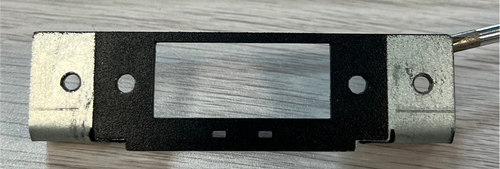

.. centered:: Figura 19.2-1 Chapa de instalación (frontal)

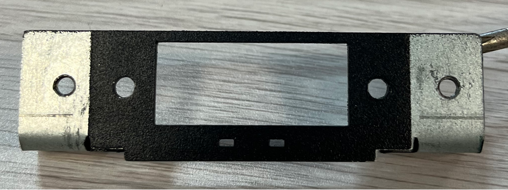

.. centered:: Figura 19.2-2 Chapa de instalación (posterior)

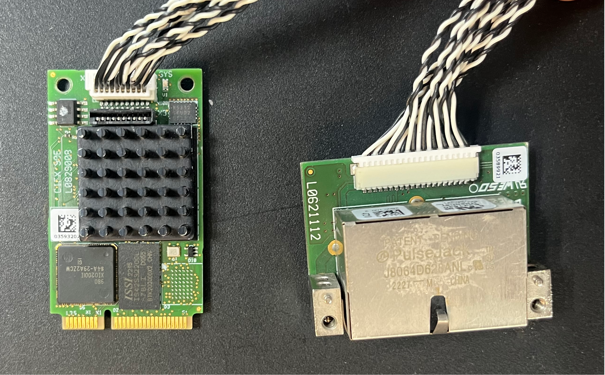

.. centered:: Figura 19.2-3 Tarjeta FRH-PCIeN-EC/EIP/CC/PN-RJ-V10

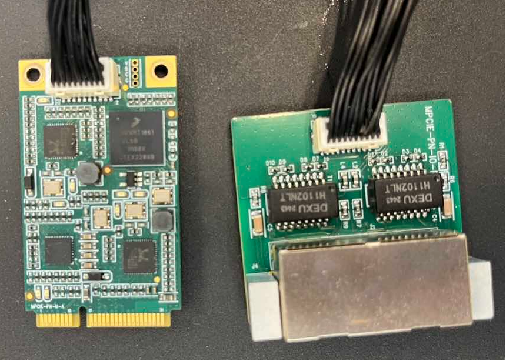

.. centered:: Figura 19.2-4 Tarjeta FRJ-PCIeN-EIP/CC/PN-RJ-V10

(2) Instalar la tarjeta en la caja de control mini integrada, como se muestra en la figura.

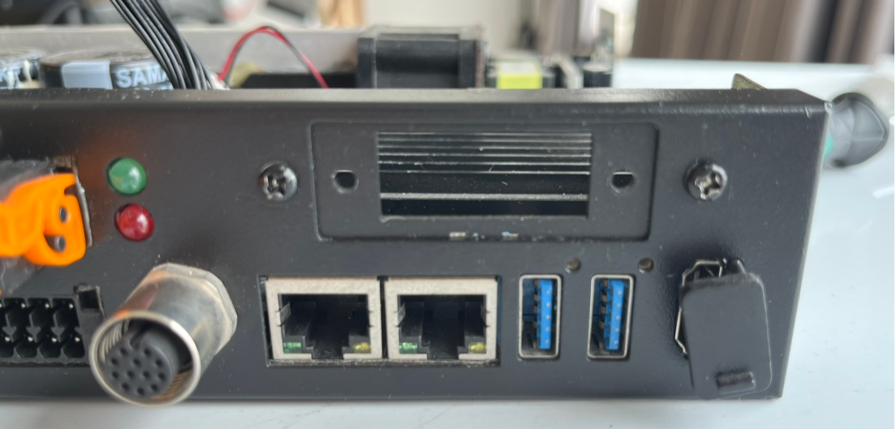

.. centered:: Figura 19.2-5 Esquema de instalación de la chapa metálica

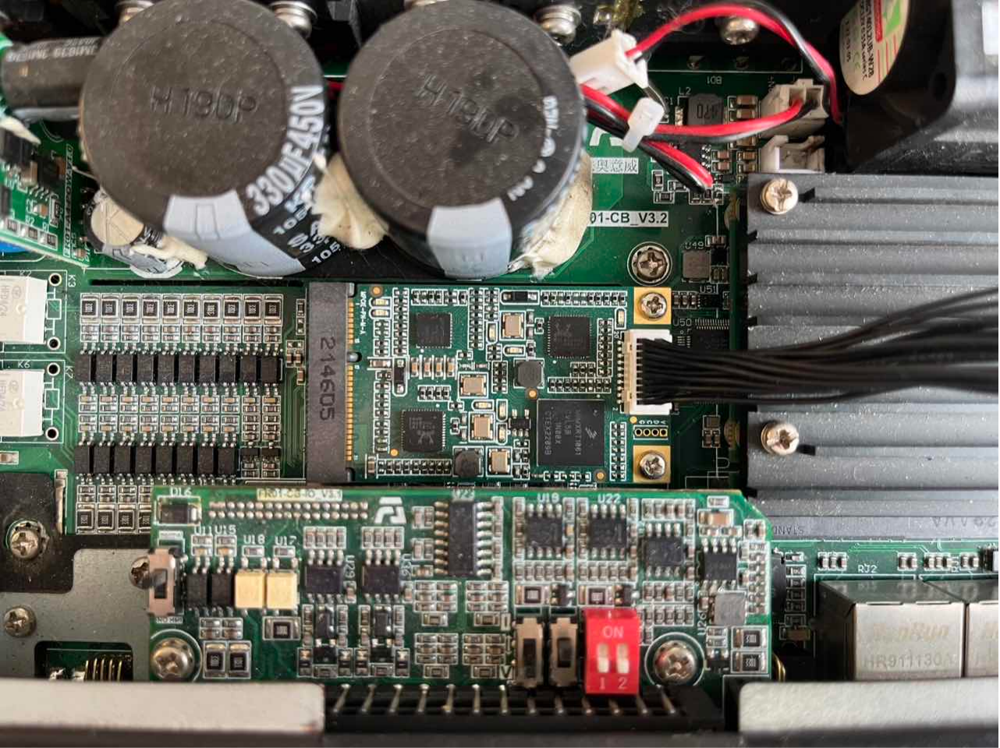

.. centered:: Figura 19.2-6 Esquema de instalación de la placa base principal

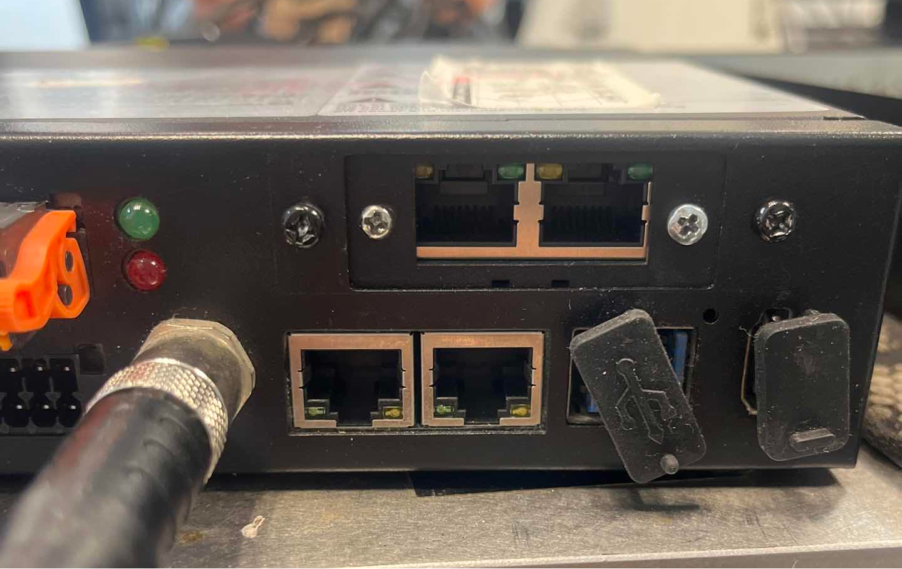

.. centered:: Figura 19.2-7 Esquema de instalación de la tarjeta de expansión de puerto de red RJ45

.. note:: Nota: todos los tornillos deben apretarse.

(3) El cableado de la caja de control del robot y del PLC se muestra en la figura siguiente.

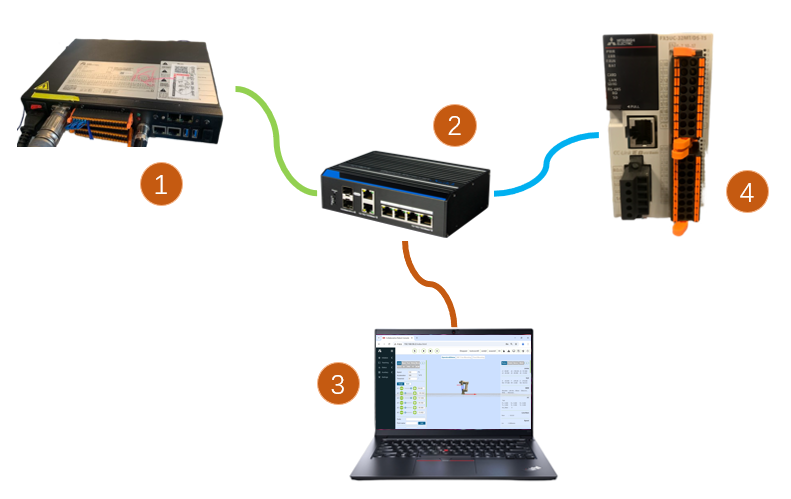

.. centered:: Figura 19.2-8 Diagrama de cableado caja de control y PLC Mitsubishi    

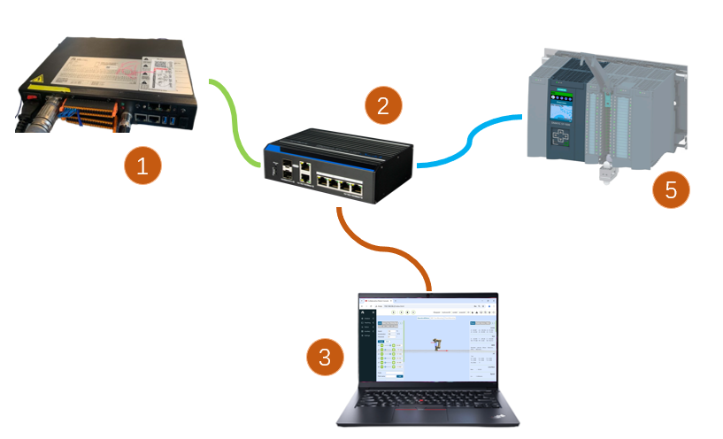

.. centered:: Figura 19.2-9 Diagrama de cableado caja de control y PLC Siemens

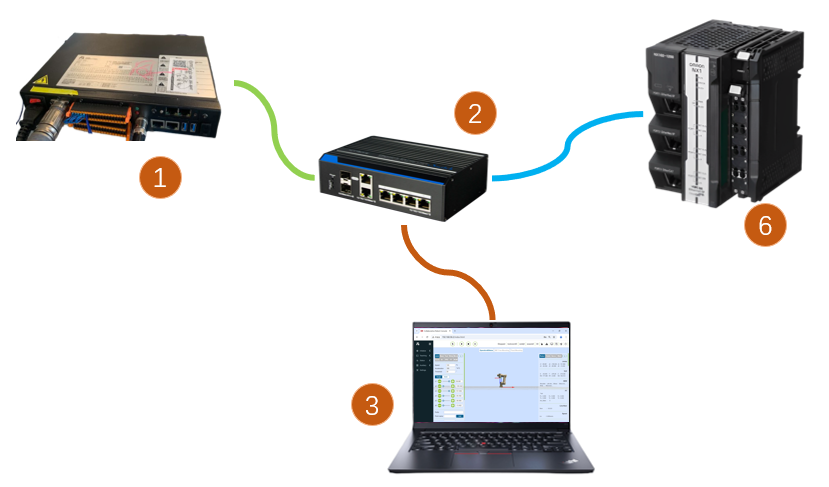

.. centered:: Figura 19.2-10 Diagrama de cableado caja de control y PLC Inovance

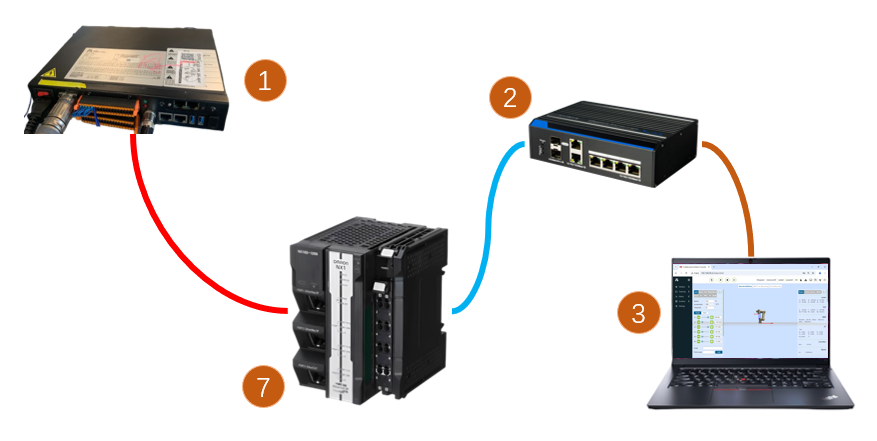

.. centered:: Figura 19.2-11 Diagrama de cableado caja de control y PLC Inovance

.. note:: 
    1: caja de control del robot (puerto de red de la tarjeta);
    2: conmutador;
    3: PC portátil;
    4: PLC Mitsubishi (puerto de red CC-Link IEF Basic);
    5: PLC Siemens (puerto de red Profinet);
    6: PLC Inovance (Ethernet/IP);
    7: PLC Inovance (puerto de red EtherCAT);
        
Configuración del entorno del PLC
~~~~~~~~~~~~~~~~~~~~~~~~~~~~~~~~~~~~~~~~~~~~~~~~~~~~~~~~

El entorno de prueba construido para implementar las instrucciones de esclavo de cada protocolo se muestra en la tabla siguiente, que incluye los modelos de PLC utilizados en cada protocolo, las versiones de firmware y el software de prueba.

.. centered:: Tabla 2-1 Entorno de prueba

.. list-table:: 
   :widths: 20 40 40
   :header-rows: 1
   :align: center

   * - Protocolo
     - Profinet
     - CC-link

   * - Marca
     - Siemens
     - Mitsubishi

   * - Modelo
     - CPU 1515-2 PN
     - FX5S-30TR/DS

   * - Firmware
     - 6ES75152AM020AB0
     - 30MR/ES V1.3

   * - Software
     - TIA Portal V17
     - GXWorks3V1.097B

   * - Dirección IP de la tarjeta
     - IP configurable
     - IP configurable

   * - Dirección IP del PLC
     - IP no requiere mismo segmento de red
     - IP mismo segmento de red
		
.. list-table:: 
   :widths: 20 40 40
   :header-rows: 1
   :align: center

   * - Protocolo
     - Ethernet/IP
     - EtherCAT

   * - Marca
     - Inovance
     - Inovance

   * - Modelo
     - Easy521-0808TN
     - Easy521-0808TN

   * - Firmware
     - /
     - /

   * - Software
     - AutoShop 4.11.0.1
     - AutoShop 4.11.0.1

   * - Dirección IP de la tarjeta
     - IP configurable
     - IP configurable

   * - Dirección IP del PLC
     - IP mismo segmento de red
     - IP mismo segmento de red
		
Ethernet/IP de Inovance
+++++++++++++++++++++++++++++++++++++++++++++++++++++

(1) Importación del archivo EDS

Abrir el software de programación de Inovance AutoShop, crear un nuevo proyecto de PLC y seleccionar "EtherNet/IP Devices" en la barra de herramientas de la derecha.

Hacer clic con el botón izquierdo en "EtherNet/IP" y, con el botón derecho, que aparezca el cuadro de diálogo "Importar EDS"; confirmar con el botón izquierdo y localizar la carpeta donde se encuentra el archivo EDS de la tarjeta. Tras una importación correcta, en el directorio "EtherNet/IP Devices" aparecerá el nombre de la tarjeta; cerrar el proyecto y volver a abrirlo, con lo que finaliza la importación del archivo EDS.

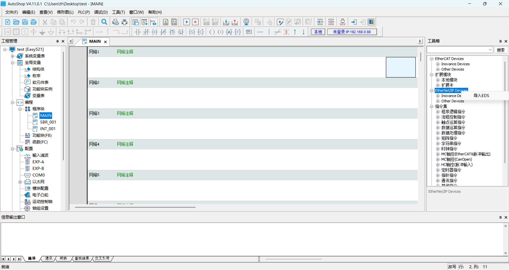

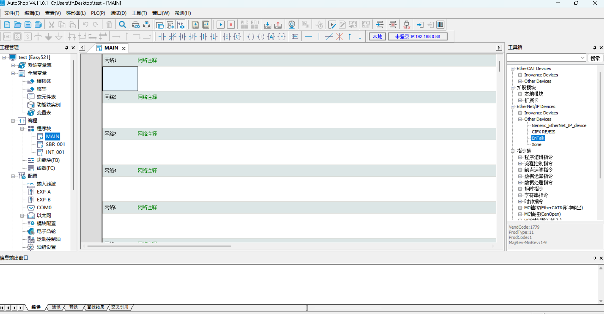

(2) Configuración de parámetros de EtherNet/IP

Hacer doble clic en el esclavo situado bajo "EtherNet/IP" de la barra de herramientas de la izquierda y aparecerá la ventana de configuración de parámetros:

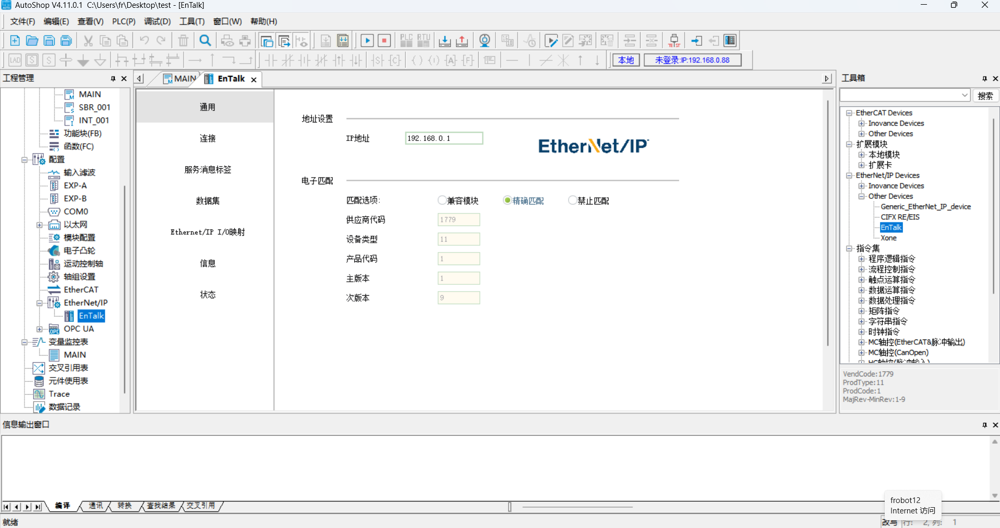

Rellenar la dirección IP de la tarjeta:

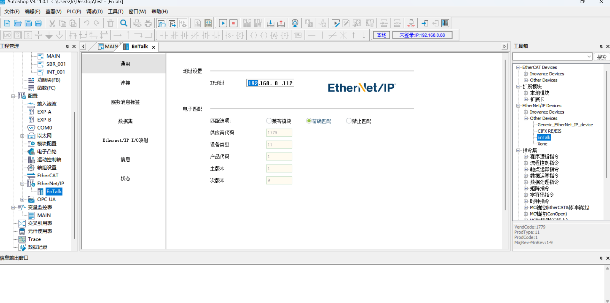

Hacer clic para seleccionar "Conexión" y configurar el tamaño en bytes de entrada y salida de datos:

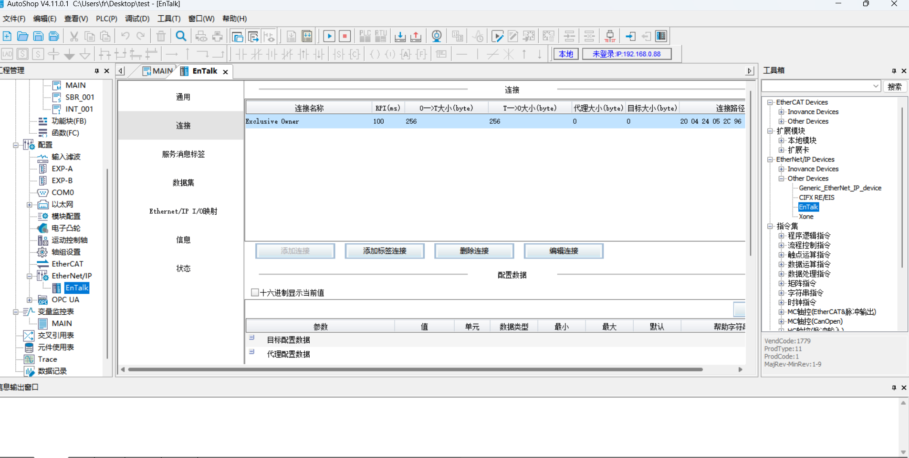

Hacer clic en "Editar conexión", entrar en la ventana emergente y cambiar tanto el número de bytes de entrada como el de salida a 256:

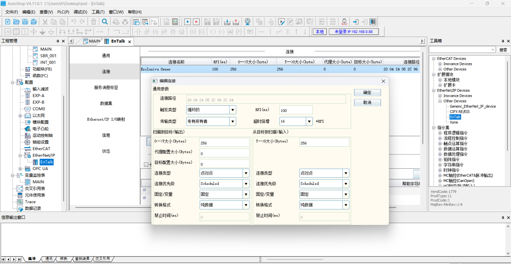

Hacer clic para seleccionar "Conjunto de datos", configurar el tipo de dato de entrada y salida como "INT" y la longitud de bits como "2048":

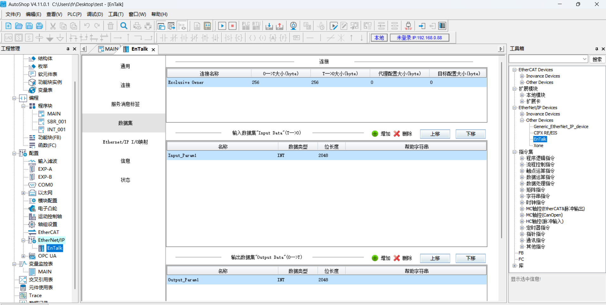

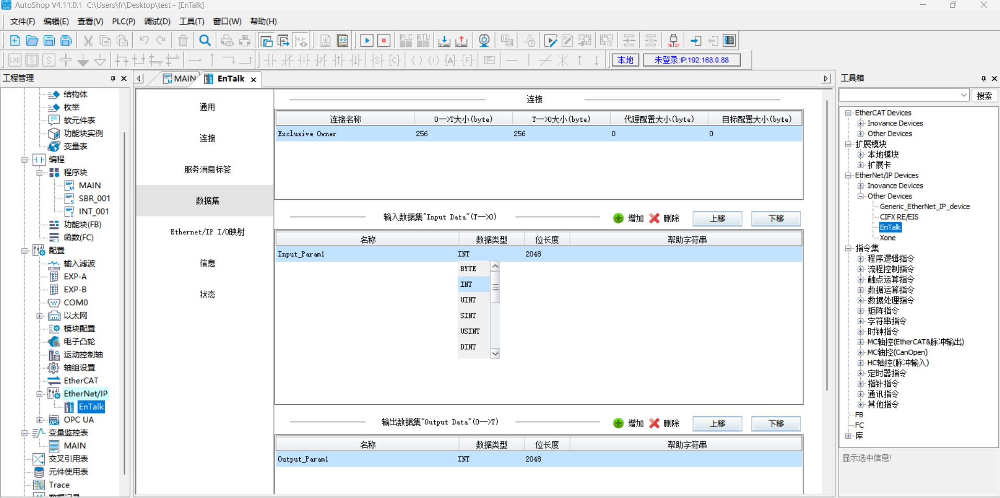

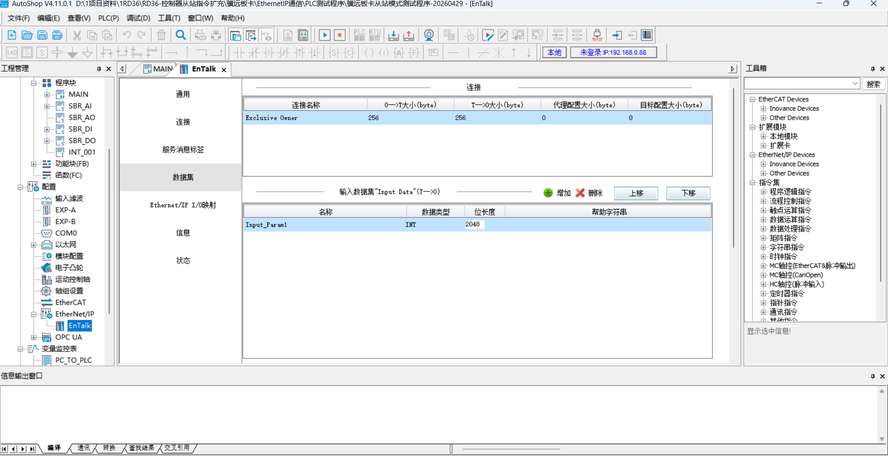

Tras configurar correctamente los parámetros del "Conjunto de datos", hacer clic para seleccionar "Asignación de E/S de EtherNet/IP" e introducir respectivamente D0 y D200; D0 y D200 corresponden respectivamente a la dirección inicial del array de recepción y de envío del lado del PLC.

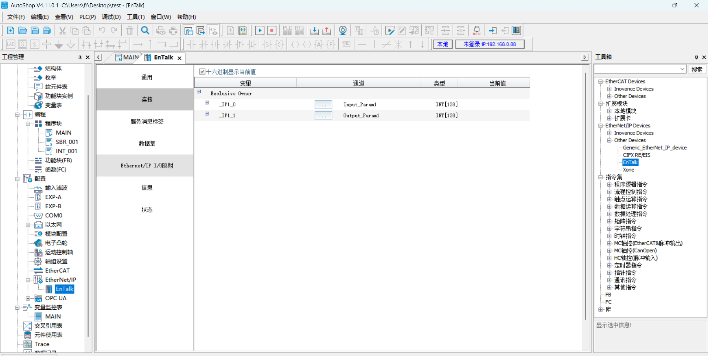

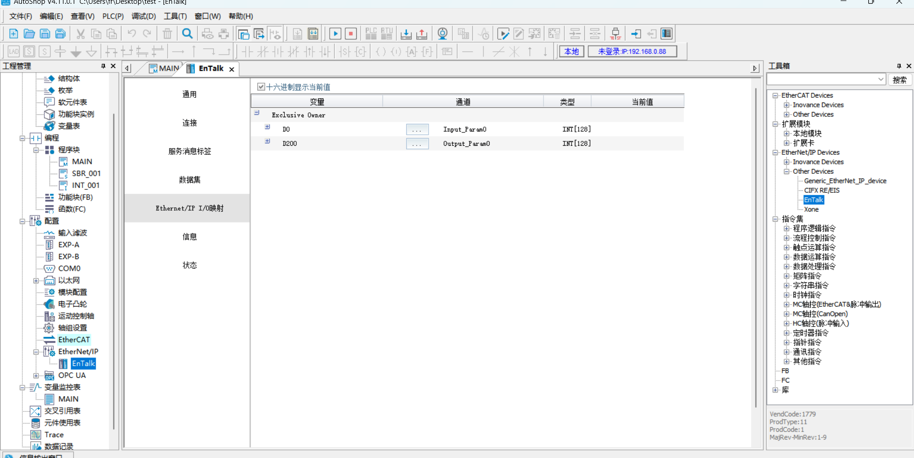

(3) Descarga del programa

Abrir el programa de prueba, modificar la dirección IP del PLC para que esté en el mismo segmento de red que la tarjeta, descargar el programa y ejecutarlo.

Profinet de Siemens
++++++++++++++++++++++++++++++++++++++++++++++++++++++++

(1) Importación del archivo GSD (archivo XML)

Abrir el software de programación de Siemens TIA Portal V17, crear un nuevo proyecto de PLC, seleccionar "Dispositivos y redes" y, en el "Catálogo de hardware" de la derecha, hacer doble clic en 6ES7 515-2AM02-0AB0 para añadir el módulo de PLC.

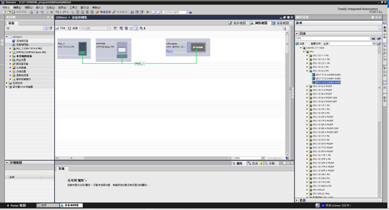

En la barra de menú del software TIA PORTAL, seleccionar "Opciones"->"Gestionar archivos de descripción de estación general (GSD)" para instalar o eliminar los archivos GSD ya instalados.

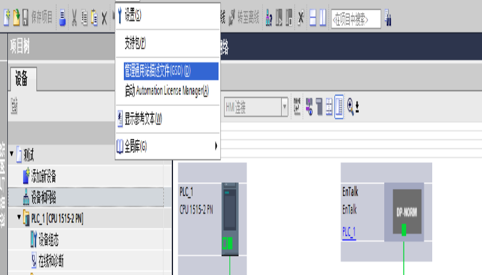

Instalar el archivo GSD: como se ha indicado, seleccionar "Gestionar archivos de descripción de estación general (GSD)" y aparecerá la ventana "Gestionar archivo de descripción de estación general".

Seleccionar en "Ruta de origen" la carpeta donde se encuentra el archivo GSD que se desea instalar, seleccionar en la lista de archivos GSD mostrada uno o varios archivos que se deseen instalar y hacer clic en el botón "Instalar". Como se muestra en la figura siguiente.

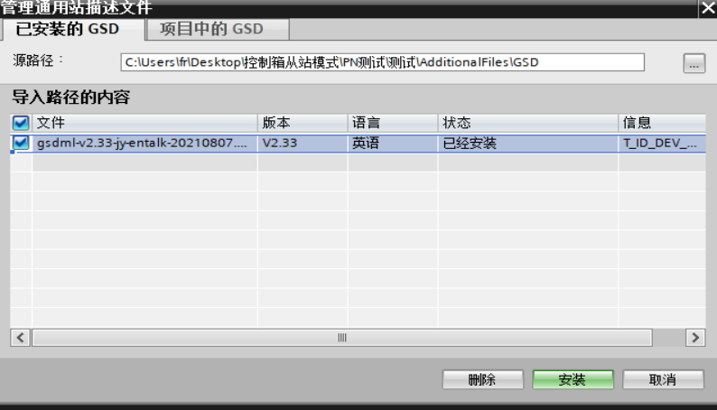

Tras una instalación correcta, se puede encontrar el dispositivo del archivo GSD instalado en el catálogo de hardware, en otros dispositivos de campo, como se muestra en la figura siguiente.

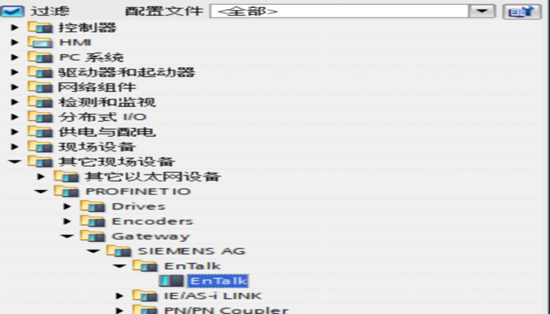

Asignar IO: buscar el módulo en el catálogo y arrastrar Input y Output.

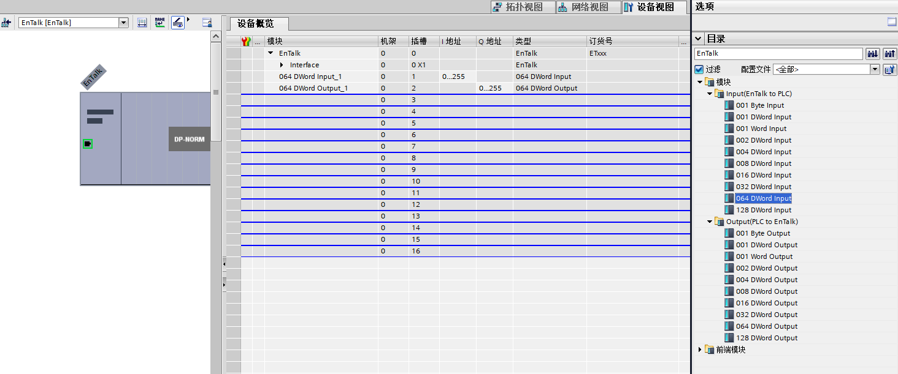

Compilar el programa: hacer doble clic en "Dispositivos y redes" del árbol de proyectos de la izquierda, hacer clic con el botón derecho en el módulo "PLC_1", seleccionar compilar en el menú desplegable y hacer clic en "Hardware y software (solo cambios)". Tras completar la compilación, en la parte inferior de la vista de software se mostrará "Compilación completada":

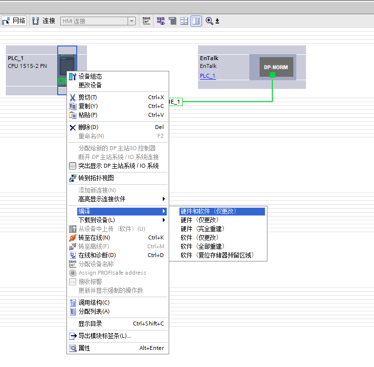

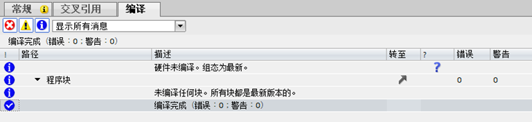

Descargar el programa al dispositivo: hacer doble clic en "Dispositivos y redes" del árbol de proyectos de la izquierda, hacer clic con el botón derecho en el módulo "PLC_1", seleccionar "Descargar al dispositivo" en el menú desplegable y hacer clic en "Hardware y software (solo cambios)":

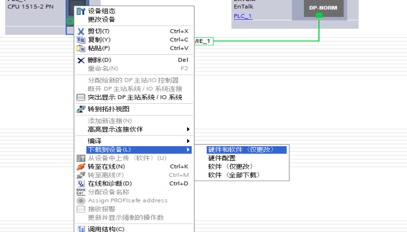

Buscar y descargar el dispositivo: tras aparecer la ventana emergente, configurar el tipo de interfaz PG/PC como se muestra en la figura siguiente, hacer clic en iniciar búsqueda, seleccionar el dispositivo al que se desea descargar el programa y hacer clic en descargar:

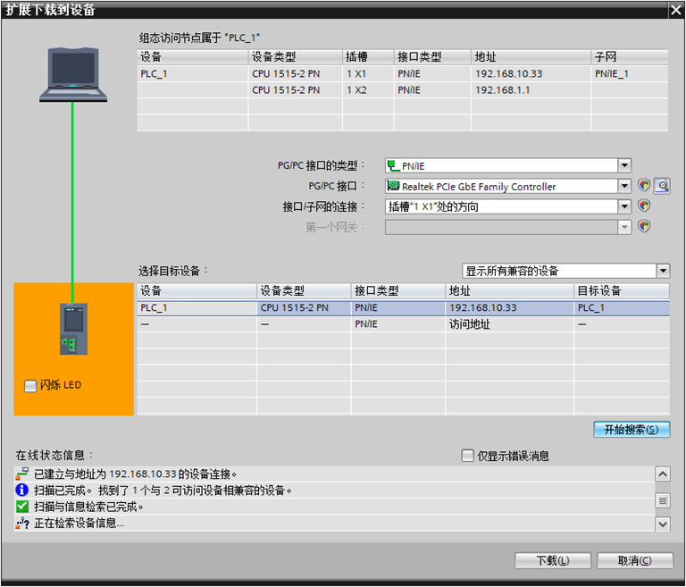

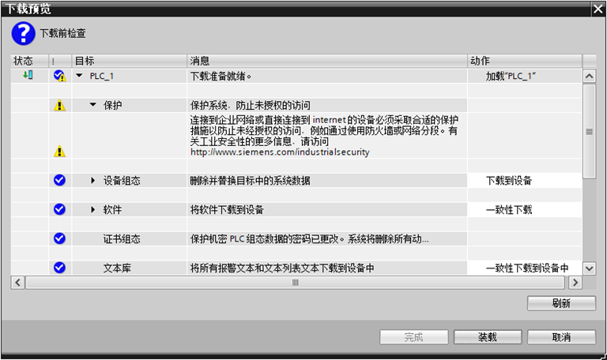

CC-link de Mitsubishi
+++++++++++++++++++++++++++++++++++++++++++++++++

(1) Configuración de CC-Link IEF Basic

Activar el uso de CC-link: seleccionar "Puerto Ethernet" en el menú de navegación de la izquierda y configurar la dirección IP del PLC, garantizando que esté en el mismo segmento de red que la dirección de la tarjeta Jiyuan. Hacer clic en "Uso de CC-link IEF Basic" y seleccionar "Usar":

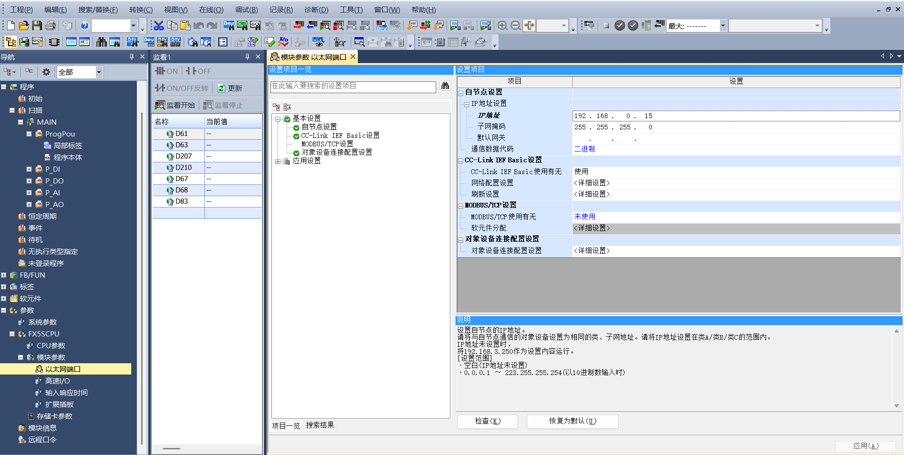

Configuración de red de CC-Link: igualmente en la configuración de CC-Link IEF Basic, seleccionar "Configuración de red" y seleccionar el módulo genérico CC-Link IEF Basic como módulo. Arrastrarlo a la parte inferior izquierda de la vista para completar la configuración de hardware:

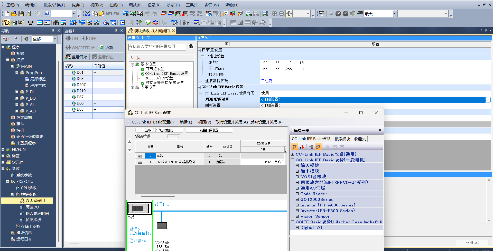
   
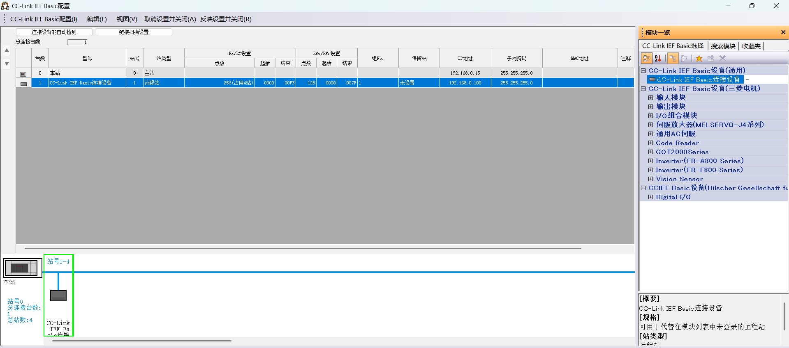

Configurar el número de puntos y la dirección IP del esclavo:

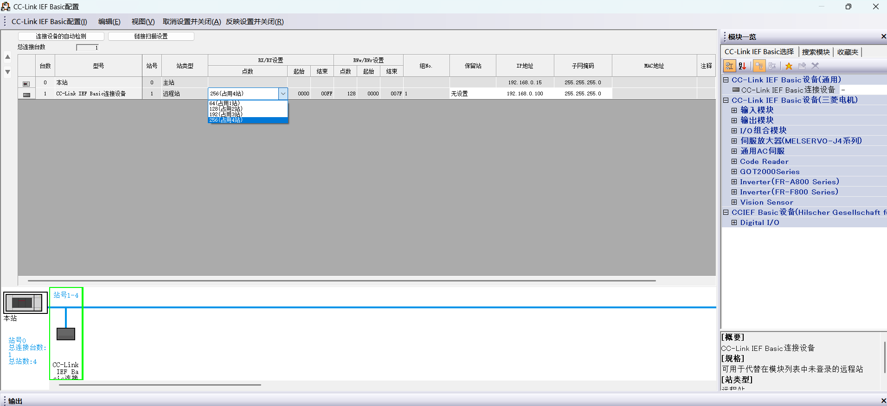
   
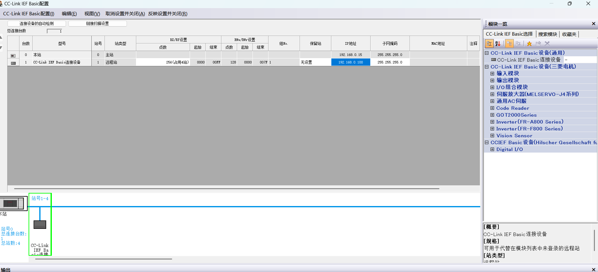

Configuración de refresco de CC-Link: igualmente en la configuración de CC-Link IEF Basic, hacer clic en configuración de refresco y personalizar la configuración de transmisión: 256 bytes de recepción, 256 bytes de envío.
   
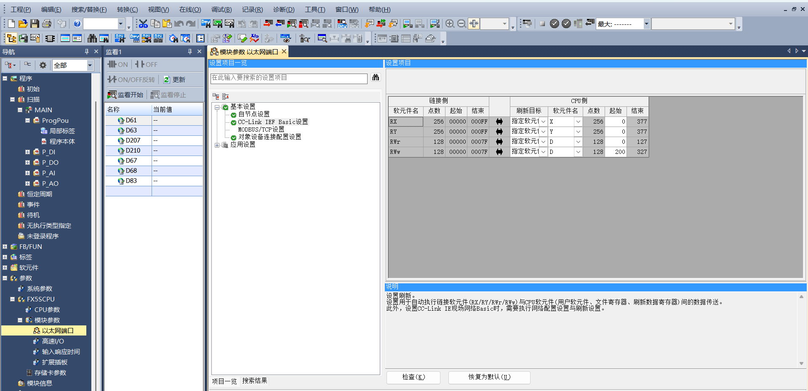

(2) Descarga del programa

Tras abrir el programa de prueba, hacer clic en "En línea"→"Escribir en controlador programable" para entrar en la interfaz de descarga.
   
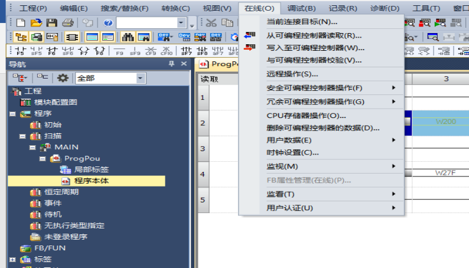

Tras abrir la interfaz de descarga, hacer clic en "Parámetros + programa" de la parte superior izquierda y, a continuación, hacer clic en "Ejecutar" de la esquina inferior derecha para descargar, esperando a que finalice la descarga.
   
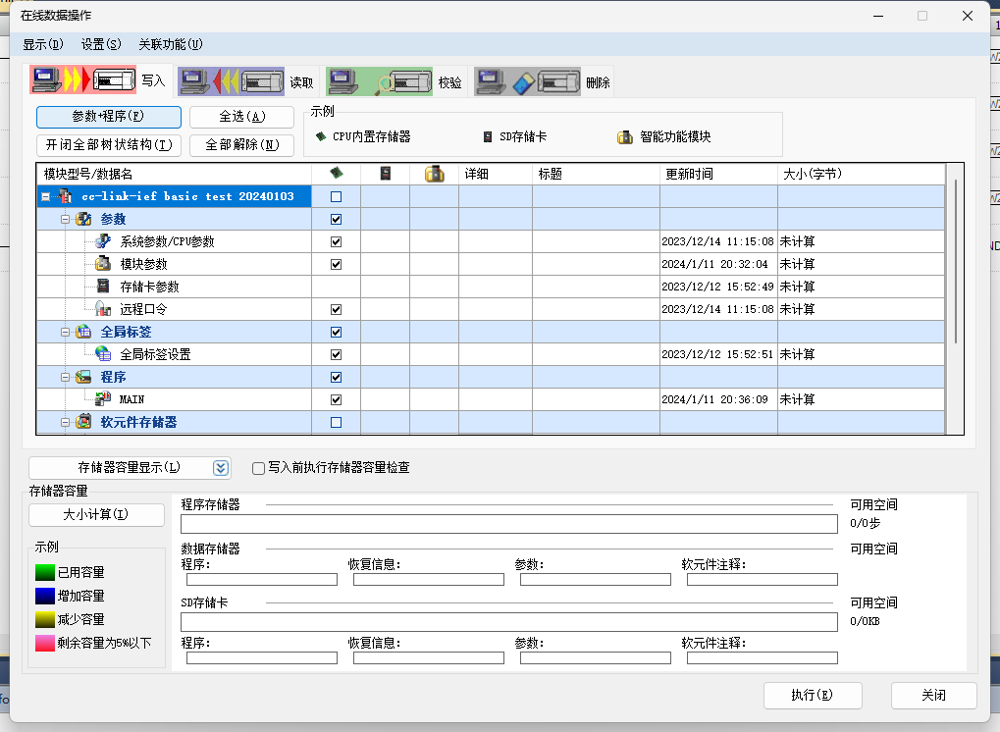

EtherCAT de Inovance
++++++++++++++++++++++++++++++++++++++++++++++

(1) Importación del archivo XML

Abrir el software de programación de Inovance AutoShop, crear un nuevo proyecto de PLC y seleccionar "EtheCATDevices" en la barra de herramientas de la derecha:
   
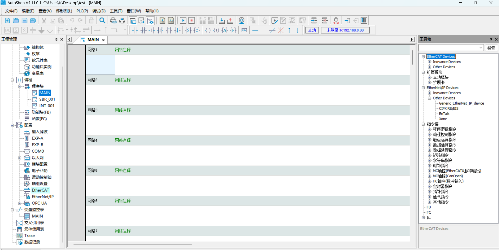

Hacer clic con el botón izquierdo en "EtheCATDevices" y, con el botón derecho, que aparezca el cuadro de diálogo "Importar XML de dispositivo"; confirmar con el botón izquierdo y localizar la carpeta donde se encuentra el archivo XML de la tarjeta.

Tras una importación correcta, en el directorio "EtherCAT Devices" aparecerá el nombre de la tarjeta; en este momento, cerrar el proyecto y volver a abrirlo para completar el proceso de importación del archivo XML.
   
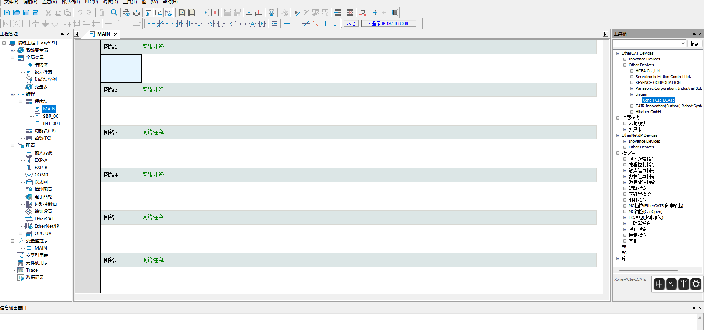

(2) Añadir el esclavo EtherCAT

Barra de herramientas de la derecha→"EtehrCAT Devices"→"Other Devices"→"JIYuan"→"Xone-PCIe-ECATs"; hacer doble clic en "Xone-PCIe-ECATs" para añadir el esclavo EtherCAT; en este momento se puede ver que en el proyecto de la izquierda, bajo el maestro EtherCAT, el esclavo se ha añadido correctamente.
   
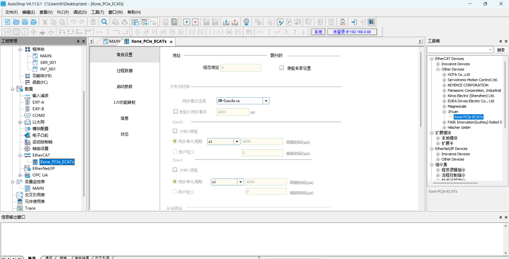
   
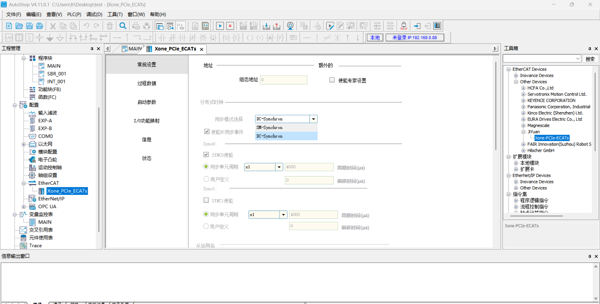

(3) Añadir PDO
   
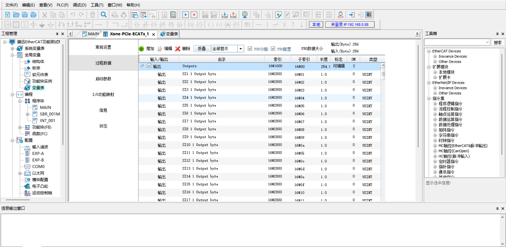
   
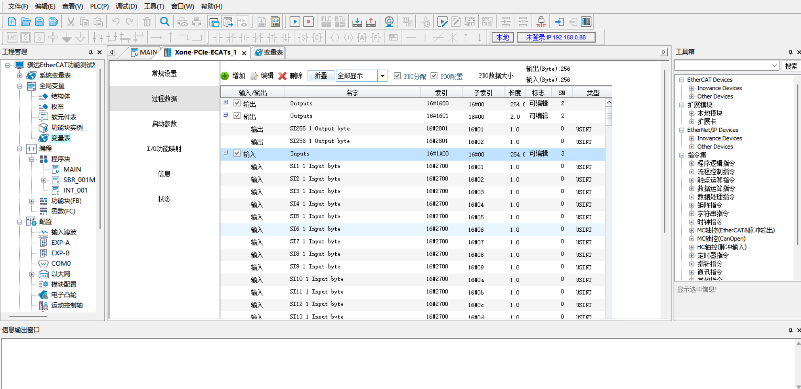

(4) Asignación de direcciones EtherCAT

Hacer doble clic en la tabla de variables de la barra de herramientas de la izquierda, crear un nuevo array de entrada de 256 bytes con dirección de dispositivo virtual D0. Crear un nuevo array de salida de 256 bytes con dirección de dispositivo virtual D200.
   
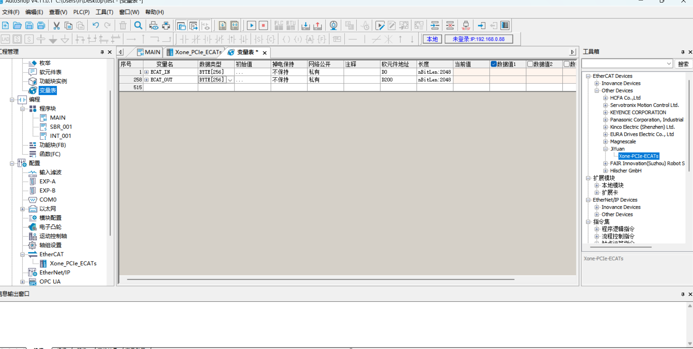

En la barra de herramientas de la izquierda, bajo "EtherCAT", hacer doble clic en "Xone-PCIe-ECATs"; en el cuadro de diálogo emergente, hacer clic en "Asignación de funciones de E/S", hacer clic en la casilla para vincular la dirección de la variable y, en el cuadro de diálogo emergente, hacer clic en "Tabla de variables", seleccionar la entrada/salida que corresponda y hacer clic en aceptar; las operaciones de vinculación de las demás direcciones son las mismas en orden.
   
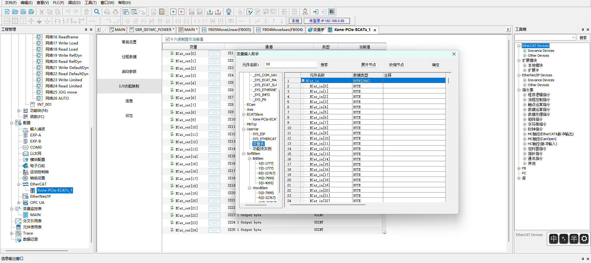

(5) Descarga del programa

Abrir el programa de prueba, cambiar la dirección IP del PLC para que esté en el mismo segmento de red que la tarjeta, descargar el programa y ejecutarlo.

Descripción de las operaciones relacionadas con el modo esclavo del robot
--------------------------------------------------------------------------------------

Carga del modo esclavo
~~~~~~~~~~~~~~~~~~~~~~~~~~~~~~~~~~~~~~~~~~

(1) Abrir WebApp y entrar en Configuración inicial->Periféricos->Comunicación de tarjeta->Configuración manual.
   
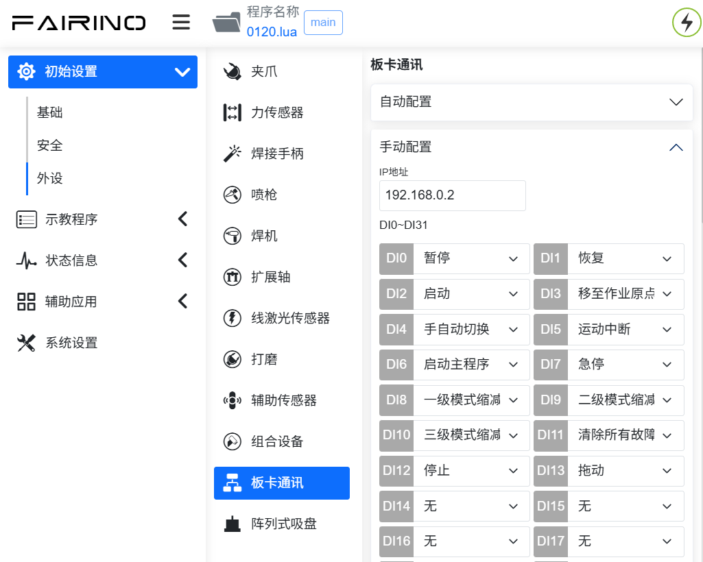

En primer lugar, configurar la dirección IP de la tarjeta; si no se rellena, la tarjeta se inicia con la configuración de la IP predeterminada: 192.168.0.100. Actualmente la configuración de IP solo es aplicable a los protocolos EIP y CC-link; en el protocolo PN el maestro PLC escanea el dispositivo esclavo y le asigna la IP.

.. note:: Tras cambiar la dirección IP en la página, es necesario cargar el modo esclavo para que surta efecto.
   
A continuación, seleccionar sucesivamente las funciones de mapeo necesarias para DI, DO y AO (véase el apéndice); el significado de cada parámetro es el siguiente:

- DI es control del robot: el esclavo del robot recibe la señal de entrada externa y ejecuta la función mapeada;
- DO es salida de estado del robot: el esclavo del robot realimenta la señal de estado al maestro;
- AO es realimentación de estado del robot: el esclavo del robot realimenta los datos de estado al maestro; AO0~AO15 son enteros con signo (int16) y AO16~AO31 son números de coma flotante de precisión simple (float).

(2) Hacer clic en el botón "Configurar" para generar el archivo lua de protocolo abierto.
   
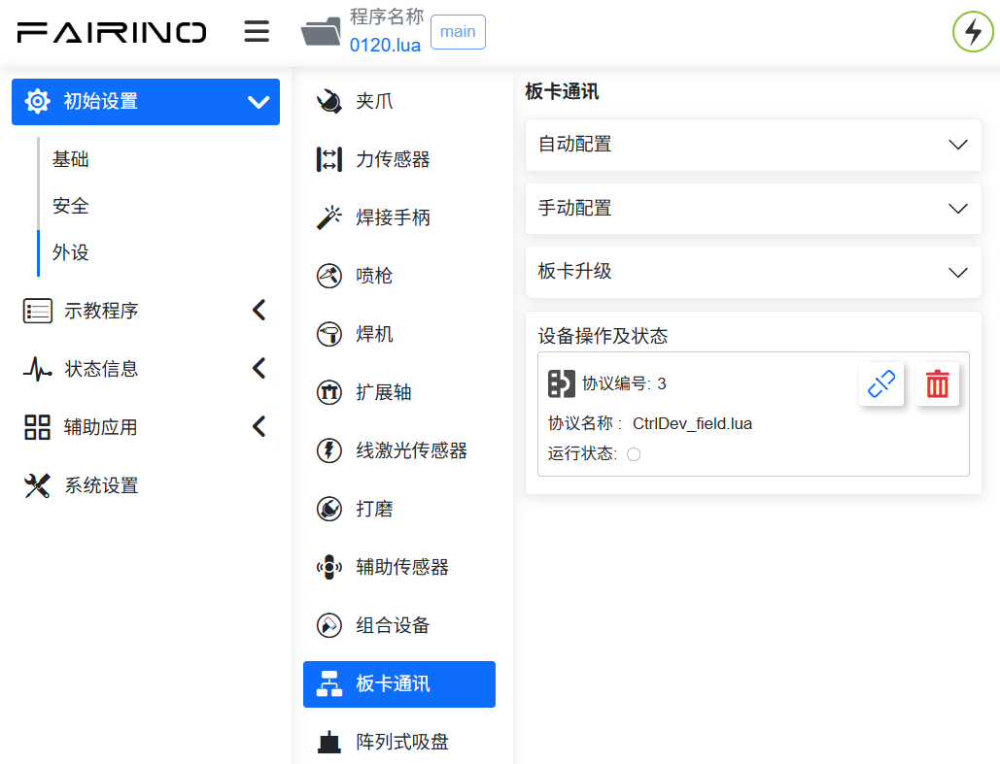

.. note:: El archivo lua de protocolo abierto admite descarga y se puede importar en la interfaz de configuración automática.

Ejemplo del programa generado:

.. code-block:: console
   :linenos:

   local id = 3 
   local ctrlDI = {0, 0, 0, 0, 0, 0}
   local funcDI = {0, 0, 0, 0, 0, 0, 0, 0, 0, 0, 0, 0, 0, 0, 0, 0}
   local DOState = {0, 0, 0, 0, 0, 0, 0, 0}
   local AOState = {0, 0, 0, 0, 0, 0, 0, 0, 0, 0, 0, 0, 0, 0, 0, 0, 0, 0, 0, 0, 0, 0, 0, 0, 0, 0, 0, 0, 0, 0, 0, 0}
   -- Launch the board communication process
   SetFieldBusIP("192.168.0.99")
   LoadFieldBusSlave()
   sleep_ms(8000)
   while(1) do
      -- Set the DO status
      CtrlBoxDO, CtrlBoxCO, CtrlBoxDI, CtrlBoxCI, errState, motionState, moveToOriginState, robotStartDoneState, modeChangeState, programStartStopState, emergencyState, reduceState, collision, enablestate, safetyStop0, safetyStop1, pauseState, interfereState = GetRobotFuncDOState()
      DOState[1] = CtrlBoxDO
      DOState[2] = CtrlBoxCO
      DOState[3] = CtrlBoxDI
      DOState[4] = CtrlBoxCI
      local ctrlWord0 = 0
      ctrlWord0 = SetBitWithIndex(ctrlWord0, 0, errState)
      ctrlWord0 = SetBitWithIndex(ctrlWord0, 1, motionState)
      ctrlWord0 = SetBitWithIndex(ctrlWord0, 2, moveToOriginState)
      ctrlWord0 = SetBitWithIndex(ctrlWord0, 3, robotStartDoneState)
      ctrlWord0 = SetBitWithIndex(ctrlWord0, 4, modeChangeState)
      ctrlWord0 = SetBitWithIndex(ctrlWord0, 5, programStartStopState)
      ctrlWord0 = SetBitWithIndex(ctrlWord0, 6, emergencyState)
      ctrlWord0 = SetBitWithIndex(ctrlWord0, 7, reduceState)
      DOState[5] = ctrlWord0
      local ctrlWord1 = 0
      ctrlWord1 = SetBitWithIndex(ctrlWord1, 0, collision)
      ctrlWord1 = SetBitWithIndex(ctrlWord1, 1, enablestate)
      ctrlWord1 = SetBitWithIndex(ctrlWord1, 2, safetyStop0)
      ctrlWord1 = SetBitWithIndex(ctrlWord1, 3, safetyStop1)
      ctrlWord1 = SetBitWithIndex(ctrlWord1, 4, pauseState)
      ctrlWord1 = SetBitWithIndex(ctrlWord1, 5, interfereState)
      DOState[6] = ctrlWord1
      SetFieldBusDOState(DOState)

      -- Set the AO status
      mainErrCode, subErrCode, TCPSpeed, axisPos1, axisPos2, axisPos3, axisPos4, axisPos5, axisPos6, jointVelFeedback1, jointVelFeedback2, jointVelFeedback3, jointVelFeedback4, jointVelFeedback5, jointVelFeedback6, jointCurFeedback1, jointCurFeedback2, jointCurFeedback3,jointCurFeedback4,jointCurFeedback5,jointCurFeedback6, jointTorqueFeedback1, jointTorqueFeedback2,jointTorqueFeedback3,jointTorqueFeedback4, jointTorqueFeedback5, jointTorqueFeedback6, cartPosx, cartPosy, cartPosz, cartPosrx, cartPosry, cartPosrz = GetRobotFuncAOState()
      AOState[1] = mainErrCode
      AOState[2] = subErrCode
      AOState[17] = axisPos1
      AOState[18] = axisPos2
      AOState[19] = axisPos3
      AOState[20] = axisPos4
      AOState[21] = axisPos5
      AOState[22] = axisPos6
      AOState[23] = cartPosx
      AOState[24] = cartPosy
      AOState[25] = cartPosz
      AOState[26] = cartPosrx
      AOState[27] = cartPosry
      AOState[28] = cartPosrz
      SetFieldBusAOState(AOState)
      sleep_ms(10) 

      -- Set the DI status
      -- Configue the DI function and update it in real-time
      ctrlDI[1],ctrlDI[2],ctrlDI[3],ctrlDI[4],ctrlDI[5],ctrlDI[6] = GetFieldBusDIState()
      funcDI[1] = ctrlDI[1] 
      funcDI[2] = ctrlDI[2] 
      funcDI[3] = GetBitWithIndex(ctrlDI[3], 0)
      funcDI[4] = GetBitWithIndex(ctrlDI[3], 1)
      funcDI[5] = GetBitWithIndex(ctrlDI[3], 2)
      funcDI[6] = GetBitWithIndex(ctrlDI[3], 3)
      funcDI[7] = GetBitWithIndex(ctrlDI[3], 4)
      funcDI[8] = GetBitWithIndex(ctrlDI[3], 5)
      funcDI[9] = GetBitWithIndex(ctrlDI[3], 6)
      funcDI[10] = GetBitWithIndex(ctrlDI[3], 7)
      funcDI[11] = GetBitWithIndex(ctrlDI[4], 0)
      funcDI[12] = GetBitWithIndex(ctrlDI[4], 1)
      funcDI[13] = GetBitWithIndex(ctrlDI[4], 2)
      funcDI[14] = GetBitWithIndex(ctrlDI[4], 3)
      funcDI[15] = GetBitWithIndex(ctrlDI[4], 4)
      funcDI[16] = GetBitWithIndex(ctrlDI[4], 5)
      SetRobotFuncDIState(funcDI)
      local stopFlag = GetOpenLUAStopFlag(id)
      if(stopFlag ~= 0) then 
         UnloadFieldBusSlave()
         break
      end
      sleep_ms(10)
   end

(3) Hacer clic en el botón cargar para cargar el modo esclavo del robot.
   

.. note:: Tras cargar correctamente el modo esclavo del robot, se admite la función de inicio automático al encender. Si se necesita utilizar el modo remoto, desinstalar primero el modo esclavo.

(4) Hacer clic en el botón de la barra de estado de la tarjeta de la derecha para monitorizar la información de intercambio de DI, DO, AI y AO; la introducción de cada parámetro es la siguiente:

- CtrlDO: valor de entrada de la señal DO/CO de la caja de control enviado por el maestro externo;
- DI: valor de entrada de la señal de control del maestro externo;
- Aux_DI: DI extendidas de la tarjeta de comunicación;
- DO: valor de salida de la señal de realimentación del esclavo del robot;
- Aux_DO: DO extendidas de la tarjeta de comunicación;
- AI: valor de entrada del maestro externo;
- AI0~AI15: tipo int16;
- AI16~AI31: tipo float;
- AO: valor de salida del esclavo del robot;
- AO0~AO15: tipo int16;
- AO16~AO31: tipo float.

.. note:: Para la información detallada de cada parámetro de DI, DO, AI y AO, consulte «RD36-Tabla de correspondencia de direcciones del modo esclavo del robot-V1.0-20260605».
   

(5) Tras completar la carga, se pueden generar instrucciones lua de tarjeta mediante Programa de enseñanza->Instrucciones de comunicación->Tarjeta, para establecer las DO y AO del esclavo, obtener las DI y AI del esclavo y esperar las DI y AI del esclavo.
   

Actualización del firmware de la tarjeta y configuración del período de comunicación
-----------------------------------------------------------------------------------------

Tarjeta FRJ-PCIeN-EIP/CC/PN-RJ-V10
~~~~~~~~~~~~~~~~~~~~~~~~~~~~~~~~~~~~~~~~~~~~~~~~~~~~~~~~~~~~~~~~~~~~~~~~~~~~~~~~~~
Al cambiar de protocolo, la tarjeta requiere actualizar el firmware; para actualizar el firmware de la tarjeta FRJ-PCIeN-EIP/CC/PN-RJ-V10 con el ordenador superior, los pasos son los siguientes:

(1) Abrir WinPcap_4_1_3.exe e instalar el paquete de controladores de la tarjeta de red.

(2) Conectar directamente el puerto de red del PC (sistema Win11) con el puerto de red de la tarjeta, abrir Device Assistant v1.1.0.exe, hacer doble clic en "Ethernet", hacer clic en el botón "Actualizar" de la esquina superior izquierda y se podrá escanear el dispositivo de tarjeta conectado actualmente.
   

      

(3) Hacer doble clic en el dispositivo de tarjeta escaneado para entrar en la interfaz de actualización de firmware. Configurar el PC y la IP de la tarjeta obtenida en el mismo segmento de red, hacer clic en el botón "…" de la derecha de la barra de menú "Actualización de firmware", cargar el firmware que se desea actualizar y hacer clic en el botón "Actualizar"; cuando el cuadro de texto de la esquina inferior izquierda muestre la impresión "Actualización correcta" habrá finalizado.
      

(4) Tras una actualización correcta, la tarjeta ejecutará una operación de reinicio; esperar a que finalice el reinicio de la tarjeta (5 s), introducir el período de comunicación necesario (compatible con 1~100 ms) y hacer clic en el botón "Configurar"; tras la impresión "Configuración del período correcta" en la esquina inferior izquierda, reiniciar la caja de control.
      

Tarjeta FRJ-PCIeN-EC/PN/EIP/CC-RJ-V20
~~~~~~~~~~~~~~~~~~~~~~~~~~~~~~~~~~~~~~~~~~~~~~~~~~~~~~~~~~~~~~~~~~~~~~~~~~~~~~~~~~

Al cambiar de protocolo, la tarjeta requiere actualizar el firmware; para actualizar el firmware de la tarjeta FRJ-PCIeN-EC/PN/EIP/CC-RJ-V20 desde la interfaz del robot, los pasos son los siguientes:

(1) Introducir en el navegador 192.168.58.2 para entrar en la interfaz del robot y hacer clic en "Configuración inicial"->"Periféricos"->"Comunicación de tarjeta"; se puede obtener el número de versión del firmware de la tarjeta FRJ-PCIeN-EC/PN/EIP/CC-RJ-V20. Seleccionar el archivo bin que se desea actualizar, hacer clic en cargar y, tras una actualización correcta del firmware, reiniciar la caja de control.
      
.. image:: custom_protocol_slave/047.png
   :width: 6in
   :align: center

.. note:: Para actualizar el firmware de la tarjeta FRJ-PCIeN-EC/PN/EIP/CC-RJ-V20 es necesario desinstalar el protocolo abierto que se esté ejecutando.

(2) Introducir en el navegador 192.168.58.2 para entrar en la interfaz del robot y hacer clic en "Configuración inicial"->"Periféricos"->"Comunicación de tarjeta"; se puede obtener el período de comunicación de la tarjeta. Introducir el período de comunicación necesario (1~100 ms), hacer clic en el botón "Configurar" y, tras una configuración correcta, reiniciar la caja de control.
      

.. note:: Para configurar el período de comunicación de la tarjeta FRJ-PCIeN-EC/PN/EIP/CC-RJ-V20 es necesario desinstalar el protocolo abierto que se esté ejecutando.

:download:`Firmware y archivos de configuración de comunicación de la tarjeta <../_static/_doc/Board communication firmware and configuration files.zip>`

:download:`Resumen de programas de prueba de PLC de cada protocolo <../_static/_doc/Summary of PLC Test Programs for Each Protocol.zip>`