Programación gráfica
========================

.. toctree:: 
   :maxdepth: 6

Introducción
-------------------

Dado que el teach pendant generalmente no tiene conectados periféricos como teclado y ratón, cuando el usuario accede a WebAPP del robot desde el teach pendant, puede editar programas de enseñanza del robot mediante la función de programación gráfica. La implementación de funciones estandarizadas utiliza la biblioteca Blockly, que puede integrarse en el sistema WebAPP para implementar bloques de código personalizados según sea necesario; tras completar la programación por arrastre, se convierte en un programa LUA y se envía para su ejecución mediante el protocolo de instrucciones existente.

Mediante el uso de la programación gráfica se consigue que sea sencilla y fácil de entender, fácil de operar y con la interfaz en chino.

La página se divide en tres áreas: "Barra de operaciones", "Barra de herramientas toolbox" y "Área de edición de código workspace"; el diseño general de la disposición se muestra a continuación:

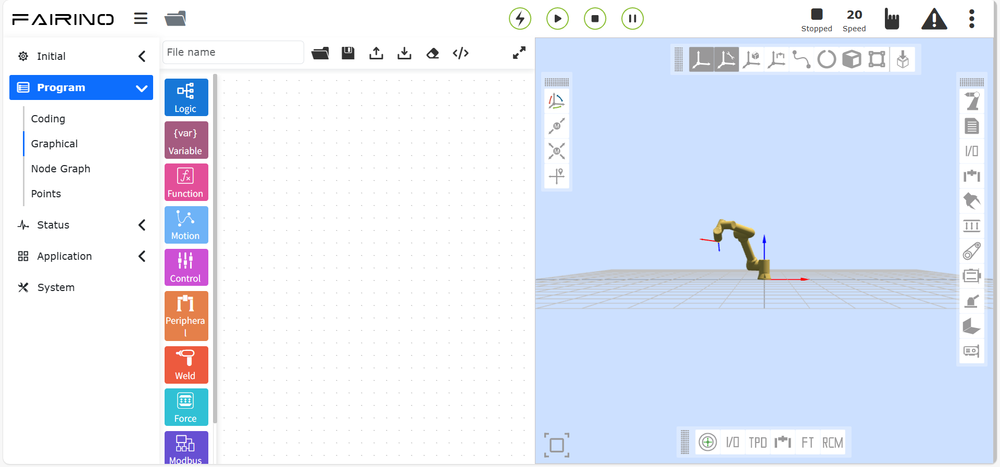

.. centered:: Figura 10.1‑1 Interfaz de programación gráfica

**Barra de operaciones**

1) **Cargar**: se encarga de recargar el área de trabajo y admite la ordenación alfabética (A~Z o Z~A) o por hora de última modificación;
2) **Importar**: se encarga de importar los programas de programación gráfica correspondientes;
3) **Exportar**: se encarga de exportar el programa de programación gráfica del área de trabajo guardada; la función del botón "Guardar" es guardar como el programa de enseñanza correspondiente una vez completada la edición de los bloques de código;
4) **Guardar**: se encarga de guardar los bloques de código gráfico ya editados;
5) **Vaciar**: se encarga de vaciar rápidamente el área de edición de código;
6) **Código**: se encarga de traducir los bloques de código a código Lua.

**Toolbox**

1) Contiene los bloques de código de todas las instrucciones y del código lógico, que se pueden arrastrar al workspace para crear bloques de código y editarlos;
2) La barra de herramientas Toolbox se clasifica además según el tipo de instrucción;
3) Instrucciones de tipo lógico: if-else, while, etc.;
4) Instrucciones de movimiento básicas: PTP, LIN, ARC, etc.; clasificadas según el escenario de aplicación: encolado, soldadura, cinta transportadora, etc. Durante el uso se pueden encontrar cómodamente los bloques de código necesarios.

**Workspace**: en el área de edición de código se pueden editar y mostrar los bloques de código gráfico.

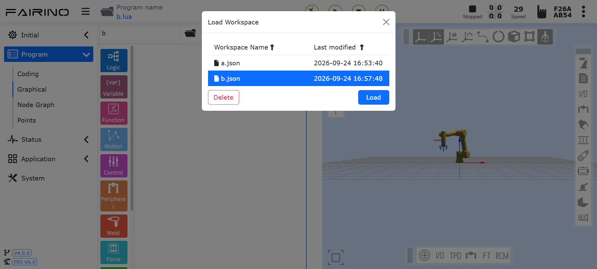

.. centered:: Figura 10.1-2 Ordenación de archivos del área de trabajo

Comandos de programación gráfica de tipo lógico
-----------------------------------------------
Los comandos de programación gráfica de tipo lógico incluyen comandos lógicos como bucles, números, etc.

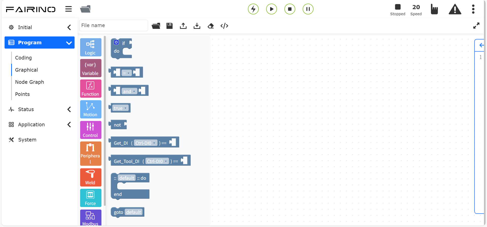

.. centered:: Figura 10.2 Programación gráfica de tipo lógico

Instrucción de juicio If/Else
~~~~~~~~~~~~~~~~~~~~~~~~~~~~~
Arrastrar el bloque de código "Instrucción de juicio If/Else" al área de trabajo de la interfaz de edición gráfica. (Esta instrucción requiere cierta base de programación; si necesita ayuda, póngase en contacto con nosotros)

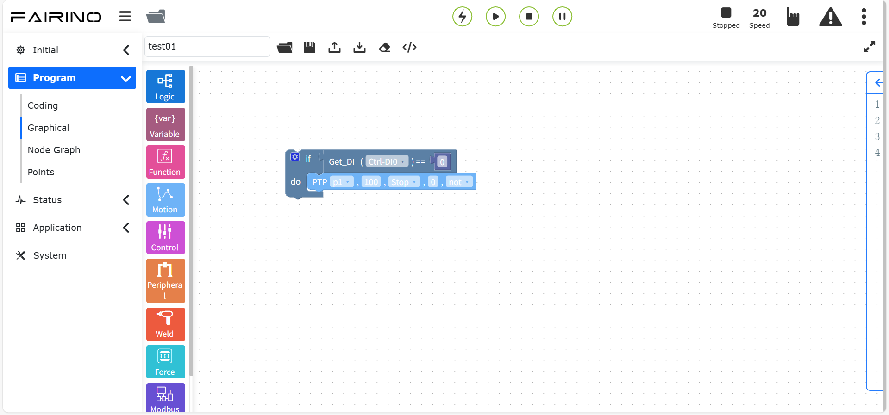

.. centered:: Figura 10.2-1 Bloque de código de la instrucción de juicio If/Else

Instrucción While
~~~~~~~~~~~~~~~~~~~~~~~~~~~~~
Arrastrar el bloque de código "Instrucción While" al área de trabajo de la interfaz de edición gráfica. (Esta instrucción requiere cierta base de programación; si necesita ayuda, póngase en contacto con nosotros)

Añadir después de While la condición de espera de entrada y dentro de while el bloque de código de la instrucción de movimiento; hacer clic en guardar. (Para facilitar la operación, se puede introducir arbitrariamente el contenido do y editarlo en el programa sustituyéndolo por otras instrucciones insertadas)

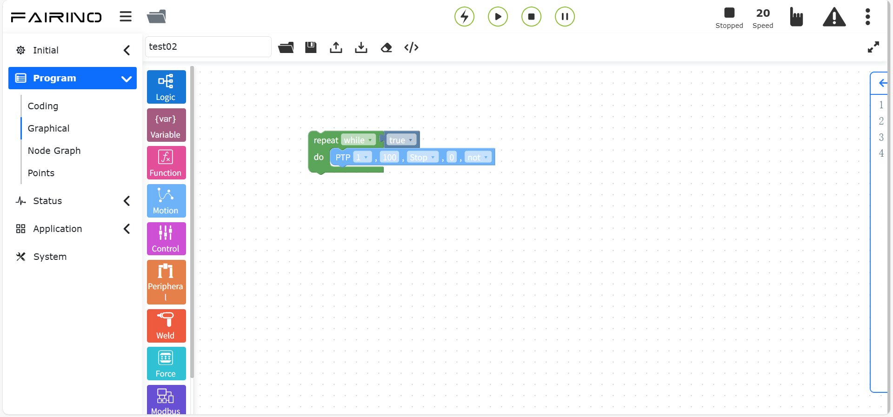

.. centered:: Figura 10.2-2 Bloque de código de la instrucción While

Instrucción de salto
~~~~~~~~~~~~~~~~~~~~~~~~~~~~~
Arrastrar el bloque de código "Instrucción de salto" al área de trabajo de la interfaz de edición gráfica. (Esta instrucción requiere cierta base de programación; si necesita ayuda, póngase en contacto con nosotros)

- Nombre de salto: introducir el nombre de salto para determinar la posición de salto

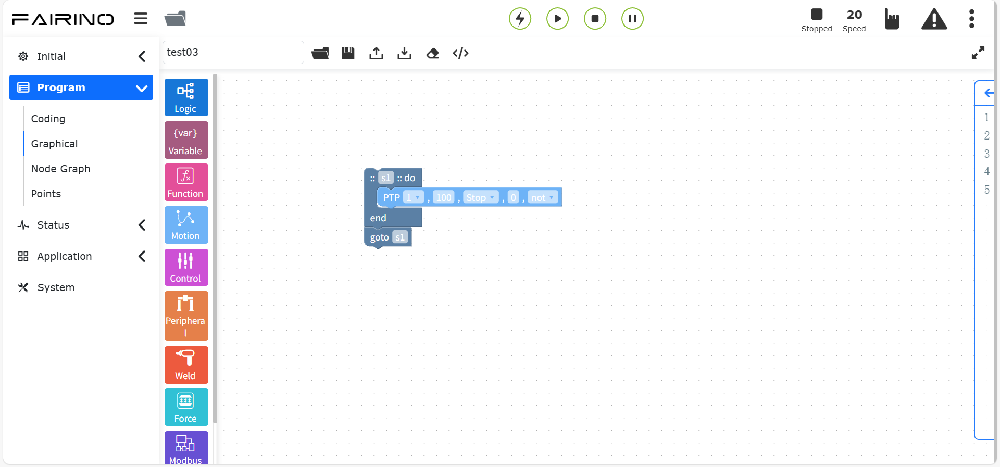

.. centered:: Figura 10.2-3 Bloque de código de la instrucción de salto

.. important:: El nombre de salto no puede comenzar por un número.

Comandos de programación gráfica de tipo variable
-------------------------------------------------
Los comandos de programación gráfica de tipo variable incluyen el comando de creación de variables.

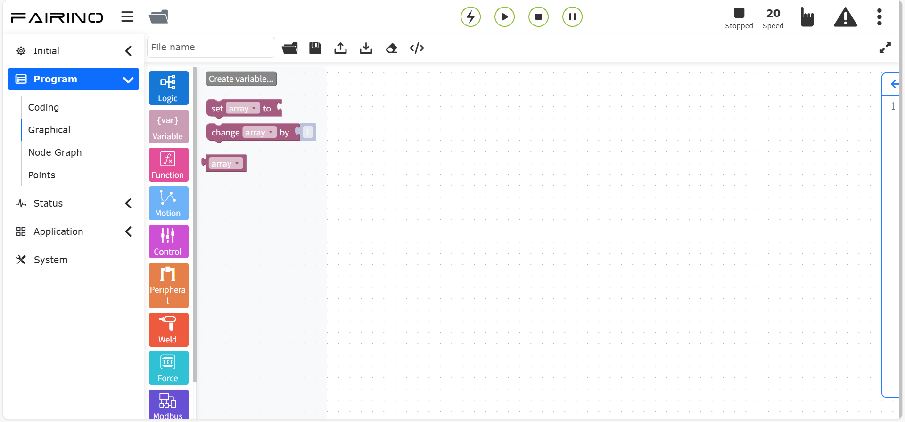

.. centered:: Figura 10.3 Programación gráfica de tipo variable

Instrucción de variable
~~~~~~~~~~~~~~~~~~~~~~~~~~~~~
Hacer clic en el botón "Crear" para introducir el nombre de la variable que se desea definir.

Arrastrar el bloque de código "Instrucción de variable" al área de trabajo de la interfaz de edición gráfica.

Nodo de la instrucción "Variable", parámetros:

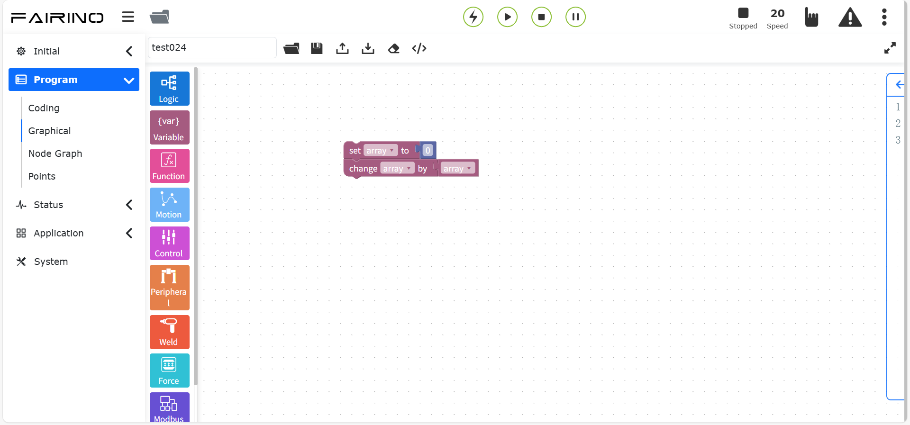

.. centered:: Figura 10.3-1 Bloque de código de la instrucción de variable

Comandos de programación gráfica de tipo función
------------------------------------------------
Los comandos de programación gráfica de tipo función incluyen el comando de creación de funciones.

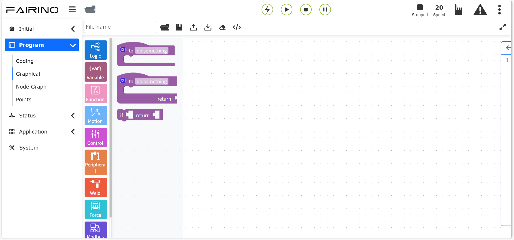

.. centered:: Figura 10.4 Programación gráfica de tipo función

Instrucción de método de función
~~~~~~~~~~~~~~~~~~~~~~~~~~~~~~~~~~~~~~~~~~~~~~~~~~~~~~~
Arrastrar el bloque de código "Instrucción de método de función" al área de trabajo de la interfaz de edición gráfica.

Nodo de la instrucción "Método de función", parámetros:

- Nombre de la función: nombre de la función que se ejecuta

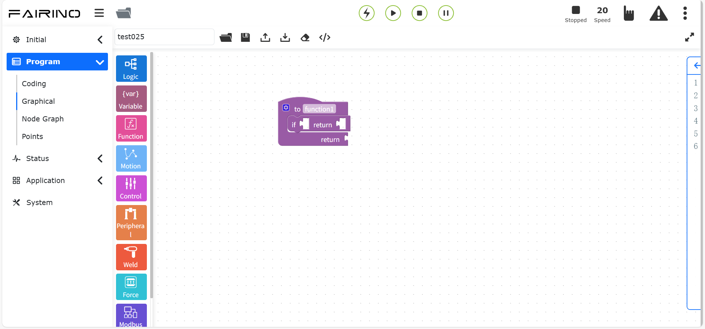

.. centered:: Figura 10.4-1 Bloque de código de la instrucción de método de función

Comandos de programación gráfica de tipo movimiento
---------------------------------------------------
Los comandos de programación gráfica de tipo movimiento incluyen comandos de movimiento como PTP, Lin, ARC, etc.

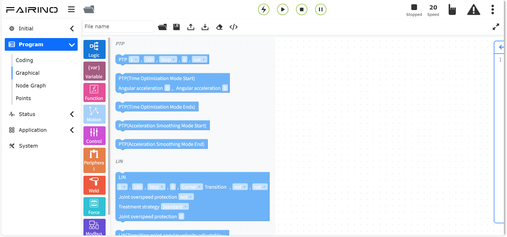

.. centered:: Figura 10.5 Programación gráfica de tipo movimiento

Instrucción punto a punto
~~~~~~~~~~~~~~~~~~~~~~~~~~~~~
Arrastrar el bloque de código "Instrucción punto a punto" al área de trabajo de la interfaz de edición gráfica.

Se puede seleccionar el punto al que se desea llegar; la configuración del tiempo de transición suave permite que el movimiento de este punto al siguiente sea continuo; la configuración de desplazamiento permite seleccionar el desplazamiento basado en el sistema de coordenadas base y el desplazamiento basado en el sistema de coordenadas de herramienta, y aparece la configuración de los valores de desplazamiento x, y, z, rx, ry, rz; la ruta concreta de PTP es la ruta óptima planificada automáticamente por el controlador de movimiento.

Nodo de la instrucción "Punto a punto", parámetros:

- Nombre del punto: punto de enseñanza

- Velocidad de depuración (%): 0 ~ 100

- Detener: false/true

- Transición suave (ms): tiempo de transición suave 0 ~ 500

- ¿Desplazamiento? No/desplazamiento del sistema de coordenadas base/desplazamiento del sistema de coordenadas de herramienta; al seleccionar No, los valores de los parámetros dx~drz no surten efecto

- dx~drz: valor de desplazamiento

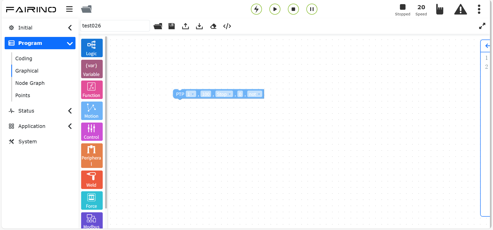

.. centered:: Figura 10.5-1 Bloque de código de la instrucción punto a punto

Instrucción de línea recta
~~~~~~~~~~~~~~~~~~~~~~~~~~~~~
Arrastrar el bloque de código "Instrucción de línea recta" al área de trabajo de la interfaz de edición gráfica.

La función de esta instrucción es similar a la de la instrucción "Punto a punto", pero la ruta hasta el punto alcanzado por esta instrucción es una línea recta.

Nodo de la instrucción "Línea recta", parámetros:

- Nombre del punto: punto de enseñanza

- Velocidad de depuración (%): 0 ~ 100

- Detener: false/true; al seleccionar true, el valor del parámetro de transición suave no surte efecto

- Transición suave (mm): radio de transición suave 0 ~ 1000

- ¿Búsqueda de posición?: false/true

- Variable del punto de búsqueda de posición: REF0~99/RES0~99; al seleccionar false en ¿Búsqueda de posición?, el parámetro no surte efecto

- ¿Desplazamiento?: No

- Protección contra sobrevelocidad articular: No/Sí

- Estrategia de tratamiento: Estándar/Detener con error al sobrevelocidad/Reducción adaptativa de velocidad

- Umbral de reducción de velocidad permitido: 0~100

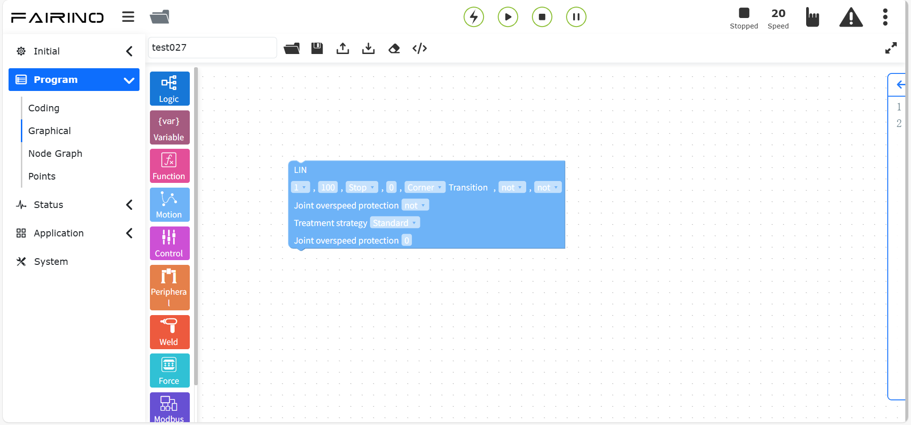

.. centered:: Figura 10.5-2 Bloque de código de la instrucción de línea recta

Instrucción de línea recta (velocidad angular del punto de transición ajustable)
~~~~~~~~~~~~~~~~~~~~~~~~~~~~~~~~~~~~~~~~~~~~~~~~~~~~~~~~~~~~~~~~~~~~~~~~~~~~~~~~~
Arrastrar el bloque de código "Instrucción de línea recta (velocidad angular del punto de transición ajustable)" al área de trabajo de la interfaz de edición gráfica.

La función de esta instrucción es similar a la de la instrucción "Punto a punto", pero esta instrucción incluye la velocidad angular del punto de transición ajustable.

Nodo de la instrucción "Línea recta (velocidad angular del punto de transición ajustable)", parámetros:

- Velocidad angular máxima: 0~300

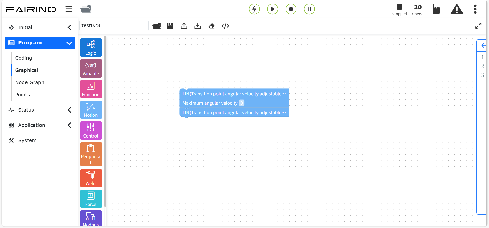

.. centered:: Figura 10.5-3 Bloque de código de la instrucción de línea recta (velocidad angular del punto de transición ajustable)

Instrucción de línea recta (seamPos)
~~~~~~~~~~~~~~~~~~~~~~~~~~~~~~~~~~~~~
Arrastrar el bloque de código "Instrucción de línea recta (seamPos)" al área de trabajo de la interfaz de edición gráfica.

La función de esta instrucción se aplica al uso del sensor láser en escenarios de soldadura.

Nodo de la instrucción "Línea recta (seamPos)", parámetros:

- Nombre del punto: punto de enseñanza

- Velocidad de depuración (%): 0 ~ 100

- Detener: false/true; al seleccionar true, el valor del parámetro de transición suave no surte efecto

- Transición suave (mm): radio de transición suave 0 ~ 1000

- Selección de datos de caché de soldadura: datos de planificación de ejecución/datos de registro de ejecución

- Tipo de placa: placa ondulada/placa corrugada/placa de valla/barril de aceite/acero con caparazón ondulado

- ¿Desplazamiento?: No/desplazamiento del sistema de coordenadas base/desplazamiento del sistema de coordenadas de herramienta/desplazamiento de datos originales del láser; al seleccionar No, los valores de los parámetros dx~drz no surten efecto

- dx~drz: valor de desplazamiento

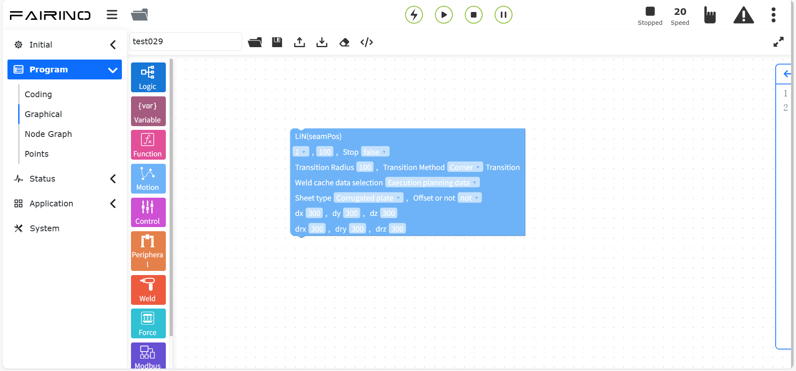

.. centered:: Figura 10.5-4 Bloque de código de la instrucción de línea recta (seamPos)

Instrucción de arco
~~~~~~~~~~~~~~~~~~~~~~~~~~~~~
Arrastrar el bloque de código "Instrucción de arco" al área de trabajo de la interfaz de edición gráfica.

El movimiento en arco incluye dos puntos: el primer punto es el punto de transición intermedio del arco y el segundo punto es el punto final; tanto el punto de transición como el punto final permiten configurar si hay desplazamiento, pudiendo seleccionar desplazamiento basado en el sistema de coordenadas base y desplazamiento basado en el sistema de coordenadas de herramienta, y configurar los valores de desplazamiento x, y, z, rx, ry, rz; el punto final permite configurar el radio de transición suave para lograr un efecto de movimiento continuo.

Nodo de la instrucción "Arco", parámetros:

- Punto intermedio del arco: punto de enseñanza

- ¿Desplazamiento?: No/desplazamiento del sistema de coordenadas base/desplazamiento del sistema de coordenadas de herramienta; al seleccionar No, los valores de los parámetros dx~drz no surten efecto

- dx~drz: valor de desplazamiento

- Punto final del arco: punto de enseñanza

- ¿Desplazamiento?: No/desplazamiento del sistema de coordenadas base/desplazamiento del sistema de coordenadas de herramienta; al seleccionar No, los valores de los parámetros dx~drz no surten efecto

- dx~drz: valor de desplazamiento

- Velocidad de depuración (%): 0 ~ 100

- Detener: false/true; al seleccionar true, el valor del parámetro de transición suave no surte efecto

- Transición suave (mm): radio de transición suave 0 ~ 1000

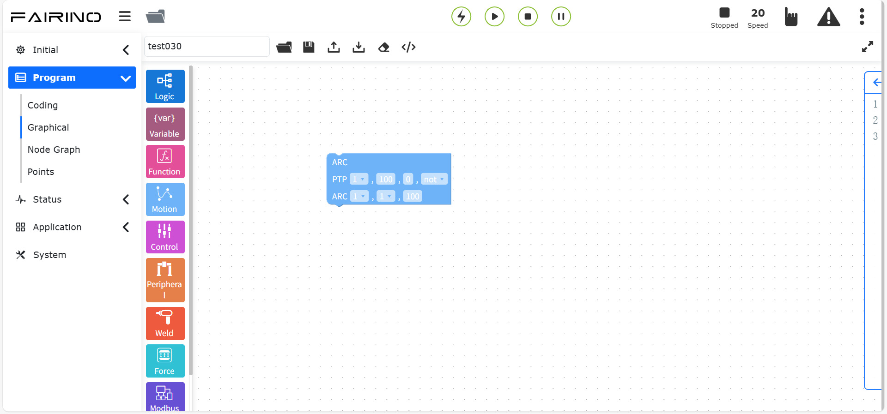

.. centered:: Figura 10.5-5 Bloque de código de la instrucción de arco

Instrucción de círculo completo
~~~~~~~~~~~~~~~~~~~~~~~~~~~~~~~~
Arrastrar el bloque de código "Instrucción de círculo completo" al área de trabajo de la interfaz de edición gráfica.

Hacer clic en el nodo de la instrucción "Círculo completo" para entrar en la interfaz de edición del gráfico de nodos.

El movimiento de círculo completo incluye dos puntos: el primer punto es el punto de transición intermedio 1 del círculo completo y el segundo punto es el punto de transición intermedio 2 del círculo completo; en el punto de transición 2 se puede configurar si hay desplazamiento, y dicho valor de desplazamiento surte efecto simultáneamente en el punto de transición 1 y en el punto de transición 2.

Nodo de la instrucción "Círculo completo", parámetros:

- Punto intermedio 1 del círculo completo: punto de enseñanza

- Punto intermedio 2 del círculo completo: punto de enseñanza

- Velocidad de depuración (%): 0 ~ 100

- ¿Desplazamiento?: No/desplazamiento del sistema de coordenadas base/desplazamiento del sistema de coordenadas de herramienta; al seleccionar No, los valores de los parámetros dx~drz no surten efecto

- dx~drz: valor de desplazamiento

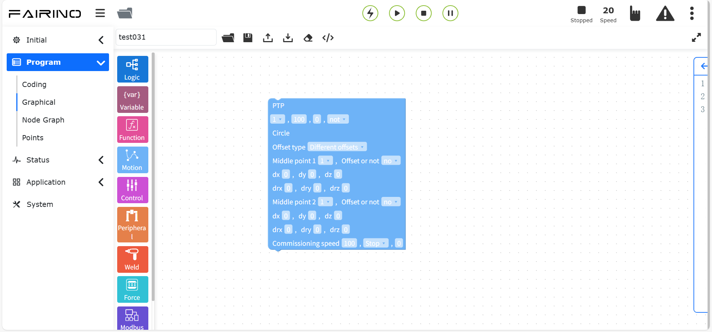

.. centered:: Figura 10.5-6 Bloque de código de la instrucción de círculo completo

Instrucción de hélice
~~~~~~~~~~~~~~~~~~~~~~~~~~~~~
Arrastrar el bloque de código "Instrucción de hélice" al área de trabajo de la interfaz de edición gráfica.

El movimiento en hélice incluye tres puntos; estos tres puntos forman un círculo; en la página de configuración del tercer punto se incluyen parámetros como el número de vueltas de la hélice, el ángulo de corrección de actitud, el incremento de radio y el incremento de dirección del eje de rotación. El número de vueltas de la hélice es el número de vueltas del movimiento de la hélice; el ángulo de corrección de actitud corrige la actitud al final de la hélice respecto a la actitud del primer punto de la hélice; el incremento de radio es el incremento del radio de cada vuelta; el incremento de dirección del eje de rotación es el incremento en la dirección del eje de la hélice. Configurar si hay desplazamiento; este valor de desplazamiento surte efecto sobre toda la trayectoria de la hélice.

Nodo de la instrucción "Hélice", parámetros:

- Punto intermedio 1 de la hélice: punto de enseñanza

- Punto intermedio 2 de la hélice: punto de enseñanza

- Punto intermedio 3 de la hélice: punto de enseñanza

- Velocidad de depuración (%): 0 ~ 100

- ¿Desplazamiento?: No/desplazamiento del sistema de coordenadas base/desplazamiento del sistema de coordenadas de herramienta; al seleccionar No, los valores de los parámetros dx~drz no surten efecto

- dx~drz: valor de desplazamiento

- Número de vueltas de la hélice: 0 ~ 100

- Corrección del ángulo de actitud rx (°): -1000 ~ 1000

- Corrección del ángulo de actitud ry (°): -1000 ~ 1000

- Corrección del ángulo de actitud rz (°): -1000 ~ 1000

- Incremento de radio (mm): -100 ~ 100

- Incremento de dirección del eje de rotación (mm): -100 ~ 100

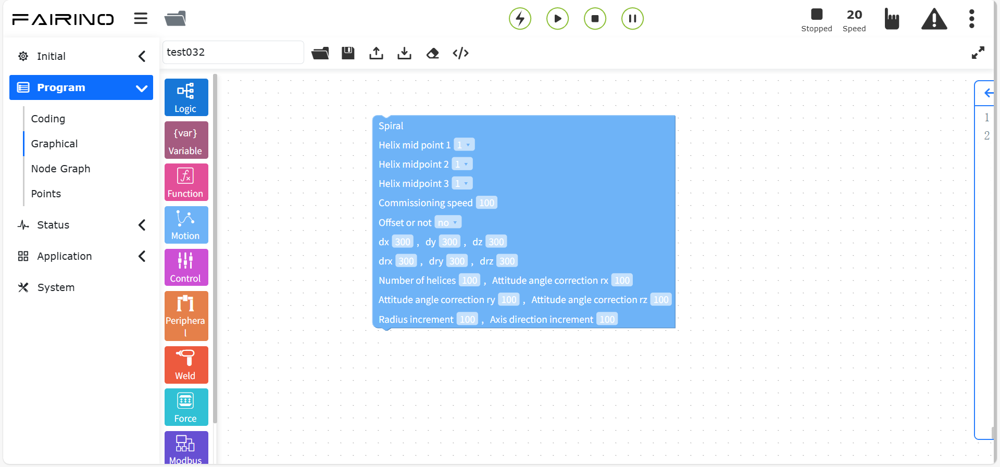

.. centered:: Figura 10.5-7 Bloque de código de la instrucción de hélice

Instrucción de nueva hélice
~~~~~~~~~~~~~~~~~~~~~~~~~~~~~~~~
Arrastrar el bloque de código "Instrucción de nueva hélice" al área de trabajo de la interfaz de edición gráfica.

Hacer clic en el nodo de la instrucción "Nueva hélice" para entrar en la interfaz de edición del gráfico de nodos.

El movimiento de nueva hélice es una versión optimizada del movimiento en hélice; esta instrucción solo requiere un punto más la configuración de cada parámetro para realizar el movimiento en hélice. El robot toma la posición actual como punto inicial; el usuario configura la velocidad de depuración, si hay desplazamiento, el número de vueltas de la hélice, la inclinación de la hélice, el radio inicial, el incremento de radio, el incremento de dirección del eje de rotación y la dirección de rotación. El número de vueltas de la hélice es el número de vueltas del movimiento de la hélice; la inclinación de la hélice es el ángulo entre el eje Z de la herramienta y la dirección horizontal; el ángulo de corrección de actitud corrige la actitud al final de la hélice respecto a la actitud del primer punto de la hélice; el radio inicial es el tamaño del radio de la primera vuelta; el incremento de radio es el incremento del radio de cada vuelta; el incremento de dirección del eje de rotación es el incremento en la dirección del eje de la hélice; la dirección de rotación es en sentido horario o antihorario.

Nodo de la instrucción "Nueva hélice", parámetros:

- Punto inicial de la hélice: punto de enseñanza

- Velocidad de depuración (%): 0 ~ 100

- ¿Desplazamiento?: No/desplazamiento del sistema de coordenadas base/desplazamiento del sistema de coordenadas de herramienta; al seleccionar No, los valores de los parámetros dx~drz no surten efecto

- dx~drz: valor de desplazamiento

- Número de vueltas de la hélice: 0 ~ 100

- Inclinación de la hélice (°): -100 ~ 100

- Radio inicial: 0 ~ 100

- Incremento de radio (mm): -100 ~ 100

- Incremento de dirección del eje de rotación (mm): -100 ~ 100

- Dirección de rotación: sentido horario/sentido antihorario

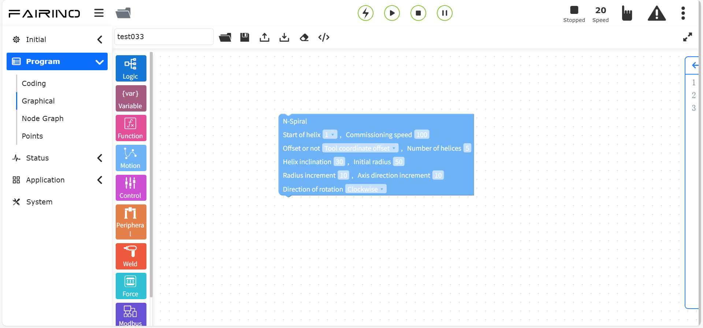

.. centered:: Figura 10.5-8 Bloque de código de la instrucción de nueva hélice

Instrucción de hélice horizontal
~~~~~~~~~~~~~~~~~~~~~~~~~~~~~~~~~~
Arrastrar el bloque de código "Instrucción de hélice horizontal" al área de trabajo de la interfaz de edición gráfica.

La instrucción "H-Spiral" es un movimiento en hélice en el espacio horizontal; esta instrucción se configura después de una instrucción de movimiento de un solo segmento (línea recta).

Nodo de la instrucción "Hélice horizontal", parámetros:

- Radio de la hélice: 0~100mm

- Velocidad angular de la hélice: 0~2rev/s

- Dirección de rotación: hélice en sentido horario/antihorario

- Inclinación de la hélice: 0~40°

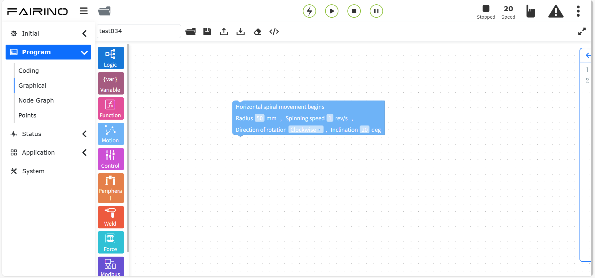

.. centered:: Figura 10.5-9 Bloque de código de la instrucción de hélice horizontal

Instrucción de spline
~~~~~~~~~~~~~~~~~~~~~~~~~~~~~
Arrastrar el bloque de código "Instrucción de spline" al área de trabajo de la interfaz de edición gráfica.

Esta instrucción se divide en tres partes: inicio del grupo de splines, segmento de spline y fin del grupo de splines. El inicio del grupo de splines es el indicador de inicio del movimiento de spline; el segmento de spline actualmente solo incluye el segmento SPL en el gráfico de nodos; el fin del grupo de splines es el indicador de fin del movimiento de spline.

Nodo de la instrucción "Spline-SPTP", parámetros:

- Nombre del punto: punto de enseñanza

- Velocidad de depuración (%): 0 ~ 100

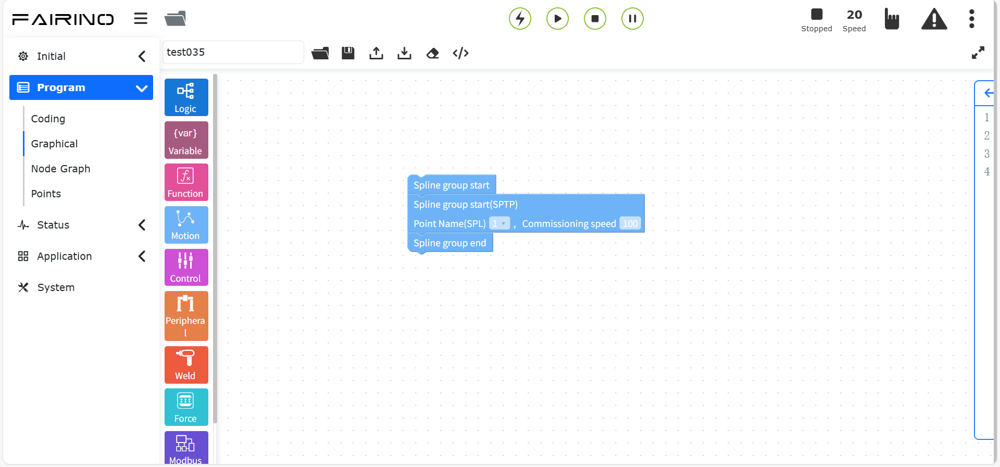

.. centered:: Figura 10.5-10 Bloque de código de la instrucción de spline

Instrucción de nueva spline
~~~~~~~~~~~~~~~~~~~~~~~~~~~~~
Arrastrar el bloque de código "Instrucción de nueva spline" al área de trabajo de la interfaz de edición gráfica.

Esta instrucción es una versión optimizada del algoritmo de la instrucción de spline y sustituirá en el futuro a la instrucción de spline actual. Esta instrucción se divide en tres partes: inicio de trayectoria multipunto, segmento de trayectoria multipunto y fin de trayectoria multipunto. El inicio de trayectoria multipunto es el indicador de inicio del movimiento de trayectoria multipunto; el segmento de trayectoria multipunto sirve para configurar cada punto de trayectoria; hacer clic en el icono para entrar en la interfaz de adición de puntos; el fin de trayectoria multipunto es el indicador de fin del movimiento de trayectoria multipunto, donde se puede configurar el modo de control y la velocidad de depuración. El modo de control se divide en punto de control dado y punto de ruta dado.

Nodo de la instrucción "Nueva spline", parámetros:

- Modo de control: punto de enseñanza

- Tiempo medio de enlace global: tipo entero, mayor que 10, valor predeterminado 2000ms

Nodo de la instrucción "Nueva spline-SPL", parámetros:

- Nombre del punto: punto de enseñanza

- Velocidad de depuración (%): 0 ~ 100

- Radio de transición suave: 0 ~ 1000

- ¿Es el último punto?: No/Sí

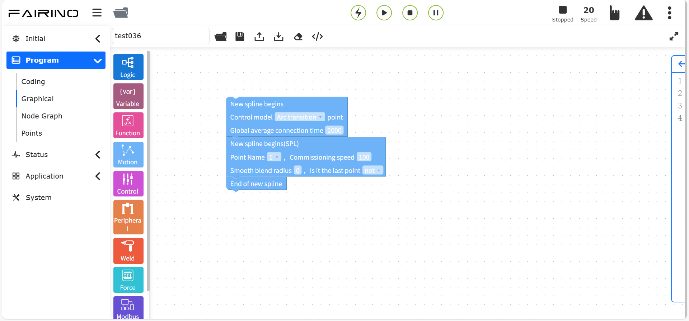

.. centered:: Figura 10.5-11 Bloque de código de la instrucción de nueva spline

Instrucción de oscilación
~~~~~~~~~~~~~~~~~~~~~~~~~~~~~
Arrastrar el bloque de código "Instrucción de oscilación" al área de trabajo de la interfaz de edición gráfica.

Nodo de la instrucción "Oscilación", parámetros:

- Número: 0~7

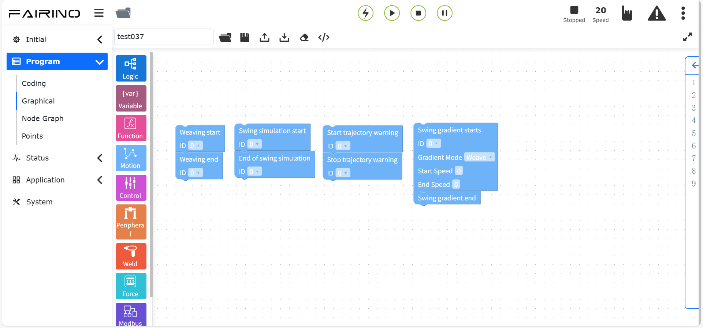

.. centered:: Figura 10.5-12 Bloque de código de la instrucción de oscilación

Instrucción de desplazamiento de punto
~~~~~~~~~~~~~~~~~~~~~~~~~~~~~~~~~~~~~~
Arrastrar el bloque de código "Instrucción de desplazamiento de punto" al área de trabajo de la interfaz de edición gráfica.

Esta instrucción es una instrucción de desplazamiento global; al introducir cada valor de desplazamiento, las instrucciones de movimiento se desplazarán basándose en el sistema de coordenadas base (o el sistema de coordenadas de pieza).

Nodo de la instrucción "Desplazamiento de punto", parámetros:

- ∆x: valor de desplazamiento, -300~300

- ∆y: valor de desplazamiento, -300~300

- ∆z: valor de desplazamiento, -300~300

- ∆rx: valor de desplazamiento, -300~300

- ∆ry: valor de desplazamiento, -300~300

- ∆rz: valor de desplazamiento, -300~300

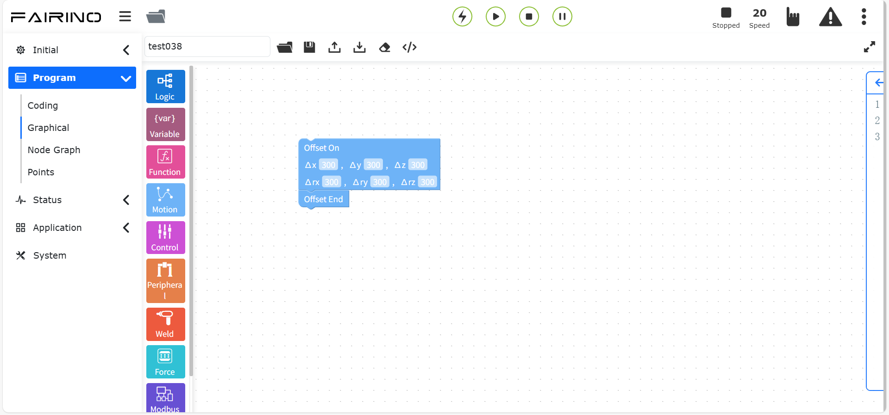

.. centered:: Figura 10.5-13 Bloque de código de la instrucción de desplazamiento de punto

Instrucción servo
~~~~~~~~~~~~~~~~~~~~~~~~~~~~~
Arrastrar el bloque de código "Instrucción servo" al área de trabajo de la interfaz de edición gráfica.

Instrucción de control servo (movimiento en el espacio cartesiano): esta instrucción permite controlar el movimiento del robot mediante control de pose absoluta o mediante desplazamiento basado en la pose actual.

Nodo de la instrucción "Servo", parámetros:

- Modo de movimiento: posición absoluta/desplazamiento del sistema de coordenadas base/desplazamiento del sistema de coordenadas de herramienta

- x: valor de desplazamiento, -300~300

- y: valor de desplazamiento, -300~300

- z: valor de desplazamiento, -300~300

- rx: valor de desplazamiento, -300~300

- ry: valor de desplazamiento, -300~300

- rz: valor de desplazamiento, -300~300

- Coeficiente de proporción x: 0~1

- Coeficiente de proporción y: 0~1

- Coeficiente de proporción z: 0~1

- Coeficiente de proporción rx: 0~1

- Coeficiente de proporción ry: 0~1

- Coeficiente de proporción rz: 0~1

- Aceleración (%): 0~100

- Velocidad (%): 0~100

- Período de instrucción (s): 0.001~0.016

- Tiempo de filtrado (s): 0~1

- Ampliación de proporción: 0~100

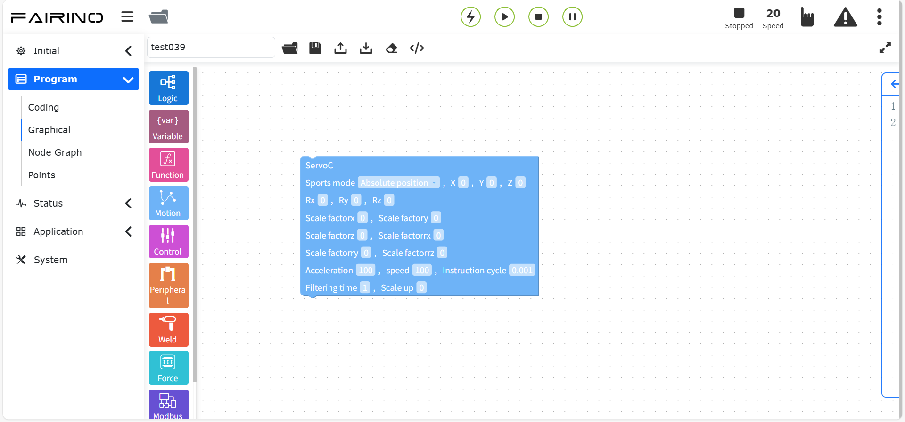

.. centered:: Figura 10.5-14 Bloque de código de la instrucción servo

Instrucción de trayectoria
~~~~~~~~~~~~~~~~~~~~~~~~~~~~~
Arrastrar el bloque de código "Instrucción de trayectoria" al área de trabajo de la interfaz de edición gráfica.

En esta instrucción, el usuario debe disponer primero de una trayectoria registrada.

Nodo de la instrucción "Trayectoria", parámetros:

- Seleccionar archivo de trayectoria: trayectoria registrada

- Velocidad de depuración (%): 0 ~ 100, valor predeterminado 25

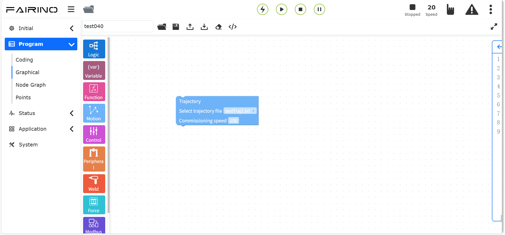

.. centered:: Figura 10.5-15 Bloque de código de la instrucción de trayectoria

Instrucción de trayectoria J
~~~~~~~~~~~~~~~~~~~~~~~~~~~~~
Arrastrar el bloque de código "Instrucción de trayectoria J" al área de trabajo de la interfaz de edición gráfica.

En esta instrucción, el usuario debe disponer primero de una trayectoria registrada; el archivo de trayectoria se puede importar previamente en la interfaz del programa de enseñanza. La instrucción de trayectoria y la instrucción de trayectoria J son interfaces genéricas aplicables a trayectorias dadas directamente por la cámara; permiten que, cuando se dispone de un archivo de puntos de trayectoria discretos con un formato fijo, se pueda importar al sistema para que el robot se desplace según la trayectoria del archivo importado.

Nodo de la instrucción "Trayectoria J", parámetros:

- Seleccionar archivo de trayectoria: trayectoria registrada

- Velocidad de depuración (%): 0 ~ 100, valor predeterminado 25

- Modo de trayectoria: punto de ruta/punto de control

.. centered:: Figura 10.5-16 Bloque de código de la instrucción de trayectoria J

Instrucción de reproducción de trayectoria
~~~~~~~~~~~~~~~~~~~~~~~~~~~~~~~~~~~~~~~~~~~
Arrastrar el bloque de código "Instrucción de reproducción de trayectoria" al área de trabajo de la interfaz de edición gráfica.

En esta instrucción, el usuario debe disponer primero de una trayectoria registrada.

Al realizar la programación de programas, primero hay que llegar al punto inicial de la trayectoria correspondiente con la instrucción punto a punto; a continuación, en la instrucción de reproducción de trayectoria seleccionar la trayectoria, seleccionar el suavizado de trayectoria y configurar la velocidad de depuración. La instrucción de carga de trayectoria se utiliza principalmente para leer previamente el archivo de trayectoria y extraerlo como instrucción de trayectoria, aplicándose mejor en escenarios de seguimiento de cinta transportadora.

Nodo de la instrucción "Reproducción de trayectoria", parámetros:

- Nombre de la trayectoria: trayectoria registrada

- Suavizado de trayectoria: No/Sí

- Velocidad de depuración (%): 0 ~ 100, valor predeterminado 25

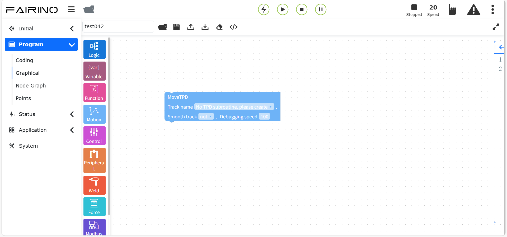

.. centered:: Figura 10.5-17 Bloque de código de la instrucción de reproducción de trayectoria

Instrucción DMP
~~~~~~~~~~~~~~~~~~~~~~~~~~~~~
Arrastrar el bloque de código "Instrucción DMP" al área de trabajo de la interfaz de edición gráfica.

DMP es un método de aprendizaje por imitación de trayectoria y requiere planificar previamente una trayectoria de referencia. En la interfaz de edición del comando, seleccionar el punto de enseñanza como nuevo punto inicial y hacer clic en "Añadir" y "Aplicar" para guardar esta instrucción. La ruta concreta de DMP es la nueva trayectoria que imita la trayectoria de referencia tomando el nuevo punto inicial.

Nodo de la instrucción "DMP", parámetros:

- Nombre del punto: punto de enseñanza

- Velocidad de depuración (%): 0 ~ 100, valor predeterminado 100

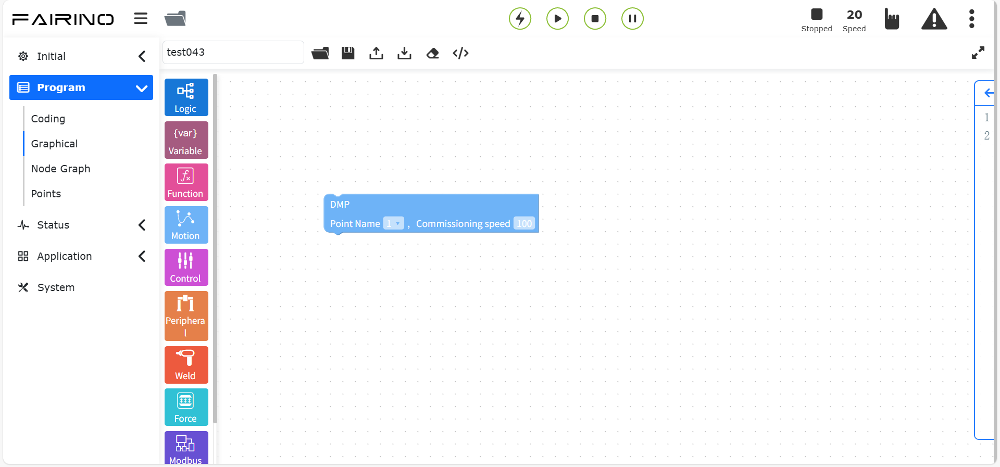

.. centered:: Figura 10.5-18 Bloque de código de la instrucción DMP

Instrucción de conversión de herramienta
~~~~~~~~~~~~~~~~~~~~~~~~~~~~~~~~~~~~~~~~~
Arrastrar el bloque de código "Instrucción de conversión de herramienta" al área de trabajo de la interfaz de edición gráfica.

Seleccionar el sistema de coordenadas de herramienta sobre el que se desea realizar la conversión automática y hacer clic en "Añadir" y "Aplicar" para guardar esta instrucción; los puntos bajo el sistema de coordenadas de herramienta se convierten automáticamente.

Nodo de la instrucción "Conversión de herramienta", parámetros:

- Sistema de coordenadas de herramienta: lista de sistemas de coordenadas de herramienta

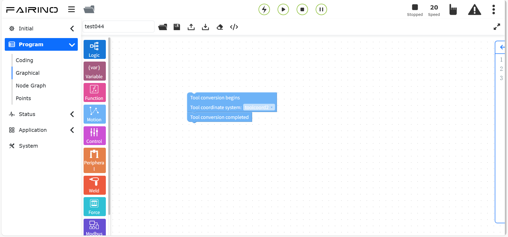

.. centered:: Figura 10.5-19 Bloque de código de la instrucción de conversión de herramienta

Instrucción de conversión de pieza
~~~~~~~~~~~~~~~~~~~~~~~~~~~~~~~~~~~~
Arrastrar el bloque de código "Instrucción de conversión de pieza" al área de trabajo de la interfaz de edición gráfica.

Seleccionar el sistema de coordenadas de pieza sobre el que se desea realizar la conversión automática y hacer clic en "Añadir" y "Aplicar" para guardar esta instrucción; los puntos bajo el sistema de coordenadas de pieza se convierten automáticamente.

Nodo de la instrucción "Conversión de pieza", parámetros:

- Sistema de coordenadas de pieza: lista de sistemas de coordenadas de pieza

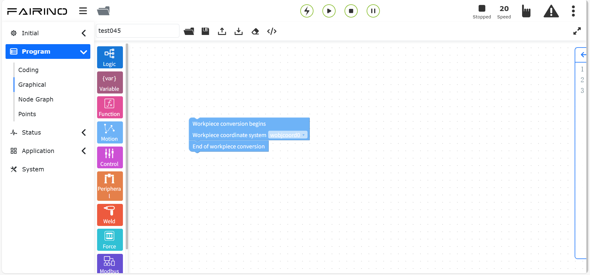

.. centered:: Figura 10.5-20 Bloque de código de la instrucción de conversión de pieza

Comandos de programación gráfica de tipo control
------------------------------------------------
Los comandos de programación gráfica de tipo control incluyen comandos de control como Wait, IO, etc.

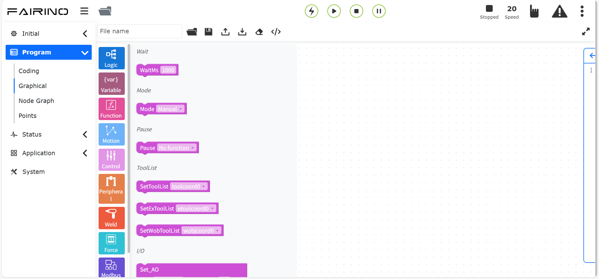

.. centered:: Figura 10.6 Comandos de programación gráfica de tipo control

Instrucción de espera
~~~~~~~~~~~~~~~~~~~~~~~~~~~~~
Arrastrar el bloque de código "Instrucción de espera" al área de trabajo de la interfaz de edición gráfica.

Esta instrucción es una instrucción de retardo y se divide en cuatro partes: "WaitMs", "WaitDI", "WaitMultiDI" y "WaitAI".

1. Nodo de la instrucción "Espera", parámetros:

- Tiempo de espera (ms): la unidad del tiempo de espera de retardo es el milisegundo; introducir el número de milisegundos que se desea esperar

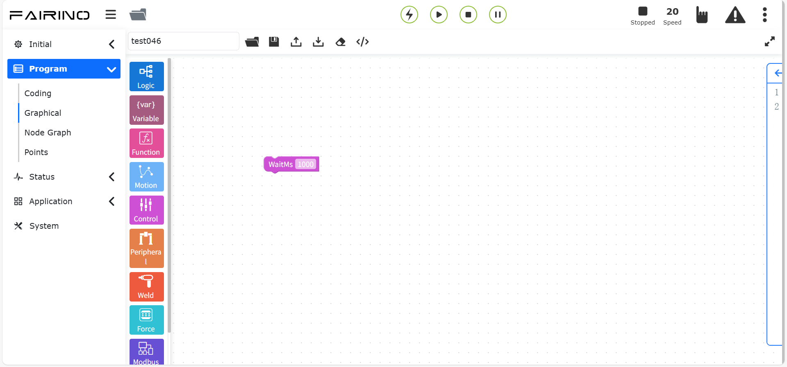

.. centered:: Figura 10.6-1 Bloque de código de la instrucción de espera

2. Nodo de la instrucción "Espera DI", parámetros:

- Número de puerto DI: Ctrl-DI0 ~ Ctrl-CI7(WaitDI,[0~15]), End-DI0 ~ End-DI1(WaitToolDI,[0~1])

- Estado: false/true

- Tiempo máximo (ms): 0 ~ 10000

- Tratamiento del tiempo de espera agotado: Detener con error/Continuar la ejecución/Esperar siempre

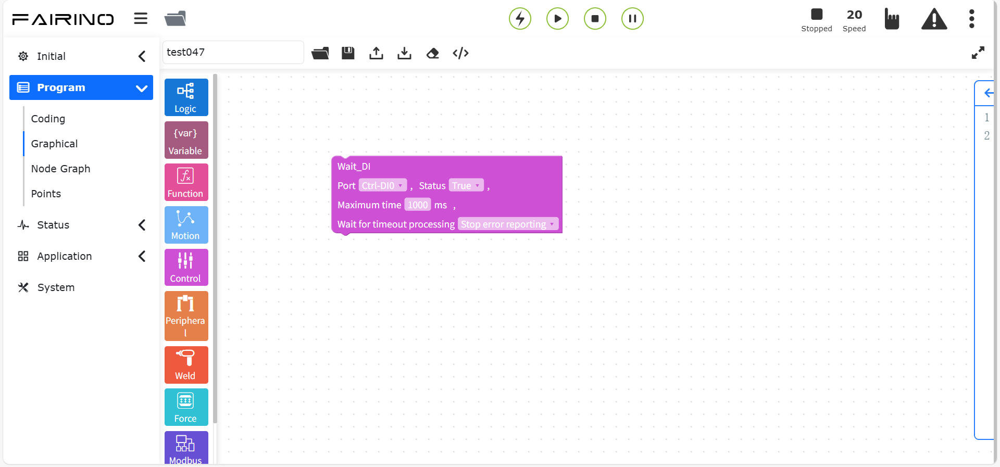

.. centered:: Figura 10.6-2 Bloque de código de la instrucción de espera DI

3. Nodo de la instrucción "Espera múltiples DI", parámetros:

- Condición: Y/O

- Selección de condición: seleccionar el número de puerto cuyo estado de bit está activado, separados por comas, por ejemplo DI0,DI1

- Puerto correspondiente al valor verdadero: seleccionar el número de puerto del valor verdadero, separados por comas, por ejemplo DI0,DI1

- Tiempo máximo (ms): 0 ~ 10000, tiempo máximo de espera

- Tratamiento del tiempo de espera agotado: Detener con error/Continuar la ejecución/Esperar siempre

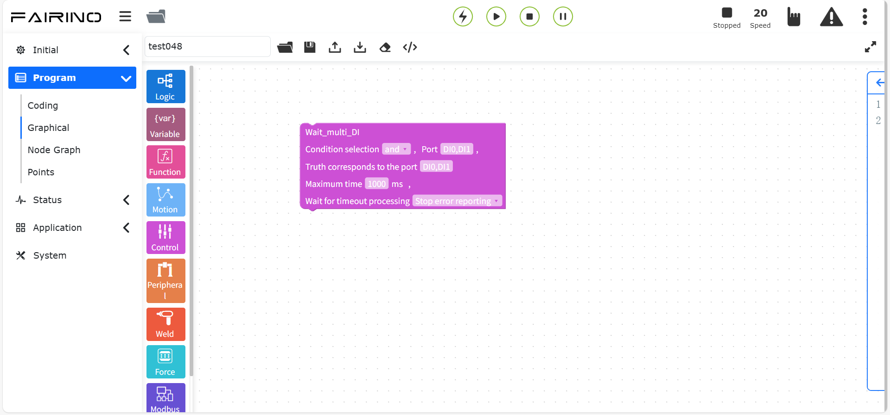

.. centered:: Figura 10.6-3 Bloque de código de la instrucción de espera múltiples DI

4. Nodo de la instrucción "Espera AI", parámetros:

- Condición: Y/O

- Número de puerto AI: Ctrl-AI0 ~ Ctrl-AI1(WaitAI,[0~1]), End-AI0(WaitToolAI,[0])

- Condición: mayor que/menor que

- Valor (%): 1 ~ 100

- Tiempo máximo (ms): 0 ~ 10000

- Tratamiento del tiempo de espera agotado: Detener con error/Continuar la ejecución/Esperar siempre; cuando el tratamiento del tiempo de espera agotado es esperar siempre, el tiempo máximo se establece por defecto en 0

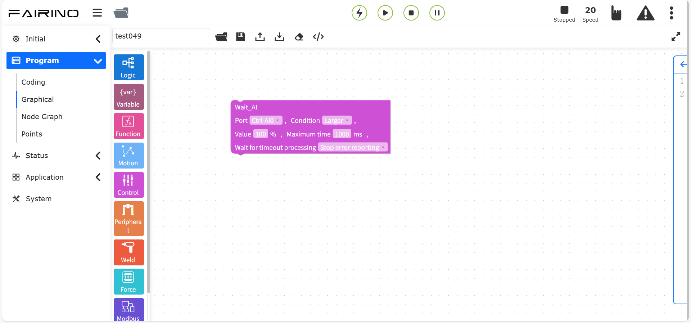

.. centered:: Figura 10.6-4 Bloque de código de la instrucción de espera AI

Instrucción de cambio de modo
~~~~~~~~~~~~~~~~~~~~~~~~~~~~~
Arrastrar el bloque de código "Instrucción de cambio de modo" al área de trabajo de la interfaz de edición gráfica.

Esta instrucción permite cambiar el robot al modo manual; normalmente se añade al final de un programa para que, tras finalizar la ejecución del programa, el usuario pueda hacer que el robot cambie automáticamente al modo manual y arrastrarlo.

Nodo de la instrucción "Cambio de modo", parámetros:

- Cambio de modo: modo manual

.. centered:: Figura 10.6-5 Bloque de código de la instrucción de cambio de modo

Instrucción de pausa
~~~~~~~~~~~~~~~~~~~~~~~~~~~~~
Arrastrar el bloque de código "Instrucción de pausa" al área de trabajo de la interfaz de edición gráfica.

Esta instrucción es una instrucción de pausa; al insertar esta instrucción en el programa, cuando el programa llegue a esta instrucción el robot entrará en estado de pausa; si se desea continuar la ejecución, basta con hacer clic en el botón "Pausa/Reanudar" del área de control.

Nodo de la instrucción "Pausa", parámetros:

- Tipo de pausa: sin función, cilindro no en posición, etc.

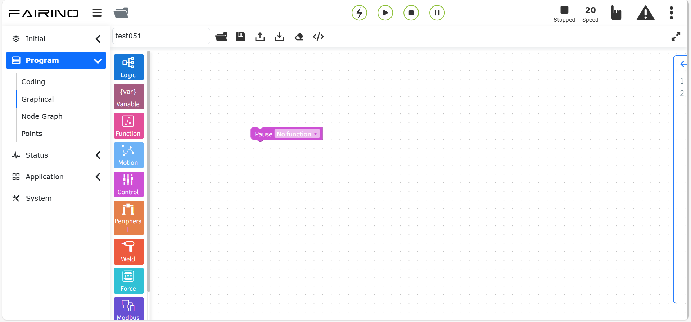

.. centered:: Figura 10.6-6 Bloque de código de la instrucción de pausa

Instrucción de sistema de coordenadas
~~~~~~~~~~~~~~~~~~~~~~~~~~~~~~~~~~~~~~
Arrastrar el bloque de código "Establecer sistema de coordenadas de herramienta"/"Establecer sistema de coordenadas de pieza" al área de trabajo de la interfaz de edición gráfica.

1. Nodo de la instrucción "Establecer sistema de coordenadas de herramienta", parámetros:

- Nombre del sistema de coordenadas de herramienta: toolcoord1 ~ toolcoord19(SetToolList,[0~19]), etoolcoord0 ~ etoolcoord14(SetExToolList, [0~14])

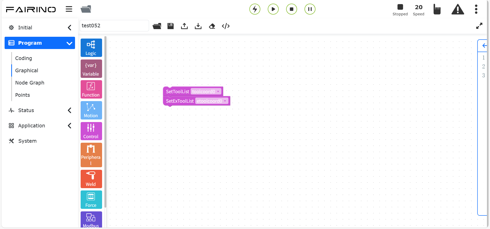

.. centered:: Figura 10.6-7 Bloque de código de la instrucción de establecer sistema de coordenadas de herramienta

2. Nodo de la instrucción "Establecer sistema de coordenadas de pieza", parámetros:

- Nombre del sistema de coordenadas de pieza: wobjcoord1 ~ wobjcoord14

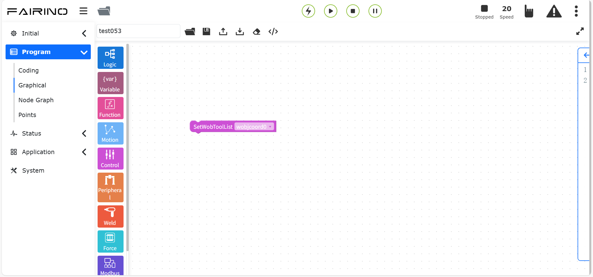

.. centered:: Figura 10.6-8 Bloque de código de la instrucción de establecer sistema de coordenadas de pieza

Instrucción de AI analógica
~~~~~~~~~~~~~~~~~~~~~~~~~~~~
Arrastrar el bloque de código "Establecer AO"/"Obtener AI" al área de trabajo de la interfaz de edición gráfica.

En esta instrucción se distinguen dos partes: establecer salida analógica (SetAO/SPLCSetAO) y obtener entrada analógica (GetAI/SPLCGetAI).

1. Nodo de la instrucción "Establecer AO", parámetros:

- Puerto: Ctrl-AO0 ~ Ctrl-AO1(Bloqueante:SetAO,No bloqueante:SPLCSetAO,[0~1]), End-AO0(Bloqueante:SetToolAO,No bloqueante:SPLCSetToolAO,[0])

- Valor (%): 0 ~ 100

- ¿Bloqueante?: Bloqueante/No bloqueante

- ¿Aplicar hilo?: No/Sí

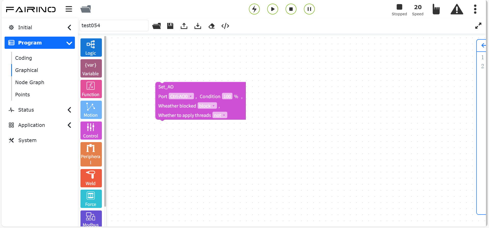

.. centered:: Figura 10.6-9 Bloque de código de la instrucción de establecer AO

2. Nodo de la instrucción "Obtener AI", parámetros:

- Puerto: Ctrl-AI0 ~ Ctrl-DI1(Bloqueante:GetAI,No bloqueante:SPLCGetAI,[0~1]), End-AI0(Bloqueante:GetToolAI,No bloqueante:SPLCGetToolAI,[0])

- Condición: mayor que/menor que

- Valor (%): 0 ~ 100

- Tiempo máximo (ms): 0 ~ 10000

- ¿Bloqueante?: Bloqueante/No bloqueante

- ¿Aplicar hilo?: No/Sí

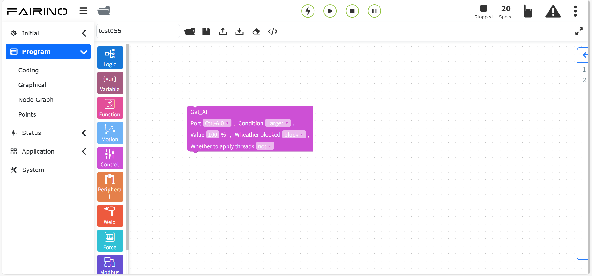

.. centered:: Figura 10.6-10 Bloque de código de la instrucción de obtener AI

Instrucción de IO digital
~~~~~~~~~~~~~~~~~~~~~~~~~~~~
Arrastrar el bloque de código "Establecer DO"/"Obtener DI" al área de trabajo de la interfaz de edición gráfica.

La instrucción es una instrucción de IO y se divide en dos partes: establecer IO (SetDO/SPLCSetDO) y obtener IO (GetDI/SPLCGetDI).

1. Nodo de la instrucción "Establecer DO", parámetros:

- Puerto: Ctrl-DO0 ~ Ctrl-CO7(Bloqueante:SetDO,No bloqueante:SPLCSetDO,[0~15]), End-DO0 ~ End-DO1(Bloqueante:SetToolDO,No bloqueante:SPLCSetToolDO,[0~1])

- Estado: false/true

- ¿Bloqueante?: Bloqueante/No bloqueante

- Trayectoria suave: Break/Serious

- ¿Aplicar hilo?: No/Sí

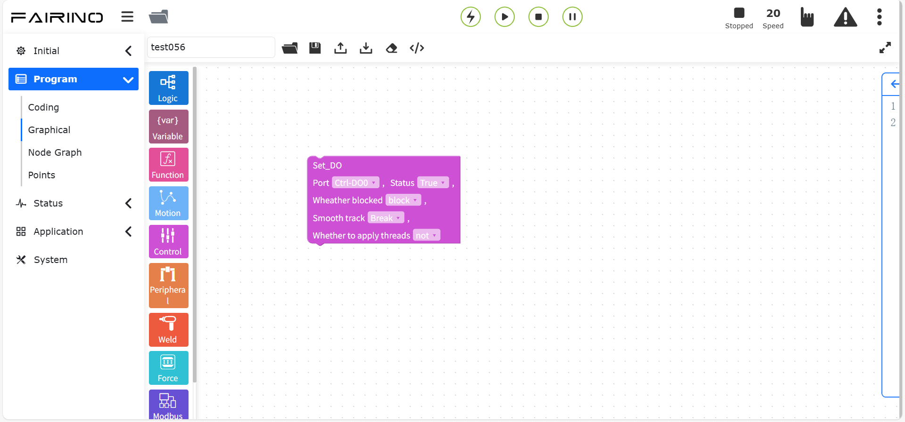

.. centered:: Figura 10.6-11 Bloque de código de la instrucción de establecer DO

2. Nodo de la instrucción "Obtener DI", parámetros:

- Puerto: Ctrl-DI0 ~ Ctrl-CI7(Bloqueante:GetDI,No bloqueante:SPLCGetDI,[0~15]), End-DI0 ~ End-DI1(Bloqueante:GetToolDI,No bloqueante:SPLCGetToolDI,[0~1])

- ¿Bloqueante?: Bloqueante/No bloqueante

- Estado: false/true

- Tiempo máximo de espera (ms): 0 ~ 10000

- ¿Aplicar hilo?: No/Sí

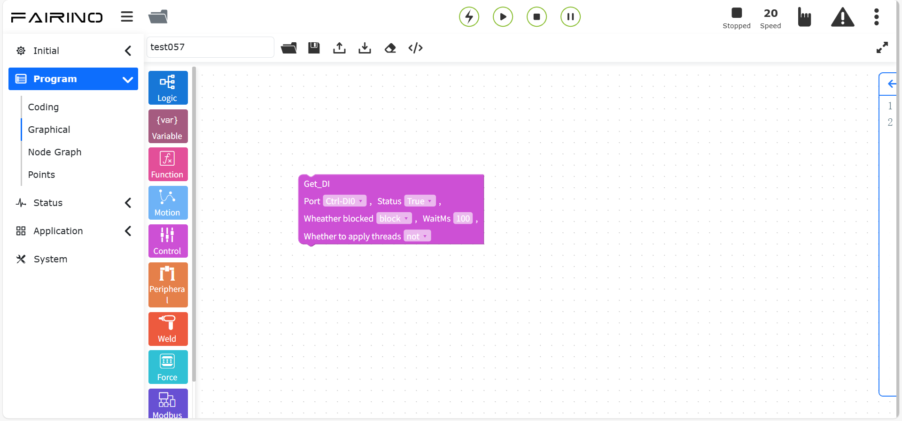

.. centered:: Figura 10.6-12 Bloque de código de la instrucción de obtener DI

Instrucción DO de movimiento
~~~~~~~~~~~~~~~~~~~~~~~~~~~~~
Arrastrar el bloque de código "Instrucción DO de movimiento" al área de trabajo de la interfaz de edición gráfica.

Esta instrucción permite emitir continuamente señales DO durante el movimiento en línea recta según el intervalo establecido.

1. Nodo de la instrucción "Salida continua DO de movimiento", parámetros:

- Puerto: Ctrl-DO0 ~ Ctrl-DO0(MoveDOStart,[0~15]), End-DO1(MoveDOStart,[0~1])

- Intervalo establecido (mm): 0 ~ 500

- Ciclo de trabajo del pulso de salida (%): 0 ~ 99

2. Nodo de la instrucción "Salida única DO de movimiento", parámetros:

- Puerto: Ctrl-DO0 ~ Ctrl-DO0(MoveDOOnceStart,[0~15]), End-DO1(MoveDOOnceStart,[0~1])

- Modo de salida: salida en el tramo de velocidad uniforme/configuración libre

- Tiempo de activación (ms): 0 ~ 1000 (el modo de salida en el tramo de velocidad uniforme tiene por defecto -1)

- Tiempo de desactivación (ms): 0 ~ 1000 (el modo de salida en el tramo de velocidad uniforme tiene por defecto -1)

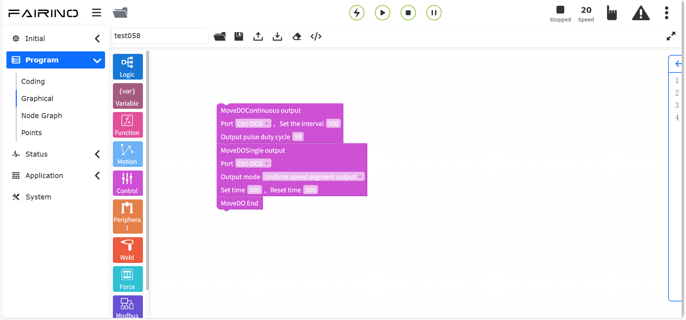

.. centered:: Figura 10.6-13 Bloque de código de la instrucción "Salida única/continua DO de movimiento"

Instrucción AO de movimiento
~~~~~~~~~~~~~~~~~~~~~~~~~~~~~
Arrastrar el bloque de código "Instrucción AO de movimiento" al área de trabajo de la interfaz de edición gráfica.

Cuando esta instrucción se utiliza junto con instrucciones de movimiento, permite emitir señales AO de forma proporcional según la velocidad real del TCP durante el movimiento.

Nodo de la instrucción "AO de movimiento", parámetros:

- Número AO de la caja de control: Ctrl-AO0 ~ Ctrl-AO1(MoveAOStart,[0~1]), End-AO0(MoveToolAOStart,0)

- Velocidad máxima del TCP: 0 ~ 100

- Porcentaje AO de la velocidad máxima del TCP: 0 ~ 100

- Porcentaje AO del valor de compensación de zona muerta: 0 ~ 100

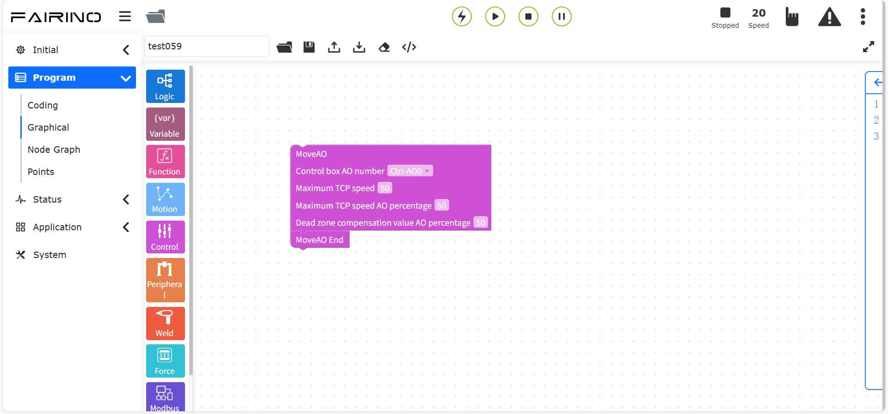

.. centered:: Figura 10.6-14 Bloque de código de la instrucción "AO de movimiento"
  
Instrucción de nivel de colisión
~~~~~~~~~~~~~~~~~~~~~~~~~~~~~~~~~
Arrastrar el bloque de código "Instrucción de nivel de colisión" al área de trabajo de la interfaz de edición gráfica.

Esta instrucción permite configurar el nivel de colisión; mediante esta instrucción se puede ajustar en tiempo real durante la ejecución del programa el nivel de colisión de cada eje, desplegando los escenarios de aplicación de forma más flexible.

Nodo de la instrucción "Nivel de colisión", parámetros:

- Nivel estándar: nivel estándar/porcentaje personalizado

- joint1-joint6(N): 0 ~ 100, umbral de colisión, tipo array

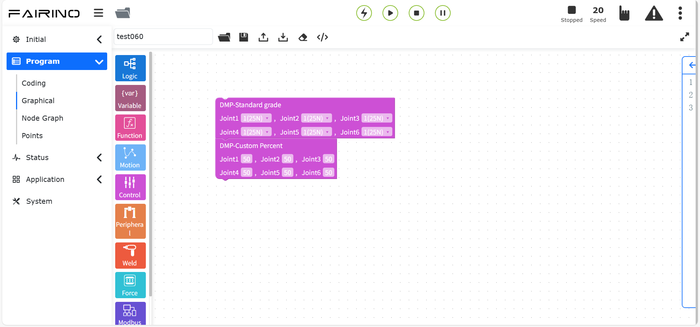

.. centered:: Figura 10.6-15 Bloque de código de la instrucción de nivel de colisión

Instrucción de aceleración
~~~~~~~~~~~~~~~~~~~~~~~~~~~~
Arrastrar el bloque de código "Instrucción de aceleración" al área de trabajo de la interfaz de edición gráfica.

El comando "Aceleración" permite configurar de forma independiente la aceleración del robot; mediante el ajuste del factor de escala de aceleración de la instrucción de movimiento se puede aumentar o reducir el tiempo de aceleración/deceleración, logrando un tiempo de ciclo de acción del robot ajustable.

Nodo de la instrucción "Aceleración", parámetros:

- Porcentaje de aceleración (%): 0 ~ 100

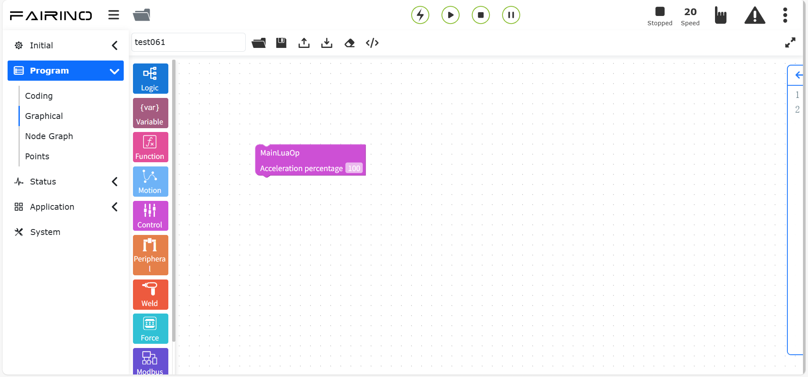

.. centered:: Figura 10.6-16 Bloque de código de la instrucción de aceleración

Comandos de programación gráfica de tipo periférico
----------------------------------------------------
Los comandos de programación gráfica de tipo periférico incluyen comandos de periféricos como pinza, pistola de pulverización, eje extendido, etc.

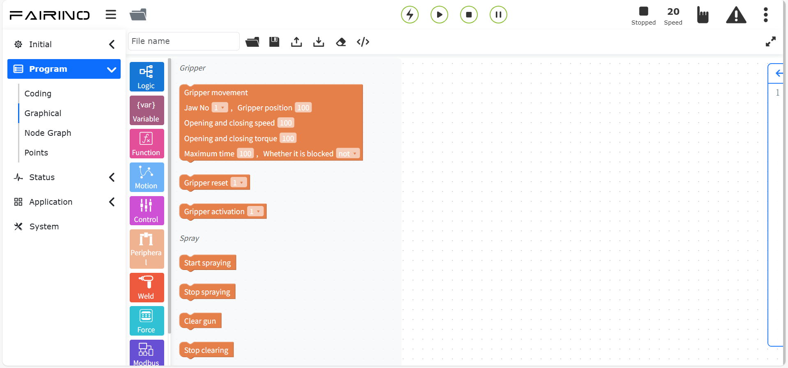

.. centered:: Figura 10.7 Comandos de programación gráfica de tipo periférico

Instrucción de pinza
~~~~~~~~~~~~~~~~~~~~~~~~~~~~~
Arrastrar los bloques de código "Movimiento de pinza", "Activación de pinza" y "Restablecimiento de pinza" al área de trabajo de la interfaz de edición gráfica.

En la instrucción se muestra el número de la pinza que ha completado la configuración y ha sido activada; para configurar la apertura/cierre, la velocidad de apertura/cierre y el par de apertura/cierre de la pinza los valores están en porcentaje; en la opción de bloqueo, seleccionar bloqueante significa que el movimiento de la pinza debe esperar a que finalice la ejecución de la instrucción de movimiento anterior, mientras que seleccionar no bloqueante significa que el movimiento de la pinza es paralelo a la instrucción de movimiento anterior.

1. Nodo "Movimiento de pinza", parámetros:

- Número de pinza: número de la pinza ya activada

- Posición de la pinza: 0~100

- Velocidad de apertura/cierre: 0~100

- Par de apertura/cierre: 0~100

- Tiempo máximo (ms): 0~30000

- ¿Bloqueante?: false/true

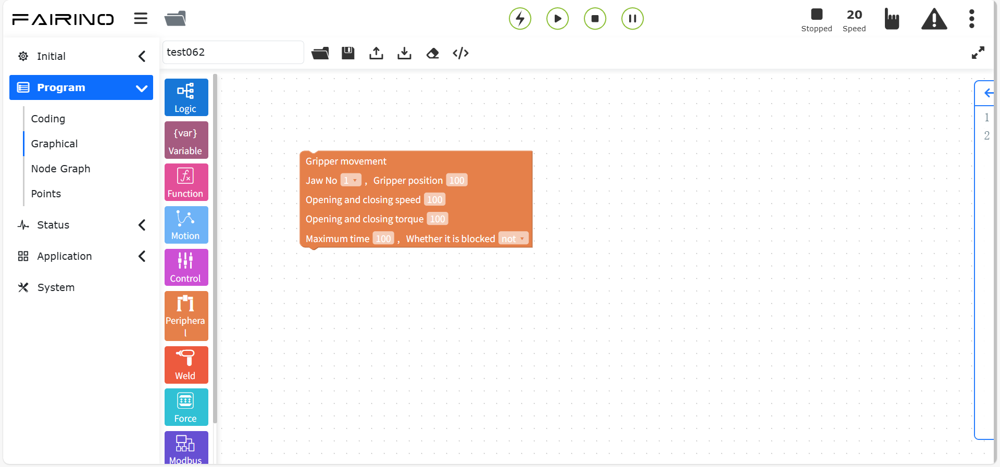

.. centered:: Figura 10.7-1 Bloque de código de la instrucción de movimiento de pinza

Instrucción de restablecimiento de pinza: muestra el número de la pinza ya configurada y permite añadir la instrucción de restablecimiento de pinza al programa.

2. Nodo "Restablecimiento de pinza", parámetros:

- Número de pinza: número de la pinza ya activada

.. centered:: Figura 10.7-2 Bloque de código de la instrucción de restablecimiento de pinza

Instrucción de activación de pinza: muestra el número de la pinza ya configurada y permite añadir la instrucción de activación de pinza al programa.

3. Nodo "Activación de pinza", parámetros:

- Número de pinza: número de la pinza ya activada

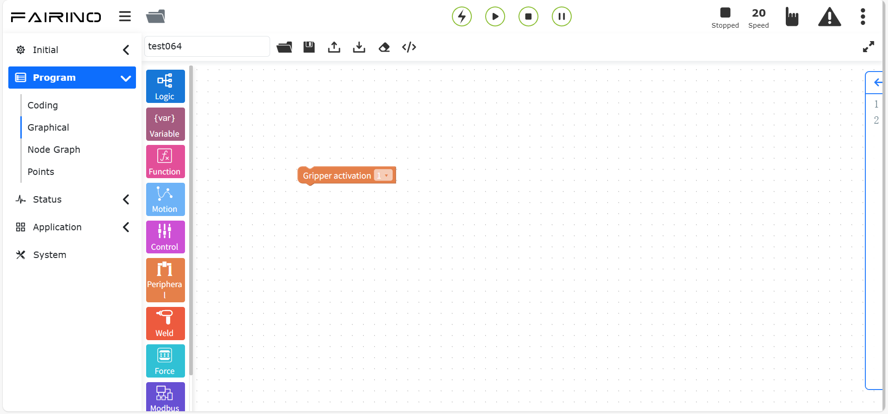

.. centered:: Figura 10.7-3 Bloque de código de la instrucción de activación de pinza

Instrucción de pistola de pulverización
~~~~~~~~~~~~~~~~~~~~~~~~~~~~~~~~~~~~~~~
Arrastrar el bloque de código "Instrucción de pistola de pulverización" al área de trabajo de la interfaz de edición gráfica.

Esta instrucción es una instrucción relacionada con la pulverización y controla "Iniciar pulverización", "Detener pulverización", "Iniciar limpieza de pistola" y "Detener limpieza de pistola" de la pistola de pulverización. Al editar los nodos relacionados con este programa es necesario confirmar que el periférico de la pistola de pulverización ya está configurado; de lo contrario, no se podrá guardar. Consulte el capítulo de periféricos del robot para más detalles.

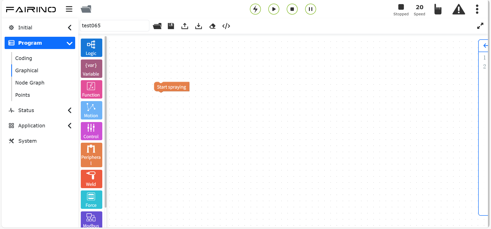

.. centered:: Figura 10.7-4 Bloque de código de la instrucción de iniciar pulverización

.. centered:: Figura 10.7-5 Bloque de código de la instrucción de detener pulverización

.. centered:: Figura 10.7-6 Bloque de código de la instrucción de iniciar limpieza de pistola

.. centered:: Figura 10.7-7 Bloque de código de la instrucción de detener limpieza de pistola

Instrucción de eje extendido (controlador + PLC)
~~~~~~~~~~~~~~~~~~~~~~~~~~~~~~~~~~~~~~~~~~~~~~~~~~
Arrastrar el bloque de código "Instrucción de eje extendido" al área de trabajo de la interfaz de edición gráfica.

Esta instrucción está orientada a escenarios en los que se utiliza un eje externo y, combinada con la instrucción PTP, permite descomponer el movimiento de un punto en el espacio en la dirección del eje X en el movimiento del eje externo. Seleccionar el número de eje externo, seleccionar sincronizado como modo de movimiento y seleccionar el punto al que se desea llegar.

Se divide en carga/configuración de comunicación UDP, movimiento asíncrono, movimiento síncrono PTP/LIN, movimiento síncrono ARC, instrucción de retorno a cero e instrucción de habilitación.

Nodo de la instrucción "Configuración de comunicación UDP": introducir la dirección IP, el número de puerto y el período de comunicación;

.. centered:: Figura 10.7-8 Bloque de código de la instrucción de configuración de comunicación UDP

Nodo de la instrucción "Movimiento asíncrono", parámetros:

- Nombre del punto: punto de enseñanza

- Velocidad de depuración (%): 0~100

.. centered:: Figura 10.7-9 Bloque de código de la instrucción de movimiento asíncrono

Nodo de la instrucción "Movimiento síncrono PTP/LIN", parámetros:

- Selección de movimiento: PTP/LIN

- Nombre del punto: punto de enseñanza

- Velocidad de depuración (%): 0~100

.. centered:: Figura 10.7-10 Bloque de código de la instrucción "Movimiento síncrono PTP/LIN"

Nodo de la instrucción "Movimiento síncrono ARC", modo de movimiento predeterminado ARC, parámetros:

Nombre del punto: punto de enseñanza

Velocidad de depuración (%): 0~100

.. centered:: Figura 10.7-11 Bloque de código de la instrucción "Movimiento síncrono ARC"

Nodo de la instrucción "Retorno a cero del eje extendido", parámetros:

- Número de eje extendido: 1~4

- Modo de retorno a cero: retorno a cero en la posición actual/retorno a cero por límite negativo/retorno a cero por límite positivo

- Velocidad de búsqueda de cero: 0~2000, valor predeterminado 5

- Velocidad de sujeción del punto cero: 0~2000, valor predeterminado 1

.. centered:: Figura 10.7-12 Bloque de código de la instrucción de retorno a cero del eje extendido

Nodo de la instrucción "Habilitación del eje extendido", parámetros:

- Número de eje extendido: 1~4

.. centered:: Figura 10.7-13 Bloque de código de la instrucción de habilitación del eje extendido

Instrucción de eje extendido (controlador + servomotor)
~~~~~~~~~~~~~~~~~~~~~~~~~~~~~~~~~~~~~~~~~~~~~~~~~~~~~~~~
Arrastrar el bloque de código "Instrucción de eje extendido" al área de trabajo de la interfaz de edición gráfica.

Esta instrucción permite configurar los parámetros del eje extendido. Configurar parámetros diferentes según los distintos modos de control. Para un eje extendido ya configurado se puede establecer su punto cero.

Se divide en ID de servo, modo de control, habilitación del servo y retorno a cero del servo; el modo de control se divide a su vez en modo de posición y modo de velocidad; estos dos nodos deben utilizarse junto con el modo de control; de lo contrario, añadirlos por separado no surte efecto.

Nodo de la instrucción "ID de servo", parámetros:

- ID de servo: 1~15

.. centered:: Figura 10.7-14 Bloque de código de la instrucción de ID de servo

Nodo de la instrucción "Modo de control", parámetros:

- ID de servo: 1~15

- Modo de control: modo de posición/modo de velocidad

.. centered:: Figura 10.7-15 Bloque de código de la instrucción de modo de control

Nodo de la instrucción "Habilitación del servo", parámetros:

- ID de servo: 1~15

- Habilitación del servo: habilitar servo/quitar habilitación

.. centered:: Figura 10.7-16 Bloque de código de la instrucción de habilitación del servo

Nodo de la instrucción "Retorno a cero del servo", parámetros:

- ID de servo: 1~15

- Modo de retorno a cero: retorno a cero en la posición actual/retorno a cero por límite negativo/retorno a cero por límite positivo

- Velocidad de búsqueda de cero: 0~2000, valor predeterminado 5

- Velocidad de sujeción del punto cero: 0~2000, valor predeterminado 1

- Porcentaje de aceleración: 1~100, valor predeterminado 100

.. centered:: Figura 10.7-17 Bloque de código de la instrucción de retorno a cero del servo

Nodo de la instrucción "Modo de posición", parámetros:

- ID de servo: 1~15

- Posición objetivo: sin límite

- Velocidad de búsqueda de cero: sin límite

- Porcentaje de aceleración: 1~100, valor predeterminado 100
  

.. centered:: Figura 10.7-18 Bloque de código de la instrucción de modo de posición

Nodo de la instrucción "Modo de velocidad", parámetros:

- ID de servo: 1~15

- Velocidad objetivo: sin límite

- Porcentaje de aceleración: 1~100, valor predeterminado 100
  

.. centered:: Figura 10.7-19 Bloque de código de la instrucción de modo de velocidad
   
Instrucción de cinta transportadora
~~~~~~~~~~~~~~~~~~~~~~~~~~~~~~~~~~~~
Esta instrucción incluye cuatro comandos: detección de IO en tiempo real, detección de posición en tiempo real, inicio de seguimiento y fin de seguimiento. Consulte el capítulo de periféricos del robot para más detalles.

Nodo de la instrucción "Detección de IO en tiempo real", parámetros:

- Tiempo máximo de espera: 0~10000

.. centered:: Figura 10.7-20 Bloque de código de la instrucción de detección de IO en tiempo real

Nodo de la instrucción "Detección de posición en tiempo real", parámetros:

- Modo de trabajo: seguimiento y agarre/seguimiento de movimiento/seguimiento TPD

.. centered:: Figura 10.7-21 Bloque de código de la instrucción de detección de posición en tiempo real

Nodos de las instrucciones "Inicio de seguimiento" y "Fin de seguimiento", parámetros:

Modo de trabajo: seguimiento y agarre/seguimiento de movimiento/seguimiento TPD

.. centered:: Figura 10.7-22 Bloque de código de las instrucciones de inicio/fin de seguimiento

Instrucción de pulido
~~~~~~~~~~~~~~~~~~~~~~~~~~~~~
Arrastrar el bloque de código "Instrucción de pulido" al área de trabajo de la interfaz de edición gráfica.

Esta instrucción se utiliza en escenarios de pulido; al utilizarla es necesario desinstalar primero el driver, volver a cargarlo y, a continuación, configurar la habilitación del equipo de pulido.

A continuación se configuran la velocidad de rotación, la fuerza de contacto, la distancia de extensión y el modo de control del equipo de pulido; asimismo, se puede borrar el error del equipo de pulido y poner a cero el sensor de fuerza del equipo.

.. centered:: Figura 10.7-23 Bloque de código de las instrucciones de carga/descarga del driver de comunicación

Nodo de la instrucción "Habilitación del equipo", parámetros:

- Habilitación del equipo: habilitar/deshabilitar

.. centered:: Figura 10.7-24 Bloque de código de la instrucción de habilitación del equipo

.. centered:: Figura 10.7-25 Bloque de código de la instrucción de borrado de errores del equipo

.. centered:: Figura 10.7-26 Bloque de código de la instrucción de puesta a cero del sensor de fuerza del equipo

Nodo de la instrucción "Velocidad de rotación", parámetros:

- Velocidad de rotación: 0~5500

.. centered:: Figura 10.7-27 Bloque de código de la instrucción de velocidad de rotación del equipo

Nodo de la instrucción "Fuerza establecida", parámetros:

- Fuerza establecida: 0~200

.. centered:: Figura 10.7-28 Bloque de código de la instrucción de fuerza establecida

Nodo de la instrucción "Distancia de extensión", parámetros:

- Distancia de extensión: 0~12

.. centered:: Figura 10.7-29 Bloque de código de la instrucción de distancia de extensión

Nodo de la instrucción "Fuerza de contacto de pulido", parámetros:

- Fuerza de contacto: 0~10000

.. centered:: Figura 10.7-30 Bloque de código de la instrucción de fuerza de contacto de pulido

Nodo de la instrucción "Tiempo de transición de la fuerza establecida", parámetros:

- Tiempo de transición de la fuerza establecida: 0~10000

.. centered:: Figura 10.7-31 Bloque de código de la instrucción de tiempo de transición de la fuerza establecida

Nodo de la instrucción "Peso de la pieza", parámetros:

- Peso de la pieza: 0~10000

.. centered:: Figura 10.7-32 Bloque de código de la instrucción de peso de la pieza

Nodo de la instrucción "Modo de control", parámetros:

- Modo de control: modo de retorno a cero/modo de posición/modo de par

.. centered:: Figura 10.7-33 Bloque de código de la instrucción de modo de control

Comandos de programación gráfica de tipo soldadura
---------------------------------------------------
Los comandos de programación gráfica de tipo soldadura incluyen comandos de soldadura como búsqueda de posición, soldadura por segmentos, soldadura, seguimiento láser, etc.

.. centered:: Figura 10.8 Comandos de programación gráfica de tipo soldadura

Instrucción de soldadura por segmentos
~~~~~~~~~~~~~~~~~~~~~~~~~~~~~~~~~~~~~~~
Arrastrar el bloque de código "Instrucción de soldadura por segmentos" al área de trabajo de la interfaz de edición gráfica.

Esta instrucción es una instrucción exclusiva de soldadura y se utiliza principalmente en escenarios de soldadura intermitente cíclica en los que se suelda un segmento y no se suelda otro. Entre el punto inicial y el punto final, utilizar esta instrucción, seleccionar el modo de soldadura por segmentos, seleccionar el punto inicial y el punto final, configurar la velocidad de depuración, configurar el puerto DO de encendido del arco, la longitud de ejecución y la longitud de no ejecución; configurar según el escenario de aplicación real el modo de función, la selección de oscilación y la regla de redondeo para realizar la función de soldadura por segmentos. Para el funcionamiento detallado, consulte la instrucción de soldadura por segmentos de la página de enseñanza de programas.

1. Nodo de la instrucción "Apagado/Encendido del arco", parámetros:

- Tipo de I/O: IO del controlador/IO extendida

- Número de proceso de soldadura: 0 ~ 7

- Tiempo máximo de espera (ms): 0 ~ 10000

.. centered:: Figura 10.8-1 Bloque de código de la instrucción "Apagado/Encendido del arco"

2. Nodo de la instrucción "Soldadura por segmentos", parámetros:

- Modo de soldadura por segmentos: actitud sin cambios/actitud cambiante

- Punto inicial: punto de enseñanza

- Punto final: punto de enseñanza

- Velocidad de depuración (%): 0~100, valor predeterminado 100

- Longitud de ejecución: 0~1000

- Longitud de no ejecución: 0~1000

- Modo de función: 0~100, valor predeterminado 100

- Selección de oscilación: el segmento de ejecución no oscila/el segmento de ejecución oscila

- Regla de redondeo: sin redondeo/redondeo de ciclo/redondeo de un solo segmento

.. centered:: Figura 10.8-2 Bloque de código de la instrucción de soldadura por segmentos

Instrucción de soldadura
~~~~~~~~~~~~~~~~~~~~~~~~~~~~~
Arrastrar el bloque de código "Instrucción de soldadura" al área de trabajo de la interfaz de edición gráfica.

Esta instrucción se utiliza principalmente para periféricos de máquina de soldar; antes de añadir esta instrucción, confirme si la configuración de la máquina de soldar en los periféricos del usuario está completa; consulte el capítulo de periféricos del robot para más detalles.

1. Nodo de la instrucción "Tensión de soldadura", parámetros:

- Tipo de I/O: IO del controlador/IO extendida

- Tensión de la máquina de soldar: valor mínimo 0

- AO de control de corriente de soldadura: Ctrl-AO0/Ctrl-AO1

- Selección de suavizado: Break/Serious

.. centered:: Figura 10.8-3 Bloque de código de la instrucción de tensión de la máquina de soldar

2. Nodo de la instrucción "Corriente de la máquina de soldar", parámetros:

- Tipo de I/O: IO del controlador/IO extendida

- Corriente de la máquina de soldar: valor mínimo 0

- AO de control de corriente de soldadura: Ctrl-AO0/Ctrl-AO1

- Selección de suavizado: Break/Serious

.. centered:: Figura 10.8-4 Bloque de código de la instrucción de corriente de la máquina de soldar

3. Nodo de la instrucción "Suministro de gas/Corte de gas", parámetros:

- Tipo de I/O: IO del controlador/IO extendida

.. centered:: Figura 10.8-5 Bloque de código de la instrucción "Suministro de gas/Corte de gas"

4. Nodo de la instrucción "Alimentación de alambre en sentido directo/Detención de la alimentación de alambre en sentido directo", parámetros:

- Tipo de I/O: IO del controlador/IO extendida

.. centered:: Figura 10.8-6 Bloque de código de la instrucción "Alimentación de alambre en sentido directo/Detención de la alimentación de alambre en sentido directo"

5. Nodo de la instrucción "Alimentación de alambre en sentido inverso/Detención de la alimentación de alambre en sentido inverso", parámetros:

- Tipo de I/O: IO del controlador/IO extendida

.. centered:: Figura 10.8-7 Bloque de código de la instrucción "Alimentación de alambre en sentido inverso/Detención de la alimentación de alambre en sentido inverso"

Instrucción de seguimiento láser
~~~~~~~~~~~~~~~~~~~~~~~~~~~~~~~~~~
Arrastrar el bloque de código "Instrucción de seguimiento láser" al área de trabajo de la interfaz de edición gráfica.

Esta instrucción incluye tres partes: comandos láser, comandos de seguimiento y comandos de búsqueda de posición; antes de añadir esta instrucción, confirme si el sensor de seguimiento láser en los periféricos del usuario se ha configurado correctamente. Consulte el capítulo de periféricos del robot para más detalles.

1. Nodo de la instrucción "Abrir/Cerrar sensor", parámetros:

- Seleccionar tipo de soldadura: 0 ~ 49

.. centered:: Figura 10.8-8 Bloque de código de la instrucción "Abrir/Cerrar sensor—tipo de soldadura"

- Seleccionar número de tarea: 0 ~ 255

.. centered:: Figura 10.8-9 Bloque de código de la instrucción "Abrir/Cerrar sensor—número de tarea"

- Solución: 0 ~ 5

.. centered:: Figura 10.8-10 Bloque de código de la instrucción "Abrir/Cerrar sensor—solución"

2. Nodo de la instrucción "Cargar/Descargar sensor", parámetros:

- Selección de función: Ruineng RRT-SV2-BP/Chuangxiang CXZK-RBTA4L

.. centered:: Figura 10.8-11 Bloque de código de la instrucción "Cargar/Descargar sensor"

3. Nodo de la instrucción "Iniciar/Detener seguimiento láser", parámetros:

- Nombre del sistema de coordenadas: sistema de coordenadas de configuración personalizada

.. centered:: Figura 10.8-12 Bloque de código de la instrucción "Iniciar/Detener seguimiento láser"

4. Nodo de la instrucción "Registro del sensor láser", parámetros:

- Selección de función: detener registro/seguimiento en tiempo real/iniciar registro/reproducción de trayectoria

- Selección de función: tiempo de retardo/distancia de retardo

- Tiempo: 0 ~ 10000

- Número de eje extendido: 1 ~ 4

- Distancia: 0 ~ 10000

- Coeficiente de sensibilidad de compensación: 0 ~ 1

- Velocidad: 0 ~ 100

.. centered:: Figura 10.8-13 Bloque de código de la instrucción "Registro del sensor láser"

5. Nodo de la instrucción "Movimiento de captación por sensor", parámetros:

- Nombre del sistema de coordenadas: sistema de coordenadas de configuración personalizada

- Modo de movimiento: PTP/Lin

- Velocidad de depuración (%): 0 ~ 100

- Punto de referencia de actitud: punto de enseñanza

.. centered:: Figura 10.8-14 Bloque de código de la instrucción "Movimiento de captación por sensor"

6. Nodo de la instrucción "Reproducción de seguimiento láser", parámetros:

.. centered:: Figura 10.8-15 Bloque de código de la instrucción "Reproducción de seguimiento láser"

7. Nodo de la instrucción "Inicio/Fin de búsqueda de posición", parámetros:

- Nombre del sistema de coordenadas: sistema de coordenadas de configuración personalizada

- Dirección: -x/-x/-y/-y/-z/-z/dirección especificada

- Punto de dirección: al no seleccionar "dirección especificada", el parámetro no surte efecto

- Velocidad (%): 0 ~ 100

- Longitud (mm): 0 ~ 1000

- Tiempo máximo de búsqueda de posición (ms): 0 ~ 10000

.. centered:: Figura 10.8-16 Bloque de código de la instrucción "Inicio/Fin de búsqueda de posición"

Instrucción de registro láser
~~~~~~~~~~~~~~~~~~~~~~~~~~~~~~~
Arrastrar el bloque de código "Instrucción de registro láser" al área de trabajo de la interfaz de edición gráfica.

Esta instrucción permite extraer el punto inicial y el punto final del registro de seguimiento láser, de modo que el robot pueda desplazarse automáticamente hasta la posición inicial, siendo aplicable a situaciones en las que se comienza el movimiento desde el exterior de la pieza y se realiza el registro de seguimiento láser; además, el ordenador superior puede obtener la información del punto inicial y del punto final de los datos registrados para su uso en movimientos posteriores.

Se implementa la función de velocidad ajustable de reproducción del seguimiento láser, de modo que el robot puede registrar a una velocidad muy rápida y luego reproducir a la velocidad normal de soldadura, lo que permite aumentar la eficiencia de la operación.

1. Nodo de la instrucción "Registro del sensor láser", parámetros:

- Selección de función: detener registro/seguimiento en tiempo real/iniciar registro/reproducción de trayectoria

- Selección de función: tiempo de retardo/distancia de retardo

- Tiempo: 0 ~ 10000

- Número de eje extendido: 1 ~ 4

- Distancia: 0 ~ 10000

- Coeficiente de sensibilidad de compensación: 0 ~ 1

- Velocidad: 0 ~ 100

.. centered:: Figura 10.8-17 Bloque de código de la instrucción de registro de datos de soldadura

2. Nodo de la instrucción "Obtener punto inicial/punto final de la soldadura", parámetros:

- Modo de movimiento: PTP/LIN

- Velocidad (%): 0~100, valor predeterminado 30

.. centered:: Figura 10.8-18 Bloque de código de la instrucción "Obtener punto inicial/punto final de la soldadura"

Instrucción de búsqueda de posición del alambre de soldadura
~~~~~~~~~~~~~~~~~~~~~~~~~~~~~~~~~~~~~~~~~~~~~~~~~~~~~~~~~~~~~
Arrastrar el bloque de código "Instrucción de búsqueda de posición del alambre de soldadura" al área de trabajo de la interfaz de edición gráfica.

Esta instrucción se aplica generalmente en escenarios de soldadura y requiere el uso combinado de la máquina de soldar con las IO del robot y las instrucciones de movimiento. Se divide en inicio de búsqueda de posición, fin de búsqueda de posición, configuración de puntos de búsqueda de posición, cálculo del valor de desplazamiento y escritura de datos de puntos de contacto.

Nodo de la instrucción "Inicio/Fin de búsqueda de posición del alambre de soldadura", parámetros:

- Posición de referencia: no actualizar/actualizar

- Velocidad de búsqueda de posición: 0~100

- Distancia de búsqueda de posición: 0~1000

- Indicador de retorno automático: sin retorno automático/con retorno automático

- Velocidad de retorno automático: 0~100

- Distancia de retorno automático: 0~1000

- Modo de búsqueda de posición: búsqueda de posición por punto de enseñanza/búsqueda de posición con desplazamiento

.. centered:: Figura 10.8-19 Bloque de código de la instrucción "Inicio/Fin de búsqueda de posición del alambre de soldadura"

La configuración de puntos de búsqueda de posición añade puntos según el tipo de soldadura y el método de cálculo.

- Cuando el tipo es soldadura en ángulo y el método de cálculo es 1D (uno de xyz), los puntos se añaden seleccionando entre el punto a y el punto b;

- Cuando el tipo es soldadura en ángulo y el método de cálculo es 2D (dos de xyz), los puntos se añaden seleccionando entre el punto a, el punto b, el punto e y el punto f;

- Cuando el tipo es soldadura en ángulo y el método de cálculo es 3D (xyz), los puntos se añaden seleccionando entre el punto a, el punto b, el punto c, el punto d, el punto e y el punto f;

- Cuando el tipo es soldadura en ángulo y el método de cálculo es 2D- (dos de xyz, uno de rxryrz), los puntos se añaden seleccionando entre el punto a, el punto b, el punto c, el punto d, el punto e y el punto f;

- Cuando el tipo es diámetro interior/exterior y el método de cálculo es 2D2D (dos de xyz), los puntos se añaden seleccionando entre el punto a y el punto b;

- Cuando el tipo es punto y el método de cálculo es 3D (xyz), los puntos se añaden seleccionando entre el punto a, el punto b, el punto c, el punto d, el punto e y el punto f;

- Cuando el tipo es cámara y el método de cálculo es 3D- (xyzrxryrz), los puntos se añaden seleccionando entre el punto a y el punto b;

- Cuando el tipo es superficie y el método de cálculo es 3D- (xyzrxryrz), los puntos se añaden seleccionando entre el punto a y el punto b;

.. centered:: Figura 10.8-20 Bloque de código de la instrucción "Guía de configuración de puntos de búsqueda de posición"

El cálculo del valor de desplazamiento establece el punto de referencia y el punto de contacto según el tipo de soldadura y el método de cálculo.

- Cuando el tipo es soldadura en ángulo y el método de cálculo es 1D (uno de xyz), configurar el punto de referencia 1 y el punto de contacto 1;

- Cuando el tipo es soldadura en ángulo y el método de cálculo es 2D (dos de xyz), configurar el punto de referencia 1, el punto de referencia 2, el punto de contacto 1 y el punto de contacto 2;

- Cuando el tipo es soldadura en ángulo y el método de cálculo es 3D (xyz), configurar el punto de referencia 1, el punto de referencia 2, el punto de referencia 3, el punto de contacto 1, el punto de contacto 2 y el punto de contacto 3;

- Cuando el tipo es soldadura en ángulo y el método de cálculo es 2D- (dos de xyz, uno de rxryrz), configurar el punto de referencia 1, el punto de referencia 2, el punto de referencia 3, el punto de contacto 1, el punto de contacto 2 y el punto de contacto 3;

- Cuando el tipo es diámetro interior/exterior y el método de cálculo es 2D2D (dos de xyz), configurar el punto de referencia 1, el punto de referencia 2, el punto de referencia 3, el punto de contacto 1, el punto de contacto 2 y el punto de contacto 3;

- Cuando el tipo es punto y el método de cálculo es 3D (xyz), configurar el punto de contacto 1 y el punto de contacto 2;

- Cuando el tipo es cámara y el método de cálculo es 3D- (xyzrxryrz), configurar el punto de contacto 1 y el punto de contacto 2;

- Cuando el tipo es superficie y el método de cálculo es 3D- (xyzrxryrz), configurar el punto de contacto 1, el punto de contacto 2, el punto de contacto 3, el punto de contacto 4, el punto de contacto 5 y el punto de contacto 6;

.. centered:: Figura 10.8-21 Bloque de código de la instrucción "Cálculo del valor de desplazamiento"

Nodo de la instrucción "Escritura de datos de puntos de contacto", parámetros:

- Nombre del punto de contacto: RES0~99

- Nombre del punto de contacto: el formato de datos es {0,0,0,0,0,0};

.. centered:: Figura 10.8-22 Bloque de código de la instrucción "Escritura de datos de puntos de contacto"

Instrucción de seguimiento de arco
~~~~~~~~~~~~~~~~~~~~~~~~~~~~~~~~~~~~
Arrastrar el bloque de código "Instrucción de seguimiento de arco" al área de trabajo de la interfaz de edición gráfica.

Esta instrucción permite al robot realizar el seguimiento de soldadura utilizando la detección de desviación de la soldadura para compensar la trayectoria; se puede utilizar un sensor de arco para detectar la desviación de la soldadura.

Nodo de la instrucción "Inicio/Fin del seguimiento de arco", parámetros:

- Tiempo de retardo del seguimiento de arco (ms): valor de referencia 50

- Compensación de desviación: desactivar/activar

- Coeficiente de ajuste: 0 ~ 300

- Tiempo de compensación (cyc): 0 ~ 300

- Cantidad máxima de compensación por vez (mm): 0 ~ 300

- Cantidad máxima total de compensación (mm): 0 ~ 300

- Selección del sistema de coordenadas superior e inferior: oscilación

- Modo de establecimiento de la corriente de referencia superior e inferior: retroalimentación/constante

- Corriente de referencia superior e inferior (A): 0 ~ 300

.. centered:: Figura 10.8-23 Bloque de código de la instrucción de seguimiento de arco

Instrucción de ajuste de actitud
~~~~~~~~~~~~~~~~~~~~~~~~~~~~~~~~~~
Arrastrar el bloque de código "Instrucción de ajuste de actitud" al área de trabajo de la interfaz de edición gráfica.

Esta instrucción está orientada al escenario de ajuste adaptativo de la actitud de la antorcha de soldadura en el seguimiento de soldadura; es necesario enseñar primero los tres puntos PosA, PosB y PosC; de lo contrario, no se podrá añadir el nodo.

Tras registrar los tres puntos de actitud correspondientes, se añade la instrucción de ajuste adaptativo de actitud según la dirección real de movimiento del robot. Consulte el capítulo de periféricos del robot para más detalles.

Nodo de la instrucción "Activar ajuste de actitud", parámetros:

- Tipo de placa: placa ondulada/placa corrugada/placa de valla/acero con caparazón ondulado

- Dirección de movimiento: de izquierda a derecha/de derecha a izquierda

- Tiempo de ajuste de actitud (ms): 0 ~ 1000

- Longitud del primer segmento (mm):

- Tipo de punto de inflexión: de arriba abajo/de abajo arriba

- Longitud del segundo segmento (mm):

- Longitud del tercer segmento (mm):

- Longitud del cuarto segmento (mm):

- Longitud del quinto segmento (mm):

.. centered:: Figura 10.8-24 Bloque de código de la instrucción de ajuste de actitud

Comandos de programación gráfica de tipo control de fuerza
----------------------------------------------------------
Los comandos de programación gráfica de tipo control de fuerza incluyen comandos de control de fuerza como conjunto de control de fuerza, registro de par, etc.

.. centered:: Figura 10.9 Comandos de programación gráfica de tipo control de fuerza

Instrucción de control de fuerza
~~~~~~~~~~~~~~~~~~~~~~~~~~~~~~~~~~
Arrastrar el bloque de código "Instrucción de control de fuerza" al área de trabajo de la interfaz de edición gráfica.

Esta instrucción incluye ocho instrucciones: FT_Guard (detección de colisiones), FT_Control (control de fuerza constante), FT_Compliance (control de conformidad), FT_Spiral (inserción en hélice), FT_Rot (inserción rotativa), FT_Lin (inserción en línea recta), FT_FindSurface (localización de superficie) y FT_CalCenter (localización de centro); consulte el capítulo de periféricos del robot para más detalles.

1. Nodo de la instrucción "Activar/Desactivar detección de colisiones", parámetros:

- Nombre del sistema de coordenadas: sistema de coordenadas de configuración personalizada

- Valor verdadero Fx-Tx: true/false

- Valor actual Fx-Tx: introducir según la situación real

- Umbral máximo Fx-Tx: introducir según la situación real

- Umbral mínimo Fx-Tx: introducir según la situación real

.. centered:: Figura 10.9-1 Bloque de código de la instrucción de activar/desactivar detección de colisiones

2. Nodo de la instrucción "Activar/Desactivar control", parámetros:

- Nombre del sistema de coordenadas: sistema de coordenadas de configuración personalizada

- Valor verdadero Fx-Tx: true/false

- Valor actual Fx-Tx: ajustar según la situación real

- F_P_gain - F_D_gain: ajustar según la situación real, no puede ser 0

- Estado de activación/desactivación adaptativa: detener/activar

- Estado de activación/desactivación del control ILC: detener/entrenamiento/operación real

- Distancia máxima de ajuste (mm): 0 ~ 1000

- Ángulo máximo de ajuste (°): 0 ~ 1000

.. centered:: Figura 10.9-2 Bloque de código de la instrucción de activar/desactivar control

3. Nodo de la instrucción "Activar/Desactivar control de conformidad", parámetros:

- Coeficiente de ajuste de posición enviado: 0 ~ 1

- Umbral de fuerza de activación de conformidad (N): 0 ~ 100

.. centered:: Figura 10.9-3 Bloque de código de la instrucción de activar/desactivar control de conformidad

4. Nodo de la instrucción "Inserción en hélice", parámetros:

- Nombre del sistema de coordenadas: sistema de coordenadas de herramienta/sistema de coordenadas base

- Avance de radio por vuelta (mm): 0 ~ 100, valor de referencia: 0.7

- Umbral de fuerza o par (N/Nm): 0 ~ 100, valor de referencia: 50

- Tiempo máximo de exploración (ms): 0 ~ 60000, valor de referencia: 60000

- Velocidad lineal máxima (mm/s): 0 ~ 100, valor de referencia: 5

.. centered:: Figura 10.9-4 Bloque de código de la instrucción de inserción en hélice

5. Nodo de la instrucción "Inserción rotativa", parámetros:

- Nombre del sistema de coordenadas: sistema de coordenadas de herramienta/sistema de coordenadas base

- Velocidad angular de rotación (°/s): 0 ~ 100, valor de referencia: 0.7

- Fuerza de activación o par de terminación (N/Nm): 0 ~ 100, valor de referencia: 50

- Ángulo máximo de rotación (°): 0 ~ 100, valor de referencia: 5

- Dirección de la fuerza: dirección z/dirección mz

- Aceleración angular máxima de rotación (°/s^2): 0 ~ 100

- Dirección de inserción: positiva/negativa

.. centered:: Figura 10.9-5 Bloque de código de la instrucción de inserción rotativa

6. Nodo de la instrucción "Inserción en línea recta", parámetros:

- Nombre del sistema de coordenadas: sistema de coordenadas de herramienta/sistema de coordenadas base

- Umbral de fuerza de terminación de la acción (N): 0 ~ 100

- Velocidad lineal (mm/s): 0 ~ 100, valor de referencia: 1

- Aceleración lineal (°/s^2): 0 ~ 100

- Distancia máxima de inserción (mm): 0 ~ 100

- Dirección de inserción: positiva/negativa

.. centered:: Figura 10.9-6 Bloque de código de la instrucción de inserción en línea recta

7. Nodo de la instrucción "Localización de superficie", parámetros:

- Nombre del sistema de coordenadas: sistema de coordenadas de herramienta/sistema de coordenadas base

- Dirección de movimiento: positiva/negativa

- Eje de movimiento: X/Y/Z

- Velocidad lineal de exploración (mm/s): 0 ~ 100

- Aceleración de exploración (mm/s^2): 0 ~ 100

- Distancia máxima de exploración (mm): 0 ~ 100

- Umbral de fuerza de terminación de la acción (N): 0 ~ 100

.. centered:: Figura 10.9-7 Bloque de código de la instrucción de localización de superficie

8. Nodo de la instrucción "Inicio/Fin del cálculo del plano intermedio".

.. centered:: Figura 10.9-8 Bloque de código de la instrucción de inicio/fin del cálculo del plano intermedio

Instrucción de registro de par
~~~~~~~~~~~~~~~~~~~~~~~~~~~~~~~
Arrastrar el bloque de código "Instrucción de registro de par" al área de trabajo de la interfaz de edición gráfica.

Esta instrucción es una instrucción de registro de par e incluye tres instrucciones: "Inicio del registro de par", "Detención del registro de par" y "Restablecimiento del registro de par".

Permite el registro en tiempo real del par para la detección de colisiones.

Hacer clic en el botón "Iniciar registro de par" para registrar continuamente las situaciones de colisión durante la ejecución de las instrucciones de movimiento; el par en tiempo real registrado se utiliza como valor teórico para el juicio de detección de colisiones, con el fin de reducir la probabilidad de falsos avisos de error.

Cuando se supera el rango del umbral establecido, se registra la duración de la detección de colisión.

Hacer clic en el botón "Detener registro de par" para detener el registro. Hacer clic en "Restablecer registro de par" para que el estado vuelva al estado predeterminado.

1. Nodo de la instrucción "Inicio del registro de par", parámetros:

- Selección de suavizado: sin suavizado (datos originales)/suavizado (datos suavizados)

- Umbral negativo articular (Nm): -100 ~ 0

- Umbral positivo articular (Nm): 0 ~ 100

- Tiempo de detección continua de colisión articular (ms): 0 ~ 1000

.. centered:: Figura 10.9-9 Bloque de código de la instrucción de inicio del registro de par

2. Nodo de la instrucción "Fin del registro de par"

.. centered:: Figura 10.9-10 Bloque de código de la instrucción de fin del registro de par

3. Nodo de la instrucción "Restablecimiento del registro de par"

.. centered:: Figura 10.9-11 Bloque de código de la instrucción de restablecimiento del registro de par

Comandos de programación gráfica de tipo comunicación
-----------------------------------------------------
Los comandos de programación gráfica de tipo comunicación incluyen comandos de comunicación como configuración del maestro modbus (cliente), configuración del esclavo modbus, lectura de registros, etc.

.. centered:: Figura 10.10 Comandos de programación gráfica de tipo comunicación

Instrucción Modbus
~~~~~~~~~~~~~~~~~~~~~~~~~~~~~
Arrastrar el bloque de código "Instrucción Modbus" al área de trabajo de la interfaz de edición gráfica.

La función de esta instrucción es la función de bus basada en el protocolo ModbusTCP; el usuario puede, mediante las instrucciones correspondientes, controlar la comunicación del robot con el cliente o servidor ModbusTCP (comunicación entre maestro y esclavo) y realizar operaciones de lectura y escritura sobre bobinas, entradas discretas y registros. Para más funciones de operación de ModbusTCP, póngase en contacto con nosotros para consultar.

Antes de utilizar la función de nodo modbus, es necesario configurar primero en la configuración de ModbusTCP del programa de enseñanza el maestro, el esclavo y los nombres de DI, DO, AI y AO.

1. Configuración de salida digital del maestro, parámetros:

- Nombre del maestro Modbus: configurar según la situación real

- Nombre DO: configurar según la situación real

- Número de registros: tipo entero 0 ~ 128

- Valor del registro: determinado por el número de registros; se pueden introducir varios valores. Por ejemplo, si el número es 3, el valor es 1,0,1

.. centered:: Figura 10.10-1 Bloque de código de la instrucción "Leer/Escribir salida digital" del maestro

2. Configuración de entrada digital del maestro, parámetros:

- Nombre del maestro Modbus: configurar según la situación real

- Nombre DI: configurar según la situación real

- Número de registros: tipo entero 0 ~ 128

.. centered:: Figura 10.10-2 Bloque de código de la instrucción "Leer entrada digital" del maestro

3. Configuración de salida analógica del maestro, parámetros:

- Nombre del maestro Modbus: configurar según la situación real

- Nombre AO: configurar según la situación real

- Número de registros: tipo entero 0 ~ 128

- Valor del registro: determinado por el número de registros; se pueden introducir varios valores. Por ejemplo, si el número es 3, el valor es 1,0,1

.. centered:: Figura 10.10-3 Bloque de código de la instrucción "Leer/Escribir salida analógica" del maestro

4. Configuración de entrada analógica del maestro, parámetros:

- Nombre del maestro Modbus: configurar según la situación real

- Nombre AI: configurar según la situación real

- Número de registros: tipo entero 0 ~ 128

.. centered:: Figura 10.10-4 Bloque de código de la instrucción "Leer entrada analógica" del maestro

5. Configuración de espera de entrada digital del maestro, parámetros:

- Nombre del maestro Modbus: configurar según la situación real

- Nombre DI: configurar según la situación real

- Estado de espera: true/false

- Tiempo de espera agotado (ms): tipo entero 0 ~ 128

.. centered:: Figura 10.10-5 Bloque de código de la instrucción "Esperar entrada digital" del maestro

6. Configuración de espera de entrada analógica del maestro, parámetros:

- Nombre del maestro Modbus: configurar según la situación real

- Nombre AI: configurar según la situación real

- Estado de espera: mayor que/menor que

- Número de registros: tipo entero 0 ~ 128

- Valor del registro: determinado por el número de registros; se pueden introducir varios valores.

.. centered:: Figura 10.10-6 Bloque de código de la instrucción "Esperar entrada analógica" del maestro

7. Configuración de salida digital del esclavo, parámetros:

- Nombre DO: configurar según la situación real

- Número de registros: tipo entero 0 ~ 128

- Valor del registro: determinado por el número de registros; se pueden introducir varios valores. Por ejemplo, si el número es 3, el valor es 1,0,1

.. centered:: Figura 10.10-7 Bloque de código de la instrucción "Leer/Escribir salida digital" del esclavo

8. Configuración de entrada digital del esclavo, parámetros:

- Nombre DI: configurar según la situación real

- Número de registros: tipo entero 0 ~ 128

.. centered:: Figura 10.10-8 Bloque de código de la instrucción "Leer entrada digital" del esclavo

9. Configuración de salida analógica del esclavo, parámetros:

- Nombre AO: configurar según la situación real

- Número de registros: tipo entero 0 ~ 128

- Valor del registro: determinado por el número de registros; se pueden introducir varios valores. Por ejemplo, si el número es 3, el valor es 1,0,1

.. centered:: Figura 10.10-9 Bloque de código de la instrucción "Leer/Escribir salida analógica" del esclavo

10. Configuración de entrada analógica del esclavo, parámetros:

- Nombre AI: configurar según la situación real

- Número de registros: tipo entero 0 ~ 128

.. centered:: Figura 10.10-10 Bloque de código de la instrucción "Leer entrada analógica" del esclavo

11. Configuración de espera de entrada digital del esclavo, parámetros:

- Nombre DI: configurar según la situación real

- Estado de espera: true/false

- Tiempo de espera agotado (ms): tipo entero

.. centered:: Figura 10.10-11 Bloque de código de la instrucción "Esperar entrada digital" del esclavo

12. Configuración de espera de entrada analógica del esclavo, parámetros:

- Nombre AI: configurar según la situación real

- Estado de espera: mayor que/menor que

- Número de registros: tipo entero 0 ~ 128

- Valor del registro: determinado por el número de registros; se pueden introducir varios valores.

.. centered:: Figura 10.10-12 Bloque de código de la instrucción "Esperar entrada analógica" del esclavo

13. Instrucción de lectura de registros, parámetros:

- Código de función: 0x01-bobina/0x02-entrada discreta/0x03-registro de retención/0x04-registro de entrada

- Dirección de registro, bobina, entrada discreta: introducir según la situación real

- Número de registros, bobinas, entradas discretas: 0 ~ 255

- Dirección: introducir según la situación real

- ¿Aplicar hilo?: No/Sí

.. centered:: Figura 10.10-13 Bloque de código de la instrucción "Leer registros"

14. Instrucción de lectura de datos de registros, parámetros:

- Número de registros, bobinas, entradas discretas: 0 ~ 255

- ¿Aplicar hilo?: No/Sí

.. centered:: Figura 10.10-14 Bloque de código de la instrucción "Leer datos de registros"

15. Instrucción de escritura de registros, parámetros:

- Código de función: 0x01-bobina/0x02-entrada discreta/0x03-registro de retención/0x04-registro de entrada

- Dirección de registro, bobina: introducir según la situación real

- Número de registros, bobinas: 0 ~ 255

- Matriz de bytes: introducir según la situación real

- Dirección: introducir según la situación real

- ¿Aplicar hilo?: No/Sí

.. centered:: Figura 10.10-15 Bloque de código de la instrucción "Escribir registros"

Comandos de programación gráfica de tipo avanzado
-------------------------------------------------
Los comandos de programación gráfica de tipo avanzado incluyen comandos avanzados como llamada a subprograma dofile, hilo auxiliar, instrucción de plegado, etc.

.. centered:: Figura 10.11 Comandos de programación gráfica de tipo avanzado

Instrucción de plegado
~~~~~~~~~~~~~~~~~~~~~~~~~~~~~
Arrastrar el bloque de código "Instrucción de plegado" al área de trabajo de la interfaz de edición gráfica.

Esta instrucción permite el plegado de varias líneas de bloques de código para facilitar la lectura del código por parte del usuario.

Nodo de la instrucción "Plegado", parámetros:

- Nombre del bloque de código: nombrar el bloque de código plegado

.. centered:: Figura 10.11-1 Bloque de código de la instrucción de plegado

Instrucción de llamada a subprograma
~~~~~~~~~~~~~~~~~~~~~~~~~~~~~~~~~~~~~
Arrastrar el bloque de código "Instrucción de llamada a subprograma" al área de trabajo de la interfaz de edición gráfica.

Esta instrucción es una instrucción de llamada a subprograma; al insertar esta instrucción en el programa, cuando el programa llegue a esta instrucción el robot entrará en estado de pausa; si se desea continuar la ejecución, basta con hacer clic en el botón "Pausa/Reanudar" del área de control.

Nodo de la instrucción "Llamada a subprograma", parámetros:

- Archivo dofile: nombre del archivo generado creado

- Nivel de llamada: primer nivel/segundo nivel

- Número de id: id de la posición correspondiente al nivel al que pertenece

.. centered:: Figura 10.11-2 Bloque de código de la instrucción de llamada a subprograma

Instrucción de hilo auxiliar
~~~~~~~~~~~~~~~~~~~~~~~~~~~~
Arrastrar el bloque de código "Hilo auxiliar" al área de trabajo de la interfaz de edición gráfica.

El comando Thread es una función de hilo auxiliar; el usuario puede definir un hilo auxiliar que se ejecute simultáneamente con el hilo principal; el hilo auxiliar se utiliza principalmente para el intercambio de datos con dispositivos externos y admite comunicación socket, obtención del estado DI del robot, establecimiento del estado DO del robot, obtención de información de estado del robot e intercambio de datos con el hilo principal; el hilo principal utiliza los datos obtenidos por el hilo auxiliar para el juicio de la lógica de control del movimiento del robot.

Nodo de la instrucción "Hilo auxiliar", parámetros:

- Nombre del método: nombre del hilo auxiliar
  
- Función de llamada: valor de la función de llamada del hilo auxiliar

.. centered:: Figura 10.11-3 Bloque de código del hilo auxiliar

Instrucción de tabla de puntos
~~~~~~~~~~~~~~~~~~~~~~~~~~~~~~~
Arrastrar el bloque de código "Tabla de puntos" al área de trabajo de la interfaz de edición gráfica.

Esta instrucción se utiliza principalmente para el cambio de modo entre el modo de sistema y el modo de tabla de puntos; mediante el cambio de tabla de puntos se aplican los puntos de enseñanza de distintas tablas de puntos. Para más detalles, consulte el capítulo 12——Puntos de enseñanza.

Nodo de la instrucción "Tabla de puntos", parámetros:

- Modo de tabla de puntos: cambiar el nombre de las distintas tablas de puntos

.. centered:: Figura 10.11-4 Bloque de código de la tabla de puntos

Instrucción de seguimiento de foco
~~~~~~~~~~~~~~~~~~~~~~~~~~~~~~~~~~~
Arrastrar el bloque de código "Seguimiento de foco" al área de trabajo de la interfaz de edición gráfica.

Esta instrucción se utiliza principalmente para que el robot, durante el movimiento, mantenga siempre el foco en un punto y lo siga en su desplazamiento.

Nodo de la instrucción "Seguimiento de foco", parámetros:

- Coeficiente del parámetro: 0~100, valor predeterminado 50
- Parámetro de prealimentación: 0~1000, valor predeterminado 19
- Límite máximo de aceleración angular: 0~10000, valor predeterminado 1440
- Límite máximo de velocidad angular: 0~1000, valor predeterminado 180
- Bloqueo de la orientación del eje X: vector de entrada de referencia/horizontal/vertical

.. centered:: Figura 10.11-5 Bloque de código del seguimiento de foco

Ejemplo de uso de los comandos de programación gráfica
------------------------------------------------------
Tras seleccionar el tipo de programación gráfica, hacer clic en el bloque de código gráfico que se desea utilizar y se podrán realizar operaciones de arrastre y ensamblaje en el área de trabajo.

Por ejemplo, seleccionar las instrucciones de movimiento PTP y Lin, así como la instrucción de control Waitms, para ensamblarlas; en la capa externa se puede anidar una instrucción avanzada de plegado e introducir un nombre de comentario, con lo que se puede realizar la operación de plegado de bloques de código.

Al hacer clic en el cuadro desplegable se puede seleccionar el tipo de parámetro de la instrucción, y en el cuadro de entrada se pueden rellenar los datos del parámetro de la instrucción. El ejemplo de los comandos de programación gráfica es el siguiente:

.. centered:: Figura 10.12-1 Ejemplo de comandos de programación gráfica

Tras completar el ensamblaje de las instrucciones de programación gráfica y la introducción de los parámetros, rellenar el nombre del área de trabajo y hacer clic en el icono "Guardar" para guardar el programa actual. Seleccionar el "área de trabajo" ya escrita y hacer clic en iniciar ejecución para ejecutar este segmento de programa.

Modularización de los bloques de código de programación gráfica
~~~~~~~~~~~~~~~~~~~~~~~~~~~~~~~~~~~~~~~~~~~~~~~~~~~~~~~~~~~~~~~~
Para mejorar la legibilidad del código de programación gráfica se ha añadido la función de modularización de los bloques de código de programación gráfica, es decir, la instrucción avanzada: bloque de código de instrucción de plegado.

.. centered:: Figura 10.12-2 Bloque de código de la instrucción de plegado

1. Escribir un segmento de instrucciones de bloque de código, añadir en la capa externa el bloque de código de la instrucción de plegado y escribir en el cuadro de entrada el comentario de dicho segmento de instrucciones.

.. centered:: Figura 10.12-3 Imagen del efecto de la instrucción de plegado

2. Hacer clic con el botón derecho en la barra de operaciones y hacer clic con el botón derecho en "Bloque de plegado"; el bloque de código de dicho segmento de instrucciones se pliega, mostrándose en una sola línea, y bajo el plegado se puede ejecutar correctamente el programa.

.. centered:: Figura 10.12-4 Imagen del efecto tras el plegado

3. Al girar la rueda del ratón se puede realizar la función de zoom de la página; el efecto concreto es el siguiente:

.. centered:: Figura 10.12-5 Imagen del efecto de la función de zoom de la página

Sobrescritura de programas con el mismo nombre en la programación gráfica
~~~~~~~~~~~~~~~~~~~~~~~~~~~~~~~~~~~~~~~~~~~~~~~~~~~~~~~~~~~~~~~~~~~~~~~~~~
En la página de programación gráfica, tras crear/cargar un archivo, cambiar el nombre del área de trabajo y hacer clic en guardar. Si ya existe un archivo con el nombre del área de trabajo modificado, se activa la ventana emergente "El punto de enseñanza ya existe", como se muestra en la figura siguiente.

.. centered:: Figura 10.12-6 Sobrescritura de programas de programación gráfica

**Step1**: Hacer clic en el botón "Cancelar" para continuar ejecutando la operación anterior.

**Step2**: Marcar la casilla "Actualizar sincronizadamente el programa de enseñanza" y hacer clic en el botón "Sobrescribir"; entonces el programa lua de la página de programación gráfica actual sobrescribe el programa lua con el nombre del archivo del área de trabajo modificado.

Verificación de programa de programación gráfica no guardado
~~~~~~~~~~~~~~~~~~~~~~~~~~~~~~~~~~~~~~~~~~~~~~~~~~~~~~~~~~~~~~
En la página de programación gráfica, tras abrir/crear un programa, si el programa de programación gráfica ha sufrido modificaciones y no se ha guardado.

Si se hace clic en la operación de archivo "Abrir", se activa la ventana emergente "¿Guardar este programa?", que muestra "El programa actual ha cambiado, ¿desea guardar los cambios de este programa?", como se muestra en la figura siguiente.

.. centered:: Figura 10.12-7 Verificación de programa no guardado en la página actual

**Step1**: Hacer clic en el botón "No guardar" para continuar ejecutando la operación de archivo "Abrir" anterior.

**Step2**: Hacer clic en el botón "Guardar"; el programa lua no guardado se guarda correctamente y continúa ejecutando la operación de archivo "Abrir" anterior.

Si se abandona la página de programación gráfica y se cambia a otra página, también se activa el aviso "¿Guardar este programa?" y se permanece en la página de programación gráfica actual, como se muestra en la figura siguiente.

.. centered:: Figura 10.12-8 Verificación de programa no guardado al cambiar de página

**Step1**: Hacer clic en el botón "No guardar"; se salta a la página seleccionada anteriormente.

**Step2**: Hacer clic en el botón "Guardar"; el programa lua no guardado se guarda correctamente y se salta a la página seleccionada anteriormente. Si el nombre del programa guardado ya existe, se muestra un aviso de que el punto de enseñanza ya existe y se pregunta si se desea sobrescribir. Tras realizar la operación de cancelar/sobrescribir, se salta a la página seleccionada anteriormente.