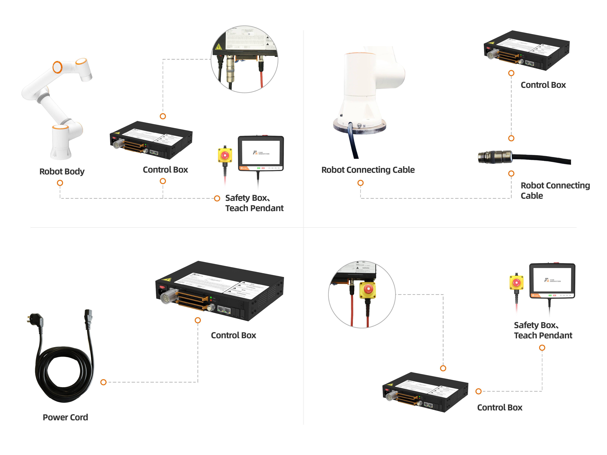
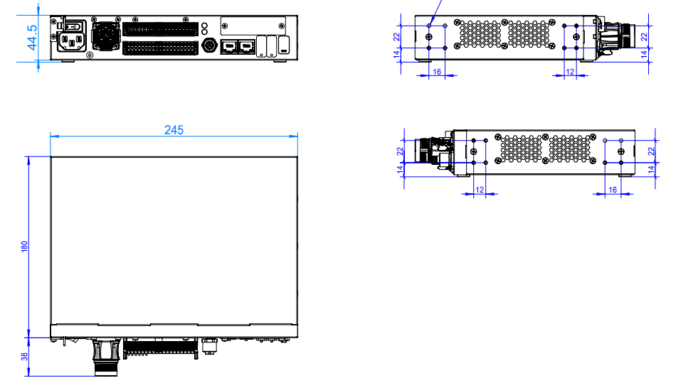
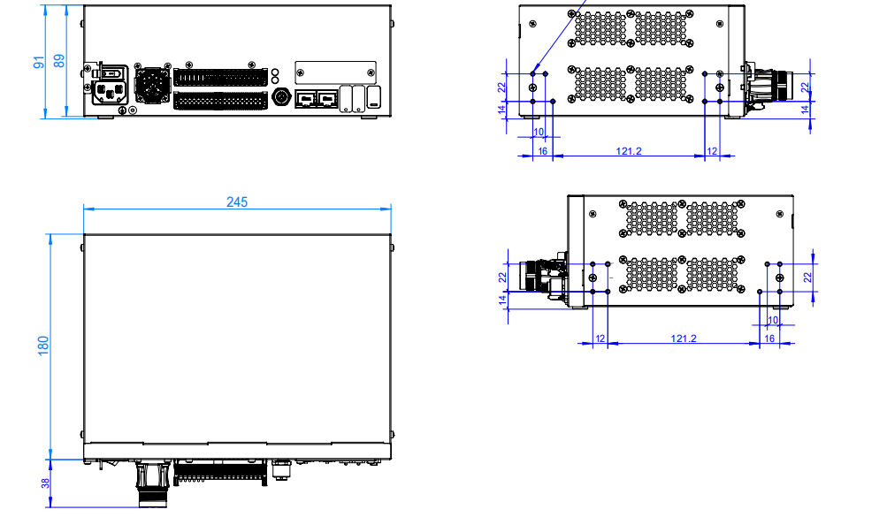
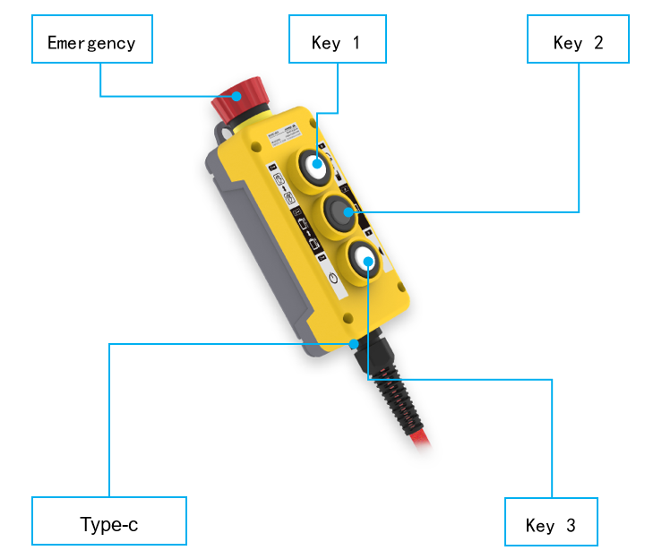
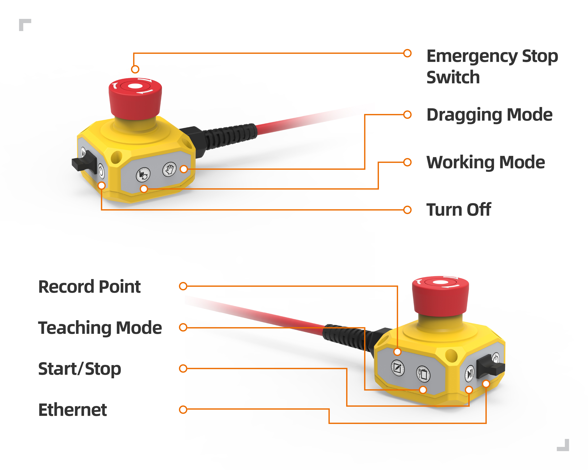
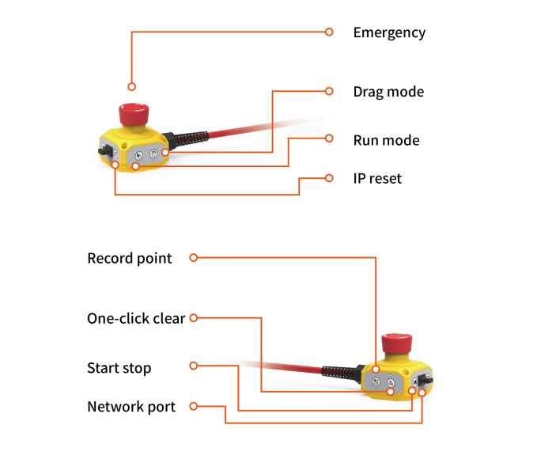
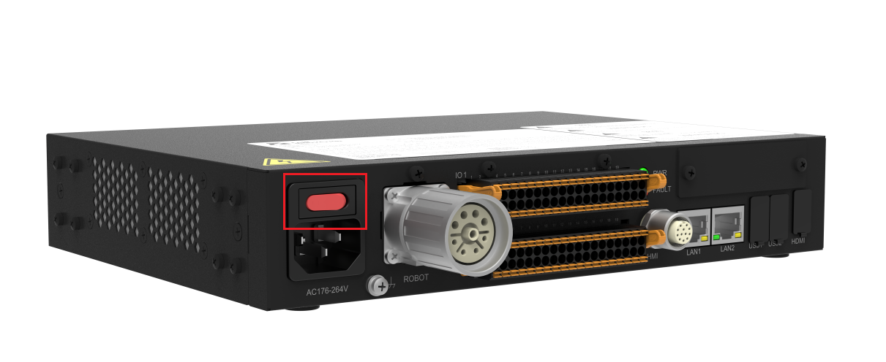
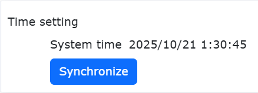
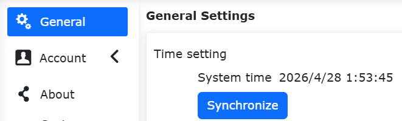

Instalación y encendido del robot
=================================

.. toctree:: 
   :maxdepth: 6

Instalación del brazo del robot
-------------------------------

Cuando el robot colaborativo se instala en la base de montaje, se debe fijar el robot a la base de montaje apretándolo con el número correcto de tornillos (de una resistencia no inferior a la clase 8.8); se recomienda utilizar en la base de montaje dos orificios de pasador correctos con pasadores para el posicionamiento del robot, con el fin de mejorar la precisión de instalación del robot y evitar que este se desplace debido a colisiones, etc. Cuando se exija una alta precisión de funcionamiento del robot, es imprescindible añadir pasadores para el posicionamiento del robot.

.. centered:: Tabla 1.1-1 Normas de las piezas de instalación del robot

.. list-table::
   :widths: 80 50 50 50
   :header-rows: 0
   :align: center

   * - **Modelo del robot colaborativo**
     - **Tornillos**
     - **Par de apriete de los tornillos**
     - **Especificación del orificio de pasador**

   * - FR3
     - 4 tornillos M6
     - ≥10Nm
     - φ5mm

   * - FR3-WMS
     - 4 tornillos M6
     - ≥10Nm
     - φ5mm

   * - FR3-WML
     - 4 tornillos M6
     - ≥10Nm
     - φ5mm

   * - FR3-C
     - 4 tornillos M6
     - ≥10Nm
     - φ5mm

   * - FR5-C
     - 4 tornillos M6
     - ≥10Nm
     - φ5mm
   
   * - FR5
     - 4 tornillos M8
     - ≥20Nm
     - φ8mm

   * - FR10
     - 4 tornillos M8
     - ≥25Nm
     - φ8mm

   * - FR16
     - 4 tornillos M8
     - ≥25Nm
     - φ8mm

   * - FR20
     - 6 tornillos M10
     - ≥45Nm
     - φ8mm

   * - FR30
     - 6 tornillos M10
     - ≥45Nm
     - φ8mm

.. important:: 
   Se recomienda que la base de montaje del robot cumpla los siguientes requisitos para garantizar una instalación firme y estable del robot:
   
   （1）La base de montaje del robot debe ser suficientemente firme y tener suficiente capacidad de carga; debe poder soportar al menos 5 veces el peso del robot y al menos 10 veces el par del eje 1.

   （2）La base de montaje del robot debe tener una superficie plana para garantizar un contacto estrecho con la superficie de contacto del robot;

   （3）La base de montaje del robot debe tener suficiente rigidez, estar firmemente fijada y no entrar en resonancia con el robot;

   （4）Cuando el robot y otros componentes se muevan simultáneamente, la base de montaje debe estar aislada de los demás componentes móviles; no deben fijarse juntos para evitar interferencias por vibración durante el movimiento;

   （5）Si el robot se instala en una plataforma móvil o en un eje externo, la aceleración de la plataforma móvil o del eje externo debe ser lo más baja posible;

Conexión de la caja de control
------------------------------

Esta serie de robots puede configurarse con tres cajas de control de distintas entradas de alimentación; para la información de entrada de alimentación de la caja de control, consulte la información de la placa de características de la caja de control. El robot requiere conexión eléctrica a tierra. Todos los cables externos del sistema de control del manipulador se conectan mediante conectores enchufables de instalación rápida.

A. 30-60VDC
B. 176-264VAC~50-60Hz
C. 100-240VAC~50-60HZ

.. note:: Las cajas de control de entrada de corriente alterna se dividen en dos versiones, de tensión estrecha y de tensión amplia; los terminales de conexión y el aspecto exterior de la caja de control son idénticos y no se pueden distinguir solo por el aspecto exterior; confírmelo mediante la placa de características de la caja de control y, tras confirmarlo, enciéndalo y póngalo en funcionamiento.

El panel de conexiones del robot colaborativo se muestra en la tabla siguiente:

.. centered:: Figura 1.2-1 Panel de conexiones de la caja de control

El puerto de la caja de botones es por defecto el puerto de control del teach pendant, con dirección IP 192.168.58.2; utilice un cable de red para conectar el puerto de la caja de botones con el ordenador, configure la dirección IP del ordenador como 192.168.58.10 o en el mismo segmento de red, abra el navegador Chrome e introduzca 192.168.58.2 para acceder a la página del teach pendant.

Información de los orificios roscados de instalación de la caja de control
~~~~~~~~~~~~~~~~~~~~~~~~~~~~~~~~~~~~~~~~~~~~~~~~~~~~~~~~~~~~~~~~~~~~~~~~~~~~~~~~~~~~~~~~~~~~~~~~~~~~~~~~~~~~~~~~~~~~~~~~~~~~~~~~~~~~~~~~~~~

.. centered:: Figura 1.2-2 Dimensiones exteriores de la caja de control - dimensiones de los orificios de instalación 1

.. centered:: Figura 1.2-3 Dimensiones exteriores de la caja de control - dimensiones de los orificios de instalación 2

.. note:: 
  1. Los orificios con cotas indicadas son orificios de instalación utilizables;
  2. Hay un total de 16 orificios de instalación, distribuidos en los lados izquierdo y derecho de la caja de control, 8 en cada lado;
  3. La especificación de los tornillos utilizados en los orificios de instalación es M3, con paso de rosca de 0.5mm;
  4. La profundidad de roscado del tornillo en la carcasa de chapa metálica de la caja de control es ≤5mm;
  5. Se recomienda un par de apriete de 0.6Nm y un par de apriete máximo de 0.84Nm.

:download:`Dimensiones exteriores de la caja de control - dimensiones de los orificios de instalación <../_static/_doc/Control box outer dimensions - mounting hole dimensions.zip>`

Conocimiento de la caja de botones y del LED del extremo
---------------------------------------------------------

Caja de botones
~~~~~~~~~~~~~~~

60 caja de botones (POE) (BX01)
++++++++++++++++++++++++++++++++++++++++++

.. centered:: Figura 1.3-1 60 caja de botones (POE)

60 caja de botones (POE) (BX02)-V1.0
++++++++++++++++++++++++++++++++++++++++++

.. centered:: Figura 1.3-2 Panel de conexiones de la caja de control

.. centered:: Tabla 1.3-1 Descripción de los botones del panel de conexiones de la caja de control

.. list-table::
   :widths: 50 200
   :header-rows: 0
   :align: center

   * - **Nombre del botón**
     - **Función**

   * - Interruptor de parada de emergencia
     - Al pulsar el interruptor de parada de emergencia, el robot entra en estado de parada de emergencia

   * - Inicio/Detención
     - Iniciar/detener la ejecución del programa

   * - Puerto de red
     - Conectar el teach pendant web

   * - Apagado
     - Aún no disponible

   * - Registro de puntos
     - Registrar puntos de enseñanza

   * - Modo de enseñanza
     - Entrar/salir del estado con teach pendant

   * - Modo de funcionamiento
     - Conmutación entre modo automático y manual

   * - Modo de arrastre
     - Entrar/salir del modo de arrastre

60 caja de botones (POE) (BX02)-V2.0
++++++++++++++++++++++++++++++++++++

.. centered:: Figura 1.3-3 Panel de conexiones de la caja de control

.. centered:: Tabla 1.3-2 Descripción de los botones del panel de conexiones de la caja de control

.. list-table::
   :widths: 50 200
   :header-rows: 0
   :align: center

   * - **Nombre del botón**
     - **Función**

   * - Interruptor de parada de emergencia
     - Al pulsar el interruptor de parada de emergencia, el robot entra en estado de parada de emergencia

   * - Inicio/Detención
     - Iniciar/detener la ejecución del programa

   * - Puerto de red
     - Conectar el teach pendant web

   * - Restablecimiento de IP
     - Restablecer la IP del puerto de red

   * - Registro de puntos
     - Registrar puntos de enseñanza

   * - Borrado con un clic
     - Borrar todos los errores recuperables

   * - Modo de funcionamiento
     - Conmutación entre modo automático y manual

   * - Modo de arrastre
     - Entrar/salir del modo de arrastre

LED del extremo
~~~~~~~~~~~~~~~

.. centered:: Tabla 1.3-3 Definición del LED del extremo

.. list-table::
   :widths: 120 100
   :header-rows: 0
   :align: center

   * - **Función**
     - **Color del LED**

   * - Cuando no se ha establecido la comunicación
     - Alternancia de "apagado", "rojo", "verde" y "azul"

   * - Modo automático
     - Azul fijo

   * - Modo manual
     - Verde fijo

   * - Modo de arrastre
     - Cian claro fijo

   * - Registro de puntos de la caja de botones (solo al usar la caja de botones)
     - Morado parpadeando dos veces

   * - Entrada en estado sin teach pendant (solo al usar la caja de botones)
     - Azul cian parpadeando dos veces

   * - Inicio de ejecución (solo al usar la caja de botones)
     - Azul parpadeando dos veces

   * - Detención de ejecución (solo al usar la caja de botones)
     - Rojo parpadeando dos veces

   * - Error (solo al usar la caja de botones)
     - Rojo fijo

   * - Puesta a cero completada
     - Cian claro parpadeando tres veces

   * - Deshabilitado
     - Amarillo parpadeando dos veces

Encendido y habilitación
------------------------

Antes del encendido, confirme que el botón de parada de emergencia de la caja de botones está suelto; pulse el botón rojo de la caja de control para encender; tras una habilitación correcta, el LED del extremo permanece en verde fijo.

Apagado
-------

.. important:: 
  Al utilizar este equipo, asegúrese de detener todos los programas en ejecución, desactivar la función de consulta de estado y confirmar que el estado de funcionamiento es "Stopped" antes de apagar la alimentación. Esta operación tiene como objetivo proteger la seguridad del equipo y de los datos almacenados, evitando la pérdida de datos o el daño del sistema provocados por un corte de energía repentino.

.. centered:: Figura 1.5-1 Botón de apagado

Batería de botón de la caja de control
--------------------------------------

Causas habituales de la pérdida de hora
~~~~~~~~~~~~~~~~~~~~~~~~~~~~~~~~~~~~~~~~

Este equipo utiliza una batería de botón externa como alimentación de respaldo del reloj en tiempo real (RTC), para mantener el conteo del tiempo cuando se corta la alimentación principal.

Si se produce pérdida de hora (es decir, tras volver a encender se muestra una fecha errónea), normalmente se debe a una o varias de las siguientes causas:

.. list-table::
   :widths: 40 40 60
   :header-rows: 0
   :align: center

   * - **Categoría de la causa**
     - **Descripción concreta**
     - **Sugerencia de comprobación**

   * - Batería de botón agotada
     - El equipo no se ha encendido durante más de 3 meses, lo que provoca el agotamiento natural de la energía de la batería.
     - Medir la tensión de la batería con un multímetro (es necesario extraerla para medirla); si la tensión es inferior a 2.5V, es necesario cargarla.

   * - Batería dañada
     - Se ha alcanzado la vida útil de la batería.
     - Comprobar si la batería presenta fugas o hinchazón; es necesario sustituir la batería. Modelo de batería: MS621FE-FL11E, 3V/5.5mAH, recargable.

   * - Contacto deficiente de los terminales de la batería
     - Los terminales de la batería están oxidados o deformados, o el equipo ha sufrido vibraciones que han provocado que la batería se separe momentáneamente del contacto.
     - Comprobar si la batería está bien insertada en los terminales, limpiar los contactos, volver a instalar la batería y asegurarse de que queda bien sujeta.

   * - Batería no instalada o instalada al revés
     - El usuario no ha instalado la batería de respaldo, o la ha instalado con la polaridad invertida.
     - | Confirmar que la batería está instalada y con la polaridad correcta (polo positivo hacia arriba).
      
       .. image:: installation/131.png
          :width: 2in
          :align: center

   * - Fallo del circuito de carga de la batería
     - La batería de botón recargable no puede almacenar energía correctamente.
     - Es necesario que personal de mantenimiento profesional revise el circuito de carga.

.. warning:: El modelo de batería de botón utilizada en este equipo es [MS621FE-FL11E, 3V/5.5mAH, recargable]; asegúrese de elegir el modo de tratamiento correcto según el modelo y está estrictamente prohibido instalar baterías no recargables.

Identificación de anomalías de hora y calibración manual
~~~~~~~~~~~~~~~~~~~~~~~~~~~~~~~~~~~~~~~~~~~~~~~~~~~~~~~~~

1) Método de identificación de anomalías
   
Tras volver a encender el robot, compruebe primero la hora que muestra actualmente la página del equipo y compárela con la hora del sistema del ordenador:

- Si ambas coinciden, la hora es normal y no se requiere ninguna operación posterior.

.. centered:: Figura 1.6-1 Situación de anomalía de la hora del sistema

- Si ambas no coinciden (por ejemplo, fecha errónea o desviación considerable de horas, minutos y segundos), se determina que la hora es anómala; continúe con los pasos de calibración siguientes.
  
2) Pasos de calibración

Si se ha confirmado que la hora es anómala, realice las siguientes operaciones para sincronizar la hora del sistema:

- Abra el navegador y entre en WebApp; navegue sucesivamente hasta: "Configuración del sistema -> Configuración general -> Hora".

.. centered:: Figura 1.6-2 Interfaz de actualización de la hora del sistema

- Haga clic en el botón "Actualizar" de la interfaz y el sistema completará automáticamente la sincronización de la hora. Tras la sincronización, vuelva a la página del robot y la hora se restablecerá con normalidad.

Precauciones de carga y mantenimiento de la batería de botón
~~~~~~~~~~~~~~~~~~~~~~~~~~~~~~~~~~~~~~~~~~~~~~~~~~~~~~~~~~~~~

1) Condiciones de carga

- Tras conectar la alimentación principal del equipo (220V AC), el circuito de carga se activa automáticamente.
- La temperatura ambiente debe estar en el rango de 0℃ ~ 45℃; las temperaturas elevadas reducen la eficiencia de carga y acortan la vida útil de la batería.

2) Tiempo de carga

- Una batería completamente descargada tarda aproximadamente [5 horas] en cargarse por completo. Durante este tiempo, la función de mantenimiento de la hora funciona con normalidad.

3) Prohibiciones

- No utilice un cargador externo para cargar directamente la batería de botón del equipo.
- No instale baterías no recargables en el equipo, ya que podría provocar peligro.

Sustitución y eliminación de la batería
~~~~~~~~~~~~~~~~~~~~~~~~~~~~~~~~~~~~~~~~

1) Ciclo de sustitución

- Normalmente puede utilizarse durante más de [5 años]; si se producen pérdidas frecuentes de hora, sustitúyala.

2) Pasos de sustitución

- Desconecte la alimentación principal del equipo.
- Abra la tapa superior.
- Extraiga la batería antigua, prestando atención a la polaridad.
- Suelde una batería nueva del mismo modelo y en buen estado (polo positivo hacia arriba).
- Cierre la tapa, vuelva a encender y ajuste la hora actual.

3) Eliminación

- No arroje la batería al fuego ni la ponga en contacto con agua.
- Recicle las baterías usadas según la normativa local (las baterías de botón suelen contener litio o metales pesados).

Soporte técnico
~~~~~~~~~~~~~~~

Si tras realizar los pasos anteriores el problema persiste, póngase en contacto con nuestro equipo de soporte técnico y proporcione la siguiente información:

- Modelo y número de serie del equipo.
- Modelo de batería utilizado (consulte la inscripción de la superficie de la batería).
- Fenómeno del fallo (por ejemplo: pérdida inmediata tras el corte de energía / pérdida tras dejarlo una noche).