Instalación de hardware
=======================

.. toctree:: 
	:maxdepth: 5

Avisos de seguridad
-------------------

Introducción
~~~~~~~~~~~~

Este manual utiliza los siguientes avisos, cuya finalidad es garantizar la seguridad de las personas y del equipo; al leer este manual es muy importante que cumpla y ejecute todas las instrucciones de montaje y las directrices del resto de capítulos de este manual. Debe prestarse especial atención a los textos asociados a los símbolos de advertencia.

.. important:: 
    - Si el robot (cuerpo del robot, caja de control, teach pendant o caja de botones) se daña, altera o modifica por causas humanas, FAIRINO declina toda responsabilidad;
    - FAIRINO no se hace responsable de ningún daño causado al robot o a cualquier otro equipo debido a errores en los programas escritos por el cliente.

Seguridad del personal
~~~~~~~~~~~~~~~~~~~~~~

Al poner en funcionamiento el sistema del robot, en primer lugar es imprescindible garantizar la seguridad del personal de trabajo; a continuación se enumeran las precauciones generales; adopte debidamente las medidas correspondientes para garantizar la seguridad del personal de trabajo.

1. Todo el personal de trabajo que utilice el sistema del robot deberá recibir formación a través de los cursos organizados por FAIRINO (Suzhou) Robot Technology Co., Ltd. El usuario debe asegurarse de que domina plenamente los procedimientos de operación seguros y normalizados y de que posee la cualificación para operar el robot. Para obtener información detallada sobre la formación, consulte con nuestra empresa en el correo electrónico jiling@frtech.fr.

2. Todo el personal de trabajo que utilice el sistema del robot no debe llevar ropa holgada ni joyas. Al operar el robot, asegúrese de recogerse el pelo largo.

3. Durante el funcionamiento del equipo, aunque el robot parezca detenido, es posible que se encuentre en un estado a punto de moverse porque está esperando la señal de inicio. Incluso en ese estado, el robot debe considerarse en movimiento.

4. Deben trazarse líneas en el suelo para delimitar claramente el rango de movimiento del robot, de modo que el operador conozca el rango de movimiento del robot, incluida la herramienta que sujeta (manipulador, herramienta, etc.).

5. Asegúrese de establecer medidas de seguridad en las proximidades de la zona de operación del robot (por ejemplo, barandillas, cuerdas o pantallas de protección) para proteger al operador y a las personas del entorno. Deben instalarse cerraduras según sea necesario, de modo que las personas ajenas al personal responsable de la operación no puedan acceder a la alimentación del robot.

6. Al utilizar el panel de operación y el teach pendant, dado que llevar guantes puede provocar errores de operación, asegúrese de trabajar tras quitarse los guantes.

7. En situaciones de emergencia y anómalas, como cuando una persona queda atrapada o rodeada por el robot, empuje o tire del brazo del robot con fuerza (al menos 700 N) para forzar el movimiento de las articulaciones. El movimiento manual del brazo del robot sin accionamiento eléctrico solo se limita a situaciones de emergencia y puede dañar las articulaciones.

Identificación de peligros
~~~~~~~~~~~~~~~~~~~~~~~~~~

La evaluación de riesgos debe considerar todos los contactos potenciales entre el operador y el robot durante el uso normal, así como los errores previsibles. El cuello, la cara y la cabeza del operador no deben quedar expuestos para evitar contactos. El uso del robot sin dispositivos de protección periféricos requiere primero una evaluación de riesgos para determinar si los peligros correspondientes constituyen un riesgo inaceptable, por ejemplo:

-  El uso de efectores finales o conectores de herramientas afilados puede ser peligroso;

-  La manipulación de sustancias tóxicas u otras sustancias nocivas puede ser peligrosa;

-  Existe el peligro de que los dedos del operador queden atrapados por la base o las articulaciones del robot;

-  Existe el peligro de colisión con el robot;

-  Existe el peligro de que el robot o la herramienta conectada al extremo no estén fijados correctamente;

-  Existe el peligro de impacto entre la carga útil del robot y una superficie sólida.

El integrador debe medir mediante la evaluación de riesgos este tipo de peligros y su nivel de riesgo asociado, y determinar e implementar las medidas correspondientes para reducir el riesgo a un nivel aceptable. Tenga en cuenta que un equipo de robot específico puede presentar además otros peligros importantes.

Mediante la combinación de las medidas de diseño de seguridad inherentes aplicadas a los robots FR con las normas de seguridad o la evaluación de riesgos implementadas por el integrador y el usuario final, los riesgos asociados a la operación colaborativa de los FR se reducen en la medida de lo razonablemente posible. Mediante este documento se pueden transmitir al integrador y al usuario final los riesgos residuales existentes antes de la instalación del robot. Si la evaluación de riesgos del integrador determina que en su aplicación específica existen peligros que pueden constituir un riesgo inaceptable para el usuario, el integrador debe adoptar medidas adecuadas de reducción de riesgos para eliminar o minimizar al máximo dichos peligros, hasta reducir el riesgo a un nivel aceptable. No es seguro utilizarlo antes de adoptar las medidas adecuadas de reducción de riesgos (si es necesario).

Si se realiza una instalación no colaborativa del robot (por ejemplo, cuando se utilizan herramientas peligrosas), la evaluación de riesgos puede concluir que el integrador necesita conectar equipos de seguridad adicionales durante su programación (por ejemplo, dispositivos de arranque de seguridad) para garantizar la seguridad de las personas y del equipo.

Información de la placa de características
~~~~~~~~~~~~~~~~~~~~~~~~~~~~~~~~~~~~~~~~~~

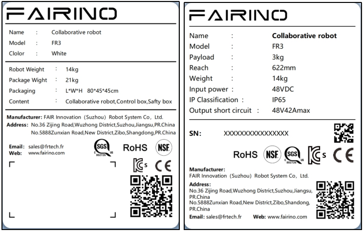

.. centered:: Figura 3.1-1 Robot colaborativo modelo FR3

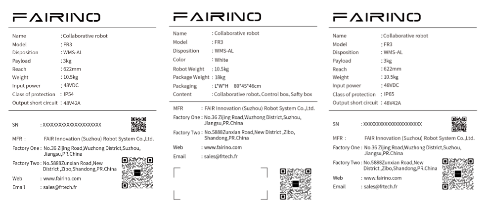

.. centered:: Figura 3.1-2 Robot colaborativo modelo FR3-WMS

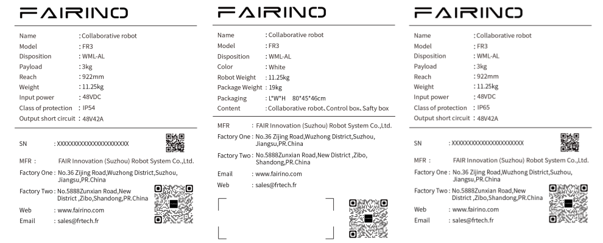

.. centered:: Figura 3.1-3 Robot colaborativo modelo FR3-WML

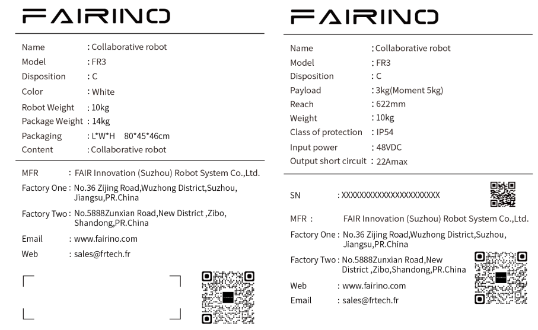

.. centered:: Figura 3.1-4 Robot colaborativo modelo FR3-C

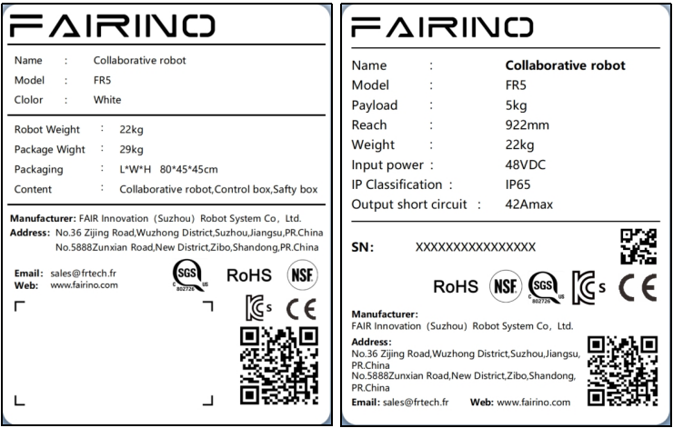

.. centered:: Figura 3.1-5 Robot colaborativo modelo FR5

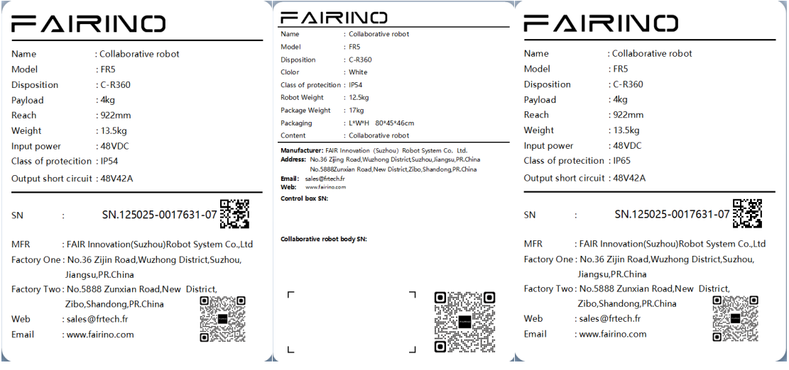

.. centered:: Figura 3.1-6 Robot colaborativo modelo FR5-C

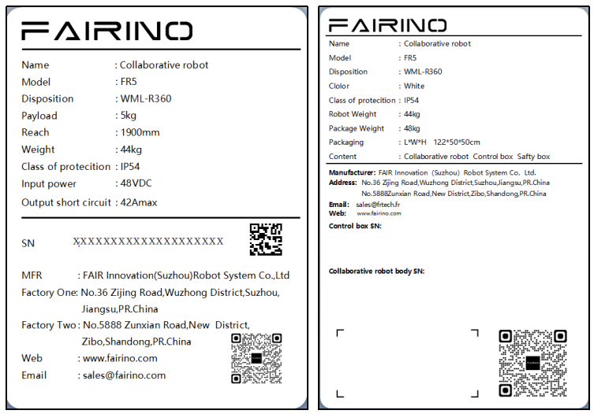

.. centered:: Figura 3.1-7 Robot colaborativo modelo FR5-WML

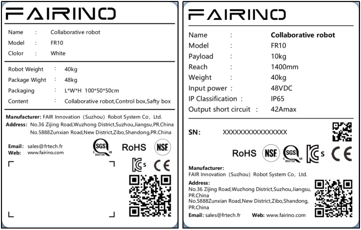

.. centered:: Figura 3.1-8 Robot colaborativo modelo FR10

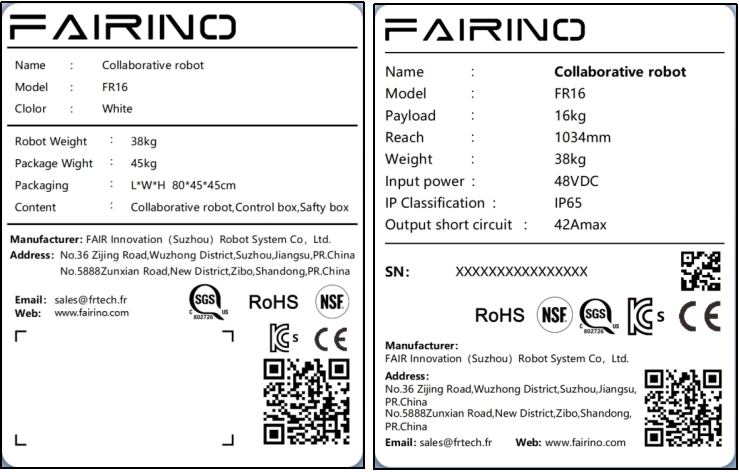

.. centered:: Figura 3.1-9 Robot colaborativo modelo FR16

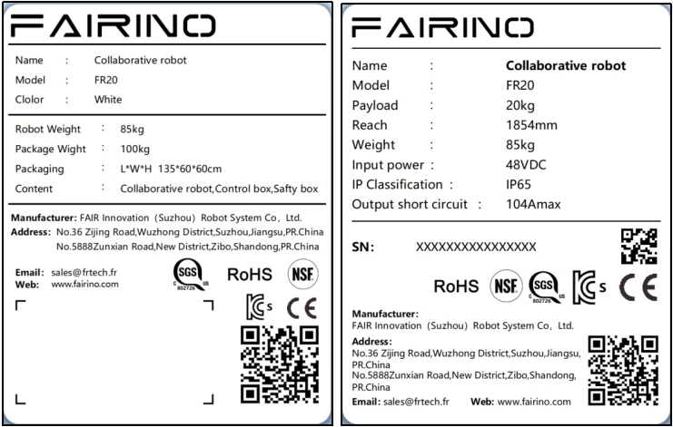

.. centered:: Figura 3.1-10 Robot colaborativo modelo FR20

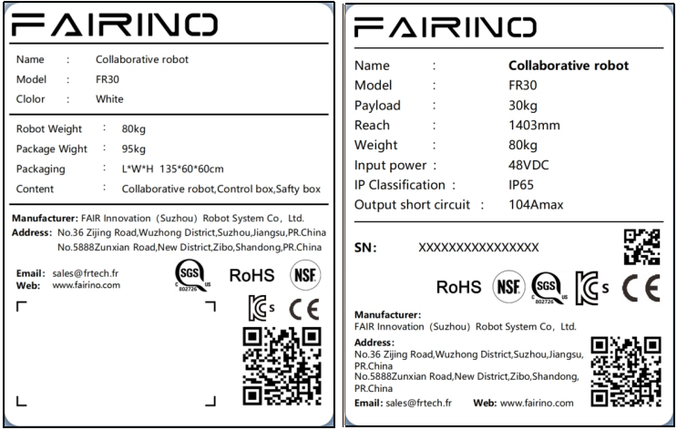

.. centered:: Figura 3.1-11 Robot colaborativo modelo FR30

Validez y responsabilidad
~~~~~~~~~~~~~~~~~~~~~~~~~

La información de este manual no incluye el diseño, la instalación y la operación de una aplicación completa de robot, ni incluye todos los equipos periféricos que puedan afectar a la seguridad de este sistema completo. El diseño y la instalación de este sistema completo deben cumplir los requisitos de seguridad establecidos en las normas y reglamentos del país donde se instala el robot.

El integrador de FAIRINO tiene la responsabilidad de garantizar el cumplimiento de las leyes y reglamentos de los países correspondientes y de garantizar que en la aplicación completa del robot no exista ningún peligro importante. Esto incluye, entre otros, los siguientes aspectos:

-  Realizar una evaluación de riesgos de todo el sistema de robot

-  Conectar entre sí otros equipos mecánicos y equipos de seguridad adicionales definidos en la evaluación de riesgos

-  Establecer en el software la configuración de seguridad adecuada

-  Garantizar que el usuario no modifique ninguna medida de seguridad

-  Confirmar que el diseño y la instalación de todo el sistema de robot son correctos

-  Definir claramente las instrucciones de uso

-  Indicar en el robot la marca y la información de contacto correspondientes del integrador

-  Recopilar toda la documentación de los archivos técnicos, incluido este manual

Responsabilidad limitada
~~~~~~~~~~~~~~~~~~~~~~~~

Ninguna información de seguridad contenida en este manual debe considerarse como una garantía general de seguridad del robot; incluso cumpliendo todas las instrucciones de seguridad, todavía es posible que se produzcan daños personales o daños al equipo.

Los símbolos de advertencia de este manual
~~~~~~~~~~~~~~~~~~~~~~~~~~~~~~~~~~~~~~~~~~

Los siguientes símbolos definen las indicaciones de nivel de peligro contenidas en este manual. Los mismos símbolos de advertencia se utilizan también en el producto.

.. important:: 
	.. figure:: installation/008.png
		:width: 60
		:height: 50
		:align: left

	Peligro: se refiere a una situación eléctrica que está a punto de provocar peligro y que, si no se evita, puede causar la muerte o lesiones graves.

.. important:: 
	.. figure:: installation/009.png
		:width: 60
		:height: 50
		:align: left

	Peligro de descarga eléctrica: se refiere a una situación de descarga eléctrica que está a punto de provocar peligro y que, si no se evita, puede causar la muerte por descarga eléctrica o lesiones graves.

.. important:: 
	.. figure:: installation/010.png
		:width: 60
		:height: 50
		:align: left

	Peligro de quemadura: se refiere a una superficie caliente que puede provocar peligro y que, si se toca sin evitarlo, puede causar daños personales.

Evaluación antes del uso
~~~~~~~~~~~~~~~~~~~~~~~~

La primera vez que se utilice el robot o tras realizar cualquier modificación, la velocidad predeterminada del robot es inferior a 250 mm/s; no inicie sesión como administrador para modificar la velocidad y entrar en modo de alta velocidad; a continuación deben realizarse las siguientes pruebas. Confirme que todas las entradas y salidas de seguridad son correctas y que están conectadas correctamente. Compruebe si todas las entradas y salidas de seguridad conectadas (incluidos los equipos compartidos por varios robots o máquinas) funcionan correctamente. Por lo tanto, debe:

-  Probar si el botón de parada de emergencia y las entradas pueden detener el robot y activar el freno.

-  Probar si las entradas de protección pueden detener el movimiento del robot. Si se ha configurado el restablecimiento de protección, compruebe si es necesario activarlo antes de reanudar el movimiento.

-  Probar si el modo de operación puede cambiar el modo de operación; consulte el icono de la esquina superior derecha de la interfaz de usuario.

-  Probar si es necesario pulsar el dispositivo de habilitación de 3 posiciones para iniciar el movimiento en modo manual y si el robot se encuentra bajo control de deceleración (esta función no es compatible con versiones del software del robot anteriores a la V3.0).

-  Probar si la salida de parada de emergencia del sistema puede llevar todo el sistema a un estado seguro.

Parada de emergencia
~~~~~~~~~~~~~~~~~~~~

El botón de parada de emergencia es una parada de categoría 0; al pulsar el botón de parada de emergencia se detiene inmediatamente todo movimiento del robot.

La tabla siguiente muestra la distancia de parada y el tiempo de parada que activan la parada de categoría 0. Estos resultados de medición corresponden a la siguiente configuración del robot:

-  Extensión: 100% (el brazo del robot está completamente extendido en horizontal)

-  Velocidad: 100% (la velocidad general del robot se establece en 100%, moviéndose a una velocidad articular de 180°/s)

-  Carga útil: carga útil máxima

Las articulaciones 1 y 6 prueban el movimiento horizontal del robot, con el eje de rotación perpendicular al suelo. Las articulaciones 2, 3, 4 y 5 prueban el robot siguiendo una trayectoria vertical, con el eje de rotación paralelo al suelo, y se detienen cuando el robot se desplaza hacia abajo.

.. centered:: Tabla 3.1-1 Distancia de parada de categoría 0 (rad)
.. list-table::
   :widths: 10 15 15 15 15 15 15
   :header-rows: 0
   :class: sheet-center

   * - 
     - **Articulación 1**
     - **Articulación 2**
     - **Articulación 3**
     - **Articulación 4**
     - **Articulación 5**
     - **Articulación 6**

   * - **FR3**
     - 0.47
     - 0.60
     - 0.56
     - 0.29
     - 0.10
     - 0.06

   * - **FR3-WMS**
     - 0.47
     - 0.60
     - 0.56
     - 0.29
     - 0.10
     - 0.06

   * - **FR3-WML**
     - 0.51
     - 0.63
     - 0.60
     - 0.33
     - 0.16
     - 0.10

   * - **FR3-C**
     - 0.47
     - 0.60
     - 0.56
     - 0.29
     - 0.10
     - 0.06

   * - **FR5**
     - 0.51
     - 0.63
     - 0.60
     - 0.33
     - 0.16
     - 0.10

   * - **FR5-C**
     - 0.51
     - 0.63
     - 0.60
     - 0.33
     - 0.16
     - 0.10

   * - **FR5-WML**
     - 0.64
     - 0.70
     - 0.69
     - 0.42
     - 0.25
     - 0.13

   * - **FR10**
     - 0.64
     - 0.70
     - 0.69
     - 0.42
     - 0.25
     - 0.13

   * - **FR16**
     - 0.60
     - 0.67
     - 0.65
     - 0.39
     - 0.22
     - 0.12

   * - **FR20**
     - 0.69
     - 0.75
     - 0.80
     - 0.48
     - 0.31
     - 0.22

   * - **FR30**
     - 0.69
     - 0.75
     - 0.80
     - 0.48
     - 0.31
     - 0.22

.. centered:: Tabla 3.1-2 Tiempo de parada de categoría 0 (ms)
.. list-table::
   :widths: 10 15 15 15 15 15 15
   :header-rows: 0
   :class: sheet-center

   * - 
     - **Articulación 1**
     - **Articulación 2**
     - **Articulación 3**
     - **Articulación 4**
     - **Articulación 5**
     - **Articulación 6**

   * - **FR3**
     - 400
     - 470
     - 450
     - 280
     - 120
     - 90

   * - **FR3-WMS**
     - 400
     - 470
     - 450
     - 280
     - 120
     - 90

   * - **FR3-WML**
     - 400
     - 470
     - 450
     - 280
     - 120
     - 90

   * - **FR3-C**
     - 400
     - 470
     - 450
     - 280
     - 120
     - 90

   * - **FR5**
     - 420
     - 500
     - 480
     - 310
     - 150
     - 120

   * - **FR5-C**
     - 420
     - 500
     - 480
     - 310
     - 150
     - 120

   * - **FR5-WML**
     - 460
     - 540
     - 510
     - 330
     - 170
     - 140

   * - **FR10**
     - 460
     - 540
     - 510
     - 330
     - 170
     - 140

   * - **FR16**
     - 440
     - 530
     - 490
     - 320
     - 160
     - 130

   * - **FR20**
     - 540
     - 600
     - 700
     - 400
     - 260
     - 170

   * - **FR30**
     - 540
     - 600
     - 700
     - 400
     - 260
     - 170

Tras la parada de emergencia, apague la alimentación, gire el botón de parada de emergencia y vuelva a encender la alimentación para reiniciar el robot.

Asimismo, el tiempo de parada y la distancia de parada de la parada de seguridad del robot y de la parada por límite suave se muestran en la tabla siguiente. Estos resultados de medición corresponden a la siguiente configuración del robot:

-  Extensión: 100% (el brazo del robot está completamente extendido en horizontal)

-  Velocidad: 100% (la velocidad general del robot se establece en 100%, moviéndose a una velocidad articular de 180°/s)

-  Carga útil: carga útil máxima

Las articulaciones 1 y 6 prueban el movimiento horizontal del robot, con el eje de rotación perpendicular al suelo. Las articulaciones 2, 3, 4 y 5 prueban el robot siguiendo una trayectoria vertical, con el eje de rotación paralelo al suelo, y se detienen cuando el robot se desplaza hacia abajo.

.. centered:: Tabla 3.1-3 Distancia de parada de seguridad (rad)
.. list-table::
   :widths: 10 15 15 15 15 15 15
   :header-rows: 0
   :class: sheet-center

   * - 
     - **Articulación 1**
     - **Articulación 2**
     - **Articulación 3**
     - **Articulación 4**
     - **Articulación 5**
     - **Articulación 6**

   * - **FR3**
     - 0.49
     - 0.63
     - 0.58
     - 0.32
     - 0.12
     - 0.09

   * - **FR3-WMS**
     - 0.49
     - 0.63
     - 0.58
     - 0.32
     - 0.12
     - 0.09

   * - **FR3-WML**
     - 0.54
     - 0.65
     - 0.63
     - 0.35
     - 0.19
     - 0.12

   * - **FR3-C**
     - 0.49
     - 0.63
     - 0.58
     - 0.32
     - 0.12
     - 0.09

   * - **FR5**
     - 0.54
     - 0.65
     - 0.63
     - 0.35
     - 0.19
     - 0.12

   * - **FR5-C**
     - 0.54
     - 0.65
     - 0.63
     - 0.35
     - 0.19
     - 0.12

   * - **FR5-WML**
     - 0.66
     - 0.73
     - 0.71
     - 0.45
     - 0.27
     - 0.14

   * - **FR10**
     - 0.66
     - 0.73
     - 0.71
     - 0.45
     - 0.27
     - 0.14

   * - **FR16**
     - 0.63
     - 0.69
     - 0.68
     - 0.41
     - 0.25
     - 0.14

   * - **FR20**
     - 0.71
     - 0.78
     - 0.82
     - 0.51
     - 0.33
     - 0.25

   * - **FR30**
     - 0.71
     - 0.78
     - 0.82
     - 0.51
     - 0.33
     - 0.25

.. centered:: Tabla 3.1-4 Tiempo de parada de seguridad (ms)
.. list-table::
   :widths: 10 15 15 15 15 15 15
   :header-rows: 0
   :class: sheet-center

   * - 
     - **Articulación 1**
     - **Articulación 2**
     - **Articulación 3**
     - **Articulación 4**
     - **Articulación 5**
     - **Articulación 6**

   * - **FR3**
     - 410
     - 490
     - 410
     - 300
     - 130
     - 110

   * - **FR3-WMS**
     - 410
     - 490
     - 410
     - 300
     - 130
     - 110

   * - **FR3-WML**
     - 410
     - 490
     - 410
     - 300
     - 130
     - 110

   * - **FR3-C**
     - 410
     - 490
     - 410
     - 300
     - 130
     - 110

   * - **FR5**
     - 450
     - 520
     - 510
     - 330
     - 180
     - 140

   * - **FR5-C**
     - 450
     - 520
     - 510
     - 330
     - 180
     - 140

   * - **FR5-WML**
     - 480
     - 570
     - 530
     - 360
     - 190
     - 170

   * - **FR10**
     - 480
     - 570
     - 530
     - 360
     - 190
     - 170

   * - **FR16**
     - 470
     - 550
     - 520
     - 340
     - 190
     - 150

   * - **FR20**
     - 560
     - 630
     - 720
     - 430
     - 280
     - 200

   * - **FR30**
     - 560
     - 630
     - 720
     - 430
     - 280
     - 200

.. centered:: Tabla 3.1-5 Distancia de parada por límite suave (rad)
.. list-table::
   :widths: 10 15 15 15 15 15 15
   :header-rows: 0
   :class: sheet-center

   * - 
     - **Articulación 1**
     - **Articulación 2**
     - **Articulación 3**
     - **Articulación 4**
     - **Articulación 5**
     - **Articulación 6**

   * - **FR3**
     - 0.52
     - 0.65
     - 0.61
     - 0.34
     - 0.15
     - 0.11

   * - **FR3-WMS**
     - 0.52
     - 0.65
     - 0.61
     - 0.34
     - 0.15
     - 0.11

   * - **FR3-WML**
     - 0.56
     - 0.68
     - 0.65
     - 0.38
     - 0.21
     - 0.15

   * - **FR3-C**
     - 0.52
     - 0.65
     - 0.61
     - 0.34
     - 0.15
     - 0.11

   * - **FR5**
     - 0.56
     - 0.68
     - 0.65
     - 0.38
     - 0.21
     - 0.15

   * - **FR5-C**
     - 0.56
     - 0.68
     - 0.65
     - 0.38
     - 0.21
     - 0.15

   * - **FR5-WML**
     - 0.69
     - 0.75
     - 0.74
     - 0.47
     - 0.30
     - 0.18

   * - **FR10**
     - 0.69
     - 0.75
     - 0.74
     - 0.47
     - 0.30
     - 0.18

   * - **FR16**
     - 0.65
     - 0.72
     - 0.70
     - 0.44
     - 0.27
     - 0.17

   * - **FR20**
     - 0.74
     - 0.80
     - 0.85
     - 0.53
     - 0.36
     - 0.27

   * - **FR30**
     - 0.74
     - 0.80
     - 0.85
     - 0.53
     - 0.36
     - 0.27

.. centered:: Tabla 3.1-6 Tiempo de parada por límite suave (ms)
.. list-table::
   :widths: 10 15 15 15 15 15 15
   :header-rows: 0
   :class: sheet-center

   * - 
     - **Articulación 1**
     - **Articulación 2**
     - **Articulación 3**
     - **Articulación 4**
     - **Articulación 5**
     - **Articulación 6**

   * - **FR3**
     - 430
     - 500
     - 430
     - 310
     - 150
     - 120

   * - **FR3-WMS**
     - 430
     - 500
     - 430
     - 310
     - 150
     - 120

   * - **FR3-WML**
     - 430
     - 500
     - 430
     - 310
     - 150
     - 120

   * - **FR3-C**
     - 430
     - 500
     - 430
     - 310
     - 150
     - 120

   * - **FR5**
     - 460
     - 540
     - 520
     - 350
     - 190
     - 160

   * - **FR5-C**
     - 460
     - 540
     - 520
     - 350
     - 190
     - 160

   * - **FR5-WML**
     - 500
     - 580
     - 550
     - 370
     - 210
     - 180

   * - **FR10**
     - 500
     - 580
     - 550
     - 370
     - 210
     - 180

   * - **FR16**
     - 480
     - 570
     - 530
     - 360
     - 200
     - 170

   * - **FR20**
     - 580
     - 640
     - 740
     - 440
     - 300
     - 210

   * - **FR30**
     - 580
     - 640
     - 740
     - 440
     - 300
     - 210

.. important:: 
	Según IEC 60204-1 e ISO 13850, los dispositivos de parada de emergencia no son dispositivos de protección de seguridad. Son medidas de protección complementarias y no están destinados a prevenir daños.

Movimiento sin accionamiento eléctrico
~~~~~~~~~~~~~~~~~~~~~~~~~~~~~~~~~~~~~~

Si se produce una situación de emergencia en la que es necesario mover las articulaciones del robot pero no se puede alimentar el robot u otras situaciones de emergencia, póngase en contacto con el distribuidor del robot; si es necesario, se pueden utilizar medios violentos para forzar el movimiento del robot y rescatar a las personas atrapadas.

Transporte del equipo
---------------------

Transporte
~~~~~~~~~~

El robot y la caja de control ya están calibrados como un equipo completo. No los separe, ya que sería necesario volver a calibrarlos.

El robot solo debe transportarse en su embalaje original. Si en el futuro va a trasladar el robot, conserve el material de embalaje en un lugar seco.

Al mover el robot desde el embalaje hasta el espacio de instalación, sujete simultáneamente los dos brazos del robot. Sujete el robot hasta que todos los pernos de instalación de la base del robot estén completamente apretados.

Manipulación
~~~~~~~~~~~~

El robot colaborativo, según el modelo, tiene una masa total (incluido el embalaje) en el rango de 15 kg a 80 kg; cuando se manipule o traslade el robot colaborativo de forma manual, es necesario que varias personas ayuden a levantarlo; no se recomienda que lo manipule una sola persona; durante el transporte debe mantenerse estable para evitar que el equipo vuelque o se deslice.

.. warning:: 
	- Si se utiliza equipo profesional para la manipulación, asegúrese de que personal profesional con la cualificación correspondiente utilice una grúa o una carretilla elevadora para transportar o manipular el robot colaborativo; de lo contrario, podría provocar daños personales u otros accidentes.
	- Si se realiza manipulación manual, preste atención a la seguridad personal durante el transporte;
	- El robot colaborativo contiene componentes de precisión; durante el transporte o la manipulación deben evitarse vibraciones o sacudidas violentas; de lo contrario, podría reducirse el rendimiento del equipo.

Almacenamiento
~~~~~~~~~~~~~~

El robot colaborativo debe almacenarse en un entorno de -25~60℃, sin escarcha.

Mantenimiento, inspección y eliminación
---------------------------------------

Mantenimiento y tratamiento
~~~~~~~~~~~~~~~~~~~~~~~~~~~

Se solicita al usuario que compruebe la parada de emergencia y la parada protectora con una periodicidad de 1 mes, para determinar si la función de seguridad es efectiva.
Para el cableado de la parada de emergencia y de la parada protectora, consulte el capítulo de cableado.

Manual de inspección
~~~~~~~~~~~~~~~~~~~~

Prefacio
++++++++

Avisos de seguridad
*******************

Este manual utiliza los siguientes avisos, cuya finalidad es garantizar la seguridad de las personas y del equipo; al leer este manual es muy importante que cumpla y ejecute todas las instrucciones de montaje y las directrices del resto de capítulos de este manual.

Debe prestarse especial atención a los textos asociados a los símbolos de advertencia; lea atentamente el manual de usuario antes de su uso. Este manual solo debe utilizarse como manual de orientación para el mantenimiento del cliente; el personal de mantenimiento debe poseer capacidad profesional; FAIRINO declina toda responsabilidad por operaciones realizadas por personal no profesional.

.. note:: Si el robot (cuerpo del robot, caja de control, teach pendant) se daña, altera o modifica por causas humanas, FAIRINO declina toda responsabilidad; FAIRINO no se hace responsable de ningún daño causado al robot o a cualquier otro equipo debido a errores en los programas escritos por el cliente.

Validez y responsabilidad
*************************

La información de este manual no incluye el diseño, la instalación y la operación de una aplicación completa de robot, ni incluye todos los equipos periféricos que puedan afectar a la seguridad de este sistema completo. El diseño y la instalación de este sistema completo deben cumplir los requisitos de seguridad establecidos en las normas y reglamentos del país donde se instala el robot.

El integrador de FAIRINO tiene la responsabilidad de garantizar el cumplimiento de las leyes y reglamentos de los países correspondientes y de garantizar que en la aplicación completa del robot no exista ningún peligro importante. Esto incluye, entre otros, los siguientes aspectos:

- Realizar una evaluación de riesgos de todo el sistema de robot
- Conectar entre sí otros equipos mecánicos y equipos de seguridad adicionales definidos en la evaluación de riesgos
- Establecer en el software la configuración de seguridad adecuada
- Garantizar que el usuario no modifique ninguna medida de seguridad
- Confirmar que el diseño y la instalación de todo el sistema de robot son correctos
- Definir claramente las instrucciones de uso
- Indicar en el robot la marca y la información de contacto correspondientes del integrador
- Recopilar toda la documentación de los archivos técnicos, incluido este manual

Responsabilidad limitada
*************************

Ninguna información de seguridad contenida en este manual debe considerarse como una garantía general de seguridad del robot; incluso cumpliendo todas las instrucciones de seguridad, todavía es posible que se produzcan daños personales o daños al equipo.

Símbolos de advertencia
***********************

Los siguientes símbolos definen las indicaciones de nivel de peligro contenidas en este manual. Los mismos símbolos de advertencia se utilizan también en el producto.

.. note:: 
   .. image:: installation/070.png
      :height: 0.75in
      :align: left

   Nombre: **Peligro**
     
   Función: se refiere a una situación eléctrica que está a punto de provocar peligro y que, si no se evita, puede causar la muerte o lesiones graves.

.. note:: 
   .. image:: installation/071.png
      :height: 0.75in
      :align: left

   Nombre: **Peligro de descarga eléctrica**
   
   Función: se refiere a una situación de descarga eléctrica que está a punto de provocar peligro y que, si no se evita, puede causar la muerte por descarga eléctrica o lesiones graves.

.. note:: 
   .. image:: installation/072.png
      :height: 0.75in
      :align: left

   Nombre: **Peligro de quemadura**
   
   Función: se refiere a una superficie caliente que puede provocar peligro y que, si se toca, puede causar daños personales.

Descripción de las entradas y salidas digitales de la caja de control
~~~~~~~~~~~~~~~~~~~~~~~~~~~~~~~~~~~~~~~~~~~~~~~~~~~~~~~~~~~~~~~~~~~~~~

Precauciones al cambiar las funciones digitales de la caja de control
+++++++++++++++++++++++++++++++++++++++++++++++++++++++++++++++++++++

.. important:: 

  (1) Al cambiar las funciones de entrada y salida digital, deben cumplirse los procedimientos de operación segura del robot para garantizar la seguridad del operador y del equipo.
  (2) Durante el funcionamiento del robot, evite cambiar las funciones de entrada y salida digital para no afectar al funcionamiento normal del robot.
  (3) Antes de realizar la operación de cambio de funciones de entrada y salida digital, asegúrese de cortar primero la alimentación del robot para evitar descargas eléctricas y movimientos accidentales del robot que puedan causar daños personales y daños al equipo.
  (4) Antes de cambiar las funciones, deben aclararse los requisitos del sistema de control del robot respecto a las entradas y salidas digitales, incluidos el tipo de señal, el nivel de tensión, la capacidad de carga, etc.
  (5) Asegúrese de que la conexión de los puertos de entrada y salida digital con los dispositivos externos es correcta, incluida la firmeza del cableado y la coincidencia de los puertos, etc.
  (6) Evite la asignación repetida de señales; asegúrese de que la asignación de cada señal es única.
  (7) Tras completar la asignación, es necesario reiniciar el sistema de control del robot para que la configuración surta efecto.
  (8) Tras completar la configuración, entre en la interfaz de estado de I/O y compruebe si el estado de las señales de entrada y salida digital es correcto.
  (9) Verifique mediante la operación real o mediante la escritura de un programa de prueba si la función de entrada y salida digital funciona correctamente.
  (10) Si las señales de entrada y salida digital están relacionadas con la lógica del programa, compruebe si el tratamiento de estas señales en el programa es correcto.

Descripción de las entradas digitales de la caja de control
++++++++++++++++++++++++++++++++++++++++++++++++++++++++++++

Resumen de las entradas digitales de la caja de control
*******************************************************

A continuación se enumeran los tipos de entrada admitidos por las entradas digitales de la caja de control mini integrada de los robots FAIRINO, así como los diagramas de cableado y las tablas de correspondencia de configuración correspondientes.

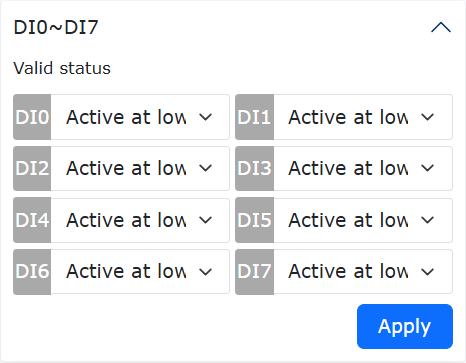

.. centered:: Figura 3.3-1 Estado válido de las entradas DI0-DI7

.. centered:: Tabla 3.3-1 Tabla de correspondencia de configuración de las entradas digitales de la caja de control

.. list-table::
   :widths: 15 15 35 10 10 10 10 
   :header-rows: 0
   :align: center

   * - **Tipo de caja de control**
     - **Tipo de entrada**
     - **Diagrama de conexión**
     - **Activo por nivel alto (interruptor cerrado)** 
     - **Activo por nivel alto (interruptor abierto)** 
     - **Activo por nivel bajo (interruptor cerrado)**
     - **Activo por nivel bajo (interruptor abierto)**

   * - Caja de control de CC
     - Salida tipo NPN
     - .. figure:: installation/081.png
          :align: center
          :width: 3in
     - No válido
     - Válido
     - Válido
     - No válido

   * - Caja de control de CA de tensión estrecha
     - Salida tipo NPN
     - .. figure:: installation/082.png
          :align: center
          :width: 3in
     - No válido
     - Válido
     - Válido
     - No válido

   * - Caja de control de CA de tensión amplia
     - Salida tipo NPN
     - .. figure:: installation/083.png
          :align: center
          :width: 3in
     - No válido
     - Válido
     - Válido
     - No válido

   * - Caja de control de CA de tensión amplia
     - Salida tipo PNP
     - .. figure:: installation/084.png
          :align: center
          :width: 3in
     - No válido
     - Válido
     - Válido
     - No válido

Tipos de entrada digital admitidos por la caja de control
***************************************************************************************

Las entradas digitales de la caja de control de CC y de la caja de control de CA de tensión estrecha solo admiten entrada de tipo NPN; las entradas digitales de la caja de control de CA de tensión amplia admiten seleccionablemente NPN y PNP, siendo el modo predeterminado de fábrica el tipo NPN.

.. list-table::
   :widths: 50 50
   :header-rows: 0
   :align: center

   * - **Tipo de caja de control**
     - **Tipo de entrada**

   * - Caja de control de CC
     - Entrada tipo NPN

   * - Caja de control de CA de tensión estrecha
     - Entrada tipo NPN

   * - Caja de control de CA de tensión amplia
     - Entrada tipo NPN/entrada tipo PNP

Diagrama de cableado de las entradas digitales de la caja de control
********************************************************************************************

Las entradas digitales de la caja de control de CC y de la caja de control de CA de tensión estrecha solo admiten entrada de tipo NPN; su diagrama de cableado es el siguiente.

	.. figure:: installation/085.png
		:align: center
		:width: 6in

	.. centered:: Figura 3.3-2 Diagrama de conexión de las entradas digitales de la caja de control de CC y de la caja de control de CA de tensión estrecha

Las entradas digitales de la caja de control de CA de tensión amplia admiten seleccionablemente NPN y PNP, siendo el modo predeterminado de fábrica el tipo NPN. Su diagrama de cableado es el siguiente:

.. list-table::
   :widths: 50 50
   :header-rows: 0
   :align: center

   * - **Tipo de entrada** 
     - **Diagrama de conexión**

   * - Entrada tipo NPN 
     - 	.. figure:: installation/086.png
          :align: center
          :width: 3in

   * - Entrada tipo PNP
     - 	.. figure:: installation/087.png
          :align: center
          :width: 3in

El tipo de entrada de las entradas digitales de la caja de control de tensión amplia está determinado por el interruptor DIP del interior de la caja de control; si el usuario necesita cambiar el tipo de entrada, debe colocar el interruptor DIP en la posición correspondiente.

.. list-table::
   :widths: 30 30 40
   :header-rows: 0
   :align: center

   * -  
     - Posición del interruptor DIP
     - Posición física del interruptor DIP

   * - Entrada tipo NPN 
     - EX-24V
     - .. figure:: installation/088.png
          :align: center
          :width: 3in

   * - Entrada tipo PNP 
     - EX-0V
     - 	.. figure:: installation/089.png
          :align: center
          :width: 3in

Configuración de software relacionada con las entradas digitales de la caja de control
********************************************************************************************************************

El único elemento de configuración de software relativo a las entradas digitales es "Estado válido de las entradas DI0-DI7", que representa el valor de nivel de tensión digital correspondiente cuando se detecta una entrada válida. Esta configuración permite al usuario utilizar las entradas digitales de forma más flexible.

	.. figure:: installation/090.png
		:align: center
		:width: 6in

  .. centered:: Figura 3.3-3 Estado válido de las entradas DI0-DI7

Con "Estado válido de las entradas DI0-DI7" en distintas configuraciones, cuando el interruptor externo conectado a la entrada digital se encuentra en distintos estados, la tabla de correspondencia del estado válido detectado por el software es la siguiente:

.. centered:: Tabla 3.3-2 Tabla de correspondencia del estado válido

.. list-table::
   :widths: 15 15 15 15 15 15
   :header-rows: 0
   :align: center

   * - **Tipo de caja de control** 
     - **Tipo de entrada**
     - **Activo por nivel alto (interruptor cerrado)**
     - **Activo por nivel alto (interruptor abierto)**
     - **Activo por nivel bajo (interruptor cerrado)**
     - **Activo por nivel bajo (interruptor abierto)**

   * - Caja de control de CC
     - Entrada tipo NPN
     - No válido
     - Válido
     - Válido
     - No válido

   * - Caja de control de CA de tensión estrecha
     - Entrada tipo NPN
     - No válido
     - Válido
     - Válido
     - No válido

   * - Caja de control de CA de tensión amplia
     - Entrada tipo NPN
     - No válido
     - Válido
     - Válido
     - No válido

   * - Caja de control de CA de tensión amplia
     - Entrada tipo PNP
     - No válido
     - Válido
     - Válido
     - No válido

Descripción de las salidas digitales de la caja de control
+++++++++++++++++++++++++++++++++++++++++++++++++++++++++++++

Resumen de las salidas digitales de la caja de control
**********************************************************************

A continuación se enumeran los tipos de salida admitidos por las salidas digitales de la caja de control mini integrada de los robots FAIRINO, así como los diagramas de cableado y las tablas de correspondencia de configuración correspondientes.

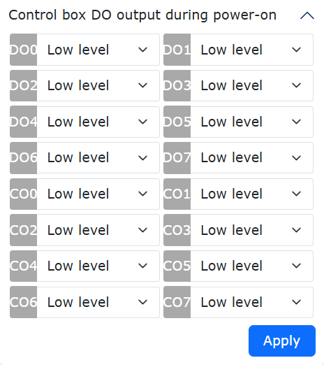

.. centered:: Figura 3.3-4 Salida DO de la caja de control durante el encendido

.. centered:: Tabla 3.3-3 Tabla de correspondencia de configuración de las salidas digitales de la caja de control

.. list-table::
   :widths: 10 10 30 10 10 10 10
   :header-rows: 0
   :align: center

   * - **Tipo de caja de control**
     - **Tipo de entrada**
     - **Diagrama de conexión**
     - **Nivel alto (interruptor en ON)** 
     - **Nivel alto (interruptor en OFF)** 
     - **Nivel bajo (interruptor en ON)**
     - **Nivel bajo (interruptor en OFF)**

   * - Caja de control de CC
     - Salida tipo NPN
     - 	.. figure:: installation/093.png
          :align: center
          :width: 3in
     - Válido 
     - Válido
     - No válido
     - No válido

   * - Caja de control de CA de tensión estrecha
     - Salida tipo NPN
     - .. figure:: installation/094.png
          :align: center
          :width: 3in
     - Válido 
     - Válido
     - No válido
     - No válido

   * - Caja de control de CA de tensión amplia
     - Salida tipo NPN
     - .. figure:: installation/095.png
          :align: center
          :width: 3in
     - Válido 
     - Válido
     - No válido
     - No válido

   * - Caja de control de CA de tensión amplia
     - Salida tipo PNP
     - .. figure:: installation/096.png
          :align: center
          :width: 3in
     - Válido 
     - Válido
     - No válido
     - No válido

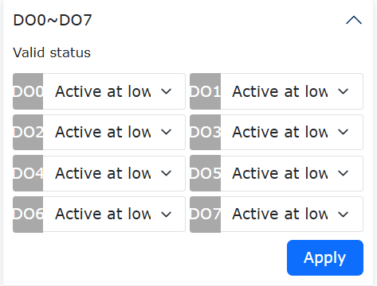

.. centered:: Figura 3.3-5 Estado válido de las salidas DO0-D07

.. centered:: Tabla 3.3-4 Tabla de correspondencia de configuración de las salidas digitales de la caja de control

.. list-table::
   :widths: 10 10 30 10 10 10 10 
   :header-rows: 0
   :align: center

   * - **Tipo de caja de control**
     - **Tipo de entrada**
     - **Diagrama de conexión**
     - **Activo por nivel alto (interruptor en ON)**
     - **Activo por nivel alto (interruptor en OFF)**
     - **Activo por nivel bajo (interruptor en ON)**
     - **Activo por nivel bajo (interruptor en OFF)**

   * - Caja de control de CC
     - Salida tipo NPN
     - 	.. figure:: installation/093.png
          :align: center
          :width: 3in
     - Válido
     - No válido
     - No válido
     - Válido

   * - Caja de control de CA de tensión estrecha
     - Salida tipo NPN
     - .. figure:: installation/094.png
          :align: center
          :width: 3in
     - Válido
     - No válido
     - No válido
     - Válido

   * - Caja de control de CA de tensión amplia
     - Salida tipo NPN
     - .. figure:: installation/095.png
          :align: center
          :width: 3in
     - Válido
     - No válido
     - No válido
     - Válido

   * - Caja de control de CA de tensión amplia
     - Salida tipo PNP
     - .. figure:: installation/096.png
          :align: center
          :width: 3in
     - Válido
     - No válido
     - No válido
     - Válido

Tipos de salida digital admitidos por la caja de control
**************************************************************************

Las salidas digitales de la caja de control de CC y de la caja de control de CA de tensión estrecha solo admiten salida de tipo NPN. Las salidas digitales de la caja de control de CA de tensión amplia admiten seleccionablemente NPN y PNP; su salida es de estructura push-pull, por lo que solo es necesario cablear según el diagrama de cableado correspondiente, sin necesidad de realizar configuraciones especiales.

.. list-table::
   :widths: 50 50
   :header-rows: 0
   :align: center

   * - **Tipo de caja de control**
     - **Tipo de entrada**

   * - Caja de control de CC
     - Salida tipo NPN

   * - Caja de control de CA de tensión estrecha
     - Salida tipo NPN

   * - Caja de control de CA de tensión amplia
     - Salida tipo NPN/salida tipo PNP

Diagrama de cableado de las salidas digitales de la caja de control
************************************************************************************************

Las salidas digitales de la caja de control de CC y de la caja de control de CA de tensión estrecha solo admiten salida de tipo NPN; su diagrama de cableado es el siguiente.

	.. figure:: installation/097.png
		:align: center
		:width: 6in

	.. centered:: Figura 3.3-6 Diagrama de conexión de las salidas digitales de la caja de control de CC y de la caja de control de CA de tensión estrecha

Las salidas digitales de la caja de control de CA de tensión amplia admiten NPN y PNP. Su diagrama de cableado es el siguiente:

.. list-table::
   :widths: 50 50
   :header-rows: 0
   :align: center

   * - **Tipo de entrada** 
     - **Diagrama de conexión**

   * - Entrada tipo NPN 
     - 	.. figure:: installation/098.png
          :align: center
          :width: 3in

   * - Entrada tipo PNP
     - 	.. figure:: installation/099.png
          :align: center
          :width: 3in

Configuración de software relacionada con las salidas digitales de la caja de control
****************************************************************************************************************

Los elementos de configuración de software relativos a las salidas digitales son dos: "Salida DO de la caja de control durante el encendido" y "Estado válido de las salidas DO0-D07". "Salida DO de la caja de control durante el encendido" representa el nivel que se emite durante el encendido de la caja de control, cuando el sistema de control aún no ha completado la inicialización; puede corresponder a distintos estados válidos de salida y responder de forma flexible a situaciones que exijan requisitos especiales sobre el estado de salida durante el encendido. "Estado válido de las salidas DO0-D07" representa el valor de nivel de tensión digital de salida que debe controlarse cuando la salida es válida. Esta configuración permite al usuario utilizar las salidas digitales de forma más flexible.

(1) Con "Salida DO de la caja de control durante el encendido" en distintas configuraciones, la tabla de correspondencia del estado válido de la salida digital es la siguiente:

	.. figure:: installation/100.png
		:align: center
		:width: 6in

	.. centered:: Figura 3.3-7 Salida DO de la caja de control durante el encendido

.. centered:: Tabla 3.3-5 Tabla de correspondencia del estado válido

.. list-table::
   :widths: 20 15 15 15 15 15
   :header-rows: 0
   :align: center

   * - **Tipo de caja de control** 
     - **Tipo de entrada**
     - **Activo por nivel alto (interruptor en ON)**
     - **Activo por nivel alto (interruptor en OFF)**
     - **Activo por nivel bajo (interruptor en ON)**
     - **Activo por nivel bajo (interruptor en OFF)**

   * - Caja de control de CC
     - Salida tipo NPN
     - Válido
     - Válido
     - No válido
     - No válido

   * - Caja de control de CA de tensión estrecha
     - Salida tipo NPN
     - Válido
     - Válido
     - No válido
     - No válido

   * - Caja de control de CA de tensión amplia
     - Salida tipo NPN
     - Válido
     - Válido
     - No válido
     - No válido

   * - Caja de control de CA de tensión amplia
     - Salida tipo PNP
     - Válido
     - Válido
     - No válido
     - No válido

(2) Con "Estado válido de las salidas DO0-D07" en distintas configuraciones, la tabla de correspondencia del estado válido de la salida digital es la siguiente:

	.. figure:: installation/101.png
		:align: center
		:width: 6in

	.. centered:: Figura 3.3-8 Estado válido de las salidas DO0-D07

.. centered:: Tabla 3.3-6 Tabla de correspondencia del estado válido

.. list-table::
   :widths: 20 15 15 15 15 15
   :header-rows: 0
   :align: center

   * - **Tipo de caja de control** 
     - **Tipo de entrada**
     - **Activo por nivel alto (interruptor en ON)**
     - **Activo por nivel alto (interruptor en OFF)**
     - **Activo por nivel bajo (interruptor en ON)**
     - **Activo por nivel bajo (interruptor en OFF)**

   * - Caja de control de CC
     - Salida tipo NPN
     - Válido
     - No válido
     - No válido
     - Válido

   * - Caja de control de CA de tensión estrecha
     - Salida tipo NPN
     - Válido
     - No válido
     - No válido
     - Válido

   * - Caja de control de CA de tensión amplia
     - Salida tipo NPN
     - Válido
     - No válido
     - No válido
     - Válido

   * - Caja de control de CA de tensión amplia
     - Salida tipo PNP
     - Válido
     - No válido
     - No válido
     - Válido

Manual de seguridad de conexión de alimentación de la caja de control de CC
++++++++++++++++++++++++++++++++++++++++++++++++++++++++++++++++++++++++++++++++++++++++++++++++++++++++++++++++

Definición e identificación de los terminales de conexión
************************************************************************************
El panel frontal de la caja de control de CC dispone de un terminal de entrada de alimentación de 3 PIN, que corresponden respectivamente al polo positivo de la alimentación (+V), al polo negativo de la alimentación (-V) y a la toma de tierra de protección (PE). Para evitar que una conexión errónea queme el equipo, consulte estrictamente la tabla siguiente:

.. list-table::
   :widths: 15 10 35 35
   :header-rows: 0
   :align: center

   * - **Identificación del terminal** 
     - **Norma de color**
     - **Definición de la función**
     - **Operación estrictamente prohibida**

   * - 	.. figure:: installation/144.png
          :align: center
          :width: 2in
     - Rojo
     - Entrada del polo positivo de la alimentación de CC; solo puede conectarse el cable del polo positivo de 30-60VDC
     - Estrictamente prohibido cortocircuitarlo con PE o -V

   * - 	.. figure:: installation/145.png
          :align: center
          :width: 2in
     - Negro
     - Entrada del polo negativo de la alimentación de CC; solo puede conectarse el cable del polo negativo de 30-60VDC, que constituye el circuito de alimentación
     - Estrictamente prohibido conectarlo a la carcasa o a PE

   * - 	.. figure:: installation/146.png
          :align: center
          :width: 2in
     - Amarillo (amarillo-verde)
     - Terminal de toma de tierra de protección (toma de tierra de seguridad de la carcasa)
     - Estrictamente prohibido utilizarlo como polo negativo o positivo de la alimentación

.. warning::
  Aviso de riesgo importante: este equipo no incorpora circuitos de protección contra conexión inversa, conexión errónea ni sobretensión. Cualquiera de las siguientes operaciones irregulares perforará instantáneamente la placa base interna y los componentes de potencia, provocando la quema permanente e irreversible del equipo:
  
  1. Conexión inversa de los polos positivo y negativo (intercambiar los cables +V y -V);
  2. Conectar por error +V o -V al orificio PE;
  3. Conectar a tierra por error el terminal negativo (-V en cortocircuito con PE);
  4. Conectar corriente alterna (110V/220V/380V) o una tensión de CC fuera del rango 30~60Vdc.

Preparación de seguridad antes del cableado
*************************************************************************

Antes de realizar el cableado, el operador debe completar las siguientes preparaciones:

Confirmación del corte de energía
""""""""""""""""""""""""""""""""""""""""""""""""""""""""""""""""""""""""""""""

Cortar completamente la alimentación del suministro frontal y colgar un cartel de advertencia de seguridad. Utilizar un multímetro para comprobar la entrada de alimentación y confirmar que no hay tensión ni electricidad residual, evitando así el cableado con tensión.

Comprobación del equipo
""""""""""""""""""""""""""""""""""""""""""""""""""""""""""""""""""""""""""""""

Comprobar que los terminales de conexión del equipo no están dañados, oxidados ni flojos, y que el cuerpo de la máquina no presenta humedad, entrada de agua ni daños por golpes, garantizando que el estado del equipo en sí es correcto.

Confirmación del suministro de alimentación
""""""""""""""""""""""""""""""""""""""""""""""""""""""""""""""""""""""""""""""

Confirmar que el tipo de salida del suministro frontal es una fuente de alimentación estabilizada de CC de 30-60VDC. Está estrictamente prohibido conectar alimentación de CA de 110V/220V/380V, o alimentación de CC inferior a 30VDC o superior a 60VDC;

Selección de los cables
""""""""""""""""""""""""""""""""""""""""""""""""""""""""""""""""""""""""""""""

Se recomienda seleccionar cable flexible de cobre de calibre 4mm² (AWG11) o superior; se recomienda que la longitud de un solo cable de alimentación no supere los 2 metros. Evite utilizar cables con un diámetro excesivamente fino, con la capa aislante dañada o envejecidos.

Selección de los terminales del mazo de cables
""""""""""""""""""""""""""""""""""""""""""""""""""""""""""""""""""""""""""""""

El extremo del cable debe crimparse obligatoriamente con terminales de compresión en frío preaislados (modelo recomendado: terminal tipo pala DBV5.5-10); está estrictamente prohibido insertar directamente el hilo de cobre desnudo en el orificio de conexión.

Verificación de las herramientas
""""""""""""""""""""""""""""""""""""""""""""""""""""""""""""""""""""""""""""""

Prepare un multímetro homologado, un destornillador aislado y unos alicates de crimpar. Verifique previamente que la función de detección de tensión del multímetro funciona correctamente, asegurando que puede detectar con precisión la tensión y distinguir el polo positivo y el negativo.

Flujo de operación de cableado estándar
************************************************************************************

Fabricación de los terminales del cable
""""""""""""""""""""""""""""""""""""""""""""""""""""""""""""""""""""""""""""""

Utilice los alicates de crimpar para crimpar en un extremo de cada uno de los tres cables de colores rojo (+V), negro (-V) y amarillo-verde (PE) un terminal de compresión en frío (recomendado DBV5.5-10), asegurando una compresión firme y que el hilo de cobre no quede al descubierto. Está estrictamente prohibido utilizar cables del mismo color o cables con identificación de color poco clara.

Inserción y bloqueo del conector de terminales
""""""""""""""""""""""""""""""""""""""""""""""""""""""""""""""""""""""""""""""

Inserte sucesivamente los terminales crimpados en los orificios correspondientes del conector de cableado enchufable suministrado con el equipo (tenga en cuenta la dirección de inserción; la cara plana del terminal debe apuntar a la lengüeta elástica):
Cable rojo → insertar en el orificio +V;
Cable negro → insertar en el orificio -V;
Cable amarillo-verde → insertar en el orificio PE.
Utilice un destornillador de punta plana aislado para apretar en sentido horario el tornillo de presión situado encima de cada orificio.

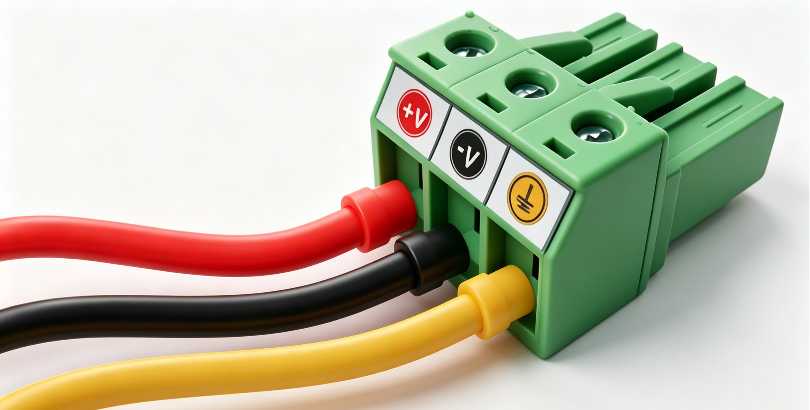

.. centered:: Mazo de cables con terminales de compresión en frío insertado en el conector verde

Verificación de la fuerza de tracción
""""""""""""""""""""""""""""""""""""""""""""""""""""""""""""""""""""""""""""""

Tras apretar cada cable, tire del cable con fuerza con la mano para confirmar que el terminal no se suelta y que el núcleo del cable no se desliza. Si hay holgura, es necesario volver a crimpar el terminal y apretarlo de nuevo.

Inserción en la unidad principal de la caja de control
""""""""""""""""""""""""""""""""""""""""""""""""""""""""""""""""""""""""""""""

Inserte el conector ya cableado, en la dirección de la ranura de guía de seguridad, en la entrada de alimentación de la caja de control de CC. Asegúrese de que el conector queda completamente en su posición.

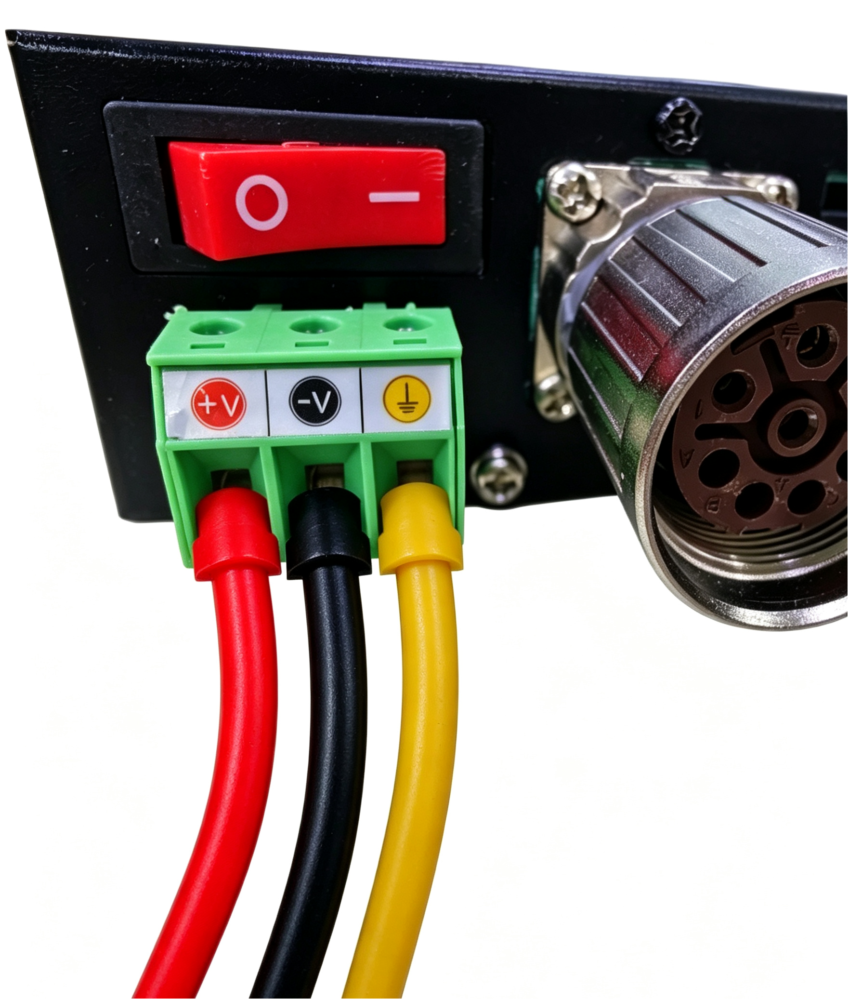

.. centered:: Conector con mazo de cables insertado en la entrada de alimentación de la caja de control de CC

Verificación final de aislamiento antes del encendido
""""""""""""""""""""""""""""""""""""""""""""""""""""""""""""""""""""""""""""""

Sin conectar la alimentación, utilice un multímetro para medir la impedancia entre +V y -V en el extremo del conector y confirmar que no hay cortocircuito; mida la impedancia entre +V/-V y PE y confirme que se encuentra en estado de aislamiento por circuito abierto.

Encendido y tratamiento de anomalías
************************************************************************************

- Arranque normal: cerrar el interruptor de alimentación frontal y observar el indicador del panel de la caja de control. El comportamiento normal es que el indicador permanezca encendido y que no haya ruidos anómalos ni olores extraños.
- Fenómenos anómalos (¡cortar la alimentación inmediatamente!): si se produce un silbido agudo, humo, chispas, olores extraños, o si el amperímetro del suministro frontal se satura instantáneamente por sobrecarga, debe cortarse inmediatamente la alimentación general y prohibirse un segundo encendido. Póngase en contacto con el soporte técnico una vez que el equipo se haya enfriado completamente; no desmonte el equipo por su cuenta para inspeccionarlo.

.. warning:: Advertencia final: el encendido significa que usted ha comprendido y cumplido completamente las normas de cableado anteriores. Si alguna identificación no está clara, llame inmediatamente al soporte técnico y ¡no realice el cableado basándose en su experiencia!

Plan de inspección y mantenimiento
++++++++++++++++++++++++++++++++++

Brazo mecánico
********************

1. Plan de inspección

A continuación se enumera la lista de comprobaciones que FAIRINO recomienda ejecutar según los intervalos de tiempo marcados. Si la inspección detecta que el estado de las piezas correspondientes no es aceptable, corríjalo inmediatamente.

.. note:: F=inspección funcional, V=inspección visual, *=inspección obligatoria tras una colisión grave.

.. list-table::
   :widths: 10 40 20 20 20 20
   :header-rows: 0
   :align: center

   * - 
     - **Elemento de inspección**
     - **Requisito**
     - **Una vez al mes**
     - **Una vez cada seis meses**
     - **Una vez al año**

   * - 1
     - Comprobar la tapa posterior de la articulación*
     - V
     - 
     - ✔
     - 

   * - 2
     - Comprobar los tornillos de la tapa posterior de la articulación
     - F
     - 
     - ✔
     - 

   * - 3
     - Comprobar la junta de goma de la articulación
     - V
     - 
     - ✔
     - 

   * - 4
     - Comprobar los cables del robot
     - V
     - 
     - ✔
     - 

   * - 5
     - Comprobar la conexión de los cables del robot
     - V
     - 
     - ✔
     - 

   * - 6
     - Comprobar los pernos de instalación de la base del robot*
     - F
     - ✔
     - 
     - 

   * - 7
     - Comprobar los pernos de instalación de la herramienta del extremo*
     - F
     - ✔
     - 
     - 

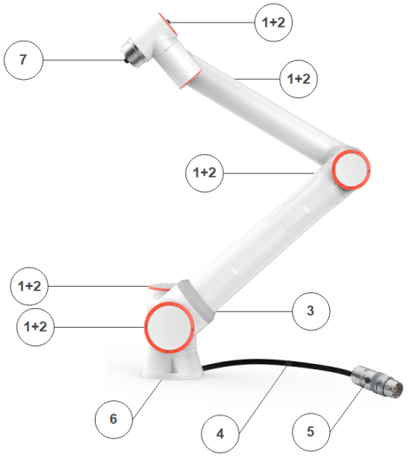

2. Inspección visual
   
.. note:: No utilice nunca aire comprimido para limpiar el brazo del robot, ya que podría dañar los componentes. No almacene el robot durante más de 6 meses sin realizar una inspección visual.

- Si es posible, mueva el brazo del robot a la posición cero.
- Apague y desconecte el cable de alimentación de la caja de control.
- Compruebe si el cable entre la caja de control y el brazo del robot presenta algún daño.
- Compruebe si los pernos de instalación de la base están correctamente apretados.
- Compruebe si los pernos de la brida de la herramienta están correctamente apretados.
- Compruebe si el anillo plano presenta desgaste y daños. 
- Compruebe si todas las tapas posteriores de las articulaciones presentan grietas o daños.
- Compruebe si los tornillos utilizados para la tapa posterior de la articulación están en su sitio y correctamente apretados.

.. note:: Si el robot presenta cualquier daño durante el período de garantía, póngase en contacto con el distribuidor que vendió el robot.

3. Inspección funcional

La finalidad de la inspección funcional es garantizar que los tornillos, pernos, herramientas y el brazo mecánico no presentan holguras. Los tornillos/pernos mencionados en el plan de inspección deben comprobarse con una llave dinamométrica, y el par debe cumplir las normas estándar; en cuanto a las especificaciones de los pernos de instalación del brazo mecánico, estas especificaciones pueden encontrarse en las normas de instalación del «Manual de usuario».

4. Limpieza

Puede utilizar un paño y uno de los siguientes limpiadores para eliminar cualquier polvo/suciedad/grasa observada en el brazo del robot: agua, alcohol isopropílico, etanol al 10% o nafta al 10%. Si el robot funciona en entornos adversos, por ejemplo con líquido de corte, refrigerante, etc., se recomienda limpiar o sustituir periódicamente la junta de goma.

No utilice lejía. No utilice lejía en ninguna solución de limpieza diluida. En raras ocasiones, puede observarse una cantidad mínima de grasa en las juntas. Esto no afecta a la función, el uso ni la vida útil de la articulación.

Caja de control, teach pendant, caja de botones
***********************************************

1. Plan de inspección

A continuación se enumera la lista de comprobaciones que FAIRINO recomienda ejecutar según los intervalos de tiempo marcados. Si la inspección detecta que el estado de las piezas correspondientes no es aceptable, corríjalo inmediatamente.

.. note:: F=inspección funcional, V=inspección visual.

.. list-table::
   :widths: 10 40 20 20 20 20
   :header-rows: 0
   :align: center

   * - 
     - **Elemento de inspección**
     - **Requisito**
     - **Una vez al mes**
     - **Una vez cada seis meses**
     - **Una vez al año**

   * - 1
     - Comprobar el botón de parada de emergencia de la caja de botones (teach pendant)
     - F
     - ✔
     - 
     - 

   * - 2
     - Comprobar la función de entrada y salida de seguridad de la regleta de terminales
     - F
     - ✔
     - 
     - 

   * - 3
     - Comprobar las funciones de inicio/parada y cambio de modo de la caja de botones
     - F
     - ✔
     - 
     - 

   * - 4
     - Comprobar el cable de la caja de botones (teach pendant)
     - V
     - 
     - ✔
     - 

   * - 5
     - Comprobar y limpiar el filtro de aire de la caja de control
     - V
     - ✔
     - 
     - 

   * - 6
     - Comprobar si los terminales de la caja de control están firmes
     - F
     - 
     - ✔
     - 

   * - 7
     - Comprobar que la resistencia de puesta a tierra de la caja de control ≤1Ω
     - F
     - 
     - 
     - ✔

   * - 8
     - Comprobar la alimentación principal de la caja de control
     - F
     - 
     - 
     - ✔

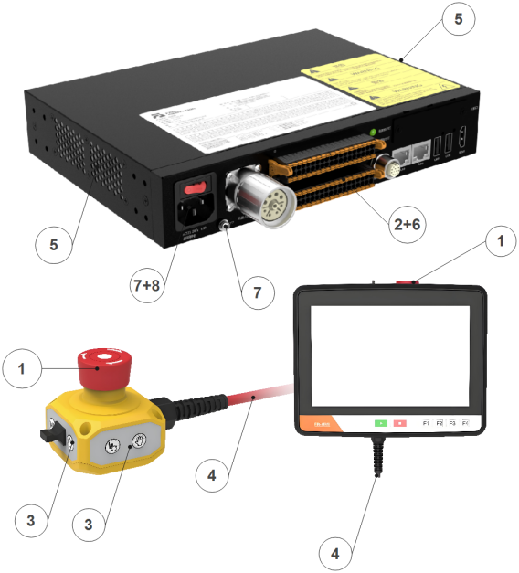

2. Inspección visual

- Desconecte el cable de alimentación de la caja de control.
- Compruebe si los terminales de la placa de control están correctamente insertados y si hay cables flojos.
- Compruebe si hay suciedad/polvo en el interior de la caja de control. Si es necesario, utilice un aspirador ESD para limpiarlo.

.. note:: No utilice nunca aire comprimido para limpiar el interior de la caja de control, ya que podría dañar los componentes.

3. Inspección funcional

.. note:: La función de seguridad del robot es un punto clave; se recomienda realizar una prueba mensual para garantizar que la función es correcta.

- Botón de parada de emergencia del teach pendant/caja de botones:
  
  A. Pulse el botón de parada de emergencia del teach pendant/caja de botones.
  B. Observe que el robot se detiene y se corta la alimentación de las articulaciones.
  C. Vuelva a encender la alimentación del robot.

	.. figure:: installation/075.png
		:align: center
		:width: 4in

	.. figure:: installation/076.png
		:align: center
		:width: 4in

- Las demás entradas y salidas de seguridad siguen en funcionamiento
  
  Compruebe qué entradas y salidas de seguridad están activas y si pueden activarse mediante PolyScope o dispositivos externos.

- Fecha y reloj
  
  Compruebe si la fecha y el reloj de la pestaña "Registro" son correctos. Una fecha y un reloj incorrectos indican que la batería CMOS tiene poca carga. La vida útil de la batería CMOS es de hasta 5 años.

- Comprobar si los cierres de la regleta de terminales están en su posición
  
  .. figure:: installation/077.png
    :align: center
    :width: 4in

4. Limpieza
   
- Teach pendant
  
  Puede ser necesario limpiar la pantalla del teach pendant. Se recomienda utilizar un limpiador industrial suave estándar que no contenga disolventes ni aditivos corrosivos. No utilice materiales abrasivos para limpiar la pantalla. FAIRINO no comercializa limpiadores específicos.

- Caja de botones del teach pendant
  
  Normalmente no requiere limpieza periódica. Si la identificación de los botones se vuelve borrosa y afecta a la operación de reconocimiento, límpiela con un limpiador cuando sea necesario.

- Caja de control
  
  La caja de control contiene dos filtros, uno a cada lado de la caja de control.

  A. El estado del filtro puede observarse desde las rejillas de ventilación de los lados izquierdo y derecho de la caja de control. Normalmente puede verse la estructura de panal del filtro.
  B. Desmonte el filtro para limpiarlo. Utilice aire a baja presión para limpiarlo o sustitúyalo según sea necesario. Recuerde limpiar cada cara. Si está muy sucio o dañado, sustitúyalo (en el peor de los casos es necesario desmontar la tapa superior del controlador y sustituir el filtro desde el interior de la tapa superior).
  C. Durante el funcionamiento, escuche el sonido del ventilador; si el sonido es anómalo, póngase en contacto con el proveedor de servicio o sustitúyalo.

Tarjeta de registro del plan de inspección
******************************************

1. Brazo mecánico
  
.. list-table::
   :widths: 40 20 20 20 40
   :header-rows: 0
   :align: center

   * - **Elemento de inspección**
     - **Inspeccionado**
     - **Inspector**
     - **Fecha**
     - **Observaciones**

   * - **Comprobar la tapa posterior de la articulación**
     - 
     - 
     - 
     - 

   * - **Comprobar los tornillos de la tapa posterior de la articulación**
     - 
     - 
     - 
     - 

   * - **Comprobar la junta de goma de la articulación**
     - 
     - 
     - 
     - 

   * - **Comprobar los cables del robot**
     - 
     - 
     - 
     - 

   * - **Comprobar la conexión de los cables del robot**
     - 
     - 
     - 
     - 

   * - **Comprobar los pernos de instalación de la base del robot**
     - 
     - 
     - 
     - 

   * - **Comprobar los pernos de instalación de la herramienta del robot**
     - 
     - 
     - 
     - 
  
2. Caja de control, teach pendant, caja de botones

.. list-table::
   :widths: 40 20 20 20 40
   :header-rows: 0
   :align: center

   * - **Elemento de inspección**
     - **Inspeccionado**
     - **Inspector**
     - **Fecha**
     - **Observaciones**

   * - **Comprobar el botón de parada de emergencia de la caja de botones (teach pendant)**
     - 
     - 
     - 
     - 

   * - **Comprobar la función de entrada y salida de seguridad de la regleta de terminales**
     - 
     - 
     - 
     - 

   * - **Comprobar las funciones de inicio/parada y cambio de modo de la caja de botones**
     - 
     - 
     - 
     - 

   * - **Comprobar el cable de la caja de botones (teach pendant)**
     - 
     - 
     - 
     - 

   * - **Comprobar y limpiar el filtro de aire de la caja de control**
     - 
     - 
     - 
     - 

   * - **Comprobar si los terminales de la caja de control están firmes**
     - 
     - 
     - 
     - 

   * - **Comprobar que la resistencia de puesta a tierra de la caja de control ≤1Ω**
     - 
     - 
     - 
     - 

   * - **Comprobar la alimentación principal de la caja de control**
     - 
     - 
     - 
     - 

Eliminación
~~~~~~~~~~~

Los robots FR deben eliminarse según las leyes y reglamentos nacionales aplicables y las normas nacionales; para más detalles, póngase en contacto con el fabricante.

Normas de instalación
---------------------

Instalación del brazo del robot
~~~~~~~~~~~~~~~~~~~~~~~~~~~~~~~

.. important:: 
	Se recomienda que la base de montaje del robot cumpla los siguientes requisitos para garantizar una instalación firme y estable del robot:
   
	（1）La base de montaje del robot debe ser suficientemente firme y tener suficiente capacidad de carga; debe poder soportar al menos 5 veces el peso del robot y al menos 10 veces el par del eje 1.

	（2）La base de montaje del robot debe tener una superficie plana para garantizar un contacto estrecho con la superficie de contacto del robot;

	（3）La base de montaje del robot debe tener suficiente rigidez, estar firmemente fijada y no entrar en resonancia con el robot;

	（4）Cuando el robot y otros componentes se muevan simultáneamente, la base de montaje debe estar aislada de los demás componentes móviles; no deben fijarse juntos para evitar interferencias por vibración durante el movimiento;

	（5）Si el robot se instala en una plataforma móvil o en un eje externo, la aceleración de la plataforma móvil o del eje externo debe ser lo más baja posible;

.. warning:: 
	Deben evitarse los siguientes modos de instalación:

	（I）Evitar fijar el robot sobre otros equipos en movimiento

	.. figure:: installation/064.png
		:align: center
		:width: 3in

	.. centered:: Figura 3.4-1 Evitar la instalación sobre otros equipos en movimiento

	Asegúrese de que el brazo del robot está instalado correctamente y de forma segura en su posición. Una instalación inestable provocará accidentes.

.. note:: 
	Se puede adquirir una base precisa como accesorio. Las Figuras 3.4-2, 3.4-5, 3.4-8 y 3.4-11 muestran la posición de los orificios de pasador y la posición de instalación de los tornillos.

Requisitos de instalación del brazo del robot FR3/FR3-WMS/FR3-WML/FR3-C/FR5-C
++++++++++++++++++++++++++++++++++++++++++++++++++++++++++++++++++++++++++++++++++++++++

Cuando el robot se instala en la base de montaje, se fija a la base de montaje con 4 pernos M6 de una resistencia no inferior a la clase 8.8, y los pernos deben apretarse con un par no inferior a 10Nm; se recomienda utilizar en la base de montaje dos orificios de pasador de φ5mm con pasadores para el posicionamiento del robot, con el fin de mejorar la precisión de instalación del robot y evitar que este se desplace debido a colisiones, etc. Cuando se exija una alta precisión de funcionamiento del robot, es imprescindible añadir pasadores para el posicionamiento del robot.

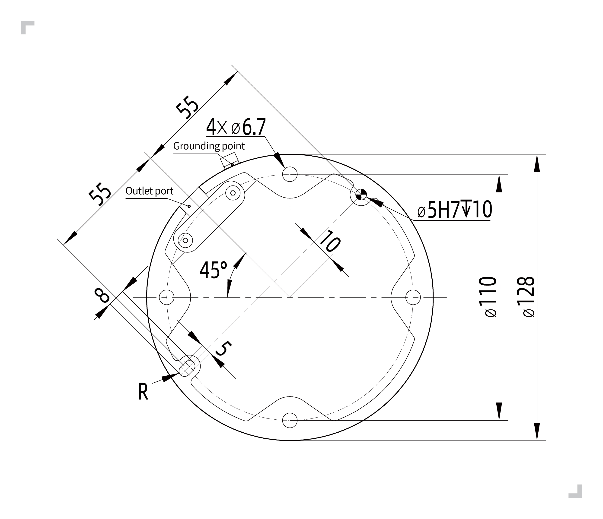

.. centered:: Figura 3.4-2 Dimensiones de instalación del robot colaborativo modelo FR3/FR3-WMS/FR3-WML/FR3-C/FR5-C

.. important:: 
	Según los distintos escenarios de aplicación se recomiendan varios modelos de base de instalación del robot como los siguientes:

	（I）Para situaciones en las que la velocidad de movimiento no es demasiado rápida, la velocidad de funcionamiento no es demasiado grande, los requisitos de precisión son generales y no es conveniente fijarlo al suelo, se recomienda la siguiente base de instalación del robot:

	.. figure:: installation/062.png
		:align: center
		:width: 3in

	.. centered:: Figura 3.4-3 Base de instalación de bajos requisitos para el robot colaborativo modelo FR3/FR3-WMS/FR3-WML/FR3-C/FR5-C

	（II）Para situaciones en las que la velocidad de movimiento es más rápida, la velocidad de funcionamiento es mayor y los requisitos de precisión son más elevados, se recomienda la siguiente base de instalación del robot y fijar el robot a un suelo firme:

	.. figure:: installation/067.png
		:align: center
		:width: 3in

	.. centered:: Figura 3.4-4 Base de instalación de altos requisitos para el robot colaborativo modelo FR3/FR3-WMS/FR3-WML/FR3-C/FR5-C

Requisitos de instalación del brazo del robot FR5
++++++++++++++++++++++++++++++++++++++++++++++++++++++++++++++++++++

Cuando el robot se instala en la base de montaje, se fija a la base de montaje con 4 pernos M8 de una resistencia no inferior a la clase 8.8, y los pernos deben apretarse con un par no inferior a 20Nm; se recomienda utilizar en la base de montaje dos orificios de pasador de φ8mm con pasadores para el posicionamiento del robot, con el fin de mejorar la precisión de instalación del robot y evitar que este se desplace debido a colisiones, etc. Cuando se exija una alta precisión de funcionamiento del robot, es imprescindible añadir pasadores para el posicionamiento del robot.

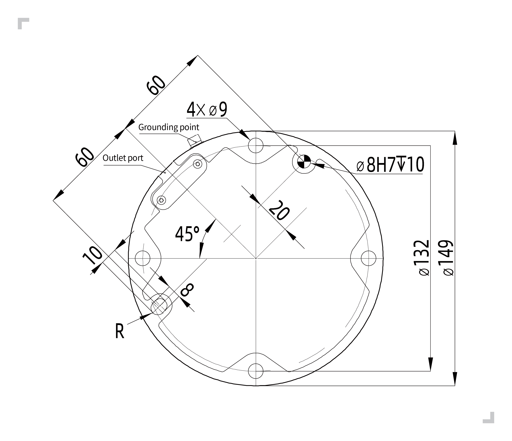

.. centered:: Figura 3.4-5 Dimensiones de instalación del robot colaborativo modelo FR5

.. important:: 
	Según los distintos escenarios de aplicación se recomiendan varios modelos de base de instalación del robot como los siguientes:

	（I）Para situaciones en las que la velocidad de movimiento no es demasiado rápida, la velocidad de funcionamiento no es demasiado grande, los requisitos de precisión son generales y no es conveniente fijarlo al suelo, se recomienda la siguiente base de instalación del robot:

	.. figure:: installation/062.png
		:align: center
		:width: 3in

	.. centered:: Figura 3.4-6 Base de instalación de bajos requisitos para el robot colaborativo modelo FR5

	（II）Para situaciones en las que la velocidad de movimiento es más rápida, la velocidad de funcionamiento es mayor y los requisitos de precisión son más elevados, se recomienda la siguiente base de instalación del robot y fijar el robot a un suelo firme:

	.. figure:: installation/067.png
		:align: center
		:width: 3in

	.. centered:: Figura 3.4-7 Base de instalación de altos requisitos para el robot colaborativo modelo FR5

Requisitos de instalación del brazo del robot FR10 y FR16
+++++++++++++++++++++++++++++++++++++++++++++++++++++++++++++++++++++++++++

Cuando el robot se instala en la base de montaje, se fija a la base de montaje con 4 pernos M8 de una resistencia no inferior a la clase 8.8, y los pernos deben apretarse con un par no inferior a 25Nm; se recomienda utilizar en la base de montaje dos orificios de pasador de φ8mm con pasadores para el posicionamiento del robot, con el fin de mejorar la precisión de instalación del robot y evitar que este se desplace debido a colisiones, etc. Cuando se exija una alta precisión de funcionamiento del robot, es imprescindible añadir pasadores para el posicionamiento del robot.

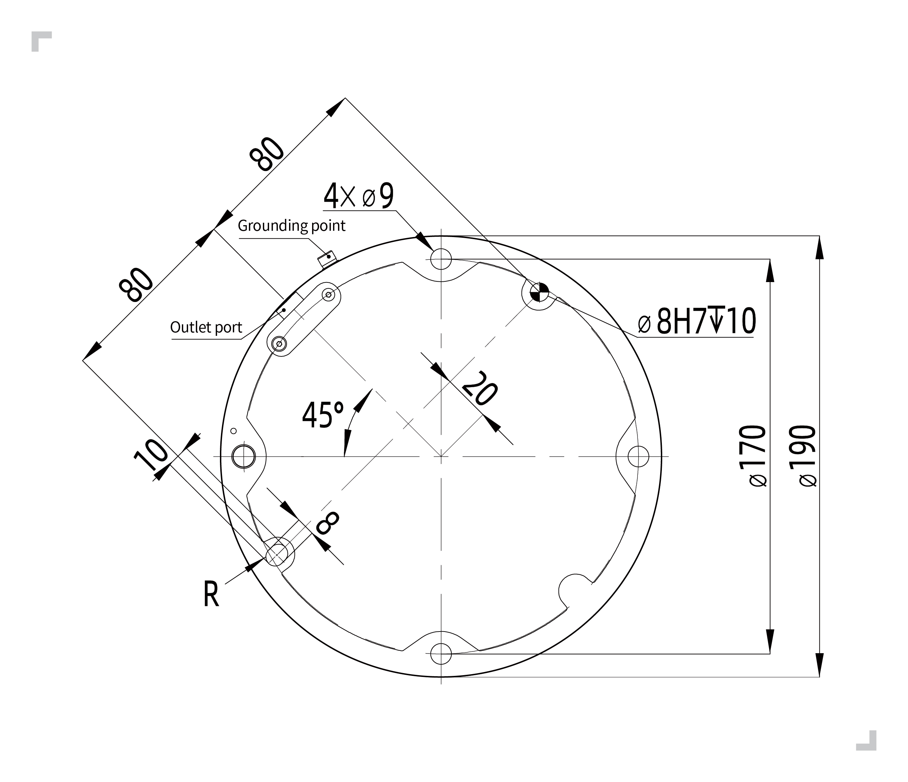

.. centered:: Figura 3.4-8 Dimensiones de instalación del robot colaborativo modelo FR10 y FR16
	
.. important:: 
	Según los distintos escenarios de aplicación se recomiendan varios modelos de base de instalación del robot como los siguientes:

	（I）Para situaciones en las que la velocidad de movimiento no es demasiado rápida, la velocidad de funcionamiento no es demasiado grande, los requisitos de precisión son generales y no es conveniente fijarlo al suelo, se recomienda la siguiente base de instalación del robot:

	.. figure:: installation/065.png
		:align: center
		:width: 3in

	.. centered:: Figura 3.4-9 Base de instalación de bajos requisitos para el robot colaborativo modelo FR10 y FR16

	（II）Para situaciones en las que la velocidad de movimiento es más rápida, la velocidad de funcionamiento es mayor y los requisitos de precisión son más elevados, se recomienda la siguiente base de instalación del robot y fijar el robot a un suelo firme:

	.. figure:: installation/067.png
		:align: center
		:width: 3in

	.. centered:: Figura 3.4-10 Base de instalación de altos requisitos para el robot colaborativo modelo FR10 y FR16

Requisitos de instalación del brazo del robot FR20 y FR30
+++++++++++++++++++++++++++++++++++++++++++++++++++***********

Cuando el robot se instala en la base de montaje, se fija a la base de montaje con 6 pernos M10 de una resistencia no inferior a la clase 8.8, y los pernos deben apretarse con un par no inferior a 45Nm; se recomienda utilizar en la base de montaje dos orificios de pasador de φ8mm con pasadores para el posicionamiento del robot, con el fin de mejorar la precisión de instalación del robot y evitar que este se desplace debido a colisiones, etc. Cuando se exija una alta precisión de funcionamiento del robot, es imprescindible añadir pasadores para el posicionamiento del robot.

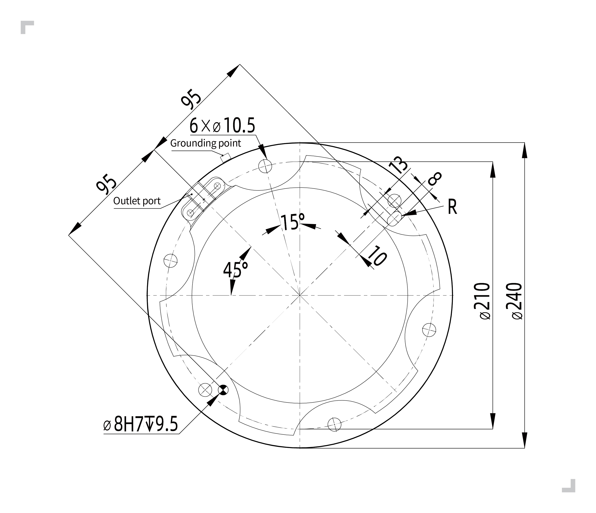

.. centered:: Figura 3.4-11 Dimensiones de instalación del robot colaborativo modelo FR20 y FR30

.. important:: 

	Debido al gran peso propio y a la gran inercia de funcionamiento de los robots FR20 y FR30, se recomienda fijarlos directamente al suelo para su uso. La base recomendada es la siguiente:

	.. figure:: installation/066.png
		:align: center
		:width: 3in

	.. centered:: Figura 3.4-12 Base de instalación para el robot colaborativo modelo FR20 y FR30

Instalación del extremo de la herramienta
~~~~~~~~~~~~~~~~~~~~~~~~~~~~~~~~~~~~~~~~~

La brida de herramienta del robot dispone de cuatro orificios roscados M6 que pueden utilizarse para conectar la herramienta al robot. Los pernos M6 deben apretarse con un par de 8Nm y su clase de resistencia no debe ser inferior a 8.8. Para volver a posicionar la herramienta con precisión, utilice pasadores en los orificios de pasador Ø6 reservados.

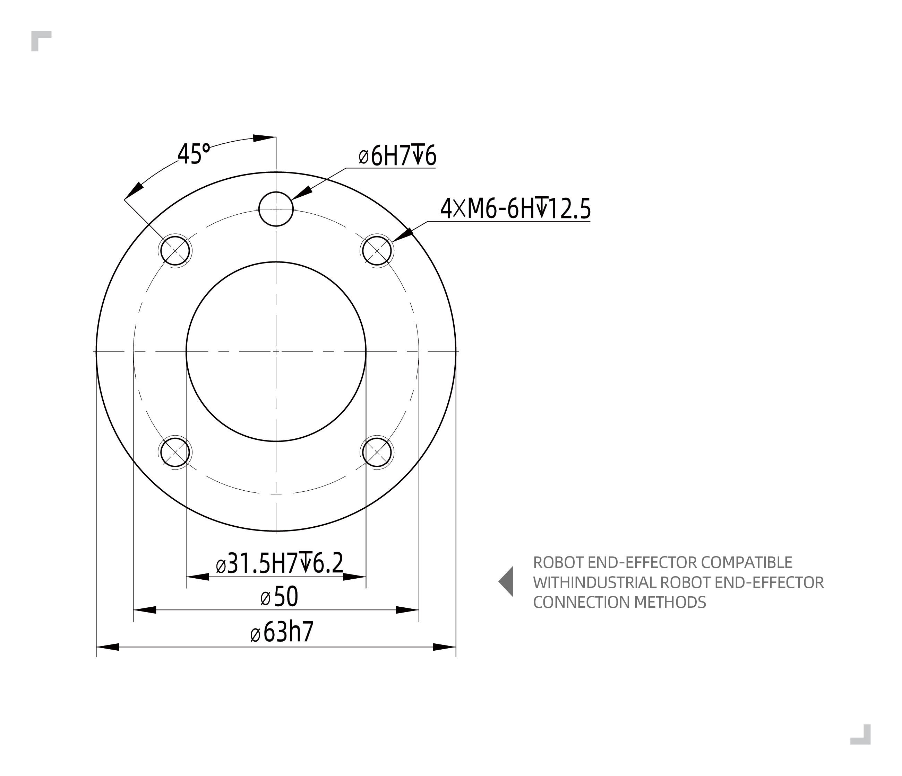

.. centered:: Figura 3.4-13 Plano de la brida del extremo del robot modelo FR3/FR3-WMS/FR3-WML/FR3-C/FR5/FR5-C/FR10/FR16

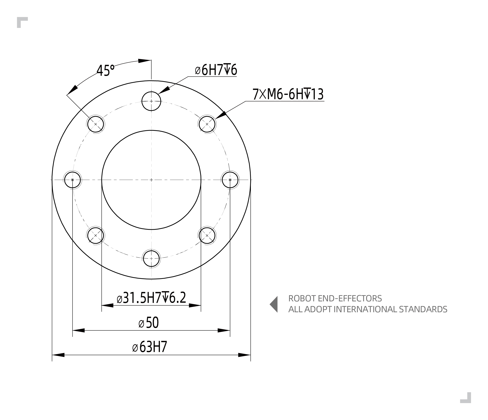

.. centered:: Figura 3.4-14 Plano de la brida del extremo del robot modelo FR20/FR30

.. important:: 
	- Asegúrese de que la herramienta está instalada correctamente y de forma segura en su posición.
	- Asegúrese de que la estructura de seguridad de la herramienta es correcta y que no hay riesgo de caída accidental de piezas.
	- Instalar en la brida del robot pernos M6 de longitud superior a 8 milímetros puede dañar la brida de la herramienta y causar daños irreparables, lo que obligaría a sustituir la brida de la herramienta.

Entorno de instalación
~~~~~~~~~~~~~~~~~~~~~~

Al instalar y utilizar el robot colaborativo, asegúrese de cumplir los siguientes requisitos:

-  Temperatura ambiente 0-45℃

-  Humedad 0%~90%RH (sin condensación)

-  Sin impactos mecánicos ni vibraciones

-  Requisito de altitud inferior a 2000m

-  Sin gases corrosivos, sin líquidos, sin gases explosivos, sin suciedad de aceite, sin niebla salina, sin polvo ni polvo metálico, sin materiales radiactivos, sin ruido electromagnético, sin materiales inflamables

-  Evitar que el equipo trabaje en condiciones de corriente inestable

-  El usuario debe añadir un interruptor de aire antes de la alimentación del robot y, además, se recomienda añadir un filtro EMC

.. note:: 
	Si desea izar el robot colaborativo o instalarlo en una superficie vertical, póngase en contacto con nosotros.

Capacidad de carga del suelo
~~~~~~~~~~~~~~~~~~~~~~~~~~~~

Instale el robot sobre una superficie firme, que debe ser capaz de soportar al menos 5 veces el peso del brazo del robot y que no debe tener vibraciones.

Curvas de carga de toda la serie de modelos
~~~~~~~~~~~~~~~~~~~~~~~~~~~~~~~~~~~~~~~~~~~

Descripción general
+++++++++++++++++++

Las curvas de carga tratadas en esta sección se obtienen a partir de las pruebas de cada modelo en trayectorias específicas. Las curvas de carga de cada modelo constan de dos partes: "rendimiento completo" y "capacidad de carga ampliada", concretamente como sigue:

(1) El entorno de funcionamiento del "rendimiento completo" es: coeficiente de compensación de fricción de cada articulación igual a 1; nivel de colisión de cada articulación igual a 10; velocidad de funcionamiento del 100% y aceleración de 360deg/s2 configuradas en la interfaz Web; dinámica 2.0. En este entorno, la parte de "rendimiento completo" de la curva de carga se adapta a la gran mayoría de las trayectorias de funcionamiento.
(2) Si la carga del extremo se encuentra en la "capacidad de carga ampliada", es necesario activar el "modo de tiempo óptimo" y cumplir las limitaciones de aceleración, o reducir el rango de trabajo del robot.

Descripción de los parámetros
+++++++++++++++++++++++++++++

La carga útil nominal del robot depende de la desviación del centro de gravedad de la carga útil, donde la desviación del centro de gravedad se define como la distancia entre el centro de la brida del extremo y el centro de gravedad de la carga útil adicional.

Curva de carga del robot colaborativo modelo FR3
**********************************************************

La carga máxima que puede transportar el robot colaborativo modelo FR3 es de 5 kg y la carga nominal es de 3 kg; la curva de carga se muestra en la figura. La explicación concreta de la curva de carga es la siguiente:

(1) El FR3, con rendimiento completo, puede transportar una carga de 3 kg o inferior, véase la "envolvente azul".
(2) Cuando la carga es de 3 kg a 5 kg, se trata de la capacidad de carga ampliada, véase la "envolvente roja"; en este caso el robot puede funcionar en los siguientes estados:

  ①Activar el "modo de tiempo óptimo"; se recomienda configurar la aceleración por debajo de 360deg/s\ :sup:`2`;

  ②Reducir el rango de trabajo del robot o disminuir la velocidad de funcionamiento.

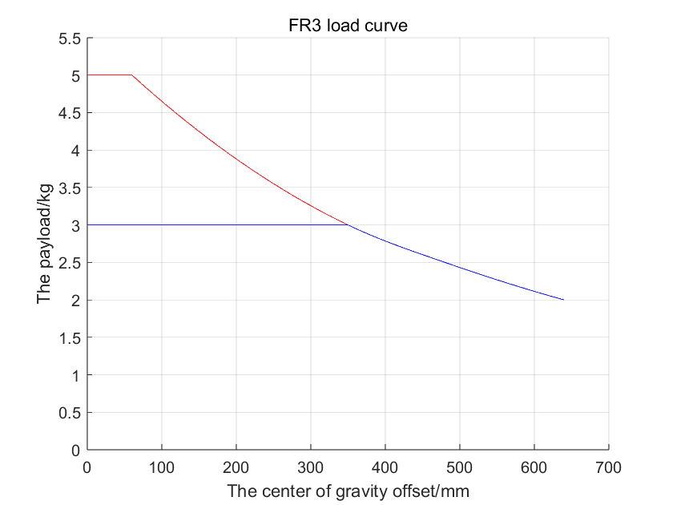

.. centered:: Figura 3.4-15 Curva de carga del robot colaborativo modelo FR3

Curva de carga del robot colaborativo modelo FR3-WMS
**********************************************************

La carga máxima que puede transportar el robot colaborativo modelo FR3 es de 5 kg y la carga nominal es de 3 kg; la curva de carga se muestra en la figura. La explicación concreta de la curva de carga es la siguiente:

(1) El FR3-WMS, con rendimiento completo, puede transportar una carga de 3 kg o inferior, véase la "envolvente azul".
(2) Cuando la carga es de 3 kg a 5 kg, se trata de la capacidad de carga ampliada, véase la "envolvente roja"; en este caso el robot puede funcionar en los siguientes estados:

  ①Activar el "modo de tiempo óptimo"; se recomienda configurar la aceleración por debajo de 360deg/s\ :sup:`2`;

  ②Reducir el rango de trabajo del robot o disminuir la velocidad de funcionamiento.

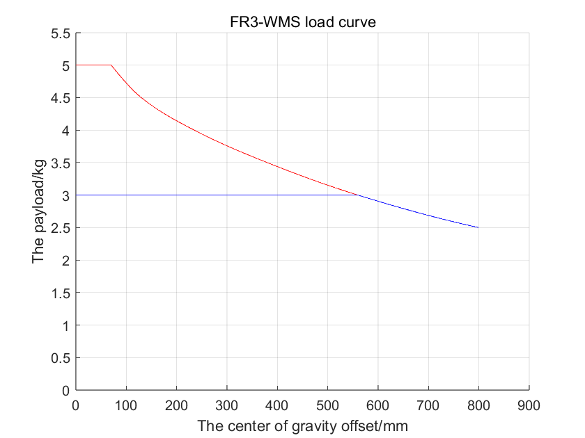

.. centered:: Figura 3.4-16 Curva de carga del robot colaborativo modelo FR3-WMS

Curva de carga del robot colaborativo modelo FR3-WML
**********************************************************

La carga máxima que puede transportar el robot colaborativo modelo FR3-WML es de 4 kg y la carga nominal es de 3 kg; la curva de carga se muestra en la figura. La explicación concreta de la curva de carga es la siguiente:

(1) El FR3-WMS, con rendimiento completo, puede transportar una carga de 3 kg o inferior, véase la "envolvente azul".
(2) Cuando la carga es de 3 kg a 4 kg, se trata de la capacidad de carga ampliada, véase la "envolvente roja"; en este caso el robot puede funcionar en los siguientes estados:

  ①Activar el "modo de tiempo óptimo"; se recomienda configurar la aceleración por debajo de 360deg/s\ :sup:`2`;

  ②Reducir el rango de trabajo del robot o disminuir la velocidad de funcionamiento.

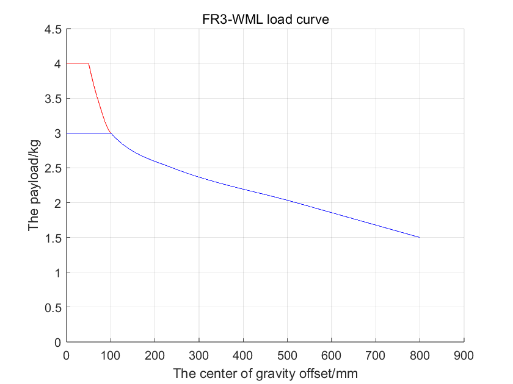

.. centered:: Figura 3.4-17 Curva de carga del robot colaborativo modelo FR3-WML

Curva de carga del robot colaborativo modelo FR3-C
**********************************************************

La carga máxima que puede transportar el robot colaborativo modelo FR3-C es de 5 kg y la carga nominal es de 3 kg; la curva de carga se muestra en la figura. La explicación concreta de la curva de carga es la siguiente:

(1) El FR3-WMS, con rendimiento completo, puede transportar una carga de 3 kg o inferior, véase la "envolvente azul".
(2) Cuando la carga es de 3 kg a 5 kg, se trata de la capacidad de carga ampliada, véase la "envolvente roja"; en este caso el robot puede funcionar en los siguientes estados:

  ①Activar el "modo de tiempo óptimo"; se recomienda configurar la aceleración por debajo de 360deg/s\ :sup:`2`;

  ②Reducir el rango de trabajo del robot o disminuir la velocidad de funcionamiento.

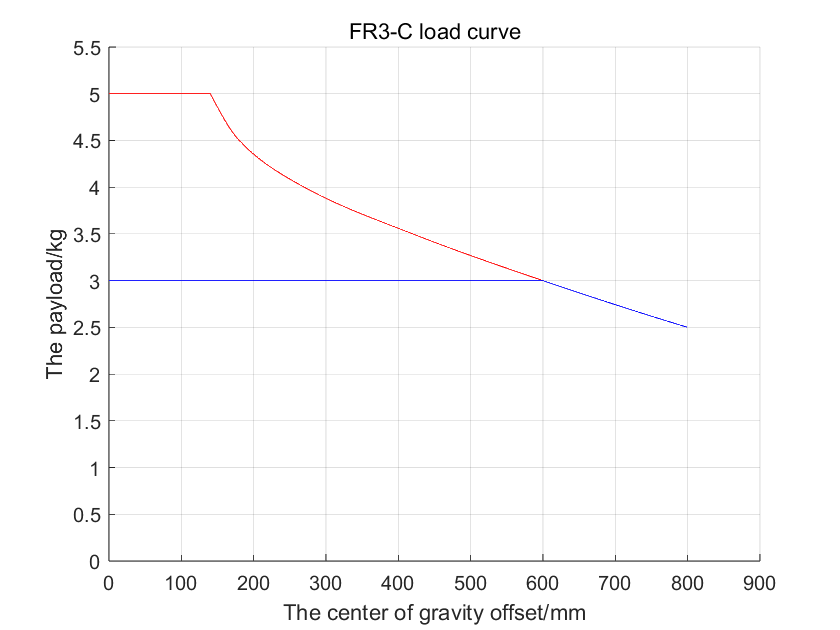

.. centered:: Figura 3.4-18 Curva de carga del robot colaborativo modelo FR3-C

Curva de carga del robot colaborativo modelo FR5
**********************************************************

La carga máxima que puede transportar el robot colaborativo modelo FR5 es de 7 kg y la carga nominal es de 5 kg; la curva de carga se muestra en la figura. La explicación concreta de la curva de carga es la siguiente:

(1) El FR5, con rendimiento completo, puede transportar una carga de 5 kg o inferior, véase la "envolvente azul".
(2) Cuando la carga es de 5 kg a 7 kg, se trata de la capacidad de carga ampliada, véase la "envolvente roja"; en este caso el robot puede funcionar en los siguientes estados:

  ①Activar el "modo de tiempo óptimo"; se recomienda configurar la aceleración por debajo de 360deg/s\ :sup:`2`;

  ②Reducir el rango de trabajo del robot o disminuir la velocidad de funcionamiento.

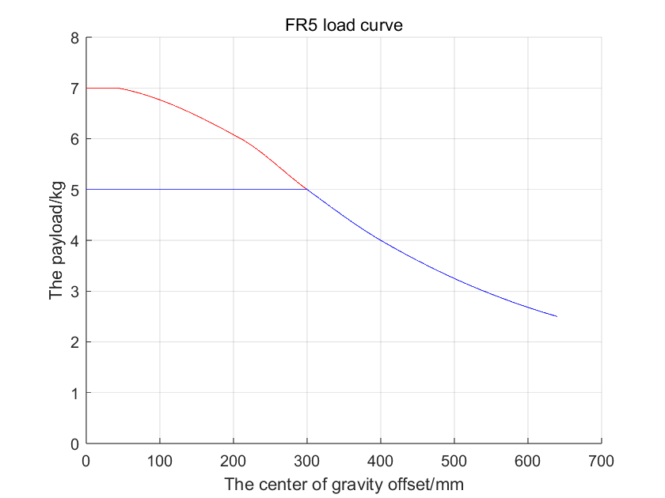

.. centered:: Figura 3.4-19 Curva de carga del robot colaborativo modelo FR5

Curva de carga del robot colaborativo modelo FR5-WML
**********************************************************

La carga máxima que puede transportar el robot colaborativo modelo FR5-WML es de 7 kg y la carga nominal es de 5 kg; la curva de carga se muestra en la figura. La explicación concreta de la curva de carga es la siguiente:

(1) Dentro de la "envolvente azul" se encuentra el rendimiento completo: puede funcionar en la gran mayoría de las trayectorias con el coeficiente de compensación de fricción a 1, dinámica 2.0, velocidad al 100% y aceleración de 360deg/s2 (modo de mantenimiento).
(2) Dentro de la "envolvente roja" se encuentra la capacidad de carga ampliada, pudiendo funcionar en los siguientes estados:

  ①Activar el "modo de tiempo óptimo";

  ②Reducir el rango de trabajo del robot o disminuir la velocidad de funcionamiento.

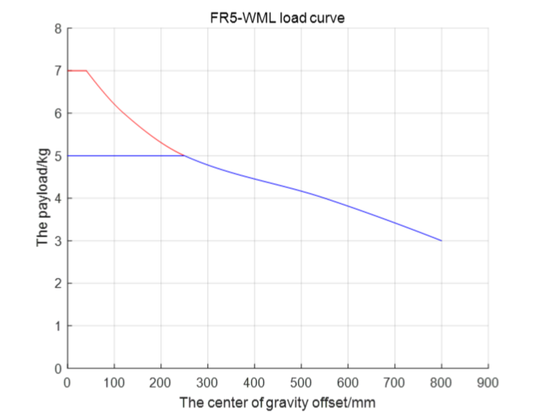

.. centered:: Figura 3.4-20 Curva de carga del robot colaborativo modelo FR5-WML

Curva de carga del robot colaborativo modelo FR5-C
**********************************************************

La carga máxima que puede transportar el robot colaborativo modelo FR5-C es de 5 kg y la carga nominal es de 4 kg; la curva de carga se muestra en la figura y corresponde al "rendimiento completo".

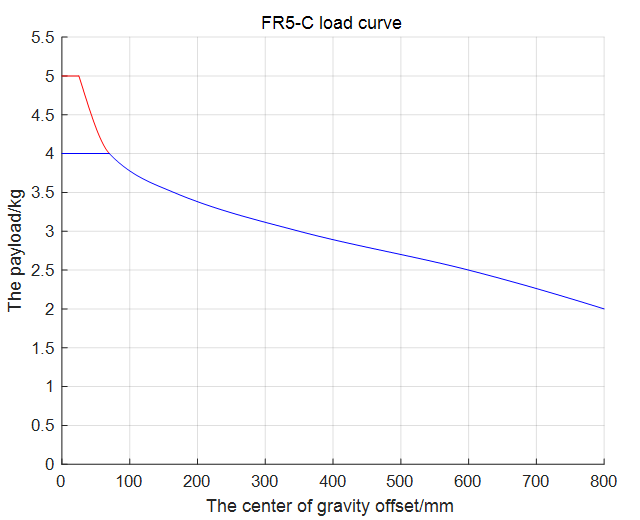

.. centered:: Figura 3.4-21 Curva de carga del robot colaborativo modelo FR5-C

Curva de carga del robot colaborativo modelo FR10
**********************************************************

La carga máxima que puede transportar el robot colaborativo modelo FR10 es de 14 kg y la carga nominal es de 10 kg; la curva de carga se muestra en la Figura 3. La explicación concreta de la curva de carga es la siguiente:

(1) El FR10, con rendimiento completo, puede transportar una carga de 10 kg o inferior, véase la "envolvente azul".
(2) Cuando la carga es de 10 kg a 14 kg, se trata de la capacidad de carga ampliada, véase la "envolvente roja"; en este caso el robot puede funcionar en los siguientes estados:

  ①Activar el "modo de tiempo óptimo"; se recomienda configurar la aceleración por debajo de 180deg/s\ :sup:`2`;

  ②Reducir el rango de trabajo del robot o disminuir la velocidad de funcionamiento.

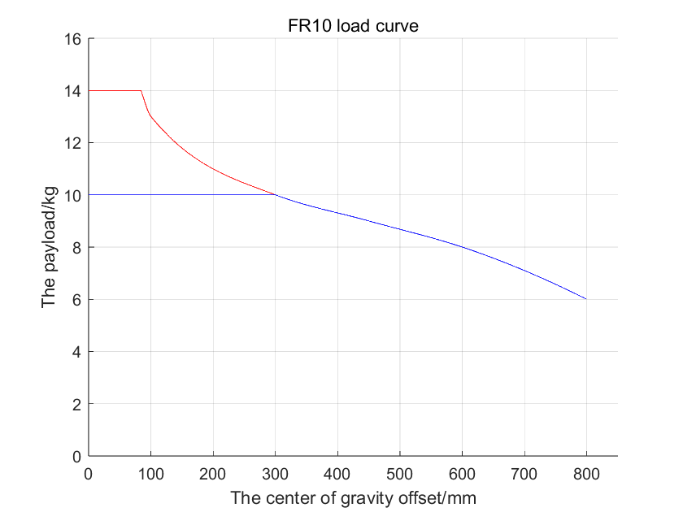

.. centered:: Figura 3.4-22 Curva de carga del robot colaborativo modelo FR10
  
Curva de carga del robot colaborativo modelo FR16
**********************************************************

La carga máxima que puede transportar el robot colaborativo modelo FR16 es de 20 kg y la carga nominal es de 16 kg; la curva de carga se muestra en la figura. La explicación concreta de la curva de carga es la siguiente:

(1) El FR16, con rendimiento completo, puede transportar una carga de 16 kg o inferior, véase la "envolvente azul".
(2) Cuando la carga es de 16 kg a 20 kg, se trata de la capacidad de carga ampliada, véase la "envolvente roja"; en este caso el robot puede funcionar en los siguientes estados:

  ①Activar el "modo de tiempo óptimo"; se recomienda configurar la aceleración por debajo de 180deg/s\ :sup:`2`;

  ②Reducir el rango de trabajo del robot o disminuir la velocidad de funcionamiento.

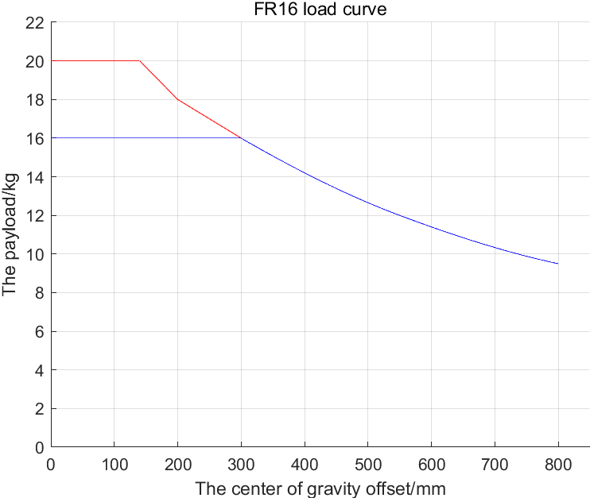

.. centered:: Figura 3.4-23 Curva de carga del robot colaborativo modelo FR16

Curva de carga del robot colaborativo modelo FR20
**********************************************************

La carga máxima que puede transportar el robot colaborativo modelo FR20 es de 25 kg y la carga nominal es de 20 kg; la curva de carga se muestra en la figura. La explicación concreta de la curva de carga es la siguiente:

(1) El FR20, con rendimiento completo, puede transportar una carga de 20 kg o inferior, véase la "envolvente azul".
(2) Cuando la carga es de 20 kg a 25 kg, se trata de la capacidad de carga ampliada, véase la "envolvente roja"; en este caso el robot puede funcionar en los siguientes estados:

  ①Activar el "modo de tiempo óptimo"; se recomienda configurar la aceleración por debajo de 150deg/s\ :sup:`2`;
  
  ②Reducir el rango de trabajo del robot o disminuir la velocidad de funcionamiento.

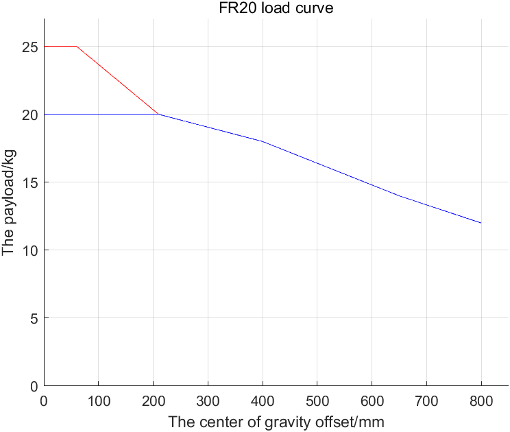

.. centered:: Figura 3.4-24 Curva de carga del robot colaborativo modelo FR20

Curva de carga del robot colaborativo modelo FR30
**********************************************************

La carga máxima que puede transportar el robot colaborativo modelo FR30 es de 35 kg y la carga nominal es de 30 kg; la curva de carga se muestra en la figura.

(1) El FR30, con rendimiento completo, puede transportar una carga de 30 kg o inferior, véase la "envolvente azul".
(2) Cuando la carga es de 30 kg a 35 kg, se trata de la capacidad de carga ampliada, véase la "envolvente roja"; en este caso el robot puede funcionar en los siguientes estados:

  ①Activar el "modo de tiempo óptimo"; se recomienda configurar la aceleración por debajo de 150deg/s\ :sup:`2`;

  ②Reducir el rango de trabajo del robot o disminuir la velocidad de funcionamiento.

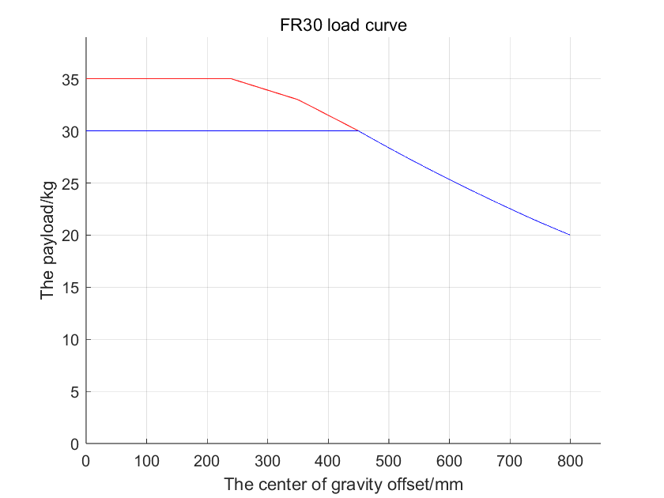

.. centered:: Figura 3.4-25 Curva de carga del robot colaborativo modelo FR30

Conexiones de control
---------------------

Interfaces del controlador
~~~~~~~~~~~~~~~~~~~~~~~~~~

Esta serie de robots puede configurarse con tres cajas de control de distintas entradas de alimentación; para la información de entrada de alimentación de la caja de control, consulte la información de la placa de características de la caja de control. El robot requiere conexión eléctrica a tierra.

.. list-table::
   :widths: 20 40 40
   :header-rows: 0
   :align: center

   * - 
     - **Entrada máxima Input (para que el cliente configure la potencia de alimentación del nivel anterior)**
     - **Salida máxima Output (pico máximo de salida)**

   * - **CC 2kW**
     - 30-60VDC/30A
     - 2000W/48VDC/41A

   * - **CC 5kW**
     - 30-60VDC/40A
     - 5000W/48VDC/104A

   * - **CA tensión estrecha 2kW**
     - 176-264VDC/10A/una unidad/50Hz
     - 2000W/48VDC/41A

   * - **CA tensión amplia 2kW**
     - 100-240VDC/10A/una unidad/50-60Hz
     - 2000W/48VDC/41A

   * - **CA tensión amplia 5kW**
     - 100-240VDC/16A/una unidad/50-60Hz
     - 5000W/48VDC/104A

.. warning:: 
	Antes del cableado, asegúrese de que la alimentación está apagada y coloque junto a ella un cartel de advertencia de seguridad.

Todos los cables externos del sistema de control del manipulador de esta serie se conectan mediante conectores enchufables de instalación rápida. El panel de conexiones del robot colaborativo se muestra en la figura siguiente.

-  Asegúrese de que el botón de alimentación de la caja de control está apagado (botón en 0) antes de conectar el cable de alimentación a la toma de alimentación.

-  Conecte el cable de carga pesada del cuerpo del robot a la interfaz de carga pesada de la caja de control.

-  Conecte el conector de aviación de la caja de botones a la interfaz del teach pendant de la caja de control.

-  Las rejillas de ventilación de ambos lados de la caja de control deben mantener una distancia de separación no inferior a 15 cm.

-  La parte frontal de la caja de control (chapa metálica del usuario, botón de encendido, mazo de carga pesada y del teach pendant) debe mantener una distancia de separación no inferior a 25 cm.

-  La caja de control debe estar a una altura de 0.6-1.5 m del suelo.

-  No se permite al usuario sustituir por su cuenta los cables de alimentación.

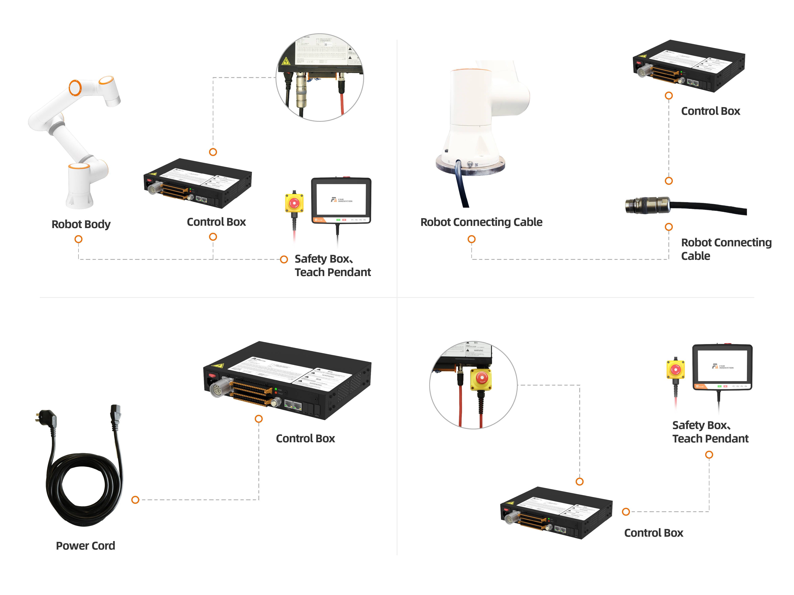

.. centered:: Figura 3.5-1 Esquema de conexión del robot

Panel de I/O del controlador
~~~~~~~~~~~~~~~~~~~~~~~~~~~~

Puede utilizar las I/O del interior de la caja de control para controlar diversos dispositivos, incluidos relés neumáticos, PLC y botones de límite de fin de carrera. La Figura 3.5-2 muestra el grupo de interfaces eléctricas de la caja de control, y la Figura 3.5-3 muestra el grupo de interfaces eléctricas de la caja de control mini integrada (mini BOX).

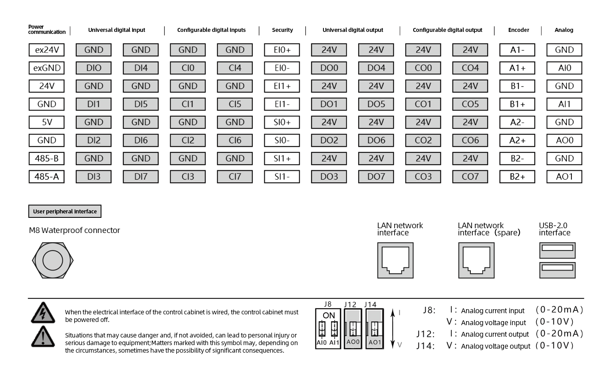

.. centered:: Figura 3.5-2 Esquema de las interfaces eléctricas de la caja de control

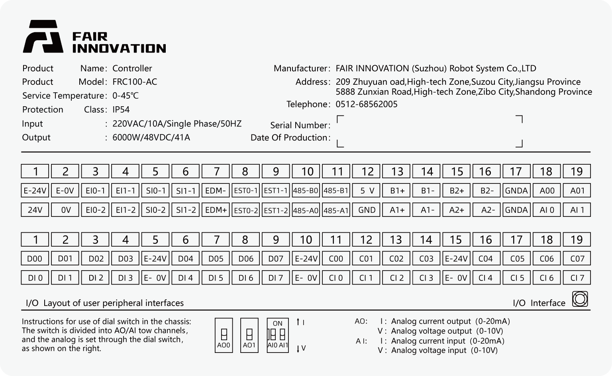

.. centered:: Figura 3.5-3 Esquema de las interfaces eléctricas de la caja de control mini integrada (mini BOX)

Grupo de interfaces de red RJ45
~~~~~~~~~~~~~~~~~~~~~~~~~~~~~~~

La dirección del grupo de interfaces de red del interior de la caja de control se muestra en la figura siguiente; tenga en cuenta que esta figura corresponde al orden de las direcciones de los puertos de red del interior de la caja de control; está prohibido enchufar o desenchufar el puerto predeterminado del robot. El puerto de red de usuario puede utilizarse para comunicarse con dispositivos como cámaras; su dirección IP es 192.168.57.2. El puerto de la caja de botones es por defecto el puerto de control del teach pendant, con dirección IP 192.168.58.2; utilice un cable de red para conectar el puerto de la caja de botones con el ordenador, configure la dirección IP del ordenador como 192.168.58.10 o en el mismo segmento de red, abra el navegador Chrome e introduzca 192.168.58.2 para acceder a la página del teach pendant. La caja de control de fabricación fácil accede a la página del teach pendant a través del puerto de red conectado a la caja de botones.

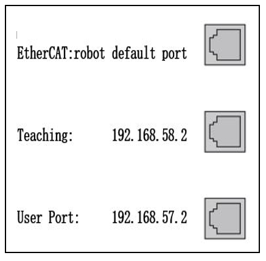

.. centered:: Figura 3.5-4 Esquema del grupo de interfaces de red

Placa del extremo
~~~~~~~~~~~~~~~~~

Puede utilizar las I/O y la interfaz de comunicación 485 de la placa del extremo para controlar diversos dispositivos, incluidos relés neumáticos, PLC y botones de parada de emergencia. La distribución de pines y la descripción de los pines se muestran en la figura siguiente. El modelo del conector de I/O es un conector M12 hembra de 8 pines.

.. note:: Está prohibido el conexionado en caliente de las I/O y de la interfaz 485 de la placa del extremo.

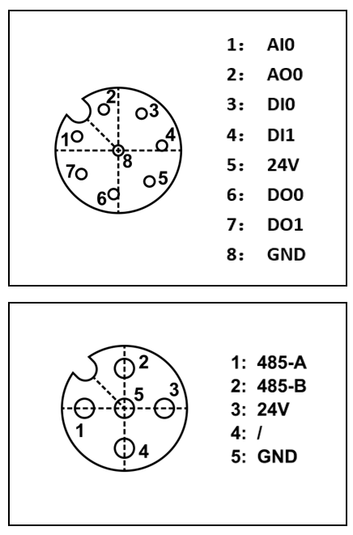

.. centered:: Figura 3.5-5 Esquema de las interfaces eléctricas de la placa del extremo

Descripción de la puesta a tierra
~~~~~~~~~~~~~~~~~~~~~~~~~~~~~~~~~

1. La toma de tierra de la caja de control se encuentra en el tornillo combinado M4 situado en la parte superior izquierda del interruptor de alimentación, como se muestra en la figura siguiente.

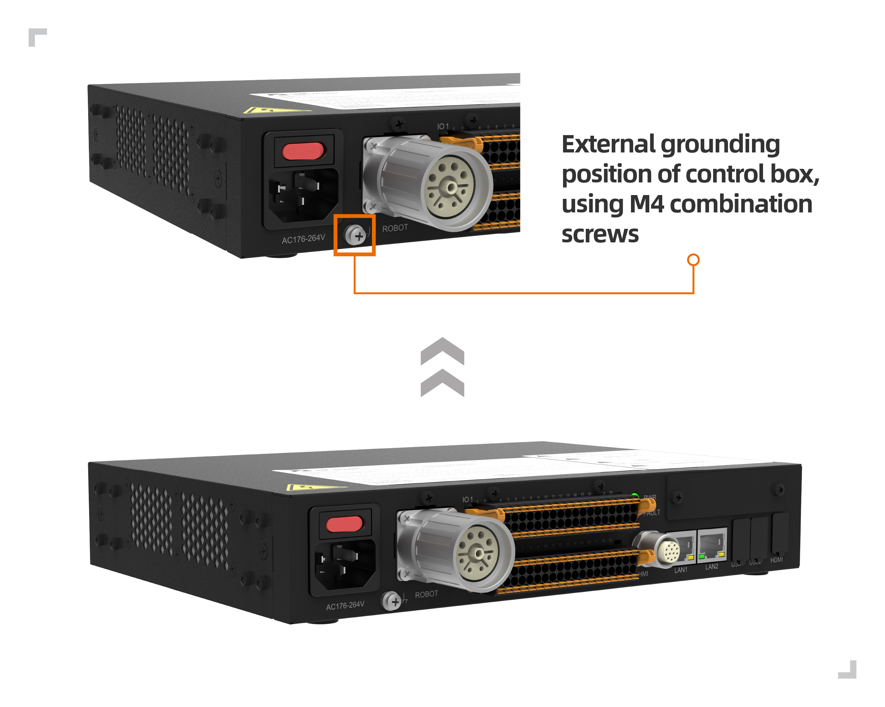

.. centered:: Figura 3.5-6 Esquema de puesta a tierra de la caja de control

1. La toma de tierra del cuerpo se encuentra en la posición derecha de la salida de cables de la base, como se muestra en la figura siguiente.

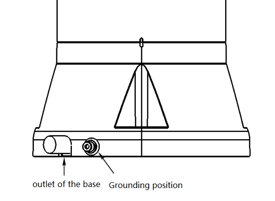

.. centered:: Figura 3.5-7 Esquema de puesta a tierra del cuerpo

El conductor de protección utilizado de forma independiente no debe tener una sección inferior a:

- 2.5mm\ :sup:`2` de cobre o 16mm\ :sup:`2` de aluminio, si se proporciona protección contra daños mecánicos (tubo de cables, conducto, etc.)
- 4mm\ :sup:`2` de cobre o 16mm\ :sup:`2` de aluminio, si no se proporciona protección contra daños mecánicos

Especificaciones generales de todas las I/O digitales
~~~~~~~~~~~~~~~~~~~~~~~~~~~~~~~~~~~~~~~~~~~~~~~~~~~~~~

Esta sección establece las especificaciones eléctricas de las siguientes entradas/salidas digitales de 24 voltios de la caja de control:

-  I/O de seguridad

-  I/O digitales generales

El robot debe instalarse conforme a las especificaciones eléctricas.

Mediante la configuración de la interfaz "comunicación de alimentación" se puede utilizar una fuente de alimentación de 24V interna o externa para alimentar las I/O digitales. En esta interfaz, los dos terminales superiores (ex24V y exon) son los 24V y la tierra de la alimentación externa, y los dos terminales inferiores (24V y GND) son los 24V y la tierra de la alimentación interna. La configuración predeterminada es utilizar la alimentación interna; la caja de control y la caja de control mini integrada (mini BOX) se muestran en la figura siguiente.

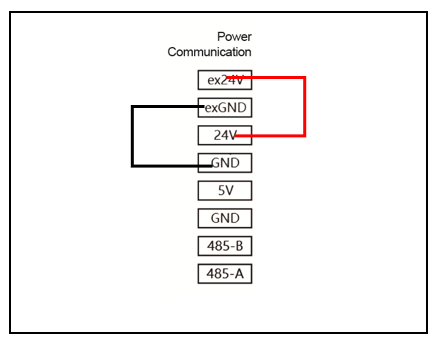

.. centered:: Caja de control

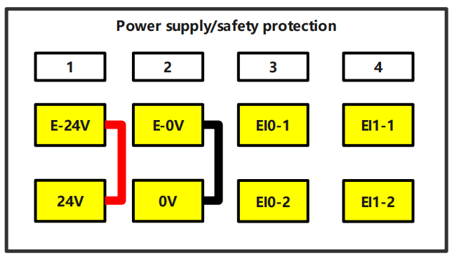

.. centered:: Caja de control mini integrada (mini BOX)
.. centered:: Figura 3.5-8 Esquema de comunicación de alimentación 01

Si la potencia de la carga es grande, se puede conectar la alimentación externa como se muestra en la figura siguiente. En la caja de control mini integrada de tensión amplia de CA (mini BOX), la alimentación externa y la alimentación interna comparten la conexión de 0V.

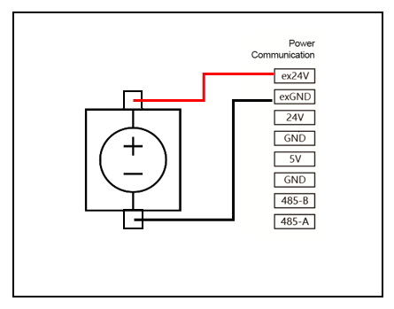

.. centered:: Caja de control

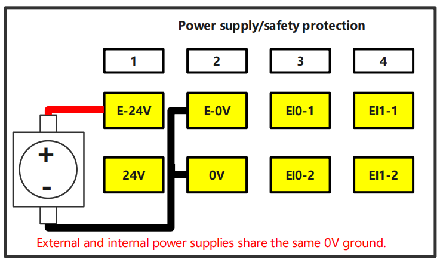

.. centered:: Caja de control mini integrada (mini BOX)
.. centered:: Figura 3.5-9 Esquema de comunicación de alimentación 02

Las especificaciones eléctricas de la alimentación interna y externa se muestran en la tabla siguiente:

.. centered:: Tabla 3.5-1 Especificaciones eléctricas de la alimentación interna y externa
.. list-table::
   :widths: 30 20 10 10 10 10
   :header-rows: 0
   :align: center

   * - **Terminal**
     - **Parámetro**
     - **Valor mínimo**
     - **Valor típico**
     - **Valor máximo**
     - **Unidad**

   * - | Alimentación interna de 24V
       | [ex24V -exGND]
       | [ex24V -exGND]
     - | 
       | Tensión
       | Corriente
     - | 
       | 23
       | 0
     - | 
       | 24
       | -
     - | 
       | 25
       | 2
     - | 
       | V
       | A

   * - | Alimentación interna de 24V
       | [24V- GND]
       | [24V- GND]
     - | 
       | Tensión
       | Corriente
     - | 
       | 23
       | 0
     - | 
       | 24
       | -
     - | 
       | 25
       | 1.5
     - | 
       | V
       | A

Las especificaciones eléctricas de las I/O digitales se muestran en la tabla siguiente:

.. centered:: Tabla 3.5‑2 Especificaciones eléctricas de las I/O digitales
.. list-table::
   :widths: 30 20 10 10 10 10
   :header-rows: 0
   :align: center

   * - **Terminal**
     - **Parámetro**
     - **Valor mínimo**
     - **Valor típico**
     - **Valor máximo**
     - **Unidad**

   * - | Salida digital
       | [COx/DOx]
       | [COx/DOx]
       | [COx/DOx]
     - | 
       | Corriente
       | Caída de tensión
       | Corriente de fuga
     - | 
       | 0
       | 0
       | 0
     - | 
       | -
       | -
       | -
     - | 
       | 1
       | 0.5
       | 0.1
     - | 
       | A
       | V
       | mA

   * - [COx/DOx]
     - Función
     - | -
     - NPN
     - | -
     - Type

   * - | Entrada digital
       | [EIx/SIx/CIx/DIx]
       | [EIx/SIx/CIx/DIx]
       | [EIx/SIx/CIx/DIx]
     - | 
       | OFF
       | ON
       | Corriente (11~30A)
     - | 
       | -3
       | 11
       | 2
     - | 
       | -
       | -
       | -
     - | 
       | 5
       | 30
       | 15
     - | 
       | V
       | V
       | mA

   * - [EIx/SIx/CIx/DIx]
     - Función
     - | -
     - NPN
     - | -
     - Type

Las especificaciones eléctricas de la carga de las DO digitales se muestran en la tabla siguiente:

.. centered:: Tabla 3.5-3 Especificaciones eléctricas de la carga de un solo canal de DO digital

.. list-table::
   :widths: 30 20 20 30
   :header-rows: 0
   :align: center

   * - **Tipo de caja de control** 
     - **Tipo de salida DO**
     - **Tipo de alimentación**
     - **Valor máximo de carga de un solo canal de DO**

   * - Caja de control de CC/CA de tensión estrecha
     - Salida tipo NPN
     - Alimentación externa de 24V
     - | Canales 1-4: 400mA
       | Canales 5-8: 250mA
       | Canales 9-16: 125mA

   * - Caja de control de CC/CA de tensión estrecha
     - Salida tipo NPN
     - Alimentación interna de 24V
     - | Canales 1-4: 300mA
       | Canales 5-8: 190mA
       | Canales 9-16: 90mA

   * - Caja de control de CA de tensión amplia
     - Salida tipo NPN/PNP
     - Alimentación externa de 24V
     - | Canales 1-2: 200mA
       | Canales 3-8: 100mA
       | Canales 9-16: 60mA

   * - Caja de control de CA de tensión amplia
     - Salida tipo NPN/PNP
     - Alimentación interna de 24V
     - | Canales 1-2: 200mA
       | Canales 3-8: 100mA
       | Canales 9-16: 60mA

I/O de seguridad
~~~~~~~~~~~~~~~~

Esta sección describe las especificaciones eléctricas de las I/O de seguridad; deben cumplirse las especificaciones eléctricas generales de la sección 3.5.6.

Los dispositivos y equipos de seguridad deben instalarse conforme a las instrucciones de seguridad y a la evaluación de riesgos; véase la sección 3.1. Todas las I/O de seguridad están emparejadas (redundantes) y deben conservarse como dos ramas independientes. Un solo fallo no debe provocar la pérdida de la función de seguridad.

Las I/O de seguridad incluyen la parada de emergencia y la parada de seguridad. La entrada de parada de emergencia se utiliza exclusivamente para dispositivos de parada de emergencia, y la entrada de parada de seguridad se utiliza para diversos dispositivos de protección relacionados con la seguridad. Las diferencias funcionales se muestran en la tabla siguiente:

.. centered:: Tabla 3.5-3 Diferencias funcionales
.. list-table::
   :widths: 50 80 80
   :header-rows: 0
   :align: center

   * - 
     - **Parada de emergencia**
     - **Parada de seguridad**

   * - **El robot detiene el movimiento**
     - Sí
     - Sí

   * - **Categoría de parada**
     - Categoría 0
     - Categoría 1

   * - **Ejecución del programa P**
     - Detener
     - Pausar

   * - **Alimentación del robot**
     - Apagar
     - Encender

   * - **Reinicio**
     - Manual
     - Automático o manual

   * - **Frecuencia de uso**
     - Poco frecuente
     - Frecuente

   * - **Requiere reinicialización**
     - Sí
     - No

.. warning:: 
	- No conecte nunca señales de seguridad a PLC que no dispongan del nivel de seguridad correcto. Si no se cumple esta advertencia, pueden producirse lesiones graves o la muerte, ya que una de las funciones de parada de seguridad podría quedar anulada. Las señales de la interfaz de seguridad deben mantenerse separadas de las señales de la interfaz de I/O normal.
	- Todas las I/O relacionadas con la seguridad están construidas de forma redundante (dos canales independientes). Los dos canales deben mantenerse separados, de modo que un solo fallo no provoque la pérdida de la función de seguridad.
	- Antes de poner el robot en funcionamiento, debe verificarse la función de seguridad de la parada de emergencia (robot encendido y habilitado, pulsar el botón de parada de emergencia, el robot se apaga y se detiene, apagar la alimentación, girar el botón de parada de emergencia, encender la alimentación, el robot se vuelve a encender y habilitar). Las funciones de seguridad deben probarse periódicamente.
	- La instalación del robot debe cumplir estas especificaciones. De lo contrario, pueden producirse lesiones graves o la muerte, ya que la función de parada de seguridad podría quedar anulada.

Los siguientes subapartados ofrecen algunos ejemplos de cómo utilizar las I/O de seguridad.

**Configuración de seguridad predeterminada**
El robot se suministra de fábrica con una configuración predeterminada que permite operarlo sin necesidad de ningún equipo de seguridad adicional; consulte la figura siguiente:

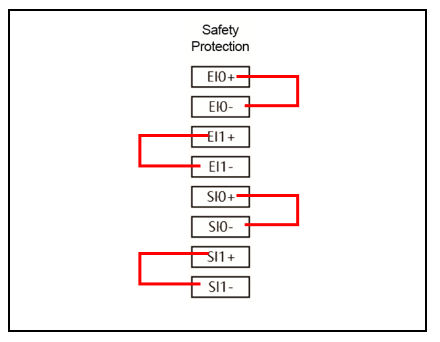

.. centered:: Caja de control

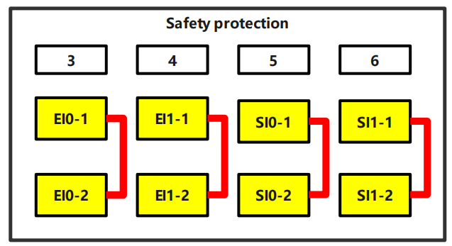

.. centered:: Caja de control mini integrada (mini BOX)
.. centered:: Figura 3.5-10 Esquema de protección de seguridad 01

**Conexión de botones de parada de emergencia**
En la mayoría de las aplicaciones es necesario utilizar uno o varios botones de parada de emergencia adicionales; consulte la figura siguiente:

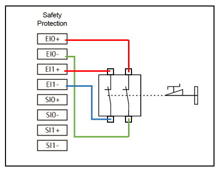

.. centered:: Caja de control
  
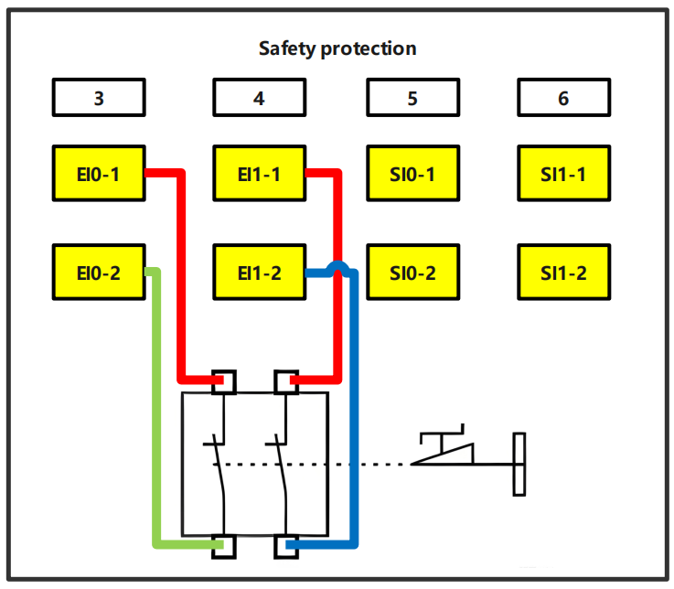

.. centered:: Caja de control mini integrada (mini BOX)
.. centered:: Figura 3.5-11 Esquema de protección de seguridad 02

**Conexión de botones de parada de seguridad**
Un ejemplo de dispositivo de parada de seguridad es un interruptor de puerta que detiene el robot cuando la puerta se abre; consulte la figura siguiente:

.. centered:: Caja de control
  

.. centered:: Caja de control mini integrada (mini BOX)
.. centered:: Figura 3.5-12 Esquema de protección de seguridad 03

I/O digitales generales
~~~~~~~~~~~~~~~~~~~~~~~

Esta sección describe las especificaciones eléctricas de las I/O digitales generales; deben cumplirse las especificaciones eléctricas generales de la sección 3.5.6.

Las I/O digitales generales pueden utilizarse para accionar dispositivos como relés y electroválvulas, o para interactuar con otros PLC.

**Control de carga mediante salida digital**

Este ejemplo muestra cómo conectar una salida digital para controlar una carga; consulte la figura siguiente:

.. centered:: Caja de control
  

.. centered:: Caja de control mini integrada (mini BOX)
.. centered:: Figura 3.5-13 Esquema de salida digital general 01

Entrada digital desde botón
~~~~~~~~~~~~~~~~~~~~~~~~~~~

El ejemplo siguiente muestra cómo conectar un botón simple a una entrada digital.

.. centered:: Caja de control
  

.. centered:: Caja de control mini integrada (mini BOX)
.. centered:: Figura 3.5-14 Esquema de salida digital general 02

Interacción con otros dispositivos o PLC
~~~~~~~~~~~~~~~~~~~~~~~~~~~~~~~~~~~~~~~~

El ejemplo siguiente muestra cómo interactuar con otros dispositivos o PLC mediante entradas y salidas digitales.

.. centered:: Caja de control
  

.. centered:: Caja de control mini integrada (mini BOX)
.. centered:: Figura 3.5-15 Esquema de interacción con otros dispositivos o PLC

I/O analógicas
~~~~~~~~~~~~~~

.. centered:: Tabla 3.5-4 Corriente y tensión analógicas
.. list-table::
   :widths: 30 20 10 10 10 10
   :header-rows: 0
   :align: center

   * - **Terminal**
     - **Parámetro**
     - **Valor mínimo**
     - **Valor típico**
     - **Valor máximo**
     - **Unidad**

   * - | Entrada de corriente analógica
       | [AIx-END]
       | [AIx-END]
       | [AIx-END]
     - | 
       | Corriente
       | Impedancia
       | Resolución
     - | 
       | 0
       | -
       | -
     - | 
       | -
       | 500
       | 12
     - | 
       | 20
       | -
       | -
     - | 
       | mA
       | ohm
       | bit

   * - | Entrada de tensión analógica
       | [AIx-END]
       | [AIx-END]
       | [AIx-END]
     - | 
       | Tensión
       | Impedancia
       | Resolución
     - | 
       | 0
       | -
       | -
     - | 
       | -
       | 510
       | 12
     - | 
       | 10
       | -
       | -
     - | 
       | V
       | Kohm
       | bit

   * - | Salida de corriente analógica
       | [AOx-END]
       | [AOx-END]
       | [AOx-END]
     - | 
       | Corriente
       | Tensión
       | Resolución
     - | 
       | 0
       | 0
       | -
     - | 
       | -
       | -
       | 12
     - | 
       | 20
       | 10
       | -
     - | 
       | mA
       | V
       | bit

   * - | Salida de tensión analógica
       | [AOx-END]
       | [AOx-END]
       | [AOx-END]
       | [AOx-END]
     - | 
       | Tensión
       | Corriente
       | Impedancia
       | Resolución
     - | 
       | 0
       | 0
       | -
       | -
     - | 
       | -
       | -
       | 100
       | 12
     - | 
       | 10
       | 20
       | -
       | -
     - | 
       | V
       | mA
       | ohm
       | bit

Las I/O analógicas se utilizan para establecer o medir la tensión (0-10V) o la corriente (0-20mA) de otros dispositivos.

Para lograr una alta precisión, se recomienda adoptar los siguientes métodos.

-  El dispositivo y la caja de control utilizan la misma tierra (GND).

-  Utilizar cables apantallados o par trenzado.

El ejemplo siguiente muestra cómo utilizar las I/O analógicas.

**Uso de la salida analógica**

El ejemplo siguiente muestra el uso de una salida analógica para controlar una cinta transportadora.

.. centered:: Caja de control
  

.. centered:: Caja de control mini integrada (mini BOX)
.. centered:: Figura 3.5-16 Esquema de salida analógica

**Uso de la entrada analógica**

El ejemplo siguiente muestra el uso de una entrada analógica para conectar un sensor analógico.

.. centered:: Caja de control
  

.. centered:: Caja de control mini integrada (mini BOX)
.. centered:: Figura 3.5-17 Esquema de entrada analógica

Módulos opcionales FR3MT y 3C
~~~~~~~~~~~~~~~~~~~~~~~~~~~~~~~~~~~~~~~~~

Prefacio
+++++++++++++++++++++++++

La definición del robot colaborativo sigue las normas internacionales ISO y las disposiciones pertinentes de las normas nacionales para proteger la seguridad de los operadores; no recomendamos aplicar directamente el cuerpo del robot en situaciones en las que el objeto de trabajo sean personas. Sin embargo, cuando el usuario de la aplicación o el desarrollador de la aplicación realmente necesite que el objeto de trabajo del robot sean personas, deberá, bajo la premisa de una evaluación suficiente por parte del usuario o desarrollador de la aplicación y de la garantía de la seguridad del personal, configurar para el cuerpo del robot un sistema de protección de seguridad fiable, suficientemente probado y certificado, para proteger la seguridad del personal.

Avisos de seguridad
***************************

Este manual solo debe utilizarse como manual de orientación para la certificación de seguridad del cliente; el personal de mantenimiento debe poseer capacidad profesional; FAIRINO declina toda responsabilidad por operaciones realizadas por personal no profesional.

.. important:: Si el robot (cuerpo del robot, módulo de alimentación, módulo de expansión) se daña, altera o modifica por causas humanas, FAIRINO declina toda responsabilidad; FAIRINO no se hace responsable de ningún daño causado al robot o a cualquier otro equipo debido a errores en los programas escritos por el cliente.

Validez y responsabilidad
***************************

La información de este manual no incluye el diseño, la instalación y la operación de una aplicación completa de robot, ni incluye todos los equipos periféricos que puedan afectar a la seguridad de este sistema completo. El diseño y la instalación de este sistema completo deben cumplir los requisitos de seguridad establecidos en las normas y reglamentos del país donde se instala el robot.

El integrador de FAIRINO tiene la responsabilidad de garantizar el cumplimiento de las leyes y reglamentos de los países correspondientes y de garantizar que en la aplicación completa del robot no exista ningún peligro importante. Esto incluye, entre otros, los siguientes aspectos:

- Realizar una evaluación de riesgos de todo el sistema de robot
- Conectar entre sí otros equipos mecánicos y equipos de seguridad adicionales definidos en la evaluación de riesgos
- Establecer en el software la configuración de seguridad adecuada
- Garantizar que el usuario no modifique ninguna medida de seguridad
- Confirmar que el diseño y la instalación de todo el sistema de robot son correctos
- Definir claramente las instrucciones de uso
- Indicar en el robot la marca y la información de contacto correspondientes del integrador
- Recopilar toda la documentación de los archivos técnicos, incluido este manual

Responsabilidad limitada
***************************

Ninguna información de seguridad contenida en este manual debe considerarse como una garantía general de seguridad del robot; incluso cumpliendo todas las instrucciones de seguridad, todavía es posible que se produzcan daños personales o daños al equipo.

Símbolos de advertencia de seguridad
*************************************************

En el producto se utilizan los siguientes símbolos de advertencia de seguridad.

.. important:: 
	.. figure:: installation/008.png
		:width: 60
		:height: 50
		:align: left

	Nombre: **Peligro**
   
	Función: se refiere a una situación eléctrica que está a punto de provocar peligro y que, si no se evita, puede causar la muerte o lesiones graves.

.. important:: 
	.. figure:: installation/009.png
		:width: 60
		:height: 50
		:align: left

	Nombre: **Peligro de descarga eléctrica**
   
	Función: se refiere a una situación de descarga eléctrica que está a punto de provocar peligro y que, si no se evita, puede causar la muerte por descarga eléctrica o lesiones graves.

.. important:: 
	.. figure:: installation/010.png
		:width: 60
		:height: 50
		:align: left

	Nombre: **Peligro de quemadura**
   
	Función: se refiere a una superficie caliente que puede provocar peligro y que, si se toca sin evitarlo, puede causar daños personales.

.. important:: 
	.. figure:: installation/112.png
		:width: 60
		:height: 50
		:align: left

	Nombre: **Puesta a tierra**
   
	Función: indica que el equipo requiere una puesta a tierra fiable.
	                                           
Definición de las interfaces de la base y de los módulos FR3MT y 3C
++++++++++++++++++++++++++++++++++++++++++++++++++++++++++++++++++++

Definición de las interfaces de la base
*************************************************

La parte de la base del cuerpo dispone en total de 7 botones e interfaces hacia el exterior, cuya definición es la siguiente:

.. centered:: Figura 3.5-18 Botones e interfaces de la parte de la base del cuerpo

.. note:: Las vistas de la definición de pines de las interfaces de la base corresponden todas a la perspectiva del plano de referencia de instalación.

**1. Botón de encendido/apagado del controlador**: por defecto se enciende automáticamente al aplicar alimentación.

**2. Definición de pines de la interfaz M8 tipo A de 4P hembra**:
Puerto de red de usuario. Dirección 192.168.57.2. Conector: M8 tipo A de 4P hembra [el extremo de conexión utiliza M8 tipo A de 4P macho]; el conector cumple la norma IEC 61076-2-101.

.. list-table::
   :widths: 20 30 50
   :header-rows: 0
   :align: center

   * - **Pin**
     - **Definición**
     - **Descripción**

   * - 1
     - TX+
     - Transmisión de datos positiva

   * - 2
     - RX+
     - Recepción de datos positiva

   * - 3
     - RX-
     - Recepción de datos negativa

   * - 4
     - TX-
     - Transmisión de datos negativa

**3. Definición de pines de la interfaz M12 tipo L de 5P macho**:
Conector: M12 tipo L de 5P macho [el extremo de conexión utiliza M12 tipo L de 5P hembra]; el conector cumple la norma IEC 61076-2-101.

.. list-table::
   :widths: 10 15 15 20 40 
   :header-rows: 0
   :align: center

   * - **Pin**
     - **Color**
     - **Definición**
     - **Descripción**
     - **Observaciones**

   * - 1
     - Negro 1
     - 0V
     - Negativo de la alimentación de control
     - Negativo de la alimentación de control del robot [alimentación de la caja de control de reserva, no es necesario conectar]

   * - 2
     - Marrón 2
     - 24V
     - Positivo de la alimentación de control
     - Positivo de la alimentación de control del robot [alimentación de la caja de control de reserva, no es necesario conectar]

   * - 3
     - Blanco 3
     - 48V
     - Positivo de la alimentación de potencia
     - Positivo de la alimentación de potencia del robot

   * - 4
     - Azul 4
     - 0V
     - Negativo de la alimentación de potencia
     - Negativo de la alimentación de potencia del robot

   * - 5
     - Gris 5
     - PE
     - Puesta a tierra
     - Puesta a tierra de seguridad
  
.. note:: 
  ①En el interior de la base se diseña una alimentación de control de 48V a 24V.

  ②La alimentación de 48V a 24V del interior de la base se utiliza como alimentación de respaldo de la alimentación de 24V de entrada del puerto de alimentación.

.. centered:: Figura 3.5-19 Esquema de la alimentación de 48V a 24V del interior de la base

**4. Definición de pines de la interfaz M12 tipo A de 12P hembra**:
Conector: M12 tipo A de 12P hembra [el extremo de conexión utiliza M12 tipo A de 12P macho]; el conector cumple la norma IEC 61076-2-101.

.. list-table::
   :widths: 10 15 20 40 
   :header-rows: 0
   :align: center

   * - **Pin**
     - **Definición**
     - **Descripción**
     - **Observaciones**

   * - 1
     - AGND
     - Tierra analógica
     - Tierra de referencia analógica

   * - 2
     - 0V
     - Negativo de la alimentación de 24V
     - Negativo de la alimentación de control

   * - 3
     - 485-A
     - Comunicación 485 A
     - Comunicación 485 para expansión de reserva

   * - 4
     - 485-B
     - Comunicación 485 B
     - Comunicación 485 para expansión de reserva

   * - 5
     - DI0/DO0
     - Entrada/salida digital 0
     - 5, 6 y 7 son la misma interfaz; mediante el programa pueden configurarse como entrada o salida, eligiéndose una de las dos en cada momento

   * - 6
     - DI1/DO1
     - Entrada/salida digital 1
     - 5, 6 y 7 son la misma interfaz; mediante el programa pueden configurarse como entrada o salida, eligiéndose una de las dos en cada momento

   * - 7
     - DI2/DO2
     - Entrada/salida digital 2
     - 5, 6 y 7 son la misma interfaz; mediante el programa pueden configurarse como entrada o salida, eligiéndose una de las dos en cada momento

   * - 8
     - AI0/AO0
     - Entrada/salida analógica 0
     - 8 y 9 son la misma interfaz; mediante el programa pueden configurarse como entrada o salida, eligiéndose una de las dos en cada momento

   * - 9
     - AI1/AO1
     - Entrada/salida analógica 1
     - 8 y 9 son la misma interfaz; mediante el programa pueden configurarse como entrada o salida, eligiéndose una de las dos en cada momento

   * - 10
     - 24V
     - Positivo de la alimentación de 24V
     - Positivo de la alimentación de control

   * - 11
     - DI3/DO3
     - Entrada/salida digital 3
     - 11 y 12 son la misma interfaz; mediante el programa pueden configurarse como entrada o salida, eligiéndose una de las dos en cada momento

   * - 12
     - DI4/DO4
     - Entrada/salida digital 4
     - 11 y 12 son la misma interfaz; mediante el programa pueden configurarse como entrada o salida, eligiéndose una de las dos en cada momento

**5. Definición de pines de la interfaz M8 tipo A de 4P hembra**:
Puerto de red de depuración. Dirección 192.168.58.2. Conector: M8 tipo A de 4P hembra [el extremo de conexión utiliza M8 tipo A de 4P macho]; el conector cumple la norma IEC 61076-2-101.

.. list-table::
   :widths: 20 30 50
   :header-rows: 0
   :align: center

   * - **Pin**
     - **Definición**
     - **Descripción**

   * - 1
     - TX+
     - Transmisión de datos positiva

   * - 2
     - RX+
     - Recepción de datos positiva

   * - 3
     - RX-
     - Recepción de datos negativa

   * - 4
     - TX-
     - Transmisión de datos negativa

6. Interfaz USB tipo A, USB2.0 - uso interno de depuración.

7. Interfaz HDMI tipo A, visualización HDMI - uso interno de depuración.

Definición de las interfaces del módulo de alimentación
*****************************************************************

La alimentación utiliza el modelo Mean Well NDR-480-48. La definición de las interfaces es la siguiente:

.. list-table::
   :widths: 20 20 20 40
   :header-rows: 0
   :align: center

   * - **Pin**
     - **Definición**
     - **Descripción**
     - **Observaciones**

   * - 1
     - L
     - Fase
     - Entrada 100-240V AC

   * - 2
     - N
     - Neutro
     - Entrada 100-240V AC

   * - 3
     - PE
     - Toma de tierra
     - Punto de puesta a tierra

   * - 4
     - +V
     - 48V
     - Salida 48V/10A

   * - 5
     - +V
     - 48V
     - Salida 48V/10A

   * - 6
     - -V
     - 0V
     - Salida 48V/10A

   * - 7
     - -V
     - 0V
     - Salida 48V/10A

Definición de las interfaces del módulo de expansión
******************************************************

El módulo de expansión dispone de función de parada de emergencia y función de disipación de energía. Los terminales externos y el diagrama de topología interna del módulo de expansión son los siguientes:

.. list-table::
   :widths: 20 30 50
   :header-rows: 0
   :align: center

   * - **Pin**
     - **Definición**
     - **Descripción**

   * - 1
     - 48-IN
     - Positivo de entrada de 48V

   * - 2
     - 0V
     - Negativo de entrada de 48V

   * - 3
     - PE
     - Toma de tierra

   * - 4
     - PE
     - Toma de tierra

   * - 5
     - 24V
     - Positivo de la alimentación de control

   * - 6
     - 0V
     - Negativo de la alimentación de control

   * - 7
     - 0V
     - Negativo de la alimentación de potencia

   * - 8
     - 48-OUT
     - Positivo de la alimentación de potencia

   * - 9
     - ESW1
     - Positivo del botón de parada de emergencia 1

   * - 10
     - 0V
     - Negativo del botón de parada de emergencia 1

   * - 11
     - ESW2
     - Positivo del botón de parada de emergencia 2

   * - 12
     - 0V
     - Negativo del botón de parada de emergencia 2

   * - 13
     - E-O-2
     - Contacto normalmente abierto sin tensión 2

   * - 14
     - E-O-1
     - Contacto normalmente abierto sin tensión 1

   * - 15
     - E-C-2
     - Contacto normalmente cerrado sin tensión 2

   * - 16
     - E-C-1
     - Contacto normalmente cerrado sin tensión 1

Escenarios de aplicación de FR3MT y 3C
++++++++++++++++++++++++++++++++++++++++++++++++++++

En la mayoría de los escenarios de uso, al usuario le basta con seleccionar el mazo de cables de usuario. Los escenarios de uso concretos son los siguientes:

.. list-table::
   :widths: 10 15 15 20 40 
   :header-rows: 0
   :align: center

   * - **Número**
     - **Categoría de escenario**
     - **Condiciones de alimentación del usuario**
     - **Requisitos funcionales del usuario**
     - **Solución de configuración recomendada**

   * - 1
     - Tipo de aplicación básica
     - Dispone de alimentación de CC de 48V/10A
     - Sin función de parada de emergencia/disipación de energía
     - Mazo de cables de usuario

   * - 2
     - Tipo de expansión de seguridad
     - Dispone de alimentación de CC de 48V/10A
     - Requiere función de parada de emergencia + disipación de energía
     - Mazo de cables de usuario + módulo de expansión

   * - 3
     - Tipo de alimentación independiente
     - Sin alimentación de CC de 48V/10A
     - Sin función de parada de emergencia/disipación de energía
     - Mazo de cables de usuario + módulo de alimentación + cable de alimentación

   * - 4
     - Tipo de integración de funcionalidad completa
     - Sin alimentación de CC de 48V/10A
     - Requiere función de parada de emergencia + disipación de energía
     - Mazo de cables de usuario + módulo de alimentación + cable de alimentación + módulo de expansión

Tipo de aplicación básica
******************************************************

Solo se selecciona el mazo de cables de usuario. El modo de conexión es el siguiente:

1. Conectar el conector M12 tipo L de 5P hembra del cable de alimentación a la base; el extremo posterior tiene 5 marcas de cable 48V/0V/24V/0V/PE; conectar los tres cables 48V/0V/PE a los terminales correspondientes de la alimentación del usuario. Los cables 24V/0V no se conectan y se someten a tratamiento de aislamiento.

2. Conectar los conectores M12 tipo A de 12P macho y M8 tipo A de 4P macho a los terminales correspondientes de la base.

.. centered:: Figura 3.5-20 Modo de conexión con el mazo de cables de usuario opcional

Tipo de expansión de seguridad
******************************************************

Se selecciona el mazo de cables de usuario + módulo de expansión. El modo de conexión es el siguiente:

1. El mazo de cables del módulo de expansión de 0.5M tiene en ambos extremos 3 marcas de cable 48V/0V/PE; el extremo de entrada del mazo de cables se conecta a los terminales correspondientes de la alimentación del usuario. El extremo de salida se inserta en las posiciones 48Vin/0V/PE del módulo de expansión.

2. Conectar el conector M12 tipo L de 5P hembra del cable de alimentación a la base; el extremo posterior tiene 5 marcas de cable 48V/0V/24V/0V/PE; conectar los 5 cables a 48Vout/0V/0V/24V/PE del módulo de expansión.

3. Conectar los conectores M12 tipo A de 12P macho y M8 tipo A de 4P macho a los terminales correspondientes de la base.

.. centered:: Figura 3.5-21 Modo de conexión con el mazo de cables de usuario + módulo de expansión opcionales

Tipo de alimentación independiente
******************************************************

Se selecciona el mazo de cables de usuario + módulo de alimentación + cable de alimentación. El modo de conexión es el siguiente:

1. El extremo posterior del mazo de cables de alimentación de 1.5M tiene 3 marcas de cable L/N/PE; conectar a las posiciones de los terminales de entrada correspondientes de la alimentación NDR-480-48.

2. Conectar el conector M12 tipo L de 5P hembra del cable de alimentación a la base; el extremo posterior tiene 5 marcas de cable 48V/0V/24V/0V/PE; conectar los tres cables 48V/0V/PE a los terminales correspondientes de la alimentación del usuario. Los cables 24V/0V no se conectan y se someten a tratamiento de aislamiento.

3. Conectar los conectores M12 tipo A de 12P macho y M8 tipo A de 4P macho a los terminales correspondientes de la base.

.. centered:: Figura 3.5-22 Modo de conexión con el mazo de cables de usuario + módulo de alimentación + cable de alimentación opcionales

Tipo de integración de funcionalidad completa
******************************************************

Se selecciona el mazo de cables de usuario + módulo de alimentación + cable de alimentación + módulo de expansión. El modo de conexión es el siguiente:

1. El extremo posterior del mazo de cables de alimentación de 1.5M tiene 3 marcas de cable L/N/PE; conectar a las posiciones de los terminales de entrada correspondientes de la alimentación NDR-480-48.

2. El mazo de cables del módulo de expansión de 0.5M tiene en ambos extremos 3 marcas de cable 48V/0V/PE; el extremo de entrada del mazo de cables se conecta a los terminales correspondientes del extremo de salida de la alimentación NDR-480-48; el cable PE se comparte con la entrada. El extremo de salida se inserta en las posiciones 48Vin/0V/PE del módulo de expansión.

3. Conectar el conector M12 tipo L de 5P hembra del cable de alimentación a la base; el extremo posterior tiene 5 marcas de cable 48V/0V/24V/0V/PE; conectar los 5 cables a 48Vout/0V/0V/24V/PE del módulo de expansión.

4. Conectar los conectores M12 tipo A de 12P macho y M8 tipo A de 4P macho a los terminales correspondientes de la base.

.. centered:: Figura 3.5-23 Modo de conexión con el mazo de cables de usuario + módulo de alimentación + cable de alimentación + módulo de expansión opcionales

Lista de materiales de los elementos opcionales
+++++++++++++++++++++++++++++++++++++++++++++++++++++++

El mazo de cables de usuario de 5M incluye los siguientes materiales:

.. list-table::
   :widths: 20 60 20 
   :header-rows: 0
   :align: center

   * - **Número**
     - **Nombre**
     - **Cantidad**

   * - 1
     - Cable de alimentación de CC FR3MT&3C-5M
     - 1

   * - 2
     - Cable de señal de I/O FR3MT&3C-5M
     - 1

   * - 3
     - Mazo de cables Ethernet FR3MT&3C-5M
     - 1

   * - 4
     - Conector combinado recto M8, M8-P4A-PLA05, 4 pines
     - 1

El mazo de cables de usuario de 1M incluye los siguientes materiales:

.. list-table::
   :widths: 20 60 20 
   :header-rows: 0
   :align: center

   * - **Número**
     - **Nombre**
     - **Cantidad**

   * - 1
     - Cable de alimentación de CC FR3MT&3C-1M
     - 1

   * - 2
     - Cable de señal de I/O FR3MT&3C-1M
     - 1

   * - 3
     - Mazo de cables Ethernet FR3MT&3C-1M
     - 1

   * - 4
     - Conector combinado recto M8, M8-P4A-PLA05, 4 pines
     - 1

El módulo de alimentación incluye los siguientes materiales:

.. list-table::
   :widths: 20 60 20 
   :header-rows: 0
   :align: center

   * - **Número**
     - **Nombre**
     - **Cantidad**

   * - 1
     - Fuente de alimentación conmutada Mean Well, NDR-480-48
     - 1

El cable de alimentación incluye los siguientes materiales:

.. list-table::
   :widths: 20 60 20 
   :header-rows: 0
   :align: center

   * - **Número**
     - **Nombre**
     - **Cantidad**

   * - 1
     - Cable de la fuente de alimentación conmutada FR3MT&3C-1.5M 
     - 1

El módulo de expansión incluye los siguientes materiales:

.. list-table::
   :widths: 20 60 20 
   :header-rows: 0
   :align: center

   * - **Número**
     - **Nombre**
     - **Cantidad**

   * - 1
     - Base FR3MT&3C - módulo de expansión
     - 1

   * - 2
     - Mazo de cables de conexión entre la alimentación y el módulo de expansión FR3MT&3C-0.5M
     - 1

Teach pendant y LED del extremo
--------------------------------

El teach pendant del robot puede accederse y controlarse mediante un ordenador o una tableta; para el modo de conexión, consulte la sección 3.5.3; además, el usuario también puede utilizar nuestro teach pendant FR-HMI, que es un elemento opcional.

Introducción a la caja de botones
~~~~~~~~~~~~~~~~~~~~~~~~~~~~~~~~~

60 caja de botones (POE) (BX01)
+++++++++++++++++++++++++++++++++++++

.. centered:: Figura 3.6-1 60 caja de botones (POE) (BX01)

**Interruptor de parada de emergencia:**\ al pulsar el interruptor de parada de emergencia, el robot entra en estado de parada de emergencia.

**Interfaz Type-c:**\ puerto de conexión del teach pendant web.

**Botón 1:**\ pulsación corta para conmutar entre modo automático y manual; pulsación larga para entrar/salir del modo de arrastre.

**Botón 2:**\ pulsación corta para registrar puntos de enseñanza; pulsación larga para entrar/salir del estado sin teach pendant.

**Botón 3:**\ pulsación corta para iniciar/detener la ejecución del programa.

60 caja de botones (POE) (BX02)-V1.0
++++++++++++++++++++++++++++++++++++++++++++

.. centered:: Figura 3.6-2 60 caja de botones (POE) (BX02)-V1.0

**Interruptor de parada de emergencia:**\ al pulsar el interruptor de parada de emergencia, el robot entra en estado de parada de emergencia.

**Inicio/Detención:**\ iniciar/detener la ejecución del programa.

**Puerto de red:**\ conectar el teach pendant web.

**Apagado:**\ aún no disponible.

**Registro de puntos:**\ registrar puntos de enseñanza.

**Modo de enseñanza:**\ entrar/salir del estado con teach pendant.

**Modo de funcionamiento:**\ conmutación entre modo automático y manual.

**Modo de arrastre:**\ entrar/salir del modo de arrastre.

60 caja de botones (POE) (BX02)-V2.0
++++++++++++++++++++++++++++++++++++++++++++

.. centered:: Figura 3.6-3 60 caja de botones (POE) (BX02)-V2.0

**Interruptor de parada de emergencia:**\ al pulsar el interruptor de parada de emergencia, el robot entra en estado de parada de emergencia.

**Inicio/Detención:**\ iniciar/detener la ejecución del programa.

**Puerto de red:**\ conectar el teach pendant web.

**Restablecimiento de IP:**\ restablecer la IP del puerto de red.

**Registro de puntos:**\ registrar puntos de enseñanza.

**Borrado con un clic:**\ borrar todos los errores recuperables.

**Modo de funcionamiento:**\ conmutación entre modo automático y manual.

**Modo de arrastre:**\ entrar/salir del modo de arrastre.

Introducción al teach pendant FR-HMI
~~~~~~~~~~~~~~~~~~~~~~~~~~~~~~~~~~~~~

.. centered:: Figura 3.6-4 Parte frontal del teach pendant FR-HMI

.. centered:: Figura 3.6-5 Parte posterior del teach pendant FR-HMI

**Pantalla:**\ interfaz táctil de operación y visualización del teach pendant.

**Tecla de inicio:**\ iniciar el programa.

**Tecla de parada:**\ detener el programa en ejecución actual.

**Tecla Joint:**\ jog de las articulaciones del robot.

**Habilitación de tres posiciones:**\ habilitar el robot en modo manual.

**Interruptor de parada de emergencia:**\ al pulsar el interruptor de parada de emergencia, el robot entra en estado de parada de emergencia.

**Tecla de modo:**\ botón giratorio para conmutar entre modo manual y automático.

Definición del LED del extremo
~~~~~~~~~~~~~~~~~~~~~~~~~~~~~~

.. centered:: Tabla 3.6‑1 Tabla de definición del LED del extremo
.. list-table::
   :widths: 50 50
   :header-rows: 0
   :align: center

   * - **Función**
     - **Color del LED**

   * - Cuando no se ha establecido la comunicación
     - Alternancia de "apagado", "rojo", "verde" y "azul"

   * - Modo automático
     - Azul fijo

   * - Modo manual
     - Verde fijo

   * - Modo de arrastre
     - Cian claro fijo

   * - Registro de puntos de la caja de botones (solo al usar la caja de botones)
     - Morado parpadeando dos veces

   * - Entrada en estado sin teach pendant (solo al usar la caja de botones)
     - Morado parpadeando dos veces

   * - Inicio de ejecución (solo al usar la caja de botones)
     - Azul cian parpadeando dos veces

   * - Detención de ejecución (solo al usar la caja de botones)
     - Rojo parpadeando dos veces

   * - Error (solo al usar la caja de botones)
     - Rojo fijo

   * - Puesta a cero completada
     - Cian claro parpadeando tres veces

   * - Deshabilitado
     - Amarillo parpadeando dos veces