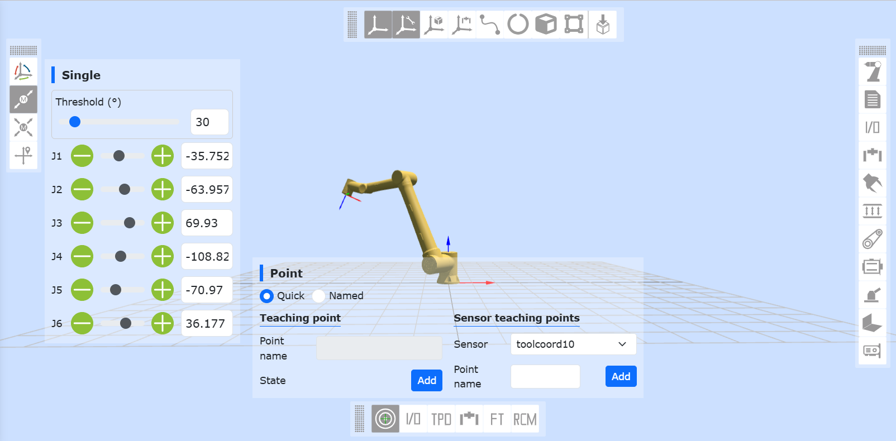
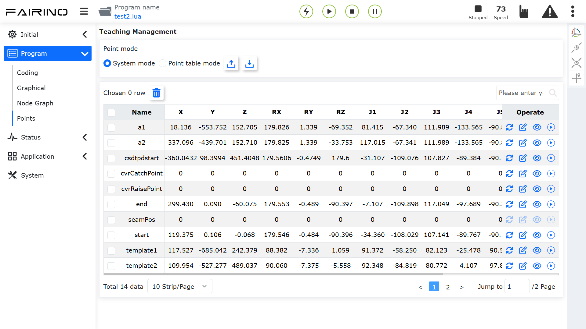

Enseñanza manual del robot
==========================

Enseñanza manual y registro de puntos de enseñanza
--------------------------------------------------

La enseñanza manual incluye dos modos:

- 1. Mantener pulsado el botón de arrastre del extremo para realizar la enseñanza por arrastre;
- 2. Realizar el jog en Robot simulado en 3D->operación de objetos 3D.

Tras enseñar hasta la posición objetivo, se puede guardar el punto de enseñanza en "Funciones complementarias del robot"->"Registro de puntos de enseñanza". Al guardar el punto de enseñanza, el sistema de coordenadas de dicho punto de enseñanza es el sistema de coordenadas aplicado actualmente por el robot.

.. centered:: Figura 4.1‑1 Enseñanza manual

Consulta de la información de los puntos de enseñanza
-----------------------------------------------------

Hacer clic en "Programa de enseñanza"->"Puntos de enseñanza" para mostrar toda la información de los puntos de enseñanza guardados; el modo de puntos actual se divide en "Modo de sistema" y "Modo de tabla de puntos".

En esta interfaz se pueden importar y exportar archivos de puntos de enseñanza; tras seleccionar un punto de enseñanza, hacer clic en el botón "Eliminar" para eliminar la información de dicho punto; los valores x, y, z, rx, ry, rz y v del punto de enseñanza se pueden modificar; introducir el valor modificado, marcar la casilla de verificación de la izquierda y hacer clic en modificar de la parte superior para modificar la información del punto de enseñanza.

Hacer clic en el botón "Iniciar ejecución" para ejecutar de forma individual el punto de enseñanza local y desplazar el robot hasta la posición de dicho punto. Además, el usuario puede buscar puntos de enseñanza por nombre.

.. centered:: Figura 4.2‑1 Interfaz de gestión de la enseñanza

.. important:: 
    Los valores modificados de x, y, z, rx, ry, rz del punto de enseñanza no deben superar el rango de trabajo del robot.