Programación por grafo de nodos
===============================

.. toctree:: 
   :maxdepth: 6

Información básica
------------------

Introducción al sistema
~~~~~~~~~~~~~~~~~~~~~~~

La programación por grafo de nodos es un software de programación desarrollado para el robot; sus funciones y características técnicas principales son las siguientes:

-  Las conexiones entre nodos presentan mejor la relación lógica de contexto del programa;
-  Mediante operaciones como crear nodos, conectar nodos y editar parámetros de nodos, basta con operaciones de arrastre y una pequeña introducción de parámetros para completar la escritura del programa del robot;
-  Ayuda a visualizar mejor el código y a escribir más rápidamente scripts de tareas complejas y repetitivas;

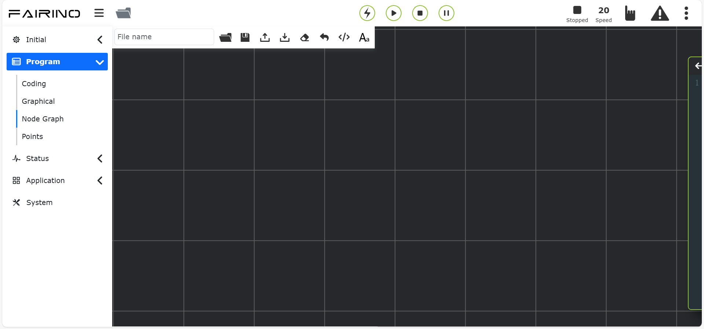

.. centered:: Figura 11.1-1 Interfaz de programación por grafo de nodos

Barra de herramientas
~~~~~~~~~~~~~~~~~~~~~

Utilice la barra de herramientas situada en la parte superior izquierda de la página de programación por grafo de nodos.

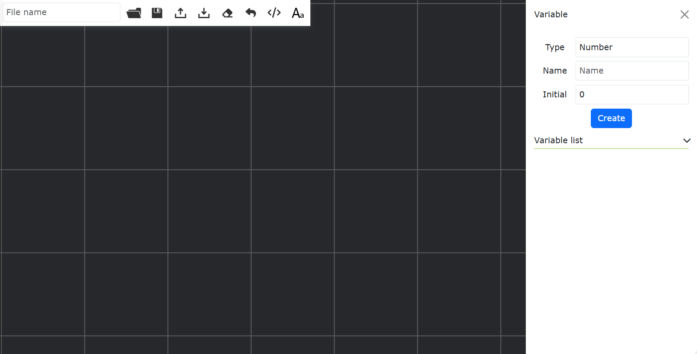

.. centered:: Figura 11.1-2 Barra de herramientas de operaciones

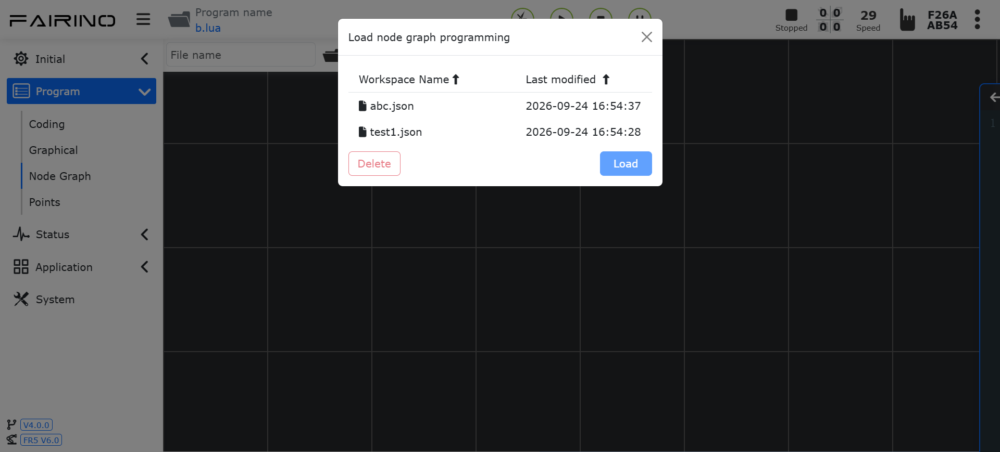

.. centered:: Figura 11.1-2 Ordenación del área de trabajo 
.. note:: 
   .. image:: coding/006.png
      :height: 0.75in
      :align: left

   Nombre: **Abrir**
   
   Función: abrir archivos de programas de usuario; en la ventana emergente seleccionar cargar o eliminar archivos; admite la ordenación alfabética (A~Z o Z~A) o por hora de última modificación

.. note:: 
   .. image:: coding/010.png
      :height: 0.75in
      :align: left

   Nombre: **Guardar**
   
   Función: guardar el contenido editado del grafo de nodos

.. note:: 
   .. image:: node_editor_software/131.png
      :height: 0.75in
      :align: left

   Nombre: **Recargar**
   
   Función: volver a cargar localmente el contenido del grafo de nodos de la última operación

.. note:: 
   .. image:: coding/007.png
      :height: 0.75in
      :align: left

   Nombre: **Nuevo**
   
   Función: crear un nuevo archivo de programación por grafo de nodos

.. note:: 
   .. image:: coding/008.png
      :height: 0.75in
      :align: left

   Nombre: **Exportar**
   
   Función: tras crear/abrir un archivo de programación por grafo de nodos, hacer clic en el botón "Exportar" para que aparezca la ventana emergente "Exportar programación por grafo de nodos"; seleccionar el nombre del archivo del área de trabajo para exportar el archivo (formato json)

.. note:: 
   .. image:: coding/009.png
      :height: 0.75in
      :align: left

   Nombre: **Importar**
   
   Función: hacer clic en el botón "Importar" para que aparezca el cuadro de aviso de importación. Seleccionar el archivo que se desea importar y, tras hacer clic en importar, el contenido del archivo se muestra en el área de trabajo de programación por grafo de nodos

.. note:: 
   .. image:: node_editor_software/129.png
      :height: 0.75in
      :align: left

   Nombre: **Código**
   
   Función: tras conectar el grafo de nodos, generar el código Lua

Operaciones del grafo de nodos
------------------------------

Programa de nodos
~~~~~~~~~~~~~~~~~

Para el programa de nodos es necesario hacer clic con el botón derecho del ratón en una zona en blanco para abrir la barra de selección de programa de nodos. Las instrucciones del programa se dividen principalmente en instrucciones lógicas, instrucciones de movimiento, instrucciones de control de fuerza, instrucciones de control, instrucciones Modbus, instrucciones de eje extendido, etc.

El cuadro de entrada situado en la parte superior de la barra de selección de programa de nodos permite realizar una búsqueda difusa para localizar rápidamente la instrucción de nodo necesaria.

El flujo de operación concreto del programa de nodos es el siguiente:

-  Hacer clic en el nodo de inicio "Begin" para crear la posición de programación del nodo de inicio;
-  Hacer clic en el nodo de instrucción de programa seleccionado; el nodo correspondiente se muestra en el área de trabajo, donde se pueden seleccionar los parámetros de la instrucción mediante cuadros desplegables y realizar operaciones de entrada;
-  Función de las flechas a la derecha del nodo de instrucción: 1. el icono de una sola flecha conecta con el siguiente nodo; 2. el icono de varias flechas: el primer icono de flecha "Body" conecta con el nodo de contenido, y el segundo icono "Completed" conecta con el siguiente nodo;
-  Conectar el nodo de inicio "Begin" con el programa de nodos ya escrito completa la operación de programación del nodo final;

Instrucción de juicio If/Else
-----------------------------

Hacer clic en el nodo de instrucción relacionado con "If/Else" para entrar en la interfaz de edición del grafo de nodos. (Esta instrucción requiere cierta base de programación; si necesita ayuda, póngase en contacto con nosotros)

Instrucción "If/Else":

- First: conecta con los nodos de instrucción dentro de la condición if
- Second: si a la izquierda solo se introducen dos condiciones de juicio, indica la conexión con los nodos de instrucción dentro de la condición else; si existen las tres condiciones de juicio a la izquierda, indica la conexión con los nodos de instrucción dentro de la condición elseif
- Third: si existen las tres condiciones de juicio a la izquierda, indica la conexión con la condición else
- Completed: conecta con los nodos de instrucción posteriores

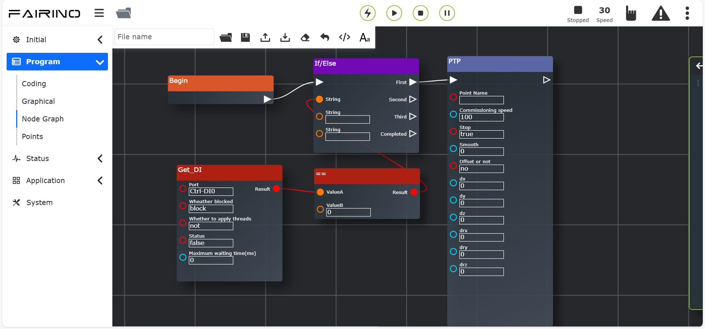

.. centered:: Figura 11.3-1 Interfaz del nodo de instrucción "If/Else"

Instrucción While
-----------------

Hacer clic en el nodo de instrucción relacionado con "While" para entrar en la interfaz de edición del grafo de nodos.

Introducir en el cuadro de entrada situado después de While la condición de espera, introducir en el cuadro de entrada situado después de do las instrucciones de acción durante el bucle y hacer clic en guardar. (Para facilitar la operación, se puede introducir arbitrariamente el contenido do y editarlo en el programa sustituyéndolo por otras instrucciones insertadas)

Instrucción "While":

- Condition: condición del bucle while

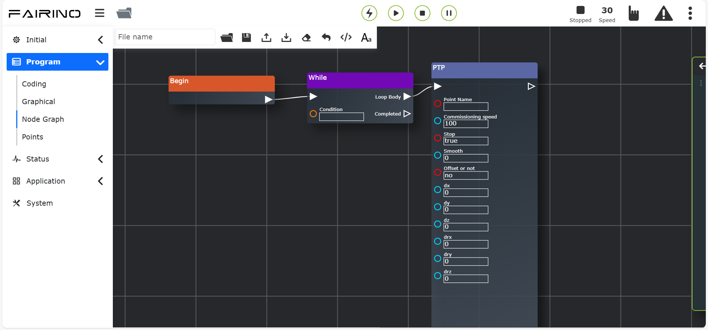

.. centered:: Figura 11.4-1 Interfaz del nodo de instrucción "While"

Instrucción de salto
--------------------

Hacer clic en el nodo de instrucción relacionado con "Salto" para entrar en la interfaz de edición del grafo de nodos.

En la instrucción "Salto", el primer icono de flecha "Body" conecta con el nodo de contenido principal, y el segundo icono de flecha "Completed" conecta con el nodo de instrucción goto de la posición de salto posterior. (Esta instrucción requiere cierta base de programación; si necesita ayuda, póngase en contacto con nosotros)

- Nombre de salto: introducir el nombre de salto para determinar la posición de salto

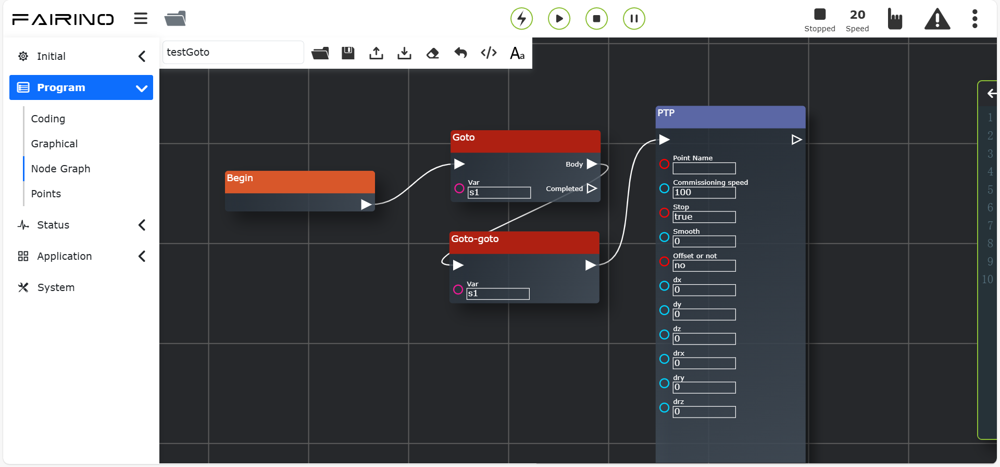

.. centered:: Figura 11.5-1 Interfaz del nodo de instrucción "Salto"

.. important:: El nombre de salto no puede comenzar por un número

Instrucción de espera
---------------------

Hacer clic en el nodo de instrucción relacionado con "Espera" para entrar en la interfaz de edición del grafo de nodos.

Esta instrucción es una instrucción de retardo y se divide en cuatro partes: "WaitMs", "WaitDI", "WaitMultiDI" y "WaitAI".

1. Nodo de la instrucción "Espera", parámetros:

- Tiempo de espera (ms): la unidad del tiempo de espera de retardo es el milisegundo; introducir el número de milisegundos que se desea esperar

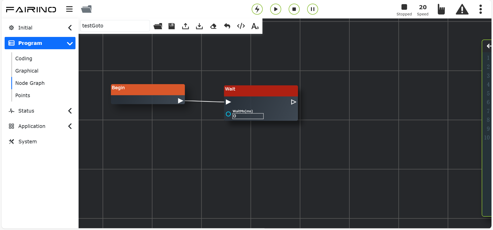

.. centered:: Figura 11.6-1 Interfaz del nodo de instrucción "Espera"

2. Nodo de la instrucción "Espera DI", parámetros:

- Número de puerto DI: Ctrl-DI0 ~ Ctrl-CI7(WaitDI,[0~15]), End-DI0 ~ End-DI1(WaitToolDI,[0~1])
- Estado: false/true
- Tiempo máximo (ms): 0 ~ 10000 
- Tratamiento del tiempo de espera agotado: Detener con error/Continuar la ejecución/Esperar siempre

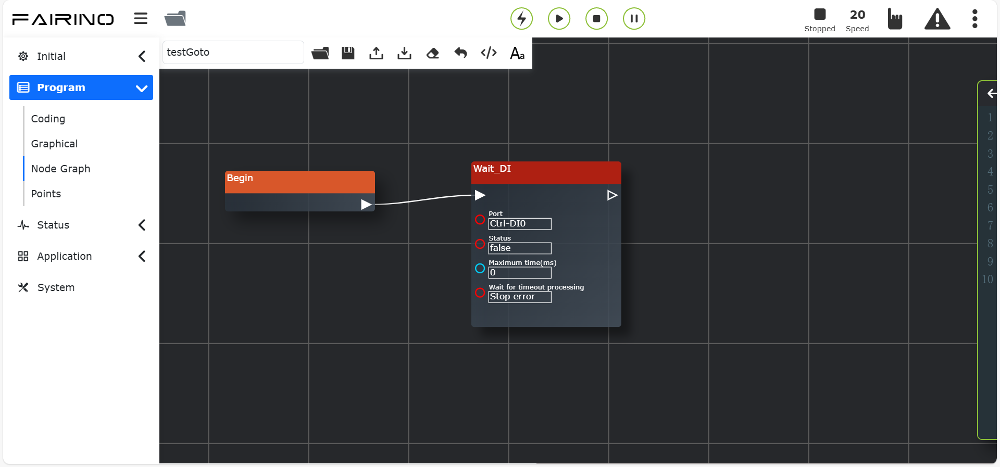

.. centered:: Figura 11.6-2 Interfaz del nodo de instrucción "Espera DI"

3. Nodo de la instrucción "Espera múltiples DI", parámetros:

- Condición: Y/O
- Selección de condición: seleccionar el número de puerto cuyo estado de bit está activado, separados por comas, por ejemplo DI0,DI1
- Puerto correspondiente al valor verdadero: seleccionar el número de puerto del valor verdadero, separados por comas, por ejemplo DI0,DI1
- Tiempo máximo (ms): 0 ~ 10000, tiempo máximo de espera
- Tratamiento del tiempo de espera agotado: Detener con error/Continuar la ejecución/Esperar siempre

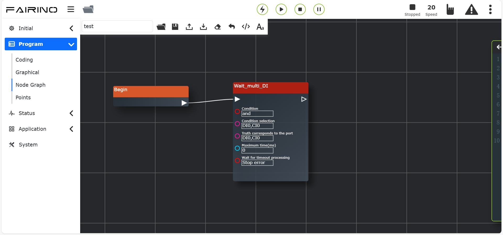

.. centered:: Figura 11.6-3 Interfaz del nodo de instrucción "Espera múltiples DI"

4. Nodo de la instrucción "Espera AI", parámetros:

- Condición: Y/O
- Número de puerto AI: Ctrl-AI0 ~ Ctrl-AI1(WaitAI,[0~1]), End-AI0(WaitToolAI,[0])
- Condición: mayor que/menor que
- Valor (%): 1 ~ 100
- Tiempo máximo (ms): 0 ~ 10000
- Tratamiento del tiempo de espera agotado: Detener con error/Continuar la ejecución/Esperar siempre; cuando el tratamiento del tiempo de espera agotado es esperar siempre, el tiempo máximo se establece por defecto en 0

.. centered:: Figura 11.6-4 Interfaz del nodo de instrucción "Espera AI"

Instrucción de pausa
--------------------

Hacer clic en el nodo de instrucción "Pausa" para entrar en la interfaz de edición del grafo de nodos.

Esta instrucción es una instrucción de pausa; al insertar esta instrucción en el programa, cuando el programa llegue a esta instrucción el robot entrará en estado de pausa; si se desea continuar la ejecución, basta con hacer clic en el botón "Pausa/Reanudar" del área de control.

Nodo de la instrucción "Pausa", parámetros:

- Tipo de pausa: sin función, cilindro no en posición, etc.

.. centered:: Figura 11.7-1 Interfaz del nodo de instrucción "Pausa"

Instrucción de llamada a subprograma
------------------------------------

Hacer clic en el nodo de instrucción "Llamada a subprograma" para entrar en la interfaz de edición del grafo de nodos.

Esta instrucción es una instrucción de llamada a subprograma; al insertar esta instrucción en el programa, cuando el programa llegue a esta instrucción el robot entrará en estado de pausa; si se desea continuar la ejecución, basta con hacer clic en el botón "Pausa/Reanudar" del área de control.

Nodo de la instrucción "Llamada a subprograma", parámetros:

- Archivo dofile: nombre del archivo generado creado
- Nivel de llamada: primer nivel/segundo nivel
- Número de id: id de la posición correspondiente al nivel al que pertenece

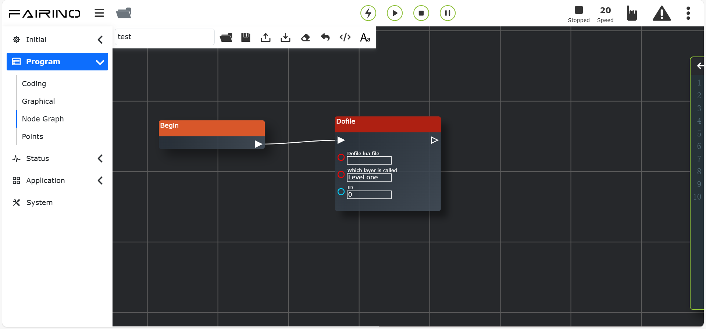

.. centered:: Figura 11.8-1 Interfaz del nodo de instrucción "Llamada a subprograma"

Instrucción de establecimiento de variable del sistema
------------------------------------------------------

Hacer clic en el nodo de instrucción "Establecer variable del sistema" para entrar en la interfaz de edición del grafo de nodos.

Esta instrucción es una instrucción de establecimiento de variable del sistema y se divide en establecer variable del sistema y obtener variable del sistema; se utiliza junto con instrucciones como while, if-else, etc.

Nodo de la instrucción "Establecer variable del sistema", parámetros:

- Var: nombre de la variable personalizada
- Valor: introducir según la situación real

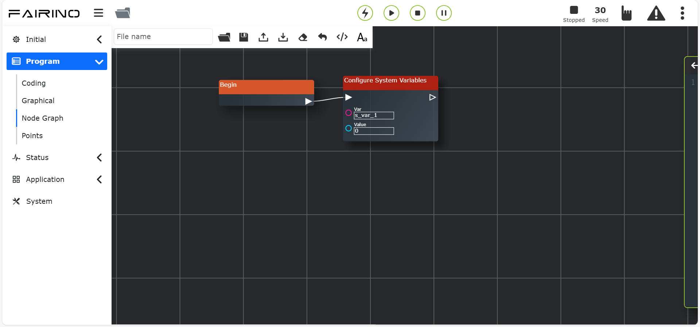

.. centered:: Figura 11.9-1 Interfaz del nodo de instrucción "Establecer variable del sistema"

Nodo de la instrucción "Obtener variable del sistema", parámetros:

- Var: nombre de la variable personalizada

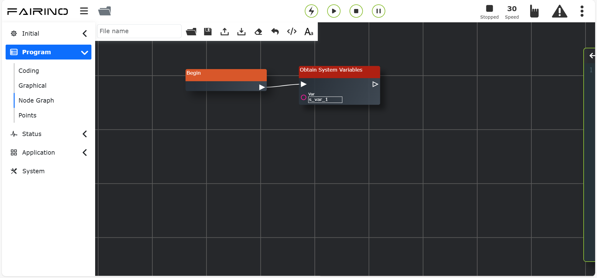

.. centered:: Figura 11.9-2 Interfaz del nodo de instrucción "Obtener variable del sistema"

.. important:: El nombre de la variable debe ser un nombre ya definido.

Instrucción punto a punto
-------------------------

Hacer clic en el nodo de instrucción "Punto a punto" para entrar en la interfaz de edición del grafo de nodos.

Se puede seleccionar el punto al que se desea llegar; la configuración del tiempo de transición suave permite que el movimiento de este punto al siguiente sea continuo; la configuración de desplazamiento permite seleccionar el desplazamiento basado en el sistema de coordenadas base y el desplazamiento basado en el sistema de coordenadas de herramienta, y aparece la configuración de los valores de desplazamiento x, y, z, rx, ry, rz; la ruta concreta de PTP es la ruta óptima planificada automáticamente por el controlador de movimiento.

Nodo de la instrucción "Punto a punto", parámetros:

- Nombre del punto: punto de enseñanza
- Velocidad de depuración (%): 0 ~ 100
- Detener: false/true
- Transición suave (ms): tiempo de transición suave 0 ~ 500
- ¿Desplazamiento? No/desplazamiento del sistema de coordenadas base/desplazamiento del sistema de coordenadas de herramienta; al seleccionar No, los valores de los parámetros dx~drz no surten efecto
- dx~drz: valor de desplazamiento

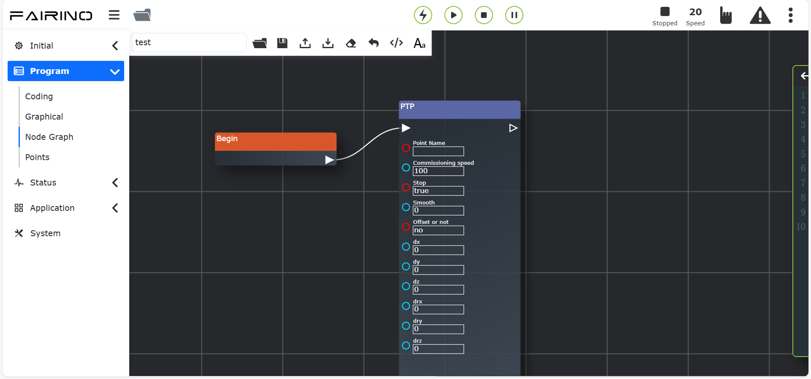

.. centered:: Figura 11.10-1 Interfaz del nodo de instrucción "Punto a punto"

Instrucción de línea recta
--------------------------

Hacer clic en el nodo de instrucción "Línea recta" para entrar en la interfaz de edición del grafo de nodos.

La función de esta instrucción es similar a la de la instrucción "Punto a punto", pero la ruta hasta el punto alcanzado por esta instrucción es una línea recta.

Nodo de la instrucción "Línea recta", parámetros:

- Nombre del punto: punto de enseñanza
- Velocidad de depuración (%): 0 ~ 100
- Detener: false/true; al seleccionar true, el valor del parámetro de transición suave no surte efecto
- Transición suave (mm): radio de transición suave 0 ~ 1000
- ¿Búsqueda de posición?: false/true
- Variable del punto de búsqueda de posición: REF0~99/RES0~99; al seleccionar false en ¿Búsqueda de posición?, el parámetro no surte efecto
- ¿Desplazamiento?: No/desplazamiento del sistema de coordenadas base/desplazamiento del sistema de coordenadas de herramienta; al seleccionar No, los valores de los parámetros dx~drz no surten efecto
- dx~drz: valor de desplazamiento.

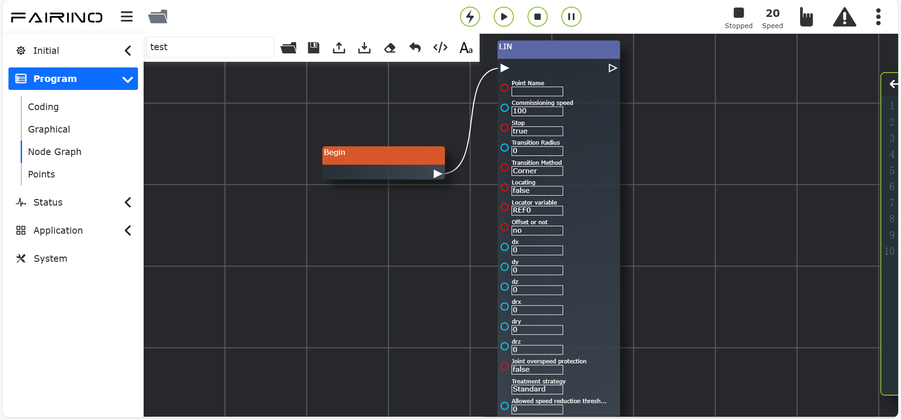

.. centered:: Figura 11.11-1 Interfaz del nodo de instrucción "Línea recta"

Instrucción de línea recta (seamPos)
------------------------------------

Hacer clic en el nodo de instrucción "Línea recta (seamPos)" para entrar en la interfaz de edición del grafo de nodos.

La función de esta instrucción se aplica al uso del sensor láser en escenarios de soldadura.

Nodo de la instrucción "Línea recta (seamPos)", parámetros:

- Nombre del punto: punto de enseñanza
- Velocidad de depuración (%): 0 ~ 100
- Detener: false/true; al seleccionar true, el valor del parámetro de transición suave no surte efecto
- Transición suave (mm): radio de transición suave 0 ~ 1000
- Selección de datos de caché de soldadura: datos de planificación de ejecución/datos de registro de ejecución
- Tipo de placa: placa ondulada/placa corrugada/placa de valla/barril de aceite/acero con caparazón ondulado
- ¿Desplazamiento?: No/desplazamiento del sistema de coordenadas base/desplazamiento del sistema de coordenadas de herramienta/desplazamiento de datos originales del láser; al seleccionar No, los valores de los parámetros dx~drz no surten efecto
- dx~drz: valor de desplazamiento

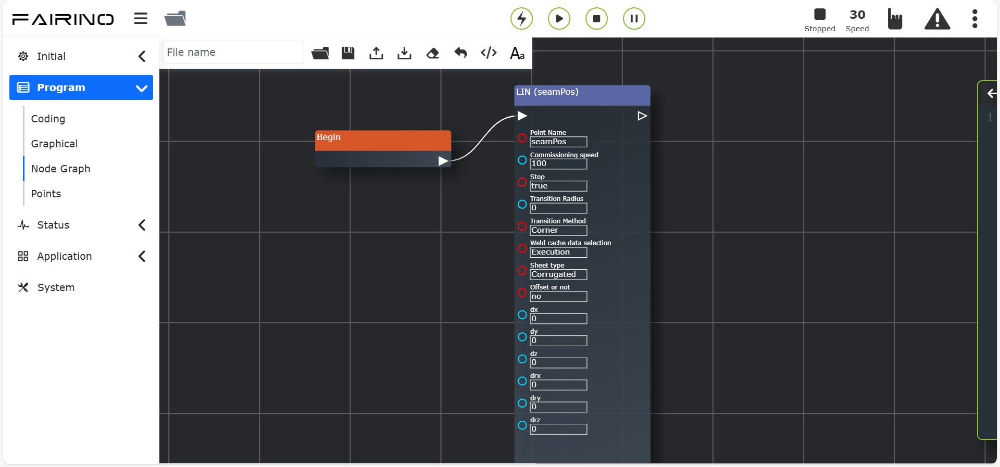

.. centered:: Figura 11.12-1 Interfaz del nodo de instrucción "Línea recta (seamPos)"

Instrucción de arco
-------------------

Hacer clic en el nodo de instrucción "Arco" para entrar en la interfaz de edición del grafo de nodos.

El movimiento en arco incluye dos puntos: el primer punto es el punto de transición intermedio del arco y el segundo punto es el punto final; tanto el punto de transición como el punto final permiten configurar si hay desplazamiento, pudiendo seleccionar desplazamiento basado en el sistema de coordenadas base y desplazamiento basado en el sistema de coordenadas de herramienta, y configurar los valores de desplazamiento x, y, z, rx, ry, rz; el punto final permite configurar el radio de transición suave para lograr un efecto de movimiento continuo.

Nodo de la instrucción "Arco", parámetros:

- Punto intermedio del arco: punto de enseñanza
- ¿Desplazamiento?: No/desplazamiento del sistema de coordenadas base/desplazamiento del sistema de coordenadas de herramienta; al seleccionar No, los valores de los parámetros dx~drz no surten efecto
- dx~drz: valor de desplazamiento
- Punto final del arco: punto de enseñanza
- ¿Desplazamiento?: No/desplazamiento del sistema de coordenadas base/desplazamiento del sistema de coordenadas de herramienta; al seleccionar No, los valores de los parámetros dx~drz no surten efecto
- dx~drz: valor de desplazamiento
- Velocidad de depuración (%): 0 ~ 100
- Detener: false/true; al seleccionar true, el valor del parámetro de transición suave no surte efecto
- Transición suave (mm): radio de transición suave 0 ~ 1000

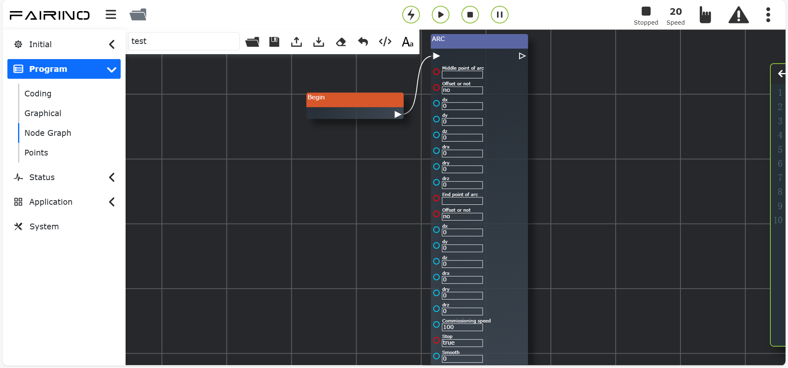

.. centered:: Figura 11.13-1 Interfaz del nodo de instrucción "Arco"

Instrucción de círculo completo
-------------------------------

Hacer clic en el nodo de instrucción "Círculo completo" para entrar en la interfaz de edición del grafo de nodos.

El movimiento de círculo completo incluye dos puntos: el primer punto es el punto de transición intermedio 1 del círculo completo y el segundo punto es el punto de transición intermedio 2 del círculo completo; en el punto de transición 2 se puede configurar si hay desplazamiento, y dicho valor de desplazamiento surte efecto simultáneamente en el punto de transición 1 y en el punto de transición 2.

Nodo de la instrucción "Círculo completo", parámetros:

- Punto intermedio 1 del círculo completo: punto de enseñanza
- Punto intermedio 2 del círculo completo: punto de enseñanza
- Velocidad de depuración (%): 0 ~ 100
- ¿Desplazamiento?: No/desplazamiento del sistema de coordenadas base/desplazamiento del sistema de coordenadas de herramienta; al seleccionar No, los valores de los parámetros dx~drz no surten efecto
- dx~drz: valor de desplazamiento

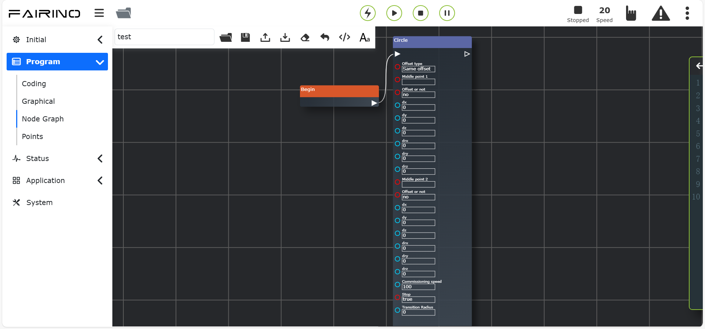

.. centered:: Figura 11.14-1 Interfaz del nodo de instrucción "Círculo completo"

Instrucción de hélice
---------------------

Hacer clic en el nodo de instrucción "Hélice" para entrar en la interfaz de edición del grafo de nodos.

El movimiento en hélice incluye tres puntos; estos tres puntos forman un círculo; en la página de configuración del tercer punto se incluyen parámetros como el número de vueltas de la hélice, el ángulo de corrección de actitud, el incremento de radio y el incremento de dirección del eje de rotación. El número de vueltas de la hélice es el número de vueltas del movimiento de la hélice; el ángulo de corrección de actitud corrige la actitud al final de la hélice respecto a la actitud del primer punto de la hélice; el incremento de radio es el incremento del radio de cada vuelta; el incremento de dirección del eje de rotación es el incremento en la dirección del eje de la hélice. Configurar si hay desplazamiento; este valor de desplazamiento surte efecto sobre toda la trayectoria de la hélice.

Nodo de la instrucción "Hélice", parámetros:

- Punto intermedio 1 de la hélice: punto de enseñanza
- Punto intermedio 2 de la hélice: punto de enseñanza
- Punto intermedio 3 de la hélice: punto de enseñanza
- Velocidad de depuración (%): 0 ~ 100
- ¿Desplazamiento?: No/desplazamiento del sistema de coordenadas base/desplazamiento del sistema de coordenadas de herramienta; al seleccionar No, los valores de los parámetros dx~drz no surten efecto
- dx~drz: valor de desplazamiento
- Número de vueltas de la hélice: 0 ~ 100
- Corrección del ángulo de actitud rx (°): -1000 ~ 1000
- Corrección del ángulo de actitud ry (°): -1000 ~ 1000
- Corrección del ángulo de actitud rz (°): -1000 ~ 1000
- Incremento de radio (mm): -100 ~ 100
- Incremento de dirección del eje de rotación (mm): -100 ~ 100

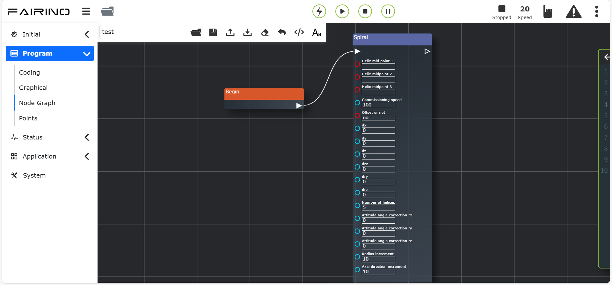

.. centered:: Figura 11.15-1 Interfaz del nodo de instrucción "Hélice"

Instrucción de nueva hélice
---------------------------

Hacer clic en el nodo de instrucción "Nueva hélice" para entrar en la interfaz de edición del grafo de nodos.

El movimiento de nueva hélice es una versión optimizada del movimiento en hélice; esta instrucción solo requiere un punto más la configuración de cada parámetro para realizar el movimiento en hélice. El robot toma la posición actual como punto inicial; el usuario configura la velocidad de depuración, si hay desplazamiento, el número de vueltas de la hélice, la inclinación de la hélice, el radio inicial, el incremento de radio, el incremento de dirección del eje de rotación y la dirección de rotación. El número de vueltas de la hélice es el número de vueltas del movimiento de la hélice; la inclinación de la hélice es el ángulo entre el eje Z de la herramienta y la dirección horizontal; el ángulo de corrección de actitud corrige la actitud al final de la hélice respecto a la actitud del primer punto de la hélice; el radio inicial es el tamaño del radio de la primera vuelta; el incremento de radio es el incremento del radio de cada vuelta; el incremento de dirección del eje de rotación es el incremento en la dirección del eje de la hélice; la dirección de rotación es en sentido horario o antihorario.

Nodo de la instrucción "Nueva hélice", parámetros:

- Punto inicial de la hélice: punto de enseñanza
- Velocidad de depuración (%): 0 ~ 100
- ¿Desplazamiento?: No/desplazamiento del sistema de coordenadas base/desplazamiento del sistema de coordenadas de herramienta; al seleccionar No, los valores de los parámetros dx~drz no surten efecto
- dx~drz: valor de desplazamiento
- Número de vueltas de la hélice: 0 ~ 100
- Inclinación de la hélice (°): -100 ~ 100
- Radio inicial: 0 ~ 100
- Incremento de radio (mm): -100 ~ 100
- Incremento de dirección del eje de rotación (mm): -100 ~ 100
- Dirección de rotación: sentido horario/sentido antihorario

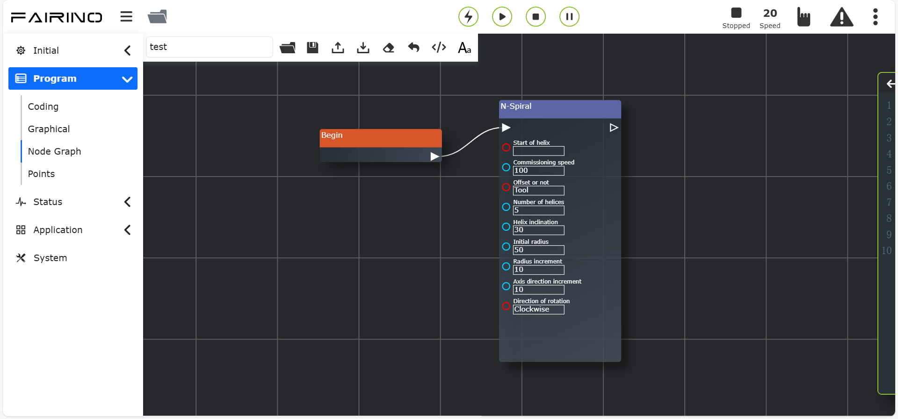

.. centered:: Figura 11.16-1 Interfaz del nodo de instrucción "Nueva hélice"

Instrucción de hélice horizontal
--------------------------------

Hacer clic en el nodo de instrucción "Hélice horizontal" para entrar en la interfaz de edición del grafo de nodos.

La instrucción "H-Spiral" es un movimiento en hélice en el espacio horizontal; esta instrucción se configura después de una instrucción de movimiento de un solo segmento (línea recta).

Nodo de la instrucción "Hélice horizontal", parámetros:

- Radio de la hélice: 0~100mm
- Velocidad angular de la hélice: 0~2rev/s
- Dirección de rotación: hélice en sentido horario/antihorario
- Inclinación de la hélice: 0~40°

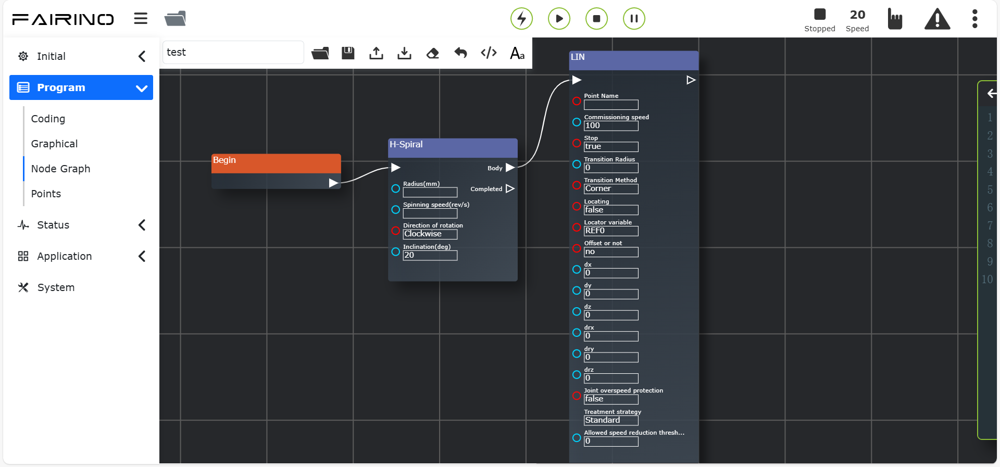

.. centered:: Figura 11.17-1 Interfaz del nodo de instrucción "Hélice horizontal"

Instrucción de spline
---------------------

Hacer clic en el nodo de instrucción "Spline" para entrar en la interfaz de edición del grafo de nodos.

Esta instrucción se divide en tres partes: inicio del grupo de splines, segmento de spline y fin del grupo de splines. El inicio del grupo de splines es el indicador de inicio del movimiento de spline; el segmento de spline actualmente solo incluye el segmento SPL en el grafo de nodos; el fin del grupo de splines es el indicador de fin del movimiento de spline.

Nodo de la instrucción "Spline-SPTP", parámetros:

- Nombre del punto: punto de enseñanza
- Velocidad de depuración (%): 0 ~ 100

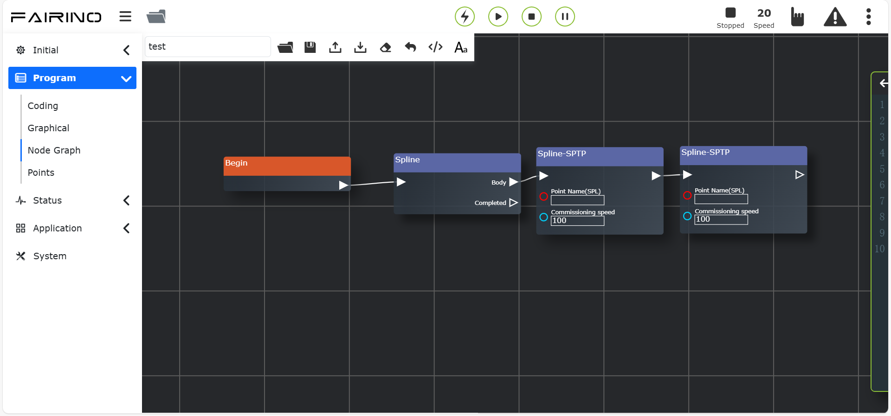

.. centered:: Figura 11.18-1 Interfaz del nodo de instrucción "Spline"

Instrucción de nueva spline
---------------------------

Hacer clic en el nodo de instrucción "Nueva spline" para entrar en la interfaz de edición del grafo de nodos.

Esta instrucción es una versión optimizada del algoritmo de la instrucción de spline y sustituirá en el futuro a la instrucción de spline actual. Esta instrucción se divide en tres partes: inicio de trayectoria multipunto, segmento de trayectoria multipunto y fin de trayectoria multipunto. El inicio de trayectoria multipunto es el indicador de inicio del movimiento de trayectoria multipunto; el segmento de trayectoria multipunto sirve para configurar cada punto de trayectoria; hacer clic en el icono para entrar en la interfaz de adición de puntos; el fin de trayectoria multipunto es el indicador de fin del movimiento de trayectoria multipunto, donde se puede configurar el modo de control y la velocidad de depuración. El modo de control se divide en punto de control dado y punto de ruta dado.

Nodo de la instrucción "Nueva spline", parámetros:

- Modo de control: punto de enseñanza
- Tiempo medio de enlace global: tipo entero, mayor que 10, valor predeterminado 2000ms

Nodo de la instrucción "Nueva spline-SPL", parámetros:

- Nombre del punto: punto de enseñanza
- Velocidad de depuración (%): 0 ~ 100
- Radio de transición suave: 0 ~ 1000
- ¿Es el último punto?: No/Sí

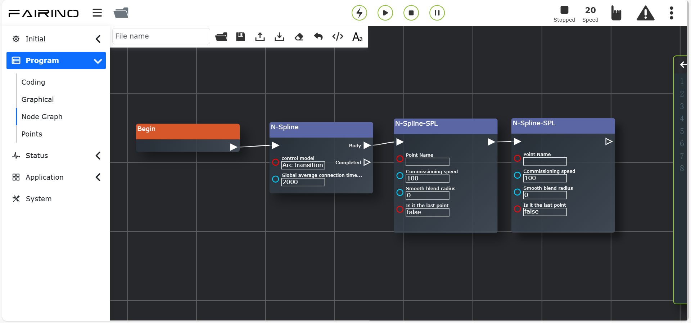

.. centered:: Figura 11.19-1 Interfaz del nodo de instrucción "Nueva spline"

Instrucción de oscilación
-------------------------

Hacer clic en el nodo de instrucción "Oscilación" para entrar en la interfaz de edición del grafo de nodos.

Esta instrucción incluye dos partes; en la primera se selecciona el número de oscilación con los parámetros ya configurados; la conexión de Body representa que el programa del nodo conectado se ejecuta entre "Iniciar oscilación" y "Detener oscilación".

Nodo de la instrucción "Oscilación", parámetros:

- Número: 0~7

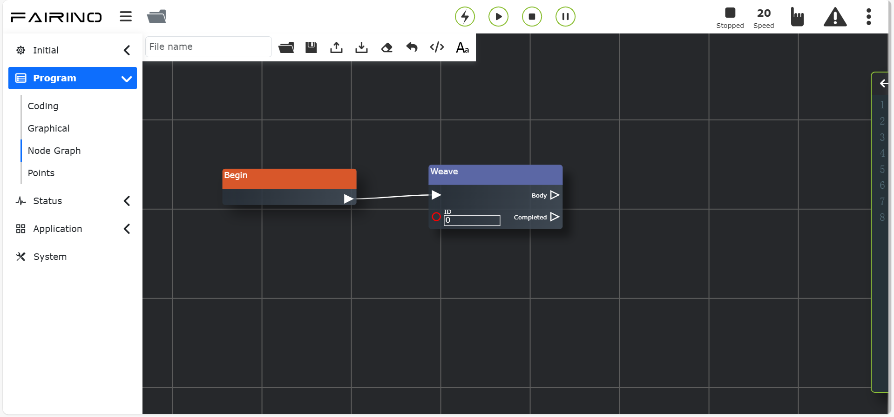

.. centered:: Figura 11.20-1 Interfaz del nodo de instrucción "Oscilación"

Instrucción de reproducción de trayectoria
------------------------------------------

Hacer clic en el nodo de instrucción "Reproducción de trayectoria" para entrar en la interfaz de edición del grafo de nodos.

En esta instrucción, el usuario debe disponer primero de una trayectoria registrada.

Al realizar la programación de programas, primero hay que llegar al punto inicial de la trayectoria correspondiente con la instrucción punto a punto; a continuación, en la instrucción de reproducción de trayectoria seleccionar la trayectoria, seleccionar el suavizado de trayectoria y configurar la velocidad de depuración. La instrucción de carga de trayectoria se utiliza principalmente para leer previamente el archivo de trayectoria y extraerlo como instrucción de trayectoria, aplicándose mejor en escenarios de seguimiento de cinta transportadora.

Nodo de la instrucción "Reproducción de trayectoria", parámetros:

- Nombre de la trayectoria: trayectoria registrada
- Suavizado de trayectoria: No/Sí
- Velocidad de depuración (%): 0 ~ 100, valor predeterminado 25

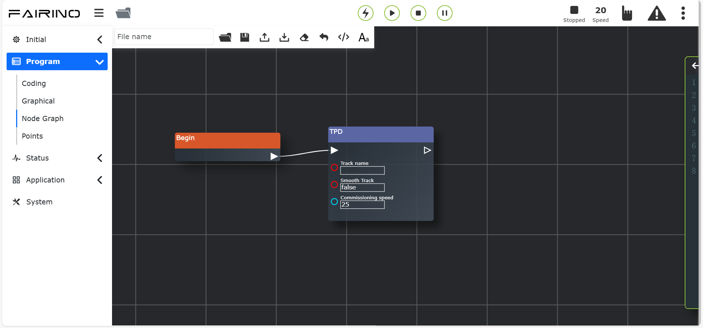

.. centered:: Figura 11.21-1 Interfaz del nodo de instrucción "Reproducción de trayectoria"

Instrucción de desplazamiento de punto
--------------------------------------

Hacer clic en el nodo de instrucción "Desplazamiento de punto" para entrar en la interfaz de edición del grafo de nodos.

Esta instrucción es una instrucción de desplazamiento global; al introducir cada valor de desplazamiento, la conexión de Body representa que el programa del nodo conectado se ejecuta entre el inicio y la desactivación, y las instrucciones de movimiento intermedias se desplazarán basándose en el sistema de coordenadas base (o el sistema de coordenadas de pieza).

Nodo de la instrucción "Desplazamiento de punto", parámetros:

- ∆x: valor de desplazamiento, -300~300
- ∆y: valor de desplazamiento, -300~300
- ∆z: valor de desplazamiento, -300~300
- ∆rx: valor de desplazamiento, -300~300
- ∆ry: valor de desplazamiento, -300~300
- ∆rz: valor de desplazamiento, -300~300

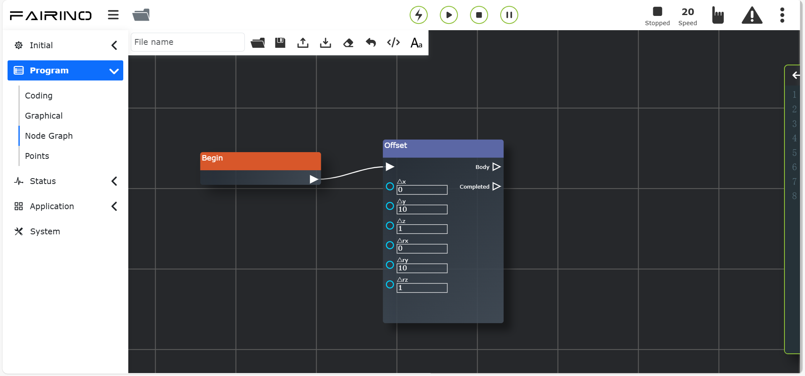

.. centered:: Figura 11.22-1 Interfaz del nodo de instrucción "Desplazamiento de punto"

Instrucción servo
-----------------

Hacer clic en el nodo de instrucción "Servo" para entrar en la interfaz de edición del grafo de nodos.

Instrucción de control servo (movimiento en el espacio cartesiano): esta instrucción permite controlar el movimiento del robot mediante control de pose absoluta o mediante desplazamiento basado en la pose actual.

Nodo de la instrucción "Servo", parámetros:

- Modo de movimiento: posición absoluta/desplazamiento del sistema de coordenadas base/desplazamiento del sistema de coordenadas de herramienta
- x: valor de desplazamiento, -300~300
- y: valor de desplazamiento, -300~300
- z: valor de desplazamiento, -300~300
- rx: valor de desplazamiento, -300~300
- ry: valor de desplazamiento, -300~300
- rz: valor de desplazamiento, -300~300
- Coeficiente de proporción x: 0~1
- Coeficiente de proporción y: 0~1
- Coeficiente de proporción z: 0~1
- Coeficiente de proporción rx: 0~1
- Coeficiente de proporción ry: 0~1
- Coeficiente de proporción rz: 0~1
- Aceleración (%): 0~100
- Velocidad (%): 0~100
- Período de instrucción (s): 0.001~0.016
- Tiempo de filtrado (s): 0~1
- Ampliación de proporción: 0~100

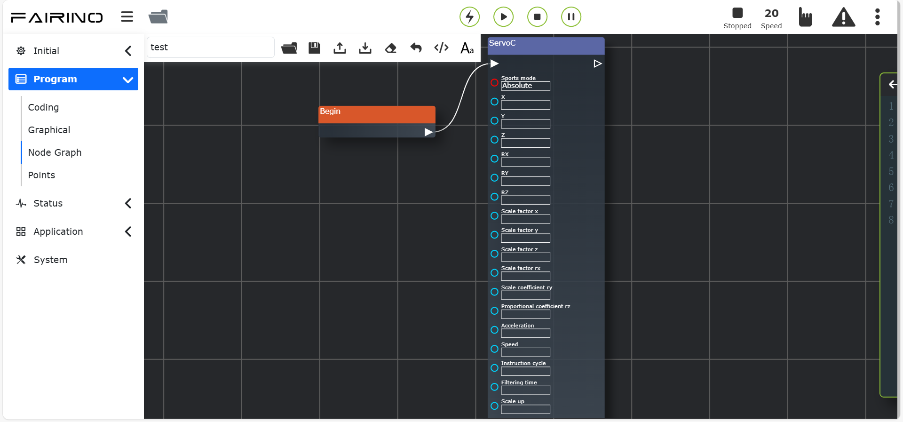

.. centered:: Figura 11.23-1 Interfaz del nodo de instrucción "Servo"

Instrucción de trayectoria
--------------------------

Hacer clic en el nodo de instrucción "Trayectoria" para entrar en la interfaz de edición del grafo de nodos.

En esta instrucción, el usuario debe disponer primero de una trayectoria registrada.

Nodo de la instrucción "Trayectoria", parámetros:

- Seleccionar archivo de trayectoria: trayectoria registrada
- Velocidad de depuración (%): 0 ~ 100, valor predeterminado 25

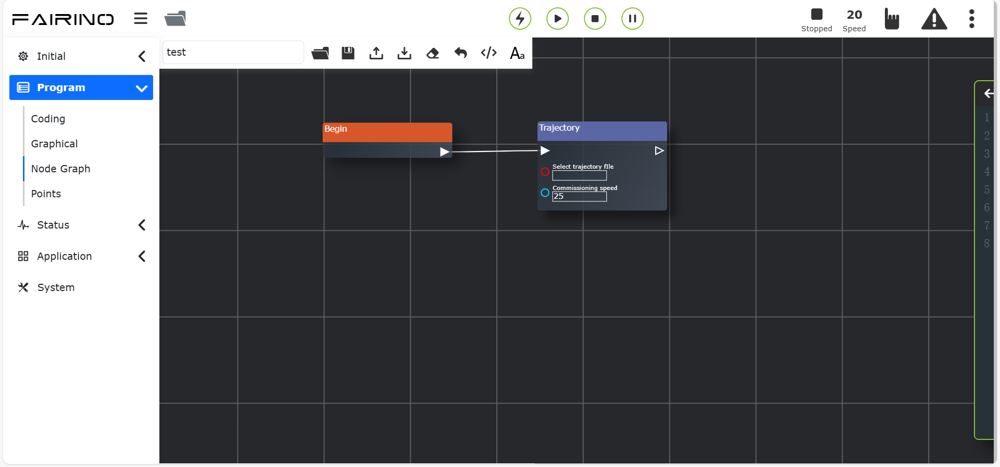

.. centered:: Figura 11.24-1 Interfaz del nodo de instrucción "Trayectoria"

Instrucción de trayectoria J
----------------------------

Hacer clic en el nodo de instrucción "Trayectoria J" para entrar en la interfaz de edición del grafo de nodos.

En esta instrucción, el usuario debe disponer primero de una trayectoria registrada; el archivo de trayectoria se puede importar previamente en la interfaz del programa de enseñanza. La instrucción de trayectoria y la instrucción de trayectoria J son interfaces genéricas aplicables a trayectorias dadas directamente por la cámara; permiten que, cuando se dispone de un archivo de puntos de trayectoria discretos con un formato fijo, se pueda importar al sistema para que el robot se desplace según la trayectoria del archivo importado.

Nodo de la instrucción "Trayectoria J", parámetros:

- Seleccionar archivo de trayectoria: trayectoria registrada
- Velocidad de depuración (%): 0 ~ 100, valor predeterminado 25
- Modo de trayectoria: punto de ruta/punto de control

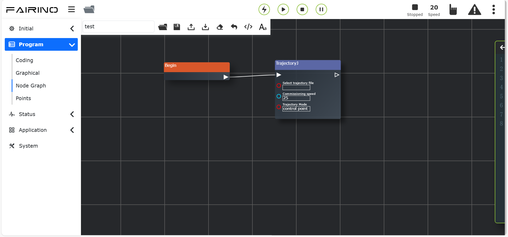

.. centered:: Figura 11.25-1 Interfaz del nodo de instrucción "Trayectoria J"

Instrucción DMP
---------------

Hacer clic en el nodo de instrucción "DMP" para entrar en la interfaz de edición del grafo de nodos.

DMP es un método de aprendizaje por imitación de trayectoria y requiere planificar previamente una trayectoria de referencia. En la interfaz de edición del comando, seleccionar el punto de enseñanza como nuevo punto inicial y hacer clic en "Añadir" y "Aplicar" para guardar esta instrucción. La ruta concreta de DMP es la nueva trayectoria que imita la trayectoria de referencia tomando el nuevo punto inicial.

Nodo de la instrucción "DMP", parámetros:

- Nombre del punto: punto de enseñanza
- Velocidad de depuración (%): 0 ~ 100, valor predeterminado 100

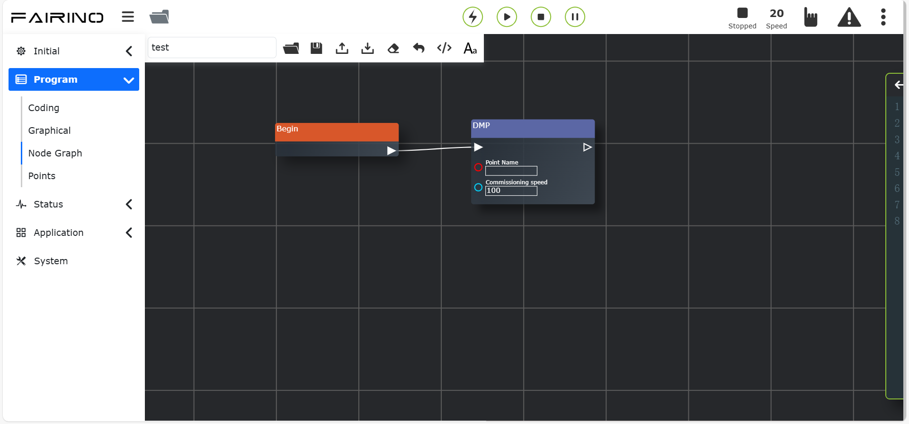

.. centered:: Figura 11.26-1 Interfaz del nodo de instrucción "DMP"

Instrucción de conversión de pieza
----------------------------------

Hacer clic en el nodo de instrucción "Conversión de pieza" para entrar en la interfaz de edición del grafo de nodos.

Seleccionar el sistema de coordenadas de pieza sobre el que se desea realizar la conversión automática y hacer clic en "Añadir" y "Aplicar" para guardar esta instrucción; al añadir las instrucciones PTP y LIN y conectarlas con Body se puede lograr la ejecución dentro de esta instrucción, con conversión automática de los puntos bajo el sistema de coordenadas de pieza.

Nodo de la instrucción "Conversión de pieza", parámetros:

- Sistema de coordenadas de pieza: lista de sistemas de coordenadas de pieza

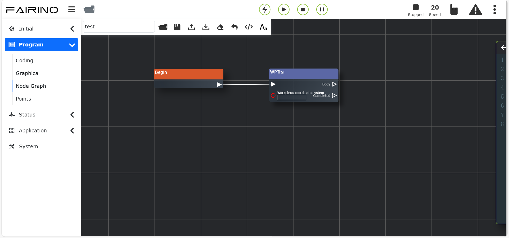

.. centered:: Figura 11.27-1 Interfaz del nodo de instrucción "Conversión de pieza"

Instrucción de conversión de herramienta
----------------------------------------

Hacer clic en el nodo de instrucción "Conversión de herramienta" para entrar en la interfaz de edición del grafo de nodos.

Seleccionar el sistema de coordenadas de herramienta sobre el que se desea realizar la conversión automática y hacer clic en "Añadir" y "Aplicar" para guardar esta instrucción; al añadir las instrucciones PTP y LIN y conectarlas con Body se puede lograr la ejecución dentro de esta instrucción, con conversión automática de los puntos bajo el sistema de coordenadas de herramienta.

Nodo de la instrucción "Conversión de herramienta", parámetros:

- Sistema de coordenadas de herramienta: lista de sistemas de coordenadas de herramienta

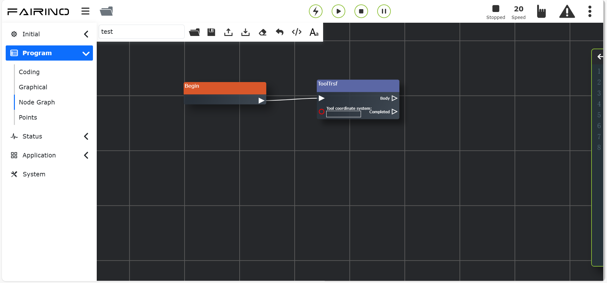

.. centered:: Figura 11.28-1 Interfaz del nodo de instrucción "Conversión de herramienta"

Nodo de instrucción de IO digital
---------------------------------

Hacer clic en el nodo de instrucción "Establecer DO"/"Obtener DI" para entrar en la interfaz de edición del grafo de nodos.

Esta instrucción es una instrucción de IO y se divide en dos partes: establecer IO (SetDO/SPLCSetDO) y obtener IO (GetDI/SPLCGetDI).

1. Nodo de la instrucción "Establecer DO", parámetros:

- Puerto: Ctrl-DO0 ~ Ctrl-CO7(Bloqueante:SetDO,No bloqueante:SPLCSetDO,[0~15]), End-DO0 ~ End-DO1(Bloqueante:SetToolDO,No bloqueante:SPLCSetToolDO,[0~1])
- Estado: false/true
- ¿Bloqueante?: Bloqueante/No bloqueante
- Trayectoria suave: Break/Serious
- ¿Aplicar hilo?: No/Sí
  
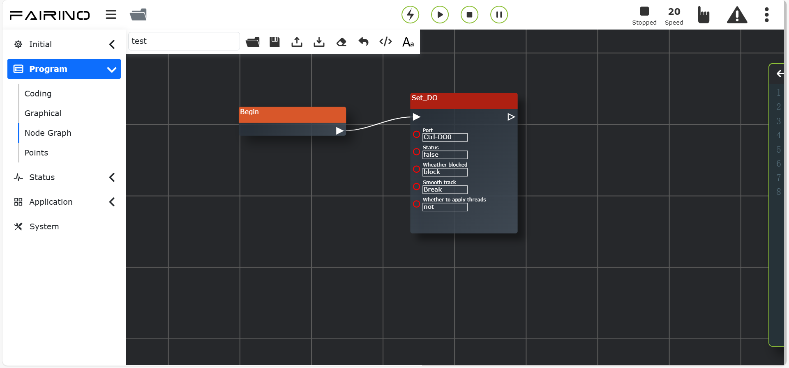

.. centered:: Figura 11.29-1 Interfaz del nodo de instrucción "Establecer DO"

2. Nodo de la instrucción "Obtener DI", parámetros:

- Puerto: Ctrl-DI0 ~ Ctrl-CI7(Bloqueante:GetDI,No bloqueante:SPLCGetDI,[0~15]), End-DI0 ~ End-DI1(Bloqueante:GetToolDI,No bloqueante:SPLCGetToolDI,[0~1])
- ¿Bloqueante?: Bloqueante/No bloqueante
- Estado: false/true
- Tiempo máximo de espera (ms): 0 ~ 10000
- ¿Aplicar hilo?: No/Sí
  
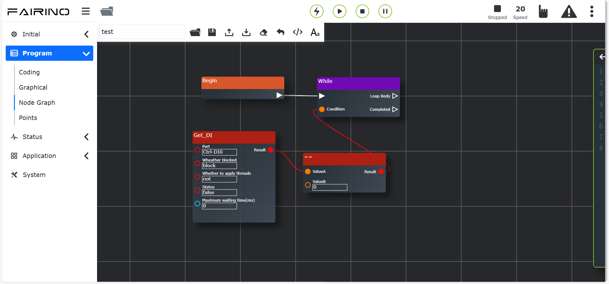

.. centered:: Figura 11.29-2 Interfaz del nodo de instrucción "Obtener DI"

Comando AI analógica
--------------------

Hacer clic en el nodo de instrucción "Establecer AO"/"Obtener AI" para entrar en la interfaz de edición del grafo de nodos.

En esta instrucción se distinguen dos partes: establecer salida analógica (SetAO/SPLCSetAO) y obtener entrada analógica (GetAI/SPLCGetAI).

1. Nodo de la instrucción "Establecer AO", parámetros:

- Puerto: Ctrl-AO0 ~ Ctrl-AO1(Bloqueante:SetAO,No bloqueante:SPLCSetAO,[0~1]), End-AO0(Bloqueante:SetToolAO,No bloqueante:SPLCSetToolAO,[0])
- Valor (%): 0 ~ 100
- ¿Bloqueante?: Bloqueante/No bloqueante
- ¿Aplicar hilo?: No/Sí
  
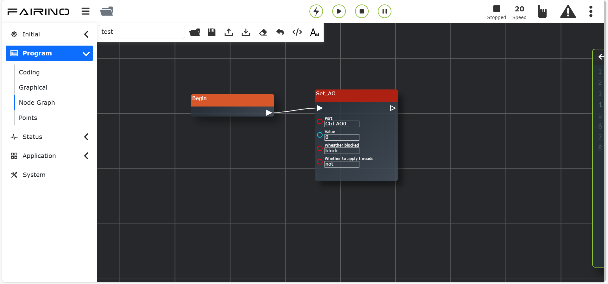

.. centered:: Figura 11.30-1 Interfaz del nodo de instrucción "Establecer AO"
   
2. Nodo de la instrucción "Obtener AI", parámetros:

- Puerto: Ctrl-AI0 ~ Ctrl-DI1(Bloqueante:GetAI,No bloqueante:SPLCGetAI,[0~1]), End-AI0(Bloqueante:GetToolAI,No bloqueante:SPLCGetToolAI,[0])
- Condición: mayor que/menor que
- Valor (%): 0 ~ 100
- Tiempo máximo (ms): 0 ~ 10000
- ¿Bloqueante?: Bloqueante/No bloqueante
- ¿Aplicar hilo?: No/Sí
  
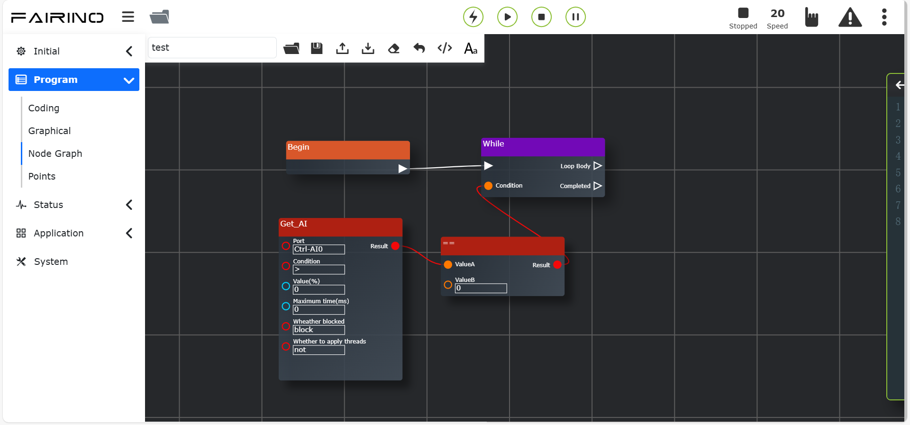

.. centered:: Figura 11.30-2 Interfaz del nodo de instrucción "Obtener AI"

Nodo de comando de IO virtual
-----------------------------

Hacer clic en el nodo de instrucción "Establecer DI externa simulada"/"Establecer AI externa simulada" para entrar en la interfaz de edición del grafo de nodos.

Esta instrucción es un comando de control de IO virtual que permite establecer los estados de DI y AI externas simuladas y obtener los estados de DI y AI simuladas.

1. Nodo de la instrucción "Establecer DI externa simulada", parámetros:

- Puerto: Vir-Ctrl-DI0 ~ Vir-Ctrl-DI15(SetVirtualDI,[0~15]), Vir-End-DI0 ~ Vir-End-DI1(SetVirtualToolDI,[1~2])
- Estado: false/true
  
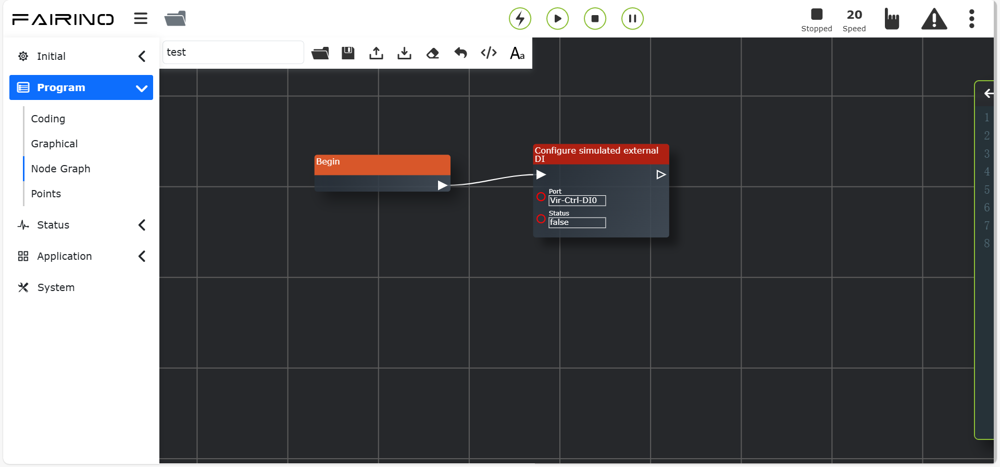

.. centered:: Figura 11.31-1 Interfaz del nodo de instrucción "Establecer DI externa simulada"
   
2. Nodo de la instrucción "Establecer AI externa simulada", parámetros:

- Puerto: Vir-Ctrl-AI0 ~ Vir-Ctrl-AI0(SetVirtualAI,[0~1]), Vir-End-AI0(SetVirtualToolAI,[0])
- Valor (v/ma): 0 ~ 20

.. centered:: Figura 11.31-2 Interfaz del nodo de instrucción "Establecer AI externa simulada"

Nodo de comando de IO extendida
-------------------------------

Hacer clic en el nodo de instrucción "Obtener DI externa simulada"/"Obtener AI externa simulada" para entrar en la interfaz de edición del grafo de nodos.

Aux-IO es la función de instrucción mediante la cual el robot controla IO extendidas externas comunicándose con el PLC; requiere que el robot establezca comunicación UDP con el PLC.

1. Nodo de la instrucción "Obtener DI externa simulada", parámetros:

- Puerto: Vir-Ctrl-DI0 ~ Vir-Ctrl-DI15(GetVirtualDI,[0~15]), Vir-End-DI0 ~ Vir-End-DI1(GetVirtualToolDI,[1~2])
  

.. centered:: Figura 11.32-1 Interfaz del nodo de instrucción "Obtener DI externa simulada"
   
2. Nodo de la instrucción "Establecer AI externa simulada", parámetros:

- Puerto: Vir-Ctrl-AI0 ~ Vir-Ctrl-AI0(GetVirtualAI,[0~1]), Vir-End-AI0(GetVirtualToolAI,[0])

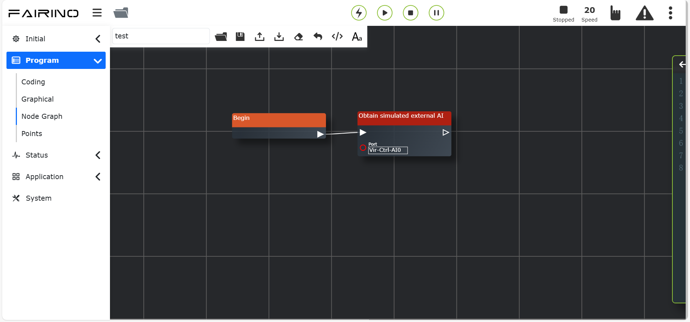

.. centered:: Figura 11.32-2 Interfaz del nodo de instrucción "Establecer AI externa simulada"

3. Nodo de la instrucción "Configurar comunicación UDP", parámetros:

- ip: dirección ip
- Puerto: número de puerto
- Período de comunicación (ms): 0 ~ 10000

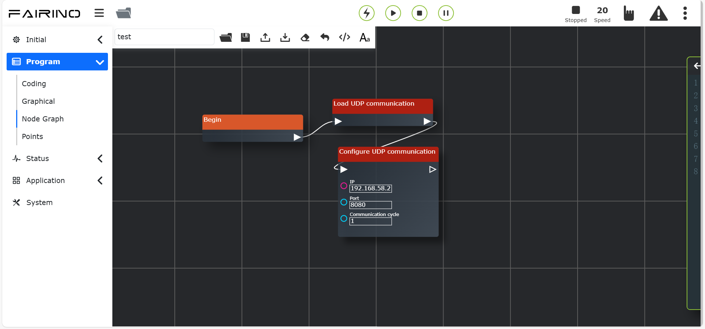

.. centered:: Figura 11.32-3 Interfaz del nodo de instrucción "Configurar comunicación UDP"

Comando DO de movimiento
------------------------

Hacer clic en el nodo de instrucción "DO de movimiento" para entrar en la interfaz de edición del grafo de nodos.

Esta instrucción permite emitir continuamente señales DO durante el movimiento en línea recta según el intervalo establecido.

Nodo de la instrucción "Salida continua DO de movimiento", parámetros:

- Puerto: Ctrl-DO0 ~ Ctrl-DO0(MoveDOStart,[0~15]), End-DO1(MoveDOStart,[0~1])
- Intervalo establecido (mm): 0 ~ 500
- Ciclo de trabajo del pulso de salida (%): 0 ~ 99

Nodo de la instrucción "Salida única DO de movimiento", parámetros:

- Puerto: Ctrl-DO0 ~ Ctrl-DO0(MoveDOOnceStart,[0~15]), End-DO1(MoveDOOnceStart,[0~1])
- Modo de salida: salida en el tramo de velocidad uniforme/configuración libre
- Tiempo de activación (ms): 0 ~ 1000 (el modo de salida en el tramo de velocidad uniforme tiene por defecto -1)
- Tiempo de desactivación (ms): 0 ~ 1000 (el modo de salida en el tramo de velocidad uniforme tiene por defecto -1)
  
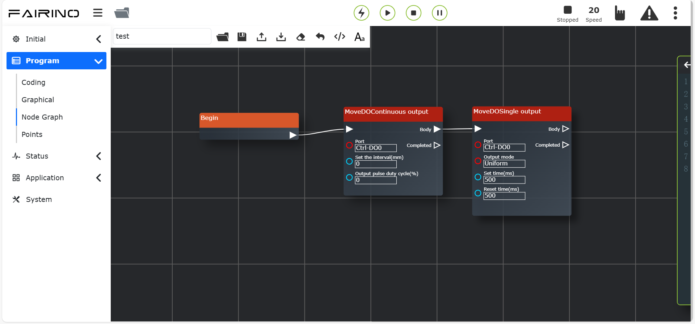

.. centered:: Figura 11.33-1 Interfaz del nodo de instrucción "Salida única/continua DO de movimiento"

Comando de sistema de coordenadas
---------------------------------

Hacer clic en el nodo de instrucción relacionado con "Establecer sistema de coordenadas de herramienta"/"Establecer sistema de coordenadas de pieza" para entrar en la interfaz de edición del grafo de nodos.

En esta instrucción se distinguen dos partes: "Establecer sistema de coordenadas de herramienta" y "Establecer sistema de coordenadas de pieza".

Seleccionar el nombre del sistema de coordenadas de herramienta y hacer clic en "Aplicar" para añadir esta instrucción al programa; cuando el programa ejecute esta sentencia, se establecerá el sistema de coordenadas de herramienta del robot.

1. Nodo de la instrucción "Establecer sistema de coordenadas de herramienta", parámetros:

- Nombre del sistema de coordenadas de herramienta: toolcoord1 ~ toolcoord19(SetToolList,[0~19]), etoolcoord0 ~ etoolcoord14(SetExToolList, [0~14])
  
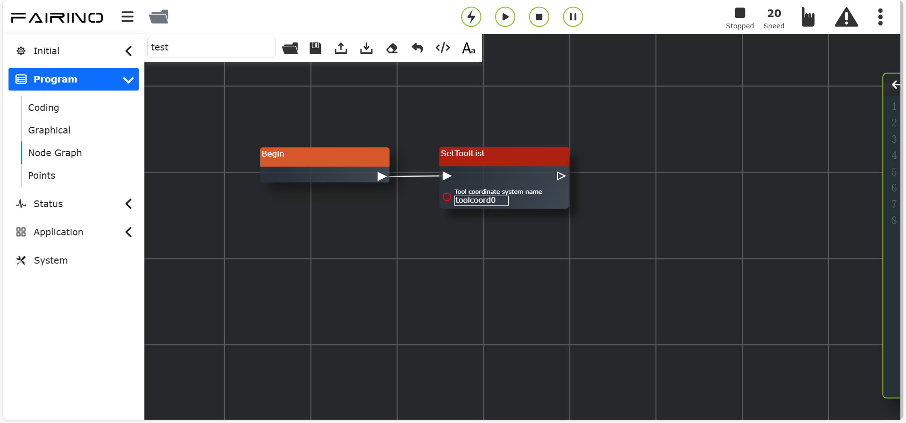

.. centered:: Figura 11.34-1 Interfaz del nodo de instrucción "Establecer sistema de coordenadas de herramienta"

2. Nodo de la instrucción "Establecer sistema de coordenadas de pieza", parámetros:

- Nombre del sistema de coordenadas de pieza: wobjcoord1 ~ wobjcoord14
  
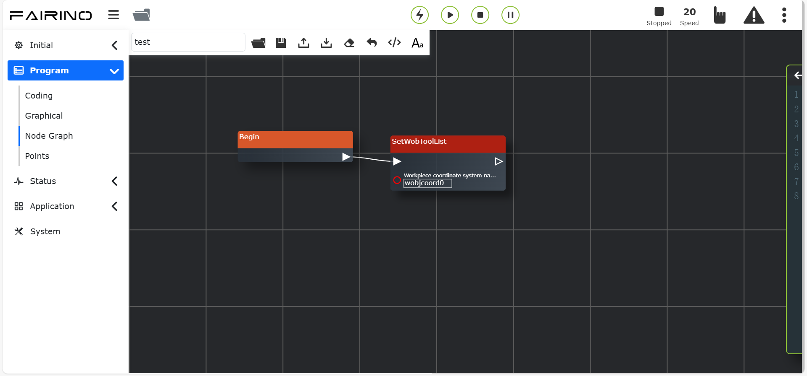

.. centered:: Figura 11.34-2 Interfaz del nodo de instrucción "Establecer sistema de coordenadas de pieza"

Comando de cambio de modo
-------------------------

Hacer clic en el nodo de instrucción "Cambio de modo" para entrar en la interfaz de edición del grafo de nodos.

Esta instrucción permite cambiar el robot al modo manual; normalmente se añade al final de un programa para que, tras finalizar la ejecución del programa, el usuario pueda hacer que el robot cambie automáticamente al modo manual y arrastrarlo.

Nodo de la instrucción "Cambio de modo", parámetros:

- Cambio de modo: modo manual

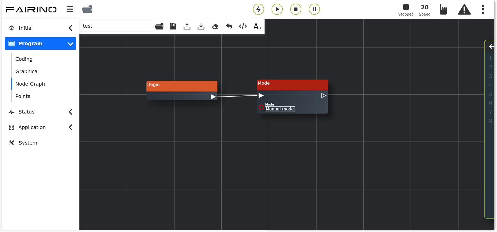

.. centered:: Figura 11.35-1 Interfaz del nodo de instrucción "Cambio de modo"

Comando de nivel de colisión
----------------------------

Hacer clic en el nodo de instrucción "Nivel de colisión" para entrar en la interfaz de edición del grafo de nodos.

Esta instrucción permite configurar el nivel de colisión; mediante esta instrucción se puede ajustar en tiempo real durante la ejecución del programa el nivel de colisión de cada eje, desplegando los escenarios de aplicación de forma más flexible.

Nodo de la instrucción "Nivel de colisión", parámetros:

- Nivel estándar: nivel estándar/porcentaje personalizado
- joint1-joint6(N): 0 ~ 100, umbral de colisión, tipo array

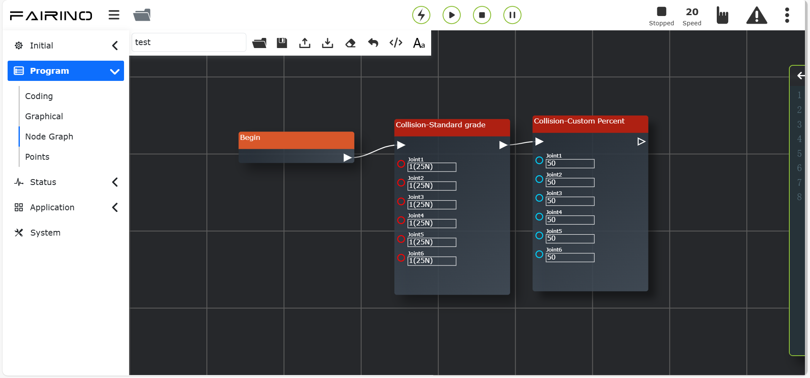

.. centered:: Figura 11.36-1 Interfaz del nodo de instrucción "Nivel de colisión"

Comando de aceleración
----------------------

Hacer clic en el nodo de instrucción "Aceleración" para entrar en la interfaz de edición del grafo de nodos.

El comando "Aceleración" permite configurar de forma independiente la aceleración del robot; mediante el ajuste del factor de escala de aceleración de la instrucción de movimiento se puede aumentar o reducir el tiempo de aceleración/deceleración, logrando un tiempo de ciclo de acción del robot ajustable.

Nodo de la instrucción "Aceleración", parámetros: 

- Porcentaje de aceleración (%): 0 ~ 100

.. centered:: Figura 11.37-1 Interfaz del nodo de instrucción "Aceleración"

Instrucción de pinza
--------------------

Esta instrucción se divide en "Movimiento de pinza", "Activación de pinza" y "Restablecimiento de pinza".

En la instrucción se muestra el número de la pinza que ha completado la configuración y ha sido activada; para configurar la apertura/cierre, la velocidad de apertura/cierre y el par de apertura/cierre de la pinza los valores están en porcentaje; en la opción de bloqueo, seleccionar bloqueante significa que el movimiento de la pinza debe esperar a que finalice la ejecución de la instrucción de movimiento anterior, mientras que seleccionar no bloqueante significa que el movimiento de la pinza es paralelo a la instrucción de movimiento anterior.

Nodo "Movimiento de pinza", parámetros:

- Número de pinza: número de la pinza ya activada
- Posición de la pinza: 0~100
- Velocidad de apertura/cierre: 0~100
- Par de apertura/cierre: 0~100
- Tiempo máximo (ms): 0~30000
- ¿Bloqueante?: false/true

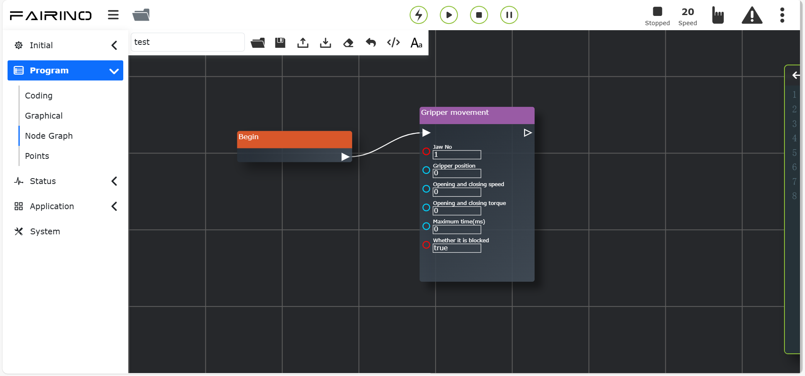

.. centered:: Figura 11.38-1 Interfaz del nodo "Movimiento de pinza"

Instrucción de restablecimiento de pinza: muestra el número de la pinza ya configurada y permite añadir la instrucción de restablecimiento de pinza al programa.

Nodo "Restablecimiento de pinza", parámetros:

- Número de pinza: número de la pinza ya activada

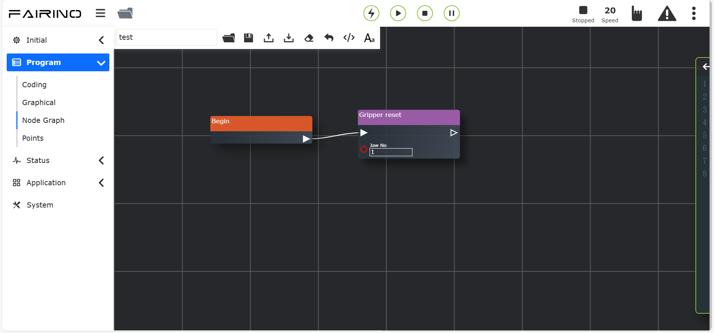

.. centered:: Figura 11.38-2 Interfaz del nodo "Restablecimiento de pinza"

Instrucción de activación de pinza: muestra el número de la pinza ya configurada y permite añadir la instrucción de activación de pinza al programa.

Nodo "Activación de pinza", parámetros:

- Número de pinza: número de la pinza ya activada

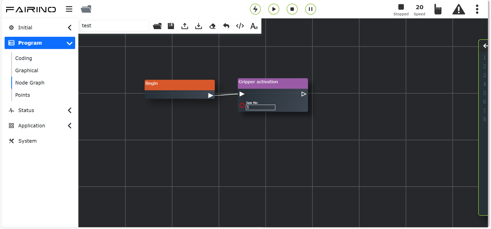

.. centered:: Figura 11.38-3 Interfaz del nodo "Activación de pinza"

Instrucción de pistola de pulverización
---------------------------------------

Esta instrucción es una instrucción relacionada con la pulverización y controla "Iniciar pulverización", "Detener pulverización", "Iniciar limpieza de pistola" y "Detener limpieza de pistola" de la pistola de pulverización. Al editar los nodos relacionados con este programa es necesario confirmar que el periférico de la pistola de pulverización ya está configurado; de lo contrario, no se podrá guardar. Consulte el capítulo de periféricos del robot para más detalles.

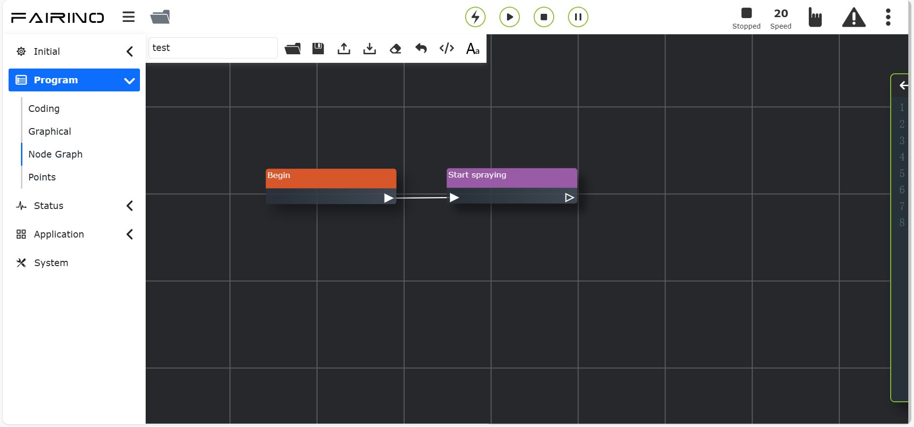

.. centered:: Figura 11.39-1 Interfaz del nodo de instrucción "Iniciar pulverización"

.. centered:: Figura 11.39-2 Interfaz del nodo de instrucción "Detener pulverización"

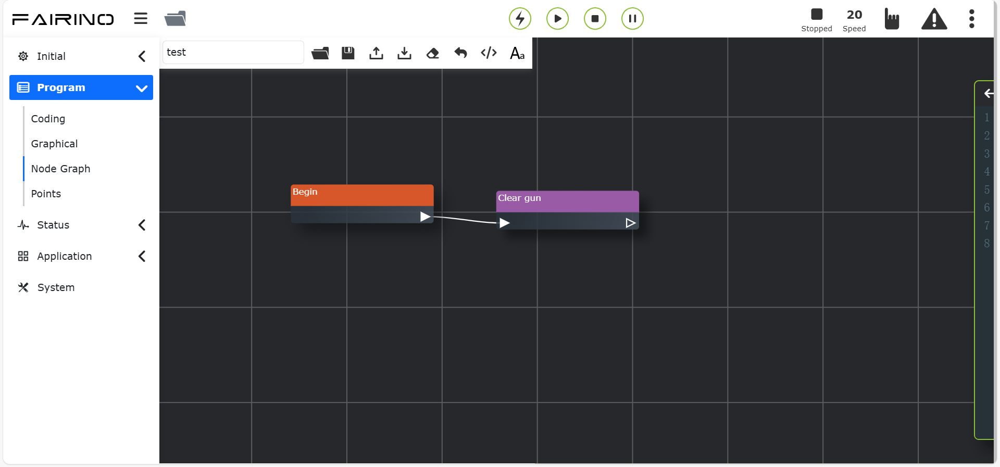

.. centered:: Figura 11.39-3 Interfaz del nodo de instrucción "Iniciar limpieza de pistola"

.. centered:: Figura 11.39-4 Interfaz del nodo de instrucción "Detener limpieza de pistola"

Instrucción de eje extendido (controlador + PLC)
--------------------------------------------------

Esta instrucción está orientada a escenarios en los que se utiliza un eje externo y, combinada con la instrucción PTP, permite descomponer el movimiento de un punto en el espacio en la dirección del eje X en el movimiento del eje externo. Seleccionar el número de eje externo, seleccionar sincronizado como modo de movimiento y seleccionar el punto al que se desea llegar.

Se divide en carga/configuración de comunicación UDP, movimiento asíncrono, movimiento síncrono PTP/LIN, movimiento síncrono ARC, instrucción de retorno a cero e instrucción de habilitación.

Nodo de la instrucción "Configuración de comunicación UDP": introducir la dirección IP, el número de puerto y el período de comunicación.

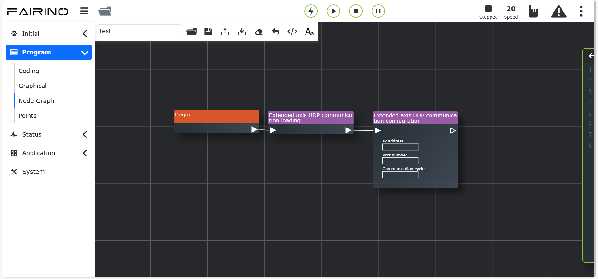

.. centered:: Figura 11.40-1 Interfaz del nodo de instrucción "Configuración de comunicación UDP"

Nodo de la instrucción "Movimiento asíncrono", parámetros:

- Nombre del punto: punto de enseñanza
- Velocidad de depuración (%): 0~100

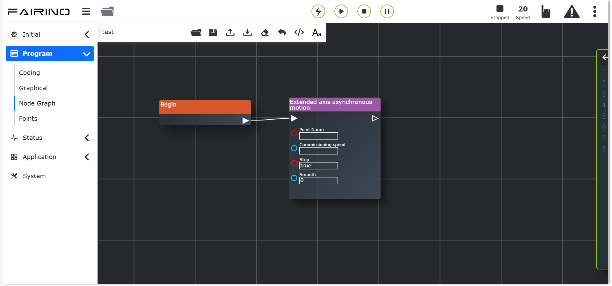

.. centered:: Figura 11.40-2 Interfaz del nodo de instrucción "Movimiento asíncrono"

Nodo de la instrucción "Movimiento síncrono PTP/LIN", parámetros:

- Selección de movimiento: PTP/LIN
- Nombre del punto: punto de enseñanza
- Velocidad de depuración (%): 0~100

.. centered:: Figura 11.40-3 Interfaz del nodo de instrucción "Movimiento síncrono PTP/LIN"

Nodo de la instrucción "Movimiento síncrono ARC", modo de movimiento predeterminado ARC, parámetros:

- Nombre del punto: punto de enseñanza
- Velocidad de depuración (%): 0~100

.. centered:: Figura 11.40-4 Interfaz del nodo de instrucción "Movimiento síncrono ARC"

Nodo de la instrucción "Retorno a cero", parámetros:

- Número de eje extendido: 1~4
- Modo de retorno a cero: retorno a cero en la posición actual/retorno a cero por límite negativo/retorno a cero por límite positivo
- Velocidad de búsqueda de cero: 0~2000, valor predeterminado 5
- Velocidad de sujeción del punto cero: 0~2000, valor predeterminado 1

.. centered:: Figura 11.40-5 Interfaz del nodo de instrucción "Retorno a cero"

Nodo de la instrucción "Habilitación", parámetros:

- Número de eje extendido: 1~4

.. centered:: Figura 11.40-6 Interfaz del nodo de instrucción "Habilitación"

Instrucción de eje extendido (controlador + servomotor)
-------------------------------------------------------

Esta instrucción permite configurar los parámetros del eje extendido. Configurar parámetros diferentes según los distintos modos de control. Para un eje extendido ya configurado se puede establecer su punto cero.

Se divide en ID de servo, modo de control, habilitación del servo y retorno a cero del servo; el modo de control se divide a su vez en modo de posición y modo de velocidad; estos dos nodos deben utilizarse junto con el modo de control; de lo contrario, añadirlos por separado no surte efecto.

Nodo de la instrucción "ID de servo", parámetros:

- ID de servo: 1~15

.. centered:: Figura 11.41-1 Interfaz del nodo de instrucción "ID de servo"

Nodo de la instrucción "Modo de control", parámetros:

- ID de servo: 1~15
- Modo de control: modo de posición/modo de velocidad

.. centered:: Figura 11.41-2 Interfaz del nodo de instrucción "Modo de control"

Nodo de la instrucción "Habilitación del servo", parámetros:

- ID de servo: 1~15
- Habilitación del servo: habilitar servo/quitar habilitación

.. centered:: Figura 11.41-3 Interfaz del nodo de instrucción "Habilitación del servo"

Nodo de la instrucción "Retorno a cero del servo", parámetros:

- ID de servo: 1~15
- Modo de retorno a cero: retorno a cero en la posición actual/retorno a cero por límite negativo/retorno a cero por límite positivo
- Velocidad de búsqueda de cero: 0~2000, valor predeterminado 5
- Velocidad de sujeción del punto cero: 0~2000, valor predeterminado 1
- Porcentaje de aceleración: 1~100

.. centered:: Figura 11.41-4 Interfaz del nodo de instrucción "Retorno a cero del servo"

Nodo de la instrucción "Modo de posición", parámetros:

- ID de servo: 1~15
- Posición objetivo: sin límite
- Velocidad de búsqueda de cero: sin límite
- Porcentaje de aceleración: 1~100

.. centered:: Figura 11.41-5 Interfaz del nodo de instrucción "Modo de posición"

Nodo de la instrucción "Modo de velocidad", parámetros:

- ID de servo: 1~15
- Velocidad objetivo: sin límite
- Porcentaje de aceleración: 1~100

.. centered:: Figura 11.41-6 Interfaz del nodo de instrucción "Modo de velocidad"

Instrucción de cinta transportadora
-----------------------------------

Esta instrucción incluye cuatro comandos: detección de IO en tiempo real, detección de posición en tiempo real, inicio de seguimiento y fin de seguimiento. Consulte el capítulo de periféricos del robot para más detalles.

Nodo de la instrucción "Detección de IO en tiempo real", parámetros:

- Tiempo máximo de espera: 0~10000

.. centered:: Figura 11.42-1 Interfaz del nodo de instrucción "Detección de IO en tiempo real"

Nodo de la instrucción "Detección de posición en tiempo real", parámetros:

- Modo de trabajo: seguimiento y agarre/seguimiento de movimiento/seguimiento TPD

.. centered:: Figura 11.42-2 Interfaz del nodo de instrucción "Detección de posición en tiempo real"

Nodo de la instrucción "Inicio de seguimiento", parámetros:

- Modo de trabajo: seguimiento y agarre/seguimiento de movimiento/seguimiento TPD

.. centered:: Figura 11.42-3 Interfaz del nodo de instrucción "Inicio de seguimiento"

.. centered:: Figura 11.42-4 Interfaz del nodo de instrucción "Fin de seguimiento"

Instrucción de pulido
---------------------

Esta instrucción se utiliza en escenarios de pulido; al utilizarla es necesario desinstalar primero el driver, volver a cargarlo y, a continuación, configurar la habilitación del equipo de pulido. A continuación se configuran la velocidad de rotación, la fuerza de contacto, la distancia de extensión y el modo de control del equipo de pulido; asimismo, se puede borrar el error del equipo de pulido y poner a cero el sensor de fuerza del equipo.

.. centered:: Figura 11.43-1 Interfaz del nodo de instrucción "Descarga del driver de comunicación"

.. centered:: Figura 11.43-2 Interfaz del nodo de instrucción "Carga del driver de comunicación"

Nodo de la instrucción "Habilitación del equipo", parámetros:

- Habilitación del equipo: habilitar/deshabilitar

.. centered:: Figura 11.43-3 Interfaz del nodo de instrucción "Habilitación del equipo"

.. centered:: Figura 11.43-4 Interfaz del nodo de instrucción "Borrado de errores del equipo"

.. centered:: Figura 11.43-5 Interfaz del nodo de instrucción "Puesta a cero del sensor de fuerza del equipo"

Nodo de la instrucción "Velocidad de rotación", parámetros:

- Velocidad de rotación: 0~5500

.. centered:: Figura 11.43-6 Interfaz del nodo de instrucción "Velocidad de rotación"

Nodo de la instrucción "Fuerza de contacto", parámetros:

- Fuerza de contacto: 0~200

.. centered:: Figura 11.43-7 Interfaz del nodo de instrucción "Fuerza de contacto"

Nodo de la instrucción "Distancia de extensión", parámetros:

- Distancia de extensión: 0~12

.. centered:: Figura 11.43-8 Interfaz del nodo de instrucción "Distancia de extensión"

Nodo de la instrucción "Modo de control", parámetros:

- Modo de control: modo de retorno a cero/modo de posición/modo de par

.. centered:: Figura 11.43-9 Interfaz del nodo de instrucción "Modo de control"

Instrucción de soldadura
------------------------

Hacer clic en el nodo de instrucción relacionado con la soldadura para entrar en la interfaz de edición del grafo de nodos.

Esta instrucción se utiliza principalmente para periféricos de máquina de soldar; antes de añadir esta instrucción, confirme si la configuración de la máquina de soldar en los periféricos del usuario está completa; consulte el capítulo de periféricos del robot para más detalles.

1. Nodo de la instrucción "Tensión de la máquina de soldar", parámetros:

- Tensión de la máquina de soldar: valor mínimo 0

.. centered:: Figura 11.44-1 Interfaz del nodo de instrucción "Tensión de la máquina de soldar"

2. Nodo de la instrucción "Corriente de la máquina de soldar", parámetros:

- Corriente de la máquina de soldar: valor mínimo 0

.. centered:: Figura 11.44-2 Interfaz del nodo de instrucción "Corriente de la máquina de soldar"

3. Nodo de la instrucción "Apagado/Encendido del arco", parámetros:

- Tipo de I/O: IO del controlador/IO extendida
- Número de proceso de soldadura: 0 ~ 7
- Tiempo máximo de espera (ms): 0 ~ 10000

.. centered:: Figura 11.44-3 Interfaz del nodo de instrucción "Apagado/Encendido del arco"

4. Nodo de la instrucción "Suministro de gas/Corte de gas", parámetros:

- Tipo de I/O: IO del controlador/IO extendida

.. centered:: Figura 11.44-4 Interfaz del nodo de instrucción "Suministro de gas/Corte de gas"

5. Nodo de la instrucción "Alimentación de alambre en sentido directo/Detención de la alimentación de alambre en sentido directo", parámetros:

- Tipo de I/O: IO del controlador/IO extendida

.. centered:: Figura 11.44-5 Interfaz del nodo de instrucción "Alimentación de alambre en sentido directo/Detención de la alimentación de alambre en sentido directo"

6. Nodo de la instrucción "Alimentación de alambre en sentido inverso/Detención de la alimentación de alambre en sentido inverso", parámetros:

- Tipo de I/O: IO del controlador/IO extendida

.. centered:: Figura 11.44-6 Interfaz del nodo de instrucción "Alimentación de alambre en sentido inverso/Detención de la alimentación de alambre en sentido inverso"

Instrucción de soldadura por segmentos
--------------------------------------

Esta instrucción es una instrucción exclusiva de soldadura y se utiliza principalmente en escenarios de soldadura intermitente cíclica en los que se suelda un segmento y no se suelda otro. Entre el punto inicial y el punto final, utilizar esta instrucción, seleccionar el modo de soldadura por segmentos, seleccionar el punto inicial y el punto final, configurar la velocidad de depuración, configurar el puerto DO de encendido del arco, la longitud de ejecución y la longitud de no ejecución; configurar según el escenario de aplicación real el modo de función, la selección de oscilación y la regla de redondeo para realizar la función de soldadura por segmentos. Para el funcionamiento detallado, consulte la instrucción de soldadura por segmentos de la página de enseñanza de programas.

Nodo de la instrucción "Soldadura por segmentos", parámetros:

- Modo de soldadura por segmentos: actitud sin cambios/actitud cambiante
- Punto inicial: punto de enseñanza
- Punto final: punto de enseñanza
- Velocidad de depuración (%): 0~100, valor predeterminado 100
- Longitud de ejecución: 0~1000
- Longitud de no ejecución: 0~1000
- Modo de función: 0~100, valor predeterminado 100
- Selección de oscilación: el segmento de ejecución no oscila/el segmento de ejecución oscila
- Regla de redondeo: sin redondeo/redondeo de ciclo/redondeo de un solo segmento

.. centered:: Figura 11.45-1 Interfaz del nodo de instrucción "Soldadura por segmentos"

Instrucción de seguimiento láser
---------------------------------

Hacer clic en el nodo de instrucción "Seguimiento láser" para entrar en la interfaz de edición del grafo de nodos.

Esta instrucción incluye tres partes: comandos láser, comandos de seguimiento y comandos de búsqueda de posición; antes de añadir esta instrucción, confirme si el sensor de seguimiento láser en los periféricos del usuario se ha configurado correctamente. Consulte el capítulo de periféricos del robot para más detalles.

1. Nodo de la instrucción "Abrir/Cerrar sensor", parámetros:

- Seleccionar tipo de soldadura: 0 ~ 49
  

.. centered:: Figura 11.46-1 Interfaz del nodo de instrucción "Abrir/Cerrar sensor"——tipo de soldadura

- Seleccionar número de tarea: 0 ~ 255
  

.. centered:: Figura 11.46-2 Interfaz del nodo de instrucción "Abrir/Cerrar sensor"——número de tarea

2. Nodo de la instrucción "Cargar/Descargar sensor", parámetros:

- Selección de función: Ruineng RRT-SV2-BP/Chuangxiang CXZK-RBTA4L
  

.. centered:: Figura 11.46-3 Interfaz del nodo de instrucción "Cargar/Descargar sensor"

3. Nodo de la instrucción "Iniciar/Detener seguimiento", parámetros:

- Nombre del sistema de coordenadas: sistema de coordenadas de configuración personalizada
  

.. centered:: Figura 11.46-4 Interfaz del nodo de instrucción "Iniciar/Detener seguimiento"

4. Nodo de la instrucción "Registro de datos", parámetros:

- Selección de función: detener registro/seguimiento en tiempo real/iniciar registro/reproducción de trayectoria
- Tiempo de espera (ms): 0 ~ 10000
  

.. centered:: Figura 11.46-5 Interfaz del nodo de instrucción "Registro de datos"

5. Nodo de la instrucción "Reproducción de seguimiento láser", parámetros:
  

.. centered:: Figura 11.46-6 Interfaz del nodo de instrucción "Reproducción de seguimiento láser"

6. Nodo de la instrucción "Movimiento de captación por sensor", parámetros:

- Nombre del sistema de coordenadas: sistema de coordenadas de configuración personalizada
- Modo de movimiento: PTP/Lin
- Velocidad de depuración (%): 0 ~ 100
  

.. centered:: Figura 11.46-7 Interfaz del nodo de instrucción "Movimiento de captación por sensor"

7. Nodo de la instrucción "Inicio/Fin de búsqueda de posición", parámetros:

- Nombre del sistema de coordenadas: sistema de coordenadas de configuración personalizada
- Dirección: -x/-x/-y/-y/-z/-z/dirección especificada
- Punto de dirección: al no seleccionar "dirección especificada", el parámetro no surte efecto
- Velocidad (%): 0 ~ 100
- Longitud (mm): 0 ~ 1000
- Tiempo máximo de búsqueda de posición (ms): 0 ~ 10000
  

.. centered:: Figura 11.46-8 Interfaz del nodo de instrucción "Inicio/Fin de búsqueda de posición"

Instrucción de registro láser
----------------------------------

Esta instrucción permite extraer el punto inicial y el punto final del registro de seguimiento láser, de modo que el robot pueda desplazarse automáticamente hasta la posición inicial, siendo aplicable a situaciones en las que se comienza el movimiento desde el exterior de la pieza y se realiza el registro de seguimiento láser; además, el ordenador superior puede obtener la información del punto inicial y del punto final de los datos registrados para su uso en movimientos posteriores.

Se implementa la función de velocidad ajustable de reproducción del seguimiento láser, de modo que el robot puede registrar a una velocidad muy rápida y luego reproducir a la velocidad normal de soldadura, lo que permite aumentar la eficiencia de la operación.

Nodo de la instrucción "Registro de datos de soldadura", parámetros:

- Selección de función: detener registro/seguimiento en tiempo real/iniciar registro/reproducción de trayectoria
- Tiempo de espera (ms): 0~10000, valor predeterminado 10
- Velocidad (%): 0~100, valor predeterminado 30; al seleccionar reproducción de trayectoria, este parámetro surte efecto

.. centered:: Figura 11.47-1 Interfaz del nodo de instrucción "Registro de datos de soldadura"

Nodo de la instrucción "Obtener punto inicial/punto final de la soldadura", parámetros:

- Modo de movimiento: PTP/LIN
- Velocidad (%): 0~100, valor predeterminado 30

.. centered:: Figura 11.47-2 Interfaz del nodo de instrucción "Obtener punto inicial/punto final de la soldadura"

Instrucción de búsqueda de posición del alambre de soldadura
------------------------------------------------------------

Esta instrucción se aplica generalmente en escenarios de soldadura y requiere el uso combinado de la máquina de soldar con las IO del robot y las instrucciones de movimiento. Se divide en inicio de búsqueda de posición, fin de búsqueda de posición, configuración de puntos de búsqueda de posición, cálculo del valor de desplazamiento y escritura de datos de puntos de contacto.

Nodo de la instrucción "Inicio/Fin de búsqueda de posición del alambre de soldadura", parámetros:

- Posición de referencia: no actualizar/actualizar
- Velocidad de búsqueda de posición: 0~100
- Distancia de búsqueda de posición: 0~1000
- Indicador de retorno automático: sin retorno automático/con retorno automático
- Velocidad de retorno automático: 0~100
- Distancia de retorno automático: 0~1000
- Modo de búsqueda de posición: búsqueda de posición por punto de enseñanza/búsqueda de posición con desplazamiento

.. centered:: Figura 11.48-1 Interfaz del nodo de instrucción "Inicio/Fin de búsqueda de posición del alambre de soldadura"

La configuración de puntos de búsqueda de posición añade puntos según el tipo de soldadura y el método de cálculo.

- Cuando el tipo es soldadura en ángulo y el método de cálculo es 1D (uno de xyz), los puntos se añaden seleccionando entre el punto a y el punto b
- Cuando el tipo es soldadura en ángulo y el método de cálculo es 2D (dos de xyz), los puntos se añaden seleccionando entre el punto a, el punto b, el punto e y el punto f
- Cuando el tipo es soldadura en ángulo y el método de cálculo es 3D (xyz), los puntos se añaden seleccionando entre el punto a, el punto b, el punto c, el punto d, el punto e y el punto f
- Cuando el tipo es soldadura en ángulo y el método de cálculo es 2D- (dos de xyz, uno de rxryrz), los puntos se añaden seleccionando entre el punto a, el punto b, el punto c, el punto d, el punto e y el punto f
- Cuando el tipo es diámetro interior/exterior y el método de cálculo es 2D2D (dos de xyz), los puntos se añaden seleccionando entre el punto a y el punto b
- Cuando el tipo es punto y el método de cálculo es 3D (xyz), los puntos se añaden seleccionando entre el punto a, el punto b, el punto c, el punto d, el punto e y el punto f
- Cuando el tipo es cámara y el método de cálculo es 3D- (xyzrxryrz), los puntos se añaden seleccionando entre el punto a y el punto b
- Cuando el tipo es superficie y el método de cálculo es 3D- (xyzrxryrz), los puntos se añaden seleccionando entre el punto a y el punto b

.. centered:: Figura 11.48-2 Interfaz del nodo de instrucción "Configuración de puntos de búsqueda de posición"

El cálculo del valor de desplazamiento establece el punto de referencia y el punto de contacto según el tipo de soldadura y el método de cálculo.

- Cuando el tipo es soldadura en ángulo y el método de cálculo es 1D (uno de xyz), configurar el punto de referencia 1 y el punto de contacto 1
- Cuando el tipo es soldadura en ángulo y el método de cálculo es 2D (dos de xyz), configurar el punto de referencia 1, el punto de referencia 2, el punto de contacto 1 y el punto de contacto 2
- Cuando el tipo es soldadura en ángulo y el método de cálculo es 3D (xyz), configurar el punto de referencia 1, el punto de referencia 2, el punto de referencia 3, el punto de contacto 1, el punto de contacto 2 y el punto de contacto 3
- Cuando el tipo es soldadura en ángulo y el método de cálculo es 2D- (dos de xyz, uno de rxryrz), configurar el punto de referencia 1, el punto de referencia 2, el punto de referencia 3, el punto de contacto 1, el punto de contacto 2 y el punto de contacto 3
- Cuando el tipo es diámetro interior/exterior y el método de cálculo es 2D2D (dos de xyz), configurar el punto de referencia 1, el punto de referencia 2, el punto de referencia 3, el punto de contacto 1, el punto de contacto 2 y el punto de contacto 3
- Cuando el tipo es punto y el método de cálculo es 3D (xyz), configurar el punto de contacto 1 y el punto de contacto 2
- Cuando el tipo es cámara y el método de cálculo es 3D- (xyzrxryrz), configurar el punto de contacto 1 y el punto de contacto 2
- Cuando el tipo es superficie y el método de cálculo es 3D- (xyzrxryrz), configurar el punto de contacto 1, el punto de contacto 2, el punto de contacto 3, el punto de contacto 4, el punto de contacto 5 y el punto de contacto 6

.. centered:: Figura 11.48-3 Interfaz del nodo de instrucción "Cálculo del valor de desplazamiento"

Nodo de la instrucción "Escritura de datos de puntos de contacto", parámetros:

- Nombre del punto de contacto: RES0~99
- Nombre del punto de contacto: el formato de datos es {0,0,0,0,0,0}

.. centered:: Figura 11.48-4 Interfaz del nodo de instrucción "Escritura de datos de puntos de contacto"

Instrucción de seguimiento de arco
-----------------------------------

Hacer clic en el nodo de instrucción "Seguimiento de arco" para entrar en la interfaz de edición del grafo de nodos.

Esta instrucción permite al robot realizar el seguimiento de soldadura utilizando la detección de desviación de la soldadura para compensar la trayectoria; se puede utilizar un sensor de arco para detectar la desviación de la soldadura.

Nodo de la instrucción "Inicio/Fin del seguimiento de arco", parámetros:

- Tiempo de retardo del seguimiento de arco (ms): valor de referencia 50
- Compensación de desviación: desactivar/activar
- Coeficiente de ajuste: 0 ~ 300
- Tiempo de compensación (cyc): 0 ~ 300
- Cantidad máxima de compensación por vez (mm): 0 ~ 300
- Cantidad máxima total de compensación (mm): 0 ~ 300
- Selección del sistema de coordenadas superior e inferior: oscilación
- Modo de establecimiento de la corriente de referencia superior e inferior: retroalimentación/constante
- Corriente de referencia superior e inferior (A): 0 ~ 300

.. centered:: Figura 11.49-1 Interfaz del nodo de instrucción "Inicio/Fin del seguimiento de arco"

Instrucción de ajuste de actitud
----------------------------------

Hacer clic en el nodo de instrucción relacionado con "Ajuste de actitud" para entrar en la interfaz de edición del grafo de nodos.

Esta instrucción está orientada al escenario de ajuste adaptativo de la actitud de la antorcha de soldadura en el seguimiento de soldadura; es necesario enseñar primero los tres puntos PosA, PosB y PosC; de lo contrario, no se podrá añadir el nodo.

Tras registrar los tres puntos de actitud correspondientes, se añade la instrucción de ajuste adaptativo de actitud según la dirección real de movimiento del robot. Consulte el capítulo de periféricos del robot para más detalles.

Nodo de la instrucción "Activar ajuste de actitud", parámetros:

- Tipo de placa: placa ondulada/placa corrugada/placa de valla/acero con caparazón ondulado
- Dirección de movimiento: de izquierda a derecha/de derecha a izquierda
- Tiempo de ajuste de actitud (ms): 0 ~ 1000
- Longitud del primer segmento (mm):
- Tipo de punto de inflexión: de arriba abajo/de abajo arriba
- Longitud del segundo segmento (mm):
- Longitud del tercer segmento (mm):
- Longitud del cuarto segmento (mm):
- Longitud del quinto segmento (mm):

.. centered:: Figura 11.50-1 Interfaz del nodo de instrucción "Activar ajuste de actitud"

Nodo de la instrucción "Desactivar ajuste de actitud", parámetros:

- Tipo de placa: placa ondulada/placa corrugada/placa de valla/acero con caparazón ondulado

.. centered:: Figura 11.50-2 Interfaz del nodo de instrucción "Desactivar ajuste de actitud"

Comando de control de fuerza
----------------------------

Hacer clic en el nodo de instrucción relacionado con "Control de fuerza" para entrar en la interfaz de edición del grafo de nodos.

Esta instrucción incluye ocho instrucciones: FT_Guard (detección de colisiones), FT_Control (control de fuerza constante), FT_Compliance (control de conformidad), FT_Spiral (inserción en hélice), FT_Rot (inserción rotativa), FT_Lin (inserción en línea recta), FT_FindSurface (localización de superficie) y FT_CalCenter (localización de centro); consulte el capítulo de periféricos del robot para más detalles.

1. Nodo de la instrucción "Activar/Desactivar detección de colisiones", parámetros: 

- Nombre del sistema de coordenadas: sistema de coordenadas de configuración personalizada
- Valor verdadero Fx-Tx: true/false
- Valor actual Fx-Tx: introducir según la situación real
- Umbral máximo Fx-Tx: introducir según la situación real
- Umbral mínimo Fx-Tx: introducir según la situación real

.. centered:: Figura 11.51-1 Interfaz del nodo de instrucción "Activar/Desactivar detección de colisiones"

2. Nodo de la instrucción "Activar/Desactivar control", parámetros: 

- Nombre del sistema de coordenadas: sistema de coordenadas de configuración personalizada
- Valor verdadero Fx-Tx: true/false
- Valor actual Fx-Tx: ajustar según la situación real
- F_P_gain - F_D_gain: ajustar según la situación real, no puede ser 0
- Estado de activación/desactivación adaptativa: detener/activar
- Estado de activación/desactivación del control ILC: detener/entrenamiento/operación real
- Distancia máxima de ajuste (mm): 0 ~ 1000
- Ángulo máximo de ajuste (°): 0 ~ 1000

.. centered:: Figura 11.51-2 Interfaz del nodo de instrucción "Activar/Desactivar control"

3. Nodo de la instrucción "Activar/Desactivar control de conformidad", parámetros:

- Coeficiente de ajuste de posición enviado: 0 ~ 1
- Umbral de fuerza de activación de conformidad (N): 0 ~ 100

.. centered:: Figura 11.51-3 Interfaz del nodo de instrucción "Activar/Desactivar control de conformidad"

4. Nodo de la instrucción "Inserción en hélice", parámetros:

- Nombre del sistema de coordenadas: sistema de coordenadas de herramienta/sistema de coordenadas base
- Avance de radio por vuelta (mm): 0 ~ 100, valor de referencia: 0.7
- Umbral de fuerza o par (N/Nm): 0 ~ 100, valor de referencia: 50
- Tiempo máximo de exploración (ms): 0 ~ 60000, valor de referencia: 60000
- Velocidad lineal máxima (mm/s): 0 ~ 100, valor de referencia: 5

.. centered:: Figura 11.51-4 Interfaz del nodo de instrucción "Inserción en hélice"

5. Nodo de la instrucción "Inserción rotativa", parámetros: 

- Nombre del sistema de coordenadas: sistema de coordenadas de herramienta/sistema de coordenadas base
- Velocidad angular de rotación (°/s): 0 ~ 100, valor de referencia: 0.7
- Fuerza de activación o par de terminación (N/Nm): 0 ~ 100, valor de referencia: 50
- Ángulo máximo de rotación (°): 0 ~ 100, valor de referencia: 5
- Dirección de la fuerza: dirección z/dirección mz
- Aceleración angular máxima de rotación (°/s^2): 0 ~ 100
- Dirección de inserción: positiva/negativa

.. centered:: Figura 11.51-5 Interfaz del nodo de instrucción "Inserción rotativa"

6. Nodo de la instrucción "Inserción en línea recta", parámetros:

- Nombre del sistema de coordenadas: sistema de coordenadas de herramienta/sistema de coordenadas base
- Umbral de fuerza de terminación de la acción (N): 0 ~ 100
- Velocidad lineal (mm/s): 0 ~ 100, valor de referencia: 1
- Aceleración lineal (°/s^2): 0 ~ 100
- Distancia máxima de inserción (mm): 0 ~ 100
- Dirección de inserción: positiva/negativa

.. centered:: Figura 11.51-6 Interfaz del nodo de instrucción "Inserción en línea recta"

7. Nodo de la instrucción "Localización de superficie", parámetros:

- Nombre del sistema de coordenadas: sistema de coordenadas de herramienta/sistema de coordenadas base
- Dirección de movimiento: positiva/negativa
- Eje de movimiento: X/Y/Z
- Velocidad lineal de exploración (mm/s): 0 ~ 100
- Aceleración de exploración (mm/s^2): 0 ~ 100
- Distancia máxima de exploración (mm): 0 ~ 100
- Umbral de fuerza de terminación de la acción (N): 0 ~ 100

.. centered:: Figura 11.51-7 Interfaz del nodo de instrucción "Localización de superficie"

8. Nodo de la instrucción "Inicio/Fin del cálculo del plano intermedio"

.. centered:: Figura 11.51-8 Interfaz del nodo de instrucción "Inicio/Fin del cálculo del plano intermedio"

Comando de registro de par
--------------------------

Hacer clic en el nodo de instrucción relacionado con "Registro de par" para entrar en la interfaz de edición del grafo de nodos.

Esta instrucción es una instrucción de registro de par e incluye tres instrucciones: "Inicio del registro de par", "Detención del registro de par" y "Restablecimiento del registro de par".

Permite el registro en tiempo real del par para la detección de colisiones.

Hacer clic en el botón "Iniciar registro de par" para registrar continuamente las situaciones de colisión durante la ejecución de las instrucciones de movimiento; el par en tiempo real registrado se utiliza como valor teórico para el juicio de detección de colisiones, con el fin de reducir la probabilidad de falsos avisos de error.

Cuando se supera el rango del umbral establecido, se registra la duración de la detección de colisión.

Hacer clic en el botón "Detener registro de par" para detener el registro. Hacer clic en "Restablecer registro de par" para que el estado vuelva al estado predeterminado.

1. Nodo de la instrucción "Inicio del registro de par", parámetros:

- Selección de suavizado: sin suavizado (datos originales)/suavizado (datos suavizados)
- Umbral negativo articular (Nm): -100 ~ 0
- Umbral positivo articular (Nm): 0 ~ 100
- Tiempo de detección continua de colisión articular (ms): 0 ~ 1000

.. centered:: Figura 11.52-1 Interfaz del nodo de instrucción "Inicio del registro de par"

2. Nodo de la instrucción "Fin del registro de par"

.. centered:: Figura 11.52-2 Interfaz del nodo de instrucción "Fin del registro de par"

3. Nodo de la instrucción "Restablecimiento del registro de par"

.. centered:: Figura 11.52-3 Interfaz del nodo de instrucción "Restablecimiento del registro de par"

Comando Modbus
--------------

Hacer clic en el nodo de instrucción relacionado con "Mobus" para entrar en la interfaz de edición del grafo de nodos.

La función de esta instrucción es la función de bus basada en el protocolo ModbusTCP; el usuario puede, mediante las instrucciones correspondientes, controlar la comunicación del robot con el cliente o servidor ModbusTCP (comunicación entre maestro y esclavo) y realizar operaciones de lectura y escritura sobre salidas digitales, entradas digitales y registros. Para más funciones de operación de ModbusTCP, póngase en contacto con nosotros para consultar.

Antes de utilizar la función de nodo modbus, es necesario configurar primero en la configuración de ModbusTCP del programa de enseñanza el maestro, el esclavo y los nombres de DI, DO, AI y AO.

1. Configuración de salida digital del maestro, parámetros:

- Nombre del maestro Modbus: configurar según la situación real
- Nombre DO: configurar según la situación real
- Número de registros: tipo entero 0 ~ 128
- Valor del registro: determinado por el número de registros; se pueden introducir varios valores. Por ejemplo, si el número es 3, el valor es 1,0,1

.. centered:: Figura 11.53-1 Interfaz del nodo de instrucción "Leer/Escribir salida digital" del maestro

2. Configuración de entrada digital del maestro, parámetros:

- Nombre del maestro Modbus: configurar según la situación real
- Nombre DI: configurar según la situación real
- Número de registros: tipo entero 0 ~ 128

.. centered:: Figura 11.53-2 Interfaz del nodo de instrucción "Leer entrada digital" del maestro

3. Configuración de salida analógica del maestro, parámetros:

- Nombre del maestro Modbus: configurar según la situación real
- Nombre AO: configurar según la situación real
- Número de registros: tipo entero 0 ~ 128
- Valor del registro: determinado por el número de registros; se pueden introducir varios valores. Por ejemplo, si el número es 3, el valor es 1,0,1

.. centered:: Figura 11.53-3 Interfaz del nodo de instrucción "Leer/Escribir salida analógica" del maestro

4. Configuración de entrada analógica del maestro, parámetros:

- Nombre del maestro Modbus: configurar según la situación real
- Nombre AI: configurar según la situación real
- Número de registros: tipo entero 0 ~ 128
  

.. centered:: Figura 11.53-4 Interfaz del nodo de instrucción "Leer entrada analógica" del maestro

5. Configuración de espera de entrada digital del maestro, parámetros:

- Nombre del maestro Modbus: configurar según la situación real
- Nombre DI: configurar según la situación real
- Estado de espera: true/false
- Tiempo de espera agotado (ms): tipo entero 0 ~ 128
  

.. centered:: Figura 11.53-5 Interfaz del nodo de instrucción "Esperar entrada digital" del maestro

6. Configuración de espera de entrada analógica del maestro, parámetros:

- Nombre del maestro Modbus: configurar según la situación real
- Nombre AI: configurar según la situación real
- Estado de espera: mayor que/menor que
- Número de registros: tipo entero 0 ~ 128
- Valor del registro: determinado por el número de registros; se pueden introducir varios valores.
  

.. centered:: Figura 11.53-6 Interfaz del nodo de instrucción "Esperar entrada analógica" del maestro

7. Configuración de salida digital del esclavo, parámetros:

- Nombre DO: configurar según la situación real
- Número de registros: tipo entero 0 ~ 128
- Valor del registro: determinado por el número de registros; se pueden introducir varios valores. Por ejemplo, si el número es 3, el valor es 1,0,1

.. centered:: Figura 11.53-7 Interfaz del nodo de instrucción "Leer/Escribir salida digital" del esclavo

8. Configuración de entrada digital del esclavo, parámetros:

- Nombre DI: configurar según la situación real
- Número de registros: tipo entero 0 ~ 128

.. centered:: Figura 11.53-8 Interfaz del nodo de instrucción "Leer entrada digital" del esclavo

9. Configuración de salida analógica del esclavo, parámetros:

- Nombre AO: configurar según la situación real
- Número de registros: tipo entero 0 ~ 128
- Valor del registro: determinado por el número de registros; se pueden introducir varios valores. Por ejemplo, si el número es 3, el valor es 1,0,1

.. centered:: Figura 11.53-9 Interfaz del nodo de instrucción "Leer/Escribir salida analógica" del esclavo

10. Configuración de espera de entrada digital del esclavo, parámetros:

- Nombre DI: configurar según la situación real
- Estado de espera: true/false
- Tiempo de espera agotado (ms): tipo entero
  

.. centered:: Figura 11.53-10 Interfaz del nodo de instrucción "Esperar entrada digital" del esclavo

11. Configuración de espera de entrada analógica del esclavo, parámetros:

- Nombre AI: configurar según la situación real
- Estado de espera: mayor que/menor que
- Número de registros: tipo entero 0 ~ 128
- Valor del registro: determinado por el número de registros; se pueden introducir varios valores.
  

.. centered:: Figura 11.53-11 Interfaz del nodo de instrucción "Esperar entrada analógica" del esclavo

12. Configuración de entrada analógica del esclavo, parámetros:

- Nombre AI: configurar según la situación real
- Número de registros: tipo entero 0 ~ 128

.. centered:: Figura 11.53-12 Interfaz del nodo de instrucción "Leer entrada analógica" del esclavo

Ejemplo de uso en un escenario de aplicación
---------------------------------------------

Por ejemplo, instalar una punta en el extremo del robot, arrastrarlo hasta una posición cercana al orificio de la bandeja y desear realizar operaciones de inserción en hélice, rotativa y en línea recta con el sensor de fuerza.

- En primer lugar, hacer clic con el botón derecho del ratón y seleccionar los nodos de instrucción "Begin", "Inicio/Fin del control", "Inserción en hélice", "Inserción rotativa", "Inserción en línea recta";
- Conectarlos sucesivamente en las posiciones indicadas a continuación y configurar los parámetros correspondientes.

.. centered:: Figura 11.54-1 Interfaz de configuración de la aplicación del nodo de instrucción "Control de fuerza"

- Introducir el nombre del archivo; si no se han introducido parámetros correctos, el guardado falla y se avisa de un error de configuración de parámetros del nodo de instrucción.

  .. image:: node_editor_software/123.png
   :width: 6in
   :align: center

.. centered:: Figura 11.54-2 Interfaz de error de configuración de parámetros del nodo de instrucción
  
- Tras hacer clic en ejecutar, el robot explora con un movimiento en hélice más línea recta. Cuando se localiza la posición correcta del orificio, se realiza un movimiento de inserción en línea recta más rotativa hasta insertarse correctamente en el orificio.