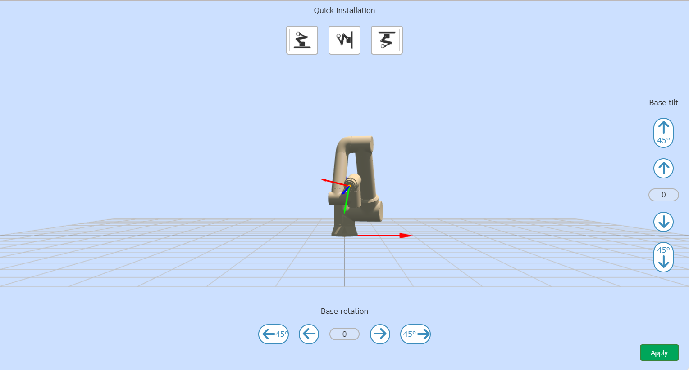
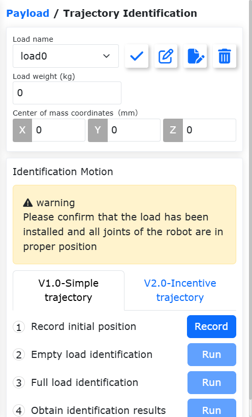
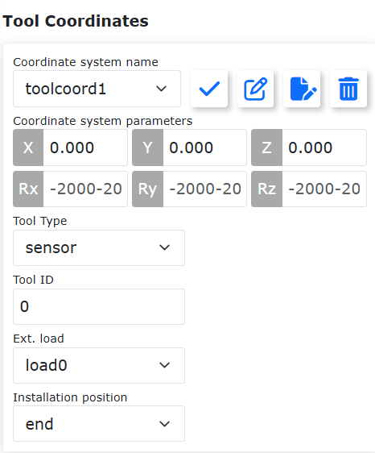
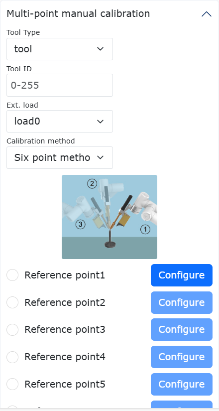

Configuración de parámetros del robot
=====================================

Configuración del modo de instalación
-------------------------------------

El modo de instalación predeterminado del robot es la instalación horizontal; cuando se modifique el modo de instalación del robot, es necesario configurar a tiempo el modo de instalación real del robot en el menú "Configuración inicial"->"Básico"->"Instalación", para garantizar el funcionamiento normal del robot.

Teniendo en cuenta escenarios de despliegue del robot más flexibles y variados, ofrecemos la función de instalación libre; el usuario debe hacer clic en "Configuración inicial"->"Básico"->"Instalación" para entrar en la página de configuración del modo de instalación del robot. Ajustar manualmente los ángulos de "Inclinación de la base" y "Rotación de la base"; el modelo 3D mostrará el efecto de instalación correspondiente. Tras la modificación, hacer clic en el botón "Aplicar" para completar la configuración del modo de instalación del robot.

   
.. centered:: Figura 3.1-1 Instalación del robot

.. important::
    Una vez completada la instalación del robot, es obligatorio configurar correctamente el modo de instalación del robot; de lo contrario, se verán afectadas la función de arrastre y la función de detección de colisiones del robot.

Configuración de la carga del extremo
-------------------------------------

En "Configuración inicial"->"Básico"->"Carga", en el tipo de identificación de "Identificación de trayectoria", entrar en la interfaz de configuración de la carga del extremo.

.. note:: 
   .. image:: base/071.png
      :width: 0.75in
      :height: 0.75in
      :align: left

   Nombre: **Botón Aplicar**
   
   Función: aplicar el peso de la carga y las coordenadas del centro de masa correspondientes al número de carga

.. note:: 
   .. image:: base/072.png
      :width: 0.75in
      :height: 0.75in
      :align: left

   Nombre: **Botón Modificar**
   
   Función: hacer clic para abrir/cerrar la interfaz de movimiento de identificación

.. note:: 
   .. image:: base/073.png
      :width: 0.75in
      :height: 0.75in
      :align: left

   Nombre: **Botón Cambiar nombre**
   
   Función: cambiar el nombre de la carga

.. note:: 
   .. image:: base/074.png
      :width: 0.75in
      :height: 0.75in
      :align: left

   Nombre: **Botón Vaciar**
   
   Función: vaciar la información de carga actual (peso de la carga y coordenadas del centro de masa a 0)

Al configurar la carga del extremo, se puede introducir directamente la masa de la herramienta del extremo y las coordenadas del centro de masa correspondientes X, Y y Z, y hacer clic en el botón "Aplicar" para configurarlo.

Asimismo, se puede hacer clic en el botón "Editar" para abrir la interfaz "Movimiento de identificación" y realizar la identificación automática de la carga; tras completar la ejecución de la identificación, aplicarla.

.. important:: 
   La masa de la carga no puede superar el rango máximo de carga del robot. La carga correspondiente a cada modelo es la siguiente:

   - FR3: 3kg

   - FR5: 5kg

   - FR10: 10kg

   - FR16: 16kg
   
   - FR20: 20kg
   
   - FR30: 30kg

   El rango de configuración de las coordenadas del centro de masa es de 0 a 1000, en unidades de mm.

.. centered:: Figura 3.2-1 Esquema de configuración de la carga
    
.. important:: 
    Tras instalar la carga en el extremo del robot, es obligatorio configurar correctamente el peso de la carga del extremo y las coordenadas del centro de masa; de lo contrario, se verán afectadas la función de arrastre y la función de detección de colisiones del robot.

Configuración de las coordenadas de herramienta
-----------------------------------------------

En "Configuración inicial"->"Básico"->"Coordenadas de herramienta" entrar en la página de coordenadas de herramienta.

.. note:: 
   .. image:: base/071.png
      :width: 0.75in
      :height: 0.75in
      :align: left

   Nombre: **Botón Aplicar**
   
   Función: hacer clic para aplicar el sistema de coordenadas de herramienta

.. note:: 
   .. image:: base/072.png
      :width: 0.75in
      :height: 0.75in
      :align: left

   Nombre: **Botón Modificar**
   
   Función: hacer clic para abrir/cerrar la interfaz de calibración del sistema de coordenadas

.. note:: 
   .. image:: base/073.png
      :width: 0.75in
      :height: 0.75in
      :align: left

   Nombre: **Botón Cambiar nombre**
   
   Función: cambiar el nombre del sistema de coordenadas de herramienta

.. note:: 
   .. image:: base/074.png
      :width: 0.75in
      :height: 0.75in
      :align: left

   Nombre: **Botón Vaciar**
   
   Función: vaciar la información del sistema de coordenadas de herramienta actual

Las coordenadas de herramienta permiten la modificación, el borrado y la aplicación de las coordenadas de herramienta. En la lista desplegable del sistema de coordenadas de herramienta, tras seleccionar el sistema de coordenadas correspondiente se mostrarán debajo los valores de coordenadas correspondientes (el nombre del sistema de coordenadas se puede personalizar), el tipo de herramienta y la posición de instalación (solo se muestra en el caso de herramientas de tipo sensor); tras seleccionar un sistema de coordenadas, hacer clic en el botón "Aplicar", y el sistema de coordenadas de herramienta en uso actualmente pasa a ser el seleccionado, como se muestra a continuación.

   
.. centered:: Figura 3.3-1 Configuración de las coordenadas de herramienta

Hacer clic en "Modificar" para volver a configurar, según las indicaciones, el sistema de coordenadas de herramienta de ese número. El método de calibración de herramienta se divide en el método de cuatro puntos y el método de seis puntos; el método de cuatro puntos solo calibra el TCP de la herramienta, es decir, la posición del punto central de la herramienta, y su actitud por defecto es consistente con la actitud del extremo; el método de seis puntos añade dos puntos sobre la base del método de cuatro puntos para calibrar la actitud de la herramienta.

.. centered:: Figura 3.3-2 Calibración del sistema de coordenadas de herramienta

.. important:: 
    1. Tras instalar la herramienta en el extremo, es obligatorio realizar la calibración y la aplicación del sistema de coordenadas de herramienta; de lo contrario, la posición y la actitud del punto central de la herramienta no cumplirán los valores esperados cuando el robot ejecute las instrucciones de movimiento.

    2. El sistema de coordenadas de herramienta utiliza generalmente toolcoord1~toolcoord19; aplicar toolcoord0 significa que el centro de posición del TCP de la herramienta está en el centro de la brida del extremo; al calibrar el sistema de coordenadas de herramienta, primero es necesario aplicar el sistema de coordenadas de herramienta a toolcoord0 y, a continuación, seleccionar otro sistema de coordenadas de herramienta para calibrarlo y aplicarlo.