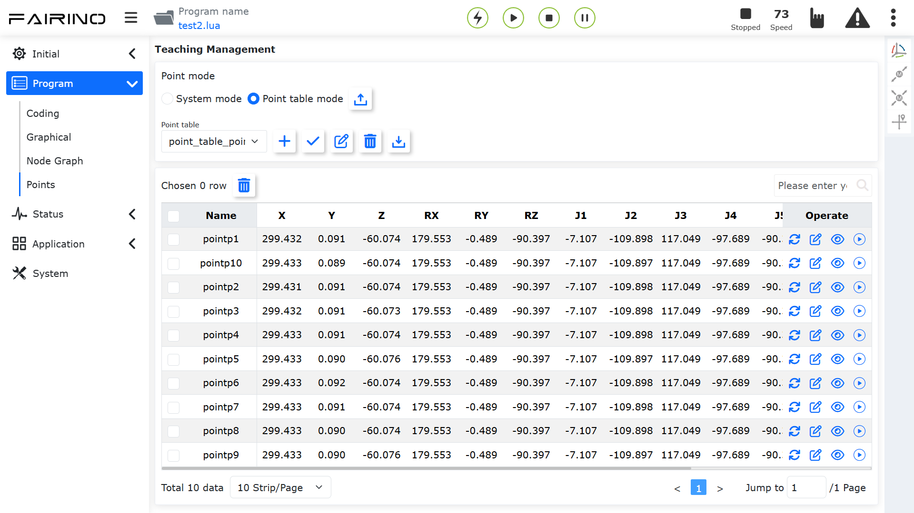
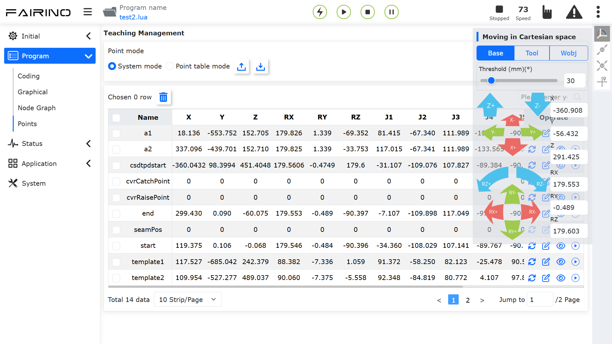
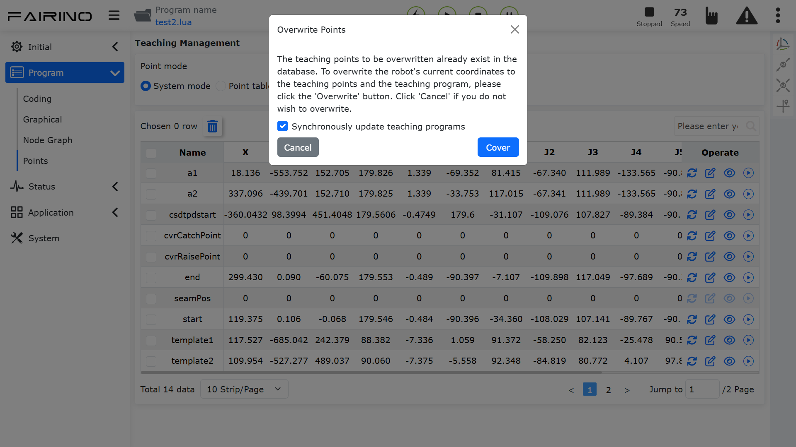
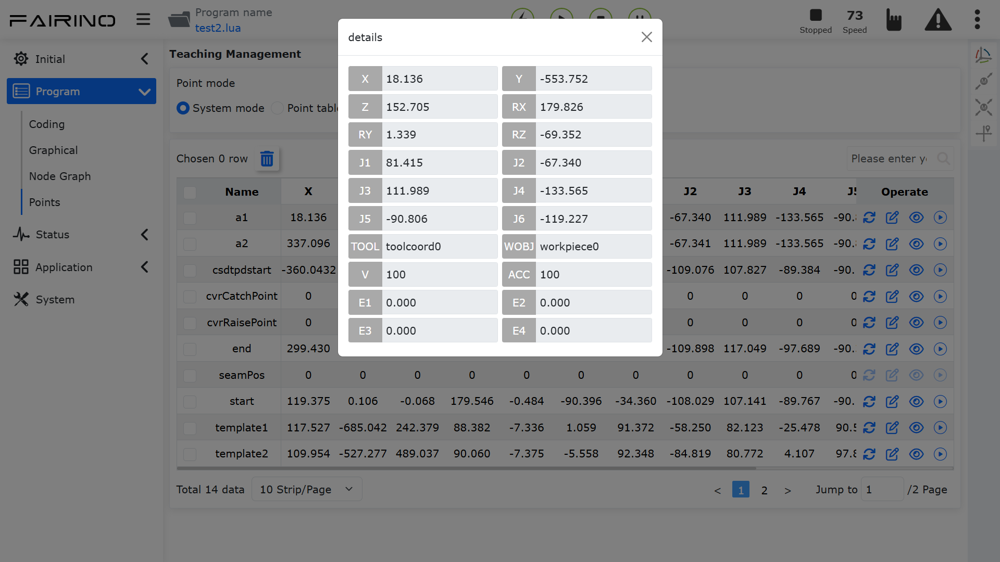
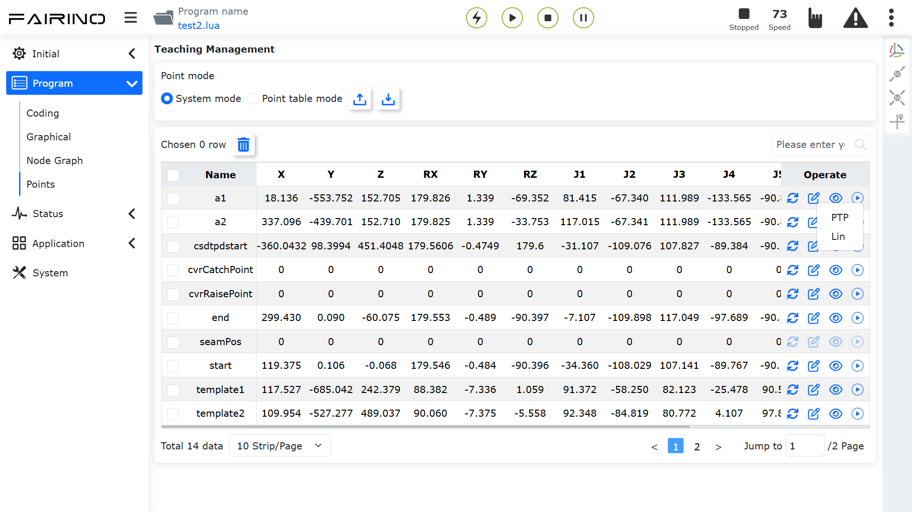

Puntos de enseñanza
===================

.. toctree:: 
   :maxdepth: 6

La gestión de la enseñanza se divide en dos modos: "Modo de sistema" y "Modo de tabla de puntos", lo que permite que, al llamar a los programas del manipulador, se puedan llamar distintas tablas de puntos para implementar distintos esquemas de inspección y satisfacer los requisitos de las recetas. En el futuro, cada vez que se añada un equipo o producto, se podrá descargar el paquete de datos de la tabla de puntos al robot mediante el ordenador superior, y el paquete de datos de la tabla de puntos creado en el robot también se podrá cargar al ordenador superior.

**Modo de sistema**: admite "importar, exportar, eliminar, cambiar nombre, modificar, sobrescribir, modificar, consultar" el contenido de los puntos de enseñanza, así como el movimiento de un solo paso hasta el punto de enseñanza.

.. centered:: Figura 12.1-1 Interfaz de gestión de la enseñanza - Modo de sistema

**Modo de tabla de puntos**: admite "añadir, aplicar, cambiar nombre, eliminar, importar, exportar" la tabla de puntos, "eliminar, modificar, consultar y sobrescribir" el contenido de los puntos dentro de la tabla de puntos, así como el movimiento de un solo paso hasta el punto de enseñanza.

.. centered:: Figura 12.1-2 Interfaz de gestión de la enseñanza - Modo de tabla de puntos

En la esquina superior derecha de la interfaz de gestión de la enseñanza se muestra la barra de operación del cuerpo del robot; el usuario puede, en esta interfaz, mover el cuerpo del robot y, a continuación, realizar la operación de sobrescritura de los datos del punto de enseñanza.

.. centered:: Figura 12.1-3 Interfaz de gestión de la enseñanza - Barra de operación del cuerpo del robot

En la esquina superior derecha de los datos de la tabla de puntos de enseñanza se puede introducir el nombre del punto de enseñanza para buscarlo; al hacer clic en el nombre del punto de enseñanza en los datos de la tabla de puntos de enseñanza se entra en estado de edición; introducir el nombre modificado y hacer clic fuera del nombre del punto de enseñanza para completar la modificación.

.. note:: 
   .. image:: points/004.png
      :height: 0.75in
      :align: left

   Nombre: **Botón Importar**
   
   Función: importar archivo de puntos de enseñanza

.. note:: 
   .. image:: points/005.png
      :height: 0.75in
      :align: left

   Nombre: **Botón Exportar**
   
   Función: exportar archivo de puntos de enseñanza

.. note:: 
   .. image:: points/006.png
      :height: 0.75in
      :align: left

   Nombre: **Botón Eliminar**
   
   Función: tras seleccionar uno o varios puntos de enseñanza y hacer clic en el botón "Eliminar" de la parte superior de la tabla, se muestra el aviso "Vuelva a hacer clic en el botón Eliminar para confirmar la eliminación"; al volver a hacer clic se elimina la información de dicho punto;

.. note:: 
   .. image:: points/007.png
      :height: 0.75in
      :align: left

   Nombre: **Botón Sobrescribir punto**
   
   Función: hacer clic para sobrescribir el punto de enseñanza con los datos de posición actuales del robot, y seleccionar en la ventana emergente "¿Sincronizar el programa de enseñanza?"

.. centered:: Figura 12.1-4 Sobrescritura del punto de enseñanza

.. note:: 
   .. image:: points/009.png
      :height: 0.75in
      :align: left

   Nombre: **Botón Editar**
   
   Función: hacer clic para confirmar la modificación de los valores x, y, z, rx, ry, rz y v del punto de enseñanza

.. important:: 
   Los valores modificados de x, y, z, rx, ry, rz del punto de enseñanza no deben superar el rango de trabajo del robot.

.. note:: 
   .. image:: points/010.png
      :height: 0.75in
      :align: left

   Nombre: **Botón Detalle**
   
   Función: hacer clic para consultar el detalle del punto de enseñanza

.. centered:: Figura 12.1-5 Detalle del punto de enseñanza

.. note:: 
   .. image:: points/012.png
      :height: 0.75in
      :align: left

   Nombre: **Botón Iniciar ejecución**
   
   Función: hacer clic para seleccionar el modo de ejecución de un solo punto y desplazar el robot hasta la posición de dicho punto; seleccionar PTP para el movimiento punto a punto y Lin para el movimiento en línea recta.

.. centered:: Figura 12.1-6 Ejecución del punto de enseñanza