Paquete de proceso
==================

.. toctree:: 
  :maxdepth: 5

Biblioteca de expertos en soldadura
-----------------------------------

Hacer clic en el menú "Biblioteca de expertos en soldadura" de "Aplicaciones auxiliares"->"Paquete de proceso" para entrar en la interfaz de la función de biblioteca de expertos en soldadura, que incluye soldadura en línea recta, soldadura en arco, soldadura multicapa y multipasada y ajuste de actitud.

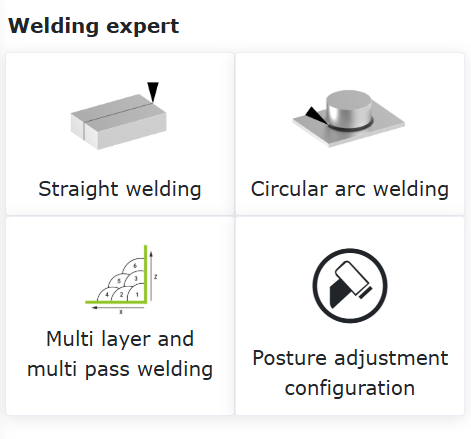

.. centered:: Figura 15.1‑1 Configuración del eje extendido

Soldadura en línea recta
~~~~~~~~~~~~~~~~~~~~~~~~

Hacer clic en "Soldadura en línea recta" para entrar en la interfaz de guía de soldadura en línea recta. Una vez completada la configuración de los ajustes básicos del robot, podemos generar rápidamente un programa de enseñanza de soldadura mediante unos sencillos pasos. Incluye principalmente los cinco pasos siguientes; dado que las funciones son mutuamente excluyentes, los pasos reales para generar un programa de enseñanza de soldadura son menos de cinco.

Paso uno: si se utiliza el eje extendido; si se utiliza el eje extendido es necesario configurar los sistemas de coordenadas relacionados con el eje extendido y habilitar el eje extendido. Al utilizar el eje extendido no se puede utilizar la función de soldadura oscilante.

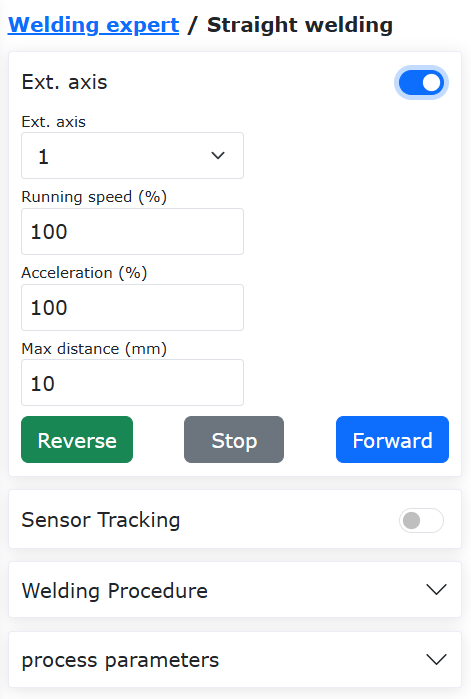

.. centered:: Figura 15.1‑2 Configuración del eje extendido

Paso dos: seleccionar si se necesita seguimiento por sensor; en caso afirmativo, es necesario editar los parámetros de la instrucción de búsqueda de posición láser. Al utilizar el seguimiento por sensor no se puede utilizar la función de soldadura oscilante.

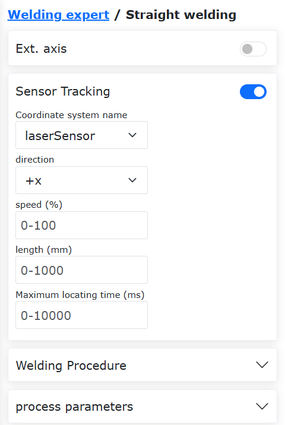

.. centered:: Figura 15.1‑3 Configuración de la búsqueda de posición láser

Paso tres: seleccionar si se necesita soldadura oscilante; si se necesita soldadura oscilante, es necesario editar los parámetros relacionados con la soldadura oscilante.

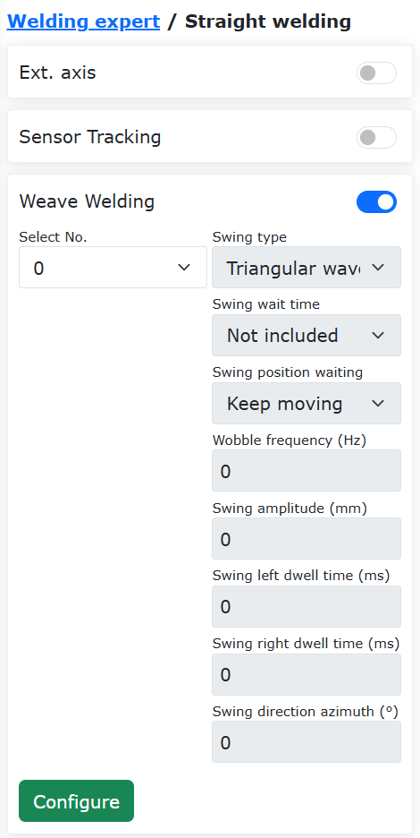

.. centered:: Figura 15.1‑4 Configuración de la soldadura oscilante

Paso cuatro: calibrar el punto inicial, el punto de seguridad inicial, el punto final y el punto de seguridad final. Si en el primer paso se seleccionó el eje extendido, se cargará la función de movimiento del eje extendido, en combinación con la calibración de los puntos correspondientes.

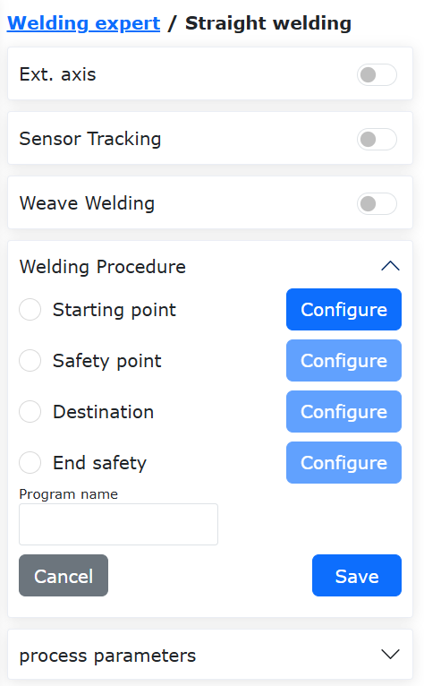

.. centered:: Figura 15.1‑5 Calibración de los puntos correspondientes

Paso cinco: dar nombre al programa y abrir automáticamente dicho programa en la interfaz de enseñanza de programas.

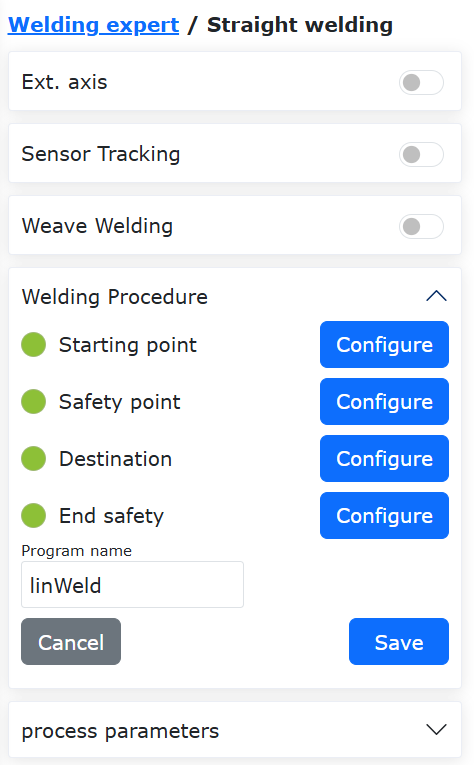

.. centered:: Figura 15.1‑6 Guardado del programa

Tras guardar correctamente el programa, se puede modificar la velocidad de soldadura en los parámetros del proceso.

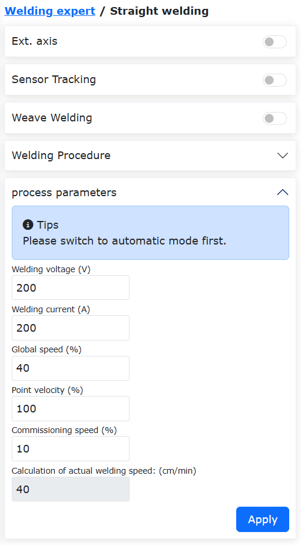

.. centered:: Figura 15.1‑7 Parámetros del proceso

Soldadura en arco
~~~~~~~~~~~~~~~~~

Hacer clic en "Soldadura en arco" de "Forma de la pieza de soldadura" para entrar en la interfaz de guía de soldadura en arco. Una vez completada la configuración de los ajustes básicos del robot, podemos generar rápidamente un programa de enseñanza de soldadura mediante dos sencillos pasos. Incluye principalmente los dos pasos siguientes.

Paso uno: calibrar el punto inicial, el punto de seguridad inicial, el punto de transición del arco, el punto final y el punto de seguridad final.

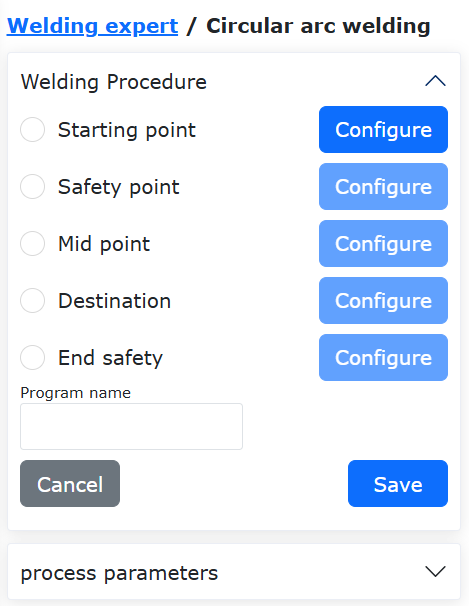

.. centered:: Figura 15.1‑8 Calibración de puntos

Paso dos: dar nombre al programa y abrir automáticamente dicho programa en la interfaz de enseñanza de programas.

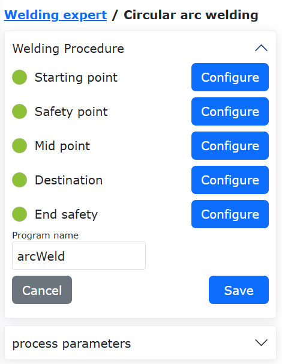

.. centered:: Figura 15.1‑9 Guardado del programa

Tras guardar correctamente el programa, se puede modificar la velocidad de soldadura en los parámetros del proceso.

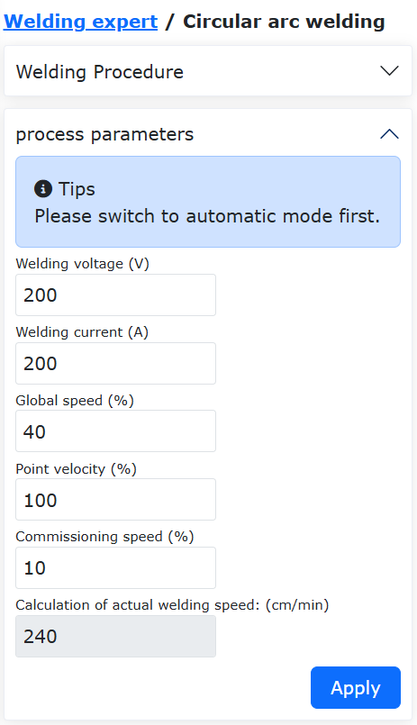

.. centered:: Figura 15.1‑10 Parámetros del proceso

Soldadura multicapa y multipasada
~~~~~~~~~~~~~~~~~~~~~~~~~~~~~~~~~

Cuando se trata de soldaduras con un tamaño de cateto superior a 10 mm, normalmente se utiliza la función de soldadura multicapa y multipasada. Esta función permite configurar el programa de soldadura mediante plantillas, añadiendo la función de seguimiento de arco durante el primer pase de la soldadura multicapa y multipasada, y corrigiendo la desviación de la soldadura en los pases lineales posteriores, mejorando así la calidad de la soldadura.

El flujo de operación de la función de soldadura multicapa y multipasada con seguimiento de arco es el siguiente:

1) Configurar el sistema de coordenadas de herramienta e introducir las dimensiones y la actitud de la antorcha de soldadura.

.. note::
   Los valores de la interfaz son solo ejemplos; prevalecerá el estado real de la herramienta.

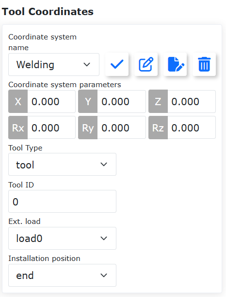

.. centered:: Figura 15.1-11 Configuración del sistema de coordenadas de herramienta

2) Hacer clic en "Soldadura multicapa y multipasada" para entrar en la interfaz.

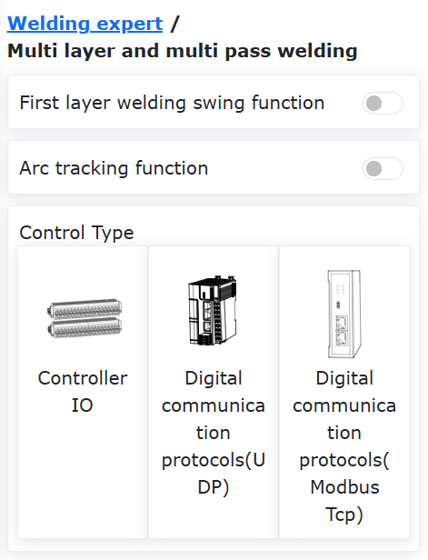

.. centered:: Figura 15.1-12 Abrir la interfaz de soldadura multicapa y multipasada

3) Si se desea utilizar la función de seguimiento de arco, es imprescindible activar el interruptor "Función de oscilación de la primera capa" y configurar los parámetros de oscilación correspondientes.

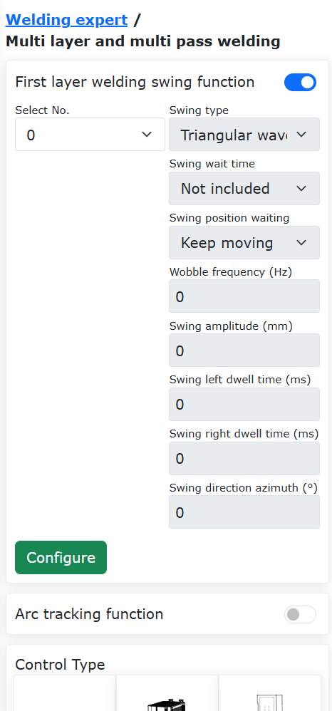

.. centered:: Figura 15.1-13 Activar la función de oscilación de la primera capa

4) Hacer clic en el botón "Configurar", editar los parámetros de oscilación y, a continuación, hacer clic en "Configurar".

.. note::
   Si se necesita que el seguimiento de arco realice la compensación izquierda y derecha, solo se pueden seleccionar los tipos "Oscilación triangular" y "Oscilación sinusoidal"; la frecuencia de oscilación no debe ser inferior a 0,5 Hz, la amplitud de oscilación no debe ser inferior a 3 mm, los tiempos de permanencia izquierdo y derecho de la oscilación deben ser iguales y el ángulo de azimut de la oscilación debe ser 0.

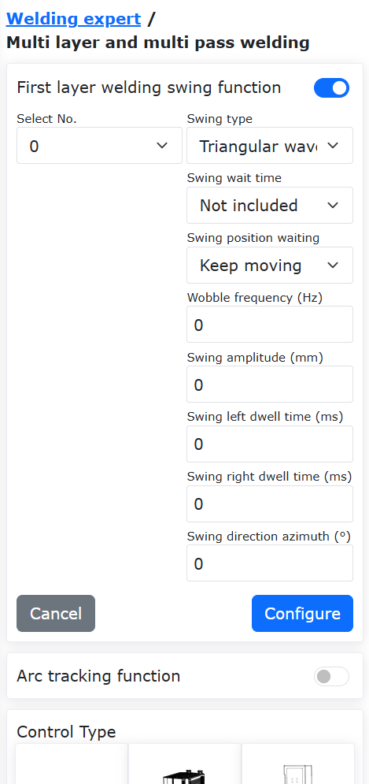

.. centered:: Figura 15.1-14 Configuración de los parámetros de oscilación

5) Activar el interruptor "Función de seguimiento de arco" y editar los parámetros de compensación superior-inferior e izquierda-derecha correspondientes.

.. note::
   Los parámetros de seguimiento de arco deben configurarse según la situación real de soldadura, consultando el «Manual de operación de la función de seguimiento de arco» o contactando con el personal técnico correspondiente.

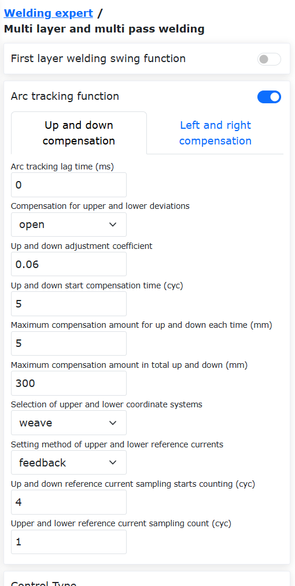

.. centered:: Figura 15.1-15 Configuración de los parámetros de seguimiento de arco

6) Según el tipo de control, hacer clic en el tipo correspondiente para entrar en la interfaz; en primer lugar, en el primer grupo de puntos, establecer el "Punto de soldadura" como la posición de inicio de la soldadura; el "Punto X+" como un punto en la dirección X+ del sistema de coordenadas de desplazamiento personalizado respecto al punto de soldadura; el "Punto Z+" como un punto en la dirección Z+ del sistema de coordenadas de desplazamiento personalizado respecto al punto de soldadura; el "Punto de seguridad" como la posición de transición desde la finalización de la soldadura anterior hasta el inicio de la siguiente. Tras completar la enseñanza y la configuración, se entra automáticamente en la configuración del segundo grupo de puntos.

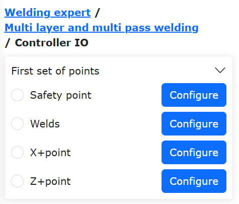

.. centered:: Figura 15.1-16 Configuración de la posición del punto inicial de la línea recta en la soldadura multicapa y multipasada

7) Seleccionar "Punto de línea recta"; aquí el "Punto de soldadura" es la posición de finalización de la soldadura; el "Punto X+" es un punto en la dirección X+ del sistema de coordenadas de desplazamiento personalizado respecto al "Punto de soldadura"; el "Punto Z+" es un punto en la dirección Z+ del sistema de coordenadas de desplazamiento personalizado respecto al "Punto de soldadura". Tras completar la enseñanza y la configuración, hacer clic en el botón "Completar" para configurar los parámetros de soldadura multicapa y multipasada.

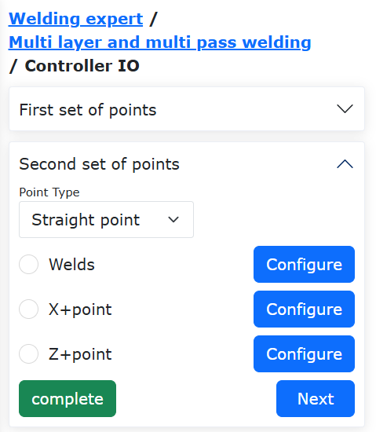

.. centered:: Figura 15.1-17 Configuración de la posición del punto final de la línea recta en la soldadura multicapa y multipasada

8) En esta página se pueden configurar el número de pasadas de soldadura multicapa y multipasada, así como la posición de distribución. Hacer clic en la casilla "On/Off" de la tabla de parámetros para seleccionar el valor correspondiente a la posición de soldadura multicapa y multipasada que se desea activar, e introducir en las columnas "X", "Z" y "B" la posición de desplazamiento y el ángulo correspondientes esperados en el sistema de coordenadas personalizado.

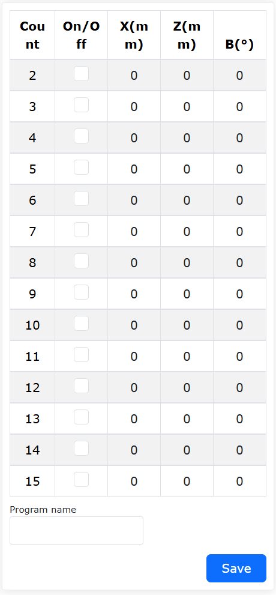

.. centered:: Figura 15.1-18 Configuración de los parámetros de soldadura multicapa y multipasada

9) Con esto se ha completado toda la configuración de parámetros; introducir el nombre del programa que se desea guardar y hacer clic en el botón "Guardar" para generar automáticamente el programa de soldadura multicapa y multipasada correspondiente.

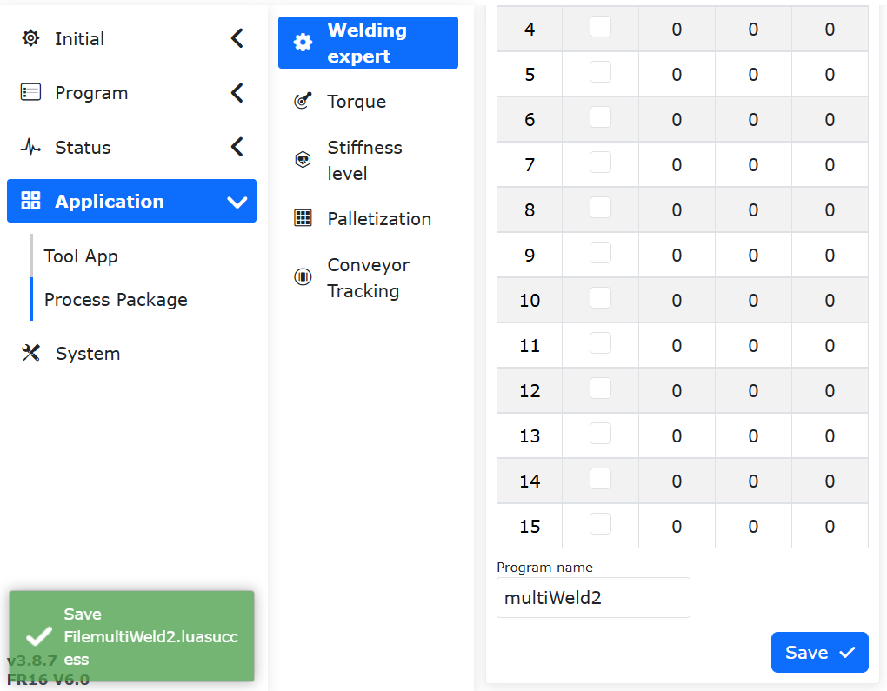

.. centered:: Figura 15.1-19 Generación del programa de soldadura multicapa y multipasada

10) Hacer clic en el botón "Abrir programa" para leer el programa lua guardado en el paso anterior; el contenido del programa se muestra en la figura siguiente.

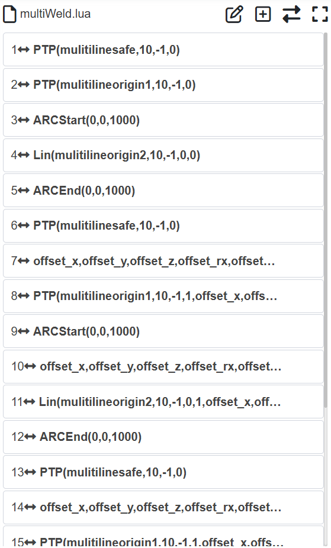

.. centered:: Figura 15.1-20 Ejemplo de programa de soldadura multicapa y multipasada con seguimiento de arco

Ajuste de actitud
~~~~~~~~~~~~~~~~~

Pasos de configuración del ajuste de actitud
+++++++++++++++++++++++++++++++++++++++++++++++++++++++++

**Step1**: Entrar en la interfaz de configuración del ajuste de actitud, seleccionar el tipo de placa y la dirección de movimiento real de trabajo del robot, ajustar la actitud del robot y configurar respectivamente el punto de actitud A, el punto de actitud B y el punto de actitud C; normalmente A es el punto de actitud del plano, B es el punto de actitud del flanco ascendente y C es el punto de actitud del flanco descendente.

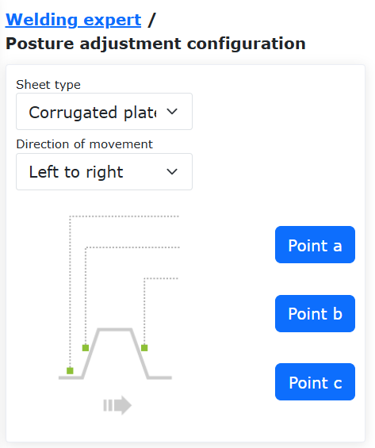

.. centered:: Figura 15.1‑21 Configuración del ajuste de actitud

.. important:: 
	La variación de actitud entre la actitud A y la actitud B, y entre la actitud A y la actitud C, debe ser lo más pequeña posible siempre que se satisfagan los requisitos de la aplicación. La función de ajuste adaptativo de actitud es una función de aplicación auxiliar y se utiliza normalmente junto con el seguimiento de soldadura.

**Step2**: En la interfaz de comandos del programa de enseñanza, seleccionar el comando "Adjust". Según los requisitos concretos de enseñanza del programa, añadir la instrucción en el lugar correspondiente.

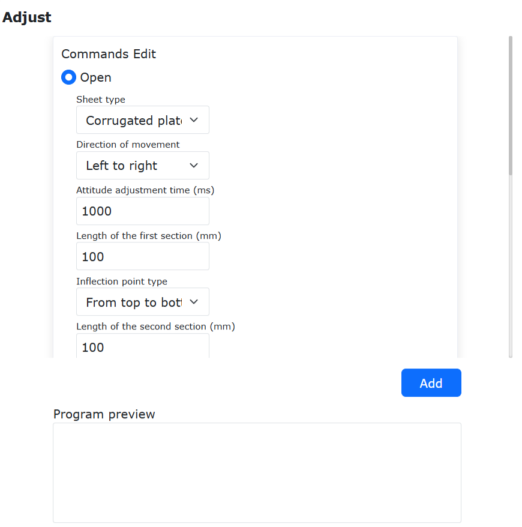

.. centered:: Figura 15.1‑22 Edición de la instrucción de ajuste de actitud

Programa de enseñanza de soldadura con ajuste adaptativo de actitud combinado con eje extendido y seguimiento láser
+++++++++++++++++++++++++++++++++++++++++++++++++++++++++++++++++++++++++++++++++++++++++++++++++++++++++++++++++++++++

.. list-table::
   :widths: 50 80 80
   :header-rows: 0
   :align: center

   * - **Número**
     - **Formato de la instrucción**
     - **Comentario**

   * - 1
     - EXT_AXIS_PTP(1,1laserstart)
     - #Punto inicial del sensor láser de movimiento del eje externo

   * - 2
     - PTP(laserstart,10,-1,0)
     - #Punto inicial del sensor láser de movimiento del robot

   * - 3
     - LTSearchStart(3,20,10,10000)
     - #Iniciar búsqueda de posición

   * - 4
     - LTSearchStop()
     - #Detener búsqueda de posición

   * - 5
     - EXT_AXIS_PTP(1,1,seamPos)
     - #Punto inicial de la soldadura de movimiento del eje externo

   * - 6
     - Lin(seamPos,20,-1,00,0)
     - #Punto inicial de la soldadura de movimiento del robot

   * - 7
     - LTTrackOn()
     - #Seguimiento láser

   * - 8
     - ARCStart(0,10000)
     - #Encendido del arco de la máquina de soldar

   * - 9
     - PostureAdjustOn(0,PosA,PosC,PosB,1000)
     - #Activación del ajuste adaptativo de actitud

   * - 10
     - EXT_AXIS_PTP(1,1,laserend)
     - #Punto final de la soldadura de movimiento del eje externo

   * - 11
     - Lin( laserend,10,-1,0,0)
     - #Punto final de la soldadura de movimiento del robot

   * - 12
     - ARCEnd(0,10000)
     - #Apagado del arco de la máquina de soldar

   * - 13
     - PostureAdjustOff(0)
     - #Desactivación del ajuste adaptativo de actitud

   * - 14
     - LTTrackOff
     - #Desactivación del seguimiento láser

Función de oscilación con transición de línea recta y arco en la nueva spline
~~~~~~~~~~~~~~~~~~~~~~~~~~~~~~~~~~~~~~~~~~~~~~~~~~~~~~~~~~~~~~~~~~~~~~~~~~~~~~~~~~~~~~

Descripción general
+++++++++++++++++++++++++++++++++++++++++++++++++++++++++++++++++++

La función de oscilación superpuesta a la transición de línea recta y arco en la nueva spline es la combinación de la función de transición de línea recta y arco en la nueva spline y la función de oscilación del robot, y permite que el robot realice movimientos de oscilación de los tipos "Oscilación triangular", "Oscilación triangular tipo L vertical", "Oscilación triangular para soldadura vertical", "Oscilación sinusoidal" y "Oscilación sinusoidal tipo L vertical" durante el proceso de transición de línea recta y arco en la nueva spline.

Flujo de operación
++++++++++++++++++++++++++++++++++++++++++++++++++++++++++++++++++++++++++++++++++++++++++++++++++++++++++++++++++++++++++++++++++++++

**Step1**: Calibrar el sistema de coordenadas de herramienta del robot mediante WebApp. Para los pasos concretos de esta función, consulte el manual de usuario del capítulo correspondiente.

**Step2**: Enseñar mediante WebApp no menos de 4 puntos. Tenga en cuenta que es mejor enseñar los puntos con un espaciado uniforme.

**Step3**: Configuración de los parámetros de oscilación. En la interfaz principal de WebApp, hacer clic en "Programa de enseñanza"->"Programación de programas" para entrar en el área de instrucciones "Instrucciones de movimiento".

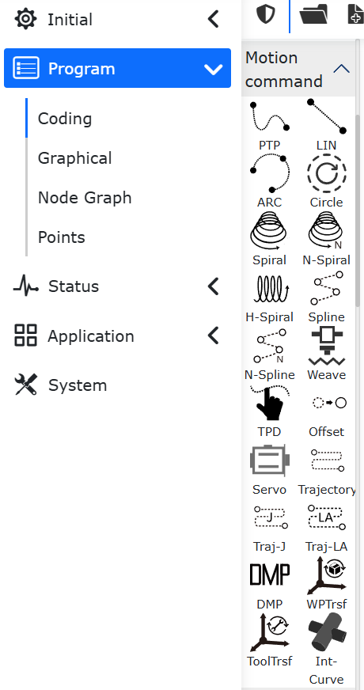
   
.. centered:: Figura 15.1‑23 Área "Instrucciones de movimiento"
  
En el área de instrucciones "Instrucciones de movimiento", hacer clic en el botón "Oscilación" para entrar en la interfaz de configuración "Weave"; en el cuadro desplegable "Seleccionar número" del área de instrucciones "Edición de instrucción", seleccionar el número de proceso y hacer clic en "Editar" para entrar en la configuración de los parámetros del proceso de oscilación; tras completar la configuración, hacer clic en "Configurar" para guardar el número de proceso.

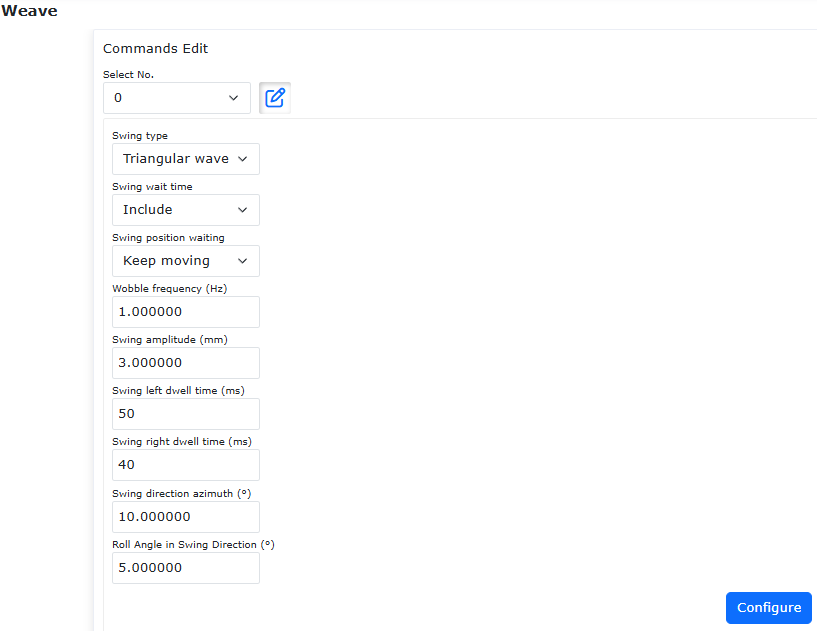
   
.. centered:: Figura 15.1‑24 Configuración de los parámetros del proceso de oscilación
 
.. note:: La función de oscilación superpuesta a la transición de línea recta y arco en la nueva spline solo es efectiva actualmente para los tipos "Oscilación triangular", "Oscilación triangular tipo L vertical", "Oscilación triangular para soldadura vertical", "Oscilación sinusoidal" y "Oscilación sinusoidal tipo L vertical"; en el cuadro desplegable "Tiempo de espera de oscilación" seleccionar la opción "Incluido", y en el cuadro desplegable "Espera de posición de oscilación" seleccionar la opción "Continuar moviéndose dentro del tiempo de espera".

**Step4**: Añadir la instrucción de movimiento de oscilación. En el área de instrucciones "Tipo de instrucción" de la interfaz de configuración "Weave", hacer clic en los botones "Iniciar oscilación"-"Añadir"-"Detener oscilación"-"Añadir"-"Aplicar" para completar la configuración del movimiento de oscilación.

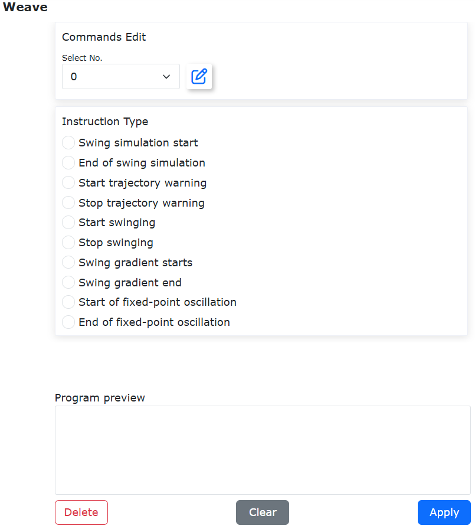
   
.. centered:: Figura 15.1‑25 Configuración del movimiento de oscilación
  
**Step5**: Añadir la instrucción de transición de línea recta y arco en la nueva spline. En el área de instrucciones "Instrucciones de movimiento", hacer clic en el botón "Nueva spline" para entrar en la interfaz de configuración "N-Spline"; en el área de instrucciones "Tipo de instrucción", hacer clic en el botón "Inicio de trayectoria multipunto", seleccionar la opción "Punto de transición de arco" en el cuadro desplegable "Modo de control", introducir el parámetro en el cuadro "Tiempo medio de enlace global" y hacer clic en "Añadir" para completar la configuración del modo de movimiento de la nueva spline.

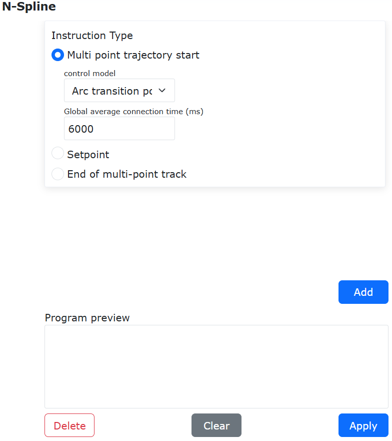
   
.. centered:: Figura 15.1‑26 Configuración del modo de movimiento de la nueva spline

.. note:: El "Tiempo medio de enlace global" es aplicable al modo de control "Punto de transición de arco"; en los demás modos se puede mantener el valor predeterminado, y se recomienda ajustarlo tomando valores lo más altos posible.

Los métodos de ajuste pueden ser:

1. Dividir el tiempo completo de movimiento ÷ (número de puntos - 1) para obtener el parámetro de tiempo medio de enlace global, donde las unidades de tiempo son milisegundos.
2. Configurarlo según el tiempo de ejecución de los dos puntos más alejados entre sí durante el movimiento completo. Si no es cómodo observarlo o no hay requisitos de transición suave de actitud, se puede configurar por defecto en 10000 milisegundos o ajustarlo tomando valores más altos.

**Step6**: Añadir puntos de movimiento. En el área de instrucciones "Tipo de instrucción" de la interfaz de configuración "N-Spline", hacer clic en los botones "Establecer punto"-"SPL"; en el cuadro desplegable "Nombre del punto" seleccionar el punto de movimiento, en el cuadro "Velocidad de depuración" introducir la proporción de velocidad de movimiento de la instrucción, en el cuadro "Radio de transición suave" introducir el parámetro del radio de suavizado, en el cuadro desplegable "¿Es el último punto?" seleccionar el estado de movimiento del punto y hacer clic en "Añadir" para completar la configuración de un único punto de movimiento.

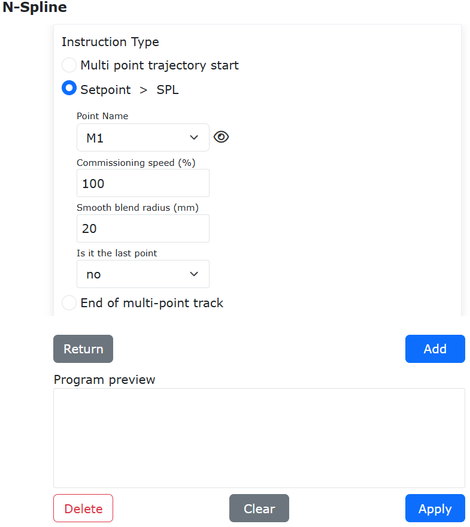
   
.. centered:: Figura 15.1‑27 Configuración de los puntos de movimiento
 
.. note:: Repetir el paso 6 para completar la configuración de todos los puntos de movimiento, y en la configuración del último punto seleccionar la opción "Sí" en el cuadro desplegable "¿Es el último punto?".

**Step7**: Completar la instrucción de transición de línea recta y arco en la nueva spline. En el área de instrucciones "Tipo de instrucción" de la interfaz de configuración "N-Spline", hacer clic en el botón "Fin de trayectoria multipunto" y hacer clic en los botones "Añadir"-"Aplicar" para completar la configuración completa de la instrucción de transición de línea recta y arco en la nueva spline.

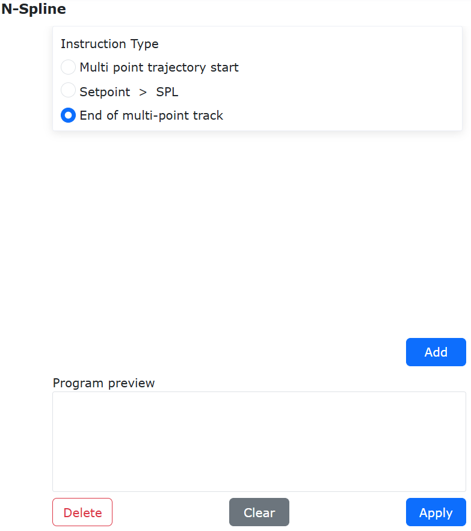
   
.. centered:: Figura 15.1‑28 Configuración del fin de movimiento de la nueva spline
  
**Step8**: Escribir el programa LUA de la función de transición de línea recta y arco en la nueva spline + oscilación. Ajustar el orden de las instrucciones generadas en los pasos 4 a 7. Ejecutar dicho programa LUA permite realizar la función de transición de línea recta y arco en la nueva spline + oscilación.

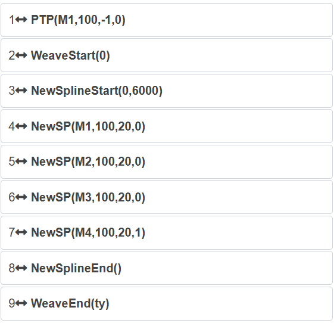
   
.. centered:: Figura 15.1‑29 Programa LUA de la función de transición de línea recta y arco en la nueva spline + oscilación
 
.. note:: Antes del punto de movimiento inicial de la transición de línea recta y arco en la nueva spline se puede añadir un movimiento PTP para asegurar que el robot llegue al punto de movimiento inicial.

Configuración de la estrategia de retorno al centro de la transición de línea recta y arco en la nueva spline + oscilación
++++++++++++++++++++++++++++++++++++++++++++++++++++++++++++++++++++++++++++++++++++++++++++++++++++++++++++++++++++++++++++++++++++++++

En la interfaz principal de WebApp, hacer clic en "Aplicaciones auxiliares"->"Paquete de proceso"->"Biblioteca de expertos en soldadura" para entrar en el área de instrucciones "Biblioteca de expertos en soldadura".

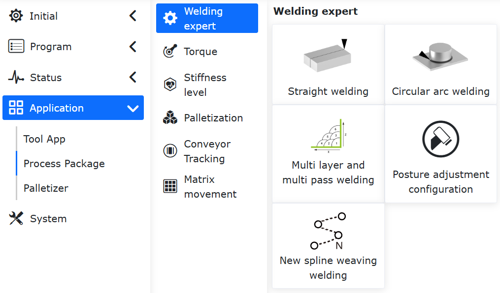
   
.. centered:: Figura 15.1‑30 Instrucción de soldadura oscilante con nueva spline

En el área de instrucciones "Biblioteca de expertos en soldadura", hacer clic en el botón "Soldadura oscilante con nueva spline" para entrar en la interfaz de configuración "Soldadura oscilante con nueva spline"; en el cuadro desplegable "Tipo de retorno al centro de oscilación" del área de instrucciones "Parámetros de soldadura oscilante" se pueden seleccionar las opciones "Sin retorno al centro" o "Retorno al centro con trayectoria extendida", como se muestra en la Figura 3-2; tras completar la selección, hacer clic en el botón "Configurar" para completar la configuración de la estrategia de retorno al centro de la oscilación.

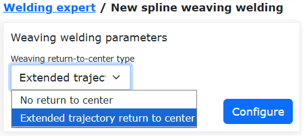
   
.. centered:: Figura 15.1‑31 Tipo de retorno al centro de oscilación de la transición de línea recta y arco en la nueva spline

.. note:: En el cuadro desplegable "Tipo de retorno al centro de oscilación", cuando se selecciona la opción "Sin retorno al centro", el movimiento de oscilación de transición de arco de la nueva spline se detiene tras llegar al último punto; cuando se selecciona la opción "Retorno al centro con trayectoria extendida", el movimiento de oscilación de transición de arco de la nueva spline continúa moviéndose tras llegar al último punto para asegurar que se detiene con un ciclo de oscilación completo.

Configuración del sistema de paletizado
---------------------------------------

Pasos de configuración del sistema de paletizado
~~~~~~~~~~~~~~~~~~~~~~~~~~~~~~~~~~~~~~~~~~~~~~~~

**Step1**: En "Aplicaciones auxiliares"->"Paquete de proceso", hacer clic en el elemento de menú "Paletizado" para entrar en la interfaz de configuración del sistema de paletizado.

La primera vez que se utiliza, es necesario crear primero una receta; hacer clic en "Crear receta", introducir el nombre de la receta y hacer clic en "Crear"; tras una creación correcta, hacer clic en "Iniciar configuración" para entrar en la página de configuración del paletizado.

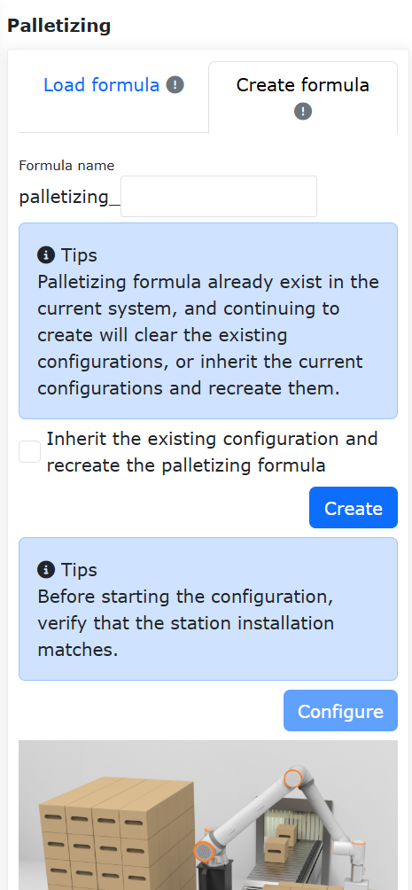

.. centered:: Figura 15.2‑1 Configuración de la receta de paletizado

**Step2**: En la columna de configuración de la pieza, hacer clic en "Configurar" para entrar en la ventana emergente de configuración de la pieza; configurar la "Longitud", la "Anchura", la "Altura" de la pieza y el punto de agarre de la pieza, y hacer clic en "Confirmar configuración" para completar la configuración de la información de la pieza.

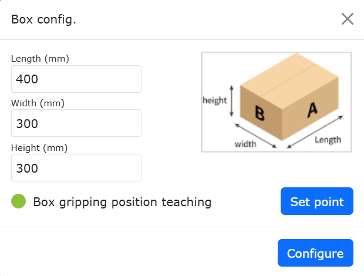

.. centered:: Figura 15.2‑2 Configuración de la pieza de paletizado

**Step3**: En la columna de configuración del palé, hacer clic en "Configurar" para entrar en la ventana emergente de configuración del palé; configurar el "Borde frontal", el "Borde lateral" y la "Altura" del palé, a continuación configurar la estación de trabajo y el punto de transición de la estación de trabajo, y hacer clic en "Confirmar configuración" para completar la configuración de la información del palé.

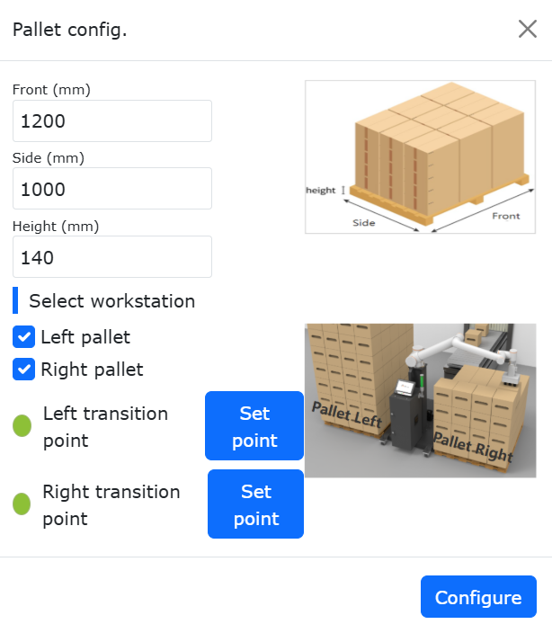

.. centered:: Figura 15.2‑3 Configuración del palé de paletizado

**Step4**: En la columna de configuración de dimensiones del equipo de paletizado, hacer clic en "Configurar" para entrar en la ventana emergente de configuración de dimensiones del equipo de paletizado; configurar "X", "Y", "Z" y "Angle" del equipo, y hacer clic en "Confirmar configuración" para completar la configuración de la información de dimensiones del equipo de paletizado.

.. important:: 
   X, Y, Z son los valores absolutos de las coordenadas del punto de la esquina superior derecha del palé izquierdo o de la esquina superior izquierda del palé derecho respecto al sistema de coordenadas base del robot; Angle es el ángulo de rotación en el momento de la instalación del robot, y se recomienda que sea 0 en la instalación.

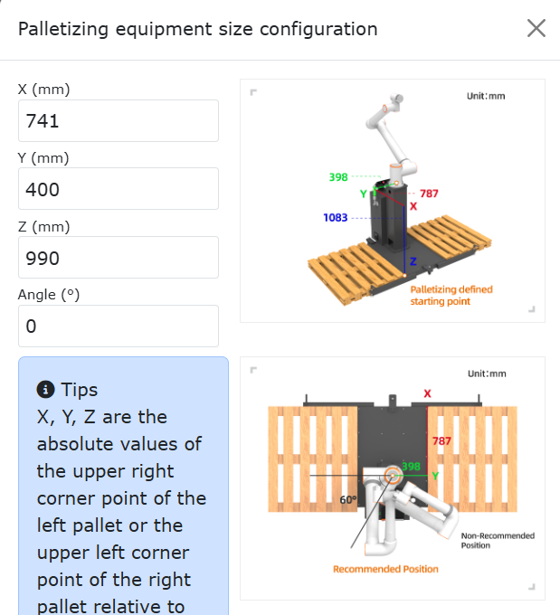

.. centered:: Figura 15.2‑4 Configuración de dimensiones del equipo de paletizado

**Step5**: En la columna de configuración de modos, hacer clic en "Configurar" para entrar en la ventana emergente de configuración de modos.

   **Activación/desactivación del modo B**: Activado: se puede conmutar entre el modo A y el modo B, y configurar el modo B de cada capa de paletizado; Desactivado: no se puede conmutar al modo B ni configurar el modo B de cada capa de paletizado;

   **Conmutación de modo A/B**: Seleccionar el modo A: la pieza añadida es del modo A, con números de pieza A1, A2..., y no se puede ajustar la transparencia de la pieza; Seleccionar el modo B: la pieza añadida es del modo B, con números de pieza B1, B2..., y en este momento se puede activar/desactivar "Mostrar configuración del modo A" para mostrar las piezas del modo A;

   **Activación/desactivación de la visualización del modo A**: Activado: ajustar la transparencia de las piezas del modo B para comprobar si el efecto de configuración de los modos A/B es razonable; en este momento solo se pueden realizar operaciones de selección, adición, adición por lotes, eliminación y eliminación total sobre las piezas del modo B; Desactivado: no se puede configurar la transparencia de las piezas del modo B;

.. important:: 
   Al configurar las piezas, si hay colisión entre piezas, el color de fondo de las piezas se vuelve rojo y en ese momento no se pueden realizar las operaciones anteriores. Si se necesita operar, configure las piezas sin colisión.

Al configurar las piezas, establecer primero el espaciado entre piezas; el marco de la derecha es la simulación del modo de colocación de las piezas en el palé derecho, y se pueden añadir individualmente o por lotes. A continuación, configurar el número de capas de paletizado y el modo de cada capa, y hacer clic en "Confirmar configuración" para completar la configuración de la información de modos.

.. important:: 
   Dirección de paletizado: tomando como ejemplo el palé derecho, la esquina inferior derecha es el punto más lejano; se coloca una fila de piezas en vertical u horizontal desde la esquina inferior derecha, y luego se coloca otra fila de piezas en horizontal o vertical hacia arriba, y así sucesivamente (la página Web ya indica la dirección de paletizado; por favor, téngalo en cuenta).
   
   El palé izquierdo coloca las piezas de forma especular según el modo del palé derecho.

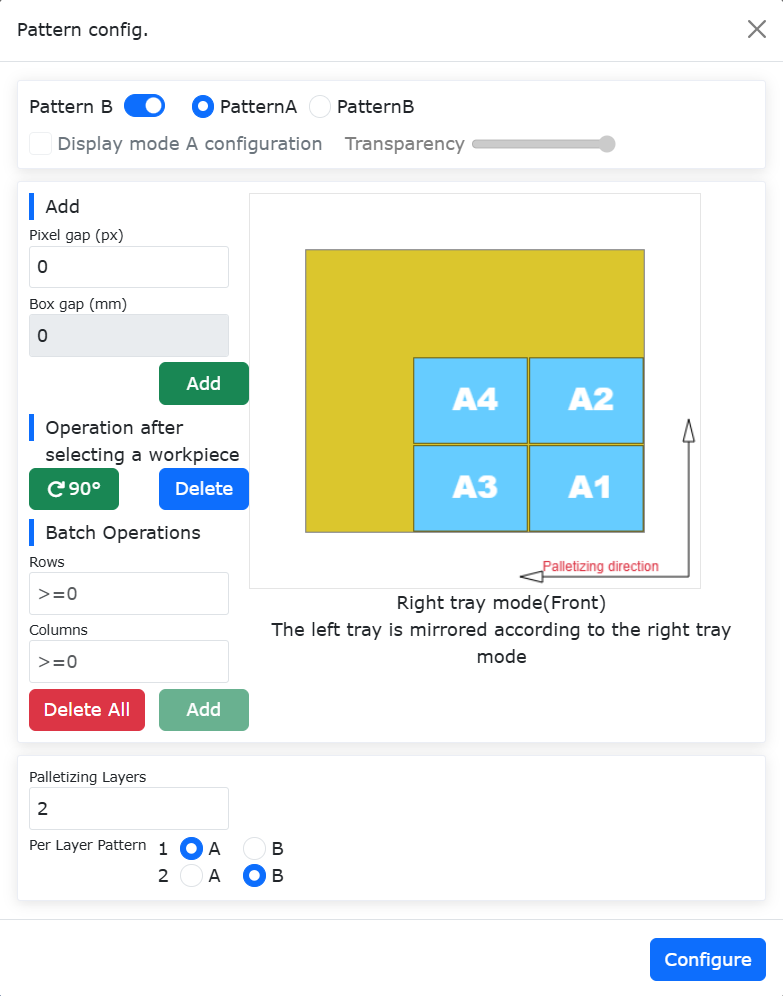

.. centered:: Figura 15.2‑5 Configuración del modo A de paletizado

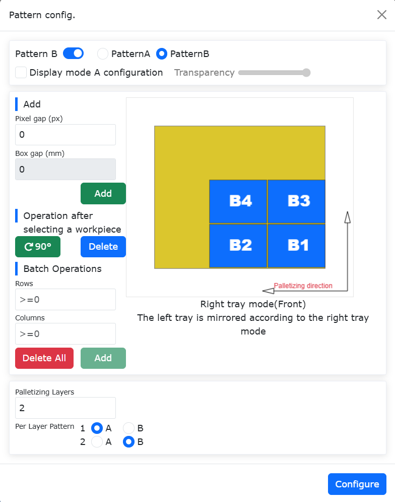

.. centered:: Figura 15.2‑6 Configuración del modo B de paletizado

**Step6**: En la columna de generación del programa de enseñanza, hacer clic en "Configuración avanzada" para entrar en la ventana emergente de configuración avanzada; en este momento configurar la "Altura de elevación en la recogida de material", la "Distancia del primer desplazamiento", la "Distancia del segundo desplazamiento" y el "Tiempo de espera de aspiración del material".

   **Altura de elevación en la recogida de material**: altura de elevación definida por el usuario tras la recogida correcta del material desde el punto de agarre;

   **Distancia del primer/segundo desplazamiento**: distancia de desplazamiento definida por el usuario para la colocación inclinada del robot hasta el punto objetivo;
   
   **Tiempo de espera de aspiración del material**: tiempo de espera de aspiración del material definido por el usuario, que monitoriza la señal de vacío en posición tras la aspiración y repite la acción de aspiración si no está en posición;

   **Transición suave**: al activar el botón de transición suave, se pueden configurar los parámetros relacionados con el tiempo de suavizado PTP y el radio de suavizado LIN del paletizado/despaletizado.
   
   - Tiempo de suavizado PTP: sin tiempo de transición suave/nivel 1 (200ms)/nivel 2 (400ms)/nivel 3 (600ms)/nivel 4 (800ms)/nivel 5 (1000ms)
   - Radio de suavizado LIN: sin radio de transición suave/nivel 1 (200mm)/nivel 2 (400mm)/nivel 3 (600mm)/nivel 4 (800mm)/nivel 5 (1000mm)

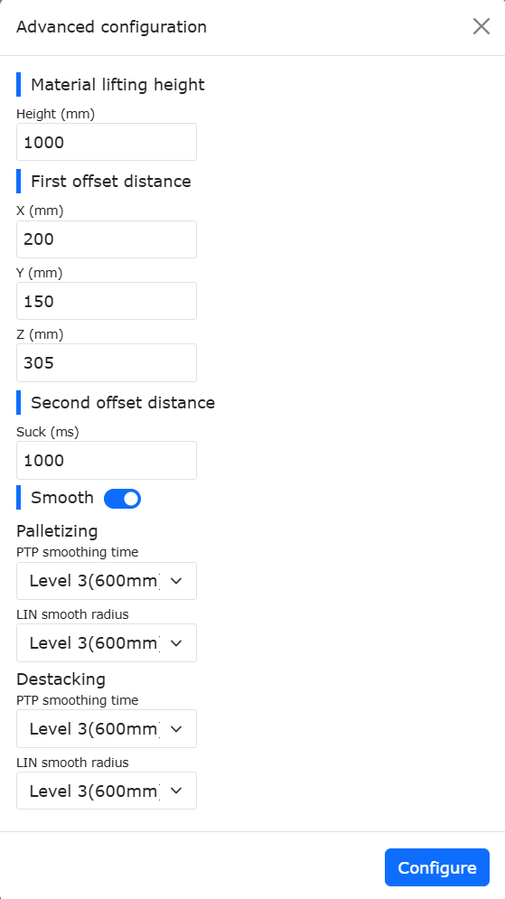

.. centered:: Figura 15.2‑7 Configuración avanzada de paletizado

**Step7**: En la columna de generación del programa de enseñanza, seleccionar "Selección de método" y hacer clic en "Generar programa" para abrir la "Página de monitorización del paletizado", donde se pueden mostrar y consultar la "Información de generación", la "Información de alarma" y el "Programa de paletizado".

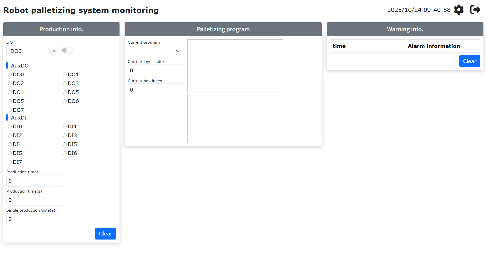

.. centered:: Figura 15.2‑8 Monitorización del sistema de paletizado

**Step8**: Si se produce un error durante la ejecución del programa de paletizado, el programa se detiene; el usuario debe borrar primero el error y, a continuación, volver a seleccionar el programa de paletizado para ejecutarlo; en ese momento aparecerá la ventana emergente "Interrupción del programa anterior"; hacer clic en el botón "Continuar" para reanudar la ejecución, o hacer clic en el botón "Reiniciar" para volver a empezar la ejecución del programa.

.. centered:: Figura 15.2‑9 Continuación del programa de paletizado

Seguimiento de cinta transportadora
-----------------------------------

Pasos de configuración del seguimiento de cinta transportadora
~~~~~~~~~~~~~~~~~~~~~~~~~~~~~~~~~~~~~~~~~~~~~~~~~~~~~~~~~~~~~~~~~~~~~

**Step1**: En "Aplicaciones auxiliares"->"Paquete de proceso", seleccionar el elemento de menú "Cinta transportadora" para entrar en la interfaz de configuración del seguimiento de cinta transportadora; hacer clic en el botón "Configurar IO de la cinta transportadora" para configurar rápidamente las IO necesarias para la función de cinta transportadora y, a continuación, configurar los parámetros correspondientes según la situación real de uso de la función; aquí se toma como ejemplo la función de agarre sin seguimiento visual, para la que es necesario configurar el canal del codificador de la cinta transportadora, la resolución, el paso y la selección de combinación visual como No; hacer clic en configurar.

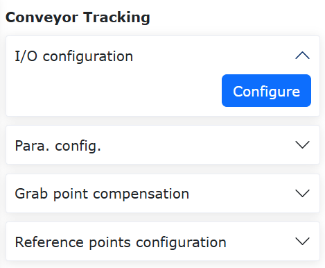

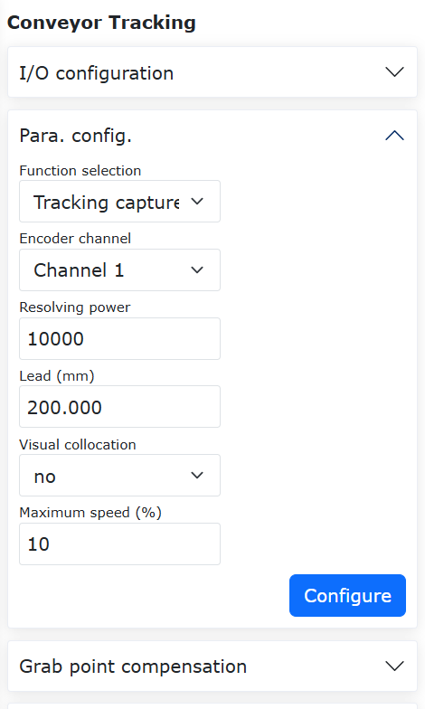

.. centered:: Figura 15.3‑1 Configuración de la cinta transportadora

**Step2**: A continuación, configurar el valor de compensación del punto de agarre, que es la distancia de compensación en las tres direcciones X, Y, Z, y que se puede configurar según la situación real durante la depuración.

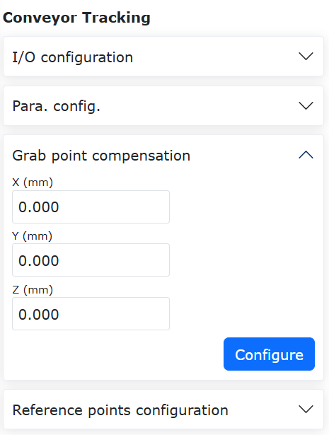

.. centered:: Figura 15.3‑2 Configuración de la compensación del punto de agarre de la cinta transportadora

**Step3**: Poner en marcha la cinta transportadora, desplazar el objeto calibrado hasta la posición del punto A definido y detener la cinta transportadora. Mover el robot para alinear la punta de la varilla de calibración del extremo del robot con la punta del objeto calibrado, hacer clic en el botón del punto inicial A; aparecerá un cuadro de diálogo que muestra el valor actual del codificador y la pose del robot; hacer clic en calibrar para completar la calibración del punto inicial A.

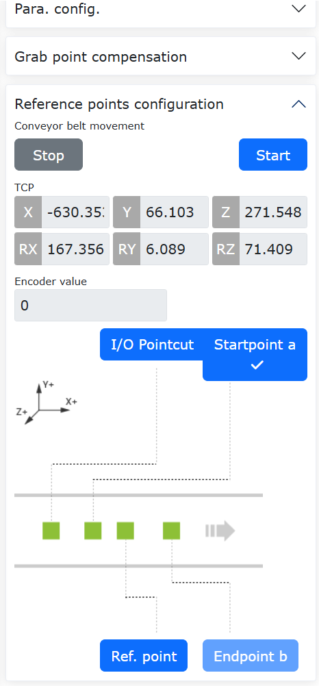

.. centered:: Figura 15.3‑3 Configuración del punto inicial A

**Step4**: Hacer clic en el botón del punto de referencia para entrar en la calibración del punto de referencia; al registrar el punto de referencia se registran la altura y la actitud del robot en el momento del agarre; en cada seguimiento se realizará el seguimiento y agarre según la altura y la actitud del punto de referencia registrado, pudiendo no estar a la misma altura que los puntos A y B; hacer clic en calibrar para completar la calibración del punto de referencia.

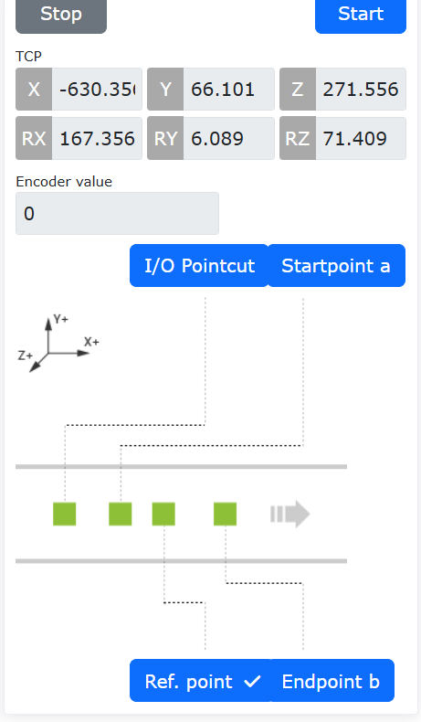

.. centered:: Figura 15.3‑4 Configuración del punto de referencia

**Step5**: Poner en marcha la cinta transportadora, desplazar el objeto calibrado hasta la posición del punto B definido y detener la cinta transportadora. Mover el robot para alinear la punta de la varilla de calibración del extremo del robot con la punta del objeto calibrado, hacer clic en el botón del punto final B; aparecerá un cuadro de diálogo que muestra el valor actual del codificador y la pose del robot; hacer clic en calibrar para completar la calibración del punto final B.

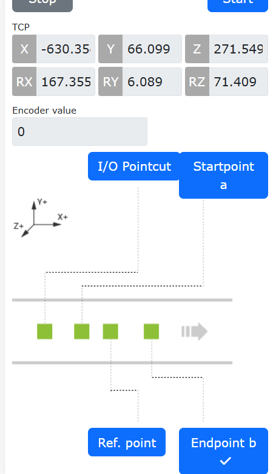

.. centered:: Figura 15.3‑5 Configuración del punto final B

Programa de enseñanza del seguimiento de cinta transportadora
~~~~~~~~~~~~~~~~~~~~~~~~~~~~~~~~~~~~~~~~~~~~~~~~~~~~~~~~~~~~~

.. list-table::
   :widths: 50 80 80
   :header-rows: 0
   :align: center

   * - **Número**
     - **Formato de la instrucción**
     - **Comentario**

   * - 1
     - PTP(conveyorstart,30,-1,0)
     - #Punto inicial de agarre del robot

   * - 2
     - While(1) do
     - #Agarre en bucle

   * - 3
     - ConveyorlODetect(10000)
     - #Detección en tiempo real del objeto por IO

   * - 4
     - ConveyorGetTrackData(1)
     - #Obtención de la posición del objeto

   * - 5
     - ConveyorTrackStart(1)
     - #Inicio del seguimiento de la cinta transportadora

   * - 6
     - Lin(cvrCatchPoint,10,-1,0,0)
     - #El robot llega al punto de agarre

   * - 7
     - MoveGripper(1,255,255,0,10000)
     - #La pinza agarra el objeto

   * - 8
     - Lin(cvrRaisePoint,10,-1,0,0)
     - #El robot eleva

   * - 9
     - ConveyorTrackEnd()
     - #Fin del seguimiento de la cinta transportadora

   * - 10
     - PTP(conveyorraise,30,-1,0)
     - #El robot llega al punto de espera

   * - 11
     - PTP(conveyorend,30,-1,0)
     - #El robot llega al punto de colocación

   * - 12
     - MoveGripper(1,0,255,0,10000)
     - #La pinza suelta

   * - 13
     - PTP(conveyorstart,50,-1,0)
     - #El robot vuelve al punto inicial de agarre, esperando el siguiente agarre

   * - 14
     - end
     - #Fin

Composición del sistema de seguimiento de cinta transportadora del robot
~~~~~~~~~~~~~~~~~~~~~~~~~~~~~~~~~~~~~~~~~~~~~~~~~~~~~~~~~~~~~~~~~~~~~~~~

Modo de conexión de comunicación de datos del codificador de la cinta transportadora
+++++++++++++++++++++++++++++++++++++++++++++++++++++++++++++++++++++++++++++++++++++++

Para lograr el flujo automatizado de carga y descarga en el mecanizado por CNC, se ha desarrollado el paquete de funciones CNC basado en la comunicación FOCAS, que permite la interacción de comunicación y el movimiento colaborativo entre el robot colaborativo y la máquina CNC.

Como se muestra en la figura, la comunicación FOCAS se basa en Ethernet; conectando mediante cable de red el puerto de red de la caja de control del robot con el puerto de red integrado de la máquina herramienta se puede establecer la comunicación FOCAS entre el robot y la máquina herramienta, realizando el control CNC y la monitorización del estado de la máquina herramienta en el lado del robot.

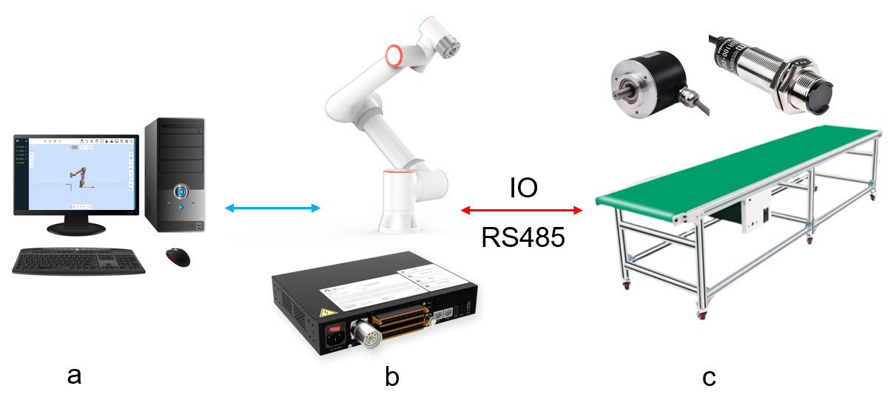

.. centered:: Figura 15.3‑6 Topología de la composición del sistema de seguimiento de cinta transportadora del robot

En el sistema, (a) es el ordenador, (b) es el robot y su caja de control, y (c) es el sistema de cinta transportadora compuesto por la cinta transportadora, el sensor fotoeléctrico y el codificador. La caja de control del robot se conecta mediante comunicación de IO digital con el sensor fotoeléctrico y la cinta transportadora, y mediante RS485 con el codificador de la cinta transportadora.

Configuración de la cinta transportadora
+++++++++++++++++++++++++++++++++++++++++++++++++++++++++++++++++++++++++++++++++++++++

Entrar en la página Web del robot en "Configuración básica", "Periféricos", "Seguimiento", en la interfaz de configuración de la función "Cinta transportadora" para configurar las propiedades de la función de seguimiento de cinta transportadora.

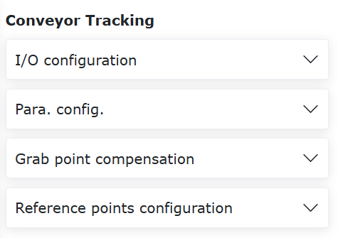

.. centered:: Figura 15.3‑7 Página de configuración del seguimiento de cinta transportadora

En la página de configuración del seguimiento de cinta transportadora, hacer clic en el botón "Configuración rápida de I/O de la cinta transportadora" para configurar con un solo clic la conexión física de la cinta transportadora.
A continuación, en el cuadro desplegable "Selección de función" de "Configuración de parámetros", seleccionar "Seguimiento de movimiento"; después configurar las propiedades del codificador, el eje de pieza del sistema de coordenadas de pieza de seguimiento y la combinación visual, y en el cuadro desplegable "Tipo de seguimiento" seleccionar "Movimiento de seguimiento e inspección"; en este momento se pueden introducir la distancia inicial de seguimiento y la distancia final de seguimiento.
Distancia inicial de seguimiento: tras activarse la señal de seguimiento, el robot comienza a moverse cuando la cinta transportadora ha recorrido la distancia establecida; cuando se configura en -1, la activación es automática.
Distancia final de seguimiento: la distancia máxima que el robot sigue en movimiento sincronizado con la cinta transportadora tras comenzar a moverse.

Configuración del sistema de coordenadas de seguimiento
+++++++++++++++++++++++++++++++++++++++++++++++++++++++++++++++++++++++++++++++++++++++

El movimiento de seguimiento utiliza el sistema de coordenadas de pieza como sistema de coordenadas de la cinta transportadora, por lo que es necesario configurar el sistema de coordenadas de pieza.

Hacer clic en "Configuración inicial", "Básico" y, en "Sistema de coordenadas", seleccionar "Sistema de coordenadas de pieza"; hacer clic para seleccionar un sistema de coordenadas de pieza distinto de "wobjcoord0" para calibrarlo; el método de calibración no se detalla aquí.

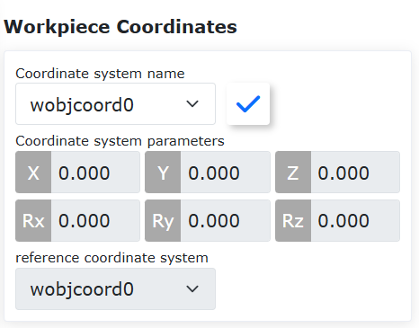

.. centered:: Figura 15.3‑8 Configuración del sistema de coordenadas de seguimiento

Función de movimiento de seguimiento e inspección del seguimiento de cinta transportadora
++++++++++++++++++++++++++++++++++++++++++++++++++++++++++++++++++++++++++++++++++++++++++

El movimiento de seguimiento e inspección es un tipo de movimiento de seguimiento de cinta transportadora; en comparación con el movimiento de seguimiento, la enseñanza de los puntos de movimiento del movimiento de seguimiento e inspección no requiere realizar el movimiento de enseñanza por encima del sistema de coordenadas de pieza, sino que se puede enseñar en cualquier posición del sistema de coordenadas de pieza y, a continuación, mediante el parámetro "Distancia inicial de seguimiento", realizar el movimiento sincronizado del extremo con la cinta transportadora; es un modo de seguimiento bastante flexible.

Introducción a la función de movimiento de seguimiento e inspección del seguimiento de cinta transportadora
+++++++++++++++++++++++++++++++++++++++++++++++++++++++++++++++++++++++++++++++++++++++++++++++++++++++++++

A continuación se ofrece un ejemplo de movimiento de seguimiento e inspección para presentar sus características de movimiento.

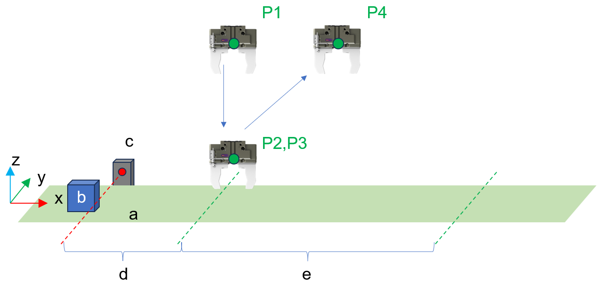

.. centered:: Figura 15.3‑9 Ejemplo de enseñanza del movimiento de seguimiento e inspección del seguimiento de cinta transportadora

Donde x es la dirección de movimiento de la cinta transportadora en el sistema de coordenadas de pieza, a es el plano de la cinta transportadora, b es la pieza objetivo de agarre, c es el sensor fotoeléctrico, d es la distancia inicial de seguimiento y e es la distancia final de seguimiento. P1 a P4 son los puntos de ruta enseñados y su orden sucesivo; P2 a P3 son el mismo punto de ruta e incluyen el movimiento de la pinza.

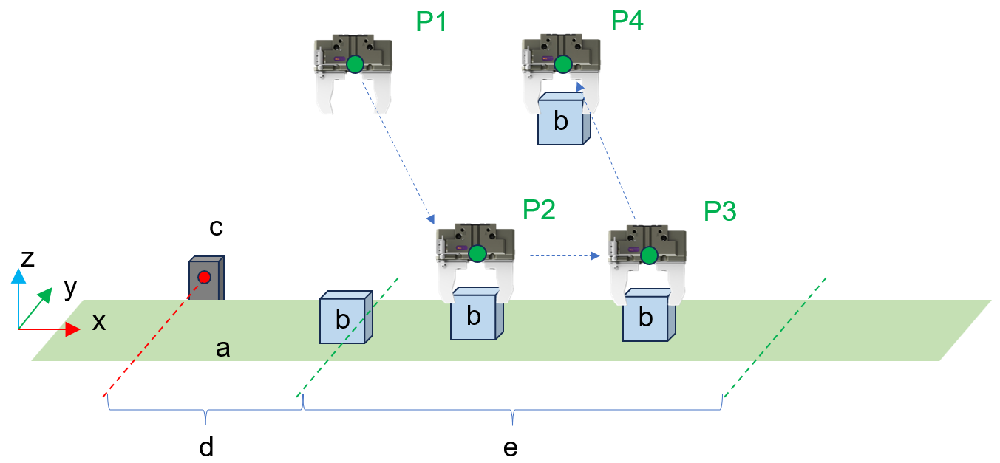

.. centered:: Figura 15.3‑10 Ejemplo de ejecución tras la enseñanza del movimiento de seguimiento e inspección del seguimiento de cinta transportadora

Cuando el programa de enseñanza anterior comienza a ejecutarse y la pieza activa la señal del interruptor fotoeléctrico, el robot espera a que el objetivo se desplace hasta debajo de P1 y comienza el movimiento de seguimiento; la pinza del robot se moverá según la trayectoria mostrada en la figura anterior.

Enseñanza del programa de movimiento de seguimiento e inspección
+++++++++++++++++++++++++++++++++++++++++++++++++++++++++++++++++++++++++++++++++++++++

La lógica del programa de movimiento de seguimiento e inspección es básicamente idéntica a la del movimiento de seguimiento e incluye las partes de obtención de la señal de activación, obtención de los datos de la cinta transportadora e inicio del movimiento de seguimiento.

**Step 1**: Hacer clic en "Programa de enseñanza", "Programación de programas", seleccionar y hacer clic en el botón "Cinta transportadora" de las "Instrucciones de periféricos" para entrar en la página de configuración de la instrucción de cinta transportadora.

.. centered:: Figura 15.3‑11 Instrucción de monitorización de I/O en tiempo real

**Step 2**: Hacer clic en "Monitorización de I/O en tiempo real", configurar el "Tiempo máximo de espera de enseñanza (ms)" y detectar en tiempo real la señal de activación del seguimiento. Hacer clic en los botones "Añadir" y "Aplicar" para añadir la instrucción al programa.

.. centered:: Figura 15.3‑12 Instrucción de detección de posición en tiempo real

**Step 3**: Hacer clic en "Detección de posición en tiempo real" y seleccionar "Seguimiento de movimiento" como modo de trabajo. Hacer clic en los botones "Añadir" y "Aplicar" para añadir la instrucción al programa.

.. centered:: Figura 15.3‑13 Instrucción de inicio de seguimiento

**Step 4**: Hacer clic en "Inicio de seguimiento" y seleccionar "Seguimiento de movimiento" como modo de trabajo. Hacer clic en los botones "Añadir" y "Aplicar" para añadir la instrucción al programa.

**Step 5**: Enseñar el movimiento en el espacio cartesiano tras el inicio del seguimiento y el movimiento de los periféricos de la pinza; durante el movimiento se mantendrá el movimiento sincronizado de seguimiento con la cinta transportadora.

.. centered:: Figura 15.3‑14 Instrucción de fin de seguimiento

**Step 6**: Hacer clic en "Fin de seguimiento" y hacer clic en los botones "Añadir" y "Aplicar" para añadir la instrucción al programa.

.. centered:: Figura 15.3‑15 Programa típico de movimiento de seguimiento de cinta transportadora

Cuando se enseñan continuamente dos objetivos de movimiento de seguimiento idénticos (que pueden incluir una distancia de desplazamiento), el movimiento del robot se bloquea en dicha posición objetivo, realizando un seguimiento sincronizado continuo hasta que la distancia de seguimiento alcanza la distancia final de seguimiento.

.. centered:: Figura 15.3‑16 Programa típico de movimiento de agarre con seguimiento bloqueante de cinta transportadora

Cuando se enseñan continuamente dos objetivos de movimiento de seguimiento idénticos (que pueden incluir una distancia de desplazamiento) y se inserta entre ellos el movimiento de la pinza, el robot sigue continuamente la cinta transportadora en dicha posición objetivo hasta que finaliza el movimiento de la pinza, realizando el agarre con seguimiento bloqueante.

Función de optimización de la instrucción de movimiento matricial
------------------------------------------------------------------

Descripción general
~~~~~~~~~~~~~~~~~~~~

En el proceso de mecanizado automatizado de equipos CNC y en las operaciones de paletizado, la instrucción de movimiento matricial se utiliza ampliamente en múltiples fases clave del proceso, incluidas la carga de piezas en bruto, la descarga de productos terminados, el volteo de piezas y la segunda sujeción. Mediante la enseñanza de tres puntos de la matriz en la receta de movimiento matricial para determinar la posición de la matriz, y tras configurar las filas, columnas, capas y la ruta de movimiento de la matriz, se puede conmutar rápidamente la receta de la matriz en la interfaz de instrucciones para su despliegue y funcionamiento.

Configuración de la receta de movimiento matricial
~~~~~~~~~~~~~~~~~~~~~~~~~~~~~~~~~~~~~~~~~~~~~~~~~~~

**Step1**: Entrar en la interfaz "Aplicaciones auxiliares—>Paquete de proceso—>Movimiento matricial" para realizar operaciones de creación, edición, cambio de nombre y eliminación de recetas;

.. centered:: Figura 15.4‑1 Interfaz de la receta de matriz

.. note:: 
   .. image:: process/050.png
      :height: 0.75in
      :align: left

   Nombre: **Botón Añadir**
   
   Función: añadir una receta de matriz

.. note:: 
   .. image:: process/051.png
      :height: 0.75in
      :align: left

   Nombre: **Botón Editar**
   
   Función: editar los parámetros de la receta de matriz

.. note:: 
   .. image:: process/052.png
      :height: 0.75in
      :align: left

   Nombre: **Botón Cambiar nombre**
   
   Función: cambiar el nombre de la receta de matriz

.. note:: 
   .. image:: process/053.png
      :height: 0.75in
      :align: left

   Nombre: **Botón Eliminar**
   
   Función: eliminar la receta de matriz

**Step2**: Añadir una receta de matriz. Hacer clic en el botón "Añadir" para que aparezca la ventana modal "Añadir matriz"; introducir el nombre de la matriz (está prohibido introducir caracteres especiales; solo se permite introducir números, caracteres chinos de uso común y el guion bajo "_") y entrar en la interfaz de detalle de la receta para introducir el número de filas, el número de capas, el número de columnas, la altura de capa, la configuración de movimiento y el desplazamiento de los puntos de transición X, Y, Z, y enseñar los tres puntos de ruta de la matriz. Hacer clic en el botón "Configurar" para confirmar la configuración.

.. centered:: Figura 15.4‑2 Ventana modal de añadir matriz

.. centered:: Figura 15.4‑3 Enseñanza del primer punto de ruta

.. centered:: Figura 15.4‑4 Enseñanza del segundo punto de ruta

.. centered:: Figura 15.4‑5 Enseñanza del tercer punto de ruta

La ruta de movimiento se divide en recorrido de principio a fin y recorrido en zigzag. Se describen a continuación:

**Recorrido de principio a fin**: recorrer la primera fila de izquierda a derecha y volver al punto inicial izquierdo, recorrer la segunda fila de izquierda a derecha y volver al punto inicial izquierdo, recorrer la tercera fila de izquierda a derecha, hasta completar la cobertura.

.. centered:: Figura 15.4‑6 Recorrido de principio a fin

**Recorrido en zigzag**: recorrer la primera fila de izquierda a derecha, desplazarse verticalmente hacia abajo y recorrer la segunda fila de derecha a izquierda. Desplazarse de nuevo verticalmente hacia abajo y recorrer la tercera fila de izquierda a derecha, hasta completar la cobertura de la zona.

.. centered:: Figura 15.4‑7 Recorrido en zigzag

**Step3**: Edición, cambio de nombre y eliminación de recetas. Hacer clic en el botón "Editar" para obtener los datos de la receta de matriz seleccionada actualmente y modificar los parámetros o volver a enseñar los puntos de ruta según sea necesario. Cuando se necesite cambiar el nombre, hacer clic en el botón "Cambiar nombre", introducir el nombre y volver a hacer clic en el botón "Cambiar nombre" para completar el cambio. Hacer clic en el botón "Eliminar"; es necesario confirmar por segunda vez si se desea eliminar la receta de matriz, y volver a hacer clic en el botón "Eliminar" para confirmar la eliminación. Como se muestra en la figura siguiente:

.. centered:: Figura 15.4‑8 Cambio de nombre de la receta de matriz

.. centered:: Figura 15.4‑9 Aviso de eliminación de la receta de matriz

Adición de la instrucción de movimiento matricial
~~~~~~~~~~~~~~~~~~~~~~~~~~~~~~~~~~~~~~~~~~~~~~~~~~

**Step1**: Entrar en la interfaz "Programa de enseñanza->Programación de programas->Instrucciones de paletizado->Movimiento matricial" y comprobar si existe una receta en la interfaz. Cuando no se ha creado ninguna receta, se muestra el contenido de aviso; debajo del texto de aviso se puede hacer clic en el botón "Configurar" para entrar rápidamente en la interfaz "Aplicaciones auxiliares->Paquete de proceso->Movimiento matricial". Como se muestra en la figura siguiente:

.. centered:: Figura 15.4‑10 Interfaz de la instrucción de movimiento matricial sin receta

Cuando existe una receta, se muestra la interfaz de la instrucción de movimiento matricial. Los tipos de instrucción actuales son:

- **Movimiento matricial**: configurar el movimiento del robot hasta el punto de transición de la operación de agarre de carga y descarga;
- **Contador de ejecución de la matriz**: contar la fila, columna y capa tras completar el agarre de carga y descarga del robot;
- **Configurar conteo inicial**: configurar desde qué fila, columna y capa comienza el agarre de carga y descarga del robot;
- **Obtener conteo de la matriz**: obtener hasta qué fila, columna y capa ha completado el agarre de carga y descarga el robot.

.. centered:: Figura 15.4‑11 Interfaz de la instrucción de movimiento matricial con receta

**Step2**: Añadir la instrucción "Movimiento matricial". Crear el programa con el nombre "matrix", seleccionar la receta "matrix1", la dirección de movimiento "Descenso" y la velocidad 100. El robot se desplaza desde el punto de seguridad hasta el punto de transición y luego hasta el punto de agarre. Hacer clic en el botón "Añadir" para aplicarlo al programa. Como se muestra en la figura siguiente:

.. centered:: Figura 15.4‑12 Movimiento descendente de la instrucción de movimiento matricial

**Step3**: Añadir la instrucción "Contador de ejecución de la matriz". Seleccionar la receta "matrix1" y hacer clic en el botón "Añadir" para aplicarlo al programa. Como se muestra en la figura siguiente:

.. centered:: Figura 15.4‑13 Instrucción de contador de ejecución de la matriz

**Step4**: Añadir la instrucción "Movimiento matricial". Seleccionar la receta "matrix1", la dirección de movimiento "Ascenso" y la velocidad 100. El robot se desplaza desde el punto de agarre hasta el punto de transición y luego vuelve al punto de seguridad. Hacer clic en el botón "Añadir" para aplicarlo al programa. Como se muestra en la figura siguiente:

.. centered:: Figura 15.4‑14 Movimiento ascendente de la instrucción de movimiento matricial

**Step5**: Añadir la instrucción while para el bucle siempre. Hacer clic en el botón "Guardar" para guardar el programa y cambiar al modo automático para ejecutarlo. El robot realiza continuamente la operación de agarre de carga y descarga del movimiento matricial. Como se muestra en la figura siguiente:

.. centered:: Figura 15.4‑15 Ejecución de la instrucción de movimiento matricial

**Step6**: Añadir la instrucción "Configurar conteo inicial". Seleccionar la receta "matrix1" e introducir fila 1, columna 1 y capa 1. Hacer clic en el botón "Añadir" para aplicarlo al programa. Como se muestra en la figura siguiente:

.. note:: A las filas, columnas y capas introducidas se les suma 1 para representar las filas, columnas y capas reales. Es decir, si se introducen fila 1, columna 1 y capa 1, el robot comienza a funcionar realmente desde la fila 2, columna 2 y capa 2 de la posición especificada.

.. centered:: Figura 15.4‑16 Instrucción de configuración del conteo inicial

**Step7**: Cuando cambie el envío de la matriz, entrar en la interfaz "Aplicaciones auxiliares->Paquete de proceso->Movimiento matricial", seleccionar la receta de matriz "matrix1", hacer clic en el botón editar para modificar los parámetros y hacer clic en el botón configurar para completar la modificación de la matriz. En este momento, volver a la interfaz de programación de programas, abrir el programa "matrix" y ejecutarlo directamente para realizar la operación del nuevo escenario de matriz.

.. centered:: Figura 15.4‑17 Modificación de la receta de matriz