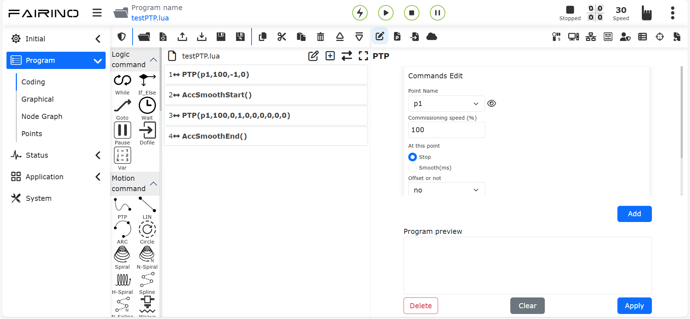
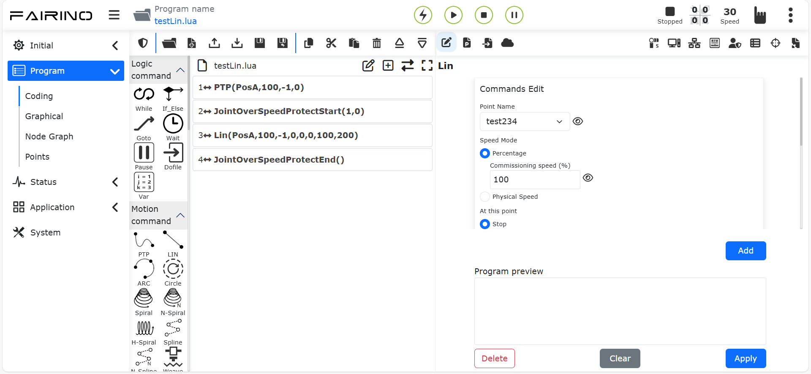
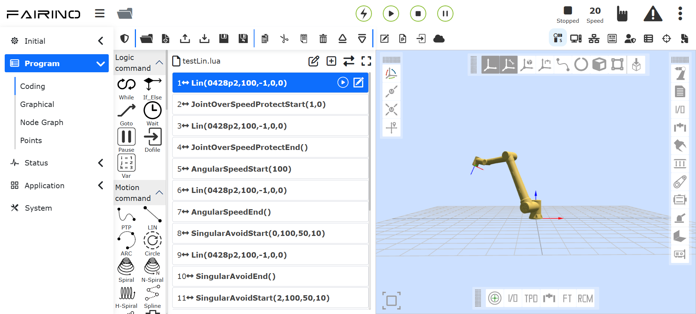

Programación rápida del robot
=============================

Introducción a las instrucciones de movimiento simples
------------------------------------------------------

**Comando PTP**: hacer clic en el icono "Punto a punto" para entrar en la interfaz de edición del comando PTP.

Se puede seleccionar el punto al que se desea llegar; la configuración del tiempo de transición suave permite que el movimiento de este punto al siguiente sea continuo; la configuración de desplazamiento permite seleccionar el desplazamiento basado en el sistema de coordenadas base y el desplazamiento basado en el sistema de coordenadas de herramienta, y aparece la configuración de los valores de desplazamiento x, y, z, rx, ry, rz; la ruta concreta de PTP es la ruta óptima planificada automáticamente por el controlador de movimiento; tras hacer clic en "Añadir" y "Aplicar" se puede guardar esta instrucción.

.. centered:: Figura 5.1‑1 Interfaz del comando PTP

**Comando Lin**: hacer clic en el icono "Línea recta" para entrar en la interfaz de edición del comando Lin.

La función de esta instrucción es similar a la de la instrucción "PTP", pero la ruta hasta el punto alcanzado por esta instrucción es una línea recta.

.. centered:: Figura 5.1‑2 Interfaz del comando Lin

Operaciones sobre los archivos de programa
------------------------------------------

Utilice la barra de herramientas situada en la parte superior del árbol de programa para modificar el árbol de programa.

.. note:: 
   .. image:: coding/006.png
      :height: 0.75in
      :align: left

   Nombre: **Abrir**
   
   Función: abrir archivos de programas de usuario

.. note:: 
   .. image:: coding/007.png
      :height: 0.75in
      :align: left

   Nombre: **Nuevo**
   
   Función: seleccionar una plantilla para crear un nuevo archivo de programa
   
.. note:: 
   .. image:: coding/008.png
      :height: 0.75in
      :align: left

   Nombre: **Importar**
   
   Función: importar archivos a la carpeta de programas de usuario

.. note:: 
   .. image:: coding/009.png
      :height: 0.75in
      :align: left

   Nombre: **Exportar**
   
   Función: exportar el archivo de programa de usuario al equipo local

.. note:: 
   .. image:: coding/010.png
      :height: 0.75in
      :align: left

   Nombre: **Guardar**
   
   Función: guardar el contenido editado del archivo.

.. note:: 
   .. image:: coding/011.png
      :height: 0.75in
      :align: left

   Nombre: **Guardar como**
   
   Función: cambiar el nombre del archivo y guardarlo en la carpeta de programas de usuario o de programas de plantilla

.. note:: 
   .. image:: coding/012.png
      :height: 0.75in
      :align: left

   Nombre: **Copiar**
   
   Función: copiar un nodo y permitir utilizarlo para otras operaciones (por ejemplo, pegarlo en otra posición del árbol de programa)

.. note:: 
   .. image:: coding/013.png
      :height: 0.75in
      :align: left

   Nombre: **Pegar**
   
   Función: permite pegar el nodo previamente cortado o copiado

.. note:: 
   .. image:: coding/014.png
      :height: 0.75in
      :align: left

   Nombre: **Cortar**
   
   Función: cortar un nodo y permitir utilizarlo para otras operaciones (por ejemplo, pegarlo en otra posición del árbol de programa)

.. note:: 
   .. image:: coding/015.png
      :height: 0.75in
      :align: left

   Nombre: **Eliminar**
   
   Función: eliminar un nodo del árbol de programa

.. note:: 
   .. image:: coding/016.png
      :height: 0.75in
      :align: left

   Nombre: **Subir**
   
   Función: mover el nodo hacia arriba

.. note:: 
   .. image:: coding/017.png
      :height: 0.75in
      :align: left

   Nombre: **Bajar**
   
   Función: mover el nodo hacia abajo

.. note:: 
   .. image:: coding/018.png
      :height: 0.75in
      :align: left

   Nombre: **Cambiar modo de edición**
   
   Función: alternar entre el modo de árbol de programa y el modo de edición Lua

Escribir y ejecutar un programa
-------------------------------

La parte izquierda es principalmente el área de adición de comandos de programa; hacer clic en el icono situado encima de cada palabra clave permite entrar en la interfaz detallada de adición de comandos de programa de la derecha. La operación de añadir comandos de programa al archivo se divide principalmente en dos tipos:

- 1. Abrir la instrucción correspondiente y hacer clic en el botón aplicar para añadir esa instrucción al programa;
- 2. Hacer clic primero en el botón "Añadir"; en este momento el comando no se ha guardado en el archivo de programa y es necesario hacer clic además en "Aplicar" para guardar el comando en el archivo.

El segundo modo aparece principalmente en casos de envío de varias instrucciones del mismo tipo; para este tipo de comandos se ha añadido un botón de añadir y una función de visualización del contenido de las instrucciones ya añadidas; hacer clic en el botón añadir permite añadir una instrucción; el área de instrucciones añadidas muestra todas las instrucciones ya añadidas; hacer clic en "Aplicar" permite guardar las instrucciones añadidas en el archivo abierto a la derecha.

Hacer clic en el botón de inicio para ejecutar el programa; hacer clic en el botón de parada para detener la ejecución del programa; hacer clic en el botón de pausa/reanudar para pausar/reanudar el programa; durante la ejecución del programa, el nodo de programa que se está ejecutando actualmente se resalta en verde.

En el modo manual, hacer clic en el primer icono a la derecha del nodo permite que el robot ejecute esa instrucción de forma individual; el segundo icono sirve para editar el contenido de ese nodo.

.. centered:: Figura 5.3‑1 Interfaz del árbol de programa