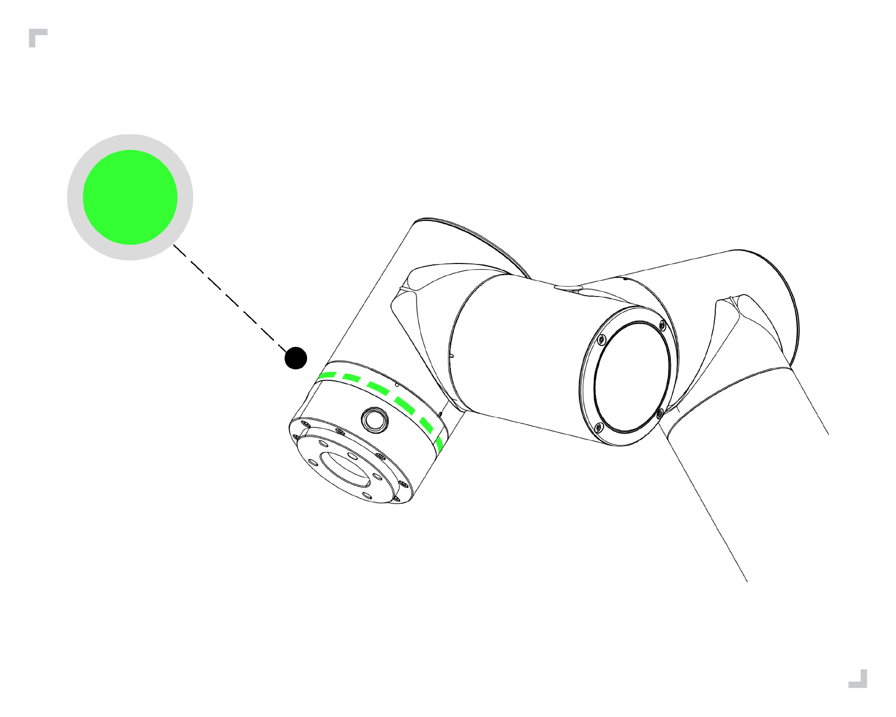
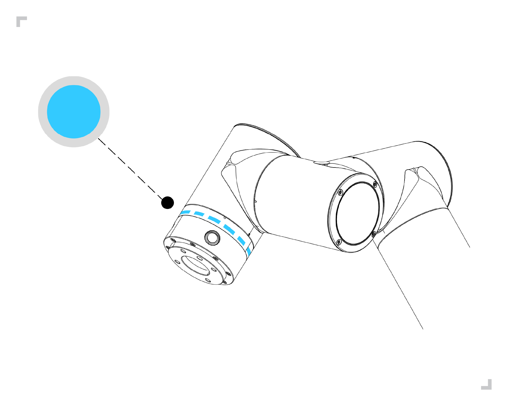
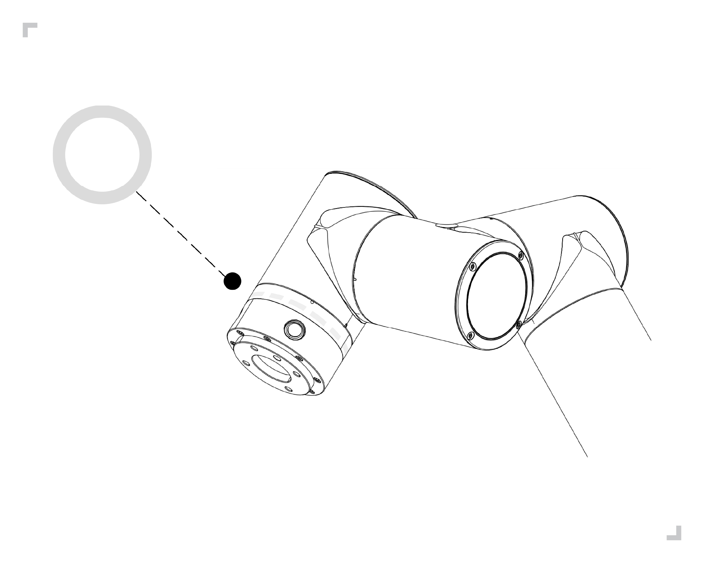
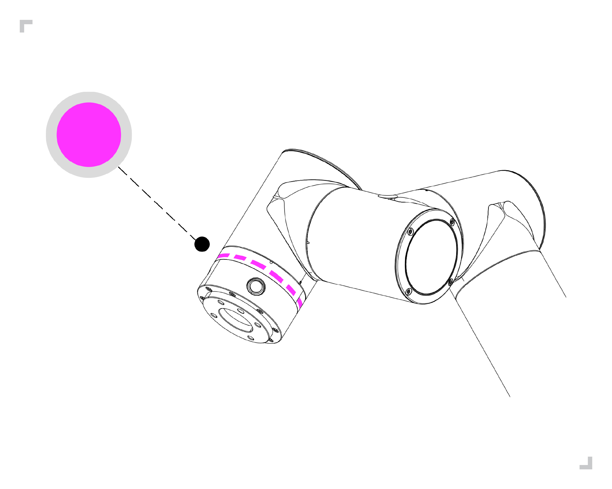
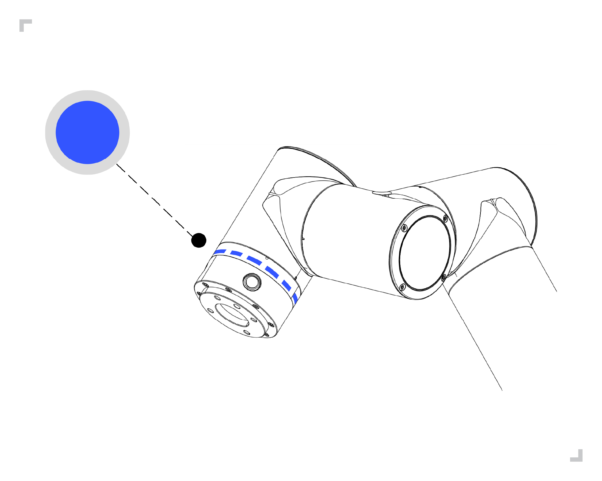
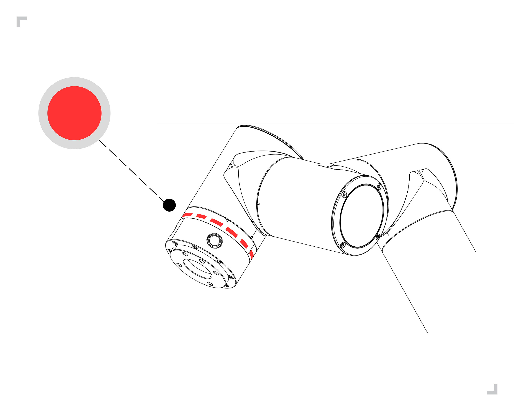
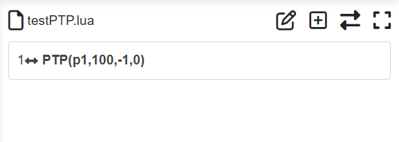
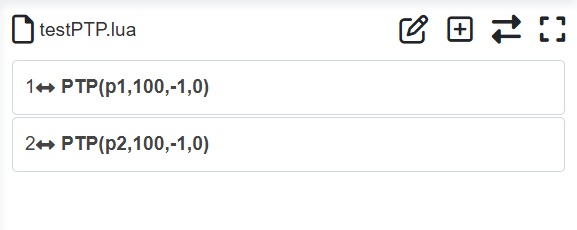
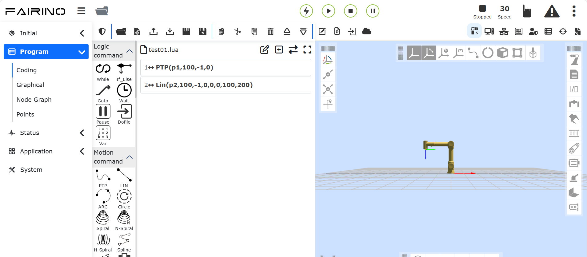

Inicio rápido del robot
=======================

.. toctree:: 
   :maxdepth: 5

Instalación del brazo del robot y de la caja de control
-------------------------------------------------------

Instalar y conectar el brazo del robot y la caja de control según las secciones 3.5 y 3.6 de 3. Instalación de hardware.

-  Desembalar y extraer el brazo del robot, e instalarlo con 4 pernos M8 de una resistencia no inferior a la clase 8.8. Instalar el brazo del robot sobre una superficie firme y a prueba de vibraciones; si se fija con placa de aluminio, el espesor de la placa de aluminio no debe ser inferior a 16 mm; si se fija con placa de hierro, el espesor de la placa de hierro no debe ser inferior a 8 mm;

-  Colocar la caja de control sobre sus patas;

-  Conectar el cable de carga pesada del cuerpo del brazo del robot a la interfaz de carga pesada de la caja de control;

-  Conectar el conector de aviación de la caja de botones a la interfaz del teach pendant de la caja de control;

-  Asegurarse de que el botón de alimentación de la caja de control está apagado (botón en 0) antes de conectar el cable de alimentación a la toma de alimentación;

-  Enchufar el conector de la caja de control de alimentación.

.. warning:: 
   （1）Si el robot no se coloca de forma segura sobre una superficie firme, el robot puede volcar y causar daños.
   
   （2）No encender y apagar rápidamente la alimentación de la caja de control; se recomienda que el tiempo entre el apagado (OFF) y el siguiente encendido (ON) de la alimentación de la caja de control sea superior a 1 minuto.

Control del robot mediante el arranque del teach pendant
--------------------------------------------------------

La caja de control conecta los terminales físicos de entrada/salida eléctrica del brazo del robot, de la caja de botones y de cualquier equipo periférico. Es necesario encender la caja de control para alimentar el brazo del robot.

-  Pulsar el botón de alimentación de la caja de control para encenderla;

-  Tras arrancar el robot, este se encuentra en modo manual y no habilitado; si se necesita operar el robot en modo manual, es necesario pulsar el interruptor de habilitación de tres posiciones del teach pendant en la secuencia OFF (soltar) ⇒ ON ⇒ OFF (pulsar); cuando el interruptor está en estado ON, se puede arrastrar o controlar el movimiento del robot.

-  Si no es necesario operar el robot en modo manual, se puede utilizar el botón giratorio del interruptor de llave del teach pendant para conmutar el modo de trabajo del robot: automático, manual, personalizado;

-  Al conmutar el robot al estado manual, debe comprobarse si existe alguna anomalía dentro y fuera del espacio de seguridad y operar el robot con precaución;

-  Al conmutar el robot al estado automático, deben comprobarse las medidas de seguridad y restablecerse al estado normal, operando el robot con precaución;

-  Si no se puede abrir correctamente el teach pendant, compruebe si la conexión del equipo es normal.

Control del movimiento del robot mediante la caja de botones
------------------------------------------------------------

Controlar el robot según la sección 3.6.3. Definición del LED del extremo de 3. Instalación de hardware. Las cajas de botones existentes se dividen en 60 caja de botones (POE) (BX01), 60 caja de botones (POE) (BX02)-V1.0 y 60 caja de botones (POE) (BX02)-V2.0; tomando como ejemplo la 60 caja de botones (POE) (BX01), los pasos de operación son los siguientes.

Sin teach pendant
~~~~~~~~~~~~~~~~~

-  **Step1**: Abrir el interruptor de alimentación de la caja de control del robot, arrancar el robot y esperar a que el LED del extremo muestre verde fijo antes de operar el robot, como se muestra en la figura siguiente:

.. centered:: Figura 4.3-1 Esquema del LED del extremo en verde

-  **Step2**: Mantener pulsado el "Botón 2" de la caja de botones para entrar en el modo sin teach pendant; el LED del extremo parpadea en azul cian tres veces, como se muestra en la figura siguiente:

.. centered:: Figura 4.3-2 Esquema del LED del extremo en azul cian

-  **Step3**: Mantener pulsado el "Botón 1" de la caja de botones para cambiar el robot al modo de arrastre; en este momento el LED del extremo es cian claro, como se muestra en la Figura 4.3-3. Mover el robot hasta cualquier posición, mantener pulsado el "Botón 1" para salir del modo de arrastre y pulsar brevemente el "Botón 2" de la caja de botones para registrar el punto P1; el LED del extremo parpadea en morado tres veces, como se muestra en la Figura 4.3-4.

-  **Step4**: Mover el robot y pulsar brevemente el "Botón 2" de la caja de botones para registrar el punto P2; el LED del extremo parpadea en morado tres veces, como se muestra en la Figura 4.3-4.

.. centered:: Figura 4.3-3 Esquema del LED del extremo en cian claro

.. centered:: Figura 4.3-4 Esquema del LED del extremo en morado

-  **Step5**: Mantener pulsado el "Botón 1" de la caja de botones para salir del modo de arrastre; en este momento se encuentra en modo manual y el LED del extremo es verde, como se muestra en la Figura 4.3-5. Pulsar brevemente el "Botón 1" para cambiar el robot al modo automático; en este momento el LED del extremo es azul, como se muestra en la Figura 4.3-6.

-  **Step6**: Pulsar brevemente el "Botón 3" de la caja de botones para ejecutar el programa; el LED del extremo parpadea en azul dos veces, como se muestra en la Figura 4.3-6.

.. figure:: quick_start_robot/005.png
   :align: center
   :width: 4in

.. centered:: Figura 4.3-5 Esquema del LED del extremo en verde

.. centered:: Figura 4.3-6 Esquema del LED del extremo en azul

-  **Step7**: Pulsar brevemente el "Botón 3" de la caja de botones para detener la ejecución del programa; el LED del extremo parpadea en rojo tres veces, como se muestra en la figura siguiente:

.. centered:: Figura 4.3-7 Esquema del LED del extremo en rojo

Con teach pendant
~~~~~~~~~~~~~~~~~

-  **Step1**: Arrancar el robot y esperar a que el LED del extremo deje de parpadear en verde antes de operar el robot.

-  **Step2**: Abrir el teach pendant y entrar en la interfaz de edición de programas.

-  **Step3**: Seleccionar la plantilla en blanco y crear un nuevo archivo de programa.

-  **Step4**: Pulsar brevemente el Botón 1 de la caja de botones para cambiar el robot al modo manual; en este momento el LED del extremo es verde.

-  **Step5**: Mantener pulsado el Botón 1 de la caja de botones para cambiar el robot al modo de arrastre; en este momento el LED del extremo es cian claro. Mover el robot hasta cualquier posición y pulsar brevemente el Botón 2 de la caja de botones para registrar el punto P1; el LED del extremo parpadea en morado tres veces. Añadir manualmente la instrucción "PTP(p1,100,-1,0)" al archivo de programa.

.. centered:: Figura 4.3-8 Registro y adición del punto P1

-  **Step6**: Mover el robot y pulsar brevemente el Botón 2 de la caja de botones para registrar el punto P2; el LED del extremo parpadea en morado tres veces. Añadir manualmente la instrucción "PTP(p2,100,-1,0)" al programa.

.. centered:: Figura 4.3-9 Registro y adición del punto P2  

-  **Step7**: Guardar el contenido del archivo de programa.

-  **Step8**: Mantener pulsado el Botón 1 de la caja de botones para salir del modo de arrastre; en este momento se encuentra en modo manual y el LED del extremo es verde. Pulsar brevemente el Botón 1 de la caja de botones para cambiar el robot al modo automático; en este momento el LED del extremo es azul.

-  **Step9**: Pulsar brevemente el Botón 3 de la caja de botones para ejecutar el programa; el LED del extremo parpadea en azul dos veces.

Control del movimiento del robot mediante el teach pendant
----------------------------------------------------------

Hacer clic en el botón "Programa de enseñanza" del menú de primer nivel de la parte izquierda del teach pendant y hacer clic en su submenú "Programación de programas" para entrar en la interfaz de enseñanza de programas, donde se realiza principalmente la escritura y modificación de los programas de enseñanza del robot.

Tras hacer clic en el botón de icono "Nuevo", el usuario da nombre al archivo, selecciona una plantilla como contenido del nuevo archivo y hace clic en nuevo para crearlo correctamente y abrir dicho archivo de programa.

   
.. centered:: Figura 4.4-1 Esquema de ejecución del programa de enseñanza

.. warning:: 
   Su cabeza y su torso no deben encontrarse dentro del alcance accesible por el robot (zona de trabajo). No coloque los dedos en lugares donde el robot pueda atraparlos.

.. important:: 
   - No permita que el robot se desplace hacia sí mismo o hacia otros objetos, ya que podría dañar el robot.
   - Esta es solo una guía de inicio rápido que le enseña cómo utilizar fácilmente el robot colaborativo FR. La premisa de esta guía es que el entorno sea seguro e inocuo y que el usuario actúe con precaución. No aumente la velocidad ni la aceleración por encima de los valores predeterminados. Realice siempre una evaluación de riesgos antes de poner el robot en funcionamiento.