Periféricos
=============

.. toctree:: 
  :maxdepth: 5

Protocolo abierto personalizado Lua del extremo
-----------------------------------------------

Descripción general
~~~~~~~~~~~~~~~~~~~

En el extremo del robot se proporciona una interfaz de hardware para conectar periféricos de comunicación 485; los periféricos admitidos actualmente incluyen pinzas, pinzas rotativas, sensores de fuerza, empuñaduras de soldadura y otros equipos. Todos los equipos del extremo mencionados pueden adaptarse mediante la redacción de protocolos abiertos Lua, permitiendo controlar los periféricos y obtener su estado. Para la empuñadura de soldadura SmartTool, el usuario también puede optar por configurar las funciones de las teclas a través de la página web para generar automáticamente el archivo de protocolo abierto; el protocolo generado se aplicará automáticamente al extremo.

Pasos de operación
~~~~~~~~~~~~~~~~~~

**Step1**: Entrar en Configuración del sistema->Acerca de->interfaz de actualización de firmware, seleccionar el archivo de firmware del extremo .bin y actualizar el firmware del extremo.

.. important:: 
   Es necesario confirmar primero si la versión del firmware del extremo FV2.010.06 y las versiones de software posteriores son compatibles; si la versión no es compatible, actualizar el software y firmware correspondiente; de lo contrario, no es necesario actualizar el firmware.

   Antes de cargar el paquete de actualización del firmware del extremo, es necesario deshabilitar primero el robot y, a continuación, entrar en modo boot.

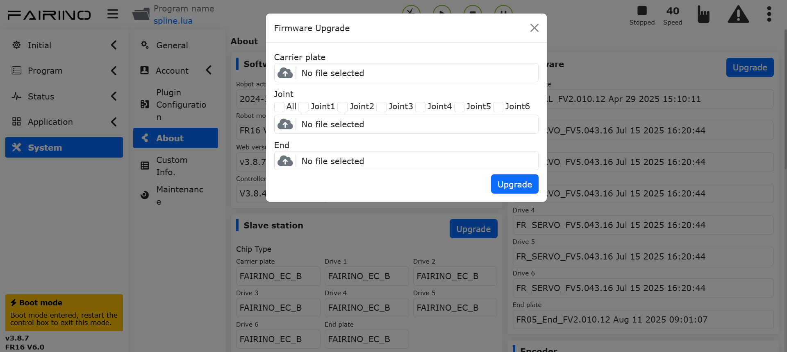

.. centered:: Figura 8.1‑1 Actualización del firmware del extremo

**Step2**: Abrir WebApp, hacer clic sucesivamente en "Configuración inicial", "Periféricos" y seleccionar el periférico del extremo que se desea configurar (por ejemplo, la pinza); el tipo de control del periférico puede ser "Dispositivo adaptado" o "Protocolo abierto de periféricos":

- **Dispositivo adaptado**: utiliza el controlador del robot para la comunicación; no requiere carga ni aplicación.
- **Protocolo abierto de periféricos**: el usuario redacta en Lua el protocolo abierto del extremo que se desea adaptar para implementar el control de comunicación; los protocolos del extremo se dividen en dos categorías: una son los protocolos cargados por el propio usuario y la otra son los protocolos predefinidos internos del robot. A partir de la versión 3.9.2, el usuario puede cargar directamente el protocolo Lua que se desea cargar al extremo sin realizar operaciones adicionales de verificación y cifrado mediante software adicional; además, los protocolos ya verificados y cifrados anteriormente se pueden seguir cargando y utilizando con normalidad; el robot distingue activamente si el archivo ha sido verificado y cifrado; si no lo ha sido, realizará la verificación y el cifrado antes de cargarlo y aplicarlo al extremo; si ya está cifrado, lo cargará y aplicará directamente al extremo.

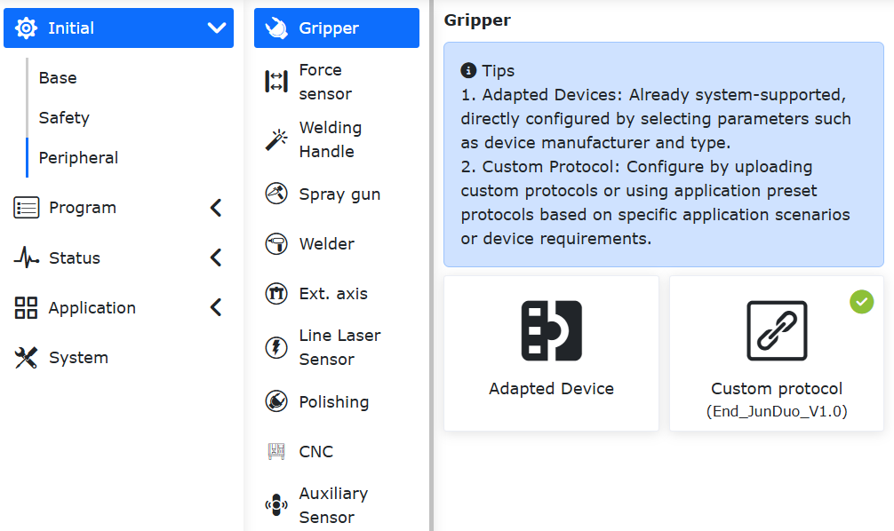

.. centered:: Figura 8.1‑2 Tipo de control de la pinza

**Step3**: Entrar en la interfaz de contenido de Periféricos->Pinza/Sensor de fuerza/Empuñadura de soldadura, hacer clic en la tarjeta "Protocolo personalizado" para entrar en la interfaz, cargar el protocolo abierto Lua del extremo y seleccionar el protocolo abierto Lua del extremo que se desea cargar para realizar la operación de carga.

.. important:: 
  El nombre del archivo cargado debe comenzar por `AXLE_LUA_`.

**Step4**: Configurar los parámetros de comunicación del extremo; los parámetros de comunicación incluyen la velocidad en baudios, los bits de datos, los bits de parada, etc.; tras completar la configuración, hacer clic en el botón "Configurar".

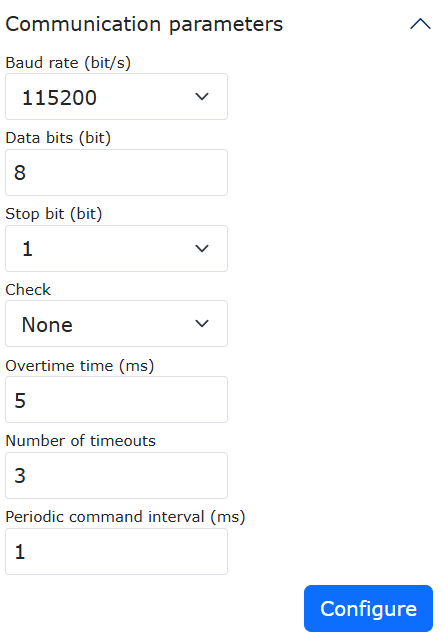

.. centered:: Figura 8.1‑3 Configuración de los parámetros de comunicación del extremo

Los parámetros detallados de comunicación del extremo son los siguientes:

- **Velocidad en baudios**: compatible con 1-9600, 2-14400, 3-19200, 4-38400, 5-56000, 6-67600, 7-115200, 8-128000; el chip driver Rs485 del extremo es de 485 de baja velocidad; la velocidad en baudios no puede ser >200k;
- **Bits de datos**: los bits de datos admiten (8,9); actualmente el más habitual es 8;
- **Bits de parada**: 1-1, 2-0.5, 3-2, 4-1.5; actualmente el más habitual es 1;
- **Bit de paridad**: 0-None, 1-Odd, 2-Even; actualmente el más habitual es 0;
- **Tiempo de espera agotado**: 1~1000ms; este valor debe configurarse con un tiempo razonable en combinación con el periférico;
- **Número de tiempos de espera agotado**: 1~10; se utiliza principalmente para el reenvío tras tiempo de espera agotado, reduciendo anomalías ocasionales y mejorando la experiencia del usuario;
- **Intervalo de tiempo de las instrucciones periódicas**: 1~1000ms; se utiliza principalmente para el intervalo de tiempo de cada envío de las instrucciones periódicas;

**Step5**: Habilitación del Lua del extremo; hacer clic en el botón "Activar".

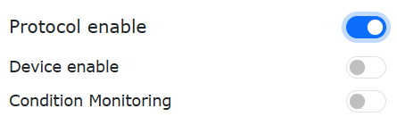

.. centered:: Figura 8.1‑4 Habilitación del Lua del extremo

Cuando se produce una anomalía en el archivo Lua, se muestra la advertencia "Anomalía en el archivo Lua del extremo", pudiendo realizarse el tratamiento de "No restaurar/Restaurar". Al desactivar el botón de habilitación del Lua, se cierra el aviso de advertencia.

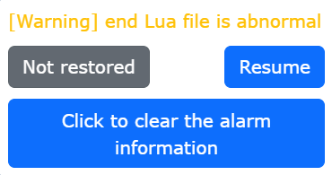

.. centered:: Figura 8.1‑5 Anomalía en el archivo Lua

Cuando el tipo de dispositivo es pinza, se puede realizar la monitorización de estado.

**Activar "Monitorización de estado"**: la barra de estado de la pinza de la derecha muestra en tiempo real información de estado como la velocidad de funcionamiento, el par y la posición de la pinza.

**Desactivar "Monitorización de estado"**: se cierra la barra de estado de datos de la pinza de la derecha.

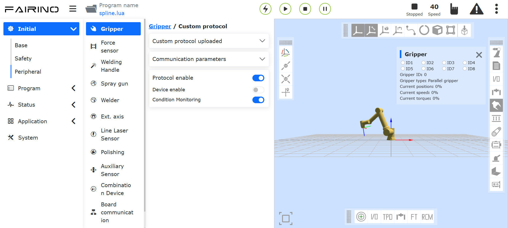

.. centered:: Figura 8.1‑6 Monitorización de estado

Pinza
-------------------

En la interfaz "Configuración inicial"->"Periféricos"->"Pinza", actualmente se puede utilizar la pinza mediante dispositivos adaptados y el protocolo abierto personalizado Lua del extremo.

Dispositivo adaptado
~~~~~~~~~~~~~~~~~~~~

**Step1**: Hacer clic en "Dispositivo adaptado" para entrar en la interfaz de configuración de periféricos del extremo. La información de configuración de la pinza se divide en fabricante de la pinza, tipo de pinza, versión de software y posición de montaje; el usuario puede configurar la información correspondiente de la pinza según sus necesidades concretas de producción. Si el usuario necesita cambiar la configuración, puede seleccionar primero el número de pinza correspondiente, hacer clic en el botón "Borrar" para borrar el botón correspondiente y volver a configurar según sus necesidades;

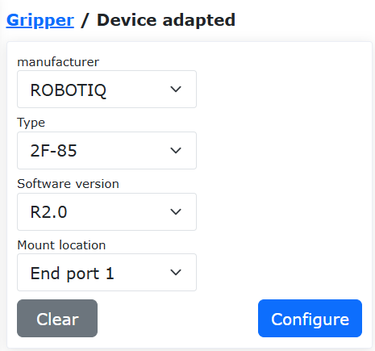

.. centered:: Figura 8.2‑1 Configuración de la pinza

.. important:: 
	Antes de hacer clic en borrar la configuración, la pinza correspondiente debe encontrarse en estado no activado.

**Step2**: Tras completar la configuración de la pinza, el usuario puede consultar la información correspondiente de la pinza en la tabla de información de pinza de la parte inferior de la página; si se detecta un error de configuración, se puede hacer clic en el botón "Borrar" y volver a configurar la pinza;

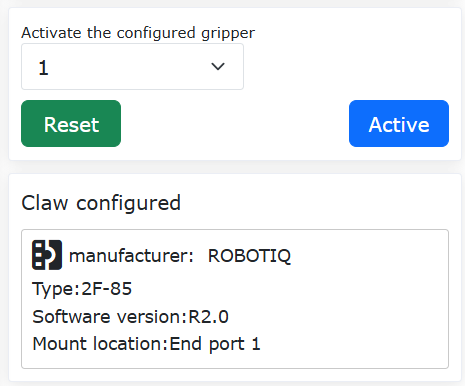

.. centered:: Figura 8.2‑2 Información de configuración de la pinza

**Step3**: Seleccionar la pinza ya configurada, hacer clic en el botón "Restablecer" y, cuando la página muestre que el comando se ha enviado correctamente, hacer clic en el botón "Activar" y consultar el estado de activación en la tabla de información de la pinza para determinar si la activación se ha realizado correctamente;

.. important::
	Al activar la pinza, esta no debe tener ningún objeto agarrado.

**Step4**: En la interfaz de comandos del programa de enseñanza, seleccionar el comando "Gripper". En la interfaz del comando de pinza, el usuario puede seleccionar el número de pinza que desea controlar (pinza ya configurada y activada), configurar el estado de apertura/cierre, la velocidad de apertura/cierre, el par de apertura/cierre y el tiempo máximo de espera del movimiento de la pinza. Tras completar la configuración, hacer clic en añadir y aplicar. Además, se pueden añadir instrucciones de activación y restablecimiento de la pinza para activar/restablecer la pinza durante la ejecución del programa.

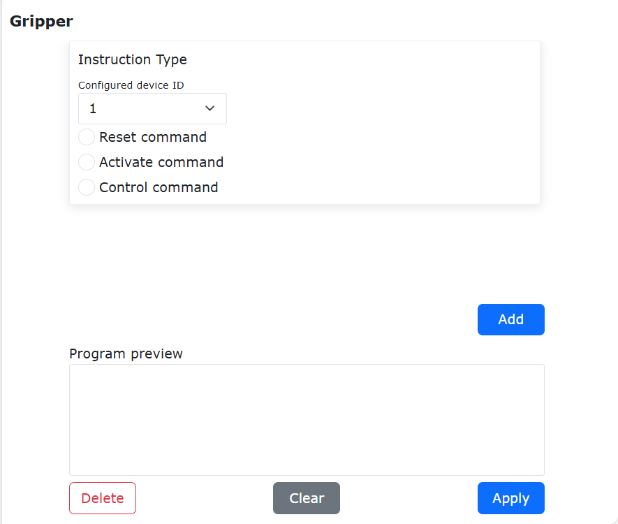

.. centered:: Figura 8.2‑3 Edición de la instrucción de pinza

Enseñanza del programa de pinza
+++++++++++++++++++++++++++++++

.. list-table:: 
   :widths: 15 40 100
   :header-rows: 1

   * - Número
     - Formato de la instrucción
     - Comentario
   * - 1
     - PTP(template2,100,-1,0)
     - #Punto de espera de agarre
   * - 2
     - PTP(template1,100,-1,0)
     - #Punto de agarre
   * - 3
     - MoveGripper(1,255,255,0,1000,0)
     - #Cierre de la pinza
   * - 4
     - PTP(template2,100,-1,0)
     - /
   * - 5
     - PTP(template3,100,-1,0)
     - #Punto de espera de colocación
   * - 6
     - PTP(template3,100,-1,0)
     - #Punto de colocación
   * - 7
     - MoveGripper(1,0,255,0,1000,0)
     - #Apertura de la pinza

Configuración del protocolo Lua del extremo de la pinza
~~~~~~~~~~~~~~~~~~~~~~~~~~~~~~~~~~~~~~~~~~~~~~~~~~~~~~~

Abrir WebApp, hacer clic sucesivamente en "Configuración inicial", "Periféricos", "Pinza", "Protocolo personalizado". Hacer clic en "Gestión de protocolos" para configurar el protocolo del extremo.

El nombre del archivo cargado por el usuario debe comenzar por "AXLE_LUA_End"; tras la carga, el nombre del protocolo de la lista pasará a comenzar por "Custom_End"; este tipo de protocolos se pueden descargar y eliminar; los archivos con el mismo nombre cargados por el usuario se sobrescribirán automáticamente con el Lua más reciente.

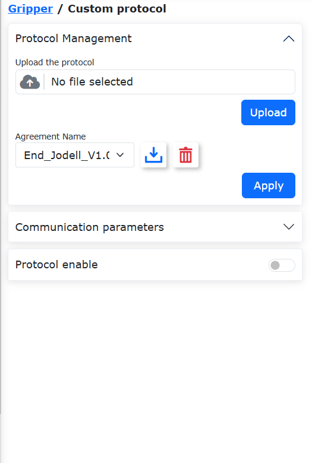

.. centered:: Figura 8.2‑4-1 Carga del protocolo personalizado de la pinza

Los protocolos predefinidos internos del robot tienen el prefijo `End_` y solo se pueden descargar, no eliminar; los protocolos internos de los periféricos de pinza (pinza rotativa, ventosa) se muestran en la figura siguiente.

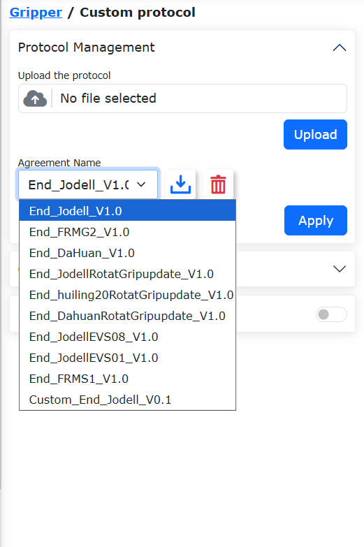

.. centered:: Figura 8.2‑4-2 Protocolos internos predefinidos de la pinza (pinza rotativa, ventosa)

Tras asegurarse de que el protocolo seleccionado es correcto, se puede deshabilitar el robot y aplicar el protocolo abierto; tras la aplicación, el robot entrará automáticamente en modo boot y aplicará el protocolo seleccionado al extremo; cuando la página muestre "Actualización correcta, reinicie la caja de control", se podrá volver a encender la caja de control.

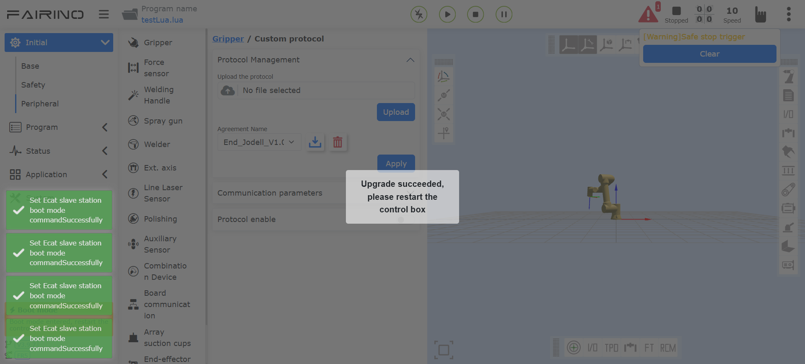

.. centered:: Figura 8.2‑4-3 Aplicación del protocolo abierto del extremo a la placa del extremo

Tras reiniciar y entrar en la página de WebApp, la página mostrará el nombre del protocolo aplicado actualmente; tras hacer clic en la habilitación del protocolo del extremo y la habilitación del dispositivo, el protocolo del extremo comenzará a ejecutarse; el ID de dispositivo es la dirección de esclavo Modbus del periférico del extremo y debe utilizarse en coordinación con el contenido del protocolo.

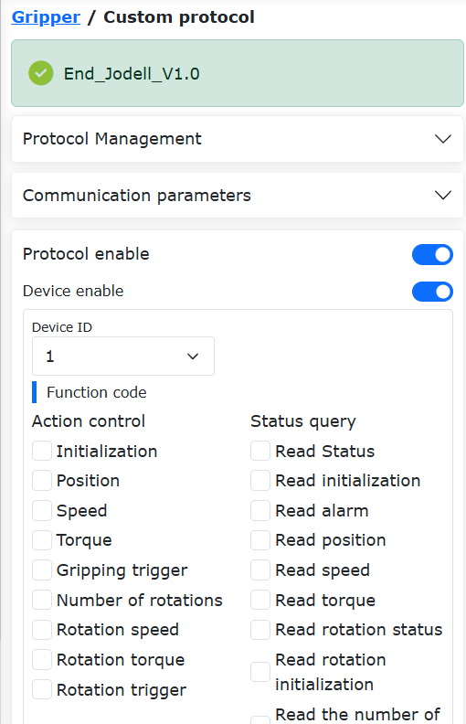

.. centered:: Figura 8.2‑4-4 Visualización y habilitación de la configuración del protocolo del extremo de la pinza

La placa del extremo verifica el protocolo Lua cargado; cuando el archivo Lua presenta anomalías, se muestra la advertencia "Anomalía en el archivo Lua del extremo", pudiendo realizarse el tratamiento de "No restaurar/Restaurar". Al desactivar el botón de habilitación del Lua, se cierra el aviso de advertencia.

.. centered:: Figura 8.2‑4-5 Visualización y habilitación de la configuración del protocolo del extremo de la pinza

Ejemplo de protocolo Lua del extremo del periférico de pinza
++++++++++++++++++++++++++++++++++++++++++++++++++++++++++++

.. code-block:: console
  
  function Getbit(X,Bit)--Getbit(), función para extraer el Bit correspondiente de un byte; parámetros: X: el byte del que se extrae el bit; Bit: el bit que se desea extraer, rango opcional 0-7
  return ((X&(1<<Bit))>>Bit)
  end

  function GetOneByte(U32)--GetOneByte(), extrae del dato 0x1234 su byte bajo, valor de retorno 0x34
  return ((U32>>0)&0xFF)
  end

  function GetTwoByte(U32)--GetTwoByte(), extrae del dato 0x1234 su byte alto, valor de retorno 0x12
  return ((U32>>8)&0xFF)
  end
  function GetThreeByte(U32)--GetThreeByte(), extrae del dato 0x56781234, valor de retorno 0x78
  return ((U32>>16)&0xFF)
  end
  function GetFourByte(U32)--GetFourByte(), extrae del dato 0x56781234, valor de retorno 0x56
  return ((U32>>24)&0xFF)
  end
  X,Speed,Torque=0,0,0
  while(1)
  do
  IwdgTaskHandle()
  MainLoop()
  UpDownLoadHandle()
  SdoRwPara()
  EndErrClear()
  local BFlag=LuaBreak()
  if(BFlag==1)then
  break
  end--hasta aquí el final del archivo LuaGc(); end es un uso fijo

  T1={0x01,0x06,0x03,0xE8,0x00,0x09,0xC9,0xBC}--rellenar la instrucción de la pinza (instrucción Modbus RTU); T1-T5 son sucesivamente la instrucción de ejecución de acción de la pinza, la instrucción de inicialización de la pinza, la instrucción de envío de posición de la pinza, la instrucción de envío de velocidad de la pinza y la instrucción de envío de par de la pinza
  --/análisis de la instrucción: T1[1]=0X01, es la dirección de la pinza; T1[2]=0x06, código de función de escritura de un único registro de retención; T1[3],T1[4]: 0x03,0xE8, dirección del registro que debe operar la instrucción de ejecución de acción; T1[5],T1[6]: 0x00,0x09, datos que se escriben en el registro; T1[7],T1[8]: 0xC9,0xBC, código de verificación CRC, que debe modificarse según el manual de usuario de la pinza
  T2={}
  T3={}
  T4={}
  T5={}

  T7={0x01,0x03,0x07,0xD0,0x00,0x01,0x84,0x87}--T7-T12, instrucciones de lectura de estado de la pinza; sucesivamente, instrucción de lectura de estado de la pinza, instrucción de lectura de inicialización de la pinza, instrucción de lectura de código de fallo de la pinza, instrucción de lectura de posición de la pinza, instrucción de lectura de velocidad de la pinza e instrucción de lectura de par de la pinza
  T8={}
  T9={}
  T10={}
  T11={}
  T12={}
  Rcmd1,Rcmd2,Rcmd3,Rcmd4=GetGripCmd()--uso fijo, no requiere modificación; Rcm2 es la dirección de la pinza enviada por el controlador; Rcmd4 son los datos enviados por el controlador
  if(Rcmd1==1) then
  T1[1]=Rcmd2                   
  T2[1]=Rcmd2
  T3[1]=Rcmd2
  T4[1]=Rcmd2
  T5[1]=Rcmd2

  T7[1]=Rcmd2
  T8[1]=Rcmd2
  T9[1]=Rcmd2
  T10[1]=Rcmd2
  T11[1]=Rcmd2
  T12[1]=Rcmd2                    --**actualización de la dirección de la pinza
  if (Rcmd3==1) then              --instrucción de ejecución de acción de la pinza
  T1[7],T1[8]=CrcValue(T1[1],T1[2],T1[3],T1[4],T1[5],T1[6])--cálculo del valor CRC de la instrucción Modbus RTU, dos bytes
  EndTxGripData(T1[1],T1[2],T1[3],T1[4],T1[5],T1[6],T1[7],T1[8])--el extremo envía la instrucción a la pinza
  DelayMs(10)                                                   --retardo de 10ms
  A,Rxd1,Rxd2,Rxd3,Rxd4,Rxd5,Rxd6,Rxd7=EndRxGripData()--el extremo devuelve al Lua los datos de realimentación recibidos de la pinza; el contenido concreto de la realimentación debe consultarse en el manual de usuario de la pinza
  GripStateBack(Rxd3)
  end
  if (Rcmd3==2) then
  T2[7],T2[8]=CrcValue(T2[1],T2[2],T2[3],T2[4],T2[5],T2[6])
  EndTxGripData(T2[1],T2[2],T2[3],T2[4],T2[5],T2[6],T2[7],T2[8])
  DelayMs(10)
  A,Rxd1,Rxd2,Rxd3,Rxd4,Rxd5,Rxd6,Rxd7=EndRxGripData()
  GripStateBack(Rxd3)
  end
  if(Rcmd3==3) then
  X=Rcmd4
  T3[5]=0x00
  T3[6]=X
  T3[7],T3[8]=CrcValue(T3[1],T3[2],T3[3],T3[4],T3[5],T3[6])
  EndTxGripData(T3[1],T3[2],T3[3],T3[4],T3[5],T3[6],T3[7],T3[8])
  DelayMs(10)
  A,Rxd1,Rxd2,Rxd3,Rxd4,Rxd5,Rxd6,Rxd7=EndRxGripData()
  GripStateBack(Rxd3)
  end
  if (Rcmd3==4) then
  Speed=Rcmd4
  T4[5]=Torque
  T4[6]=Speed
  T4[7],T4[8]=CrcValue(T4[1],T4[2],T4[3],T4[4],T4[5],T4[6])
  EndTxGripData(T4[1],T4[2],T4[3],T4[4],T4[5],T4[6],T4[7],T4[8])
  DelayMs(10)
  A,Rxd1,Rxd2,Rxd3,Rxd4,Rxd5,Rxd6,Rxd7=EndRxGripData()
  GripStateBack(Rxd3)
  end
  if(Rcmd3==5) then
  Torque=Rcmd4
  T5[5]=Torque
  T5[6]=Speed
  T5[7],T5[8]=CrcValue(T5[1],T5[2],T5[3],T5[4],T5[5],T5[6])
  EndTxGripData(T5[1],T5[2],T5[3],T5[4],T5[5],T5[6],T5[7],T5[8])
  DelayMs(10)
  A,Rxd1,Rxd2,Rxd3,Rxd4,Rxd5,Rxd6,Rxd7=EndRxGripData()
  GripStateBack(Rxd3)
  end
  if(Rcmd3 == 7) then
  T7[7],T7[8]=CrcValue(T7[1],T7[2],T7[3],T7[4],T7[5],T7[6])
  EndTxGripData(T7[1],T7[2],T7[3],T7[4],T7[5],T7[6],T7[7],T7[8])
  DelayMs(10)
  A,Rxd1,Rxd2,Rxd3,Rxd4,Rxd5,Rxd6,Rxd7=EndRxGripData()
  RxdCrcH,RxdCrcL = CrcValue(Rxd1,Rxd2,Rxd3,Rxd4,Rxd5)
  if((A==8)and(Rxd1==Rcmd2)and(Rxd2==0x03)and(Rxd3==0x02)and(Rxd6==RxdCrcH)and(Rxd7==RxdCrcL))then
  GripStateBack(Rxd4)
  end
  end
  if(Rcmd3==8) then
  T8[7],T8[8]=CrcValue(T8[1],T8[2],T8[3],T8[4],T8[5],T8[6])
  EndTxGripData(T8[1],T8[2],T8[3],T8[4],T8[5],T8[6],T8[7],T8[8])
  DelayMs(10)
  A,Rxd1,Rxd2,Rxd3,Rxd4,Rxd5,Rxd6,Rxd7=EndRxGripData()
  RxdCrcH,RxdCrcL = CrcValue(Rxd1,Rxd2,Rxd3,Rxd4,Rxd5)
  if((A==8)and(Rxd1==Rcmd2)and(Rxd2==0x03)and(Rxd3==0x02)and(Rxd6==RxdCrcH)and(Rxd7 ==RxdCrcL)) then
  GripStateBack(Rxd5)
  end
  end
  if(Rcmd3 == 9) then
  T9[7],T9[8]=CrcValue(T9[1],T9[2],T9[3],T9[4],T9[5],T9[6])
  EndTxGripData(T9[1],T9[2],T9[3],T9[4],T9[5],T9[6],T9[7],T9[8])
  DelayMs(10)
  A,Rxd1,Rxd2,Rxd3,Rxd4,Rxd5,Rxd6,Rxd7=EndRxGripData()
  RxdCrcH,RxdCrcL = CrcValue(Rxd1,Rxd2,Rxd3,Rxd4,Rxd5)
  if((A==8)and(Rxd1==Rcmd2)and(Rxd2==0x03)and(Rxd3==0x02)and(Rxd6==RxdCrcH)and(Rxd7==RxdCrcL)) then
  GripStateBack(Rxd5)
  end
  end
  if(Rcmd3 == 10) then
  T10[7],T10[8]=CrcValue(T10[1],T10[2],T10[3],T10[4],T10[5],T10[6])
  EndTxGripData(T10[1],T10[2],T10[3],T10[4],T10[5],T10[6],T10[7],T10[8])
  DelayMs(10)
  A,Rxd1,Rxd2,Rxd3,Rxd4,Rxd5,Rxd6,Rxd7=EndRxGripData()
  RxdCrcH,RxdCrcL = CrcValue(Rxd1,Rxd2,Rxd3,Rxd4,Rxd5)
  if((A==8)and(Rxd1==Rcmd2)and(Rxd2==0x03)and(Rxd3==0x02)and(Rxd6==RxdCrcH)and(Rxd7==RxdCrcL)) then
  GripStateBack(Rxd4)
  end
  end
  if(Rcmd3 == 11) then
  T11[7],T11[8]=CrcValue(T11[1],T11[2],T11[3],T11[4],T11[5],T11[6])
  EndTxGripData(T11[1],T11[2],T11[3],T11[4],T11[5],T11[6],T11[7],T11[8])
  DelayMs(10)
  A,Rxd1,Rxd2,Rxd3,Rxd4,Rxd5,Rxd6,Rxd7=EndRxGripData()
  RxdCrcH,RxdCrcL = CrcValue(Rxd1,Rxd2,Rxd3,Rxd4,Rxd5)
  if((A==8)and(Rxd1==Rcmd2)and(Rxd2==0x03)and(Rxd3==0x02)and(Rxd6==RxdCrcH)and(Rxd7==RxdCrcL)) then
  GripStateBack(Rxd5)
  end
  end
  if(Rcmd3 == 12) then
  T12[7],T12[8]=CrcValue(T12[1],T12[2],T12[3],T12[4],T12[5],T12[6])
  EndTxGripData(T12[1],T12[2],T12[3],T12[4],T12[5],T12[6],T12[7],T12[8])
  DelayMs(10)
  A,Rxd1,Rxd2,Rxd3,Rxd4,Rxd5,Rxd6,Rxd7=EndRxGripData()
  RxdCrcH,RxdCrcL = CrcValue(Rxd1,Rxd2,Rxd3,Rxd4,Rxd5)
  if((A==8)and(Rxd1==Rcmd2)and(Rxd2==0x03)and(Rxd3==0x02)and(Rxd6==RxdCrcH)and(Rxd7==RxdCrcL)) then
  GripStateBack(Rxd4)
  end
  end
  end
  LuaGc()
  end

Habilitación del dispositivo
++++++++++++++++++++++++++++

**Step1**: Habilitar la pinza->seleccionar el ID de la pinza->marcar los códigos de función adaptados a la pinza->hacer clic en configurar; en los dispositivos ya configurados se muestran el ID y los códigos de función de la pinza.

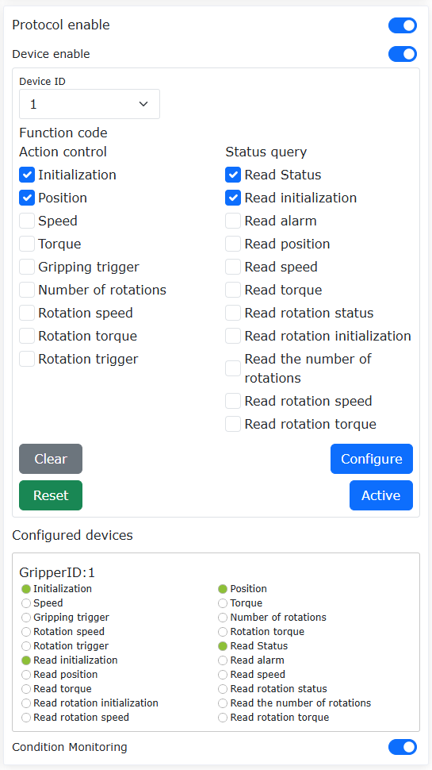

.. centered:: Figura 8.2‑4 Configuración de la pinza

.. note:: 
  Dado que la función abierta del extremo admite actualmente un rango de direcciones de dispositivo de pinza de 1~8, antes de su uso debe ajustarse la dirección de dispositivo de la pinza mediante el ordenador superior del fabricante de la pinza.

  Los códigos de función marcados deben consultarse en el manual del producto proporcionado por el fabricante de la pinza para conocer las funciones adaptadas a la pinza, y deben corresponderse con los códigos de función del Lua del extremo; para más detalles, consulte el «Manual de descripción de adaptación de pinza con Lua del extremo».

**Step2**: Seleccionar el ID de la pinza->restablecer->activar; la pinza realiza una inicialización; para el caso concreto de la inicialización, consulte el manual del producto proporcionado por el fabricante de la pinza.

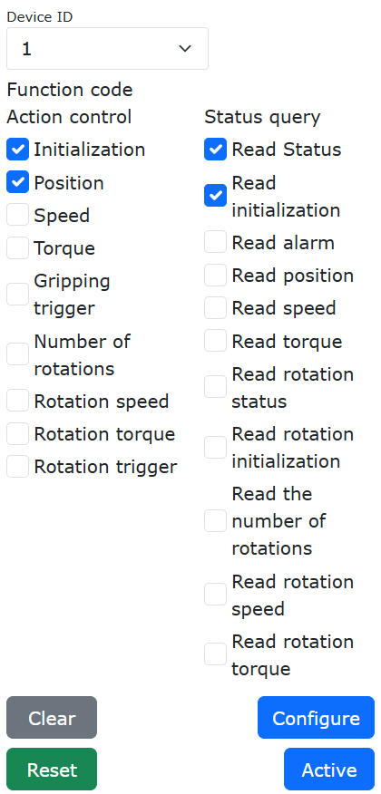

.. centered:: Figura 8.2‑5 Activación de la pinza

**Step3**: Entrar en Programa de enseñanza->Programación de programas->añadir la instrucción de movimiento de pinza.

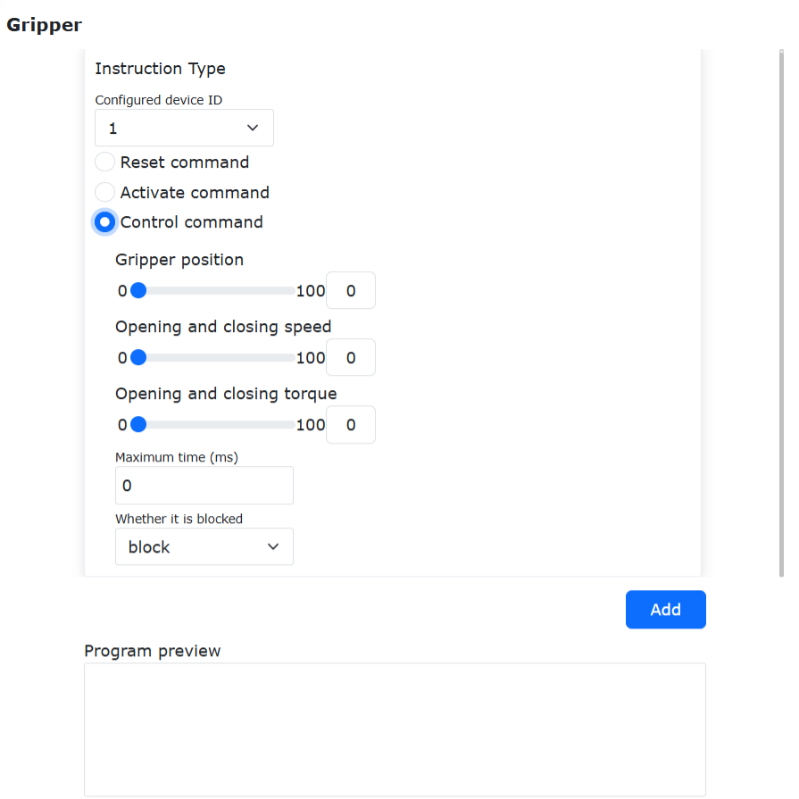

.. centered:: Figura 8.2‑6 Adición de la instrucción de movimiento de pinza

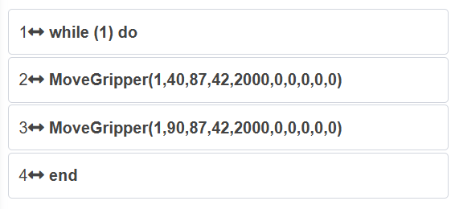

.. centered:: Figura 8.2‑7 Ejemplo de instrucción de movimiento de pinza

Múltiples pinzas
++++++++++++++++

Para la activación y el control del movimiento, consulte los pasos de la pinza. 

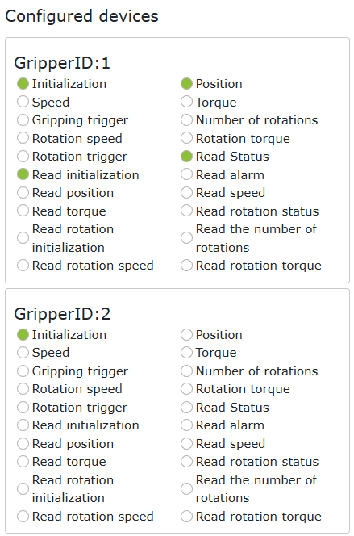

.. centered:: Figura 8.2‑8 Configuración de múltiples pinzas

.. note:: Dado que la función abierta del extremo admite actualmente un rango de direcciones de dispositivo de pinza de 1~8, antes de su uso debe ajustarse la dirección de dispositivo de la pinza mediante el ordenador superior del fabricante de la pinza.

Pinza rotativa
++++++++++++++

**Step1**: Habilitar la pinza->seleccionar el ID de la pinza->marcar los códigos de función adaptados a la pinza->hacer clic en configurar; en los dispositivos ya configurados se muestran el ID y los códigos de función de la pinza.

.. centered:: Figura 8.2‑9 Configuración de la pinza y de los códigos de función

.. note:: Los códigos de función marcados deben consultarse en el manual del producto proporcionado por el fabricante de la pinza para conocer las funciones adaptadas a la pinza, y deben corresponderse con los códigos de función del Lua del extremo; para más detalles, consulte «FR05-Protocolo de periféricos completos del extremo-V2.5-20241101.xlsx».

**Step2**: Seleccionar el ID de la pinza->restablecer->activar; la pinza realiza una inicialización; para el caso concreto de la inicialización, consulte el manual del producto proporcionado por el fabricante de la pinza.

.. centered:: Figura 8.2‑10 Activación de la pinza

**Step3**: Entrar en Programa de enseñanza->Programación de programas->añadir la instrucción de movimiento de pinza.

.. centered:: Figura 8.2‑11 Adición de la instrucción de movimiento de pinza rotativa

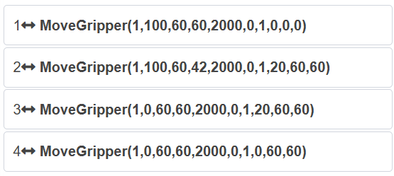

.. centered:: Figura 8.2‑12 Ejemplo de instrucción de movimiento de pinza rotativa

.. note:: El número de vueltas de rotación es el número absoluto de vueltas de rotación; el número máximo de vueltas en sentido directo es 90 y el número máximo de vueltas en sentido inverso es 90; tras la rotación es necesario realizar un tratamiento de restablecimiento.

Función de detección de caída de pieza de la pinza
~~~~~~~~~~~~~~~~~~~~~~~~~~~~~~~~~~~~~~~~~~~~~~~~~~~~~~~~~~~~~~~~~~~~~~~~~~~~~~~~~~~~~~

Descripción de la configuración
++++++++++++++++++++++++++++++++++++++++++++++++++

El usuario puede, modificando el protocolo abierto del extremo, leer el valor del registro de alarma de caída de la pinza y realimentarlo al robot; el robot, cuando la pinza activa dicho fallo, activará sincronizadamente el fallo "Alarma de caída de pieza de la pinza".

A continuación se toma como ejemplo la pinza Junduo; el ejemplo de adición de la detección de caída de la pinza en el protocolo abierto del extremo es el siguiente. El significado de este fragmento de código es leer el bit 1 del registro 0x07D0 de la pinza; cuando dicho bit se pone a 1, se activa el indicador de caída de pieza; en ese momento se asigna a GripState el valor 3 y se transmite al robot, activando el fallo "Alarma de caída de pieza de la pinza".

Si tiene problemas durante la redacción, póngase en contacto con nuestra empresa para obtener soporte técnico.

.. centered:: Ejemplo de lógica de detección de caída de la pinza Junduo añadida al protocolo abierto del extremo

.. code-block:: console
    :linenos:  

    ……
    local T5 = {0x01,0x03,0x07,0xD0,0x00,0x01,0x84,0x87}
    ……
    if (Rcmd3 == 7) then
    T5[7], T5[8] = CrcValue(T5[1], T5[2], T5[3], T5[4], T5[5], T5[6])
    EndTxGripData(T5[1], T5[2], T5[3], T5[4], T5[5], T5[6], T5[7], T5[8])
    DelayMs(10)
    a, Rxd1, Rxd2, Rxd3, Rxd4, Rxd5, Rxd6, Rxd7 = EndRxGripData()
    RxdCrcH, RxdCrcL = CrcValue(Rxd1, Rxd2, Rxd3, Rxd4, Rxd5)
    if ((a == 8) and (Rxd1 == Rcmd2) and (Rxd2 == 0x03) and (Rxd3 == 0x02) and (Rxd6 == RxdCrcH) and (Rxd7 == RxdCrcL)) then
    local Fall = ((Rxd5 & 0x02) >> 1)
    Rxd5 = ((Rxd5 & 0xC0) >> 6)
    if(Fall == 0)then
    if (Rxd5 == 0x00) then
    GripState = 0x00
    elseif (Rxd5 == 0x03) then
    GripState = 0x01
    elseif ((Rxd5 == 0x01) or (Rxd5 == 0x02)) then
    GripState = 0x02
    end
    else
    GripState = 0x03
    end
    GripStateBack(GripState)
    end
    end

Basándose en el protocolo del extremo con la lógica de detección de caída añadida, actualizar la carga y aplicar el protocolo abierto Lua del extremo a través de "Configuración inicial"->"Periféricos"->"Pinza".

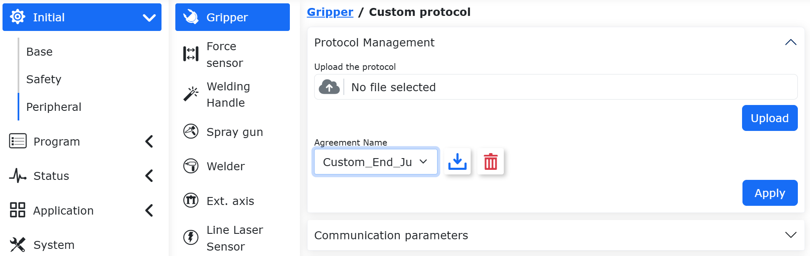

.. centered:: Figura 8.2‑13 Carga del protocolo del extremo de la pinza

Tras reiniciar el robot se podrá utilizar la pinza con normalidad; si durante el uso de la pinza se produce la caída de una pieza, el robot informará de "Pieza de la pinza caída, restablezca y vuelva a activar la pinza", y el robot detendrá sincronizadamente el movimiento actual y el programa lua en ejecución.

Entre ellos, los códigos de fallo principal y secundario de los puertos 8083 y 20004 pasarán a ser 8-3; el código de error correspondiente de la pinza es 3; los demás códigos de error cargados por la propia pinza se tratan en el controlador sumándoles +3.

.. centered:: Figura 8.2‑14 Fallo "Pieza de la pinza caída"
 
Cabe señalar que, tras borrar este fallo, el usuario debe enviar manualmente las instrucciones "Restablecimiento de pinza" y "Activación de pinza" para borrar el indicador de caída del registro de la pinza; se puede enviar mediante el botón de la página o mediante instrucciones lua; de lo contrario, en la siguiente ejecución se volverá a informar de este fallo.

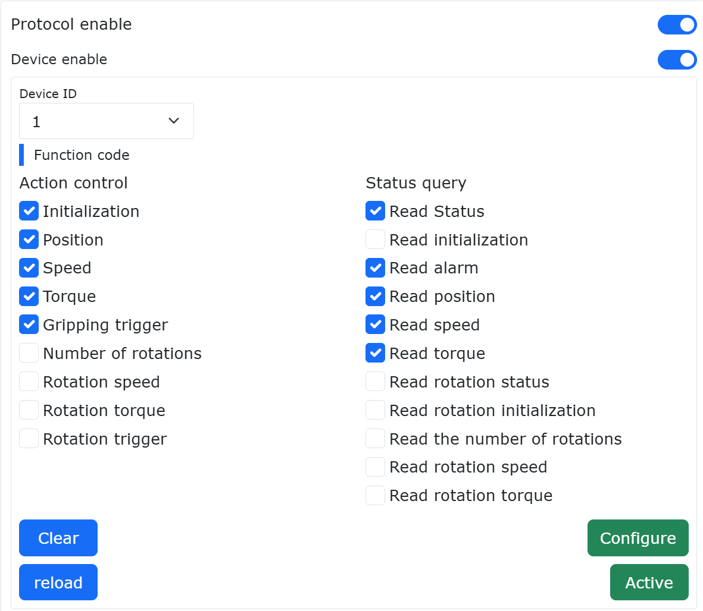

.. centered:: Figura 8.2‑15 Restablecimiento y activación de la pinza mediante la página

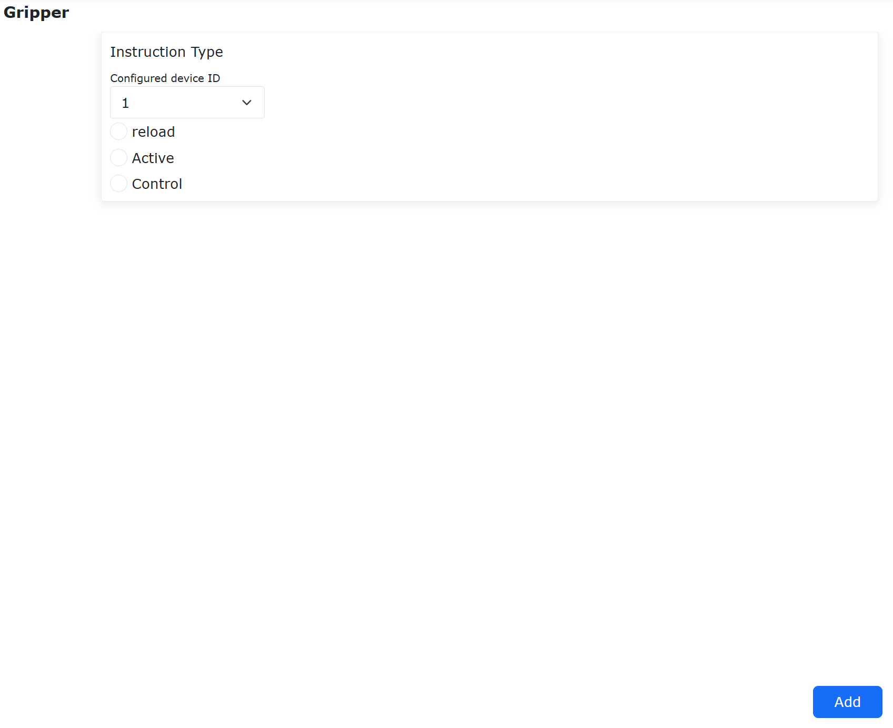

.. centered:: Figura 8.2‑16 Restablecimiento y activación de la pinza mediante instrucciones lua

Además, la pinza Junduo proporciona un registro del umbral de detección de caída, con dirección de registro 0x1399, que debe modificarse mediante escritura con la instrucción 0x10; el rango de modificación es 0~1000; el protocolo del extremo proporcionado en esta ocasión puede modificar el valor de dicho registro; en la primera escritura tras cada ejecución del protocolo se escribe dicho valor (0x14, modificable según necesidades), como se muestra en el ejemplo 2-2; para el método de uso concreto, puede consultar al fabricante de la pinza Junduo para obtener más información.

.. centered:: Ejemplo de modificación del umbral de caída de la pinza Junduo añadido al protocolo abierto del extremo

.. code-block:: console
    :linenos:  

    ……
    local T10 = {0x01,0x10,0x13,0x99,0x00,0x01,0x02,0x00,0x14,0x00,0x00}
    ……
    if Set == 0 then
    T10[10],T10[11]= CrcValue(T10[1],T10[2],T10[3],T10[4],T10[5],T10[6],T10[7],T10[8],T10[9])
    EndTxGripData(T10[1],T10[2],T10[3],T10[4],T10[5],T10[6],T10[7],T10[8],T10[9],T10[10],T10[11])
    DelayMs(35)
    a,Rxd1, Rxd2, Rxd3, Rxd4, Rxd5,Rxd6,Rxd7,Rxd8 = EndRxGripData()
    Set=1
    end

Anexo 1: Errores del controlador de movimiento y formas de tratamiento
++++++++++++++++++++++++++++++++++++++++++++++++++++++++++++++++++++++++

.. centered:: Tabla de códigos de error del controlador de movimiento

.. list-table:: 
   :widths: 15 40 100
   :header-rows: 1

   * - Código de fallo principal
     - Código de subfallo
     - Descripción
   * - 8-Error de dispositivo del extremo
     - 1
     - Error de tiempo de espera agotado en el movimiento de la pinza, reajustable
   * - 8-Error de dispositivo del extremo
     - 2
     - Tiempo de espera agotado en la comunicación 485 del extremo, reajustable
   * - 8-Error de dispositivo del extremo
     - 3
     - Alarma de caída de pieza de la pinza, reajustable; tras borrar el fallo, restablezca y vuelva a activar la pinza

Apéndice: Instrucción de espera bloqueante de la pinza
~~~~~~~~~~~~~~~~~~~~~~~~~~~~~~~~~~~~~~~~~~~~~~~~~~~~~~~

Hacer clic en "Programa de enseñanza"-"Instrucciones de periféricos"-"Pinza"; se ha añadido la instrucción de espera de finalización del movimiento de la pinza, que permite bloquear la obtención de la posición física real de la pinza tras finalizar la acción de agarre.

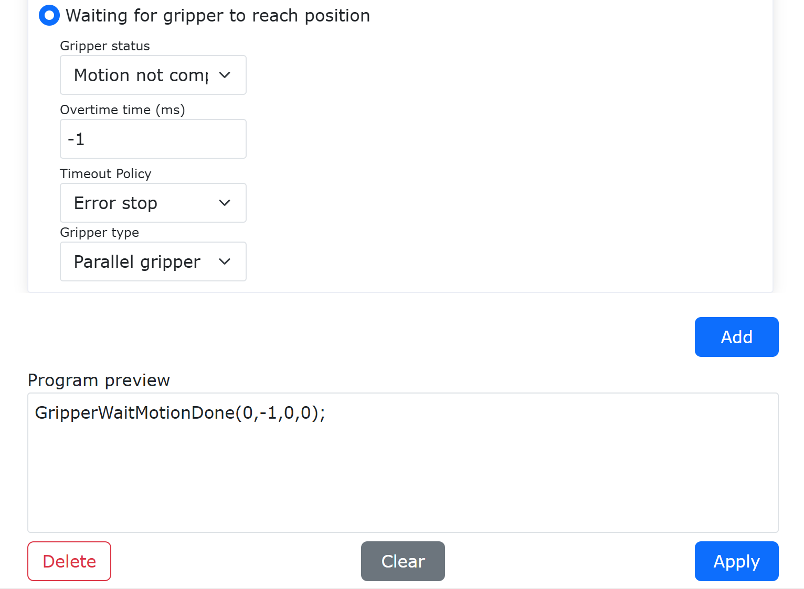

.. centered:: Figura 8.2‑17 Instrucción de espera de finalización del movimiento de la pinza
 
- Estado de la pinza: movimiento no completado, movimiento completado sin detectar objeto, movimiento completado con detección de objeto;
- Tiempo de espera agotado: en ms; -1 representa esperar siempre.
- Estrategia tras tiempo de espera agotado: se puede seleccionar detener con error o continuar la ejecución.
- Tipo de pinza: se puede seleccionar pinza paralela o pinza rotativa.

.. note:: 
   Nota: la instrucción de espera de finalización del movimiento de la pinza solo es aplicable a los protocolos personalizados; los dispositivos adaptados aún no son compatibles.

   También se puede utilizar directamente GetGripperMotionDone() para realizar la comprobación; el parámetro de entrada es el tipo de pinza, 0 pinza paralela, 1 pinza rotativa; el valor de retorno son el error de la pinza y el estado de la pinza. El error de la pinza es 0 si no hay error, y distinto de 0 si hay error; el estado de la pinza es 0 si el movimiento no está completado, 1 si el movimiento está completado sin detectar objeto y 2 si el movimiento está completado con detección de objeto. A continuación se muestra un programa de ejemplo con instrucciones como la espera de finalización del movimiento de la pinza y la obtención de la posición de la pinza:

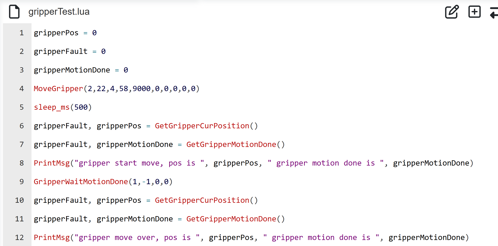

.. centered:: Figura 8.2‑18 Programa de ejemplo de movimiento de pinza

Consulta del estado de la pinza adaptada del extremo
~~~~~~~~~~~~~~~~~~~~~~~~~~~~~~~~~~~~~~~~~~~~~~~~~~~~

Descripción general
+++++++++++++++++++

En esta ocasión se añade la función de consulta del estado de funcionamiento y de la posición de la pinza, para facilitar al usuario la obtención del estado de finalización del movimiento de la pinza en el programa de enseñanza, así como la monitorización en tiempo real, a través de WebApp, de la posición, la velocidad, el par y el estado de movimiento de la pinza.

Configuración del entorno
+++++++++++++++++++++++++

- Versión del firmware del extremo: FR_END_FV201014_MAIN_U1_T01_20260626
- Versión del software del robot: V4.0.1 y superiores

Descripción de la actualización de las instrucciones de la pinza
+++++++++++++++++++++++++++++++++++++++++++++++++++++++++++++++++

Obtener el estado de finalización del movimiento de la pinza
*************************************************************

Abrir WebApp, entrar en la interfaz Programa de enseñanza->Programación de programas y abrir Instrucciones de periféricos-Pinza. Generar la instrucción de obtención del estado de finalización del movimiento de la pinza; esta instrucción solo se utiliza para consultar el estado actual de finalización del movimiento de la pinza.

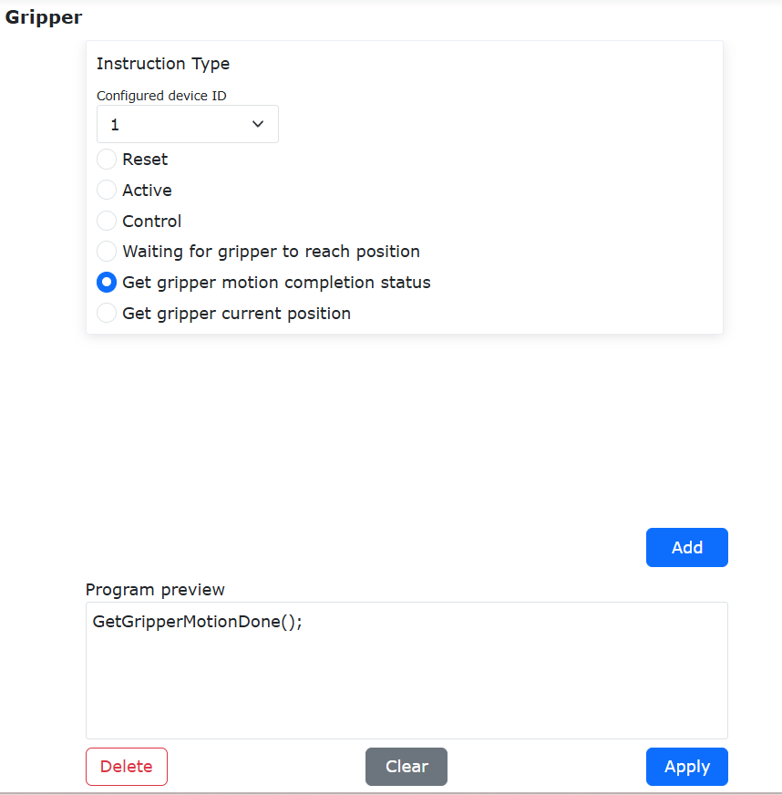

.. centered:: Figura 8.2‑19 Obtención del estado de finalización del movimiento de la pinza

Obtener la posición actual de la pinza
*************************************************************

Abrir WebApp, entrar en la interfaz Programa de enseñanza->Programación de programas y abrir Instrucciones de periféricos-Pinza. Generar la instrucción de obtención de la posición actual de la pinza; esta instrucción solo se utiliza para consultar la posición real actual de la pinza.

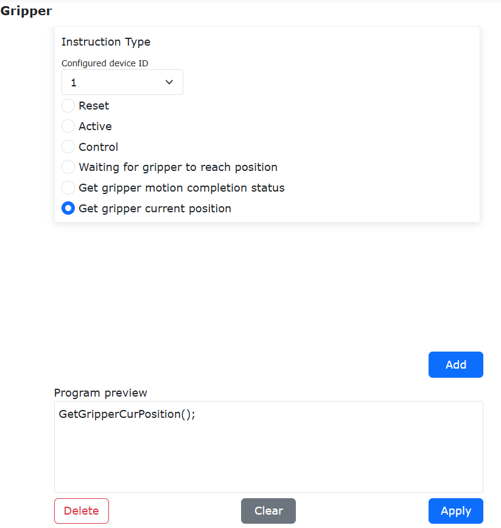

.. centered:: Figura 8.2‑20 Obtención de la posición actual de la pinza

Monitorización de datos de la pinza
*************************************************************

Abrir WebApp, entrar en Configuración inicial->Periféricos->Pinza->interfaz y habilitar la monitorización de estado. Tras enviar la instrucción de control, en la interfaz Gripper de la derecha se pueden obtener los datos de realimentación en tiempo real de la posición, la velocidad y el par de la pinza, así como su estado de movimiento.

Definición de los códigos de estado de movimiento de la pinza: 0- en movimiento; 1- movimiento completado sin detectar objeto; 2- movimiento completado con detección de objeto; 3- pieza caída.

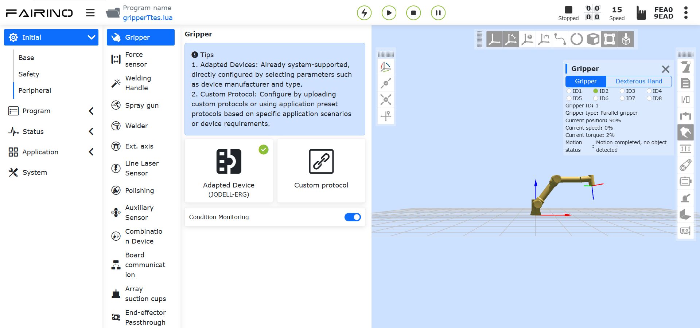

.. centered:: Figura 8.2‑21 Códigos de estado de movimiento de la pinza

.. note:: Nota: cuando se produce la caída de una pieza, la página de WebApp mostrará un aviso de alarma y el SDK podrá leer el código de fallo correspondiente. El tratamiento del fallo debe realizarse en el siguiente orden: borrar la alarma → restablecer la pinza → volver a activar la pinza; solo entonces se podrán seguir enviando instrucciones de movimiento.

Sensor de fuerza
-------------------------

En la interfaz "Configuración inicial"->"Periféricos"->"Sensor de fuerza", actualmente se puede utilizar el sensor de fuerza mediante dispositivos adaptados y el protocolo abierto personalizado Lua del extremo.

Dispositivo adaptado
~~~~~~~~~~~~~~~~~~~~

**Step1**: Hacer clic en "Dispositivo adaptado" para entrar en la interfaz de configuración de periféricos del extremo.

La información de configuración del sensor de fuerza se divide en fabricante, tipo, versión de software y posición de montaje; el usuario puede configurar la información correspondiente del sensor de fuerza según sus necesidades concretas de producción. Si el usuario necesita cambiar la configuración, puede seleccionar primero el número correspondiente, hacer clic en el botón "Borrar" para borrar la información correspondiente y volver a configurar según sus necesidades;

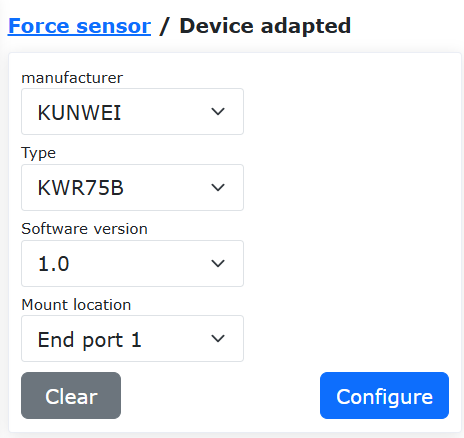

.. centered:: Figura 8.3‑1 Configuración del sensor de fuerza

.. important:: 
	Antes de hacer clic en borrar la configuración, el sensor correspondiente debe encontrarse en estado no activado.

**Step2**: Tras completar la configuración del sensor de fuerza, el usuario puede consultar la información correspondiente del sensor de fuerza en la tabla de información de la parte inferior de la página; si se detecta un error de configuración, se puede hacer clic en el botón "Borrar" y volver a configurar.

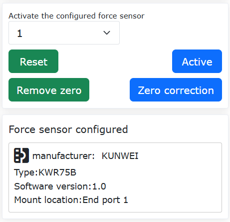

.. centered:: Figura 8.3‑2 Información de configuración del sensor de fuerza

**Step3**: Seleccionar el número del sensor de fuerza ya configurado, hacer clic en el botón "Restablecer" y, cuando la página muestre que el comando se ha enviado correctamente, hacer clic en el botón "Activar" y consultar el estado de activación en la tabla de información del sensor de fuerza para determinar si la activación se ha realizado correctamente; además, el sensor de fuerza tendrá un valor inicial; el usuario selecciona "Corrección de cero" y "Eliminar cero" según sus necesidades de uso. La corrección de cero del sensor de fuerza requiere asegurarse de que el sensor de fuerza está horizontal y verticalmente hacia abajo, y que el robot no tiene carga configurada.

**Step4**: Tras completar la configuración del sensor de fuerza, es necesario configurar el sistema de coordenadas de la herramienta de tipo sensor; se puede introducir directamente el valor del sistema de coordenadas de la herramienta del sensor según la distancia entre el sensor y el centro de la herramienta del extremo y aplicarlo.

Protocolo Lua del extremo del sensor de fuerza
~~~~~~~~~~~~~~~~~~~~~~~~~~~~~~~~~~~~~~~~~~~~~~

Abrir WebApp, hacer clic sucesivamente en "Configuración inicial", "Periféricos", "Sensor de fuerza", "Protocolo personalizado". Hacer clic en "Gestión de protocolos" para configurar el protocolo del extremo. Los protocolos internos predefinidos del sensor de fuerza se muestran en la figura siguiente. En la versión 3.9.2 se añaden dos protocolos combinados de pinza + sensor de fuerza internos: End_JD_XJC_V1.0.lua y End_JD_GZCX_V1.0.lua.

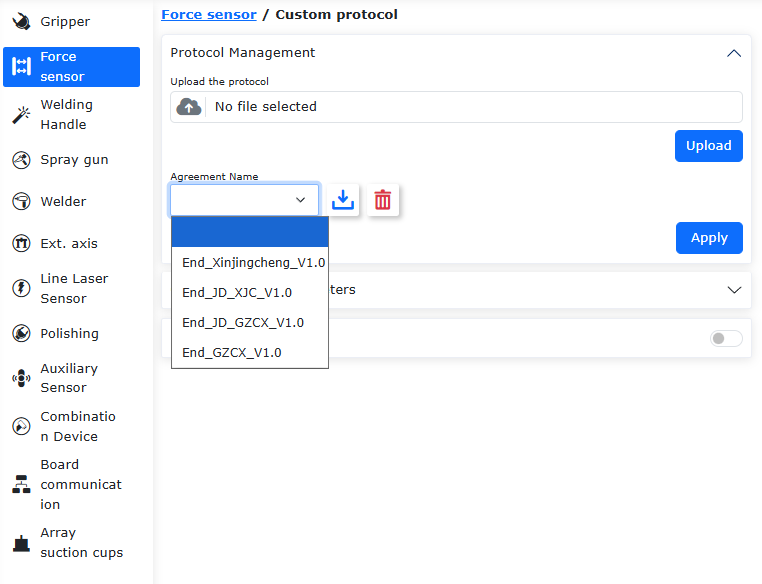

.. centered:: Figura 8.3‑2-2 Protocolos internos predefinidos del sensor de fuerza

Protocolo Lua del extremo de la empuñadura de soldadura
~~~~~~~~~~~~~~~~~~~~~~~~~~~~~~~~~~~~~~~~~~~~~~~~~~~~~~~

Abrir WebApp, hacer clic sucesivamente en "Configuración inicial", "Periféricos", "Empuñadura de soldadura", "Protocolo personalizado". Hacer clic en "Gestión de protocolos" para configurar el protocolo del extremo. Los protocolos internos predefinidos de la empuñadura de soldadura se muestran en la figura siguiente. En la versión 3.9.2 se añaden tres protocolos combinados internos de SmartTool + pinza o sensor de fuerza: End_SM_JD_V1.3.lua, End_SM_GZCX_V1.3.lua y End_SM_XJC_V1.3.lua.

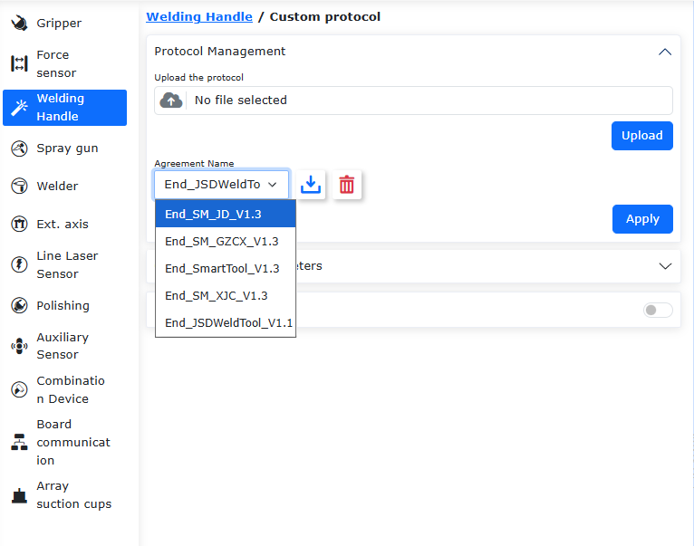

.. centered:: Figura 8.3‑2-3 Protocolos internos predefinidos de la empuñadura de soldadura

Generación automática del protocolo Lua del extremo
++++++++++++++++++++++++++++++++++++++++++++++++++++

Esta nueva función permite configurar automáticamente a través de la página Web los protocolos relacionados con el periférico de la empuñadura de soldadura SmartTool internos (actualmente solo se pueden configurar y generar automáticamente los cuatro protocolos End_SmartTool_V1.3.lua, End_SM_JD_V1.3.lua, End_SM_GZCX_V1.3.lua y End_SM_XJC_V1.3.lua), generando automáticamente el protocolo Lua del extremo y cargándolo y aplicándolo al extremo, sin necesidad de que el usuario lo redacte. El usuario configura las teclas A, B, C, D, E e IO de la empuñadura de soldadura SmartTool según sus necesidades; tras completar la configuración es necesario deshabilitar el robot y hacer clic en "Aplicar"; en ese momento la página mostrará "¿Entrar en boot y aplicar el protocolo abierto?"; tras hacer clic en confirmar, el robot entrará en estado boot y cargará automáticamente el protocolo Lua del extremo generado automáticamente; tras reiniciar el robot se podrá utilizar el SmartTool según las teclas configuradas.

A partir de la versión V3.9.8, el SmartTool basado en el protocolo del extremo permite configurar la misma función en distintas teclas, y se añade la selección del número de oscilación y del número de proceso de soldadura; el número de oscilación es por defecto 0; si se configura "Inicio de oscilación" se puede seleccionar el número de oscilación. La tecla IO se configura igual que el inicio de oscilación. El tiempo máximo de encendido y apagado del arco se puede configurar hasta 10000ms.

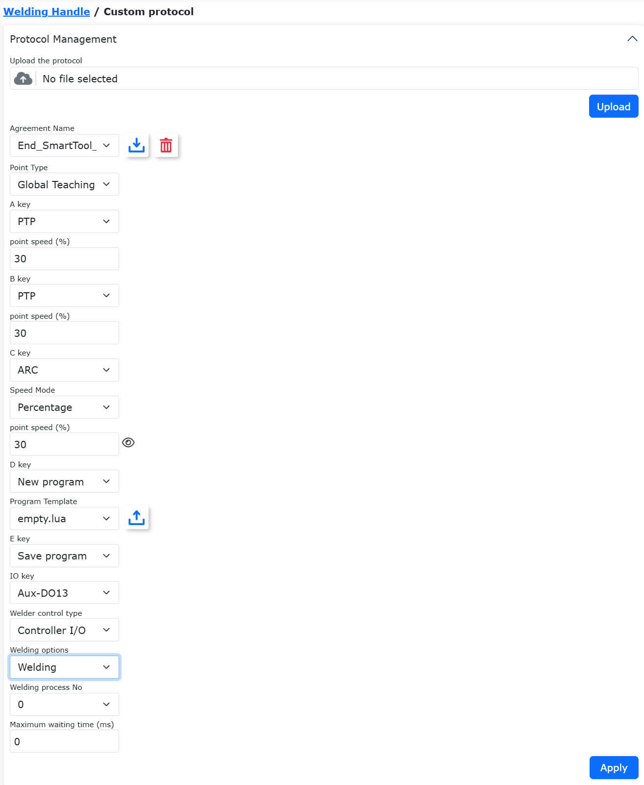

.. centered:: Figura 8.3‑2-4 Generación automática del protocolo de configuración de la empuñadura de soldadura SmartTool

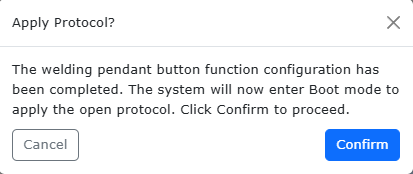

.. centered:: Figura 8.3‑2-5 Aviso de la página "¿Entrar en boot y aplicar el protocolo abierto?"
  
Además, al utilizar la tecla IO, el usuario debe seleccionar el tipo de comunicación de la máquina de soldar actual, que incluye: I/O del controlador, protocolo de comunicación digital (UDP) y protocolo de comunicación digital (ModbusTCP); entre ellos, para I/O del controlador y protocolo de comunicación digital (UDP) es necesario configurar el DO correspondiente como función de encendido del arco para poder seleccionar la generación de instrucciones relacionadas con la soldadura; para el protocolo de comunicación digital (ModbusTCP) es necesario configurar la instrucción como soldadura para poder seleccionar la generación de instrucciones relacionadas con la soldadura; de lo contrario, solo se generarán las instrucciones relacionadas con el establecimiento de la salida DO.

.. note:: Cabe señalar que, al seleccionar la máquina de soldar con protocolo de comunicación digital (UDP) o protocolo de comunicación digital (ModbusTCP), para configurar las instrucciones de soldadura es necesario garantizar que la comunicación se establece correctamente.

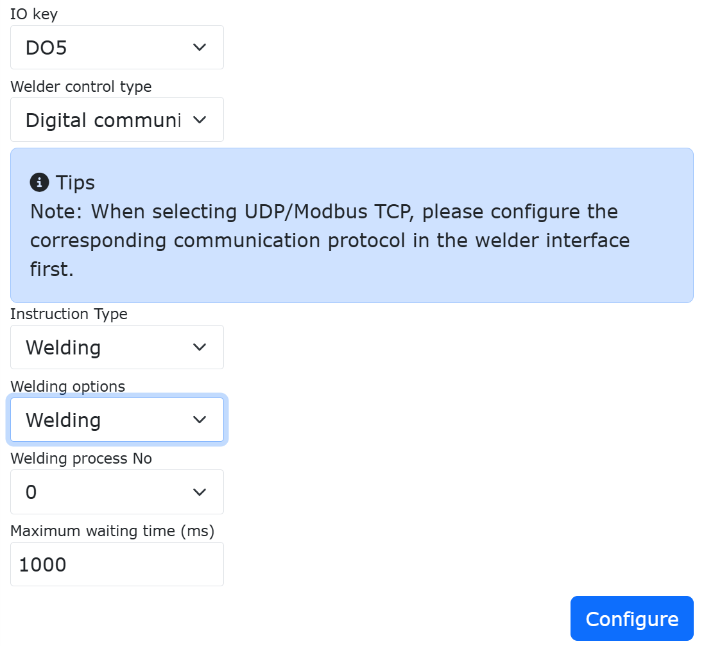

.. centered:: Figura 8.3‑2-6 Selección del tipo de control y del tipo de instrucción de la máquina de soldar

Importación de la plantilla de generación de programas de SmartTool
+++++++++++++++++++++++++++++++++++++++++++++++++++++++++++++++++++++

Si las teclas del SmartTool tienen configurada la función de generación de programas, basándose en el protocolo abierto se pueden proporcionar dos tipos de programas generados: por defecto se genera un programa lua en blanco, o bien el usuario puede seleccionar cargar una plantilla que comience por `template_` como plantilla del nuevo programa; cuando el nuevo programa selecciona la plantilla, el archivo lua generado al activar "Nuevo programa" en el SmartTool incluye el contenido del archivo de plantilla cargado, y las instrucciones añadidas posteriormente se añaden después del contenido de la plantilla.

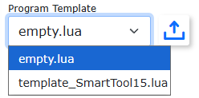

.. centered:: Figura 8.3‑2-7 Importación de la plantilla de generación de programas de SmartTool

Configuración de los puntos de instrucción de movimiento de SmartTool
+++++++++++++++++++++++++++++++++++++++++++++++++++++++++++++++++++++

Al configurar las tres instrucciones "PTP", "LIN" y "ARC", el SmartTool permite seleccionar la base de datos de almacenamiento de los puntos de instrucción generados como "Punto de enseñanza global" o "Punto de enseñanza local". Al seleccionar "Punto de enseñanza global", los puntos de instrucción generados se pueden consultar a través de "Programa de enseñanza", "Puntos de enseñanza"; al seleccionar "Punto de enseñanza local", los puntos de instrucción generados se pueden consultar a través de "Programa de enseñanza", "Programación de programas", "Punto de enseñanza local".

.. centered:: Figura 8.3‑2-8 Configuración de "Punto de enseñanza global" y "Punto de enseñanza local" de las instrucciones de movimiento de SmartTool

Modo anti-pulsación accidental de SmartTool
+++++++++++++++++++++++++++++++++++++++++++++++++

Basándose en el protocolo abierto, el SmartTool incorpora un modo anti-pulsación accidental; hacer clic sucesivamente en "Configuración inicial", "Periféricos", "Empuñadura de soldadura", "Protocolo personalizado". Tras habilitar el protocolo del extremo, se puede ver el interruptor "Modo anti-pulsación accidental"; cuando se activa esta función, las funciones de las teclas "Deshacer programa" y "Vaciar programa" del SmartTool requieren dos pulsaciones para activarse.

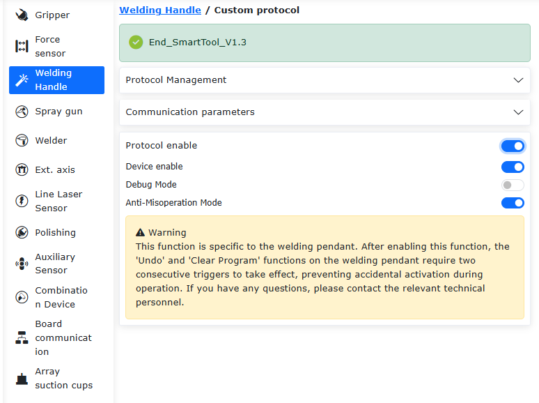

.. centered:: Figura 8.3‑2-9 Función "Modo anti-pulsación accidental" de SmartTool

Función de borrado de la memoria de la tecla IO de SmartTool
++++++++++++++++++++++++++++++++++++++++++++++++++++++++++++++++++++++++++++++++++++++++++++++++++++++

Basándose en el protocolo abierto, el SmartTool incorpora la función de borrado de la memoria de la tecla IO; cuando el usuario pulsa una vez la tecla IO se realiza una memorización para generar instrucciones emparejadas; si se pulsa la función "Vaciar programa" o "Nuevo programa", se borra la memoria de la tecla IO y la siguiente pulsación de la tecla IO volverá a generar instrucciones.

Función de borrado de puntos globales
++++++++++++++++++++++++++++++++++++++++++++++++++++++++++++++++++++++++++++++++++++++++++++++++++++++

Se ha añadido la función de borrado de puntos globales; abrir WebApp, hacer clic sucesivamente en "Programa de enseñanza", "Puntos de enseñanza", seleccionar "Modo de sistema" y hacer clic en "Borrar todo" para borrar todos los puntos guardados por el usuario. En este momento, los números de secuencia de los puntos de instrucción generados y guardados por el SmartTool se restablecen, comenzando desde 1.

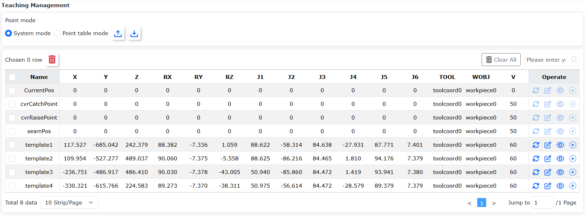

.. centered:: Figura 8.3‑2-10 Función de borrado de puntos globales

Ejemplo de protocolo Lua del periférico del extremo de la empuñadura de soldadura
+++++++++++++++++++++++++++++++++++++++++++++++++++++++++++++++++++++++++++++++++++++

Las funciones de las seis teclas A, B, C, D, E e IO se pueden modificar y definir mediante los valores key de la línea 31 del código; entre ellos, K38=Getbit(R[7],1) y K0=Getbit(R[7],2) son "Vaciar programa" y "Deshacer tecla", y no se pueden modificar; los 5 valores K posteriores se pueden modificar según las definiciones del documento «Protocolo de periféricos completos del extremo». En este ejemplo (protocolo interno SmartTool), las funciones de las teclas correspondientes son: A: LIN, B: PTP, C: crear programa, D: recuperación de interrupción de soldadura, E: salida de interrupción de soldadura, IO: LIN + soldadura + oscilación.

.. centered:: Ejemplo de protocolo Lua del periférico del extremo de la empuñadura de soldadura (SmartTool)
  
.. code-block:: 
   :linenos:

   function Getbit(X,Bit)
   return ((X&(1<<Bit))>>Bit)
   end

   if(Getbit(GetRobotState(),0)==1)then
   local SetParams={B6=3}-- B6-puerto DO de operación número DO3
   SetWeldParams(SetParams)
   while(1)
   do
   IwdgTaskHandle()
   MainLoop()
   UpDownLoadHandle()
   SdoRwPara()
   EndErrClear()
   local BFlag=LuaBreak()
   if(BFlag==1)then
   break
   end
   local R={0}
   local T={0x7D,0x01,0x30,0xC0,0x00,0x04,0x00,0x00,0x00,0x00}
   DelayMs(100)
   T[7],T[8],T[9],T[10]=GetIoCmd()
   Dword=GetRobotState()
   T[7]=Getbit(Dword,4)
   T[12],T[11]=WeldToolCrcValue(T)
   T[13]=0x0E
   WeldToolSlaveSetCmd(T)
   DelayMs(3)
   Len=EndRxWeldData(R)
   if((Len==13)and(R[1]==0x7D)and(R[2]==0x01)and(R[3]==0x30))then
   local key={K38=Getbit(R[7],1),K0=Getbit(R[7],2),K3=Getbit(R[7],3),K25=Getbit(R[7],4),K39=Getbit(R[7],5),K27=Getbit(R[7],6),K28=Getbit(R[7],7), K44=Getbit(R[8],0),
   K6=Getbit(R[8],1),K7=Getbit(R[8],2)}--configuración de las teclas de la empuñadura de soldadura SmartTool; tecla deshacer-K38 deshacer programa; tecla vaciar-K0 vaciar programa; tecla A-K3 LIN; tecla B-K25 PTP; tecla C-K39 crear programa; tecla D-K27 recuperación de interrupción de soldadura; tecla E-K28 salida de interrupción de soldadura; tecla IO-K44 LIN + soldadura + oscilación; tecla manual/automático-K6 manual/automático; tecla ejecutar/pausa-K7 ejecutar/pausa
   SetWeldToolKeys(key)
   end
   LuaGc()
   end
   end

Identificación de carga del sensor
~~~~~~~~~~~~~~~~~~~~~~~~~~~~~~~~~~

En la barra de menú "Configuración inicial"->"Básico"->"Carga", hacer clic en "Identificación del sensor" para entrar en la interfaz de identificación de carga del sensor.

Identificación por actitud específica: borrar los datos de carga del extremo, configurar el sensor de fuerza, establecer el sistema de coordenadas del sensor, ajustar la actitud del extremo del robot a vertical hacia abajo, realizar la "Corrección de cero" e instalar la carga del extremo. En primer lugar, seleccionar el sistema de coordenadas de la herramienta del sensor correspondiente, ajustar el robot para que el sensor y la herramienta estén verticales hacia abajo, registrar los datos y calcular la masa. A continuación, ajustar el robot en 3 actitudes diferentes, registrar respectivamente tres conjuntos de datos, calcular el centro de masa y, tras confirmar que es correcto, hacer clic en aplicar.

**Identificación dinámica**: borrar los datos de carga del extremo, configurar el sensor de fuerza, establecer el sistema de coordenadas del sensor, ajustar la actitud del extremo del robot a vertical hacia abajo, realizar la "Corrección de cero" e instalar la carga del extremo. Hacer clic en "Iniciar identificación", arrastrar el robot para realizar el movimiento y, a continuación, hacer clic en "Detener identificación" para aplicar automáticamente el resultado de la carga al robot.

**Puesta a cero automática**: tras registrar el sensor la posición inicial, se puede realizar la puesta a cero automática.

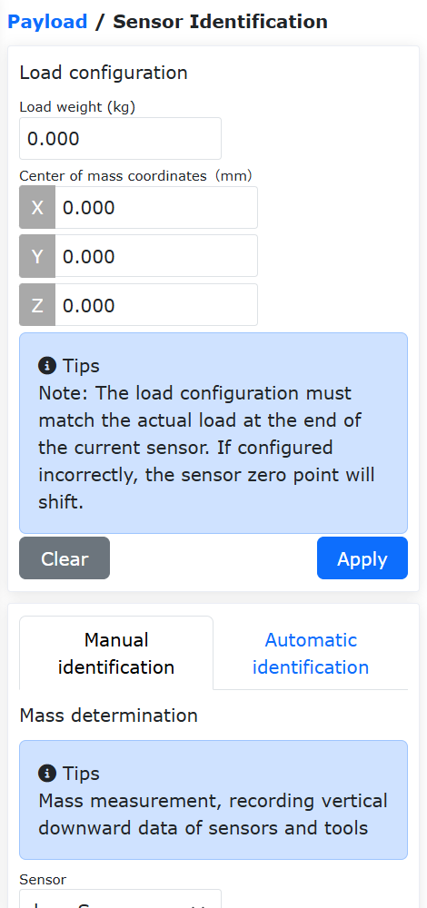

.. centered:: Figura 8.3‑3 Identificación de carga del sensor

Arrastre asistido por sensor de fuerza
~~~~~~~~~~~~~~~~~~~~~~~~~~~~~~~~~~~~~~

Tras configurar el sensor, se puede combinar con el sensor para una mejor asistencia al arrastre del robot. La primera vez que se utilice se puede configurar según los datos de la imagen de la derecha; tras completar la aplicación, sin necesidad de entrar en el modo de arrastre, basta con arrastrar directamente el sensor de fuerza del extremo para controlar el movimiento del robot en una actitud fija. (Los datos de la figura siguiente son el estándar de referencia)

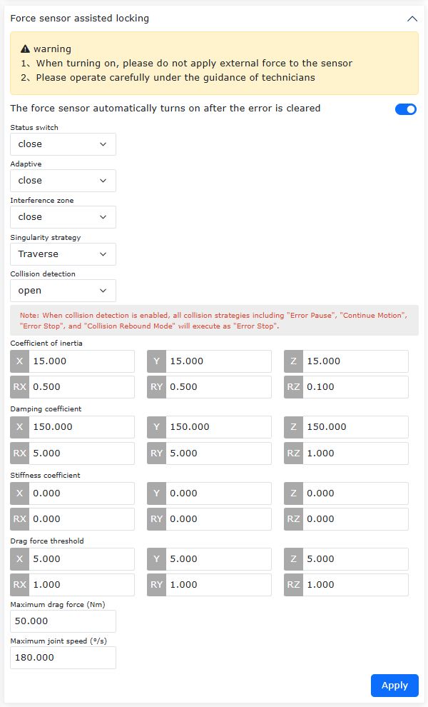

.. centered:: Figura 8.3‑4 Bloqueo de arrastre del sensor de fuerza/par

.. note:: 
   La estrategia de puntos singulares es la función de cruce y evitación de puntos singulares desarrollada bajo el bloqueo asistido por sensor de fuerza.

   La estrategia de evitación de puntos singulares es la opción de función predeterminada; tras activar el arrastre asistido se activa por defecto la función de evitación; la evitación de puntos singulares es la función que, cuando el robot se encuentra en una configuración singular, aplica una fuerza virtual para alejar el robot de la configuración singular.

   Configuraciones singulares:

   **Singularidad de codo**: los ejes de rotación 2, 3 y 4 se encuentran en el mismo plano; en este momento la articulación del codo está completamente extendida o completamente retraída; debido a los límites mecánicos del robot FR, la configuración completamente retraída no es alcanzable por el robot.

   **Singularidad de muñeca**: los ejes de rotación 4 y 6 son paralelos; en este momento, debido a los límites mecánicos del robot FR, esta configuración no es alcanzable por el robot.

   **Singularidad de hombro**: el centro de la muñeca se encuentra en el plano formado por los ejes de rotación 1 y 2.

   La función de cruce de puntos singulares: seleccionar "Estrategia de puntos singulares" como "Cruzar" y aplicar; cuando el robot detecta que la pose actual se encuentra en una configuración singular, cambia automáticamente al modo de arrastre por bucle de corriente; cuando se detecta la salida de la configuración singular, el modo de arrastre cambia al arrastre asistido por sensor de fuerza para continuar el movimiento.

**Selección adaptativa**: activar cuando se necesite ensamblaje; tras activarla el arrastre se vuelve más pesado;

**Parámetros de inercia**: ajustan la sensación durante el arrastre; deben ajustarse con precaución bajo la guía de personal técnico.

**Parámetros de amortiguación**:

-  Dirección de traslación: se recomienda configurar los parámetros entre [100-200];

-  Dirección de rotación: se recomienda configurar los parámetros entre [3-10], con el rango de configuración de la dirección RZ entre [0.1-5];

-  Efecto: al arrastrar con el sensor, aumentar la amortiguación provoca dificultad en el arrastre; reducir la amortiguación hace que el arrastre del robot sea demasiado ligero (se recomienda no demasiado pequeño);

-  Rango global de los parámetros de amortiguación: traslación XYZ: [100-1000]; rotación RX, RY: [3-50], RZ: [2-10];

-  La fuerza de arrastre máxima es 50 y la velocidad de arrastre máxima es 180.

**Parámetros de rigidez**: todos configurados en 0;

**Umbral de fuerza de arrastre**: traslación XYZ [5-10]; rotación RX, RY, RZ [0.5-5];

.. important:: 
   El bloqueo se logra aumentando el umbral de fuerza en la dirección de traslación XYZ o en la dirección de rotación RX, RY, RZ.

Detección de colisiones del sensor de fuerza/par
~~~~~~~~~~~~~~~~~~~~~~~~~~~~~~~~~~~~~~~~~~~~~~~~~~~~~~~

Descripción de la instrucción: la instrucción "FT_Guard" es una instrucción de detección de colisiones. Seleccionar el sistema de coordenadas del sensor correspondiente, marcar la detección de dirección de par efectiva, configurar el valor actual, el umbral máximo de colisión y el umbral mínimo de colisión; el rango normal de la condición de detección de colisiones es (valor actual - umbral mínimo, valor actual + umbral máximo); añadir las instrucciones "Activar" y "Desactivar" al programa.

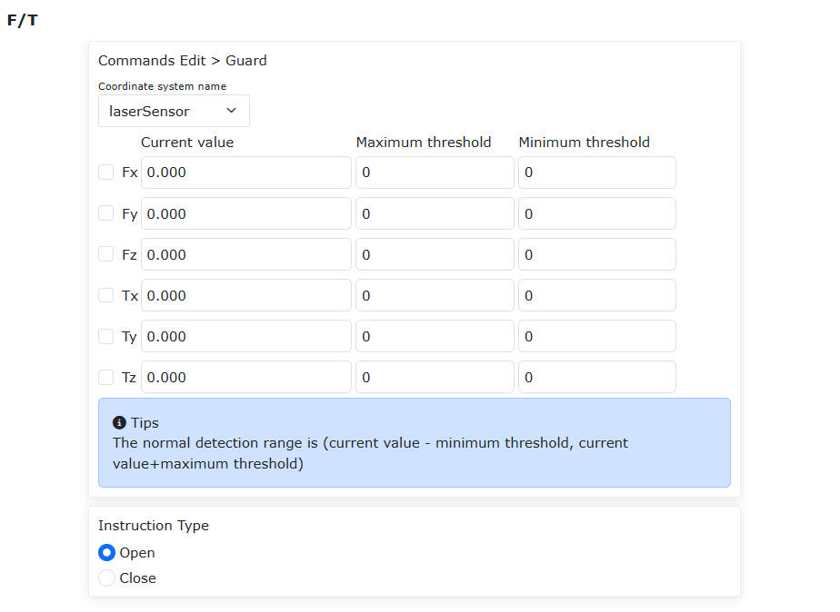

.. centered:: Figura 8.3‑5 Edición de la instrucción FT_Guard

Ejemplo de programa:

.. list-table::
   :widths: 50 80 80
   :header-rows: 0
   :align: center

   * - **Número**
     - **Formato de la instrucción**
     - **Comentario**

   * - 1
     - FT_Guard(1,1,1,1,1,0,0,0,5,0,0,0,0,0,10,0,0,0,0,0,5,0,0,0,0,0)
     - #Activación de la detección de colisión de fuerza/par

   * - 2
     - PTP(template1,100,-1,0)
     - #Instrucción de movimiento

   * - 3
     - FT_Guard(0,1,1,1,1,0,0,0,5,0,0,0,0,0,10,0,0,0,0,0,5,0,0,0,0,0)
     - #Desactivación de la detección de colisión de fuerza/par

Movimiento de control de fuerza del sensor de fuerza/par
~~~~~~~~~~~~~~~~~~~~~~~~~~~~~~~~~~~~~~~~~~~~~~~~~~~~~~~~~~~~~~~

Descripción de la instrucción: la instrucción "FT_Control" es una instrucción de movimiento de control de fuerza que permite al robot moverse en las proximidades de una fuerza establecida; se utiliza habitualmente en escenarios de pulido. Seleccionar el sistema de coordenadas del sensor correspondiente, marcar la detección de dirección de par efectiva, configurar el umbral de detección, así como los coeficientes de proporción PID en cada dirección (generalmente se configura p como 0.001), configurar la distancia máxima de ajuste (correspondiente a X, Y, Z) y el ángulo máximo de ajuste (correspondiente a RX, RY, RZ); añadir las instrucciones "Activar" y "Desactivar" al programa.

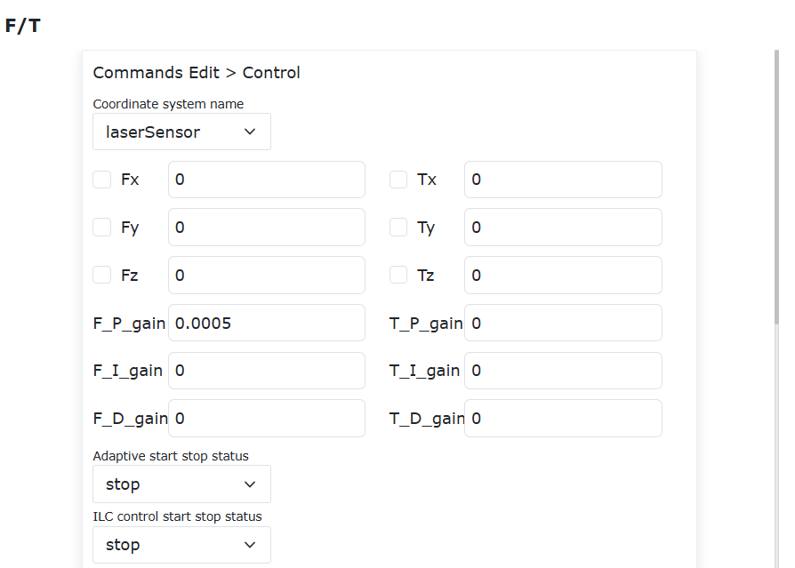
  
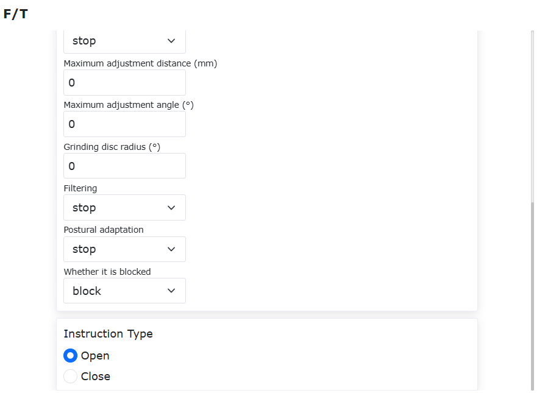

.. centered:: Figura 8.3‑6 Edición de la instrucción FT_Control

Ejemplo de programa:

.. list-table::
   :widths: 50 80 80
   :header-rows: 0
   :align: center

   * - **Número**
     - **Formato de la instrucción**
     - **Comentario**

   * - 1
     - FT_Control(1,11,1,0,1,0,0,0,10,0,5,0,0,0,0.001,0,0,0,0,0,0,0,0,10,5)
     - #Activación del control de movimiento de fuerza/par

   * - 2
     - Lin(template3,100,-1,0,0)
     - #Instrucción de movimiento

   * - 3
     - FT_Control(0,11,1,0,1,0,0,0,10,0,5,0,0,0,0.001,0,0,0,0,0,0,0,10,5)
     - #Desactivación del control de movimiento de fuerza/par

Inserción en hélice del sensor de fuerza/par
~~~~~~~~~~~~~~~~~~~~~~~~~~~~~~~~~~~~~~~~~~~~~~~~~~~~~~~~~~~

Descripción de la instrucción: la instrucción "FT_Spiral" es una inserción por exploración en hélice, que se utiliza generalmente para la operación de ensamblaje de eje y orificio de ejes cilíndricos. Antes de ejecutar la acción, es necesario arrastrar el extremo del robot hasta la posición aproximada del orificio y, según el escenario actual, configurar los parámetros de la instrucción y añadirla al programa; tras la ejecución, el robot explorará con un movimiento en hélice.

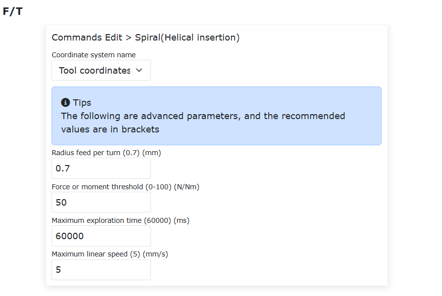

.. centered:: Figura 8.3‑7 Edición de la instrucción FT_Spiral

Ejemplo de programa:

.. list-table::
   :widths: 50 80 80
   :header-rows: 0
   :align: center

   * - **Número**
     - **Formato de la instrucción**
     - **Comentario**

   * - 1
     - FT_Control(1,10,0,0,1,0,0,0,0,0,5,0,0,0,0.0005,0,0,0,0,0,0,10,0)
     - #Activación del control de movimiento de fuerza/par

   * - 2
     - FT_SpiralSearch(0,0.7,0,60000,5)
     - #Inserción en hélice

   * - 3
     - FT_Control(0,10,0,0,1,0,0,0,0,0,5,0,0,0,0.0005,0,0,0,0,0,0,10,0)
     - #Desactivación del control de movimiento de fuerza/par

Inserción rotativa del sensor de fuerza/par
~~~~~~~~~~~~~~~~~~~~~~~~~~~~~~~~~~~~~~~~~~~

Descripción de la instrucción: la instrucción "FT_Rot" es una inserción por exploración rotativa, que se utiliza generalmente para continuar la acción de inserción en hélice y para el ensamblaje de eje y orificio de ejes estriados. Antes de ejecutar la acción, es necesario desplazar el extremo del robot hasta el orificio encontrado por la exploración en hélice o hasta el orificio de enseñanza completamente alineado; según el escenario actual, configurar los parámetros de la instrucción y añadirla al programa; tras la ejecución, el robot explorará con una rotación lenta.

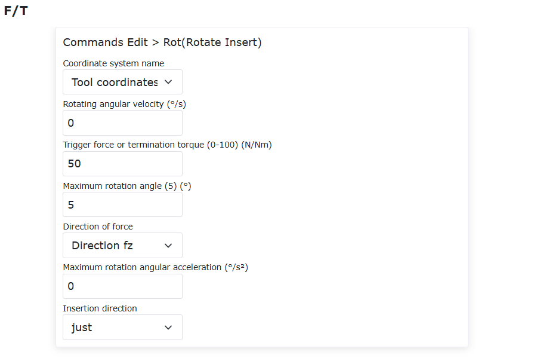

.. centered:: Figura 8.3‑8 Edición de la instrucción FT_Rot

Ejemplo de programa:

.. list-table::
   :widths: 50 80 80
   :header-rows: 0
   :align: center

   * - **Número**
     - **Formato de la instrucción**
     - **Comentario**

   * - 1
     - FT_Control(1,10,0,0,1,0,0,0,0,0,5,0,0,0,0.0005,0,0,0,0,0,0,10,0)
     - #Activación del control de movimiento de fuerza/par

   * - 2
     - FT_RotInsertion(0,3,0,5,1,0,1)
     - #Inserción rotativa

   * - 3
     - FT_Control(0,10,0,0,1,0,0,0,0,0,5,0,0,0,0.0005,0,0,0,0,0,0,10,0)
     - #Desactivación del control de movimiento de fuerza/par

Inserción en línea recta del sensor de fuerza/par
~~~~~~~~~~~~~~~~~~~~~~~~~~~~~~~~~~~~~~~~~~~~~~~~~

Descripción de la instrucción: la instrucción "FT_Lin" es una inserción por exploración rotativa, que se utiliza generalmente para continuar la acción de inserción en hélice o la acción de inserción rotativa y para el ensamblaje de eje y orificio de ejes estriados. Antes de ejecutar la acción, es necesario desplazar el extremo del robot hasta el orificio encontrado por la exploración en hélice, la posición final de la acción de inserción rotativa o el orificio de enseñanza completamente alineado; según el escenario actual, configurar los parámetros de la instrucción y añadirla al programa; tras la ejecución, el robot se moverá en línea recta en la dirección establecida.

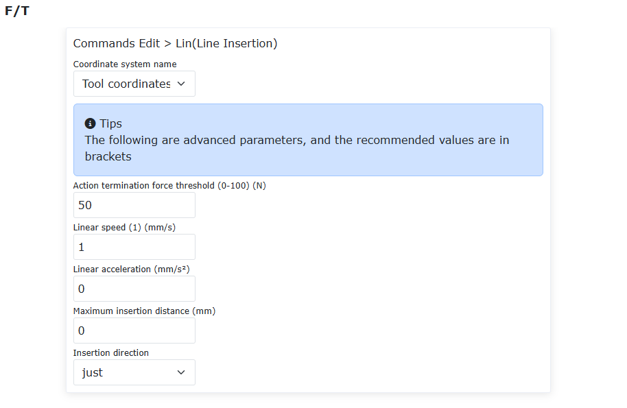

.. centered:: Figura 8.3‑9 Edición de la instrucción FT_Lin

Ejemplo de programa:

.. list-table::
   :widths: 50 80 80
   :header-rows: 0
   :align: center

   * - **Número**
     - **Formato de la instrucción**
     - **Comentario**

   * - 1
     - FT_Control(1,10,0,0,1,0,0,0,0,0,5,0,0,0,0.0005,0,0,0,0,0,0,10,0)
     - #Activación del control de movimiento de fuerza/par

   * - 2
     - FT LinInsertion(0,50,1,0,100,1)
     - #Inserción en línea recta

   * - 3
     - FT_Control(0,10,0,0,1,0,0,0,0,0,5,0,0,0,0.0005,0,0,0,0,0,0,10,0)
     - #Desactivación del control de movimiento de fuerza/par

Localización de superficie del sensor de fuerza/par
~~~~~~~~~~~~~~~~~~~~~~~~~~~~~~~~~~~~~~~~~~~~~~~~~~~~

Descripción de la instrucción: la instrucción "FT_FindSurface" es una localización de superficie, que se utiliza generalmente para buscar la superficie de un objeto. Según el escenario actual, configurar el sistema de coordenadas correspondiente, la dirección de movimiento, el eje de movimiento, la velocidad lineal de exploración, la aceleración lineal de exploración, la distancia máxima de exploración, el umbral de fuerza de terminación de la acción y otros parámetros, y añadirla al programa; ejecutar el programa y la acción comenzará a ejecutarse; el extremo del robot comenzará a moverse lentamente en la dirección en que se encuentra la superficie.

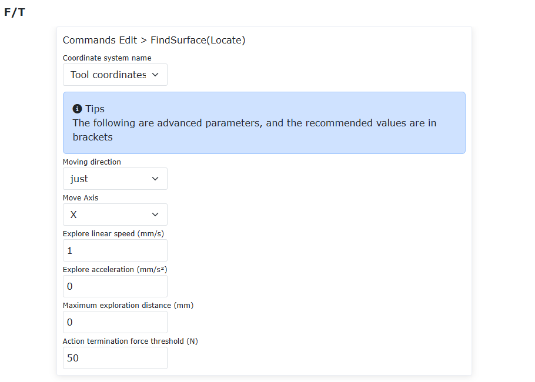

.. centered:: Figura 8.3‑10 Edición de la instrucción FT_FindSurface

Ejemplo de programa:

.. list-table::
   :widths: 50 80 80
   :header-rows: 0
   :align: center

   * - **Número**
     - **Formato de la instrucción**
     - **Comentario**

   * - 1
     - PTP(1,30,-1,0)
     - #Posición inicial

   * - 2
     - FT FindSurface(0,1,3,1,0,100,5)
     - #Localización de superficie

Localización de centro del sensor de fuerza/par
~~~~~~~~~~~~~~~~~~~~~~~~~~~~~~~~~~~~~~~~~~~~~~~~

Descripción de la instrucción: la instrucción "FT_CalCenter" es una localización de centro, que se utiliza generalmente para buscar la superficie del plano intermedio entre dos superficies. Según el escenario actual, configurar el sistema de coordenadas correspondiente, la dirección de movimiento, el eje de movimiento, la velocidad lineal de exploración, la aceleración lineal de exploración, la distancia máxima de exploración, el umbral de fuerza de terminación de la acción y otros parámetros, y buscar respectivamente el plano A y el plano B; añadirla al programa y ejecutar el programa; la acción comenzará a ejecutarse; el robot se moverá lentamente en la dirección en que se encuentra la superficie A y, tras localizar el plano A, se moverá lentamente en la dirección en que se encuentra la superficie B; tras localizar el plano B, se podrá calcular la posición del plano central.

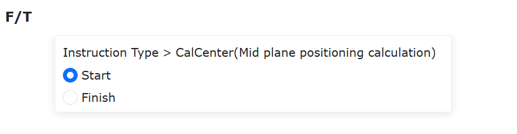

.. centered:: Figura 8.3‑11 Edición de la instrucción FT_CalCenter

Ejemplo de programa:

.. list-table::
   :widths: 20 40 50
   :header-rows: 0
   :align: center

   * - **Número**
     - **Formato de la instrucción**
     - **Comentario**

   * - 1
     - PTP(1,30,-1,0)
     - #Posición inicial

   * - 2
     - FT_CalCenterStart()
     - #Inicio de la localización de superficie

   * - 3
     - FT_Control(1,10,0,0,1,0,0,0,0,0,-10,0,0,0,0.00001,0,0,0,0,0,0,100,0)
     - #Activación del control de movimiento de fuerza/par

   * - 4
     - FT_FindSurface(1,2,2,10,0,200,5)
     - #Localización del plano A

   * - 5
     - FT_Control(0,10,0,0,1,0,0,0,0,0,-10,0,0,0,0.00001,0,0,0,0,0,0,100,0)
     - #Desactivación del control de movimiento de fuerza/par

   * - 6
     - PTP(1,30,-1,0)
     - #Posición inicial

   * - 7
     - FT_Control(1,10,0,0,1,0,0,0,0,0,-10,0,0,0,0.00001,0,0,0,0,0,0,100,0)
     - #Activación del control de movimiento de fuerza/par
     
   * - 8
     - FT FindSurface(1,1,2,20,0,200,5)
     - #Localización del plano B

   * - 9
     - FT_Control(0,10,0,0,1,0,0,0,0,0,10,0,0,0,0.00001,0,0,0,0,0,0,100,0)
     - #Desactivación del control de movimiento de fuerza/par

   * - 10
     - pos={}
     - #Definición del array pos

   * - 11
     - pos = FT_CalCenterEnd()
     - #Obtención de la pose cartesiana del centro localizado

   * - 12
     - MoveCart(pos,GetActualTCPNum(),GetActualWObjNum(),30,10,100,-1,0)
     - #Movimiento hasta la posición del centro localizado

Protocolo abierto personalizado
~~~~~~~~~~~~~~~~~~~~~~~~~~~~~~~

Hacer clic en la tarjeta "Protocolo personalizado" para entrar en la interfaz, habilitar el sensor de fuerza; en los dispositivos ya configurados se muestra el sensor de fuerza. Hacer clic para entrar en la interfaz FT y consultar los datos del sensor de fuerza.

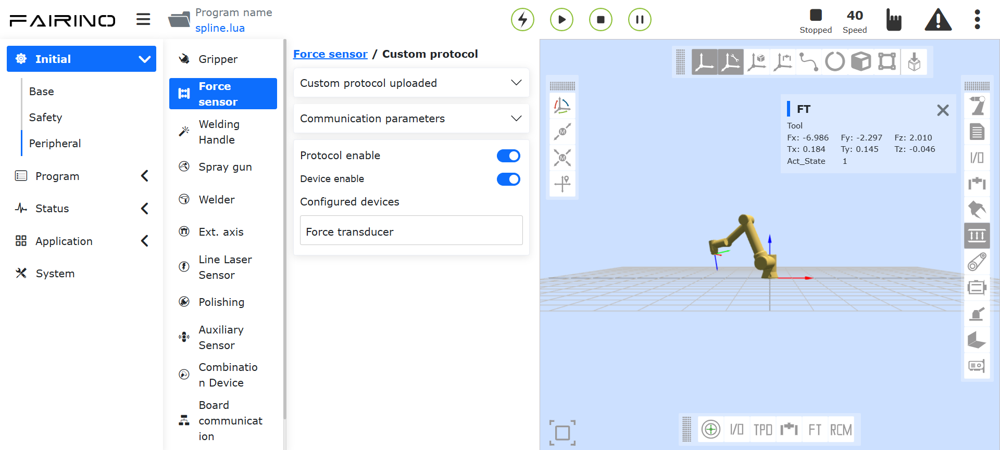

.. centered:: Figura 8.3‑12 Habilitación del sensor de fuerza

Adaptación del sensor de fuerza Kaiwei
~~~~~~~~~~~~~~~~~~~~~~~~~~~~~~~~~~~~~~~~~~~~~~~~~~~~~~~~~~~~~~~~~~~~~~~~~~~~~~~~~~~~~~~~~~~~~~~~~~~~~~~~

Descripción general
+++++++++++++++++++

La adaptación de dispositivos incorpora el sensor de fuerza Kaiwei, modelo KWL-SFTE75B.

Adaptación del sensor de fuerza Kaiwei
+++++++++++++++++++++++++++++++++++++++++++++++++++++++++++++++++++++++++++++++++++++++++++++++++++

(1) Configuración inicial->Periféricos->Sensor de fuerza, seleccionar Dispositivo adaptado.

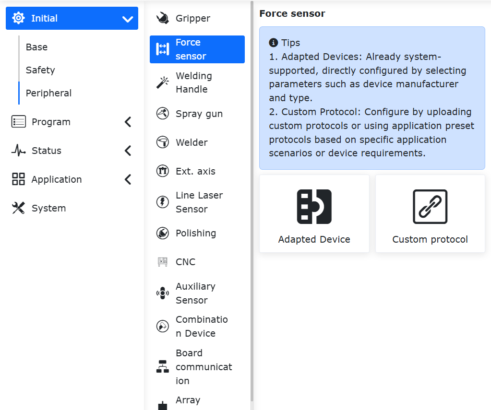

.. centered:: Figura 8.3‑13 Dispositivo adaptado

(2) En Dispositivo adaptado, seleccionar el fabricante KWL, el tipo KWL-SFTE75B, seleccionar la posición de montaje y hacer clic en configurar.

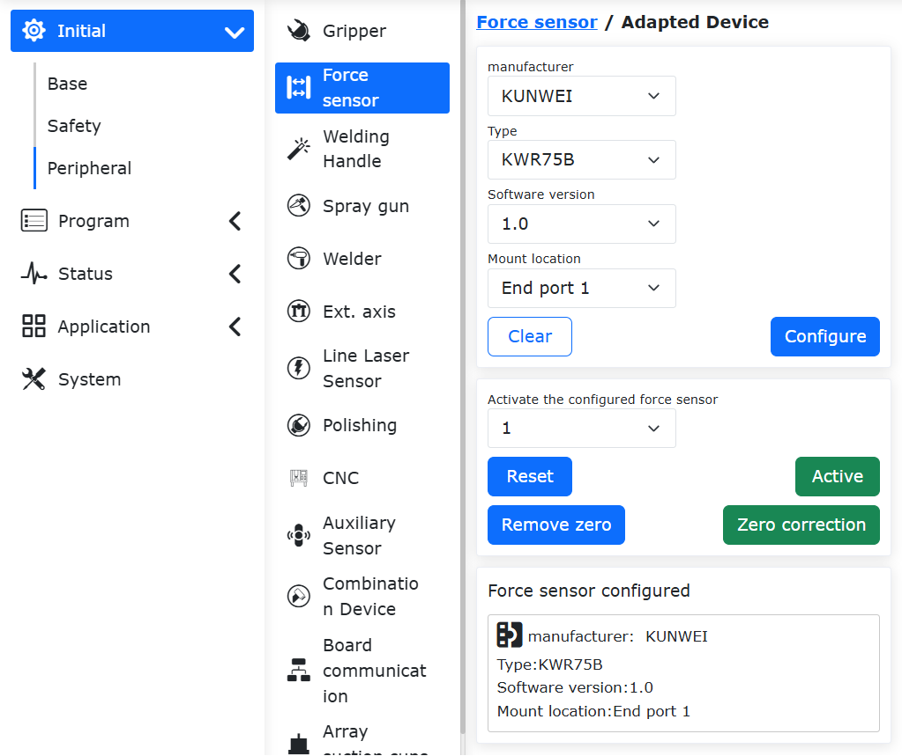

.. centered:: Figura 8.3‑13 Configuración del fabricante

(3) Seleccionar el número de posición de montaje correspondiente, hacer clic en restablecer y activar. Cuando Act_State en la barra de herramientas FT sea 1, se podrá utilizar con normalidad.

.. centered:: Figura 8.3‑14 Operación de restablecimiento y activación

Instrucciones de uso del dispositivo
+++++++++++++++++++++++++++++++++++++++++++++++++++++++++++++++++++++++++++++++++++++++++++++++++++

(1) En la barra de herramientas FT, Fx, Fy, Fz, Tx, Ty, Tz son los datos de fuerza de seis dimensiones, en unidades de N y N.m.

.. centered:: Figura 8.3‑15 Datos de fuerza de seis dimensiones de la barra de herramientas FT

Empuñadura de soldadura
-------------------------------------------------------------

En la interfaz "Configuración inicial"->"Periféricos"->"Empuñadura de soldadura", actualmente se puede utilizar la empuñadura de soldadura mediante dispositivos adaptados y el protocolo abierto personalizado Lua del extremo.

Dispositivo adaptado
~~~~~~~~~~~~~~~~~~~~

Pasos de configuración
++++++++++++++++++++++

**Step1**: Hacer clic en la tarjeta "Dispositivo adaptado" para entrar en la interfaz de dispositivo adaptado. La información de configuración se divide en fabricante, tipo, versión de software y posición de montaje; el usuario puede configurar la información correspondiente según sus necesidades concretas de producción. Si el usuario necesita cambiar la configuración, puede seleccionar primero el fabricante correspondiente, hacer clic en el botón "Borrar" para borrar la información correspondiente y volver a configurar según sus necesidades;

.. centered:: Figura 8.4‑1 Configuración del dispositivo adaptado de la empuñadura de soldadura

.. important:: 
	Antes de hacer clic en borrar la configuración, el dispositivo correspondiente debe encontrarse en estado no activado.

**Step2**: Configurar sucesivamente las teclas A-E y la tecla IO. Tras completar la configuración del Smart Tool, el gestor de tareas mantiene internamente la función correspondiente a cada botón; cuando se detecta que se ha pulsado un botón, se ejecuta automáticamente la función correspondiente a dicho botón.

Funciones de las teclas A-E:

- Instrucción de movimiento: al seleccionar las instrucciones de movimiento PTP, LIN o ARC, es necesario introducir la velocidad del punto correspondiente. Las instrucciones LIN y ARC permiten seleccionar "Porcentaje" o "Velocidad física":
- Porcentaje: introducir el porcentaje de velocidad de depuración; el robot se mueve según el porcentaje de la velocidad máxima; la velocidad real de movimiento del robot se convierte en: V = velocidad máxima del robot × porcentaje de velocidad global × porcentaje de velocidad del punto. Al pasar el ratón sobre el pequeño ojo situado a la derecha del cuadro de entrada "Velocidad del punto", se mostrará la velocidad física real del robot en modo manual y en modo automático con la velocidad configurada actualmente (unidad: mm/s).

.. centered:: Figura 8.4‑2-1 Introducir porcentaje y mostrar el valor de velocidad física real
 
- Velocidad física: la velocidad introducida es la velocidad real de funcionamiento del robot, en unidades de mm/s; la aceleración introducida suele configurarse como el doble de la velocidad. (La velocidad física máxima de la instrucción LIN está limitada por el porcentaje de velocidad global; si la velocidad máxima de funcionamiento del robot es 1000 mm/s y la velocidad global es del 50%, la velocidad física máxima de la instrucción LIN es 1000 × 50% = 500 mm/s).

.. centered:: Figura 8.4‑2-2 Introducir la velocidad física real

Tras una configuración correcta, el programa de enseñanza añade una instrucción de movimiento relacionada.

.. note:: Nota: al configurar la instrucción de movimiento ARC, es necesario configurar primero la instrucción PTP/LIN para garantizar la normalidad de los pasos de adición de instrucciones.

- Salida DO: al seleccionar "Salida DO", se muestra un cuadro desplegable para seleccionar las opciones de salida DO0⁓DO7.

.. centered:: Figura 8.4‑2-3 Configuración de Smart Tool (teclas A-E)

Funciones de la tecla IO:

-  **Configuración de señal IO**: el cuadro desplegable permite seleccionar las opciones DO0⁓DO7, CO0⁓CO7, End-DO0, End-DO1 e IO extendida (Aux-DO0⁓Aux-DO127);

-  **Instrucción combinada**: tras seleccionar "Señal IO", en determinadas condiciones se muestran los elementos de configuración "Selección de máquina de soldar" y "Velocidad del punto", generando distintas instrucciones de programa.

  - Entre ellos, el usuario debe seleccionar el tipo de comunicación de la máquina de soldar actual, que incluye: I/O del controlador, protocolo de comunicación digital (UDP) y protocolo de comunicación digital (ModbusTCP); entre ellos, para I/O del controlador y protocolo de comunicación digital (UDP) es necesario configurar el DO correspondiente como función de encendido del arco para poder seleccionar la generación de instrucciones relacionadas con la soldadura; para el protocolo de comunicación digital (ModbusTCP) es necesario configurar la instrucción como soldadura para poder seleccionar la generación de instrucciones relacionadas con la soldadura; de lo contrario, solo se generarán las instrucciones relacionadas con el establecimiento de la salida DO. Cabe señalar que, al seleccionar la máquina de soldar con protocolo de comunicación digital (UDP) o protocolo de comunicación digital (ModbusTCP), para configurar las instrucciones de soldadura es necesario garantizar que la comunicación se establece correctamente.
  - Asimismo, se añade la selección del número de proceso de soldadura; además, el tiempo máximo de encendido y apagado del arco se puede configurar hasta 10000ms. El número de oscilación es por defecto 0; si se configura "Inicio de oscilación" se puede seleccionar el número de oscilación. La tecla IO se configura igual que el inicio de oscilación.

.. important::
   -  Cuando la señal IO se configura como DO0~DO7 o CO0~CO7 (sin configurar "Encendido del arco"), el programa añade SetDO; en este momento se ocultan "Selección de máquina de soldar" y "Velocidad del punto".
   -  Cuando la señal IO se configura como End-DO0, End-DO1, el programa añade SetToolDO; en este momento se ocultan "Selección de máquina de soldar" y "Velocidad del punto".
   -  Cuando la señal IO se configura como IO extendida (sin configurar "Encendido del arco de la máquina de soldar"), el programa añade SetAuxDO; en este momento se ocultan "Selección de máquina de soldar" y "Velocidad del punto".
   -  Cuando la señal IO se configura como CO0~CO7 (configurando "Encendido del arco") y "Selección de máquina de soldar" es "Ninguna", el programa añade SetDO; en este momento se ocultan "Selección de máquina de soldar" y "Velocidad del punto".
   -  Cuando la señal IO se configura como IO extendida (configurando "Encendido del arco de la máquina de soldar") y "Selección de máquina de soldar" es "Ninguna", el programa añade SetAuxDO; en este momento se ocultan "Selección de máquina de soldar" y "Velocidad del punto".
   -  Cuando la señal IO se configura como CO0~CO7 (configurando "Encendido del arco") o IO extendida (configurando "Encendido del arco de la máquina de soldar") y "Selección de máquina de soldar" es "Soldadura", la primera pulsación añade ARCStart al programa, la segunda añade ARCEnd, la tercera añade ArcStart y la cuarta añade ARCStart, alternando y repitiendo las operaciones anteriores; en este momento se ocultan "Selección de máquina de soldar" y "Velocidad del punto".
   -  Cuando la señal IO se configura como CO0~CO7 (configurando "Encendido del arco") o IO extendida (configurando "Encendido del arco de la máquina de soldar") y "Selección de máquina de soldar" es "LIN + soldadura", la primera pulsación añade LIN y ARCStart al programa, la segunda añade LIN y ARCEnd, la tercera añade LIN y ARCStart y la cuarta añade LIN y ARCEnd, alternando y repitiendo las operaciones anteriores; en este momento se muestran "Selección de máquina de soldar" y "Velocidad del punto".
   -  Cuando la señal IO se configura como CO0~CO7 (configurando "Encendido del arco") o IO extendida (configurando "Encendido del arco de la máquina de soldar") y "Selección de máquina de soldar" es "LIN + soldadura + oscilación", la primera pulsación añade LIN, ARCStart y WeaveStart al programa, la segunda añade LIN, ARCEnd y WeaveEnd, la tercera añade LIN, ARCStart y WeaveStart y la cuarta añade LIN, ARCEnd y WeaveEnd, alternando y repitiendo las operaciones anteriores; en este momento se ocultan "Selección de máquina de soldar" y "Velocidad del punto".
   -  Al pulsar la función "Vaciar programa" o "Nuevo programa", se borra la memoria de la tecla IO y la siguiente pulsación de la tecla IO volverá a generar instrucciones.

.. centered:: Figura 8.4‑3 Tecla IO

Protocolo Lua del extremo de la empuñadura de soldadura
~~~~~~~~~~~~~~~~~~~~~~~~~~~~~~~~~~~~~~~~~~~~~~~~~~~~~~~

Hacer clic en "Protocolo personalizado" para entrar en la interfaz de la función de adaptación de la empuñadura de soldadura mediante el protocolo abierto Lua del extremo.

Gestión de protocolos
+++++++++++++++++++++

Abrir WebApp, hacer clic sucesivamente en "Configuración inicial", "Periféricos", "Empuñadura de soldadura", "Protocolo personalizado". Hacer clic en "Gestión de protocolos" para configurar el protocolo del extremo. Los protocolos internos predefinidos de la empuñadura de soldadura se muestran en la figura siguiente.

.. figure:: robot_peripherals/032.png
   :align: center
   :width: 4in

.. centered:: Figura 8.4‑4 Protocolos internos predefinidos de la empuñadura de soldadura

Al activar el deslizador "Habilitación del protocolo del extremo" se puede adaptar la empuñadura de soldadura; tras la habilitación, los parámetros se mantienen tras el corte de energía y el reinicio.

.. centered:: Figura 8.4‑5 Habilitación del protocolo abierto del extremo

Ejemplo de protocolo Lua del periférico del extremo del dispositivo combinado
+++++++++++++++++++++++++++++++++++++++++++++++++++++++++++++++++++++++++++++

Las funciones de las cinco teclas A, B, C, D, E se pueden modificar y definir mediante los valores key de la línea 30 del código; entre ellos, K38=Getbit(R[7],1) y K0=Getbit(R[7],2) son "Vaciar programa" y "Deshacer tecla", y no se pueden modificar; los 5 valores K posteriores se pueden modificar según las definiciones del documento «Protocolo de periféricos completos del extremo».

En este ejemplo (protocolo interno SmartTool), las funciones de las teclas correspondientes son: A: MoveL, B: ArcStart, C: ArcEnd, D: rewelding start, E: rewelding quit.

.. code-block:: console

  function Getbit(X,Bit)
  return ((X&(1<<Bit))>>Bit)
  end

  if(Getbit(GetRobotState(),0)==1)then
  local SetParams={A3=2000,B6=3}--configuración de los parámetros de soldadura: A3- tiempo de espera agotado de encendido y apagado del arco 2000ms; B6- número de puerto DO de operación 3; si se necesitan configurar parámetros de soldadura, consulte «RD36-Tabla de parámetros personalizados de la empuñadura de soldadura-V0.2-20250903»
  SetWeldParams(SetParams)
  while(1)
  do
  IwdgTaskHandle()
  MainLoop()
  UpDownLoadHandle()
  SdoRwPara()
  EndErrClear()
  local BFlag=LuaBreak()
  if(BFlag==1)then
  break
  end
  local R={0}
  local T={0x7D,0x01,0x30,0xC0,0x00,0x04,0x00,0x00,0x00,0x00}
  DelayMs(100)
  T[7],T[8],T[9],T[10]=GetIoCmd()
  T[7]=Getbit(T[7],3)
  T[12],T[11]=WeldToolCrcValue(T)
  T[13]=0x0E
  WeldToolSlaveSetCmd(T)
  DelayMs(3)
  Len=EndRxWeldData(R)
  if((Len==13)and(R[1]==0x7D)and(R[2]==0x01)and(R[3]==0x30))then
  local key={K38=Getbit(R[7],1),K0=Getbit(R[7],2),K3=Getbit(R[7],3),K32=Getbit(R[7],4),K33=Getbit(R[7],5),K27=Getbit(R[7],6),K28=Getbit(R[7],7),
  K6=Getbit(R[8],1),K7=Getbit(R[8],2)}--configuración de las teclas de la empuñadura de soldadura SmartTool; tecla deshacer-K38 deshacer programa; tecla vaciar-K0 vaciar programa; tecla A-K3 línea recta; tecla B-K32 encendido del arco ArcStart; tecla C-K33 apagado del arco ArcEnd; tecla D-K27 recuperación de interrupción de soldadura; tecla E-K28 salida de interrupción de soldadura; tecla manual/automático-K6 manual/automático; tecla ejecutar/pausa-K7 ejecutar/pausa
  SetWeldToolKeys(key)
  end
  LuaGc()
  end
  end

Plantilla de protocolo abierto
++++++++++++++++++++++++++++++

Tomando como ejemplo el protocolo abierto de adaptación de Jiasda:

.. code-block:: console

   function Getbit(X,Bit)                   --extrae el bit correspondiente de X
   return ((X&(1<<Bit))>>Bit)
   end
   while(1)
   do
   IwdgTaskHandle()
   MainLoop()
   UpDownLoadHandle()
   SdoRwPara()
   EndErrClear()
   local BFlag=LuaBreak()
   if(BFlag==1)then
   break
   end
   RxData={}
   T0={0x7D,0x08,0x22,0xB3,0x01,0x00}
   T1={0x7D,0x08,0x22,0xB4,0x03,0x00}
   T2={0x7D,0X08,0X22,0XB5,0x1E,0x00}
   DelayMs(5)
   RxLen=WeldToolMasterGetCmd(RxData)                                    --la función WeldToolMasterGetCmd() se utiliza para obtener la instrucción enviada por la empuñadura de soldadura (para el caso en que la empuñadura de soldadura actúa como maestro). Al utilizarla es necesario introducir una tabla vacía (X={})
   if (RxData[1]==0x7D)and(RxData[2]==0x08)and(RxData[3]==0x22) then
   if(RxData[4] == 0xB3)then                                              
      --tomando como ejemplo el código de función de la empuñadura de soldadura Jiasda, aquí es 0xB3 (establecer parámetros de soldadura).
   local SetParams={A2=RxData[7],A1=RxData[8],A6=(ByteToDwFloat(RxData[9],RxData[10],RxData[11],RxData[12]))*1000,
   A8=(ByteToDwFloat(RxData[13],RxData[14],RxData[15],RxData[16])),A7=(ByteToDwFloat(RxData[17],RxData[18],RxData[19],RxData[20])),
   A4=(ByteToDwFloat(RxData[21],RxData[22],RxData[23],RxData[24]))*1000,A5=(ByteToDwFloat(RxData[25],RxData[26],RxData[27],RxData[28]))*1000}
   SetWeldParams(SetParams)                                                --la función SetWeldParams() se utiliza para establecer los parámetros de soldadura del controlador; es necesario consultar la tabla de parámetros personalizados de la empuñadura de soldadura para determinar los parámetros de soldadura que se desean modificar (divididos en total en 3 zonas A, B, C)
   Dword=GetRobotState()                                                   --la función GetRobotState() se utiliza para obtener el estado relacionado del robot; actualmente el bit0 es el estado de habilitación del robot, el bit1 el estado de fallo del robot, el bit2 el estado de movimiento del robot y el bit3 la señal de instrucción de encendido y apagado del arco; puede consultarse el protocolo de periféricos completos del extremo V2.7
   T0[7]=((Dword)&(1<<1))
   T0[8],T0[9]=WeldToolCrcValue(T0)                                        --verificación CRC del protocolo personalizado de FAIRINO
   T0[10]=0x0E
   EndTxWeldData(T0)                                                       --la función EndTxWeldData() se utiliza para enviar los datos empaquetados (aquí es la respuesta a la instrucción de establecimiento de parámetros de soldadura de la empuñadura de soldadura)
   DelayMs(5)
   end
   if(RxData[4] == 0xB4)then                                               --instrucción de control en tiempo real 0xB4
   local key={K0=Getbit(RxData[7],0),K1=Getbit(RxData[7],1),K2=Getbit(RxData[7],2),K3=Getbit(RxData[7],3),
   K4=Getbit(RxData[7],4),K5=Getbit(RxData[7],5),K6=Getbit(RxData[7],6),K7=Getbit(RxData[7],7),
   K8=Getbit(RxData[8],0),K9=Getbit(RxData[8],1),K10=Getbit(RxData[8],2),K11=Getbit(RxData[8],3),
   K12=Getbit(RxData[8],4),K13=Getbit(RxData[8],5),K14=Getbit(RxData[8],6),K15=Getbit(RxData[9],0),
   K16=Getbit(RxData[9],1),K17=Getbit(RxData[9],2),K18=Getbit(RxData[9],3),K19=Getbit(RxData[9],4),
   K20=Getbit(RxData[9],5),K21=Getbit(RxData[9],6),K22=Getbit(RxData[9],7),K23=Getbit(RxData[10],0),
   K24=Getbit(RxData[10],1)}                                               --los valores de las teclas deben consultarse en la tabla 26 del protocolo de periféricos completos del extremo V2.7; K0-K31 corresponden a los bit0-bit31 de DWordInput10; K32-K63 corresponden a los bit0-bit31 de DWordInput9
   SetWeldToolKeys(key)                                                    --la función SetWeldToolKeys() se utiliza para cargar el estado de las teclas de la empuñadura de soldadura; los valores de las teclas rellenados en la tabla pueden ajustarse según la situación real de la empuñadura de soldadura
   Dword=GetRobotState()
   T1[7]=(Dword)&(0x1)
   T1[8]=(Dword>>1)&(0x1)
   T1[9]=(Dword>>2)&(0x1)
   T1[10],T1[11]=WeldToolCrcValue(T1)
   T1[12]=0X0E
   EndTxWeldData(T1)
   DelayMs(5)
   end
   if(RxData[4] == 0xB5)then                                               
   --lectura de parámetros de soldadura (obtenidos del controlador y enviados a la empuñadura de soldadura)
   local wldpams={"A2","A1","A6","A8","A7","A4","A5"}                      
   --rellenar según los parámetros de soldadura que necesite realmente la empuñadura de soldadura; aquí Jiasda necesita estos; puede consultarse la tabla 26 del protocolo de periféricos completos del extremo V2.7
   GetWeldParams(wldpams)                                                  --GetWeldParams() obtiene los parámetros de soldadura correspondientes y sustituye su valor en la tabla (suponiendo A2=100, tras llamar a la función, wldpams[1]=100)
   T2[7]=wldpams[1]
   T2[8]=wldpams[2]
   wldpams[3]=wldpams[3]/1000
   wldpams[6]=wldpams[6]/1000
   wldpams[7]=wldpams[7]/1000
   for i=0,4 do
   T2[9+(i*4)+3],T2[9+(i*4)+2],T2[9+(i*4)+1],T2[9+(i*4)+0]=DwFloatToByte(wldpams[3+i])
   end
   for i=0,7 do
   T2[29+i]=0
   end
   T2[37],T2[38]=WeldToolCrcValue(T2)
   T2[39]=0x0E
   EndTxWeldData(T2)
   DelayMs(5)
   end
   end
   LuaGc()
   end

Instrucciones compatibles con el protocolo abierto
++++++++++++++++++++++++++++++++++++++++++++++++++

En el protocolo abierto se pueden configurar las siguientes instrucciones; además, 39-63 están reservadas y pueden ampliarse posteriormente.

.. centered:: Tabla 8.4-1 Instrucciones compatibles con el protocolo abierto

.. list-table:: 
   :widths: 20 80
   :header-rows: 0
   :align: center
   :class: sheet-center

   * - **Bit**
     - **Descripción**
   * - 0
     - Vaciar programa
   * - 1
     - Guardar programa
   * - 2
     - Generar punto de seguridad (instrucción LIN)
   * - 3
     - Generar punto de ejecución de línea recta (instrucción LIN)
   * - 4
     - Añadir punto de transición de arco
   * - 5
     - Añadir punto final de arco y generar instrucción ARC
   * - 6
     - Cambiar modo; por defecto en modo manual
   * - 7
     - Cambiar el estado de funcionamiento del robot
   * - 8
     - Cambiar el estado de arrastre del robot
   * - 9
     - Iniciar soldadura por puntos
   * - 10
     - Añadir instrucción de inicio de oscilación de arco
   * - 11
     - Añadir instrucción de fin de oscilación de arco
   * - 12
     - Jog en dirección X positiva
   * - 13
     - Jog en dirección X negativa
   * - 14
     - Jog en dirección Y positiva
   * - 15
     - Jog en dirección Y negativa
   * - 16
     - Jog en dirección Z positiva
   * - 17
     - Jog en dirección Z negativa
   * - 18
     - Jog en dirección RX positiva
   * - 19
     - Jog en dirección RX negativa
   * - 20
     - Jog en dirección RY positiva
   * - 21
     - Jog en dirección RY negativa
   * - 22
     - Jog en dirección RZ positiva
   * - 23
     - Jog en dirección RZ negativa
   * - 24
     - Generar punto inicial
   * - 25
     - PTP
   * - 26
     - Arrastre con actitud fija
   * - 27
     - Recuperación de interrupción de soldadura
   * - 28
     - Salida de interrupción de soldadura
   * - 29
     - SetDO
   * - 30
     - offline
   * - 31
     - Actualización de parámetros de configuración
   * - 32
     - Encendido del arco ArcStart
   * - 33
     - Apagado del arco ArcEnd
   * - 34
     - Lin+ArcStart+weaveStart
   * - 35
     - Lin+ArcEnd+weaveEnd
   * - 36
     - Lin+ArcStart
   * - 37
     - Lin+ArcEnd
   * - 38
     - Deshacer programa
   * - 39
     - Reservado
   * - ...
     - Reservado
   * - 63
     - Reservado

Parámetros configurables del protocolo abierto
++++++++++++++++++++++++++++++++++++++++++++++

En el protocolo abierto se pueden configurar los siguientes parámetros.

.. centered:: Tabla 8.4-2 Parámetros configurables del protocolo abierto

.. list-table:: 
   :widths: 10 40 20 30
   :header-rows: 0
   :align: center
   :class: sheet-center

   * - **Índice**
     - **Contenido de datos**
     - **Tipo de dato**
     - **Rango**

   * - 0
     - Velocidad de soldadura
     - float
     - 0-100%

   * - 1
     - Velocidad en línea vacía
     - float
     - 0-100%

   * - 2
     - Tiempo de espera agotado de encendido y apagado del arco
     - float
     - 0-65535(ms)

   * - 3
     - Tiempo de permanencia izquierdo de oscilación
     - float
     - 0-99999（ms）

   * - 4
     - Tiempo de permanencia derecho de oscilación
     - float
     - 0-99999（ms）

   * - 5
     - Tiempo de soldadura por puntos
     - float
     - 0-99999（ms）

   * - 6
     - Anchura de oscilación
     - float
     - 0-1000（0.1mm）

   * - 7
     - Frecuencia de oscilación
     - float
     - 0-100(0.1Hz)

   * - 8
     - Tipo de control de la máquina de soldar; 0-IO de la caja de control; 1-protocolo de comunicación digital (UDP)
     - float
     - 0-255

   * - 9
     - Número de proceso de soldadura (0-99)
     - float
     - 0-99

   * - 10
     - Tipo de oscilación
     - float
     - 0-255

   * - 11
     - Puerto de salida analógica de control de corriente
     - float
     - 0-1

   * - 12
     - Puerto de salida analógica de control de tensión
     - float
     - 0-1

   * - 13
     - Número de puerto DO de operación
     - float
     - 0-15

   * - 14
     - Número de parámetro de oscilación
     - float
     - 0-255

   * - 15
     - Velocidad global en modo manual
     - float
     - 0-100%

   * - 16
     - Velocidad global en modo automático
     - float
     - 0-100%

   * - 17
     - Corriente de soldadura
     - float
     - 0-999990（0.1A）

   * - 18
     - Tensión de soldadura
     - float
     - 0-999990（0.1V）

   * - 19
     - Distancia máxima de jog individual
     - float
     - 0-1000（0.1mm）

   * - 20
     - Puerto DI extendido de preparación de la máquina de soldar
     - float
     - 0-127

   * - 21
     - Puerto DI extendido de éxito de encendido del arco
     - float
     - 0-127

   * - 22
     - Puerto DI extendido de recuperación de interrupción de soldadura
     - float
     - 0-127

   * - 23
     - Puerto DI extendido de salida de interrupción de soldadura
     - float
     - 0-127

   * - 24
     - Puerto DO extendido de encendido del arco de la máquina de soldar
     - float
     - 0-127

   * - 25
     - Puerto D0 extendido de detección de gas
     - float
     - 0-127

   * - 26
     - Puerto D0 extendido de alimentación de alambre en sentido directo
     - float
     - 0-127

   * - 27
     - Puerto D0 extendido de alimentación de alambre en sentido inverso
     - float
     - 0-127

   * - 28
     - Habilitación de recuperación de interrupción de soldadura
     - float
     - 0-1

   * - 29
     - Velocidad del punto de re-recuperación
     - float
     - 0-100%

   * - 30
     - Modo de movimiento
     - float
     - 0-1

   * - 31
     - Habilitación de detección de interrupción del arco de soldadura
     - float
     - 0-1

   * - 32
     - ¿Incluye tiempo de espera (ms)?
     - float
     - 0-1

   * - 33
     - Proporción de retorno de oscilación
     - float
     - 0-100%

   * - 34
     - Tipo de espera de posición de oscilación
     - float
     - 0-255

   * - 35
     - Tiempo de encendido del arco
     - float
     - 0-65535（ms）

   * - 36
     - Tiempo de apagado del arco
     - float
     - 0-65535（ms）

   * - 37
     - Duración de confirmación de interrupción del arco de soldadura
     - float
     - 0-65535（ms）

   * - 38
     - Distancia de solapamiento
     - float
     - 0-1000(0.1mm)

   * - 39
     - Corriente de encendido del arco
     - float
     - 0-999990(0.1A)

   * - 40
     - Tensión de encendido del arco
     - float
     - 0-999990(0.1V)

   * - 41
     - Corriente de apagado del arco
     - float
     - 0-999990(0.1A)

   * - 42
     - Tensión de apagado del arco
     - float
     - 0-999990(0.1V)

   * - 43
     - Corriente mínima de soldadura
     - float
     - 0-999990(0.1A)

   * - 44
     - Corriente máxima de soldadura
     - float
     - 0-999990(0.1A)

   * - 45
     - Salida analógica correspondiente a la corriente mínima de soldadura
     - float
     - 0-100(0.1A)

   * - 46
     - Salida analógica correspondiente a la corriente máxima de soldadura
     - float
     - 0-100(0.1A)

   * - 47
     - Tensión mínima de soldadura
     - float
     - 0-2000(0.1V)

   * - 48
     - Tensión máxima de soldadura
     - float
     - 0-2000(0.1V)

   * - 49
     - Salida analógica correspondiente a la tensión mínima de soldadura
     - float
     - 0-100(0.1V)

   * - 50
     - Salida analógica correspondiente a la tensión máxima de soldadura
     - float
     - 0-100(0.1V)

   * - 51
     - Longitud del lado izquierdo de la oscilación triangular vertical
     - float
     - 0-1000(0.1mm)

   * - 52
     - Longitud del lado derecho de la oscilación triangular vertical
     - float
     - 0-1000(0.1mm)

   * - 53
     - Ángulo de azimut de la dirección de oscilación
     - float
     - -1800-1800(0.1°)

   * - 54
     - Ángulo de inclinación lateral de la dirección de oscilación
     - float
     - -1800-1800(0.1°)

   * - 55
     - Tiempo de espera de la punta del triángulo de la oscilación triangular vertical
     - float
     - 0-99999(ms)

Pistola de pulverización
-------------------------

Pasos de configuración del periférico de la pistola de pulverización
~~~~~~~~~~~~~~~~~~~~~~~~~~~~~~~~~~~~~~~~~~~~~~~~~~~~~~~~~~~~~~~~~~~~~

**Step1**: En la barra de menú "Configuración inicial"->"Periféricos", hacer clic en "Pistola de pulverización" para entrar en la interfaz de configuración de la pistola de pulverización.

El usuario puede, mediante la configuración rápida de teclas de la función de pulverización, configurar rápidamente las DO necesarias para la pulverización (por defecto se configura DO10 como inicio/parada de pulverización y DO11 como limpieza de pistola de pulverización). 

El usuario también puede configurar personalizadamente las DO según sus necesidades en "Configuración inicial"->"Básico"->"Configuración de I/O".

.. important:: 
	Antes de utilizar la función de pulverización, es necesario establecer primero el sistema de coordenadas de herramienta correspondiente y aplicarlo durante la enseñanza del programa.

**Step2**: Tras completar la configuración, hacer clic en los cuatro botones "Iniciar pulverización", "Detener pulverización", "Iniciar limpieza de pistola" y "Detener limpieza de pistola" para realizar la depuración de la pistola de pulverización.

.. centered:: Figura 8.5‑1 Configuración de la pistola de pulverización

**Step3**: En la interfaz de comandos de programación de programas, seleccionar el comando "Pistola de pulverización". Según los requisitos concretos de enseñanza del programa, añadir y aplicar en el lugar correspondiente las cuatro instrucciones "Iniciar pulverización", "Detener pulverización", "Iniciar limpieza de pistola" y "Detener limpieza de pistola".

.. centered:: Figura 8.5‑2 Instrucción de pistola de pulverización

Enseñanza del programa de pulverización
~~~~~~~~~~~~~~~~~~~~~~~~~~~~~~~~~~~~~~~

.. list-table:: 
   :widths: 15 40 100
   :header-rows: 1

   * - Número
     - Formato de la instrucción
     - Comentario
   * - 1
     - Lin(template1,100,-1,0,0)
     - #Punto de inicio de pulverización
   * - 2
     - SprayStart()
     - #Iniciar pulverización
   * - 3
     - Lin(template2,100,-1,0,0)
     - #Ruta de pulverización
   * - 4
     - Lin(template3,100,-1,0,0)
     - #Punto de detención de pulverización
   * - 5
     - SprayStop()
     - #Detener pulverización
   * - 6
     - Lin(template4,100,-1,0,0)
     - #Punto de limpieza de pistola
   * - 7
     - PowerCleanStart()
     - #Iniciar limpieza de pistola
   * - 8
     - WaitTime(5000)
     - #Tiempo de limpieza de pistola ms
   * - 9
     - PowerCleanStop()
     - #Detener limpieza de pistola

Máquina de soldar
------------------

El robot colaborativo que transporta una antorcha de soldadura para realizar operaciones de soldadura puede mejorar notablemente la eficiencia y la calidad de la soldadura; el robot colaborativo FAIRINO puede controlar la soldadura mediante tres métodos: "IO del controlador", "Protocolo de comunicación digital (UDP)" o "Protocolo de comunicación digital (Modbus TCP)":

**IO del controlador**: el robot controla la magnitud de la corriente y la tensión de soldadura mediante el establecimiento de la salida analógica de la caja de control (0-10V), controla el encendido del arco, la alimentación de alambre y el suministro de gas mediante la salida digital de la caja de control, y recoge señales de entrada como la preparación de la máquina de soldar y el éxito del encendido del arco mediante la entrada digital de la caja de control.

**Protocolo de comunicación digital (UDP)**: el robot se comunica con el PLC mediante UDP; el PLC se comunica con la máquina de soldar mediante el bus CANOpen u otro protocolo, controlando así la tensión y la corriente de soldadura y las operaciones de encendido del arco, alimentación de alambre y suministro de gas de la máquina de soldar (el contenido del protocolo de comunicación UDP del robot se muestra en el Anexo 1).

**Protocolo de comunicación digital (Modbus TCP)**: es el protocolo abierto de periféricos del controlador, normalmente un programa LUA ejecutable; el programa incluye instrucciones de creación de comunicación, instrucciones de escritura cíclica de datos de control en el dispositivo esclavo y de lectura de datos de estado en tiempo real; al ejecutar dicho programa LUA, el robot establece comunicación con el dispositivo e intercambia datos. En el programa LUA del protocolo abierto de periféricos del controlador se pueden personalizar parámetros de comunicación como la dirección IP, el número de puerto y el período; el usuario debe modificar el contenido de dicho protocolo según la situación real del dispositivo durante su uso. Los dispositivos compatibles con el protocolo abierto de periféricos del controlador incluyen cabezales de pulido, sensores láser, CNC, máquinas de soldar, etc. El nombre del archivo del protocolo abierto de periféricos del controlador debe comenzar por `CtrlDev_`, por ejemplo "CtrlDev_Welding.lua"; se admite la ejecución simultánea de hasta 4 protocolos abiertos.

.. centered:: Figura 8.6‑1 Máquina de soldar

El control de soldadura mediante "IO del controlador" o "Protocolo de comunicación digital (UDP)" incluye principalmente los siguientes pasos: ① instalación de la antorcha de soldadura y cableado de señales; ② configuración de parámetros de la máquina de soldar; ③ escritura del programa de control de soldadura.

Instalación de la antorcha de soldadura
~~~~~~~~~~~~~~~~~~~~~~~~~~~~~~~~~~~~~~~

La antorcha de soldadura se instala en el extremo del robot mediante una placa adaptadora; el cable de la antorcha de soldadura debe fijarse al brazo mecánico.

.. centered:: Figura 8.6‑2 Instalación de la antorcha de soldadura en el extremo del robot

Tras completar la instalación fija de la antorcha de soldadura, se realiza la calibración del sistema de coordenadas de herramienta de la antorcha mediante el método de seis puntos y se aplica como sistema de coordenadas de herramienta actual; la precisión de calibración del sistema de coordenadas de herramienta de la antorcha afecta a la precisión real de la soldadura.

.. centered:: Figura 8.6-3 Calibración y aplicación del sistema de coordenadas de herramienta del robot

Configuración de parámetros de la máquina de soldar
~~~~~~~~~~~~~~~~~~~~~~~~~~~~~~~~~~~~~~~~~~~~~~~~~~~

El robot colaborativo puede controlar el proceso de soldadura mediante señales de "IO del controlador" o mediante el "Protocolo de comunicación digital"; las operaciones de configuración de ambos métodos presentan principalmente las dos diferencias siguientes:

①Al utilizar "IO del controlador" es necesario establecer la relación de correspondencia entre la corriente y tensión de soldadura reales controladas y los valores de salida analógica de la caja de control;

②Al utilizar el "Protocolo de comunicación digital" es necesario configurar los parámetros de comunicación.

Configuración del control de soldadura mediante "IO del controlador"
+++++++++++++++++++++++++++++++++++++++++++++++++++++++++++++++++++++++++

En la barra de menú "Configuración inicial"->"Periféricos"->"Máquina de soldar", hacer clic en la tarjeta "I/O del controlador" para entrar en la interfaz.

.. centered:: Figura 8.6-4 I/O del controlador

Configuración de las señales IO de soldadura
********************************************

Como se muestra en la figura siguiente, seleccionar el puerto de entrada DI de la señal de estado de la máquina de soldar y el puerto de salida DO de la señal de control de la máquina de soldar, y hacer clic en el botón "Configurar"; el significado de cada señal es el siguiente:

.. centered:: Figura 8.6-5 Configuración de los puertos de señal de la máquina de soldar

**Preparación de la máquina de soldar**: cuando la máquina de soldar ya está preparada para realizar la operación de soldadura, la máquina de soldar emite esta señal al robot.

Cuando la máquina de soldar no está preparada por fallo u otras razones, la máquina de soldar no introduce esta señal en el robot; en este momento, la esquina superior derecha de WebApp del robot muestra "Máquina de soldar no preparada". Si su máquina de soldar no dispone de señal de preparación, puede configurar este puerto como "Ninguno".

.. centered:: Figura 8.6-6 Error de máquina de soldar no preparada

.. centered:: Figura 8.6-7 Configuración de la preparación de la máquina de soldar como "Ninguno"

**Éxito del encendido del arco**: la máquina de soldar ha encendido el arco correctamente; el robot emite la señal de encendido del arco a la máquina de soldar y espera a que esta realimente la señal de éxito del encendido del arco; si dentro del tiempo de espera agotado establecido el robot no detecta la señal de éxito del encendido del arco de la máquina de soldar, el robot informa del error "Tiempo de espera agotado en el encendido del arco".

Al utilizar la función de soldadura del robot, si no se configura la señal de éxito del encendido del arco, se puede seguir soldando, pero el robot informará de la advertencia "DI de éxito del encendido del arco no configurada"; si su máquina de soldar dispone de salida de señal de éxito del encendido del arco, le recomendamos configurar esta señal para realizar una soldadura más segura.

.. centered:: Figura 8.6-8 Error de tiempo de espera agotado en el encendido del arco
   

.. centered:: Figura 8.6-9 Advertencia de DI de éxito del encendido del arco no configurada

**Recuperación de interrupción de soldadura**: cuando durante el proceso de soldadura del robot se interrumpe accidentalmente el arco o el operador pausa activamente la soldadura, se activa la interrupción de soldadura; tras la interrupción de soldadura, cuando la señal de entrada externa a la máquina cambia de no válida a válida, el robot reanuda automáticamente la soldadura desde la posición en que se interrumpió.

**Salida de interrupción de soldadura**: cuando durante el proceso de soldadura del robot se interrumpe accidentalmente el arco o el operador pausa activamente la soldadura, se activa la interrupción de soldadura; tras la interrupción de soldadura, cuando la señal de entrada externa a la máquina cambia de no válida a válida, el robot termina la soldadura; tras la terminación de la soldadura no se puede reanudar de nuevo.

**Encendido del arco de la máquina de soldar**: puerto de salida DO del robot para controlar el encendido del arco de la máquina de soldar; cuando el programa del robot ejecuta la instrucción de encendido del arco, el puerto de salida DO correspondiente al encendido del arco de la máquina de soldar emite automáticamente un valor válido.

**Detección de gas**: puerto de salida DO del robot para controlar el suministro de gas de la máquina de soldar; cuando el robot ejecuta la instrucción de suministro de gas de soldadura, el puerto de salida DO correspondiente al suministro de gas emite automáticamente un valor válido.

**Alimentación de alambre en sentido directo**: puerto de salida DO del robot para controlar la alimentación de alambre en sentido directo de la máquina de soldar; cuando el robot ejecuta la instrucción de alimentación de alambre en sentido directo, el puerto de salida DO correspondiente emite automáticamente un valor válido.

**Alimentación de alambre en sentido inverso**: puerto de salida DO del robot para controlar la alimentación de alambre en sentido inverso de la máquina de soldar; cuando el robot ejecuta la instrucción de alimentación de alambre en sentido inverso, el puerto de salida DO correspondiente emite automáticamente un valor válido.

Configuración de los parámetros del proceso de soldadura
*********************************************************

Como se muestra en la figura siguiente, en la página de configuración de soldadura, encontrar la columna "Parámetros del proceso de soldadura"; el robot colaborativo ofrece 100 grupos de parámetros del proceso de soldadura, del 0 al 99; el número de proceso 0 indica que no se utiliza la curva del proceso de soldadura, y los números de proceso 1-99 utilizan la curva del proceso de soldadura.
   

.. centered:: Figura 8.6-10 Configuración de los parámetros del proceso de soldadura 

Al utilizar la curva del proceso de soldadura, tomando como ejemplo la selección del número de proceso de soldadura 1, introducir sucesivamente los parámetros desde la corriente de encendido del arco hasta el tiempo de apagado del arco como se muestra en la Figura 8 y hacer clic en el botón "Configurar"; el proceso real de soldadura representado por estos parámetros del proceso es el siguiente:

①Establecer la corriente de soldadura en 200A y la tensión en 23V;

②Ejecutar el encendido del arco y esperar al éxito del encendido del arco;

③Tras el éxito del encendido del arco, mantener el arco durante 500ms (tiempo de encendido del arco; el robot no se mueve);

④Establecer la corriente de soldadura en 150A y la tensión de soldadura en 21V; a continuación, el robot comienza a moverse y a soldar;

⑤Tras soldar hasta el punto final, establecer la corriente de soldadura en 100A y la tensión de soldadura en 19V (corriente y tensión de apagado del arco);

⑥Tras establecer la corriente y la tensión de apagado del arco, mantener el arco encendido durante 500ms (el robot no se mueve) y, por último, apagar el arco.

Cuando no se utiliza la curva del proceso de soldadura, es decir, cuando se selecciona el número de parámetros del proceso de soldadura 0, como se muestra en la figura siguiente, el proceso de soldadura es:

①Establecer la corriente de soldadura y la tensión de soldadura;

②El robot controla el encendido del arco de la máquina de soldar y espera al éxito del encendido del arco;

③Tras el éxito del encendido del arco, el robot comienza a moverse y a soldar;

④Tras soldar hasta el punto final, el robot apaga inmediatamente el arco.
   

.. centered:: Figura 8.6-11 Sin utilizar la curva del proceso de soldadura 

Número de proceso JOB de la máquina de soldar
*********************************************************************************************************

Seleccionar la señal AO extendida y el número de proceso, e introducir el tiempo de espera. Cuando el número de proceso se configura como un valor no negativo distinto de 1, cuando el I/O de la empuñadura de soldadura selecciona DO extendida y la señal configurada de la DO extendida es "Encendido del arco de la máquina de soldar", el encendido del arco de la máquina de soldar seleccionará el proceso correspondiente.

.. centered:: Figura 8.6-11-1 Número de proceso JOB de la máquina de soldar 

Configuración del gráfico de relación entre corriente y tensión de soldadura y salida analógica
***********************************************************************************************

Cuando el tipo de control de soldadura del robot colaborativo se selecciona como "IO del controlador", la corriente y la tensión de soldadura se controlan mediante la magnitud de la salida analógica de la caja de control (el rango de tensión de salida analógica de la caja de control es de 0 ~ 10V); en este momento es necesario configurar la relación lineal de correspondencia entre el valor de salida analógica de la caja de control y los valores reales de corriente y tensión de soldadura.

Como se muestra en la Figura 12, en la página de configuración de la máquina de soldar, encontrar "Gráfico de relación corriente-tensión analógica", donde "A-V" representa la relación de correspondencia entre la corriente de soldadura y la tensión de salida analógica de la caja de control, y "V-V" representa la relación de correspondencia entre la tensión de soldadura y la tensión analógica de salida de la caja de control.

Seleccionar "A-V", introducir el rango de corriente de soldadura 0-1000A, la tensión de salida analógica 0-10V y la salida AO como "Ctrl-AO0" (el puerto de salida analógica de control de corriente de soldadura es AO0); hacer clic en el botón "Configurar"; con estos parámetros, cuando la caja de control emite una tensión analógica de 1.5V, la corriente de soldadura correspondiente es 150A.
   

.. centered:: Figura 8.6-12 Configuración de la relación de correspondencia entre la corriente de soldadura y la salida analógica

Como se muestra en la Figura 13, hacer clic en "V-V" para establecer la relación de correspondencia entre la tensión de soldadura y la tensión analógica de salida de la caja de control; introducir el rango de tensión de soldadura 0-60V, el valor de tensión de salida analógica 0-10V y la salida AO como "Ctrl-AO1" (el puerto de salida analógica de control de corriente de soldadura es AO0); hacer clic en el botón "Configurar"; en este momento, si la caja de control emite una salida analógica AO1 de 3.5V, la tensión de soldadura real controlada es 21V.
   

.. centered:: Figura 8.6-13 Configuración de la relación de correspondencia entre la tensión de soldadura y la salida analógica

Depuración de la máquina de soldar
***********************************

Como se muestra en la Figura 14, en la página de configuración de la máquina de soldar, encontrar "Depuración de la máquina de soldar", seleccionar el número de proceso 1 e introducir el tiempo de espera agotado de 1000ms; hacer clic en "Suministro de gas" y el robot controlará la máquina de soldar para comenzar a suministrar gas de protección; hacer clic en el botón "Corte de gas" y el robot controlará la máquina de soldar para detener el suministro de gas de protección. Los demás botones "Encendido del arco", "Alimentación de alambre en sentido directo", "Alimentación de alambre en sentido inverso", etc., se operan de la misma manera y no se detallan.
   

.. centered:: Figura 8.6-14 Depuración de la máquina de soldar

Configuración del control de soldadura mediante "Protocolo de comunicación digital (UDP)"
+++++++++++++++++++++++++++++++++++++++++++++++++++++++++++++++++++++++++++++++++++++++++

El control de soldadura del robot mediante el "Protocolo de comunicación digital" consiste esencialmente en la comunicación UDP entre el robot y el PLC; el robot transmite al PLC mediante comunicación UDP datos de control como el encendido del arco, la alimentación de alambre, el suministro de gas, la corriente y la tensión; el PLC controla a su vez la máquina de soldar mediante el bus CANOpen (u otro medio); al mismo tiempo, el PLC recoge la corriente y tensión de soldadura reales y la señal de éxito del encendido del arco y las realimenta al robot. (El contenido del protocolo de comunicación UDP del robot se muestra en el Anexo 1).

En la barra de menú "Configuración inicial"->"Periféricos", hacer clic en "Máquina de soldar" para entrar en la interfaz de configuración de la máquina de soldar. Como se muestra en la figura siguiente:
   

.. centered:: Figura 8.6-15 Protocolo de comunicación digital (UDP)

Dado que el robot y el PLC se comunican mediante UDP, es necesario configurar los parámetros de comunicación UDP; el significado de cada parámetro es el siguiente:

**Dirección IP**: dirección IP del extremo PLC de la comunicación UDP;

**Número de puerto**: número de puerto de comunicación UDP del extremo PLC;

**Período de comunicación**: período de comunicación UDP entre el robot y el PLC, por defecto 2ms;

**Período de detección de pérdida de paquetes, número de pérdidas de paquetes**: cuando el número de paquetes perdidos dentro del período de detección de pérdida de paquetes supera el valor establecido, el robot informa del error "Anomalía de pérdida de paquetes de comunicación UDP" y la comunicación se corta automáticamente.

**Duración de confirmación de interrupción de comunicación**: si el robot no recibe un paquete completo de datos de realimentación del PLC dentro de esta duración, informa de la alarma de error "Interrupción de comunicación UDP" y corta la comunicación UDP.

**Reconexión automática tras reinicio por corte de energía**: indica si el robot vuelve a conectarse automáticamente tras detectar el reinicio por corte de energía del robot;

**Reconexión automática tras interrupción de comunicación**: indica si el robot vuelve a conectarse automáticamente tras detectar una interrupción de la comunicación UDP;

**Período de reconexión, número de reconexiones**: tras habilitar la reconexión automática tras interrupción de comunicación UDP y detectar una interrupción de la comunicación UDP, el robot se reconecta con el período establecido; cuando el número de reconexiones alcanza el valor máximo establecido y aún no se ha conectado correctamente, el robot informa de la alarma de error "Interrupción de comunicación UDP" y corta la comunicación UDP.

Tras configurar los parámetros anteriores, hacer clic en el botón "Configurar". Tras una configuración correcta, hacer clic en el botón "Cargar".
   

.. centered:: Figura 8.6-16 Configuración de la comunicación UDP

.. note:: 
   .. image:: robot_peripherals/052.png
      :height: 0.75in
      :align: left

   Nombre: **Botón Editar**
   
   Función: abrir/cerrar la configuración de los parámetros de comunicación UDP

.. note:: 
   .. image:: robot_peripherals/053.png
      :height: 0.75in
      :align: left

   Nombre: **Botón Cargar**
   
   Función: carga de la comunicación UDP

Configuración de las señales IO de soldadura
********************************************

Seleccionar el puerto de entrada DI de la señal de estado de la máquina de soldar y el puerto de salida DO de la señal de control de la máquina de soldar, y hacer clic en el botón "Configurar"; el significado de cada señal es el siguiente:
   

.. centered:: Figura 8.6-17 Configuración de los puertos de señal de la máquina de soldar

**Preparación de la máquina de soldar**: cuando la máquina de soldar ya está preparada para realizar la operación de soldadura, la máquina de soldar emite esta señal al robot;

Cuando la máquina de soldar no está preparada por fallo u otras razones, la máquina de soldar no introduce esta señal en el robot; en este momento, la esquina superior derecha de WebApp del robot muestra "Máquina de soldar no preparada". Si su máquina de soldar no dispone de señal de preparación, puede configurar este puerto como "-1".
   

.. centered:: Figura 8.6-18 Error de máquina de soldar no preparada
   

.. centered:: Figura 8.6-19 Configuración de la preparación de la máquina de soldar como "-1"

**Éxito del encendido del arco**: la máquina de soldar ha encendido el arco correctamente; el robot emite la señal de encendido del arco a la máquina de soldar y espera a que esta realimente la señal de éxito del encendido del arco; si dentro del tiempo de espera agotado establecido el robot no detecta la señal de éxito del encendido del arco de la máquina de soldar, el robot informa del error "Tiempo de espera agotado en el encendido del arco";

Al utilizar la función de soldadura del robot, si no se configura la señal de éxito del encendido del arco, se puede seguir soldando, pero el robot informará de la advertencia "DI de éxito del encendido del arco no configurada"; si su máquina de soldar dispone de salida de señal de éxito del encendido del arco, le recomendamos configurar esta señal para realizar una soldadura más segura.
   

.. centered:: Figura 8.6-20 Error de tiempo de espera agotado en el encendido del arco	
      

.. centered:: Figura 8.6-21 Error de DI de éxito del encendido del arco no configurada

**Recuperación de interrupción de soldadura**: cuando durante el proceso de soldadura del robot se interrumpe accidentalmente el arco o el operador pausa activamente la soldadura, se activa la interrupción de soldadura; tras la interrupción de soldadura, cuando la señal de entrada externa a la máquina cambia de no válida a válida, el robot reanuda automáticamente la soldadura desde la posición en que se interrumpió.

**Salida de interrupción de soldadura**: cuando durante el proceso de soldadura del robot se interrumpe accidentalmente el arco o el operador pausa activamente la soldadura, se activa la interrupción de soldadura; tras la interrupción de soldadura, cuando la señal de entrada externa a la máquina cambia de no válida a válida, el robot termina la soldadura; tras la terminación de la soldadura no se puede reanudar de nuevo.

**Encendido del arco de la máquina de soldar**: puerto de salida DO del robot para controlar el encendido del arco de la máquina de soldar; cuando el programa del robot ejecuta la instrucción de encendido del arco, el puerto de salida DO correspondiente al encendido del arco de la máquina de soldar emite automáticamente un valor válido.

**Detección de gas**: puerto de salida DO del robot para controlar el suministro de gas de la máquina de soldar; cuando el robot ejecuta la instrucción de suministro de gas de soldadura, el puerto de salida DO correspondiente al suministro de gas emite automáticamente un valor válido.

**Alimentación de alambre en sentido directo**: puerto de salida DO del robot para controlar la alimentación de alambre en sentido directo de la máquina de soldar; cuando el robot ejecuta la instrucción de alimentación de alambre en sentido directo, el puerto de salida DO correspondiente emite automáticamente un valor válido.

**Alimentación de alambre en sentido inverso**: puerto de salida DO del robot para controlar la alimentación de alambre en sentido inverso de la máquina de soldar; cuando el robot ejecuta la instrucción de alimentación de alambre en sentido inverso, el puerto de salida DO correspondiente emite automáticamente un valor válido.

Configuración de los parámetros del proceso de soldadura
*********************************************************

Como se muestra en la Figura 22, en la página de configuración de soldadura, encontrar la columna "Parámetros del proceso de soldadura"; el robot colaborativo ofrece 100 grupos de parámetros del proceso de soldadura, del 0 al 99; el número de proceso 0 indica que no se utiliza la curva del proceso de soldadura, y los números de proceso 1-99 utilizan la curva del proceso de soldadura.
      

.. centered:: Figura 8.6-22 Configuración de los parámetros del proceso de soldadura

Al utilizar la curva del proceso de soldadura, tomando como ejemplo la selección del número de proceso de soldadura 1, introducir sucesivamente los parámetros desde la corriente de encendido del arco hasta el tiempo de apagado del arco como se muestra en la Figura 8 y hacer clic en el botón "Configurar"; el proceso real de soldadura representado por estos parámetros del proceso es el siguiente:

①Establecer la corriente de soldadura en 200A y la tensión en 23V;

②Ejecutar el encendido del arco y esperar al éxito del encendido del arco;

③Tras el éxito del encendido del arco, mantener el arco durante 500ms (tiempo de encendido del arco; el robot no se mueve);

④Establecer la corriente de soldadura en 150A y la tensión de soldadura en 21V; a continuación, el robot comienza a moverse y a soldar;

⑤Tras soldar hasta el punto final, establecer la corriente de soldadura en 100A y la tensión de soldadura en 19V (corriente y tensión de apagado del arco);

⑥Tras establecer la corriente y la tensión de apagado del arco, mantener el arco encendido durante 500ms (el robot no se mueve) y, por último, apagar el arco.

Cuando no se utilizan los parámetros del proceso de soldadura, es decir, cuando se selecciona el número de parámetros del proceso de soldadura 0, el proceso de soldadura es:

①Establecer la corriente y la tensión de soldadura correspondientes mediante la interfaz de establecimiento de corriente y tensión;

②El robot controla el encendido del arco de la máquina de soldar y espera al éxito del encendido del arco;

③Tras el éxito del encendido del arco, el robot comienza a moverse y a soldar;

④Tras soldar hasta el punto final, el robot apaga inmediatamente el arco.
      

.. centered:: Figura 8.6-23 Sin utilizar la curva del proceso de soldadura

Depuración de la máquina de soldar
***********************************

En la página de configuración de la máquina de soldar, encontrar "Depuración de la máquina de soldar", seleccionar el número de proceso 1 e introducir el tiempo de espera agotado de 1000ms; hacer clic en "Suministro de gas" y el robot controlará la máquina de soldar para comenzar a suministrar gas de protección; hacer clic en el botón "Corte de gas" y el robot controlará la máquina de soldar para detener el suministro de gas de protección. Los demás botones "Encendido del arco", "Alimentación de alambre en sentido directo", "Alimentación de alambre en sentido inverso", etc., se operan de la misma manera y no se detallan.

.. centered:: Figura 8.5-24 Depuración de la máquina de soldar

Escritura del programa de soldadura
~~~~~~~~~~~~~~~~~~~~~~~~~~~~~~~~~~~

Escritura del programa con curva del proceso de soldadura
++++++++++++++++++++++++++++++++++++++++++++++++++++++++++

Al seleccionar el uso de la curva del proceso de soldadura (es decir, seleccionar el número de parámetros del proceso de soldadura 1 ~ 99), el control de tensión y corriente durante el proceso de soldadura sigue los parámetros de la curva establecidos por un determinado número de parámetro de proceso, sin necesidad de añadir instrucciones separadas para establecer la tensión y la corriente de soldadura. Como se muestra en la Figura 25, hacer clic en "Enseñanza"->"Programación de programas" y crear el programa de usuario "testWeld.lua".

.. centered:: Figura 8.6-25 Creación del programa "testWeld.lua"

En la página de adición de instrucciones de soldadura abierta, seleccionar el tipo de control como "I/O del controlador" (seleccionar según el método de control de soldadura configurado realmente), seleccionar el número de proceso de soldadura 1 (el número de proceso 0 no utiliza la curva del proceso de soldadura; los números de proceso 1-99 utilizan la curva del proceso de soldadura), el tiempo máximo de espera de 10000ms; hacer clic sucesivamente en el botón "Encendido del arco" y en el botón "Apagado del arco" y, por último, hacer clic en "Aplicar".

.. centered:: Figura 8.6-26 Adición de la instrucción de soldadura

En este momento, en el programa "testWeld.lua" ya se han añadido la instrucción de encendido del arco de soldadura y la instrucción de apagado del arco de soldadura; dado que el encendido y el apagado del arco de soldadura seleccionan el uso del número de curva del proceso de soldadura 1, el control de tensión y corriente durante el proceso de soldadura sigue los parámetros de la curva establecidos por el número de proceso 1, sin necesidad de añadir instrucciones separadas para establecer la tensión y la corriente de soldadura.

.. centered:: Figura 8.6-27 Programa de encendido y apagado del arco

Añadir dos instrucciones de movimiento en línea recta y ajustar el orden de las instrucciones para que el robot se desplace primero al punto "P1", ejecute el encendido del arco, y luego se desplace al punto "P2" y ejecute el apagado del arco, logrando que el robot suelde desde el punto "P1" hasta el punto "P2".

.. centered:: Figura 8.6-28 El robot suelda desde el punto P1 hasta el punto P2

Escritura del programa sin curva del proceso de soldadura
++++++++++++++++++++++++++++++++++++++++++++++++++++++++++

Al seleccionar no utilizar la curva del proceso de soldadura (es decir, seleccionar el número de parámetros del proceso de soldadura 0), en el programa de soldadura es necesario añadir instrucciones para establecer la tensión y la corriente de soldadura, con el fin de controlar los parámetros reales de soldadura. Hacer clic en "Enseñanza por simulación", "Enseñanza de programas" y crear el programa de usuario "testWeld.lua".

.. centered:: Figura 8.6-29 Creación del programa "testWeld.lua"

En la página de adición de instrucciones de soldadura abierta, seleccionar el tipo de control como "I/O del controlador" (seleccionar según el método de control de soldadura configurado realmente), seleccionar el número de proceso de soldadura 0 (el número de proceso 0 no utiliza la curva del proceso de soldadura; los números de proceso 1-99 utilizan la curva del proceso de soldadura), la AO de control de corriente de soldadura como "Ctrl-AO0", la corriente de soldadura de 150A, y hacer clic en el botón "Añadir"; configurar la AO de control de tensión de soldadura como "Ctrl-AO1", la tensión de soldadura de 21V, y hacer clic en el botón "Añadir"; configurar el tiempo máximo de espera de 10000ms; hacer clic sucesivamente en el botón "Encendido del arco" y en el botón "Apagado del arco" y, por último, hacer clic en "Aplicar".

.. centered:: Figura 8.6-30 Adición de la instrucción de soldadura

En este momento, en el programa "testWeld.lua" ya se han añadido la instrucción de encendido del arco de soldadura y la instrucción de apagado del arco de soldadura; dado que las instrucciones de encendido y apagado del arco de soldadura seleccionan el número de proceso de soldadura 0, cuando el programa ejecuta las instrucciones de establecimiento de tensión y corriente de soldadura, el robot emitirá automáticamente la salida analógica de la caja de control correspondiente según los valores de tensión y corriente de soldadura establecidos y la "Relación de correspondencia entre la tensión y corriente de soldadura y la salida analógica" establecida en la página de configuración de la máquina de soldar.

.. centered:: Figura 8.6-31 Programa de establecimiento de tensión y corriente de soldadura, encendido y apagado del arco

Añadir dos instrucciones de movimiento en línea recta y ajustar el orden de las instrucciones para que el robot se desplace primero al punto "P1", ejecute el encendido del arco, y luego se desplace al punto "P2" y ejecute el apagado del arco, logrando que el robot suelde desde el punto "P1" hasta el punto "P2".

.. centered:: Figura 8.6-32 El robot suelda desde el punto P1 hasta el punto P2

Al ejecutar el programa anterior se puede realizar la soldadura de una línea recta de P1 a P2; antes de ejecutar el programa, compruebe:

①Si la antorcha de soldadura está correctamente instalada, si se ha completado la calibración del sistema de coordenadas de herramienta de la antorcha y si se ha aplicado como sistema de coordenadas de herramienta actual;

②Si la fuente de alimentación de soldadura, el circuito de gas y el circuito de alambre funcionan con normalidad;

③Si las conexiones de las distintas líneas de señal entre el robot y la máquina de soldar son normales.

Interrupción y recuperación de la soldadura
~~~~~~~~~~~~~~~~~~~~~~~~~~~~~~~~~~~~~~~~~~~

Durante el proceso de soldadura del robot se puede producir una interrupción en las siguientes situaciones:

①El operador pausa activamente la soldadura para observar la situación real de la soldadura o limpiar la boquilla, etc.;

②El arco de soldadura se interrumpe accidentalmente;

③El robot sufre una colisión que provoca la pausa de la soldadura;

Tras producirse una interrupción durante el proceso de soldadura del robot, el operador puede cambiar el robot al modo manual, arrastrarlo hasta una posición segura y tratar la causa de la interrupción.

Tras resolver el problema, el robot colaborativo puede desplazarse automáticamente desde la posición actual hasta la posición en que se produjo la interrupción de soldadura, volver a encender el arco y reanudar la soldadura; el proceso concreto de operación es:

①Configuración de los parámetros de recuperación de interrupción de soldadura;

②Ejecutar el programa de soldadura y pausar la soldadura durante el proceso para provocar la interrupción de soldadura;

③Cambiar el robot al modo manual y tratar los problemas correspondientes; tras completar el tratamiento, volver a cambiar el robot al modo automático;

④Hacer clic en el botón "Recuperar soldadura" y el robot reanuda automáticamente la soldadura.

Configuración de los parámetros de recuperación de interrupción de soldadura
+++++++++++++++++++++++++++++++++++++++++++++++++++++++++++++++++++++++++++++++++++++

En la barra de menú "Configuración inicial"->"Periféricos", hacer clic en "Máquina de soldar" para entrar en la interfaz de configuración de la máquina de soldar y encontrar la columna "Configuración de parámetros de detección de interrupción del arco"; activar "Habilitación de función", introducir la "Duración de confirmación" de 20ms y hacer clic en el botón "Configurar"; es decir, cuando durante el proceso de soldadura la señal de éxito del encendido del arco no es válida durante más de 20ms, el robot informa del error "Interrupción del arco de soldadura".

.. centered:: Figura 8.6-33 Configuración de los parámetros de detección de interrupción del arco

Encontrar la columna "Configuración de parámetros de reanudación tras interrupción de soldadura", activar "Habilitación de función", introducir la "Distancia de solapamiento" de 5mm, la "Velocidad" del 10% y el "Modo de movimiento" como "PTP", y hacer clic en el botón "Configurar"; la explicación de los tres parámetros anteriores es la siguiente:

**Distancia de solapamiento**: para garantizar la continuidad entre la soldadura posterior a la recuperación y la soldadura anterior a la interrupción, el punto de encendido del arco de la recuperación de la soldadura debe tener una cierta distancia de solapamiento con la soldadura original.

**Velocidad**: tras la interrupción de la soldadura, a menudo es necesario desplazar el robot hasta una posición segura y tratar la soldadura; tras completar el tratamiento, al ejecutar la recuperación de la soldadura, el robot se desplazará desde la posición actual hasta el punto de reencendido del arco; esta "Velocidad" representa la velocidad a la que el robot se desplaza hasta el punto de reencendido del arco.

**Modo de movimiento**: tras la interrupción de la soldadura, a menudo es necesario desplazar el robot hasta una posición segura y tratar la soldadura; tras completar el tratamiento, al ejecutar la recuperación de la soldadura, el robot se desplazará desde la posición actual hasta el punto de reencendido del arco; este "Modo de movimiento" representa el modo de movimiento con el que el robot se desplaza hasta el punto de reencendido del arco, pudiendo seleccionarse entre "LIN" y "PTP".

.. centered:: Figura 8.6-34 Configuración de los parámetros de reanudación tras interrupción de soldadura

Aplicación de la recuperación de interrupción de soldadura
+++++++++++++++++++++++++++++++++++++++++++++++++++++++++++

Tomando como ejemplo el programa "testWeld", cambiar el robot al modo automático y hacer clic en el botón de inicio; el robot comienza la operación de soldadura; durante el proceso de soldadura, hacer clic en el botón de pausa; en este momento se produce la interrupción de la soldadura y en la esquina superior derecha de WebApp aparece el cuadro de aviso de recuperación de interrupción de soldadura; hacer clic en el botón "Recuperar soldadura" y el robot se desplaza automáticamente hasta el punto de reencendido del arco y ejecuta la operación de soldadura posterior.

.. centered:: Figura 8.6-35 Ejecución del programa de soldadura

.. centered:: Figura 8.6-36 Recuperación de la soldadura

.. warning:: 
   La función de recuperación de interrupción de soldadura del robot colaborativo solo se puede utilizar para soldaduras en línea recta o soldaduras en arco; cuando se utiliza la soldadura en bucle while(1), no se admite el anidamiento de múltiples bucles while y no se pueden incluir sentencias de juicio condicional con variables locales. Si se utiliza la función de soldadura por segmentos, tenga en cuenta añadir la interfaz de realimentación de información de soldadura por segmentos.

Adaptación de comunicación de la máquina de soldar láser del robot
~~~~~~~~~~~~~~~~~~~~~~~~~~~~~~~~~~~~~~~~~~~~~~~~~~~~~~~~~~~~~~~~~~~

Antecedentes
++++++++++++++++++++++++++++++++++++++++++++

Este manual de usuario se explica tomando como ejemplo la máquina de soldar láser REDSABERE 1500, que ya ha sido adaptada. El robot controla la soldadura mediante el "Protocolo de comunicación digital"; esencialmente se trata de la comunicación UDP entre el robot y el PLC; el robot transmite los datos de control al PLC mediante comunicación UDP; el PLC controla a su vez la máquina de soldar láser mediante Modbus RTU; al mismo tiempo, el PLC recoge los parámetros reales del proceso de soldadura láser y las señales de control y las realimenta al robot. El contenido del protocolo de comunicación UDP del robot se muestra en el Anexo 1.

Configuración del PLC
++++++++++++++++++++++++++++++++++++++++++++

.. list-table:: 
   :widths: 25 25 25 25
   :header-rows: 1

   * - Marca
     - Modelo
     - Software
     - Dirección IP
   * - Inovance
     - EASY521-0808TN
     - AutoShopV4.11.0.1
     - 192.168.58.88
			
Descarga del programa: abrir el programa de prueba; la dirección IP del PLC por defecto es "192.168.1.88"; cambiar la dirección IP del PLC a "192.168.58.88";

Hacer clic en el botón de prueba test para realizar la conexión de comunicación actual del PLC, como se muestra en la figura siguiente;     

.. centered:: Figura 8.6-37 Conexión de comunicación del PLC

Tras establecer correctamente la conexión de comunicación actual del PLC, modificar la IP, como se muestra en la figura siguiente;

.. centered:: Figura 8.6-38 Modificación de la dirección IP del PLC

Cambiar a 192.168.58.88 y la puerta de enlace predeterminada a 192.168.58.1, como se muestra en la figura siguiente;

.. centered:: Figura 8.6-39 Modificación de la dirección de puerta de enlace del PLC

Cambiar la dirección IP local del ordenador al segmento de red 58 y volver a hacer clic en el botón de prueba test para verificar si la comunicación se ha realizado correctamente, como se muestra en la figura siguiente;

.. centered:: Figura 8.6-40 Prueba de conexión del PLC

Hacer clic en el botón de descarga para descargar el programa, como se muestra en la figura siguiente.

.. centered:: Figura 8.6-41 Descarga del programa del PLC

Configuración de parámetros de la máquina de soldar láser
++++++++++++++++++++++++++++++++++++++++++++++++++++++++++

El robot colaborativo controla el proceso de soldadura mediante el "Protocolo de comunicación digital"; al utilizar el "Protocolo de comunicación digital" es necesario configurar primero los parámetros de comunicación.

Configuración del "Protocolo de comunicación digital"
*************************************************************************************

Como se muestra en la figura siguiente, abrir WebApp y hacer clic sucesivamente en "Configuración inicial", "Periféricos", "Máquina de soldar", "Soldadura láser", "Protocolo de comunicación digital (UDP)", "Configuración de comunicación UDP".

.. centered:: Figura 8.6-42 Configuración del protocolo de comunicación

El significado de cada parámetro es el siguiente:

- **Dirección IP**: dirección IP del extremo PLC de la comunicación UDP;
- **Número de puerto**: número de puerto de comunicación UDP del extremo PLC;
- **Período de comunicación**: período de comunicación UDP entre el robot y el PLC, por defecto 2ms;
- **Período de detección de pérdida de paquetes, número de pérdidas de paquetes**: cuando el número de paquetes perdidos dentro del período de detección de pérdida de paquetes supera el valor establecido, el robot informa del error "Anomalía de pérdida de paquetes de comunicación UDP" y la comunicación se corta automáticamente;
- **Duración de confirmación de interrupción de comunicación**: si el robot no recibe un paquete completo de datos de realimentación del PLC dentro de esta duración, informa de la alarma de error "Interrupción de comunicación UDP" y corta la comunicación UDP;
- **Reconexión automática tras interrupción de comunicación**: indica si el robot vuelve a conectarse automáticamente tras detectar una interrupción de la comunicación UDP;
- **Período de reconexión, número de reconexiones**: tras habilitar la reconexión automática tras interrupción de comunicación UDP y detectar una interrupción de la comunicación UDP, el robot se reconecta con el período establecido; cuando el número de reconexiones alcanza el valor máximo establecido y aún no se ha conectado correctamente, el robot informa de la alarma de error "Interrupción de comunicación UDP" y corta la comunicación UDP.

Tras configurar los parámetros anteriores, hacer clic sucesivamente en los botones "Configurar" y "Cargar".

Configuración de IO de la función de soldadura
*************************************************************************************

Como se muestra en la figura siguiente, seleccionar el puerto de entrada DI de la señal de estado de la máquina de soldar y el puerto de salida DO de la señal de control de la máquina de soldar; actualmente la máquina de soldar láser REDSABERE 1500 solo admite la señal de inicio (salida de luz) de la máquina de soldar; las demás señales aún no se han adaptado. Tras seleccionar los puertos, hacer clic en el botón "Configurar" para configurar.

.. centered:: Figura 8.6-43 Configuración de IO de la función de la máquina de soldar

El significado de las señales AUX-DI es el siguiente:

- **Preparación de la máquina de soldar**: cuando la máquina de soldar ya está preparada para realizar la operación de soldadura, la máquina de soldar emite esta señal al robot; cuando la máquina de soldar no está preparada por fallo u otras razones, la máquina de soldar no introduce esta señal en el robot; en este momento, la esquina superior derecha de WebApp del robot muestra "Máquina de soldar no preparada". La máquina de soldar láser REDSABERE 1500 no admite esta señal; aún no se ha adaptado.
- **Estado de funcionamiento de la máquina de soldar**: cuando la máquina de soldar entra en estado de funcionamiento, la máquina de soldar emite esta señal al robot. La máquina de soldar láser REDSABERE 1500 no admite esta señal; aún no se ha adaptado.
- **Estado de fallo de la máquina de soldar**: cuando la máquina de soldar presenta un fallo, la máquina de soldar introduce esta señal en el robot. La máquina de soldar láser REDSABERE 1500 no admite esta señal; aún no se ha adaptado.

El significado de las señales AUX-DO es el siguiente:

- **Habilitación de la máquina de soldar**: puerto de salida DO del robot para controlar la habilitación de la máquina de soldar; cuando el programa del robot ejecuta la instrucción de habilitación de la máquina de soldar, el puerto de salida DO correspondiente a la habilitación de la máquina de soldar emite automáticamente un valor válido. La máquina de soldar láser REDSABERE 1500 no admite esta señal; aún no se ha adaptado.
- **Inicio de la máquina de soldar (salida de luz)**: puerto de salida DO del robot para controlar el inicio (salida de luz) de la máquina de soldar; cuando el programa del robot ejecuta la instrucción de inicio (salida de luz) de la máquina de soldar, el puerto de salida DO correspondiente al inicio (salida de luz) de la máquina de soldar emite automáticamente un valor válido. Al modificar el puerto de salida DO es necesario modificar simultáneamente el puerto de control correspondiente del programa del PLC; actualmente el PLC tiene por defecto DO1.
- **Detección de gas**: puerto de salida DO del robot para controlar el suministro de gas de la máquina de soldar; cuando el robot ejecuta la instrucción de suministro de gas de soldadura, el puerto de salida DO correspondiente al suministro de gas emite automáticamente un valor válido. La máquina de soldar láser REDSABERE 1500 no admite esta señal; aún no se ha adaptado.
- **Restablecimiento de fallo de la máquina de soldar**: puerto de salida DO del robot para controlar el restablecimiento de fallo de la máquina de soldar; cuando el programa del robot ejecuta la instrucción de restablecimiento de fallo de la máquina de soldar, el puerto de salida DO correspondiente emite automáticamente un valor válido. La máquina de soldar láser REDSABERE 1500 no admite esta señal; aún no se ha adaptado.
- **Alimentación de alambre en sentido directo**: puerto de salida DO del robot para controlar la alimentación de alambre en sentido directo de la máquina de soldar; cuando el robot ejecuta la instrucción de alimentación de alambre en sentido directo, el puerto de salida DO correspondiente emite automáticamente un valor válido. La máquina de soldar láser REDSABERE 1500 no admite esta señal; aún no se ha adaptado.
- **Alimentación de alambre en sentido inverso**: puerto de salida DO del robot para controlar la alimentación de alambre en sentido inverso de la máquina de soldar; cuando el robot ejecuta la instrucción de alimentación de alambre en sentido inverso, el puerto de salida DO correspondiente emite automáticamente un valor válido. La máquina de soldar láser REDSABERE 1500 no admite esta señal; aún no se ha adaptado.

Configuración de los parámetros del proceso de soldadura
*************************************************************************************

Como se muestra en la figura siguiente, en la página de configuración de soldadura, encontrar la columna "Parámetros del proceso de soldadura"; el robot colaborativo ofrece 10 grupos de parámetros del proceso de soldadura, del 0 al 10; el número de proceso 0 indica que no se utiliza la curva del proceso de soldadura, y los números de proceso 1-10 utilizan la curva del proceso de soldadura.

.. centered:: Figura 8.6-44 Configuración de los parámetros del proceso de soldadura

Al utilizar la curva del proceso de soldadura, tomando como ejemplo la selección del número de proceso de soldadura 1, introducir sucesivamente la "Velocidad de escaneo (mm/s)", la "Anchura de escaneo (mm)", la "Potencia de pico (W)", el "Ciclo de trabajo (%)" y la "Frecuencia (Hz)".

La velocidad de escaneo de la máquina de soldar láser REDSABERE 1500 está limitada por la anchura de escaneo; relación de limitación: 10≤ velocidad de escaneo/(anchura de escaneo×2) ≤500. Si se supera, se convierte automáticamente en el valor límite. Cuando la anchura de escaneo se establece en 0 no se escanea (es decir, fuente de luz puntual). De lo contrario se informará de un error y la web mostrará "Anomalía de comunicación de la máquina de soldar"; tras una configuración correcta el error desaparecerá automáticamente. Como se muestra en la figura siguiente.

.. centered:: Figura 8.6-45 Anomalía de comunicación de la máquina de soldar

Depuración de la máquina de soldar
*************************************************************************************

Como se muestra en la figura siguiente, en la página de configuración de la máquina de soldar, encontrar "Depuración de la máquina de soldar"; actualmente la máquina de soldar láser REDSABERE 1500 solo admite la depuración de las funciones de apagado y encendido de la luz; los demás botones "Tiempo de espera agotado", "Habilitación", etc., aún no se han adaptado.

.. centered:: Figura 8.6-46 Depuración de la máquina de soldar

Escritura del programa de soldadura
++++++++++++++++++++++++++++++++++++++++++++

Las instrucciones de la función de soldadura ya están integradas en el programa de enseñanza. Como se muestra en la figura siguiente, hacer clic en "Programa de enseñanza", "Programación de programas" y crear el programa de usuario "testWeld.lua".

.. centered:: Figura 8.6-47 Creación del programa "testWeld.lua"

Como se muestra en la figura siguiente, seleccionar "Instrucciones de soldadura" y hacer clic en "Soldadura láser".

.. centered:: Figura 8.6-48 Instrucciones relacionadas con la soldadura láser

Como se muestra en la figura siguiente, el tipo de control predeterminado de las instrucciones de soldadura láser es "Protocolo de comunicación digital (UDP)". Se pueden añadir sucesivamente el programa lua de establecimiento de parámetros del proceso de soldadura, el programa lua de obtención de parámetros del proceso de soldadura y las instrucciones de encendido y apagado de la luz. Tras añadir las instrucciones lua, hacer clic en el botón "Aplicar" para generar el programa lua de soldadura láser; hacer clic en el botón "Guardar", cambiar al modo automático y ejecutarlo.

.. centered:: Figura 8.6-49 Generación del programa de soldadura

Anexo 1: Protocolo de comunicación UDP del robot
~~~~~~~~~~~~~~~~~~~~~~~~~~~~~~~~~~~~~~~~~~~~~~~~

.. warning:: 
  1）Método de verificación CRC: se adopta la verificación modbus 16 pero solo se toman los 8 bits bajos para verificar la zona de datos D100-D176, D200-D273.

  2）Seguimiento de arco: la realimentación de corriente real consiste en convertir la corriente real de la máquina de soldar obtenida por el PLC en una señal analógica de 0-4095 y transmitirla al canal analógico 0 del protocolo de datos UDP, es decir, a D168.

  3）Lógica de conversión de velocidad: la velocidad emitida por el robot (unidad mm/s) V÷paso×60=V';

    el PLC convierte la velocidad emitida por el robot V'×resolución del codificador÷60=V" unidad (pulsos/s).

Controlador del robot->PLC
++++++++++++++++++++++++++

.. list-table:: 
   :widths: 10 10 10 10 20
   :header-rows: 1
   :align: center

   * - Número
     - Dirección de registro
     - Tipo de dato
     - Valor de dato
     - Nombre de variable

   * - 1
     - D199
     - INT
     - 0x5A5A
     - Cabecera de trama

   * - 2
     - D200
     - INT
     - 
     - Palabra de control del motor 1#

   * - 3
     - D201
     - DINT
     - 
     - Entrada de posición objetivo 1#

   * - 4
     - D202
     - DINT
     - 
     - Entrada de posición objetivo 1#

   * - 5
     - D203
     - INT
     - 
     - Palabra de control de retorno a cero 1#

   * - 6
     - D204
     - DINT
     - 
     - Entrada de velocidad alta de retorno a cero 1#

   * - 7
     - D205
     - DINT
     - 
     - Entrada de velocidad alta de retorno a cero 1#

   * - 8
     - D206
     - DINT
     - 
     - Entrada de velocidad baja de retorno a cero 1#

   * - 9
     - D207
     - DINT
     - 
     - Entrada de velocidad baja de retorno a cero 1#

   * - 10
     - D208
     - DINT
     - 
     - Desplazamiento de posición 1# (reservado)

   * - 11
     - D209
     - DINT
     - 
     - Desplazamiento de posición 1# (reservado)

   * - 12
     - D210
     - DINT
     - 
     - Desplazamiento de velocidad 1# (reservado)

   * - 13
     - D211
     - DINT
     - 
     - Desplazamiento de velocidad 1# (reservado)

   * - 14
     - D212
     - DINT
     - 
     - Desplazamiento de par 1# (reservado)

   * - 15
     - D213
     - DINT
     - 
     - Desplazamiento de par 1# (reservado)

   * - 16
     - D214
     - INT
     - 
     - Palabra de control del motor 2#

   * - 17
     - D215
     - DINT
     - 
     - Entrada de posición objetivo 2#

   * - 18
     - D216
     - DINT
     - 
     - Entrada de posición objetivo 2#

   * - 19
     - D217
     - INT
     - 
     - Palabra de control de retorno a cero 2#

   * - 20
     - D218
     - DINT
     - 
     - Entrada de velocidad alta de retorno a cero 2#

   * - 21
     - D219
     - DINT
     - 
     - Entrada de velocidad alta de retorno a cero 2#

   * - 22
     - D220
     - DINT
     - 
     - Entrada de velocidad baja de retorno a cero 2#

   * - 23
     - D221
     - DINT
     - 
     - Entrada de velocidad baja de retorno a cero 2#

   * - 24
     - D222
     - DINT
     - 
     - Desplazamiento de posición 2# (reservado)

   * - 25
     - D223
     - DINT
     - 
     - Desplazamiento de posición 2# (reservado)

   * - 26
     - D224
     - DINT
     - 
     - Desplazamiento de velocidad 2# (reservado)

   * - 27
     - D225
     - DINT
     - 
     - Desplazamiento de velocidad 2# (reservado)

   * - 28
     - D226
     - DINT
     - 
     - Desplazamiento de par 2# (reservado)

   * - 29
     - D227
     - DINT
     - 
     - Desplazamiento de par 2# (reservado)

   * - 30
     - D228
     - INT
     - 
     - Palabra de control del motor 3#
  
   * - 31
     - D229
     - DINT
     - 
     - Entrada de posición objetivo 3#

   * - 32
     - D230
     - DINT
     - 
     - Entrada de posición objetivo 3#

   * - 33
     - D231
     - INT
     - 
     - Palabra de control de retorno a cero 3#

   * - 34
     - D232
     - DINT
     - 
     - Entrada de velocidad alta de retorno a cero 3#

   * - 35
     - D233
     - DINT
     - 
     - Entrada de velocidad alta de retorno a cero 3#

   * - 36
     - D234
     - DINT
     - 
     - Entrada de velocidad baja de retorno a cero 3#

   * - 37
     - D235
     - DINT
     - 
     - Entrada de velocidad baja de retorno a cero 3#

   * - 38
     - D236
     - DINT
     - 
     - Desplazamiento de posición 3# (reservado)

   * - 39
     - D237
     - DINT
     - 
     - Desplazamiento de posición 3# (reservado)

   * - 40
     - D238
     - DINT
     - 
     - Desplazamiento de velocidad 3# (reservado)

   * - 41
     - D239
     - DINT
     - 
     - Desplazamiento de velocidad 3# (reservado)

   * - 42
     - D240
     - DINT
     - 
     - Desplazamiento de par 3# (reservado)

   * - 43
     - D241
     - DINT
     - 
     - Desplazamiento de par 3# (reservado)

   * - 44
     - D242
     - INT
     - 
     - Velocidad de escaneo (máquina de soldar láser)
  
   * - 45
     - D243
     - DINT
     - 
     - Anchura de escaneo (máquina de soldar láser)

   * - 46
     - D244
     - DINT
     - 
     - Potencia de pico (máquina de soldar láser)

   * - 47
     - D245
     - INT
     - 
     - Ciclo de trabajo (máquina de soldar láser)

   * - 48
     - D246
     - DINT
     - 
     - Frecuencia de escaneo (máquina de soldar láser)

   * - 49
     - D247
     - DINT
     - 
     - Frecuencia de escaneo (máquina de soldar láser)

   * - 50
     - D248
     - DINT
     - 
     - Reservado de la máquina de soldar láser

   * - 51
     - D249
     - DINT
     - 
     - Reservado de la máquina de soldar láser

   * - 52
     - D250
     - DINT
     - 
     - Reservado de la máquina de soldar láser

   * - 53
     - D251
     - DINT
     - 
     - Reservado de la máquina de soldar láser

   * - 54
     - D252
     - DINT
     - 
     - Reservado de la máquina de soldar láser

   * - 55
     - D253
     - DINT
     - 
     - Reservado de la máquina de soldar láser

   * - 56
     - D254
     - INT
     - 
     - Reservado de la máquina de soldar láser

   * - 57
     - D255
     - INT
     - 
     - Configuración del modo de soldadura (0-CC unificado, 1-pulso unificado, 2-modo JOB, 3-modo de control próximo, 4-modo separado, 5-CC/CV, 6-TIG, 7-modo CMT)

   * - 58
     - D256
     - INT
     - 
     - Salida DO normal (0-15)

   * - 59
     - D257
     - INT
     - 
     - Salida DO normal (16-31)

   * - 60
     - D258
     - INT
     - 
     - Salida DO normal (32-47)

   * - 61
     - D259
     - INT
     - 
     - Salida DO normal (48-63)

   * - 62
     - D260
     - INT
     - 
     - Salida DO normal (64-79)

   * - 63
     - D261
     - INT
     - 
     - Salida DO normal (80-95)

   * - 64
     - D262
     - INT
     - 
     - Salida DO de alta velocidad (96-111)

   * - 65
     - D263
     - INT
     - 
     - Salida DO de alta velocidad (112-127)

   * - 66
     - D264
     - INT
     - 
     - Salida analógica AO0

   * - 67
     - D265
     - INT
     - 
     - Salida analógica AO1

   * - 68
     - D266
     - INT
     - 
     - Salida analógica AO2

   * - 69
     - D267
     - INT
     - 
     - Salida analógica AO3

   * - 70
     - D268
     - REAL
     - 
     - Tensión de soldadura emitida

   * - 71
     - D269
     - REAL
     - 
     - Tensión de soldadura emitida

   * - 72
     - D270
     - REAL
     - 
     - Corriente de soldadura emitida

   * - 73
     - D271
     - REAL
     - 
     - Corriente de soldadura emitida

   * - 74
     - D272
     - REAL
     - 
     - Período de detección de pérdida de paquetes

   * - 75
     - D273
     - INT
     - 
     - Número de paquetes perdidos

   * - 76
     - D274
     - INT
     - 
     - Contador de tramas (0-255)

   * - 77
     - D275
     - INT
     - 
     - Código de verificación CRC

PLC -> Controlador del robot
++++++++++++++++++++++++++++

.. list-table:: 
   :widths: 10 10 10 10 20
   :header-rows: 1
   :align: center

   * - Número
     - Dirección de registro
     - Tipo de dato
     - Valor de dato
     - Nombre de variable

   * - 1
     - D99
     - INT
     - 0x5A5A
     - Cabecera de trama

   * - 2
     - D100
     - INT
     - 
     - Palabra de estado del motor 1#

   * - 3
     - D101
     - DINT
     - 
     - Posición actual 1#

   * - 4
     - D102
     - DINT
     - 
     - Posición actual 1#

   * - 5
     - D103
     - INT
     - 
     - Palabra de estado de retorno a cero 1#

   * - 6
     - D104
     - DINT
     - 
     - Realimentación de velocidad alta de retorno a cero 1#

   * - 7
     - D105
     - DINT
     - 
     - Realimentación de velocidad alta de retorno a cero 1#

   * - 8
     - D106
     - DINT
     - 
     - Realimentación de velocidad baja de retorno a cero 1#

   * - 9
     - D107
     - DINT
     - 
     - Realimentación de velocidad baja de retorno a cero 1#

   * - 10
     - D108
     - INT
     - 
     - Código de fallo 1#

   * - 11
     - D109
     - DINT
     - 
     - Desviación de seguimiento 1# (reservado)

   * - 12
     - D110
     - DINT
     - 
     - Desviación de seguimiento 1# (reservado)

   * - 13
     - D111
     - DINT
     - 
     - Realimentación de velocidad 1# (reservado)

   * - 14
     - D112
     - DINT
     - 
     - Realimentación de velocidad 1# (reservado)

   * - 15
     - D113
     - DINT
     - 
     - Par en tiempo real 1# (reservado): el par del motor, tras aplicar la relación de reducción, se multiplica por 100 y se transmite al ordenador superior

   * - 16
     - D114
     - DINT
     - 
     - Par en tiempo real 1# (reservado): el par del motor, tras aplicar la relación de reducción, se multiplica por 100 y se transmite al ordenador superior

   * - 17
     - D115
     - INT
     - 
     - Palabra de estado del motor 2#

   * - 18
     - D116
     - DINT
     - 
     - Posición actual 2#

   * - 19
     - D117
     - DINT
     - 
     - Posición actual 2#

   * - 20
     - D118
     - INT
     - 
     - Palabra de estado de retorno a cero 2#

   * - 21
     - D119
     - DINT
     - 
     - Realimentación de velocidad alta de retorno a cero 2#

   * - 22
     - D120
     - DINT
     - 
     - Realimentación de velocidad alta de retorno a cero 2#

   * - 23
     - D121
     - DINT
     - 
     - Realimentación de velocidad baja de retorno a cero 2#

   * - 24
     - D122
     - DINT
     - 
     - Realimentación de velocidad baja de retorno a cero 2#

   * - 25
     - D123
     - INT
     - 
     - Código de fallo 2#

   * - 26
     - D124
     - DINT
     - 
     - Desviación de seguimiento 2# (reservado)

   * - 27
     - D125
     - DINT
     - 
     - Desviación de seguimiento 2# (reservado)

   * - 28
     - D126
     - DINT
     - 
     - Realimentación de velocidad 2# (reservado)

   * - 29
     - D127
     - DINT
     - 
     - Realimentación de velocidad 2# (reservado)

   * - 30
     - D128
     - DINT
     - 
     - Par en tiempo real 2# (reservado)
  
   * - 31
     - D129
     - DINT
     - 
     - Par en tiempo real 2# (reservado)

   * - 32
     - D130
     - INT
     - 
     - Palabra de estado del motor 3#

   * - 33
     - D131
     - DINT
     - 
     - Posición actual 3#

   * - 34
     - D132
     - DINT
     - 
     - Posición actual 3#

   * - 35
     - D133
     - INT
     - 
     - Palabra de estado de retorno a cero 3#

   * - 36
     - D134
     - DINT
     - 
     - Realimentación de velocidad alta de retorno a cero 3#

   * - 37
     - D135
     - DINT
     - 
     - Realimentación de velocidad alta de retorno a cero 3#

   * - 38
     - D136
     - DINT
     - 
     - Realimentación de velocidad baja de retorno a cero 3#

   * - 39
     - D137
     - DINT
     - 
     - Realimentación de velocidad baja de retorno a cero 3#

   * - 40
     - D138
     - DINT
     - 
     - Código de fallo 3#

   * - 41
     - D139
     - DINT
     - 
     - Desviación de seguimiento 3# (reservado)

   * - 42
     - D140
     - DINT
     - 
     - Desviación de seguimiento 3# (reservado)

   * - 43
     - D141
     - DINT
     - 
     - Realimentación de velocidad 3# (reservado)

   * - 44
     - D142
     - DINT
     - 
     - Realimentación de velocidad 3# (reservado)
  
   * - 45
     - D143
     - DINT
     - 
     - Par en tiempo real 3# (reservado)

   * - 46
     - D144
     - DINT
     - 
     - Par en tiempo real 3# (reservado)

   * - 47
     - D145
     - INT
     - 
     - Velocidad de escaneo (máquina de soldar láser)

   * - 48
     - D146
     - DINT
     - 
     - Anchura de escaneo (máquina de soldar láser)

   * - 49
     - D147
     - DINT
     - 
     - Potencia de pico (máquina de soldar láser)

   * - 50
     - D148
     - INT
     - 
     - Ciclo de trabajo (máquina de soldar láser)

   * - 51
     - D149
     - DINT
     - 
     - Frecuencia de escaneo (máquina de soldar láser)

   * - 52
     - D150
     - DINT
     - 
     - Frecuencia de escaneo (máquina de soldar láser)

   * - 53
     - D151
     - DINT
     - 
     - Reservado de la máquina de soldar láser

   * - 54
     - D152
     - DINT
     - 
     - Reservado de la máquina de soldar láser

   * - 55
     - D153
     - DINT
     - 
     - Reservado de la máquina de soldar láser

   * - 56
     - D154
     - DINT
     - 
     - Reservado de la máquina de soldar láser

   * - 57
     - D155
     - DINT
     - 
     - Reservado de la máquina de soldar láser

   * - 58
     - D156
     - DINT
     - 
     - Reservado de la máquina de soldar láser

   * - 59
     - D157
     - DINT
     - 
     - Reservado de la máquina de soldar láser

   * - 60
     - D158
     - DINT
     - 
     - Reservado de la máquina de soldar láser

   * - 61
     - D159
     - DINT
     - 
     - Reservado de la máquina de soldar láser

   * - 62
     - D160
     - INT
     - 
     - Entrada DI normal (0-15)

   * - 63
     - D161
     - INT
     - 
     - Entrada DI normal (16-31)

   * - 64
     - D162
     - INT
     - 
     - Entrada DI normal (32-47)

   * - 65
     - D163
     - INT
     - 
     - Entrada DI normal (48-63)

   * - 66
     - D164
     - INT
     - 
     - Entrada DI normal (64-79)

   * - 67
     - D165
     - INT
     - 
     - Entrada DI normal (80-95)

   * - 68
     - D166
     - INT
     - 
     - Entrada DI de alta velocidad (96-111)

   * - 69
     - D167
     - INT
     - 
     - Entrada DI de alta velocidad (112-127)

   * - 70
     - D168
     - INT
     - 
     - Entrada analógica AI0

   * - 71
     - D169
     - INT
     - 
     - Entrada analógica AI1

   * - 72
     - D170
     - INT
     - 
     - Entrada analógica AI2

   * - 73
     - D171
     - INT
     - 
     - Entrada analógica AI3

   * - 74
     - D172
     - REAL
     - 
     - Realimentación de corriente real

   * - 75
     - D173
     - REAL
     - 
     - Realimentación de corriente real

   * - 76
     - D174
     - REAL
     - 
     - Realimentación de tensión real

   * - 77
     - D175
     - REAL
     - 
     - Realimentación de tensión real

   * - 78
     - D176
     - INT
     - 
     - Código de fallo: 0-sin fallo, 1-pérdida de paquetes de datos UDP, 2-fallo de comunicación de la máquina de soldar, 3-fallo de comunicación del eje extendido 

   * - 79
     - D177
     - INT
     - 
     - Contador de tramas

   * - 80
     - D178
     - INT
     - 
     - Código de verificación CRC

Protocolo de comunicación digital (Modbus TCP)
~~~~~~~~~~~~~~~~~~~~~~~~~~~~~~~~~~~~~~~~~~~~~~

Hacer clic en "Configuración inicial"->"Periféricos"->"Máquina de soldar" para entrar en la interfaz de la máquina de soldar y hacer clic en la tarjeta "Protocolo de comunicación digital (Modbus TCP)" para entrar en la interfaz del protocolo abierto de la máquina de soldar.

Configuración del protocolo
+++++++++++++++++++++++++++

En la configuración del protocolo abierto, hacer clic en el botón "Cargar" para cargar el archivo del programa LUA del protocolo abierto redactado en el controlador. Seleccionar un ID de protocolo abierto y un nombre de protocolo abierto, y hacer clic en el botón "Configurar" (el ID de protocolo seleccionado debe coincidir con el ID escrito en el archivo del protocolo abierto) para asignar un ID a cada protocolo abierto.

.. centered:: Figura 8.6-50 Carga y configuración del protocolo abierto de periféricos del controlador

En los protocolos ya configurados, hacer clic en el botón "Cargar"; el indicador luminoso de estado de funcionamiento se enciende, lo que indica que el protocolo abierto se ha cargado correctamente.

.. centered:: Figura 8.6-51 Indicación de carga y funcionamiento del protocolo abierto de periféricos del controlador

Protocolo abierto de la máquina de soldar
++++++++++++++++++++++++++++++++++++++++++

El robot y la máquina de soldar se comunican mediante ModbusTCP a través del protocolo abierto de periféricos del controlador; según la definición de los registros del esclavo de la máquina de soldar se redacta el archivo LUA del protocolo de comunicación correspondiente; en dicho archivo se configuran parámetros de comunicación como la dirección IP y el número de puerto de la máquina de soldar y direcciones de registro como el control de encendido del arco y el control de alimentación de alambre; se carga dicho protocolo en el controlador del robot y se carga el protocolo para realizar la comunicación entre el robot y la máquina de soldar.

Ejemplo de protocolo abierto de la máquina de soldar
*****************************************************

.. code-block:: console
   :linenos:

   local id = 1 --número de protocolo; debe coincidir con el número de protocolo configurado en WebApp
   local ctrlValues = {0, 0, 0, 0, 0, 0}
   local realTimeState = {0, 0, 0, 0, 0, 0, 0, 0, 0, 0, 0, 0, 0, 0, 0, 0, 0, 0, 0, 0}
   ModbusTCPMasterClose(id)
   ModbusTCPMasterCreate('192.168.58.45', 502, 1, id)
   while(1) do
   setArcStart, setWireForward, setWireReverse, setShieldingGas, setTouchEnable, setRobotError,setRobotEnableState,default1,default2, default3, default4, setCurrent, setVoltage, SetMode = WeldingGetCtrlState()
   local ctrlWord = 0  
   ctrlWord = SetBitWithIndex(ctrlWord, 0, setArcStart)
   ctrlWord = SetBitWithIndex(ctrlWord, 1, setWireForward)
   ctrlWord = SetBitWithIndex(ctrlWord, 2, setWireReverse)
   ctrlWord = SetBitWithIndex(ctrlWord, 3, setShieldingGas)
   ctrlWord = SetBitWithIndex(ctrlWord, 4, setTouchEnable)
   ctrlWord = SetBitWithIndex(ctrlWord, 7, setRobotError)
   ctrlValues[1] = setRobotEnableState
   ctrlValues[2] = ctrlWord
   ctrlValues[3] = 0
   ctrlValues[4] = setCurrent
   ctrlValues[5] = setVoltage
   ctrlValues[6] = 0
   ModbusTCPMasterSetHoldRegs(id, 201, 6, ctrlValues, "U16")
   localtmpCtrlMode={0,0,0,0}
   tmpCtrlMode[1]=SetMode
   ModbusTCPMasterSetHoldRegs(id,0x1000,1,tmpCtrlMode,"U16")
   sleep_ms(10)

   getWeldState, getCurrent, getVoltage,default1, default2, getWelderErrorCode = ModbusTCPMasterGetHoldRegs(id, 211, 6, "U16")
   realTimeState[1] = GetBitWithIndex(getWeldState, 0) + GetBitWithIndex(getWeldState, 1) * 2  --welderType
   realTimeState[2] = GetBitWithIndex(getWeldState, 5) --arc state(WCR)
   realTimeState[3] = GetBitWithIndex(getWeldState, 4) --touch state
   realTimeState[4] = GetBitWithIndex(getWeldState, 7) --welder error state
   realTimeState[12] = getCurrent                      --current
   realTimeState[13] = getVoltage                      --voltage
   realTimeState[14] = getWelderErrorCode              --welder error code
   realTimeState[15] = getWeldState / 255             --heart jump
   WeldingSetRealtimeState(realTimeState)

   local stopFlag = GetOpenLUAStopFlag(id)
   if(stopFlag ~= 0) then 
   ModbusTCPMasterClose(id)
   break
   end

   sleep_ms(10)
   end

Análisis del protocolo abierto de la máquina de soldar
******************************************************

El protocolo abierto de la máquina de soldar incluye principalmente tres partes:

**①Establecer la conexión de comunicación**: el maestro especifica el número de protocolo id (el número de protocolo establecido al cargar el protocolo abierto debe coincidir con el número del archivo del protocolo), la dirección IP de la máquina de soldar, el número de puerto y otros parámetros, y mediante la instrucción "ModbusTCPMasterCreate()" se establece la conexión ModbusTCP entre el robot y la máquina de soldar.

**②Escritura cíclica de datos de control en la máquina de soldar**: durante la ejecución del protocolo abierto de la máquina de soldar se leen primero del interior del controlador del robot los datos de control actuales de la máquina de soldar y, a continuación, se escriben los datos en la máquina de soldar para controlar su acción. La definición del valor de retorno de la instrucción de lectura de los datos de control de soldadura del robot "WeldingGetCtrlState()" del protocolo se muestra en la Tabla 2-1; se pueden descomponer los datos de control según la definición real de los registros de control de la máquina de soldar y, a continuación, escribir los datos en la máquina de soldar mediante ModbusTCP.

.. centered:: Tabla 8.19-1 Valor de retorno de WeldingGetCtrlState()

.. list-table:: 
   :widths: 10 20 30 40
   :align: center
   :class: sheet-center
   
   * - **Número**
     - **Tipo**
     - **Nombre**
     - **Descripción**

   * - 1
     - uint16_t
     - setArcStart
     - Señal de encendido del arco; 0-apagado del arco; 1-encendido del arco

   * - 2
     - uint16_t
     - setWireForward
     - Alimentación de alambre en sentido directo: 0-detener la alimentación de alambre; 1-alimentación de alambre en sentido directo

   * - 3
     - uint16_t
     - setWireReverse
     - Alimentación de alambre en sentido inverso: 0-detener la alimentación de alambre; 1-alimentación de alambre en sentido inverso

   * - 4
     - uint16_t
     - setShieldingGas
     - Control del gas de protección: 0-corte de gas; 1-suministro de gas

   * - 5
     - uint16_t
     - setTouchEnable
     - Habilitación de la búsqueda de posición del alambre de soldadura: 0-deshabilitar; 1-habilitar

   * - 6
     - uint16_t
     - setRobotError
     - Fallo del robot: 0-sin fallo; 1-fallo

   * - 7
     - uint16_t
     - setRobotEnableState
     - Estado de habilitación del robot: 0-no habilitado; 1-habilitado

   * - 8
     - uint16_t
     - default1
     - Reservado

   * - 9
     - uint16_t
     - default2
     - Reservado

   * - 10
     - uint16_t
     - default3
     - Reservado

   * - 11
     - uint16_t
     - default4
     - Reservado

   * - 12
     - uint16_t
     - setCurrent
     - Establecer la corriente de soldadura (0.1A)

   * - 13
     - uint16_t
     - setVoltage
     - Establecer la tensión de soldadura (0.01V)

   * - 14
     - uint16_t
     - SetMode
     - Establecer el modo de soldadura: 0-CC unificado, 1-pulso unificado, 2-modo JOB, 3-modo de control próximo, 4-modo separado, 5-CC/CV, 6-TIG, 7-modo CMT

   * - 15
     - uint16_t
     - default6
     - Reservado

   * - 16
     - uint16_t
     - default7
     - Reservado

   * - 17
     - uint16_t
     - default8
     - Reservado

   * - 18
     - uint16_t
     - default9
     - Reservado

   * - 19
     - uint16_t
     - default10
     - Reservado

   * - 20
     - uint16_t
     - default11
     - Reservado

**③Lectura cíclica de datos de estado de la máquina de soldar**: el protocolo abierto de la máquina de soldar lee primero mediante ModbusTCP los datos de estado en tiempo real de la máquina de soldar y, a continuación, escribe los datos relevantes en el controlador del robot, de modo que el robot pueda monitorizar el estado de acción en tiempo real de la máquina de soldar. El parámetro de la interfaz de establecimiento del estado de la máquina de soldar en el robot "WeldingSetRealtimeState()" es un array que contiene todos los estados de la máquina de soldar (nota: en el protocolo abierto LUA, el índice del array comienza en 1), como se muestra en la Tabla 2-2; se pueden leer los datos de estado de la máquina de soldar mediante ModbusTCP según la definición real de los registros de estado de la máquina de soldar y, a continuación, combinarlos en un array de estado de la máquina de soldar y escribirlos en el controlador del robot.

.. centered:: Tabla 8.19-2 Parámetros detallados de WeldingSetRealtimeState()

.. list-table:: 
   :widths: 10 20 30 40
   :align: center
   :class: sheet-center
   
   * - **Tipo**
     - **Nombre**
     - **Índice del array**
     - **Descripción**

   * - uint16_t[20]
     - realTimeState
     - 1
     - Modelo de la máquina de soldar

   * - uint16_t[20]
     - realTimeState
     - 2
     - Estado del arco: 0-sin arco; 1-arco encendido

   * - uint16_t[20]
     - realTimeState
     - 3
     - Estado de contacto del alambre de soldadura: 0-sin contacto; 1-en contacto

   * - uint16_t[20]
     - realTimeState
     - 4
     - Estado de fallo de la máquina de soldar: 0-sin fallo; 1-fallo de la máquina de soldar

   * - uint16_t[20]
     - realTimeState
     - 5
     - Reservado

   * - uint16_t[20]
     - realTimeState
     - 6
     - Reservado

   * - uint16_t[20]
     - realTimeState
     - 7
     - Reservado

   * - uint16_t[20]
     - realTimeState
     - 8
     - Reservado

   * - uint16_t[20]
     - realTimeState
     - 9
     - Reservado

   * - uint16_t[20]
     - realTimeState
     - 10
     - Reservado

   * - uint16_t[20]
     - realTimeState
     - 11
     - Reservado

   * - uint16_t[20]
     - realTimeState
     - 12
     - Corriente de soldadura en tiempo real (0.1A)

   * - uint16_t[20]
     - realTimeState
     - 13
     - Tensión de soldadura en tiempo real (0.01V)

   * - uint16_t[20]
     - realTimeState
     - 14
     - Código de fallo de la máquina de soldar

   * - uint16_t[20]
     - realTimeState
     - 15
     - Datos de latido de comunicación de la máquina de soldar

   * - uint16_t[20]
     - realTimeState
     - 16
     - Reservado

   * - uint16_t[20]
     - realTimeState
     - 17
     - Reservado

   * - uint16_t[20]
     - realTimeState
     - 18
     - Reservado

   * - uint16_t[20]
     - realTimeState
     - 19
     - Reservado

   * - uint16_t[20]
     - realTimeState
     - 20
     - Reservado

Carga y carga del protocolo abierto de la máquina de soldar
******************************************************************

Hacer clic sucesivamente en "Configuración inicial", "Periféricos", "Caja de control", "Protocolo abierto de periféricos" y hacer clic en el botón "Cargar" para cargar el protocolo abierto de la máquina de soldar "CtrlDev_WELDING.lua" (el nombre del archivo del protocolo debe comenzar por `CtrlDev_` y la extensión debe ser ".lua").

.. centered:: Figura 8.6‑39 Carga del protocolo abierto de la máquina de soldar

En "Configuración de protocolo", seleccionar un "Número de protocolo" (debe coincidir con el número de protocolo del archivo del protocolo abierto); aquí se toma como ejemplo el número 1, seleccionar el "Nombre del protocolo" como el protocolo abierto de la máquina de soldar "CtrlDev_WELDING.lua" y hacer clic en el botón "Configurar"; en este momento, en "Operación y estado del dispositivo" se muestra el protocolo abierto de la máquina de soldar ya configurado.

.. centered:: Figura 8.6‑40 Configuración del protocolo abierto de la máquina de soldar

Hacer clic en el botón "Conectar" para cargar el protocolo abierto de la máquina de soldar; el indicador luminoso de estado de funcionamiento se enciende, lo que indica que el robot y la máquina de soldar están comunicándose.

.. centered:: Figura 8.6‑41 Carga del protocolo abierto de la máquina de soldar

Depuración de la máquina de soldar
**********************************

Antes de realizar la depuración de la máquina de soldar, asegúrese primero de que el protocolo abierto de la máquina de soldar se ha cargado correctamente y de que las direcciones de registro correspondientes están configuradas correctamente.

Hacer clic sucesivamente en "Configuración inicial", "Periféricos", "Máquina de soldar" y seleccionar "Protocolo de comunicación digital (ModbusTcp)".

.. centered:: Figura 8.6‑42 Selección de "Protocolo de comunicación digital (ModbusTcp)"

Hacer clic en los botones "Encendido del arco", "Apagado del arco", "Suministro de gas", "Corte de gas", etc., y observar si la acción real de la máquina de soldar coincide con la configuración; si la máquina de soldar no realiza la acción configurada, comprobar si la configuración de registros del protocolo abierto de la máquina de soldar es errónea y realizar una depuración adicional.

.. centered:: Figura 8.6‑43 Depuración de la máquina de soldar

Escritura del programa de soldadura
***********************************

Hacer clic en "Configuración inicial", "Programa de enseñanza", "Programación de programas" y crear un nuevo programa "testWeld.lua".

.. centered:: Figura 8.6‑44 Creación del programa LUA de soldadura

Hacer clic en el botón "Soldadura"; en la página de adición de instrucciones de soldadura que aparece, seleccionar "Protocolo de comunicación digital (Modbus Tcp)"; seleccionar sucesivamente "Encendido del arco", hacer clic en "Añadir", hacer clic en "Apagado del arco", hacer clic en "Añadir" y, por último, hacer clic en el botón "Aplicar".

.. centered:: Figura 8.6‑45 Adición de las instrucciones de encendido y apagado del arco

En este momento, en "testWeld.lua" ya se han añadido las instrucciones de encendido y apagado del arco.

.. centered:: Figura 8.6‑46 Adición de las instrucciones de encendido y apagado del arco

Añadir sucesivamente el punto inicial de soldadura y el punto final de soldadura. Cambiar el robot al modo automático y, en condiciones de seguridad, iniciar el programa; el robot controla la máquina de soldar para realizar la operación de soldadura de una costura de soldadura.

.. centered:: Figura 8.6‑47 Programa de soldadura

Descarga del protocolo abierto de la máquina de soldar
******************************************************

Hacer clic sucesivamente en "Configuración inicial", "Periféricos", "Caja de control", "Protocolo abierto de periféricos" y hacer clic en el botón "Descargar" de "Operación y estado del dispositivo".

.. centered:: Figura 8.6‑48 Descarga del protocolo abierto

En este momento el indicador luminoso de estado de funcionamiento del protocolo se apaga.

.. centered:: Figura 8.6‑49 Descarga del protocolo abierto

En este momento, si se realiza la depuración de soldadura o se ejecuta el programa de soldadura, el robot muestra en la esquina inferior izquierda de WebApp el error "Error de protocolo no cargado".

.. centered:: Figura 8.6‑50 Error de protocolo no cargado

Configuración del eje extendido
-------------------------------

En "Configuración inicial"->"Periféricos", hacer clic en "Eje extendido" para entrar en la interfaz de configuración del eje extendido, que incluye la configuración del sistema de coordenadas del eje extendido y la configuración de periféricos del eje extendido. La primera vez que se entra en la configuración del eje extendido, la interfaz es la siguiente:

.. centered:: Figura 8.7‑1 Interfaz de primera entrada en la configuración del eje extendido

Actualmente, la configuración de periféricos del eje extendido se divide, según el modo de comunicación, en los dos tipos siguientes:

- Controlador + PLC (comunicación UDP).
  
- Controlador + servomotor (comunicación 485).

Sistema de coordenadas del eje extendido
~~~~~~~~~~~~~~~~~~~~~~~~~~~~~~~~~~~~~~~~

En la interfaz de configuración del sistema de coordenadas del eje extendido se pueden realizar la aplicación, el borrado y la configuración de las coordenadas del eje extendido.

.. note:: 
   .. image:: robot_peripherals/075.png
      :height: 0.75in
      :align: left

   Nombre: **Aplicar**
   
   Función: aplicar el sistema de coordenadas del eje extendido
  
.. note:: 
   .. image:: robot_peripherals/076.png
      :height: 0.75in
      :align: left

   Nombre: **Borrar**
   
   Función: borrar los datos del sistema de coordenadas del eje extendido

En la lista desplegable del sistema de coordenadas del eje extendido hay un total de 5 números, de exaxis0 a exaxis4; tras seleccionar el sistema de coordenadas correspondiente se mostrarán debajo los valores de coordenadas correspondientes; tras seleccionar un sistema de coordenadas, hacer clic en el botón "Aplicar", y el sistema de coordenadas del eje extendido en uso actualmente pasa a ser el seleccionado, como se muestra en la figura siguiente.

.. centered:: Figura 8.7‑2 Sistema de coordenadas del eje extendido

Seleccionar un sistema de coordenadas del eje extendido distinto de "exaxis0" y hacer clic en "Configurar" para entrar en la interfaz de configuración del sistema de coordenadas del eje extendido y volver a configurar el sistema de coordenadas del eje extendido de ese número. Como se muestra en la figura siguiente:

.. important::
  - Antes de la calibración, borrar primero el sistema de coordenadas del eje extendido que se desea calibrar y aplicar dicho sistema de coordenadas del eje extendido.

  - Seleccionar el número de eje extendido; al obtener la información se puede obtener la información del accionamiento del eje extendido correspondiente, y podemos realizar la configuración de parámetros según dicha información.

.. centered:: Figura 8.7‑3 Calibración del sistema de coordenadas del eje extendido

Los esquemas de eje extendido actuales son los siguientes:

- 0-riel deslizante lineal de un grado de libertad

- 1-posicionador tipo L de dos grados de libertad

- 2-tres grados de libertad (aún no disponible)

- 3-cuatro grados de libertad (aún no disponible)

- 4-posicionador de un grado de libertad

- 5-carro de dos grados de libertad

**Riel deslizante lineal de un grado de libertad**: configurar primero los parámetros DH y, a continuación, configurar la posición del robot respecto al eje extendido; el riel guía lineal está en el eje extendido. Si no se calibra, basta con hacer clic en guardar; en este caso el eje extendido solo puede moverse de forma asíncrona.

.. centered:: Figura 8.7-4 Configuración de los parámetros DH del riel deslizante lineal

.. centered:: Figura 8.7-5 Riel deslizante lineal -- configuración de la posición del robot respecto al eje extendido

Si se necesita un movimiento sincronizado con el robot, en el punto cero del eje extendido, hacer clic en Eaxis del área de operación para habilitar el eje extendido, alinear el centro del extremo del robot (el punto del extremo de la herramienta cuando se aplica el sistema de coordenadas de herramienta) con un punto fijo del eje extendido en dos actitudes diferentes y configurar respectivamente el punto 1 y el punto 2.

.. centered:: Figura 8.7‑6 Calibración de los puntos 1 y 2 del riel deslizante lineal

Quitar la habilitación, desplazar el eje extendido una cierta distancia, volver a habilitarlo y, del mismo modo, alinear el centro del extremo del robot con el punto fijo anterior y configurar el punto 3. Quitar la habilitación, desplazar el eje extendido hasta el punto cero y habilitar el eje extendido. Desplazar el centro del extremo del robot hasta un punto del espacio situado verticalmente por encima del punto fijo, configurar el punto 4, calcular el sistema de coordenadas y guardar.

.. centered:: Figura 8.7‑7 Calibración de los puntos 3 y 4 del riel deslizante lineal

**Posicionador tipo L de dos grados de libertad**: el posicionador está compuesto por dos ejes extendidos. Configurar primero los parámetros DH; medir los parámetros DH del posicionador según la figura e introducirlos en los cuadros de entrada. Configurar la posición del robot respecto al eje extendido; el posicionador está fuera del eje extendido. Si no se calibra, basta con hacer clic en guardar; en este caso el eje extendido solo puede moverse de forma asíncrona.

.. centered:: Figura 8.7‑8 Configuración de los parámetros DH del posicionador tipo L de dos grados de libertad

.. centered:: Figura 8.7‑9 Posicionador tipo L de dos grados de libertad -- posición del robot respecto al eje extendido

Si se necesita un movimiento sincronizado con el robot, en el punto cero del eje extendido, hacer clic en Eaxis del área de operación para habilitar el eje extendido; establecer un sistema de coordenadas en el posicionador, seleccionar un punto e introducir la pose cartesiana de dicho punto en dicho sistema de coordenadas; por ejemplo, seleccionar un punto en la dirección Y positiva, medir Y como 100mm e introducir el valor mostrado en la figura; hacer clic en punto de referencia para establecer el punto de referencia. Los cuatro puntos de calibración posteriores deben alinear el centro del extremo del robot (el punto del extremo de la herramienta cuando se aplica el sistema de coordenadas de herramienta) con dicho punto de referencia.

.. centered:: Figura 8.7‑10 Posicionador tipo L de dos grados de libertad -- configuración del punto de referencia

Alinear el centro del extremo del robot (el punto del extremo de la herramienta cuando se aplica el sistema de coordenadas de herramienta) con dicho punto de referencia y configurar el punto 1; hacer clic en Eaxis del área de operación para hacer jog de los dos ejes una pequeña distancia, alinear el centro del extremo del robot con el punto de referencia y configurar el punto 2; continuar haciendo jog de los dos ejes, alinear el centro del extremo del robot con el punto de referencia y configurar el punto 3; por último, continuar haciendo jog de los dos ejes, alinear el centro del extremo del robot con el punto de referencia y configurar el punto 4; hacer clic en calcular para obtener el resultado del sistema de coordenadas, hacer clic en guardar y aplicar.

.. centered:: Figura 8.7‑11 Calibración del posicionador tipo L de dos grados de libertad

**Posicionador de un grado de libertad**: compuesto por un eje extendido de rotación; los parámetros DH se configuran en 0. Configurar la posición del robot respecto al eje extendido como fuera del eje extendido. Si no se calibra, basta con hacer clic en guardar; en este caso el eje extendido solo puede moverse de forma asíncrona.

.. centered:: Figura 8.7‑12 Configuración de los parámetros DH del posicionador de un grado de libertad

.. centered:: Figura 8.7‑13 Posicionador de un grado de libertad -- posición del robot respecto al eje extendido

Si se necesita un movimiento sincronizado con el robot, en el punto cero del eje extendido, hacer clic en Eaxis del área de operación para habilitar el eje extendido; establecer un sistema de coordenadas en el posicionador, seleccionar un punto e introducir la pose cartesiana de dicho punto en dicho sistema de coordenadas; hacer clic en "Punto de referencia" para establecer el punto de referencia.

.. centered:: Figura 8.7‑14 Configuración de la referencia del posicionador de un grado de libertad

Los cuatro puntos de calibración posteriores deben alinear el centro del extremo del robot (el punto del extremo de la herramienta cuando se aplica el sistema de coordenadas de herramienta) con dicho punto de referencia. Alinear el centro del extremo del robot (el punto del extremo de la herramienta cuando se aplica el sistema de coordenadas de herramienta) con dicho punto de referencia y configurar el punto 1; hacer clic en Eaxis del área de operación para hacer jog del eje de rotación una pequeña distancia, alinear el centro del extremo del robot con el punto de referencia y configurar el punto 2; continuar haciendo jog del eje de rotación, alinear el centro del extremo del robot con el punto de referencia y configurar el punto 3; por último, continuar haciendo jog del eje de rotación, alinear el centro del extremo del robot con el punto de referencia y configurar el punto 4; hacer clic en calcular para obtener el resultado del sistema de coordenadas, hacer clic en guardar y aplicar.

.. centered:: Figura 8.7‑15 Calibración del posicionador de un grado de libertad

.. important:: 
   1. El sistema de coordenadas del eje extendido se calibra sobre la base de la herramienta, por lo que es necesario establecer el sistema de coordenadas del eje extendido sobre la base de un sistema de coordenadas de herramienta ya establecido.
   2. El sistema de ejes extendidos utiliza generalmente exaxis1~ exaxis4; aplicar exaxis0 representa que no hay sistema de coordenadas de eje extendido; al calibrar el sistema de coordenadas del eje extendido, primero es necesario aplicar el sistema de coordenadas del eje extendido a exaxis0 y, a continuación, seleccionar otro sistema de coordenadas del eje extendido para calibrarlo y aplicarlo.

Controlador + PLC (comunicación UDP)
~~~~~~~~~~~~~~~~~~~~~~~~~~~~~~~~~~~~~

Antes de utilizar el modo de comunicación UDP del eje extendido, es necesario establecer primero el sistema de coordenadas del eje extendido correspondiente, configurar el esquema de eje extendido correspondiente bajo dicho sistema de coordenadas del eje extendido y aplicar el sistema de coordenadas de herramienta establecido durante la enseñanza del programa. La función de eje extendido se utiliza principalmente en combinación con la función de la máquina de soldar y la función del sensor de seguimiento láser.

.. centered:: Figura 8.7‑16 Aplicación del sistema de coordenadas del eje extendido y visualización del esquema actual del eje extendido

Cuando solo se necesite modificar el sistema de coordenadas del eje extendido actual, basta con seleccionar el sistema de coordenadas en la interfaz de configuración de periféricos del eje extendido para aplicarlo. Cuando se necesite cambiar el esquema del eje extendido es necesario entrar en la interfaz de configuración del sistema de coordenadas del eje extendido para modificarlo.

Cuando el esquema del eje extendido es "0-riel deslizante lineal de un grado de libertad", "1-posicionador tipo L de dos grados de libertad", "2-tres grados de libertad", "3-cuatro grados de libertad" y "4-posicionador de un grado de libertad", tras una configuración correcta de la comunicación UDP se muestran los contenidos "Eje extendido UDP" y "Configuración del tiempo de finalización de posicionamiento"; cuando el esquema del eje extendido es "5-carro de dos grados de libertad", la interfaz muestra el contenido "Prueba del carro de dos grados de libertad".

Configuración de comunicación UDP
++++++++++++++++++++++++++++++++++

.. note:: 
   .. image:: robot_peripherals/100.png
      :height: 0.75in
      :align: left

   Nombre: **Botón Editar**
   
   Función: configuración de los parámetros de comunicación UDP

.. note:: 
   .. image:: robot_peripherals/101.png
      :height: 0.75in
      :align: left

   Nombre: **Botón Cargar**
   
   Función: carga de la comunicación UDP

**Step1**: Configurar los parámetros de comunicación UDP del eje extendido: establecer la dirección IP, el número de puerto, el período de comunicación, el período de detección de pérdida de paquetes, el número de pérdidas de paquetes y otros parámetros; entre ellos, el período de reconexión y el número de reconexiones solo se pueden configurar tras activar el interruptor de reconexión automática tras interrupción de comunicación.

- Dirección IP: dirección ip personalizada;

- Número de puerto: definir según la situación real;

- Período de comunicación: definir según la situación real, en unidades de ms;

- Período de comunicación de detección de pérdida de paquetes: 10 ~ 1000 ms;

- Número de pérdidas de paquetes: 1 ~ 100;

- Duración de confirmación de interrupción de comunicación: 0 ~ 500 ms;

- Reconexión automática tras reinicio por corte de energía: activado/desactivado;

- Reconexión automática tras interrupción de comunicación: activado/desactivado;

- Período de reconexión: 1 ~ 1000 ms;

- Número de reconexiones: 1 ~ 100;

.. centered:: Figura 8.7‑17 Configuración de los parámetros de comunicación UDP del eje extendido

.. important:: 
  1. Tras establecer la duración de confirmación de desconexión de comunicación, solo se confirma la desconexión de comunicación y se informa del error cuando la anomalía de comunicación supera dicha duración;
  2. Tras la desconexión de la comunicación UDP, se activa el error de desconexión UDP (reajustable); se puede hacer clic en el botón de borrar mensaje de advertencia y la comunicación UDP se vuelve a establecer.

**Step2**: Tras una configuración correcta de los parámetros de comunicación, hacer clic en el botón "Cargar" para establecer la comunicación UDP; tras una comunicación correcta, el botón situado delante de "Configuración de comunicación UDP" se vuelve verde y, en el estado del eje extendido de los distintos estados del robot, se puede comprobar que el eje extendido ya está servoenposición.

.. centered:: Figura 8.7‑18 Establecimiento de la comunicación UDP del eje extendido

.. centered:: Figura 8.7‑19 Eje extendido servoenposición

.. important:: 
  1. Cuando no se ha establecido la conexión de comunicación UDP, no se puede configurar ni consultar la información del número de eje extendido UDP;
  2. Antes de cargar la comunicación UDP del eje extendido es imprescindible configurar y aplicar primero el sistema de coordenadas del eje extendido distinto del número 0.

Eje extendido UDP
+++++++++++++++++

.. note:: 
   .. image:: robot_peripherals/100.png
      :height: 0.75in
      :align: left

   Nombre: **Botón Editar**
   
   Función: configuración de los parámetros del eje extendido

.. note:: 
   .. image:: robot_peripherals/105.png
      :height: 0.75in
      :align: left

   Nombre: **Botón Habilitar**
   
   Función: estado de habilitación del eje extendido; hacer clic en el botón para deshabilitar el eje extendido

.. note:: 
   .. image:: robot_peripherals/106.png
      :height: 0.75in
      :align: left

   Nombre: **Botón Deshabilitar**
   
   Función: estado de deshabilitación del eje extendido; hacer clic en el botón para habilitar el eje extendido

.. note:: 
   .. image:: robot_peripherals/107.png
      :height: 0.75in
      :align: left

   Nombre: **Botón Retorno a cero**
   
   Función: configuración del modo de retorno a cero del eje extendido

.. note:: 
   .. image:: robot_peripherals/108.png
      :height: 0.75in
      :align: left

   Nombre: **Botón Prueba**
   
   Función: prueba de la función del eje extendido

**Step1**: Seleccionar cualquier número de eje extendido (actualmente solo los números 1, 2, 3 y 4) y hacer clic en el botón "Editar" situado detrás del número de eje extendido para entrar en la interfaz de configuración detallada. Configurar el tipo de eje, la dirección del eje, la velocidad de funcionamiento, la aceleración, el límite en sentido positivo, el límite en sentido negativo, el paso, la resolución del codificador, el desplazamiento del punto de inicio, el fabricante, el modelo y el modo, y hacer clic en configurar para completar la configuración.

- Tipo de eje: riel guía lineal, eje de rotación y eje de rotación infinita;

- Dirección del eje: positiva/negativa;

- Velocidad de funcionamiento: 0~2000mm/s;

- Aceleración: 0 ~ 2000 mm/s²;

- Límite en sentido positivo: 0 ~ 50000;

- Límite en sentido negativo: -50000 ~ 0;

- Paso: 0~1000;

- Resolución del codificador: 0 ~ 10000000;

- Desplazamiento del punto de inicio: 0 ~ 10000mm;

- Fabricante: Hechuan, Inovance y Panasonic;

- Modelo: se empareja automáticamente con la lista de modelos según el fabricante;

- Modo: sistema incremental y sistema de posición absoluta;

.. centered:: Figura 8.7‑20 Configuración de los parámetros del eje extendido

**Step2**: Tras completar la configuración de los parámetros del eje extendido, hacer clic en el botón "Deshabilitar" para habilitar el número de eje extendido correspondiente; tras una habilitación correcta se puede configurar el modo de retorno a cero y realizar la prueba del eje extendido; cuando el eje extendido no está habilitado no se puede configurar el modo de retorno a cero ni realizar la prueba del eje extendido.

.. centered:: Figura 8.7‑21 Habilitación/deshabilitación del eje extendido

**Step3**: Si el eje extendido no se ha habilitado correctamente no se puede entrar en la interfaz de configuración y el botón aparece en gris; tras una habilitación correcta del eje extendido, hacer clic en el botón "Retorno a cero" para entrar en la interfaz de configuración del modo de retorno a cero. Configurar el modo de retorno a cero, la velocidad de búsqueda de cero y la velocidad de sujeción del punto cero, y hacer clic en el botón "Configurar"; el eje extendido comienza el retorno a cero y el estado del retorno a cero se muestra en el espacio en blanco situado debajo de la dirección del eje; cuando aparece el aviso "Retorno a cero completado" indica que el punto cero del eje extendido se ha configurado correctamente.

- Modo de retorno a cero: retorno a cero en la posición actual, retorno a cero por límite negativo y retorno a cero por límite positivo;

- Velocidad de búsqueda de cero: 0~2000mm/s;

- Velocidad de sujeción del punto cero: 0~2000mm/s;

.. centered:: Figura 8.7‑22 Configuración del modo de retorno a cero

**Step4**: Si el eje extendido no se ha habilitado correctamente no se puede entrar en la interfaz de configuración y el botón aparece en gris; tras una habilitación correcta del eje extendido y completada la configuración del modo de retorno a cero, hacer clic en el botón "Prueba" para entrar en la interfaz de prueba del eje extendido. Configurar la velocidad de funcionamiento, la aceleración y la distancia máxima, y realizar las pruebas de giro en sentido directo y en sentido inverso del eje extendido; además, durante el giro se puede hacer clic en el botón "Detener" para probar si el eje extendido se detiene con normalidad.

.. centered:: Figura 8.7‑23 Prueba del eje extendido

**Step5**: El eje extendido se utiliza normalmente en combinación con el sensor láser; en este caso el sensor láser suele adoptar un modo de instalación externo, y la configuración del punto de referencia del sensor debe realizarse mediante el método de tres puntos, en lugar del método de seis puntos utilizado anteriormente. Alinear el centro de la herramienta con el punto medio de la parte inferior de la sección transversal derecha (el lado más cercano a la cámara) y configurar el punto 1; alinear el centro de la herramienta con el punto medio de la parte inferior de la otra sección transversal, es decir, la sección transversal izquierda, y configurar el punto 2; desplazar el centro de la herramienta hasta el punto medio del borde superior de la sección transversal derecha del sensor y configurar el punto 3; calcular y guardar, y hacer clic en aplicar para completar la calibración por el método de tres puntos.

.. centered:: Figura 8.7‑24 Calibración por el método de tres puntos del sensor

**Step6**: En la interfaz "Programa de enseñanza"->"Programación de programas", seleccionar el comando "Eje extendido" de las instrucciones de periféricos. Según los requisitos concretos de enseñanza del programa, añadir la instrucción en el lugar correspondiente.

.. centered:: Figura 8.7‑25 Edición de la instrucción de eje extendido

Programa de enseñanza de soldadura con seguimiento láser combinado con eje extendido
+++++++++++++++++++++++++++++++++++++++++++++++++++++++++++++++++++++++++++++++++++++

.. list-table::
   :widths: 50 80 80
   :header-rows: 0
   :align: center

   * - **Número**
     - **Formato de la instrucción**
     - **Comentario**

   * - 1
     - EXT_AXIS_PTP(1,1laserstart)
     - #Punto inicial del sensor láser de movimiento del eje externo

   * - 2
     - PTP(laserstart,10,-1,0)
     - #Punto inicial del sensor láser de movimiento del robot

   * - 3
     - LTSearchStart(3,20,10,10000)
     - #Iniciar búsqueda de posición

   * - 4
     - LTSearchStop()
     - #Detener búsqueda de posición

   * - 5
     - EXT_AXIS_PTP(1,1,seamPos)
     - #Punto inicial de la soldadura de movimiento del eje externo

   * - 6
     - Lin(seamPos,20,-1,00,0)
     - #Punto inicial de la soldadura de movimiento del robot

   * - 7
     - LTTrackOn()
     - #Seguimiento láser

   * - 8
     - ARCStart(0,10000)
     - #Encendido del arco de la máquina de soldar

   * - 9
     - EXT_AXIS_PTP(1,1,laserend)
     - #Punto final de la soldadura de movimiento del eje externo

   * - 10
     - Lin( laserend,10,-1,0,0)
     - #Punto final de la soldadura de movimiento del robot

   * - 11
     - ARCEnd(0,10000)
     - #Apagado del arco de la máquina de soldar

   * - 12
     - LTTrackOff
     - #Desactivación del seguimiento láser

Tiempo de finalización de posicionamiento
+++++++++++++++++++++++++++++++++++++++++

Tras establecer la comunicación UDP del eje extendido, introducir el tiempo y hacer clic en el botón "Configurar" para completar la configuración. Este elemento de configuración se utiliza para monitorizar el tiempo de detención del movimiento del eje extendido.

.. centered:: Figura 8.7‑26 Configuración del tiempo de finalización de posicionamiento

Prueba del carro de dos grados de libertad
~~~~~~~~~~~~~~~~~~~~~~~~~~~~~~~~~~~~~~~~~~

Cuando en la configuración del sistema de coordenadas del eje extendido el esquema del eje extendido es "5-carro de dos grados de libertad", tras entrar en la interfaz de comunicación UDP se muestra este contenido; de lo contrario no se puede consultar.

.. centered:: Figura 8.7‑27 Interfaz con el esquema de eje extendido "5-carro de dos grados de libertad"

.. important:: El carro de dos grados de libertad aplica por defecto los números de eje extendido 1 y 2; tras una comunicación UDP correcta, comprobar mediante el estado del eje extendido de los distintos estados del robot que los ejes extendidos 1 y 2 están servoenposición.

.. centered:: Figura 8.7‑28 Ejes extendidos del carro de dos grados de libertad servoenposición

.. note:: 
   .. image:: robot_peripherals/105.png
      :height: 0.75in
      :align: left

   Nombre: **Botón Habilitar**
   
   Función: estado de habilitación del eje extendido; hacer clic en el botón para deshabilitar el eje extendido

.. note:: 
   .. image:: robot_peripherals/106.png
      :height: 0.75in
      :align: left

   Nombre: **Botón Deshabilitar**
   
   Función: estado de deshabilitación del eje extendido; hacer clic en el botón para habilitar el eje extendido

.. note:: 
   .. image:: robot_peripherals/107.png
      :height: 0.75in
      :align: left

   Nombre: **Botón Retorno a cero**
   
   Función: retorno a cero en la posición actual del eje extendido

.. note:: 
   .. image:: robot_peripherals/108.png
      :height: 0.75in
      :align: left

   Nombre: **Botón Prueba**
   
   Función: prueba de la función del carro de dos grados de libertad

**Step1**: Tras una comunicación UDP correcta, hacer clic en el botón "Deshabilitar" para habilitar el eje extendido correspondiente del carro de dos grados de libertad; comprobar mediante el estado del eje extendido de los distintos estados del robot la habilitación del servo de los ejes extendidos 1 y 2.

.. centered:: Figura 8.7‑29 Habilitación de los ejes extendidos del carro de dos grados de libertad

**Step2**: Tras una habilitación correcta del eje extendido, hacer clic en el botón "Retorno a cero" para establecer el retorno a cero en la posición actual del eje extendido; tras un retorno a cero correcto, el botón de prueba se resalta; de lo contrario aparece en gris.

.. centered:: Figura 8.7‑30 Retorno a cero correcto en la posición actual del carro de dos grados de libertad

**Step3**: Tras un retorno a cero correcto en la posición actual del carro de dos grados de libertad, hacer clic en el botón "Prueba" para entrar en la interfaz, seleccionar el modo de movimiento, introducir los parámetros y realizar la prueba de movimiento; durante el movimiento, hacer clic en el botón "Detener" para probar la función de detención.

- Modo de movimiento: línea recta/arco;

- Distancia: -5000~5000mm (modo de movimiento en línea recta);

- Radio: 1~5000mm (modo de movimiento en línea recta);

- Ángulo: -360~360° (modo de movimiento en arco);

- Velocidad: 1~100%

.. centered:: Figura 8.7‑31 Prueba del carro de dos grados de libertad

Controlador + servomotor (comunicación 485)
~~~~~~~~~~~~~~~~~~~~~~~~~~~~~~~~~~~~~~~~~~~

Cableado de hardware
++++++++++++++++++++

Antes de utilizar la comunicación RS485 para controlar el eje extendido del servo, establecer primero la conexión entre la interfaz de comunicación RS485 del servomotor y la interfaz de comunicación RS485 de la caja de control del robot. El esquema de las interfaces eléctricas de la caja de control de fabricación fácil del robot FAIRINO es el siguiente:

.. centered:: Figura 8.7‑32 Esquema de las interfaces eléctricas de la caja de control mini del robot FAIRINO

Tomando como ejemplo el modelo de servomotor Dynatec FD100-750C, consultar el esquema de los terminales del panel de dicho accionamiento y la definición del terminal X3A-IN del FD100-750C; cuando el robot se configura para comunicarse con el eje extendido del servo FD100-750C, es necesario conectar los terminales 485-A0 y 485-B0 de la caja de control con los pines 4 y 5 del terminal X3A-IN del accionamiento respectivamente. (Tenga en cuenta: en el panel del servomotor puede verse un terminal de conexión marcado con "485"; este terminal aún no está disponible para el usuario; no conecte su cable de comunicación RS485 a este terminal). Asimismo, si se conectan varios servomotores y este accionamiento es el último de la cadena, es necesario activar el interruptor DIP de resistencia de terminación de comunicación RS485 del panel (interruptor DIP número 2).

.. centered:: Figura 8.7‑33 Panel del accionamiento FD100-750C

.. centered:: Figura 8.7‑34 Definición del terminal X3A-IN del FD100-750C

Configuración de comunicación
+++++++++++++++++++++++++++++

Tras asegurarse de que el cable de comunicación RS485 está correctamente conectado y de que tanto el robot como el eje extendido del servo están correctamente encendidos, abrir WebApp del robot.

Hacer clic en la imagen del modo de combinación "Controlador + servomotor" para entrar en la interfaz de configuración detallada. En la configuración del servomotor, seleccionar el número "1" (tenga en cuenta: al conectar varios servos, este número se utiliza para distinguir los distintos servos; más adelante se mencionará este número en varias ocasiones), el fabricante "Dynatec", seleccionar el modelo correspondiente de servomotor, aquí el modelo es "FD00-750C", la versión de software V1.0, rellenar la resolución correspondiente del servomotor, aquí 131072, rellenar la relación de transmisión mecánica según el modelo de su mecanismo, aquí 15.45, y hacer clic en el botón "Configurar".

.. centered:: Figura 8.7‑35 Configuración del servomotor

Con esto hemos completado la configuración de la comunicación 485 entre el robot y el servomotor; en la "Barra de estado del servo" de la derecha de WebApp puede consultar la información de estado en tiempo real del servo. Como se muestra en la figura siguiente:

.. centered:: Figura 8.7‑36 Barra de estado del servo

Ahora es necesario habilitar y configurar el modo de retorno a cero del dispositivo de eje extendido en orden para, a continuación, poder realizar una determinada prueba de movimiento; realice las siguientes operaciones de prueba siguiendo este manual y siempre que se garantice la seguridad.

Servomotor configurado
++++++++++++++++++++++

.. note:: 
   .. image:: robot_peripherals/127.png
      :height: 0.75in
      :align: left

   Nombre: **Botón Ver**
   
   Función: hacer clic para consultar la información de configuración del servomotor

.. note:: 
   .. image:: robot_peripherals/105.png
      :height: 0.75in
      :align: left

   Nombre: **Botón Habilitar**
   
   Función: estado de habilitación del servomotor; hacer clic en el botón para deshabilitar el servomotor

.. note:: 
   .. image:: robot_peripherals/106.png
      :height: 0.75in
      :align: left

   Nombre: **Botón Deshabilitar**
   
   Función: estado de deshabilitación del servomotor; hacer clic en el botón para habilitar el servomotor

.. note:: 
   .. image:: robot_peripherals/107.png
      :height: 0.75in
      :align: left

   Nombre: **Botón Retorno a cero**
   
   Función: configuración del modo de retorno a cero del servomotor

.. note:: 
   .. image:: robot_peripherals/108.png
      :height: 0.75in
      :align: left

   Nombre: **Botón Prueba**
   
   Función: prueba del servomotor

.. note:: 
   .. image:: robot_peripherals/128.png
      :height: 0.75in
      :align: left

   Nombre: **Botón Borrar error del servo**
   
   Función: cuando el servomotor muestra un error, hacer clic para borrarlo

Modo de control y habilitación del servo
****************************************

En "Servomotor configurado", seleccionar el modo de control como "Modo de posición", seleccionar el número de servo correspondiente y hacer clic en el botón "Deshabilitar"; en este momento se establecerá primero el número de servomotor y, tras una configuración correcta, se establecerá el modo de control; tras una configuración correcta del modo de control, se habilitará el servomotor (tenga en cuenta: tras cambiar el modo de control, es necesario deshabilitar primero el servomotor y volver a habilitarlo para que el cambio del modo de control del servo surta efecto; tras una habilitación correcta del servo, el cambio de modo de control se desactivará).

.. centered:: Figura 8.7‑37 Modo de control y habilitación del servo 

Tras una habilitación correcta del servo, en "Servo" de las distintas barras de estado del robot se puede observar que el indicador de estado "Servo habilitado" se enciende, lo que indica que el servomotor está habilitado. Hacer clic en el botón de estado "Habilitar" para deshabilitar el servomotor; el indicador de estado "Servo habilitado" se apaga.

.. centered:: Figura 8.7‑38 Barra de estado del servomotor 

Retorno a cero del servo
************************

Tras una habilitación correcta del servomotor, el botón "Retorno a cero" se resalta; hacer clic en el botón para entrar en la interfaz de configuración. Seleccionar el modo de retorno a cero como "Retorno a cero en la posición actual", la velocidad de retorno a cero de 5mm/s y la velocidad de sujeción del punto cero de 1mm/s; hacer clic en el botón "Configurar" para completar la operación de retorno a cero en la posición actual del servo; en "Servo" de las distintas barras de estado del robot se puede observar que la "Posición del servo" actual es 0; (lea completamente este manual antes de seleccionar el modo de retorno a cero como "Retorno a cero por límite negativo" o "Retorno a cero por límite positivo" para realizar la prueba de retorno a cero).

.. centered:: Figura 8.7‑39 Retorno a cero del servo

Movimiento del servo
********************

Antes de controlar realmente el movimiento del servomotor, conozca primero el "Modo de posición" y el "Modo de velocidad" del servomotor; le recordamos de nuevo:

**Modo de posición**: se pueden introducir determinados parámetros de velocidad de movimiento y posición objetivo; el servo se moverá a la velocidad establecida hasta la posición objetivo y, tras llegar a la posición objetivo, el servo detendrá el movimiento.

**Modo de velocidad**: se puede introducir una determinada velocidad objetivo; el servo se moverá continuamente a la velocidad objetivo establecida hasta que se establezca la velocidad objetivo en 0 o se deshabilite el servomotor;

Al cambiar el modo de control, la visualización de "Modo de control actual" cambia automáticamente (tenga en cuenta: tras cambiar el modo de control, es necesario deshabilitar primero el servo y volver a habilitarlo para que el cambio del modo de control del servo surta efecto). Si actualmente su servo no se encuentra en "Modo de posición", cambie su servo al modo de posición. Introducir la "Posición objetivo" de 50mm y la velocidad de funcionamiento de 5mm/s y, en condiciones de seguridad, hacer clic en el botón "Configurar"; en este momento el servomotor se moverá según los parámetros establecidos; en "Servo" de las distintas barras de estado del robot se puede observar en tiempo real la posición y la velocidad del servo, etc.

.. centered:: Figura 8.7‑40 Depuración del movimiento del servo (modo de posición)

Cambiar el modo de control del servo a "Modo de velocidad", hacer clic en el botón de estado "Habilitar" para deshabilitar el servomotor y volver a hacer clic en el botón de estado "Deshabilitar"; en este momento el servo cambia al modo de velocidad (tenga en cuenta: tras el movimiento del servomotor, solo se puede detener el servomotor estableciendo la velocidad objetivo en 0). Introducir la velocidad objetivo de 5mm/s y hacer clic en el botón "Configurar"; el servomotor mantendrá el movimiento a la velocidad de 5mm/s; del mismo modo, en "Servo" de las distintas barras de estado del robot se puede observar en tiempo real la posición y la velocidad del servo, etc.

.. centered:: Figura 8.7‑41 Depuración del movimiento del servo (modo de velocidad)

Configuración avanzada
++++++++++++++++++++++

Si el robot sufre una colisión, se pulsa la parada de emergencia u otras situaciones de emergencia, el eje extendido puede activar la parada de emergencia y detener el movimiento según la deceleración de parada de emergencia establecida; tras recuperarse la alarma de colisión se pueden seguir enviando instrucciones para que el eje extendido reanude el funcionamiento. En la configuración avanzada es necesario establecer la aceleración y deceleración del servo y la aceleración y deceleración de parada de emergencia del servo, como se muestra en la figura siguiente:

.. centered:: Figura 8.7‑42 Configuración avanzada

Programación del eje extendido
++++++++++++++++++++++++++++++

En "Programa de enseñanza"->"Programación de programas", crear un nuevo programa de usuario "testServo.lua" y seleccionar "Instrucciones de periféricos".

.. centered:: Figura 8.7‑43 Apertura de las instrucciones de periféricos

Hacer clic en "Eje extendido" para abrir la interfaz de adición de instrucciones de eje extendido. Seleccionar el modo de combinación "Controlador + servomotor (485)", establecer el modo de control como "Modo de posición" y hacer clic en el botón "Añadir" de la derecha. Desplazarse hasta el final de la interfaz de adición de instrucciones de eje extendido y hacer clic en el botón "Aplicar".

.. centered:: Figura 8.7‑44 Configuración del modo de control del eje extendido

En este momento, en el programa "testServo.lua" aparece un conjunto de instrucciones para conmutar el modo de control del servo; se puede cambiar el robot al modo automático y ejecutar el programa.

.. centered:: Figura 8.7‑45 Programa de configuración del modo de control del servo

¿Cómo controlar el movimiento del servo mediante el programa de usuario? Abrir de nuevo la interfaz de adición de instrucciones de eje extendido, como se muestra en la figura siguiente, encontrar la columna de configuración de parámetros y, tomando como ejemplo el modo de posición, introducir la posición objetivo y la velocidad de funcionamiento, y hacer clic en el botón "Añadir"; desplazarse hasta el final de la interfaz de adición de instrucciones de eje extendido, hacer clic en el botón "Aplicar" y cerrar la interfaz de adición de instrucciones de eje extendido.

.. centered:: Figura 8.7‑46 Añadir la instrucción de movimiento en modo de posición

En el programa "testServo.lua" se añade la instrucción de movimiento del servo: "AuxServoSetTargetPos(1,50,5)". El significado de los tres parámetros de la función de la instrucción es:

- 1: número de servo 1.

- 50: posición objetivo.

- 5: velocidad objetivo.

.. centered:: Figura 8.7‑47 Programa de movimiento del servo en modo de posición

Cambiar el robot al modo automático y ejecutar el programa; en este momento su servo se moverá a la velocidad de 5mm/s hasta la posición de 50mm.

Con esto hemos completado la configuración y las pruebas preliminares del eje extendido del servo controlado por RS485; puede redactar programas que combinen el movimiento del robot con el movimiento del servo según la situación real, como se muestra en el programa de ejemplo de la figura siguiente.

Ejemplo de programa de movimiento coordinado entre el eje extendido y el robot
****************************************************************************************

.. list-table::
   :widths: 50 80 80
   :header-rows: 0
   :align: center

   * - **Número**
     - **Formato de la instrucción**
     - **Comentario**

   * - 1
     - AuxServoSetTargetPos(1,50,5)
     - #El eje extendido se desplaza hasta el punto de restablecimiento

   * - 2
     - if(GetDI(8,0) == 1) then
     - #Si la entrada CI0 es válida

   * - 3
     - AuxServoSetTargetPos(1,50,5)
     - #El eje extendido se desplaza a 50mm

   * - 4
     - PTP(testptp1,100,-1,0)
     - #El robot se desplaza al punto testptp1

   * - 5
     - elseif(GetDI(9,0) == 1) then
     - #Si la entrada CI1 es válida

   * - 6
     - AuxServoSetTargetPos(1,150,5)
     - #El eje extendido se desplaza a 150mm

   * - 7
     - PTP(testptp2,100,-1,0)
     - #El robot se desplaza al punto testptp2

   * - 8
     - else
     - #Si las entradas CI0 y CI1 no son válidas

   * - 9
     - AuxServoSetTargetPos(1,300,5)
     - #El eje extendido se desplaza a 300mm

   * - 10
     - PTP(testptp3,100,-1,0)
     - #El robot se desplaza al punto testptp3

   * - 11
     - end
     - #Fin

Resumen
+++++++

En resumen, la configuración de la comunicación RS485 entre el robot colaborativo y el eje extendido del servo presenta los siguientes puntos de atención:

1. Conectar correctamente el cable de comunicación RS485 entre el robot colaborativo y el servomotor;

2. Seleccionar correctamente el modo de control del eje extendido del servo;

3. Tras cambiar el modo de control, es necesario deshabilitar primero el servo y volver a habilitarlo para que el cambio del modo de control surta efecto.

Sensor láser de línea
-----------------------

El robot colaborativo FAIRINO se utiliza en combinación con el sensor láser para identificar posiciones de características como las soldaduras mediante el sensor, con el fin de simplificar la programación y mejorar la eficiencia de la producción. El robot colaborativo puede adaptarse a los sensores láser de los tres fabricantes Ruineng, Chuangxiang y Quanshi; al utilizar distintos sensores, basta con cargar el protocolo de comunicación correspondiente.

Cableado de hardware
~~~~~~~~~~~~~~~~~~~~

Antes de utilizar el sensor láser es necesario instalarlo en una posición adecuada y conectar el cable de red del sensor láser directamente o a través de un conmutador a cualquiera de las interfaces RJ45 de la caja de control del robot.

Configuración del sensor
~~~~~~~~~~~~~~~~~~~~~~~~

Asegúrese de que su sensor láser y la antorcha de soldadura están correctamente instalados y fijados en el extremo del robot, de que el sensor láser está conectado con la caja de control del robot mediante cable de red y de que la dirección IP del sensor láser y la de la caja de control del robot están en el mismo segmento de red; encienda el robot y la alimentación del sensor; la figura siguiente muestra la instalación del sensor láser Ruineng.

.. centered:: Figura 8.8‑1 Instalación del sensor láser

En la columna de configuración de comunicación, introducir la dirección IP y el número de puerto del sensor, hacer clic en el botón "Configurar"; el período de muestreo es por defecto 25; seleccionar "Sistema de coordenadas del plano láser" como sistema de coordenadas; seleccionar el protocolo de comunicación correspondiente según el modelo de su sensor y hacer clic en el botón "Cargar".

.. centered:: Figura 8.8‑2 Configuración del sensor láser

En la columna "Prueba del sensor de seguimiento", hacer clic sucesivamente en "Abrir" y "Cerrar" del sensor y observar si el láser del sensor se enciende o se apaga; si el láser se enciende o apaga con normalidad, significa que el robot y el sensor han establecido correctamente la comunicación; de lo contrario, compruebe si parámetros como la dirección IP y el número de puerto son correctos, así como si la conexión de red entre el sensor y el robot es correcta.

.. centered:: Figura 8.8‑3 Prueba de comunicación del sensor láser

Calibración del sensor
~~~~~~~~~~~~~~~~~~~~~~

Antes de utilizar el sensor láser es necesario calibrarlo primero; la precisión de la calibración afecta directamente a la precisión de seguimiento del sensor láser. Los métodos de calibración del sensor láser son el método de cinco puntos, el método de seis puntos y el método de ocho puntos; tomando como ejemplo el método de cinco puntos, el más utilizado en escenarios de aplicación de soldadura, su principio de calibración consiste en apuntar primero con la herramienta (antorcha de soldadura) a un punto de calibración fijo (como se muestra en la Figura 4) y, a continuación, iluminar e identificar dicho punto con el sensor láser desde cuatro actitudes diferentes.

.. note::
  Dicho punto de calibración debe poder ser identificado con precisión por el sensor láser; de lo contrario no se podrá calibrar con precisión. 

A continuación se calcula la pose del sistema de coordenadas del sensor; a continuación se detalla su proceso de calibración:

.. centered:: Figura 8.8‑4 Punto de calibración del sensor láser

**step1**: Abrir WebApp del robot y hacer clic sucesivamente en "Configuración inicial"->"Básico"->"Coordenadas de herramienta" para entrar en la interfaz del sistema de coordenadas de herramienta. Seleccionar un sistema de coordenadas de herramienta no utilizado, hacer clic en modificar y cambiar su nombre a "Antorcha de soldadura", el tipo de herramienta a "Herramienta" y la posición de instalación a "Extremo".

.. centered:: Figura 8.8‑5 Configuración del sistema de coordenadas "Antorcha de soldadura"

Seleccionar de nuevo un sistema de coordenadas no utilizado, cambiar su nombre a "Sensor láser", seleccionar el tipo de herramienta "Sensor" y la posición de instalación "Extremo".

.. centered:: Figura 8.8‑6 Configuración del sistema de coordenadas "Sensor láser"

**step2**: Calibrar el sistema de coordenadas de herramienta de la antorcha de soldadura con el método de seis puntos: seleccionar el sistema de coordenadas "Antorcha de soldadura", hacer clic en el botón modificar y calibrar el sistema de coordenadas de herramienta de la antorcha de soldadura con el método de seis puntos (para el método concreto de calibración, consulte la documentación de FAIRINO; no se detalla en este documento).

.. centered:: Figura 8.8‑7 Calibración del sistema de coordenadas "Antorcha de soldadura"

**step3**: En "Configuración del sistema de coordenadas de herramienta", seleccionar el sistema de coordenadas número 0 (sistema de coordenadas base), cuyo nombre por defecto es "toolcoord0", y hacer clic en "Aplicar" para cambiar el sistema de coordenadas actual al sistema de coordenadas base.

.. centered:: Figura 8.8‑8 Paso 1 de la calibración del sensor

**step4**: Seleccionar de nuevo el sistema de coordenadas "Sensor láser" establecido anteriormente (sin hacer clic en "Aplicar"), hacer clic en el botón "Editar", seleccionar el tipo de herramienta "Sensor", el sensor fijado en el "Extremo del robot" y el método de calibración "Método de cinco puntos".

.. centered:: Figura 8.8‑9 Paso 2 de la calibración del sensor

**step5**: Arrastrar el robot para que la punta de la antorcha de soldadura apunte al punto de calibración, seleccionar el sistema de coordenadas "Antorcha de soldadura", hacer clic en "Aplicar" y hacer clic en "Configurar punto 1", como se muestra en la Figura 13.

.. centered:: Figura 8.8‑10 Paso 3 de la calibración del sensor

.. centered:: Figura 8.8‑11 Paso 4 de la calibración del sensor

**step6**: Seleccionar de nuevo el sistema de coordenadas número 0 ("toolcoord0"); a continuación, seleccionar el sistema de coordenadas "Sensor" (sin hacer clic en "Aplicar") para poder continuar con la calibración.

.. centered:: Figura 8.8‑12 Paso 5 de la calibración del sensor

.. centered:: Figura 8.8‑13 Paso 6 de la calibración del sensor

**step7**: Desplazar la posición del sensor láser para que el láser escanee justo el punto de calibración y hacer clic en "Configurar punto 2"; en este momento, en la posición de número correspondiente del valor de salida del sensor de la izquierda se mostrarán los datos actuales del sensor; si los datos son normales, significa que el punto de calibración actual es correcto; de lo contrario, es necesario volver a calibrar.

.. centered:: Figura 8.8‑14 Paso 7 de la calibración del sensor

.. centered:: Figura 8.8‑15 Paso 8 de la calibración del sensor

**step8**: Hacer que el láser ilumine sucesivamente el punto de calibración desde tres actitudes diferentes y hacer clic respectivamente en "Configurar punto 3", "Configurar punto 4" y "Configurar punto 5"; por último, tras asegurarse de que los datos de cada punto son normales, hacer clic en el botón "Calcular".

.. centered:: Figura 8.8‑16 Paso 9 de la calibración del sensor

**step9**: En este momento WebApp muestra el resultado de la calibración del sensor y la precisión de la calibración; hacer clic en el botón "Aplicar" para completar la calibración del sensor láser. Si la precisión de la calibración es demasiado baja, se puede optar por hacer clic en el botón "Cancelar" y volver a calibrar.

.. centered:: Figura 8.8‑17 Precisión de la calibración del sensor

Aplicación del sensor láser
~~~~~~~~~~~~~~~~~~~~~~~~~~~

Antes de utilizar el sensor láser, aplicar primero el sistema de coordenadas de herramienta "Antorcha de soldadura" al sistema de coordenadas de herramienta actual.

.. centered:: Figura 8.8‑18 Aplicación del sistema de coordenadas de la antorcha de soldadura

Punto de enseñanza del sensor láser
+++++++++++++++++++++++++++++++++++

Arrastrar el robot para que el rayo del sensor láser apunte al punto de soldadura que se desea enseñar. En WebApp, seleccionar el sensor como "Sensor láser", introducir el nombre del punto del sensor como "laserPt" y hacer clic en el botón "Añadir". Crear el nuevo programa de usuario "testLaser.lua", crear la instrucción de movimiento PTP, seleccionar "laserPt" como punto objetivo y ejecutar la instrucción paso a paso; en este momento la antorcha de soldadura se desplazará hasta el punto al que apuntaba anteriormente el sensor láser.

.. centered:: Figura 8.8‑19 Punto de soldadura del sensor láser

.. centered:: Figura 8.8‑20 Enseñanza del punto del sensor

.. centered:: Figura 8.8‑21 La antorcha de soldadura apunta al punto de soldadura

Búsqueda de posición láser + seguimiento
++++++++++++++++++++++++++++++++++++++++

La realización de la función de búsqueda de posición láser + seguimiento láser por parte del robot colaborativo en combinación con el sensor láser requiere los siguientes pasos:

(1) El robot se desplaza hasta un punto situado en el exterior de la soldadura;

(2) Se inicia la búsqueda de posición láser y el robot, que transporta el sensor láser, se desplaza hacia la posición de la soldadura;

(3) El sensor láser identifica la soldadura y el robot desplaza la antorcha de soldadura hasta el punto de identificación de la soldadura;

(4) Se inicia el seguimiento láser y, al mismo tiempo, el robot se desplaza hacia el punto final de la soldadura; el sensor láser registra la posición en tiempo real durante el movimiento;

(5) La antorcha de soldadura se desplaza según la posición registrada por el sensor láser, realizando el efecto de seguimiento.

Antes de la depuración de la búsqueda de posición y el seguimiento, asegúrese primero de que el sensor está correctamente instalado, de que el sistema de coordenadas de herramienta "Antorcha de soldadura" se ha calibrado correctamente y de que el sensor láser también se ha calibrado correctamente. Suponiendo que la línea recta verde de la figura es la soldadura a soldar, para que el robot encuentre automáticamente el punto inicial de soldadura A y suelde automáticamente hasta el punto B, es necesario escribir las siguientes instrucciones:

.. centered:: Figura 8.8‑22 Instalación del sensor

Escritura de la instrucción de búsqueda de posición
***************************************************

Crear el nuevo programa de usuario "laserTrack.lua" y seleccionar "Instrucciones de soldadura". Hacer clic en "Seguimiento láser" para que aparezca la página de adición de instrucciones de seguimiento láser.

.. centered:: Figura 8.8‑23 Instrucción de seguimiento láser

Encontrar "Comando de búsqueda de posición", seleccionar el nombre del sistema de coordenadas "Sensor láser" y la dirección "+x", lo que indica que el robot, que transporta el sensor láser, se desplaza desde la posición actual en la dirección "+x" del sistema de coordenadas "Antorcha de soldadura" mientras busca la soldadura; la "Velocidad" es la velocidad de desplazamiento de la búsqueda de posición del sensor láser; la longitud es la longitud máxima de búsqueda de posición del sensor láser; cuando la distancia de búsqueda de posición del robot supera dicha longitud y aún no se ha encontrado la soldadura, el robot informará de un error; el tiempo máximo de búsqueda de posición es similar a la longitud; cuando se supera dicho tiempo y aún no se ha encontrado la soldadura, el robot informa de un error. Introduzca correctamente los parámetros anteriores según el escenario real. Hacer clic sucesivamente en las instrucciones "Inicio de búsqueda de posición" y "Fin de búsqueda de posición" y hacer clic en el botón "Aplicar".

.. centered:: Figura 8.8‑24 Adición de la instrucción de búsqueda de posición

En este momento, en "laserTrack.lua" se añadirán las instrucciones correspondientes de inicio y fin de la búsqueda de posición láser.

.. centered:: Figura 8.8‑25 Programa de búsqueda de posición

Escritura de la instrucción de movimiento hasta el punto de búsqueda de posición
*********************************************************************************

Añadir la instrucción de movimiento punto a punto LIN, con el punto objetivo "seamPos", es decir, el punto de búsqueda de posición del sensor láser.

.. note:: "seamPos" es el nombre del punto interno del sistema del robot dedicado a la búsqueda de posición del sensor láser; no es necesario enseñar dicho punto; tras la búsqueda de posición del sensor láser, la información del punto de búsqueda de posición se almacena automáticamente en "seamPos".

El punto de búsqueda de posición puede configurarse con desplazamiento; el tipo de desplazamiento puede seleccionarse como "Desplazamiento del sistema de coordenadas base", "Desplazamiento del sistema de coordenadas de herramienta" y "Desplazamiento de datos originales del láser".

.. centered:: Figura 8.8‑26 Opciones de desplazamiento de la búsqueda de posición

Cuando se activa la función de desplazamiento de la búsqueda de posición, se pueden configurar los parámetros de desplazamiento; "dx" representa la distancia de desplazamiento a lo largo de la dirección x del sistema de coordenadas seleccionado, y "drx" representa el ángulo de rotación alrededor del eje x del sistema de coordenadas seleccionado. Hacer clic en el botón "Añadir" y hacer clic en el botón "Aplicar".

.. centered:: Figura 8.8‑27 Configuración de los parámetros de desplazamiento de la búsqueda de posición

En este momento, en "testTrack.lua" se añadirá la instrucción de movimiento hasta el punto de búsqueda de posición, como se muestra en la figura siguiente.

.. centered:: Figura 8.8‑28 Programa de desplazamiento de la búsqueda de posición

Escritura de la instrucción de seguimiento láser
*************************************************

Abrir de nuevo la página de adición de instrucciones "Seguimiento láser", hacer clic sucesivamente en los botones "Iniciar seguimiento" y "Detener seguimiento" y, por último, hacer clic en el botón "Aplicar" de la parte inferior de la página.

.. centered:: Figura 8.8‑29 Inicio y detención del seguimiento láser

El programa de usuario "testTrack.lua" en este momento:

.. centered:: Figura 8.8‑30 Programa de seguimiento láser

Escritura de las instrucciones de punto inicial de búsqueda de posición y punto final de seguimiento
*****************************************************************************************************

Antes de iniciar la búsqueda de posición láser es necesario especificar primero un punto inicial de búsqueda de posición; el robot se desplaza primero hasta el punto inicial de búsqueda de posición y, a continuación, realiza la búsqueda de posición a lo largo de una determinada dirección y velocidad. Enseñar el punto inicial de búsqueda de posición "seamStartPt" cerca del punto A, el punto inicial de la soldadura, cuando el rayo del sensor láser se aproxima a dicho punto; tenga en cuenta la correspondencia entre el punto inicial de búsqueda de posición y la dirección de búsqueda de posición, para garantizar que el robot pueda encontrar la posición de la soldadura dentro de la distancia establecida y del tiempo máximo de búsqueda de posición.

.. centered:: Figura 8.8‑31 Punto inicial de búsqueda de posición

Enseñar el punto final de seguimiento "trackEndPt" en el extremo de la soldadura.

.. centered:: Figura 8.8‑32 Punto final de búsqueda de posición

Añadir los dos puntos anteriores al programa de usuario "testTrack.lua"; el programa de usuario final es el siguiente:

.. centered:: Figura 8.8‑33 Programa de búsqueda de posición y seguimiento

Escritura de las instrucciones relacionadas con la soldadura
************************************************************

Por último, añadir las instrucciones de soldadura entre el punto de búsqueda de posición de soldadura "seampos" y "trackEndPt"; el programa final es el siguiente:

.. centered:: Figura 8.8‑34 Programa de búsqueda de posición, seguimiento y soldadura

Al ejecutar el programa anterior, el robot, que transporta el sensor láser, iniciará el movimiento de búsqueda de posición desde el punto inicial de búsqueda de posición; tras encontrar la soldadura, el robot se desplazará inmediatamente hasta el punto inicial de la soldadura y ejecutará la operación de encendido del arco; tras el éxito del encendido del arco, el robot se desplazará hacia el punto final de la soldadura y realizará el seguimiento de la trayectoria de la soldadura durante el movimiento; tras llegar al punto final de la soldadura, el robot detendrá la soldadura.

Registro de trayectoria láser + reproducción de trayectoria
+++++++++++++++++++++++++++++++++++++++++++++++++++++++++++

El flujo de trabajo del registro de trayectoria láser + reproducción de trayectoria es el siguiente:

(1) El robot, que transporta el sensor láser, se desplaza a lo largo de la soldadura durante un tramo de trayectoria; el sensor láser registra en tiempo real los datos de la trayectoria de la posición de la soldadura durante el movimiento;

(2) Tras completar el registro de la trayectoria, el robot se desplaza hasta el punto inicial del registro de la trayectoria;

(3) El robot realiza el movimiento de reproducción de la trayectoria registrada por el sensor láser.

Escritura de la instrucción de registro de trayectoria del robot
***************************************************************************

Crear el nuevo programa de usuario "testRecord.lua", hacer clic en "Registro láser" para abrir la página de adición de instrucciones de registro láser, encontrar "Registro de datos de soldadura", seleccionar "Iniciar registro" y hacer clic en el botón "Añadir"; seleccionar detener registro y volver a hacer clic en el botón "Añadir"; por último, hacer clic en el botón "Aplicar".

.. centered:: Figura 8.8‑35 Registro láser

.. centered:: Figura 8.8‑36 Inicio y detención del registro

En este momento aparecen en la página las instrucciones de inicio y detención del registro de trayectoria.

.. centered:: Figura 8.8‑37 Programa de registro de trayectoria

Suponiendo que el segmento de línea verde AB de la figura es la soldadura, hacer que el láser ilumine respectivamente el punto inicial A y el punto intermedio B de la soldadura y enseñar el punto inicial "recordStartPt" y el punto final "recordEndPt" del registro de trayectoria.

.. centered:: Figura 8.8‑38 Punto inicial y punto final del registro de trayectoria

Añadir en "testRecord.lua" dos instrucciones de movimiento en línea recta (LIN), para desplazarse respectivamente al punto inicial "recordStartPt" y al punto final "recordEndPt" del registro de trayectoria, y ajustar la posición de las instrucciones para que el robot realice las siguientes operaciones: desplazarse primero al punto "recordStartPt", iniciar el registro de trayectoria, desplazarse al punto "recordEndPt" y detener el registro de trayectoria.

.. centered:: Figura 8.8‑39 Programa de registro de trayectoria

Escritura de la instrucción de movimiento hasta el punto inicial del registro de trayectoria
*********************************************************************************************

Hacer clic en "Registro láser" para abrir la página de adición de instrucciones de registro láser, encontrar la columna "Movimiento hasta el punto de soldadura", seleccionar el modo de movimiento PTP, introducir una determinada velocidad de movimiento, hacer clic en "Movimiento hasta el punto inicial" y hacer clic en el botón "Aplicar".

.. centered:: Figura 8.8‑40 Movimiento hasta el punto inicial de la trayectoria

El programa de usuario "testRecord.lua" en este momento es el siguiente:

.. centered:: Figura 8.8‑41 Programa de movimiento hasta el punto inicial de la trayectoria

Escritura de la instrucción de reproducción de trayectoria del sensor láser
*****************************************************************************

Hacer clic en "Registro láser" para abrir la página de adición de instrucciones de registro láser, encontrar "Registro de datos de soldadura", seleccionar "Reproducción de trayectoria" y hacer clic en el botón "Añadir"; hacer clic en el botón "Reproducción de seguimiento láser" y, por último, hacer clic en el botón "Aplicar".

.. centered:: Figura 8.8‑42 Reproducción de trayectoria

El programa tras completar la adición es el siguiente:

.. centered:: Figura 8.8‑43 Programa de reproducción de trayectoria

Escritura de las instrucciones relacionadas con la soldadura
*************************************************************

Por último, añadir las instrucciones de inicio y fin de soldadura antes del inicio y después del fin de la reproducción de trayectoria:

.. centered:: Figura 8.8‑44 Programa de registro, reproducción y soldadura de trayectoria

Al ejecutar el programa anterior, el robot, que transporta el sensor láser, se desplazará primero a lo largo de la trayectoria de la soldadura y registrará toda la trayectoria; a continuación, el robot se desplazará hasta el punto inicial del registro de trayectoria, encenderá el arco y comenzará a soldar a lo largo de la trayectoria registrada por el sensor láser; tras completar la reproducción de la trayectoria del robot, el arco de soldadura se apaga y se completa la soldadura.

Adaptación del sensor láser al protocolo abierto de periféricos del controlador
~~~~~~~~~~~~~~~~~~~~~~~~~~~~~~~~~~~~~~~~~~~~~~~~~~~~~~~~~~~~~~~~~~~~~~~~~~~~~~~

**Step1**: Si se necesita utilizar "Conexión mediante protocolo abierto" y "Control del sensor láser", en la configuración del seguimiento del sensor, seleccionar "Protocolo abierto de periféricos" en la opción "Tipo de protocolo"; si se utiliza el esquema original, seleccionar "Dispositivo adaptado"; configurar y cargar el periférico láser en la interfaz del sensor de seguimiento.

.. centered:: Figura 8.8‑45 Interfaz de configuración de "Conexión mediante protocolo abierto" y "Control del sensor láser"

**Step2**: Hacer clic en "Protocolo abierto de periféricos" para entrar en la interfaz; en "Configuración del protocolo abierto", cargar el protocolo abierto de periféricos correspondiente al sensor láser; tras una carga correcta, seleccionar el número de protocolo y el nombre del archivo cargado, hacer clic en configurar y, en Operación y estado del dispositivo, ejecutar el sensor láser cargado para establecer la conexión con el sensor láser correspondiente.

.. centered:: Figura 8.8‑46 Establecimiento de la conexión con el sensor láser

Pulido
---------------

En la interfaz "Configuración inicial"->"Periféricos"->"Pulido", actualmente se puede utilizar el pulido mediante dispositivos adaptados y el protocolo abierto de periféricos.

.. centered:: Figura 8.9-1 Página de configuración del estado de pulido

Dispositivo adaptado
~~~~~~~~~~~~~~~~~~~~

**Configuración y carga de comunicación**: configurar la información de comunicación; es necesario configurar la dirección IP, el puerto, el período de muestreo y el protocolo de comunicación. Establecer la comunicación con el equipo de pulido mediante los botones de carga/descarga.

.. centered:: Figura 8.9-2 Configuración y carga de comunicación

**Funciones del dispositivo**: permite realizar operaciones como la habilitación del dispositivo, el borrado de errores y la puesta a cero del sensor de fuerza.

.. centered:: Figura 8.9-3 Funciones del dispositivo

**Configuración de parámetros**: permite configurar la velocidad de rotación, la fuerza de contacto, la distancia de extensión y el modo de control del equipo de pulido. Tras una configuración correcta, los datos y el estado correspondientes se muestran en la barra de realimentación de estado "Polish" de la derecha.

.. centered:: Figura 8.9-4 Configuración de parámetros

.. centered:: Figura 8.9-5 Configuración de parámetros

Protocolo abierto de periféricos
~~~~~~~~~~~~~~~~~~~~~~~~~~~~~~~~~~~~~~

Hacer clic en "Protocolo abierto de periféricos" para entrar en la interfaz; en "Configuración del protocolo abierto", cargar el protocolo abierto de periféricos correspondiente al pulido; tras una carga correcta, seleccionar el número de protocolo y el nombre del archivo cargado, hacer clic en configurar y, en Operación y estado del dispositivo, ejecutar el protocolo abierto de periféricos de pulido cargado para establecer la conexión con el equipo de pulido correspondiente.

.. centered:: Figura 8.9‑6 Establecimiento de la conexión con el sensor láser

Sensor auxiliar
---------------

En la interfaz "Configuración inicial"->"Periféricos"->"Sensor auxiliar", actualmente se puede utilizar mediante dispositivos adaptados; la función de protocolo personalizado aún no está disponible.

.. centered:: Figura 8.10‑1 Sensor auxiliar -- dispositivo adaptado

Dispositivo adaptado
~~~~~~~~~~~~~~~~~~~~

Hacer clic en "Dispositivo adaptado" para entrar en la interfaz de configuración del sensor auxiliar.

La información de configuración del sensor auxiliar se divide en fabricante, tipo, versión de software y posición de montaje; el usuario puede configurar la información correspondiente del sensor auxiliar según sus necesidades concretas de producción.

Si el usuario necesita cambiar la configuración, puede seleccionar primero el número correspondiente del sensor auxiliar, hacer clic en el botón "Borrar" para borrar el botón correspondiente y volver a configurar según sus necesidades;

.. centered:: Figura 8.10‑2 Sensor auxiliar -- dispositivo adaptado

Dispositivo combinado (combinación SmartTool + sensor de fuerza)
-----------------------------------------------------------------

En la interfaz "Configuración inicial"->"Periféricos"->"Dispositivo combinado", actualmente se puede utilizar mediante dispositivos adaptados; la función de protocolo personalizado aún no está disponible.

.. centered:: Figura 8.11-1 Dispositivo combinado

Dispositivo adaptado
~~~~~~~~~~~~~~~~~~~~

Hacer clic en "Dispositivo adaptado" para entrar en la interfaz de configuración.

La información de configuración se divide en fabricante, tipo, versión de software y posición de montaje. Distintos fabricantes corresponden a distintos tipos; actualmente el fabricante es FR.

El usuario puede configurar la información correspondiente del dispositivo según sus necesidades concretas de producción; tras una configuración correcta se muestra la tabla de información del dispositivo. Si el usuario necesita cambiar la configuración, puede seleccionar primero el número correspondiente, hacer clic en el botón "Borrar" para borrar la información correspondiente y volver a configurar la información del dispositivo según sus necesidades.

.. important:: 
  Antes de hacer clic en borrar la configuración, el dispositivo correspondiente debe encontrarse en estado no activado.

.. centered:: Figura 8.11‑2 Dispositivo adaptado

FR
++

El tipo correspondiente a FR es "SmartTool" utilizado en combinación con el sensor de fuerza; el robot colaborativo puede adaptarse a los tres sensores de fuerza XJC (Xinjingcheng), NSR y GZCX (Gangzhi Chuangxin); al utilizar distintos sensores, basta con cargar el protocolo de comunicación correspondiente, concretamente como sigue:

- SmartTool + XJC-6F-D82 (Xinjingcheng).
- SmartTool + NSR-FT Sensor A (NSR).
- SmartTool + GZCX-6F-75A (Gangzhi Chuangxin).

1. Instalación de hardware

1) Desmontar la empuñadura SmartTool, extraer la pieza intermedia e instalarla en el extremo del robot; tras completar la instalación de la pieza, volver a ensamblar la empuñadura SmartTool y, tras un ensamblaje correcto, conectar el cable de conexión al extremo del robot.

.. centered:: Figura 8.11‑3 Instalación de la pieza intermedia de la empuñadura SmartTool

.. centered:: Figura 8.11‑4 Instalación correcta de la empuñadura SmartTool

2) Tras completar la instalación de la empuñadura SmartTool, instalar el sensor de fuerza (tomando como ejemplo el de Gangzhi Chuangxin) en el extremo de la empuñadura SmartTool y conectar el cable de conexión a la empuñadura SmartTool.

.. centered:: Figura 8.11‑5 Instalación del sensor de fuerza de Gangzhi Chuangxin en el extremo de la empuñadura SmartTool

2. Configuración del dispositivo

.. important:: Asegúrese de que su empuñadura SmartTool está correctamente instalada y fijada en el extremo del robot y de que está correctamente conectada al extremo del robot, y de que el sensor de fuerza está correctamente instalado y fijado en el extremo de la empuñadura SmartTool y de que está correctamente conectado a la empuñadura SmartTool.

1) Configurar la empuñadura SmartTool (consulte la configuración de las funciones de las teclas de la empuñadura de soldadura).

2) Tras completar la configuración de las funciones de las teclas de la empuñadura SmartTool, configurar el fabricante como "FR", seleccionar la información de "Tipo", "Versión de software" y "Posición de montaje" y hacer clic en el botón "Configurar";

.. centered:: Figura 8.11‑6 Interfaz de configuración de la información del dispositivo FR

3) Tras una configuración correcta de la información del dispositivo, seleccionar el sensor de fuerza configurado y hacer clic en el botón "Activar" para activar el sensor de fuerza; tras una activación correcta, hacer clic en el botón "Corrección de cero" para poner a cero el sensor de fuerza y consultar los datos de la tabla;

.. centered:: Figura 8.11‑7 Puesta a cero del sensor de fuerza

4) Según la instalación actual del extremo, configurar los datos de carga en la interfaz "Carga" y configurar los datos del sistema de coordenadas de herramienta, el tipo de herramienta y la posición de instalación en la interfaz "Coordenadas de herramienta".

.. centered:: Figura 8.11‑8 Configuración de la "Carga del extremo"

.. centered:: Figura 8.11‑9 Configuración de las "Coordenadas de herramienta"

3. Aplicación

Tras una configuración correcta de la información del dispositivo, se pueden realizar de forma independiente las funciones de las teclas del SmartTool y las funciones del sensor de fuerza, por ejemplo: la medición de la magnitud y la dirección de la fuerza y el bloqueo del arrastre asistido basado en el sensor de fuerza.

.. centered:: Figura 8.11‑10 Medición de la magnitud y la dirección de la fuerza

Protocolo Lua del extremo del dispositivo combinado
~~~~~~~~~~~~~~~~~~~~~~~~~~~~~~~~~~~~~~~~~~~~~~~~~~~~~~~~~

Actualmente el extremo puede admitir la aplicación del protocolo combinado de dos dispositivos; el segundo dispositivo se puede conectar mediante un cable de comunicación de uno a dos o mediante la interfaz SmartTool485 de FAIRINO. Los protocolos internos predefinidos de dispositivos combinados incluyen actualmente: pinza Junduo + sensor de fuerza Xinjingcheng, pinza Junduo + sensor de fuerza Gangzhi Chuangxin, SmartTool + pinza Junduo, SmartTool + sensor de fuerza Xinjingcheng y SmartTool + sensor de fuerza Gangzhi Chuangxin. Entre ellos, el protocolo interno de pinza + sensor de fuerza se puede seleccionar en "Configuración inicial", "Periféricos", "Sensor de fuerza"; el protocolo interno de SmartTool + pinza o sensor de fuerza se puede seleccionar en "Configuración inicial", "Periféricos", "Empuñadura de soldadura".

Los pasos de operación son los siguientes:

Abrir WebApp, hacer clic sucesivamente en "Configuración inicial", "Periféricos", seleccionar uno de los tipos de dispositivo que se desea combinar (por ejemplo, empuñadura de soldadura) y seleccionar "Protocolo personalizado". Hacer clic en "Gestión de protocolos" para configurar el protocolo del extremo.

Los protocolos internos predefinidos de dispositivos combinados incluyen actualmente: pinza Junduo + sensor de fuerza Xinjingcheng, SmartTool + pinza Junduo y SmartTool + sensor de fuerza Xinjingcheng; los protocolos predefinidos de dispositivos combinados son protocolos personalizados del usuario, comienzan por "Custom_End" y se pueden descargar y eliminar, como se muestra en la figura siguiente.

.. centered:: Figura 8.11‑11 Protocolos internos predefinidos de la empuñadura de soldadura

Ventosas en matriz
-------------------

Descripción general
~~~~~~~~~~~~~~~~~~~

La instalación de ventosas en matriz en el extremo del robot ayuda a desplegar rápidamente estaciones de trabajo de agarre de materiales en distintos escenarios; se puede personalizar el número y la disposición de las ventosas según las distintas dimensiones y formas de los materiales, mejorando la eficiencia y la estabilidad del trabajo.

El robot colaborativo admite una matriz de ventosas compuesta por un máximo de 20 ventosas; se puede controlar individualmente el agarre y la liberación de una determinada ventosa, o controlar el movimiento sincronizado de todas las ventosas de la matriz actualmente conectada. Cada número de esclavo de ventosa admite la configuración de 1~20; la configuración se realiza basándose en el software DynamicLAB. 

Descripción del hardware
+++++++++++++++++++++++++

El robot colaborativo controla la comunicación con la matriz de ventosas mediante un módulo de conversión de Ethernet a 485; en WebApp se genera el protocolo de comunicación de la matriz de ventosas; el protocolo envía los datos de control al módulo de conversión de Ethernet a 485 mediante TCP/IP y el módulo envía los datos de control recibidos a cada ventosa mediante 485, realizando así el control de la matriz de ventosas (el formato de los datos de control anteriores es el formato del protocolo ModbusRTU).

Entre ellos, el módulo de conversión de Ethernet a 485 es el servidor de la comunicación Ethernet y el maestro de la comunicación 485; cada ventosa de la matriz es un esclavo de comunicación 485 y cada ventosa debe configurarse con un número de esclavo diferente.

.. centered:: Figura 8.12-1 Aplicación de la pinza de matriz de ventosas del robot colaborativo

El módulo de conversión de Ethernet a 485 suele tener dos puertos TCPServer correspondientes a múltiples puertos de esclavo 485; tomando como ejemplo el CH9121, su puerto TCPServer 1 corresponde a los puertos de esclavo 485 1-10 y el puerto TCPServer 2 corresponde a los puertos de esclavo 485 11-20. El robot establece dos comunicaciones TCP con el módulo de conversión de Ethernet a 485, controlando finalmente las 20 ventosas respectivamente.

El módulo de conversión de Ethernet a 485 anterior debe configurarse de la siguiente manera:

- ①El extremo Ethernet se configura como TCPServer, con dirección IP: 192.168.58.10, el número de puerto del puerto 1 es 50001 y el número de puerto del puerto 2 es 50002;
- ②El extremo 485 se configura con velocidad en baudios 115200, 8 bits de datos, 1 bit de parada y sin paridad. El módulo de conversión de Ethernet a 485 suele incluir un software de depuración en el que se pueden realizar las configuraciones anteriores; la figura siguiente muestra la página de la herramienta de configuración del módulo de conversión de Ethernet a 485 modelo CH9121:

.. centered:: Figura 8.12-2 Herramienta de depuración del módulo de conversión de Ethernet a 485

Configuración de la función
~~~~~~~~~~~~~~~~~~~~~~~~~~~

Abrir WebApp, hacer clic sucesivamente en "Configuración inicial"->"Periféricos"->"Ventosas en matriz"; el modo de control de las ventosas en matriz puede ser el modo unidifusión o el modo difusión:

**Modo unidifusión**: el protocolo de comunicación incluye el contenido de control de comunicación de cada ventosa, permitiendo el control independiente de cada ventosa de la matriz.

**Modo difusión**: se genera el protocolo de comunicación para todas las ventosas de la matriz, permitiendo controlar sincronizadamente el agarre y la liberación de todas las ventosas de la matriz, pero sin poder controlar individualmente una de ellas.

En el trabajo se puede configurar solo el modo unidifusión según el escenario real, o configurar ambos modos simultáneamente (pudiendo controlar individualmente una ventosa y controlar sincronizadamente todas las ventosas).

.. centered:: Figura 8.12-3 Modo de control de las ventosas en matriz

Configuración del modo unidifusión
++++++++++++++++++++++++++++++++++

Abrir WebApp, hacer clic sucesivamente en "Configuración inicial"->"Periféricos"->"Ventosas en matriz"->"Modo unidifusión". El modo de configuración del protocolo del modo unidifusión puede ser "Configuración automática" o "Configuración manual":

.. centered:: Figura 8.12-4 Modo de configuración unidifusión

**Configuración automática**: cargar directamente en el controlador del robot un archivo de protocolo ya existente; el archivo de protocolo ya existente puede proceder de: ① otro robot con ventosas en matriz ya configuradas y depuradas, del que se ha descargado; ② personal técnico que lo ha redactado según el escenario real (el protocolo redactado por el usuario permite un control de las ventosas más flexible y eficiente). Si varios equipos utilizan la misma matriz de ventosas, cargar directamente el protocolo mediante la configuración automática puede aumentar la velocidad de despliegue.

**Configuración manual**: configurar el protocolo de comunicación de cada ventosa según el ID de esclavo y la situación de vacío de las ventosas de la matriz. Los pasos de la configuración manual son los siguientes:

Seleccionar el número de esclavo 1, introducir el vacío máximo, el vacío mínimo y el tiempo de espera agotado de agarre (el tiempo de espera agotado aún no está disponible) y hacer clic en el botón "Configurar". En este momento, en la columna "Operación y estado del dispositivo" aparece el protocolo de ventosa con número de protocolo 1 y, en las etiquetas "Configuración manual" y "Número de esclavo", se muestran todos los números de esclavo ya configurados.

.. centered:: Figura 8.12-5 Configuración de la ventosa en modo unidifusión

Repetir los pasos anteriores para configurar las ventosas de varios números de esclavo según sea necesario; cada vez que se configura una ventosa, el sistema del robot actualiza automáticamente el contenido del protocolo de comunicación de la ventosa correspondiente al "Número de protocolo: 1"; se admite la configuración de hasta 20 ventosas. Tras configurar todas las ventosas, hacer clic en el botón "Conectar" del cuadro "Número de protocolo 1"; la comunicación entre el robot y las ventosas comienza a ejecutarse y el indicador luminoso de "Estado de funcionamiento" se enciende (tenga en cuenta: configure primero todas las ventosas de número de esclavo y, a continuación, haga clic en el botón "Conectar"; una vez establecida la comunicación, la configuración de esclavos de ventosa no será válida).

Tras establecer correctamente la comunicación entre el robot y las ventosas, en la columna "Operación y estado del dispositivo" aparece la lista de cuadros de operación de esclavo de todas las ventosas configuradas; en la página del cuadro de operación de la ventosa correspondiente a cada número de esclavo se puede realizar el control y la monitorización del estado de la ventosa (incluidos el "Estado de aspiración", el "Vacío actual", la "Presión de la ventosa", etc.); en la figura siguiente, los ID de esclavo de las ventosas configuradas son 2 y 11 respectivamente.

.. centered:: Figura 8.12-6 Conexión de la ventosa en modo unidifusión

Hacer clic en el botón "Aspirar" de la esquina superior derecha del cuadro de control de la ventosa de número de esclavo 1; la ventosa ejecuta la acción de "aspirar con el vacío establecido". En este momento el botón "Aspirar" se convierte en el botón "Liberar"; al volver a hacer clic en dicho botón, la ventosa ejecuta la acción de liberación. Cuando la ventosa ejecuta las acciones anteriores, los elementos de estado correspondientes "Estado de aspiración", "Vacío actual", etc., muestran en tiempo real el estado de la ventosa.

.. note:: Nota: tras completar la configuración del protocolo de la ventosa y la conexión, es necesario hacer clic una vez en el botón "Aspirar" para activar dicha ventosa; al mismo tiempo también se puede probar si la comunicación entre el robot y la ventosa es normal.
  
Si falla la conexión entre el robot y la ventosa, no se mostrará el cuadro de control de la ventosa y el indicador luminoso de estado de funcionamiento del "Número de protocolo: 1" se apagará.

.. note:: Nota: si durante el uso se desconecta y vuelve a conectar la conexión física de comunicación entre la ventosa y el módulo de conversión de Ethernet a 485, puede producirse una situación en la que el protocolo no pueda establecer la conexión; en este caso se puede desenchufar y volver a enchufar el cable de red del módulo de conversión de Ethernet a 485 y volver a intentar la conexión.

.. centered:: Figura 8.12-7 Fallo de conexión entre el robot y la ventosa

Descarga del protocolo del modo unidifusión
+++++++++++++++++++++++++++++++++++++++++++

En "Configuración manual", hacer clic en el botón "Descargar" para descargar el protocolo de la ventosa al ordenador local. El protocolo de la ventosa es un programa LUA de ejecución cíclica; en cada ciclo el programa ejecuta los siguientes pasos:

- ①Leer los datos de control de la ventosa del robot;
- ②Escribir los datos de control en la ventosa mediante socket;
- ③Leer los datos de estado de la ventosa mediante socket;
- ④Realimentar los datos de estado de la ventosa al robot;

La ejecución cíclica del protocolo de comunicación de la ventosa realiza el control de comunicación entre el robot y la ventosa. En el protocolo de comunicación el usuario puede personalizar el período de ciclo, la dirección de registro de los datos de control y la dirección de registro de los datos de estado; el contenido de dicho protocolo se puede modificar según la situación real. A continuación se muestra un ejemplo del código del protocolo de comunicación de una ventosa:

Ejemplo de programa del protocolo de la ventosa:

.. code-block:: console
    :linenos:

    local id = 1 
    local ctrlValues = {0, 0, 0, 0, 0, 0, 0, 0, 0, 0, 0, 0, 0, 0, 0, 0, 0, 0, 0, 0} 
    local realTimeState = {0, 0, 0, 0, 0, 0, 0, 0, 0, 0}
    local suckerConfig = {0, 0, 0, 0, 0, 0, 0, 0, 0, 0}
    clearSuckerState() 
    socket1 = TCPClientConnect('192.168.58.10', 50001, 500, 10, 2, 3)
    socket2 = TCPClientConnect('192.168.58.10', 50002, 500, 10, 2, 3)
    suckerConfig[1] = 30
    suckerConfig[2] = 20
    suckerConfig[3] = 100
    ModbusRTUOverTCPWriteMultiReg(socket1, 0, 0x0501, 3, suckerConfig)
    ModbusRTUOverTCPWriteMultiReg(socket2, 0, 0x0501, 3, suckerConfig)
    sleep_ms(10) 
    while(1) do
      setAllCtrl,ctrlValues[1],ctrlValues[2],ctrlValues[3],ctrlValues[4],ctrlValues[5],ctrlValues[6],ctrlValues[7],ctrlValues[8],ctrlValues[9], ctrlValues[10], ctrlValues[11], ctrlValues[12],ctrlValues[13],ctrlValues[14],ctrlValues[15],ctrlValues[16],ctrlValues[17],ctrlValues[18],ctrlValues[19], ctrlValues[20] = getSuckerCtrlState()
      if(setAllCtrl ~= 0) then 
        ModbusRTUOverTCPWriteSingleReg(socket1, 0, 0x0500, setAllCtrl) 
        ModbusRTUOverTCPWriteSingleReg(socket2, 0, 0x0500, setAllCtrl) 
        ctrlValues = {0, 0, 0, 0, 0, 0, 0, 0, 0, 0, 0, 0, 0, 0, 0, 0, 0, 0, 0, 0} 
        sleep_ms(1) 
      else 
        ModbusRTUOverTCPWriteSingleReg(socket1, 2, 0x0500, ctrlValues[2]) 
        ModbusRTUOverTCPWriteSingleReg(socket2, 11, 0x0500, ctrlValues[11])
      end 
      suckerState, pressValue, error, default1, default2 = ModbusRTUOverTCPReadReg(socket1, 2, 0x0600, 3) 
      realTimeState[1] = suckerState
      realTimeState[2] = pressValue 
      realTimeState[3] = error 
      ctrlState, maxPress, minPress, time, default2 = ModbusRTUOverTCPReadReg(socket1, 2, 0x0500, 4) 
      realTimeState[4] = ctrlState 
      realTimeState[5] = maxPress 
      realTimeState[6] = minPress 
      realTimeState[7] = time 
      setSuckerRealtimeState(2, realTimeState) 
      suckerState, pressValue, error, default1, default2 = ModbusRTUOverTCPReadReg(socket2, 11, 0x0600, 3) 
      realTimeState[1] = suckerState
      realTimeState[2] = pressValue 
      realTimeState[3] = error 
      ctrlState, maxPress, minPress, time, default2 = ModbusRTUOverTCPReadReg(socket2, 11, 0x0500, 4) 
      realTimeState[4] = ctrlState 
      realTimeState[5] = maxPress 
      realTimeState[6] = minPress 
      realTimeState[7] = time 
      setSuckerRealtimeState(11, realTimeState) 
      local stopFlag = GetOpenLUAStopFlag(id) 
      if(stopFlag ~= 0) then 
        TCPClientDisconnect(socket1) 
        TCPClientDisconnect(socket2) 
        clearSuckerState() 
        break 
      end 
      sleep_ms(100) 
    end 

El protocolo anterior obtiene los datos de control de la ventosa mediante la instrucción getSuckerCtrlState(), escribe los datos de control en la ventosa mediante la instrucción ModbusRTUOverTCPWriteSingleReg() a través de la comunicación, lee los datos de estado de la ventosa mediante la instrucción ModbusRTUOverTCPReadReg() y realimenta los datos de estado de la ventosa al robot mediante setSuckerRealtimeState(). La definición detallada de estas instrucciones es la siguiente:

.. centered:: Tabla 8.12-1 Valor de retorno de getSuckerCtrlState()

.. list-table:: 
   :widths: 10 10 20 40
   :header-rows: 0
   :align: center
   :class: sheet-center

   * - **Número**
     - **Tipo**
     - **Nombre de variable**
     - **Descripción**

   * - 1
     - int
     - setAllCtrl
     - Datos de control del modo difusión: 1-aspirar con el vacío máximo; 2-aspirar con el vacío establecido, es decir, el vacío de la ventosa se mantiene entre el vacío máximo y el vacío mínimo; 3-detener la aspiración

   * - 2 ~ 21
     - int
     - ctrlValues[i]
     - Datos de control de la ventosa correspondientes a los números de esclavo 1 ~ 20: 1-aspirar con el vacío máximo; 2-aspirar con el vacío establecido, es decir, el vacío de la ventosa se mantiene entre el vacío máximo y el vacío mínimo; 3-detener la aspiración

.. centered:: Tabla 8.12-2 Parámetros detallados de ModbusRTUOverTCPWriteSingleReg()

.. list-table:: 
   :widths: 10 10 20 40
   :header-rows: 0
   :align: center
   :class: sheet-center

   * - **Número**
     - **Tipo**
     - **Nombre de variable**
     - **Descripción**

   * - 1
     - int
     - socket
     - identificador de socket

   * - 2
     - int
     - slaveID
     - Número de esclavo 0-20; 0-difusión; 1~20-número de esclavo

   * - 3
     - uint16_t
     - regAddr
     - Dirección del registro de escritura

   * - 4
     - uint16_t
     - data
     - Dato que se desea escribir

.. centered:: Tabla 8.12-3 Parámetros detallados de ModbusRTUOverTCPWriteMultiReg()

.. list-table:: 
   :widths: 10 10 20 40
   :header-rows: 0
   :align: center
   :class: sheet-center

   * - **Número**
     - **Tipo**
     - **Nombre de variable**
     - **Descripción**

   * - 1
     - int
     - socket
     - identificador de socket

   * - 2
     - int
     - slaveID
     - Número de esclavo 0-20; 0-difusión; 1~20-número de esclavo

   * - 3
     - uint16_t
     - regStartAddr
     - Dirección inicial de escritura de varios registros

   * - 4
     - int
     - num
     - Número de registros a escribir

   * - 5
     - uint16_t[]
     - data
     - Array con el contenido de los datos que se desean escribir

.. centered:: Tabla 8.12-4 Parámetros detallados de ModbusRTUOverTCPReadReg()

.. list-table:: 
   :widths: 10 10 20 40
   :header-rows: 0
   :align: center
   :class: sheet-center

   * - **Número**
     - **Tipo**
     - **Nombre de variable**
     - **Descripción**

   * - 1
     - int
     - socket
     - identificador de socket

   * - 2
     - int
     - slaveID
     - Número de esclavo 0-20; 0-difusión; 1~20-número de esclavo

   * - 3
     - uint16_t
     - regStartAddr
     - Dirección inicial de lectura de varios registros

   * - 4
     - int
     - num
     - Número de registros a leer

.. centered:: Tabla 8.12-5 Valores de retorno de ModbusRTUOverTCPReadReg()

.. list-table:: 
   :widths: 10 10 20 40
   :header-rows: 0
   :align: center
   :class: sheet-center

   * - **Número**
     - **Tipo**
     - **Nombre de variable**
     - **Descripción**

   * - 1
     - int
     - suckState
     - Estado actual de la ventosa: 0-liberación del objeto o inicio correcto de la ventosa; 1-objeto detectado, adherido al objeto; 2-no se ha adherido al objeto; 3-objeto desprendido

   * - 2
     - float
     - pressValue
     - Vacío/presión actual

   * - 3
     - int
     - err
     - Código de error: 0-normal; otros: anomalía

.. centered:: Tabla 8.12-6 Parámetros detallados de setSuckerRealtimeState()

.. list-table:: 
   :widths: 10 10 20 40
   :header-rows: 0
   :align: center
   :class: sheet-center

   * - **Número**
     - **Tipo**
     - **Nombre de variable**
     - **Descripción**

   * - 1
     - int
     - slaveID
     - ID de esclavo

   * - 2
     - int[]
     - states
     - states[1]: estado actual 0-liberación del objeto o inicio correcto de la ventosa; 1-objeto detectado, adherido al objeto; 2-no se ha adherido al objeto; 3-objeto desprendido.
        states[2]: vacío/presión actual;
        states[3]: valor del registro de espera;
        states[4]: estado de control;
        states[5]: vacío máximo;
        states[6]: vacío mínimo;
        state[7]: tiempo de espera agotado;
        states[8~10]: reservado.

Modo difusión
+++++++++++++

El robot colaborativo puede, mediante el modo difusión, controlar simultáneamente el movimiento de todas las ventosas conectadas.

.. note:: Nota: es necesario configurar primero el modo unidifusión para poder configurar el modo difusión

Abrir WebApp, hacer clic sucesivamente en "Configuración inicial"->"Periféricos"->"Ventosas en matriz" y configurar primero en el modo unidifusión todas las ventosas de esclavo necesarias (solo configurar, sin establecer la conexión del protocolo de comunicación).

Hacer clic en "Modo difusión", introducir en "Configuración de parámetros" el "Vacío máximo", el "Vacío mínimo" y el "Tiempo de espera agotado de agarre" de las ventosas (el tiempo de espera agotado aún no está disponible) y hacer clic en el botón "Configurar"; en este momento, en el cuadro "Operación y estado del dispositivo" aparece el protocolo de comunicación del modo difusión. En el modo difusión, el establecimiento de los parámetros de vacío surte efecto para cada ventosa conectada.

.. centered:: Figura 8.12-8 Configuración de parámetros del modo difusión

Hacer clic en el botón "Conectar" del cuadro de operación "Número de protocolo 1"; el indicador luminoso de "Estado de funcionamiento" se enciende, lo que indica que el robot y las ventosas en matriz han establecido la conexión de comunicación; tras una conexión correcta, la lista de cuadros de operación de todas las ventosas conectadas se muestra en la columna "Operación y estado del dispositivo".

En "Configuración de parámetros"->"Aspiración con un clic", hacer clic en "Iniciar"; cada ventosa de la matriz de ventosas ejecuta la acción de "aspirar con el vacío establecido"; hacer clic en "Detener" y cada ventosa de la matriz de ventosas detiene la acción de aspiración.

.. centered:: Figura 8.12-9 Establecimiento de la comunicación en modo difusión

La descarga del archivo de protocolo del modo difusión es igual que en el modo unidifusión; los archivos de protocolo descargados en ambos lugares se pueden cargar al robot mediante la opción "Configuración automática" de la página del modo unidifusión.

Aplicación del programa LUA de ventosas en matriz
~~~~~~~~~~~~~~~~~~~~~~~~~~~~~~~~~~~~~~~~~~~~~~~~~~

Añadir en el programa LUA del robot instrucciones de control de las ventosas en matriz, de obtención de estado, etc.; en combinación con las instrucciones de movimiento del robot, se pueden realizar de forma flexible y cómoda aplicaciones de agarre y transporte de materiales.

Abrir WebApp, hacer clic sucesivamente en "Programa de enseñanza"->"Programación de programas" y crear el nuevo programa LUA "testSucker.lua".

.. centered:: Figura 8.12-10 Creación del programa "testSucker.lua"

Seleccionar el tipo de instrucción como "Instrucciones de periféricos" y hacer clic en el botón "Ventosa" de las instrucciones de periféricos. En este momento aparece en la parte derecha de WebApp la página de adición de instrucciones de ventosas en matriz "Sucker".

.. centered:: Figura 8.12-11 Adición de instrucciones de ventosas en matriz

Adición de instrucciones de control de la ventosa
+++++++++++++++++++++++++++++++++++++++++++++++++

Escribir instrucciones de control de la ventosa en el programa LUA permite realizar el control de aspiración y de liberación de la ventosa. El control del modo unidifusión y del modo difusión tiene efectos lógicos diferentes.

Adición de instrucciones de control del modo unidifusión
*********************************************************

El control del modo unidifusión permite controlar una o varias ventosas según la dirección inicial del esclavo y el número, pudiendo configurar un estado de control diferente para cada ventosa.

En la página de adición de instrucciones de la ventosa, hacer clic en "Instrucción de control de la ventosa", seleccionar el modo de control "Modo unidifusión", introducir el número de esclavo 1, la cantidad de escritura 2 y el estado de aspiración "1,2". Hacer clic en el botón "Añadir" para añadir una instrucción de control de la ventosa en modo unidifusión en la "Vista previa del programa".

.. centered:: Figura 8.12-12 Adición de la instrucción de control de la ventosa

El significado de cada parámetro de la instrucción de control de la ventosa es el siguiente:

- **Número de esclavo**: número de esclavo inicial de la ventosa controlada en modo unidifusión.
- **Cantidad de escritura**: número de ventosas que se desean controlar en modo unidifusión a partir del número de esclavo inicial.
- **Estado de aspiración**: a partir del número de esclavo inicial, indicador del estado de control de cada ventosa en modo unidifusión (1-aspirar con el vacío máximo; 2-aspirar con el vacío establecido, es decir, el vacío de la ventosa se mantiene entre el vacío máximo y el vacío mínimo; 3-detener la aspiración); los indicadores del estado de control de cada ventosa se separan mediante ",", y el número de indicadores de control debe coincidir con el número de ventosas que se desean controlar; si se desean controlar dos ventosas cuyas operaciones de control son respectivamente "aspirar con el vacío máximo" y "aspirar con el vacío establecido", el contenido a introducir en este elemento es "1,2".

Hacer clic en el botón "Aplicar"; en este momento en el programa "testSucker.lua" se añade una instrucción de control de la ventosa; cambiar el robot al modo automático y ejecutar dicho programa LUA; el robot controlará las dos ventosas con números de esclavo 1 y 2 respectivamente para que realicen la acción de aspiración con el vacío máximo y con el vacío establecido.

.. centered:: Figura 8.12-13 Adición de la instrucción de la ventosa en el programa LUA

Adición de instrucciones de control del modo difusión
******************************************************

El estado de aspiración establecido en la instrucción de control del modo difusión surte efecto para todas las ventosas conectadas actualmente.

Hacer clic en "Instrucción de control de la ventosa", seleccionar el modo de control "Modo difusión" e introducir el estado de aspiración 1 (aspirar con el vacío máximo). Hacer clic en el botón "Añadir".

.. centered:: Figura 8.12-14 Adición de una instrucción de control en modo difusión

Hacer clic en el botón "Aplicar"; en este momento en "testSucker.lua" se añade una instrucción de control de la ventosa en modo difusión. Cambiar el robot al modo automático y ejecutar dicho programa; todas las ventosas conectadas comienzan la acción de aspiración con el vacío máximo.

.. centered:: Figura 8.12-15 Adición de una instrucción de control en modo difusión en el programa LUA

Adición de instrucciones de obtención del estado de la ventosa
+++++++++++++++++++++++++++++++++++++++++++++++++++++++++++++++

Hacer clic en "Obtener estado de la ventosa", seleccionar el número de esclavo de la ventosa cuyo estado se desea obtener y hacer clic sucesivamente en los botones "Añadir" y "Aplicar". Es decir, en "testSucker.lua" se añade una instrucción "GetSuckerState(1)" para obtener el estado de la ventosa.

.. centered:: Figura 8.12-16 Adición de la instrucción de obtención del estado de la ventosa

La instrucción GetSuckerState() devuelve 3 valores, que son los siguientes:

- **state**: estado actual de la ventosa: 0-liberación del objeto o inicio correcto de la ventosa; 1-objeto detectado, adherido al objeto; 2-no se ha adherido al objeto; 3-objeto desprendido.
- **pressValue**: vacío/presión actual;
- **err**: código de error: 0-normal; otros: anomalía.

En "testSucker.lua", utilizar tres variables para recibir los valores de retorno de la función GetSuckerState(). Y mostrar la información anterior en el área de visualización de consulta de variables de WebApp mediante la consulta de variables Lua.

.. centered:: Figura 8.12-17 Programa de obtención del estado de la ventosa

Adición de instrucciones de espera del estado de aspiración de la ventosa
++++++++++++++++++++++++++++++++++++++++++++++++++++++++++++++++++++++++++

En las aplicaciones reales de la matriz de ventosas a menudo es necesario esperar a que finalice la aspiración (liberación) de la ventosa para ejecutar la siguiente acción. El robot colaborativo proporciona la instrucción de espera de finalización del movimiento de la ventosa; cuando la ventosa alcanza el estado establecido la instrucción finaliza; de lo contrario, dentro del tiempo de espera agotado establecido se bloquea esperando a que finalice el movimiento de la ventosa.

En la página de adición de instrucciones de ventosas en matriz, hacer clic en "Esperar el estado de aspiración de la ventosa", seleccionar el número de esclavo 1 correspondiente a la ventosa, seleccionar el modo de control "Objeto detectado, adherido al objeto" e introducir el tiempo de espera agotado de 10000ms. Hacer clic en el botón "Añadir".

.. centered:: Figura 8.12-18 Adición de la instrucción de espera del estado de la ventosa

Hacer clic en el botón "Aplicar"; en "testSucker.lua" se añade una instrucción de espera a que la ventosa aspire el objeto.

.. centered:: Figura 8.12-19 Adición en el programa LUA de la espera de aspiración de la ventosa al objeto

Ejemplo de aplicación
+++++++++++++++++++++

Ejemplo de programa LUA de control de transporte con ventosa:

.. code-block:: console
  :linenos:

  while (1) do 
  ::satety_suck::
  PTP(sucker_safey,100,-1,0)
  PTP(sucker_suck,100,-1,0)
  SetSuckerCtrl(2, 1, {2})
  SetSuckerCtrl(11, 1, {2})
  loop1 = 0 
  while (loop1 < 10) do 
      state, press, errorcode = GetSuckerState(2)
      RegisterVar("number","state")
      RegisterVar("number","press")
      RegisterVar("number","errorcode")
      state11, press11, errorcode11 = GetSuckerState(11)
      RegisterVar("number","state11")
      RegisterVar("number","press11")
      RegisterVar("number","errorcode11")
      loop1 = loop1 + 1
      WaitMs(50)
  end
  
  if(state11 == 1) then
      PTP(sucker_safey,100,-1,0)
      PTP(sucker_release,100,-1,0)
      WaitMs(1000)
      SetSuckerCtrl(2, 1, {3})
      SetSuckerCtrl(11, 1, {3})
      WaitMs(500)
  else
      PTP(sucker_safey,100,-1,0)
      SetSuckerCtrl(2, 1, {3})
      SetSuckerCtrl(11, 1, {3})
      WaitMs(2000)
      goto satety_suck
  end
  ::satety_release::
  PTP(sucker_safey,100,-1,0)
  PTP(sucker_release,100,-1,0)
  SetSuckerCtrl(2, 1, {2})
  SetSuckerCtrl(11, 1, {2})
  loop1 = 0 
  while (loop1 < 10) do 
      state, press, errorcode = GetSuckerState(2)
      RegisterVar("number","state")
      RegisterVar("number","press")
      RegisterVar("number","errorcode")
      state11, press11, errorcode11 = GetSuckerState(11)
      RegisterVar("number","state11")
      RegisterVar("number","press11")
      RegisterVar("number","errorcode11")
      loop1 = loop1 + 1
      WaitMs(50)
  end
  
  if(state11 == 1) then
      PTP(sucker_safey,100,-1,0)
      PTP(sucker_suck,100,-1,0)
      WaitMs(1000)
      SetSuckerCtrl(2, 1, {3})
      SetSuckerCtrl(11, 1, {3})
      WaitMs(500)
  else
      PTP(sucker_safey,100,-1,0)
      SetSuckerCtrl(2, 1, {3})
      SetSuckerCtrl(11, 1, {3})
      WaitMs(2000)
      goto satety_release
  end
  end 

Paquete de funciones CNC basado en FOCAS (solo se utiliza en el sistema Linux)
------------------------------------------------------------------------------

Descripción general
~~~~~~~~~~~~~~~~~~~

Para lograr el flujo automatizado de carga y descarga en el mecanizado por CNC, se ha desarrollado el paquete de funciones CNC basado en la comunicación FOCAS, que permite la interacción de comunicación y el movimiento colaborativo entre el robot colaborativo y la máquina CNC.

Como se muestra en la figura, la comunicación FOCAS se basa en Ethernet; conectando mediante cable de red el puerto de red de la caja de control del robot con el puerto de red integrado de la máquina herramienta se puede establecer la comunicación FOCAS entre el robot y la máquina herramienta, realizando el control CNC y la monitorización del estado de la máquina herramienta en el lado del robot.

.. centered:: Figura 8.13‑1 Topología de la comunicación FOCAS entre el robot y el CNC

Actualmente, las funciones de control de la máquina herramienta y de realimentación de estado compatibles con el paquete de funciones CNC basado en la comunicación FOCAS de la caja de control se muestran en la tabla.

.. centered:: Tabla 8.13-1 Tabla de funciones compatibles con el paquete de funciones CNC basado en la comunicación FOCAS

.. list-table:: 
   :widths: 15 40 100
   :header-rows: 0
   :align: center
   :class: sheet-center

   * - **Número**
     - **Nombre de la función**
     - **Descripción**
   * - 1
     - Tipo de máquina herramienta
     - Realimentación de estado
   * - 2
     - Estado de la comunicación FOCAS
     - Realimentación de estado
   * - 3
     - Funcionamiento en modo automático
     - Control, realimentación de estado
   * - 4
     - Estado de alarma
     - Realimentación de estado
   * - 5
     - Puerta de seguridad
     - Realimentación de estado
   * - 6
     - Plato de sujeción
     - Control, realimentación de estado
   * - 7
     - Parada de emergencia
     - Control, realimentación de estado
  
Descripción de las operaciones relacionadas
~~~~~~~~~~~~~~~~~~~~~~~~~~~~~~~~~~~~~~~~~~~

Establecimiento de la comunicación FOCAS
++++++++++++++++++++++++++++++++++++++++

La comunicación FOCAS se basa en Ethernet; es necesario formar una red de área local con el robot, la máquina CNC y el ordenador PC para realizar el enlace físico y, mediante el protocolo abierto del robot, realizar el establecimiento final de la comunicación FOCAS.

Configuración de red
********************

**Step1**: En primer lugar, cambiar la dirección IP del ordenador PC al mismo segmento de red que la caja de control del robot; la dirección IP de la caja de control del robot es "192.168.58.2".

Si no se dispone de un conmutador para la red, se pueden utilizar los dos puertos de red integrados en la caja de control del robot para formar la red; la operación es la siguiente: iniciar sesión en WebAPP del robot y, en Configuración del sistema->Configuración general->Configuración de red, establecer la IP del puerto de red 0 como: 192.168.58.2; la IP del puerto de red 1 como 192.168.57.2. Asimismo, establecer WebAPP como puerto de red 0 y WebRecovery como puerto de red 1, como se muestra en la figura. Tras completar toda la configuración, hacer clic en configurar red.

.. centered:: Figura 8.13‑2 Diagrama de configuración de red del robot

**Step2**: A continuación, reiniciar la caja de control y conectarla con el PC a través del puerto de la tarjeta de red 0, e iniciar sesión en WebApp del robot. Asimismo, configurar la dirección IP de la máquina CNC que se desea comunicar en el mismo segmento de red que el PC y la caja de control del robot, es decir, 192.168.58.xx, y cambiar el puerto de la máquina herramienta a 8193. Con esto se completa toda la configuración de red.

Configuración del archivo de protocolo abierto
**********************************************

**Step1**: A continuación, realizar la configuración del protocolo abierto de periféricos; en primer lugar es necesario crear un archivo lua cuyo nombre comience por CtrlDev_CNC como archivo de protocolo abierto para establecer la comunicación FOCAS, por ejemplo CtrlDev_CNC_demo.lua.

En dicho archivo es necesario establecer el ID del protocolo abierto y establecer o desconectar la conexión con el CNC mediante la función CNCComSet. La descripción de los parámetros de la función CNCComSet se muestra en la tabla siguiente. El código de ejemplo es el siguiente.

.. centered:: Tabla 8.13-2 Tabla de descripción de los parámetros de la función CNCComSet

.. list-table:: 
   :widths: 15 40 100
   :header-rows: 0
   :align: center
   :class: sheet-center

   * - **Número**
     - **Nombre de la función**
     - **Descripción**
   * - 1
     - Fabricante de la máquina herramienta
     - 0-no válido 1-máquina herramienta (FOCAS)
   * - 2
     - Instrucción de comunicación
     - 1-establecer conexión 1001-desconectar
   * - 3
     - Dirección IP de la máquina herramienta
     - --
   * - 4
     - Número de puerto de la máquina herramienta
     - --

Código de ejemplo del protocolo abierto para el establecimiento de la conexión de comunicación FOCAS:

.. code-block:: console
    :linenos:

    local id = 1      --ID del protocolo LUA abierto
    --Desconexión de FOCAS
    CNCComSet(1, 1001, '192.168.57.100', 8193)
    sleep_ms(1000)
    --Establecimiento de la conexión FOCAS
    CNCComSet(1, 1, '192.168.57.100', 8193)
    sleep_ms(1000)
    while(1) do
    sleep_ms(5000)
    end

**Step2**: Tras completar la redacción del archivo lua del protocolo abierto, seleccionar el archivo CtrlDev_CNC_fanuc.lua recién creado y cargarlo; seleccionar el ID establecido en el archivo, seleccionar en el cuadro desplegable el archivo de protocolo abierto cargado y hacer clic en configurar.

.. centered:: Figura 8.13‑3 Carga y configuración del archivo de protocolo abierto

**Step3**: A continuación, comprobar que todos los enlaces de comunicación son normales y confirmar que la máquina CNC está encendida; hacer clic en el botón de conexión del protocolo abierto y, a través de la columna de realimentación de estado de la derecha, en CNC->Estado de la comunicación FOCAS, se puede confirmar si se ha establecido la conexión con la máquina herramienta (luz roja: conexión establecida; gris: conexión desconectada), como se muestra en la figura.

.. centered:: Figura 8.13‑4 Establecimiento de la conexión de comunicación FOCAS 

Descripción de la realimentación de estado del CNC
++++++++++++++++++++++++++++++++++++++++++++++++++

La realimentación de estado de la máquina CNC se muestra en el icono con la forma del CNC de la realimentación de estado de periféricos de la parte más a la derecha de WebAPP, como se muestra en la figura. Al hacer clic se muestra todo el estado actual de la máquina herramienta, incluidos el fabricante del equipo, el tipo de máquina herramienta, el estado de la comunicación FOCAS, el indicador de alarma, el estado de mecanizado en funcionamiento de la máquina herramienta, el estado de apertura/cierre de la puerta de la máquina herramienta, el estado del plato de sujeción de la máquina herramienta y el estado de parada de emergencia de la máquina herramienta.

.. centered:: Figura 8.13‑5 Columna de realimentación de estado del CNC 

El significado de las luces de visualización de cada realimentación de estado del CNC se muestra en la tabla siguiente.

.. centered:: Tabla 8.13-3 Tabla de significado de las luces del icono de realimentación de estado del CNC

.. list-table:: 
   :widths: 15 40 100
   :header-rows: 0
   :align: center
   :class: sheet-center

   * - **Número**
     - **Nombre de la función**
     - **Descripción**
   * - 1
     - Estado de la comunicación FOCAS
     - Gris-comunicación desconectada Rojo-comunicación normal
   * - 2
     - Indicador de alarma
     - Gris-sin advertencia Rojo-existe advertencia
   * - 3
     - Estado de mecanizado en funcionamiento de la máquina herramienta
     - Gris-detenida Verde-en funcionamiento
   * - 4
     - Estado de apertura/cierre de la puerta de la máquina herramienta
     - Gris-cerrada Verde-abierta
   * - 5
     - Estado del plato de sujeción de la máquina herramienta
     - Gris-suelto Verde-sujeto
   * - 6
     - Estado de parada de emergencia de la máquina herramienta
     - Gris-parada de emergencia no válida Verde-parada de emergencia activa

Descripción de la realimentación de estado del CNC
++++++++++++++++++++++++++++++++++++++++++++++++++

El control de la máquina CNC se encuentra en el protocolo abierto de periféricos; tras completar la conexión de comunicación FOCAS, hacer clic en la esquina superior derecha del protocolo abierto de periféricos configurado para abrir la página de control del CNC, como se muestra en la figura.

.. note:: Entre ellos, los botones de control incluyen el control de la puerta (abrir puerta, cerrar puerta), el control del plato de sujeción (sujetar, soltar), el control de inicio/parada (ejecutar, detener) y el control de parada de emergencia (parada de emergencia, no válida). Todas las señales de control se activan por flanco.

.. centered:: Figura 8.13‑6 Página de control del CNC 

Descripción del programa de enseñanza del CNC
+++++++++++++++++++++++++++++++++++++++++++++

El paquete de funciones CNC permite llamar a instrucciones de control en el programa de enseñanza y obtener en tiempo real el estado de la máquina herramienta; abrir sucesivamente "Programa de enseñanza"->"Programación de programas"->"Instrucciones de periféricos"->"CNC" para ver todas las instrucciones de enseñanza del CNC compatibles, como se muestra en la figura.

.. centered:: Figura 8.13‑7 Instrucciones de enseñanza del CNC 

.. note:: Entre ellas, las instrucciones de control se corresponden una a una con el control del CNC y todas se activan por flanco, es decir, tras ejecutar la instrucción de arranque es necesario ejecutar la parada para que la siguiente instrucción de arranque surta efecto.

"Obtener el estado actual de la máquina herramienta" es una función lua; el valor de retorno de dicha función son 9 parámetros, cuyo significado se muestra en la tabla siguiente.

.. centered:: Tabla 8.13-4 Tabla de descripción del valor de retorno de "Obtener el estado actual de la máquina herramienta"

.. list-table:: 
   :widths: 15 40 100
   :header-rows: 0
   :align: center
   :class: sheet-center

   * - **Número**
     - **Nombre**
     - **Significado**
   * - 1
     - Fabricante del equipo
     - 0-no válido 1-otros-reservado
   * - 2
     - Estado de la comunicación FOCAS
     - 0-comunicación normal otros-comunicación desconectada
   * - 3
     - Modelo de la máquina herramienta (string)
     - '15' : Series 150/150i '16' : Series 160/160i '18' : Series 180/180i '21' : Series 210/210i '30' : Series 300i '31' : Series 310i '32' : Series 320i '0' : Series 0i 
   * - 4
     - Modelo de la máquina herramienta (string)
     - '15' : Series 150/150i '16' : Series 160/160i '18' : Series 180/180i '21' : Series 210/210i '30' : Series 300i '31' : Series 310i '32' : Series 320i '0' : Series 0i 
   * - 5
     - Estado de funcionamiento de la máquina herramienta
     - 0-detenida 1-en funcionamiento
   * - 6
     - Estado de parada de emergencia de la máquina herramienta
     - 0-parada de emergencia activa otros-parada de emergencia no válida
   * - 7
     - Estado de alarma de la máquina herramienta
     - 0-sin advertencia otros-existe advertencia
   * - 8
     - Estado de la puerta de la máquina herramienta
     - 0-abierta 1-cerrada
   * - 9
     - Estado del plato de sujeción de la máquina herramienta
     - 0-suelto 1-sujeto

Tomando como ejemplo el flujo de carga y descarga del robot se ha redactado un ejemplo de programa de enseñanza lua; dicho programa de ejemplo incluye el control del cierre y apertura de la puerta del CNC, el funcionamiento y la parada, el aflojamiento y la sujeción del plato de sujeción, y utiliza la obtención del estado actual del CNC como condición de juicio, configurando el movimiento del robot en tres puntos: punto de seguridad, punto de recogida de material y punto de colocación de material, como se muestra en el código.

Ejemplo de programa lua de enseñanza del movimiento colaborativo entre el robot y el CNC:

.. code-block:: console
    :linenos:

     while (1) do 
        CNCDoorClose()
        CNCWorkStart()
        WaitMs(1000)
        t1,t2,t3,t4,t5,t6,t7,t8,t9=CNCGetStatus()
        if t5 == 1 then
            PTP(CNCsafe,100,-1,0)
        else
            CNCWorkStop()
            CNCDoorOpen()
            WaitMs(1000)
            PTP(CNCg1,100,-1,0)
            WaitMs(1000)
            CNCChuckOpen()
            PTP(CNCg2,100,-1,0)
            PTP(CNCsafe,100,-1,0)
        end
        t1,t2,t3,t4,t5,t6,t7,t8,t9=CNCGetStatus()
        if t8 == 0 then
            if t5 == 0 then
                PTP(CNCg2,100,-1,0)
                 PTP(CNCg1,100,-1,0)
                 CNCChuckFastening()
                 WaitMs(1000)
                 PTP(CNCsafe,100,-1,0)
             end   
         end
    end

Configuración de muro virtual basada en sensor de fuerza
---------------------------------------------------------

La función de muro virtual basada en sensor de fuerza permite, mediante el establecimiento artificial de un muro virtual, limitar el espacio de trabajo del robot y evitar el contacto directo por colisión.

Instalación y configuración del sensor de fuerza
~~~~~~~~~~~~~~~~~~~~~~~~~~~~~~~~~~~~~~~~~~~~~~~~

**Step1**: Tomando como ejemplo el sensor "Kunwei", durante la instalación la dirección del sistema de coordenadas del sensor de fuerza debe coincidir con la del sistema de coordenadas de la brida del extremo, como se muestra en la Figura 1 (en la Figura 1, el rojo es la dirección X+ del sistema de coordenadas de la brida del extremo, el verde es la dirección Y+ del sistema de coordenadas de la brida del extremo y el azul es la dirección Z+ del sistema de coordenadas de la brida del extremo);

.. centered:: Figura 8.14‑1 Instalación del sensor de fuerza

**Step2**: En la barra de menú "Configuración inicial"->"Periféricos"->"Sensor de fuerza", hacer clic en "Dispositivo adaptado" para entrar en la interfaz de configuración del dispositivo sensor de fuerza.

La información de configuración del sensor de fuerza se divide en fabricante, tipo, versión de software y posición de montaje; el usuario puede configurar la información correspondiente del sensor de fuerza según sus necesidades concretas de producción. Si el usuario necesita cambiar la configuración, puede seleccionar primero el número correspondiente, hacer clic en el botón "Borrar" para borrar la información correspondiente y volver a configurar según sus necesidades; la operación concreta se muestra en la figura.

**Step3**: Seleccionar el número del sensor de fuerza ya configurado, hacer clic en el botón "Restablecer" y, cuando la página muestre que el comando se ha enviado correctamente, hacer clic en el botón "Activar" y consultar el estado de activación en la tabla de información del sensor de fuerza para determinar si la activación se ha realizado correctamente; además, el sensor de fuerza tendrá un valor inicial; el usuario selecciona "Corrección de cero" y "Eliminar cero" según sus necesidades de uso. La corrección de cero del sensor de fuerza requiere asegurarse de que el sensor de fuerza está horizontal y verticalmente hacia abajo, y que el robot no tiene carga configurada.

.. centered:: Figura 8.14‑2 Configuración y activación del sensor de fuerza

.. centered:: Figura 8.14‑3 Activación del sensor de fuerza

Configuración del muro virtual
~~~~~~~~~~~~~~~~~~~~~~~~~~~~~~

Para el arrastre asistido mediante sensor de fuerza es necesario instalar un asa de arrastre bajo el sensor de fuerza y configurar el sistema de coordenadas de herramienta, cuya operación concreta se muestra en la Figura 4. En este momento, el modo de detección de la zona de interferencia toma como referencia la posición del sistema de coordenadas de herramienta establecido; si no se establece, toma como referencia la brida del extremo.

**Step1**: En la barra de menú "Configuración inicial"->"Seguridad"->"Zona de interferencia", hacer clic en "Individual" para entrar en la interfaz de la función de configuración de la zona de interferencia;

**Step2**: Es necesario configurar el modo de interferencia y la operación de entrada en la zona de interferencia; hacer clic en "Interferencia de cubo" para entrar en la interfaz de configuración; la entrada en la zona de interferencia en modo de arrastre se configura como "No limitar el arrastre", pudiendo configurarse el movimiento de entrada en la zona de interferencia;

**Step3**: Según las necesidades, se puede modificar la configuración de parámetros. El método de detección se divide en "Posición de instrucción" y "Posición de realimentación"; el modo de la zona de interferencia se divide en "Interferencia dentro del rango" e "Interferencia fuera del rango"; el sistema de coordenadas de referencia se selecciona como "Sistema de coordenadas base"; configurar según el uso real. La operación detallada se muestra en la figura;

.. centered:: Figura 8.14‑4 Instalación del asa de arrastre y configuración del sistema de coordenadas de herramienta

.. centered:: Figura 8.14‑5 Configuración de parámetros del muro virtual

**Step4**: En la configuración de parámetros, el modo de la zona de interferencia se divide en "Interferencia dentro del rango" e "Interferencia fuera del rango";

.. centered:: Figura 8.14‑6 Interferencia dentro del rango

.. centered:: Figura 8.14‑7 Interferencia fuera del rango

**Step5**: Establecer la zona de interferencia; la operación concreta se muestra en la Figura 7 y la Figura 8; se recomienda que, al seleccionar "Interferencia fuera del rango", la zona de interferencia se establezca lo más grande posible.

.. centered:: Figura 8.14‑8 Establecimiento de la zona de interferencia por el método de dos puntos

.. centered:: Figura 8.14‑9 Establecimiento de la zona de interferencia por el método de centro + longitud de lado

Arrastre asistido por sensor de fuerza
~~~~~~~~~~~~~~~~~~~~~~~~~~~~~~~~~~~~~~

**Step1**: En la barra de menú "Aplicaciones auxiliares"->"Aplicación de herramientas", hacer clic en "Bloqueo de arrastre" para entrar en la interfaz de la función de bloqueo asistido por sensor de fuerza;

**Step2**: Configurar según los parámetros mostrados en la figura para realizar la función de muro virtual basada en el sensor de fuerza. El efecto concreto es: al acercarse al muro virtual, la resistencia aumenta; al alejarse del muro virtual, la función de arrastre asistido por sensor de fuerza funciona con normalidad.

  

.. centered:: Figura 8.14‑10 Configuración de parámetros del arrastre asistido por sensor de fuerza

Función concreta de los parámetros:

**Selección adaptativa**: activar cuando se necesite ensamblaje; tras activarla el arrastre se vuelve más pesado;

**Parámetros de inercia**: ajustan la sensación durante el arrastre; deben ajustarse con precaución bajo la guía de personal técnico.

**Parámetros de amortiguación**:

-  Dirección de traslación: se recomienda configurar los parámetros entre [100-200];

-  Dirección de rotación: se recomienda configurar los parámetros entre [3-10], con el rango de configuración de la dirección RZ entre [0.1-5];

-  Efecto: al arrastrar con el sensor, aumentar la amortiguación provoca dificultad en el arrastre; reducir la amortiguación hace que el arrastre del robot sea demasiado ligero (se recomienda no demasiado pequeño);

-  Rango global de los parámetros de amortiguación: traslación XYZ: [100-1000]; rotación RX, RY: [3-50], RZ: [2-10];

-  La fuerza de arrastre máxima es 50 y la velocidad de arrastre máxima es 180.

**Parámetros de rigidez**: todos configurados en 0;

**Umbral de fuerza de arrastre**: traslación XYZ [5-10]; rotación RX, RY, RZ [0.5-5];

**Fuerza de arrastre máxima**: 50;

**Velocidad de arrastre máxima**: 180;

Función de arrastre mixto de fuerza de seis dimensiones e impedancia articular
~~~~~~~~~~~~~~~~~~~~~~~~~~~~~~~~~~~~~~~~~~~~~~~~~~~~~~~~~~~~~~~~~~~~~~~~~~~~~~~~~~~~~~~~~

Descripción general
+++++++++++++++++++

La función de arrastre mixto de fuerza de seis dimensiones e impedancia articular consiste en que el robot, mediante el sensor de fuerza para percibir la fuerza externa, realiza un arrastre asistido en el modo de arrastre, pudiendo obtener distintas experiencias de arrastre ajustando los coeficientes de ganancia. Por su parte, la impedancia articular utiliza el control de impedancia para limitar la fuerza de arrastre.

Instalación, configuración y puesta a cero del sensor de fuerza
++++++++++++++++++++++++++++++++++++++++++++++++++++++++++++++++++++++++++

1. Instalación y configuración del sensor de fuerza

Para la operación detallada de la instalación y configuración del sensor de fuerza, consulte el apartado anterior: Configuración de muro virtual basada en sensor de fuerza.

2. Puesta a cero del sensor de fuerza

Para facilitar el arrastre del robot es necesario instalar un asa de arrastre bajo el sensor, como se muestra en la Figura 1.

.. centered:: Figura 8.14‑11 Asa de arrastre

**Step1**: Según la longitud real del asa, configurar el sistema de coordenadas de herramienta, como se muestra en la Figura 2.

**Step2**: En la barra de menú "Configuración inicial"->"Básico"->"Carga", hacer clic en "Sensor" para entrar en la interfaz de carga del sensor de fuerza/par.

Con ayuda del botón de arrastre, ajustar el extremo del robot horizontal hacia abajo y hacer clic sucesivamente en "Carga"->"Identificación del sensor" para entrar en la interfaz y encontrar el botón "Registrar posición inicial" de la sección "Puesta a cero automática del sensor". A continuación, cambiar el modo del robot a modo automático y hacer clic en el botón "Puesta a cero automática". Cuando finalice la ejecución del programa se habrá completado la puesta a cero del sensor. La operación detallada se muestra en la figura.

.. centered:: Figura 8.14‑12 Configuración del sistema de coordenadas de herramienta

.. centered:: Figura 8.14‑13 Puesta a cero automática del sensor de fuerza/par

Arrastre mixto de fuerza de seis dimensiones e impedancia articular
+++++++++++++++++++++++++++++++++++++++++++++++++++++++++++++++++++

Arrastre asistido
*****************

**Step1**: En la barra de menú "Aplicaciones auxiliares"->"Aplicación de herramientas", hacer clic en "Bloqueo de arrastre" para entrar en la interfaz de la función de bloqueo de arrastre.

**Step2**: En la sección "Arrastre mixto de fuerza de seis dimensiones e impedancia articular", establecer el estado de control como "Activado", el estado de activación de la impedancia como "Desactivado", configurar la ganancia de arrastre, la velocidad lineal del extremo en 1000mm/s y la limitación de velocidad angular en 100°/s, y hacer clic en el botón "Aplicar" para activar la función. La configuración concreta se muestra en la figura siguiente.

.. centered:: Figura 8.14‑14 Parámetros de configuración del arrastre asistido por fuerza de seis dimensiones

Control de impedancia articular
*******************************

La función del control de impedancia es limitar la fuerza de arrastre y la posición de arrastre; su estado predeterminado es "Desactivado".

La operación concreta se muestra en la figura siguiente: establecer el estado de activación de la impedancia como "Activado" y, a continuación, configurar el coeficiente de amortiguación y el coeficiente de rigidez según se muestra en la figura. Entre ellos, la función del coeficiente de rigidez aún no está disponible.

.. centered:: Figura 8.14‑15 Parámetros de configuración de la impedancia articular

Función concreta de los parámetros:

- **Estado de control**: tras activarlo, se puede utilizar esta función en el modo de arrastre.
  
- **Activación de la impedancia**: tras activarla es necesario configurar los parámetros de rigidez y de amortiguación. Su función es limitar la fuerza de arrastre y la posición de arrastre.
  
- **Ganancia de arrastre**: se recomienda configurar el parámetro entre [0-5]. Con el parámetro en 0, el robot no se puede arrastrar. Con el parámetro en 1, el efecto de arrastre no mejora. Con el parámetro mayor que 1, el arrastre es ligero y la experiencia de arrastre es buena. Cuanto mayor es el parámetro, más ligero es el arrastre.
  
- **Ganancia de rigidez**: configurada en 0, su función es, tras el arrastre, volver a la posición inicial previa al arrastre.
  
- **Ganancia de amortiguación**: su función es limitar la fuerza de arrastre. El rango de parámetros de los ejes 1-3 es [0-0.5], el de los ejes 4-5 es [0-0.1] y el del eje 6 es [0-0.05].
  
- **Velocidad lineal del extremo**: 1000mm/s; cuando se supera el límite de velocidad lineal del extremo, el robot cambia al modo manual y muestra el aviso de sobrevelocidad del TCP.
  
- **Limitación de velocidad angular**: 100°/s; cuando se supera la limitación de velocidad angular, el robot cambia al modo manual y muestra el aviso de sobrevelocidad del TCP.

.. note::
  1. Configuración de parámetros de arrastre

  (1)Para el robot FR3WML, se recomienda la siguiente configuración de parámetros: ganancia de arrastre [1.5, 1.5, 1.5, 1.5, 1.5, 2]; ganancia de amortiguación tras activar la función de impedancia [0.1, 0.1, 0.1, 0.05, 0.05, 0.05];

  (2)Para el robot FR3WMS, se recomienda la siguiente configuración de parámetros: ganancia de arrastre [2, 2, 2, 2, 2, 2]; ganancia de amortiguación tras activar la función de impedancia [0.1, 0.1, 0.1, 0.05, 0.05, 0.05];

  (3)Para el robot FR3C, se recomienda la siguiente configuración de parámetros: ganancia de arrastre [2, 2, 2, 2, 2, 2]; ganancia de amortiguación tras activar la función de impedancia [0.1, 0.1, 0.1, 0.05, 0.05, 0.05].

  (4)Para el robot FR5C, se recomienda la siguiente configuración de parámetros: ganancia de arrastre [2, 2, 2, 2, 2, 2]; ganancia de amortiguación tras activar la función de impedancia [0.1, 0.1, 0.1, 0.05, 0.05, 0.05].

  2. Si todos los parámetros de ganancia de arrastre se configuran en 0, la sensación de bloqueo del arrastre es intensa y resulta difícil arrastrar; si todos los parámetros de ganancia de arrastre se configuran en 5, la sensación de arrastre es ligera; cuanto mayor es el parámetro, más ligero es el arrastre.

Función de seguimiento de punto fijo láser con eje extendido
-------------------------------------------------------------

Composición del sistema de seguimiento de punto fijo láser con eje extendido del robot
~~~~~~~~~~~~~~~~~~~~~~~~~~~~~~~~~~~~~~~~~~~~~~~~~~~~~~~~~~~~~~~~~~~~~~~~~~~~~~~~~~~~~~~~

.. centered:: Figura 8.15‑1 Composición del sistema de seguimiento de punto fijo láser con eje extendido del robot

En el sistema, (a) es el ordenador, (b) es el robot y su caja de control, (c) es el posicionador y el equipo de accionamiento, (d) es el sensor láser de seguimiento de soldadura y (e) es la máquina de soldar y el equipo complementario.

.. centered:: Figura 8.15‑2 Esquema de instalación de los periféricos

El sensor láser de seguimiento de soldadura y la antorcha de soldadura (b) se instalan en la brida del extremo del robot (a); el posicionador (c) se fija en el exterior del robot.

Configuración de comunicación del eje extendido
~~~~~~~~~~~~~~~~~~~~~~~~~~~~~~~~~~~~~~~~~~~~~~~

Los modos de comunicación entre el robot y el eje extendido incluyen el uso de UDP o RS485.

.. centered:: Figura 8.15‑3 Página de configuración del eje extendido

En la interfaz de operación del robot, hacer clic en los botones "Configuración inicial"->"Periféricos"->"Eje extendido" para entrar en la página de configuración del eje extendido. Tomando como ejemplo el uso de un PLC conectado al robot mediante comunicación UDP, hacer clic en el icono "Comunicación UDP" para entrar en la página de configuración del eje extendido por comunicación UDP.

.. centered:: Figura 8.15‑4 Interfaz de configuración de la comunicación UDP

En la página de configuración del eje extendido por comunicación UDP se puede seleccionar el número de eje extendido correspondiente, conectar y configurar los parámetros de comunicación UDP (dirección, puerto, período, detección de pérdida de paquetes, etc.), así como el tiempo de finalización de posicionamiento del eje extendido.

El contenido de la configuración del eje extendido no es el punto central de la introducción de esta función; para la configuración detallada, consulte la parte correspondiente del manual de usuario.

Conexión y configuración del sensor láser de seguimiento de soldadura
~~~~~~~~~~~~~~~~~~~~~~~~~~~~~~~~~~~~~~~~~~~~~~~~~~~~~~~~~~~~~~~~~~~~~~

Conectar el sensor láser de seguimiento de soldadura mediante la siguiente página de configuración:

.. centered:: Figura 8.15‑5 Página de conexión y configuración del sensor láser

Hacer clic en "Dispositivo adaptado" de "Configuración inicial"->"Periféricos"->"Sensor láser de línea" para entrar en la página de configuración. La página de configuración incluye "Configuración del sensor", "Configuración y carga de comunicación" y "Cálculo de referencia"; hacer clic en "Configuración del sensor" para configurar los parámetros de filtrado de la entrada del sensor; hacer clic en "Configuración y carga de comunicación" para introducir los parámetros de comunicación correspondientes y conectar el sensor láser.

El contenido de la configuración del sensor láser no es el punto central de la introducción de esta función; para la configuración detallada, consulte la parte correspondiente del manual de usuario.

Conexión y configuración de la máquina de soldar
~~~~~~~~~~~~~~~~~~~~~~~~~~~~~~~~~~~~~~~~~~~~~~~~

Configurar la máquina de soldar mediante la siguiente página de configuración:

.. centered:: Figura 8.15‑6 Página de configuración de la máquina de soldar

La comunicación de la máquina de soldar puede utilizar comunicación IO o comunicación RS485; hacer clic en "Configuración inicial", "Periféricos", "Máquina de soldar" para entrar en la interfaz de configuración y conexión, donde se pueden configurar los módulos "Tipo de control", "IO de señal correspondiente", "Parámetros del proceso de soldadura", "Depuración de la máquina de soldar", etc.

El contenido de la configuración de la máquina de soldar no es el punto central de la introducción de esta función; para la configuración detallada, consulte la parte correspondiente del manual de usuario.

Calibración del sistema de coordenadas de herramienta y del sistema de coordenadas del sensor láser
~~~~~~~~~~~~~~~~~~~~~~~~~~~~~~~~~~~~~~~~~~~~~~~~~~~~~~~~~~~~~~~~~~~~~~~~~~~~~~~~~~~~~~~~~~~~~~~~~~~~~~~

Tras instalar la antorcha de soldadura en el extremo del robot, calibrar los parámetros externos de la antorcha de soldadura y del sensor láser:

.. centered:: Figura 8.15‑7 Página de configuración del sistema de coordenadas de herramienta

Hacer clic en "Configuración inicial", "Básico", "Sistema de coordenadas", "Herramienta" para entrar en la página de configuración del sistema de coordenadas de pieza.

.. centered:: Figura 8.15‑8 Selección del método de 6 puntos para calibrar la antorcha de soldadura

Seleccionar un sistema de coordenadas vacío, seleccionar el tipo de herramienta "Herramienta" y seleccionar el método de 6 puntos para la calibración de la herramienta de la antorcha de soldadura.

.. centered:: Figura 8.15‑9 Selección del método de 5 puntos para calibrar el sensor láser

Seleccionar un sistema de coordenadas vacío, seleccionar el tipo de herramienta "Sensor" y seleccionar el método de 5 puntos para la calibración del sensor láser.

El contenido de la calibración del sistema de coordenadas de herramienta y del sistema de coordenadas del sensor láser no es el punto central de la introducción de esta función; para el método de calibración detallado, consulte la parte correspondiente del manual de usuario.

Función de seguimiento de punto fijo láser con eje extendido
~~~~~~~~~~~~~~~~~~~~~~~~~~~~~~~~~~~~~~~~~~~~~~~~~~~~~~~~~~~~

El seguimiento de punto fijo láser con eje extendido se divide en dos métodos: el método con transformación de datos láser ejecuta la estrategia de seguimiento de "registrar primero y reproducir después", y el método sin transformación de datos láser ejecuta la estrategia de seguimiento de "registrar y reproducir simultáneamente".

Calibración del sistema de coordenadas del eje extendido
++++++++++++++++++++++++++++++++++++++++++++++++++++++++

Cuando se utiliza el sistema de coordenadas del eje extendido para realizar el seguimiento láser sincronizado del eje extendido con el robot, es necesario calibrar el sistema de coordenadas del eje extendido.

.. centered:: Figura 8.15‑10 Página de configuración del sistema de coordenadas del eje extendido

Hacer clic en "Configuración inicial"->Periféricos->"Eje extendido" para entrar en la interfaz de configuración del sistema de coordenadas del eje extendido, seleccionar el número de eje extendido que se desea configurar, hacer clic en el botón editar, seleccionar "4-posicionador de un grado de libertad" y guardar.

.. centered:: Figura 8.15‑11 Página de calibración del eje extendido

Al calibrar el eje extendido, tenga en cuenta seleccionar "Posición del robot respecto al eje extendido" como "Exterior al eje extendido". Para el caso del posicionador, seleccionar el método de 4 puntos para la calibración.

El contenido de la calibración del eje extendido no es el punto central de la introducción de esta función; para el método de calibración detallado, consulte la parte correspondiente del manual de usuario.

Seguimiento láser sincronizado del eje extendido con el robot
++++++++++++++++++++++++++++++++++++++++++++++++++++++++++++++

Método con transformación de datos láser
****************************************

El seguimiento láser sincronizado del eje extendido con el robot bajo el sistema de coordenadas base no requiere calibrar el eje externo; el resto de la configuración de funciones y la composición son idénticas a las del seguimiento sincronizado bajo el sistema de coordenadas del eje extendido.

En primer lugar, realizar la configuración de los datos de seguimiento láser y establecer los datos del rastreador láser como datos de tipo con transformación.

.. centered:: Figura 8.15‑12 Configuración de los datos láser como tipo con transformación

Hacer clic en "Configuración inicial", "Periféricos", "Seguimiento", "Sensor" y, en el cuadro desplegable de la página, hacer clic en "Configuración del sensor" para ajustar el "Procesamiento de datos" a datos de tipo con transformación.

 
.. centered:: Figura 8.15‑13 Página de la función de seguimiento láser

Esta función se realiza mediante la combinación de módulos multifunción; los módulos funcionales principales están incluidos en la función "Seguimiento láser". Hacer clic en "Programa de enseñanza"->"Programación de programas"->"Seguimiento láser" para entrar en la página de seguimiento láser; también se puede hacer clic en "Registro láser" para entrar directamente en la página de registro.

.. centered:: Figura 8.15‑14 Adición de la instrucción de inicio del registro de datos láser

Tras desplazar el eje extendido hasta el punto inicial de soldadura, añadir la instrucción de inicio del registro de datos láser.

.. centered:: Figura 8.15‑15 Adición de la instrucción de fin del registro de datos láser

Tras desplazar el eje extendido hasta el punto final de soldadura, añadir la instrucción de detención del registro de datos láser.   

Tras registrar el robot en el lugar la trayectoria de movimiento de la soldadura durante el movimiento del eje extendido, se puede hacer que el eje extendido vuelva al punto inicial de soldadura para preparar el inicio del seguimiento sincronizado de la soldadura.

Al iniciar la soldadura es necesario desplazar la antorcha de soldadura hasta la posición inicial de los datos registrados por el sensor láser; es necesario añadir la instrucción de movimiento hasta el punto de soldadura:

.. centered:: Figura 8.15‑16 Adición de la instrucción de movimiento hasta el punto de soldadura

Hacer clic en "Programa de enseñanza->"Programación de programas"->botón "Registro láser", seleccionar "Movimiento hasta el punto de soldadura", configurar el modo de movimiento y la velocidad de movimiento, hacer clic en el botón "Punto inicial" y aplicar.

.. centered:: Figura 8.15‑17 Adición de la instrucción de reproducción de los datos registrados por láser

En la página "Seguimiento láser", seleccionar "Registro de datos"->instrucción "Reproducción de trayectoria", hacer clic en "Añadir" y aplicar. En la instrucción, el tiempo de espera es por defecto 0ms; la velocidad es la relación entre la velocidad de reproducción y la velocidad de registro; se recomienda que sea superior al 50%.

Añadir la instrucción de movimiento del eje extendido después de la instrucción "Reproducción de trayectoria" permite realizar el movimiento sincronizado del eje extendido con el seguimiento láser del robot.

A continuación se muestra un programa LUA típico de seguimiento de punto fijo láser con eje extendido:

.. centered:: Figura 8.15‑18 Programa de ejemplo de seguimiento de punto fijo con datos láser con transformación y eje extendido

El robot ejecuta el flujo de "registrar primero y reproducir después": primero registra la trayectoria de variación de la soldadura de la pieza durante el movimiento del eje extendido y, después, durante la soldadura, el eje extendido se ejecuta sincronizadamente con la reproducción de la trayectoria.

Método sin transformación de datos láser
****************************************

El seguimiento de punto fijo mediante el método sin transformación de datos láser no requiere calibrar el sistema de coordenadas del eje extendido.

Establecer los datos del sensor de seguimiento láser como tipo sin transformación.

.. centered:: Figura 8.15‑19 Configuración de los datos láser como tipo sin transformación

Hacer clic en "Configuración inicial"->"Periféricos"->"Sensor láser de línea" y, en el cuadro desplegable de la página, hacer clic en "Configuración del sensor" para ajustar el "Procesamiento de datos" a datos de tipo sin transformación.

.. centered:: Figura 8.15‑20 Página de la función de seguimiento láser

Hacer clic en "Programa de enseñanza"->"Programación de programas"->"Seguimiento láser" para entrar en la página de seguimiento láser; también se puede hacer clic en "Registro láser" para entrar directamente en la página de registro.

.. centered:: Figura 8.15‑21 Adición de la instrucción de registrar y reproducir simultáneamente

En la página "Registro láser", seleccionar la instrucción "Registrar y reproducir simultáneamente", hacer clic en "Añadir" y aplicar. En la instrucción se puede seleccionar "Tiempo de retardo" o "Distancia de retardo" (se recomienda seleccionar la distancia); el coeficiente de sensibilidad de compensación se ajusta según los datos láser reales del sensor; cuanto menor es el valor, menor es la sensibilidad de ajuste y mejor es la resistencia a las interferencias; la velocidad de reproducción es por defecto del 100%.

Añadir la instrucción de movimiento del eje extendido después de la instrucción "Registrar y reproducir simultáneamente" permite realizar el movimiento sincronizado del eje extendido con el seguimiento láser del robot.

A continuación se muestra un programa LUA típico de seguimiento de punto fijo sin transformación de datos láser con eje extendido:

.. centered:: Figura 8.15‑22 Programa de ejemplo de seguimiento de punto fijo sin transformación de datos láser con eje extendido

Tras alinear la antorcha de soldadura con la desviación en el láser delantero, el eje extendido del robot se mueve y ejecuta el flujo de "registrar y reproducir simultáneamente"; el rastreador láser delantero registra primero la trayectoria de variación de la soldadura de la pieza durante el movimiento del eje extendido y, tras la distancia o el tiempo de retardo establecidos, se ajusta en la antorcha de soldadura.
  
Función de obtención de la posición del punto de búsqueda de posición láser
-----------------------------------------------------------------------------

Composición del sistema de obtención de la posición del punto de búsqueda de posición láser del robot
~~~~~~~~~~~~~~~~~~~~~~~~~~~~~~~~~~~~~~~~~~~~~~~~~~~~~~~~~~~~~~~~~~~~~~~~~~~~~~~~~~~~~~~~~~~~~~~~~~~~~

.. centered:: Figura 8.16‑1 Topología de la composición del sistema de obtención de la posición del punto de búsqueda de posición láser del robot
.. centered:: En el sistema, (a) es el ordenador, (b) es el robot y su caja de control, (c) es el sensor láser.

Configuración de comunicación del sensor láser
~~~~~~~~~~~~~~~~~~~~~~~~~~~~~~~~~~~~~~~~~~~~~~

Abrir WebApp y hacer clic sucesivamente en "Configuración inicial"->"Periféricos"->"Sensor láser de línea" para configurar la comunicación del sensor.

.. centered:: Figura 8.16‑2 Configuración de comunicación del sensor

Función de obtención de la posición del punto de búsqueda de posición láser
~~~~~~~~~~~~~~~~~~~~~~~~~~~~~~~~~~~~~~~~~~~~~~~~~~~~~~~~~~~~~~~~~~~~~~~~~~~

El flujo de operación para obtener la posición del punto de búsqueda de posición láser es el siguiente:

**Step 1**: Antes de la búsqueda de posición láser, especificar primero los puntos iniciales de búsqueda de posición "seamStartPt1" y "seamStartPt2"; a continuación, hacer clic en "Programa de enseñanza", "Programación de programas", seleccionar "Punto a punto" y hacer que el rayo del sensor láser se acerque al punto inicial de búsqueda de posición 1 "seamStartPt1" cercano al punto inicial de la soldadura 1.

.. centered:: Figura 8.16‑3 Adición de la instrucción de movimiento hasta el punto inicial de búsqueda de posición 1

**Step 2**: En el tipo de instrucción, hacer clic en "Inicio de búsqueda de posición" y, a continuación, seleccionar el sistema de coordenadas del sensor calibrado, configurar la dirección de búsqueda de posición, la velocidad, la longitud y el tiempo máximo de búsqueda de posición, y hacer clic en el botón "Añadir". A continuación, hacer clic en "Fin de búsqueda de posición" y hacer clic en el botón "Añadir".

.. centered:: Figura 8.16‑4 Adición de la instrucción de inicio de búsqueda de posición

**Step 3**: Seleccionar "Movimiento de captación por sensor", seleccionar el "Sensor láser" calibrado como nombre del sistema de coordenadas, seleccionar "PTP" o "LIN" como modo de movimiento, configurar la velocidad de depuración y seleccionar "¿Configurar pose?", hacer clic en el botón "Añadir" y hacer clic en el botón "Aplicar" para añadirlo al programa LUA.

.. centered:: Figura 8.16‑5 Adición de la instrucción de movimiento de captación por sensor

**Step 4**: En la interfaz "Programación de programas", hacer clic en el botón "Cambiar modo", cambiar la variable "pos" por "pos1" y eliminar la instrucción de movimiento hasta el punto de búsqueda de posición.

.. centered:: Figura 8.16‑6 Cambio de modo de la programación de programas

.. centered:: Figura 8.16‑7 Modificación del programa de obtención del punto de búsqueda de posición láser

**Step 5**: Según los pasos Step1-Step4, realizar la búsqueda de posición de la segunda soldadura y obtener la posición del punto de búsqueda de posición láser.

.. centered:: Figura 8.16‑8 Obtención del punto de búsqueda de posición de la segunda soldadura

Aplicación del cabezal de pulido de control de fuerza DFC de Daru
-------------------------------------------------------------------

Descripción general
~~~~~~~~~~~~~~~~~~~

La instalación del cabezal de pulido DFC en el extremo del robot ayuda a desplegar rápidamente trabajos de pulido, abrillantado y desbarbado en distintos escenarios, permitiendo personalizar la magnitud del control de fuerza de pulido según las distintas dimensiones y formas de las piezas, mejorando la precisión y el efecto del trabajo de pulido.

Descripción del hardware
++++++++++++++++++++++++

El robot colaborativo controla la comunicación con el cabezal de pulido DFC de Daru mediante Ethernet; en WebApp se genera el protocolo de comunicación del cabezal de pulido DFC de Daru; el protocolo envía los datos de control mediante TCP/IP al módulo controlador de control de fuerza de Daru y el módulo envía los datos de control recibidos al actuador de control de fuerza DFC, realizando así el control del cabezal de pulido. Entre ellos, el módulo controlador de control de fuerza es el servidor de la comunicación Ethernet y puede conectar los actuadores del cabezal de pulido de dos canales.

.. centered:: Figura 8.17‑1 Aplicación del cabezal de pulido DFC de Daru del robot colaborativo

El módulo controlador de control de fuerza debe configurarse de la siguiente manera: el extremo Ethernet se configura con la dirección IP: 192.168.58.88 y el número de puerto 2000. 

Configuración de la función
~~~~~~~~~~~~~~~~~~~~~~~~~~~

Abrir WebApp y hacer clic sucesivamente en "Configuración inicial", "Periféricos", "Pulido"; el tipo de control del cabezal de pulido puede ser "Dispositivo adaptado" o "Protocolo abierto de periféricos":
Dispositivo adaptado: genera y carga automáticamente el protocolo abierto para el tipo de dispositivo de cabezal de pulido ya adaptado, sin necesidad de que el usuario lo redacte.
Protocolo abierto de periféricos: el usuario redacta en lua el protocolo abierto del cabezal de pulido que se desea adaptar para implementar el control de comunicación.

.. centered:: Figura 8.17‑2 Tipo de control del pulido

Configuración del dispositivo adaptado
++++++++++++++++++++++++++++++++++++++

Abrir WebApp y hacer clic sucesivamente en "Configuración inicial", "Periféricos", "Cabezal de pulido", "Dispositivo adaptado". En el estado del dispositivo, seleccionar el tipo "Cabezal de pulido DFC de Daru" y hacer clic en "Configurar"; se cargará automáticamente el protocolo abierto de periféricos interno "CtrlDev_DARUDFCPOLISH.lua".

.. centered:: Figura 8.17‑3 Carga automática del protocolo abierto de periféricos del dispositivo DFC de Daru
 
Tras asegurarse de que el enlace de hardware está correctamente conectado, se puede iniciar el protocolo abierto; cuando el estado de funcionamiento es verde y el estado de comunicación de la realimentación de estado Polish de la derecha es de conexión establecida, significa que el robot ha establecido correctamente la comunicación con el controlador del cabezal de pulido. En este momento se puede, mediante la configuración de parámetros, configurar el canal del cabezal de pulido cuyo control de fuerza se desea establecer y la magnitud de la fuerza establecida; el protocolo abierto envía cíclicamente el valor establecido, el canal y los valores rx, ry, rz actuales del robot al cabezal de pulido, como se muestra en la Figura 2-3. Además, la realimentación de estado Polish también muestra en tiempo real el valor de control de fuerza realimentado actualmente por el cabezal de pulido y la advertencia de superación del límite de control de fuerza; cuando se produce una advertencia, también se muestra un aviso de alarma en la esquina superior derecha de la página, como se muestra en la Figura 2-4.

.. centered:: Figura 8.17‑4 Configuración de la página y realimentación de estado del cabezal de pulido DFC

.. centered:: Figura 8.17‑5 Alarma de superación del límite de control de fuerza del cabezal de pulido DFC

Descarga del protocolo abierto de periféricos
+++++++++++++++++++++++++++++++++++++++++++++

En "Protocolo abierto de periféricos", hacer clic en el botón "Descargar" para descargar el protocolo al ordenador local. El protocolo abierto de periféricos es un programa LUA de ejecución cíclica; en cada ciclo el programa ejecuta los siguientes pasos:

①Leer los datos de control del cabezal de pulido DFC del robot;

②Escribir los datos de control en el cabezal de pulido DFC mediante socket;

③Leer los datos de estado del cabezal de pulido DFC mediante socket;

④Realimentar los datos de estado del cabezal de pulido DFC al robot;

La ejecución cíclica del protocolo de comunicación realiza el control de comunicación entre el robot y el cabezal de pulido. En el protocolo de comunicación el usuario puede personalizar el período de ciclo, el puerto del servidor que se desea conectar y la IP.

A continuación se muestra un ejemplo del código del protocolo de comunicación del cabezal de pulido DFC de Daru:

.. code-block:: 
    :linenos:

    local id = 1 
    local ctrlValues = {0,0, 0,0, 0,0, 0,0}
    local realTimeState = {0,0, 0,0, 0,0, 0,0}
    socket1 = TCPClientConnect('192.168.58.88', 2000, 500, 10, 2, 3)
    sleepCnt = 100
    while(sleepCnt > 0) do
        local stopFlag = GetOpenLUAStopFlag(id)
        if(stopFlag ~= 0) then 
          TCPClientDisconnect(socket1)
          setDFCPolishRealtimeState(0, 0, 0)
          break
        end 
      sleepCnt = sleepCnt -1
      sleep_ms(50)
    end
    local cnt = 5
    while(1) do
        channel, force = getDFCPolishSet()
        comState, sendBuff = DFCPolishInput(socket1, channel, force)
        sleep_ms(50)

        byte, error, forceFeedback = DFCPolishOutput(socket1)
        setDFCPolishRealtimeState(comState, error, forceFeedback)
        sleep_ms(50)

      if(comState == 0) then
          TCPClientDisconnect(socket1)
          while(cnt > 0) do
            socket1 = TCPClientConnect('192.168.58.88', 2000, 500, 10, 2, 3)
            cnt = cnt - 1
            if(socket1 > 0)then
              break
            end
          end
      end

        local stopFlag = GetOpenLUAStopFlag(id)
        if(stopFlag ~= 0 or cnt == 0) then 
          TCPClientDisconnect(socket1)
          setDFCPolishRealtimeState(0, 0, 0)
          break
        end    
    end

Aplicación del programa LUA del cabezal de pulido DFC
~~~~~~~~~~~~~~~~~~~~~~~~~~~~~~~~~~~~~~~~~~~~~~~~~~~~~

Añadir en el programa LUA del robot instrucciones de configuración del control de fuerza DFC, de conmutación de canal y de obtención de estado, etc.; en combinación con las instrucciones de movimiento del robot, se pueden realizar de forma flexible y cómoda aplicaciones de pulido.
Abrir WebApp y hacer clic sucesivamente en "Programa de enseñanza", "Programación de programas" y crear el nuevo programa LUA "testDFC.lua".

.. centered:: Figura 8.17‑6 Creación del programa "testDFC.lua"

Seleccionar el tipo de instrucción como "Instrucciones de periféricos" y hacer clic en el botón "Equipo de pulido" de las instrucciones de periféricos. En este momento aparece en la parte derecha de WebApp la página de adición de instrucciones de pulido "Polish"; seleccionar el tipo de dispositivo "Cabezal de pulido DFC de Daru".

.. centered:: Figura 8.17‑7 Adición de instrucciones del cabezal de pulido

Adición de instrucciones de control del cabezal de pulido
+++++++++++++++++++++++++++++++++++++++++++++++++++++++++

Escribir instrucciones de control del cabezal de pulido en el programa LUA permite realizar la configuración del control de fuerza y la selección de canal del DFC.

En la página de adición de instrucciones del equipo de pulido, hacer clic en "Configurar DFC", seleccionar el modo de canal del cabezal de pulido "2" y establecer la fuerza en "10". Hacer clic en el botón "Añadir" para añadir la instrucción de configuración del cabezal de pulido en la "Vista previa del programa".

.. centered:: Figura 8.17‑8 Adición de la instrucción de control del cabezal de pulido
 
Adición de instrucciones de obtención del estado del cabezal de pulido
++++++++++++++++++++++++++++++++++++++++++++++++++++++++++++++++++++++

Hacer clic en "Obtener datos DFC" y hacer clic sucesivamente en los botones "Añadir" y "Aplicar". Es decir, en "testDFC.lua" se añade una instrucción "GetDFCState()" para obtener los datos del cabezal de pulido.

.. centered:: Figura 8.17‑9 Adición de la instrucción de obtención del estado del cabezal de pulido

La instrucción GetDFCState () devuelve 2 valores, que son los siguientes:

**DFCwarn**: advertencia de superación del límite de control de fuerza 0-normal 1-alarma;

**force**: valor de realimentación del control de fuerza.

En "testDFC.lua", utilizar tres variables para recibir los valores de retorno de la función GetDFCState (). Y mostrar la información anterior en el área de visualización de consulta de variables de WebApp mediante la consulta de variables Lua.

.. centered:: Figura 8.17‑10 Programa de obtención del estado del cabezal de pulido

Ejemplo de aplicación
+++++++++++++++++++++

A continuación se muestra un ejemplo de programa LUA de control y monitorización del cabezal de pulido DFC:

.. code-block:: 
    :linenos:

    SetDFCForce(0,25)
    while (1) do 
        PTP(c1,100,-1,0)
        SetDO(0,1,0,0)
        ARC(c2,0,0,0,0,0,0,0,c3,0,0,0,0,0,0,0,100,-1,0,100,200)
        DFCwarn,force = GetDFCState()
        RegisterVar("number","DFCwarn")
        RegisterVar("number","force")
        if(DFCwarn == 1) then
            PTP(safe,100,-1,0)
            break
        else
            PTP(p6,100,-1,0)
        end
        SetDO(0,0,0,0)
    end

Función de transmisión transparente del extremo
------------------------------------------------

Descripción general
~~~~~~~~~~~~~~~~~~~

El usuario puede, mediante la configuración de la función de transmisión transparente del extremo y basándose en el protocolo abierto de periféricos del extremo + CNDE + interfaz SDK, realizar la recepción y envío de datos no periódicos y la obtención de datos periódicos de cualquier periférico del extremo. Entre ellos, los datos periódicos requieren redactar el protocolo abierto lua del extremo y cargarlo y aplicarlo al extremo para realizar la interacción periódica con el periférico y la lectura; a través de la configuración de CNDE se obtienen los datos periódicos realimentados por el periférico; los datos no periódicos se envían y reciben mediante la interfaz SDK.

Instrucciones de uso
~~~~~~~~~~~~~~~~~~~~

**Step1**: Abrir la página del robot, seleccionar "Configuración inicial"->"Periféricos"->"Transmisión transparente del extremo" y cargar y aplicar el protocolo abierto lua del extremo del periférico que se desea adaptar.

.. centered:: Figura 8.18‑1 Carga del protocolo de transmisión transparente del extremo
 
**Step2**: Tras reiniciar el robot, activar el botón "Habilitación del protocolo del extremo" para activar esta función. Cabe señalar que tras activar esta función, los demás dispositivos de extremo ya adaptados no se podrán utilizar simultáneamente.

.. centered:: Figura 8.18‑2 Activación del protocolo de transmisión transparente del extremo
 
**Step3**: Abrir la página del robot, seleccionar "Programa de enseñanza"->"Instrucciones de periféricos"->"Transmisión transparente del extremo"; tras activar la transmisión transparente del extremo, se puede realizar mediante la interfaz lua la depuración y prueba del envío y recepción de datos no periódicos y de la obtención de datos periódicos del extremo; el uso real requiere el uso combinado con la función CNDE y el SDK del robot. Entre ellos, la longitud máxima de envío y recepción de datos de las instrucciones no periódicas es de 16 bytes y la de los datos periódicos es de 128 bytes.

.. centered:: Figura 8.18‑3 Interfaz lua de datos no periódicos de la transmisión transparente del extremo

.. centered:: Figura 8.18‑4 Interfaz lua de datos periódicos de la transmisión transparente del extremo

Script Lua de la función de transmisión transparente del extremo
~~~~~~~~~~~~~~~~~~~~~~~~~~~~~~~~~~~~~~~~~~~~~~~~~~~~~~~~~~~~~~~~

Descripción general
+++++++++++++++++++++++++++++++

La función del protocolo abierto Lua incorpora una interfaz genérica de transmisión transparente de datos; según la interfaz Lua C acordada se redacta el script Lua y, en combinación con CNDE, se realiza el envío y recepción de datos con el dispositivo montado en el extremo.

Descripción de la redacción del script Lua del extremo
+++++++++++++++++++++++++++++++++++++++++++++++++++++++++++++++++

Funciones de registro Lua C de envío y recepción Rs485
*******************************************************

(1) Función de registro Lua C de envío Rs485: EndTxCustomData(). Esta función envía la instrucción al dispositivo montado mediante Rs485.

.. code-block:: 
    :linenos:

    Tcmd={0}
    EndTxCustomData(Tcmd)

.. centered:: Código 8.18-1 Descripción del script Lua

(2) Función de registro Lua C de recepción Rs485: EndRxCustomData(). Esta función recibe la instrucción de respuesta realimentada por el dispositivo montado mediante Rs485.

.. code-block:: 
    :linenos:

    Rcmd={0}
    EndRxCustomData(Rcmd)

.. centered:: Código 8.18-2 Descripción del script Lua

Funciones de registro Lua C de envío y realimentación de datos no periódicos
****************************************************************************

(1) Función de registro Lua C de envío de datos no periódicos: GetHostTransparentCmd(). Mediante esta función se obtiene si el controlador envía una instrucción de datos no periódicos y, tras el envío de la instrucción, se obtienen los datos de la instrucción no periódica. La longitud máxima de envío de la instrucción de datos no periódicos es de 16 Bytes.

.. code-block:: 
    :linenos:

    Tcmd={0}
    RxFlag=0
    RxFlag = GetHostTransparentCmd(Tcmd)
    if(RxFlag == 1)then
    EndTxCustomData(Tcmd)

.. centered:: Código 8.18-3 Descripción del script Lua

(2) Función de registro Lua C de realimentación de la instrucción de datos no periódicos: BackHostTransparentCmd(). Mediante esta función se transmite al controlador la instrucción de datos no periódicos de respuesta del dispositivo montado. La longitud máxima de recepción de la instrucción de datos no periódicos es de 16 Bytes.

.. code-block:: 
    :linenos:

    Rcmd={0}
    EndRxCustomData(Rcmd)
    BackHostTransparentCmd(Rcmd)

.. centered:: Código 8.18-4 Descripción del script Lua

Función de registro Lua C de realimentación de datos periódicos
***************************************************************

(1) Función de registro Lua C de realimentación de datos periódicos: SetDWrodInputBack(). Mediante esta función se transmiten al controlador los datos periódicos del dispositivo montado leídos. La realimentación máxima de datos periódicos es de 128 Bytes.

.. code-block:: 
    :linenos:

    R = {0}
    TotalNum =0
    PacketNum=0
    TotalNum,PacketNum=SetDWrodInputBack(R)

.. centered:: Código 8.18-5 Descripción del script Lua

Script Lua redactado tomando como ejemplo el cabezal de moxibustión Beiyikang
******************************************************************************

.. code-block:: 
    :linenos:

    --***
    --Mantener el funcionamiento normal de las demás funciones del extremo
    while(1)
    do
    IwdgTaskHandle()
    MainLoop()
    UpDownLoadHandle()
    SdoRwPara()
    EndErrClear()
    local BFlag=LuaBreak()
    if(BFlag==1)then
    break
    end
    --***
    --***
    --Ejemplo de envío de datos no periódicos
    Rcmd = {0}       --almacena los datos no periódicos de respuesta del dispositivo montado
    Tcmd = {0}       --almacena los datos no periódicos enviados por el controlador
    RxFlag=0         --indicador de si el controlador envía la instrucción
    RxFlag = GetHostTransparentCmd(Tcmd)
    if(RxFlag == 1)then
    EndTxCustomData(Tcmd)
    DelayMs(35)
    EndRxCustomData(Rcmd)
    if((#Rcmd) > 1))and(R[1]==0xAB)and(R[2]==0xBA)) then
    BackHostTransparentCmd(Rcmd)
    end
    end
    --***
    --***
    --Ejemplo de envío de datos periódicos
    R = {0}          --almacena los datos periódicos de respuesta del dispositivo montado
    T = {0xAB,0xBA,0x14,0x01,0xAA,0x24}     --instrucción de consulta de datos periódicos del dispositivo montado
    if TotalNum==0 then
    EndTxCustomData(T)
    DelayMs(35)
    EndRxCustomData(R)
    end
    TotalNum =0      --si los datos periódicos deben subdividirse en paquetes, número total de subpaquetes
    PacketNum=0     --número de secuencia del paquete actual
    if((#R==19)and(R[1]==0xAB)and(R[2]==0xBA)and(R[3]==0x14)and(R[4]==0x0E))then
    TotalNum,PacketNum=SetDWrodInputBack(R)
    if PacketNum>TotalNum then
    PacketNum=0
    TotalNum=0
    end
    end
    --***
    LuaGc()
    end

Función de mano diestra
-----------------------

Descripción general
~~~~~~~~~~~~~~~~~~~

El protocolo abierto Lua del extremo incorpora las siguientes funciones:

1. El protocolo abierto Lua del extremo se adapta a la mano diestra, realizando el movimiento sincronizado de las articulaciones de la mano diestra.
2. Se añade la función de envío de instrucciones sincronizadas de múltiples esclavos, con respuesta sincronizada de los motores de múltiples esclavos.

Configuración del entorno
~~~~~~~~~~~~~~~~~~~~~~~~~

Versión del firmware del extremo: FR_END_FV201013_MAIN_U1_T01_20260407

Versión del software del robot: V3.9.7 y superiores

Descripción de las operaciones relacionadas con la mano diestra
~~~~~~~~~~~~~~~~~~~~~~~~~~~~~~~~~~~~~~~~~~~~~~~~~~~~~~~~~~~~~~~

Configuración de la mano diestra
++++++++++++++++++++++++++++++++

1. Abrir WebApp, entrar en Configuración inicial->Periféricos->Mano diestra->interfaz de gestión de protocolos, cargar el archivo Lua de la mano diestra, seleccionar el archivo cargado y hacer clic en el botón "Aplicar"; tras el aviso de actualización correcta, reiniciar la caja de control.

.. centered:: Figura 8.19‑1 Gestión de protocolos

2. Abrir WebApp, entrar en Configuración inicial->Periféricos->Mano diestra->interfaz de parámetros de comunicación, configurar los parámetros de comunicación; los parámetros de comunicación incluyen la velocidad en baudios, los bits de datos, los bits de parada, etc.; tras completarlo, hacer clic en el botón "Configurar".

.. centered:: Figura 8.19‑2 Configuración de los parámetros de comunicación

Los parámetros detallados de comunicación del extremo son los siguientes:

- **Velocidad en baudios**: compatible con 1-9600, 2-14400, 3-19200, 4-38400, 5-56000, 6-67600, 7-115200, 8-128000; el chip driver Rs485 del extremo es de 485 de baja velocidad; la velocidad en baudios no puede ser >200k;
- **Bits de datos**: los bits de datos admiten (8,9); actualmente el más habitual es 8;
- **Bits de parada**: 1-1, 2-0.5, 3-2, 4-1.5; actualmente el más habitual es 1;
- **Bit de paridad**: 0-None, 1-Odd, 2-Even; actualmente el más habitual es 0;
- **Tiempo de espera agotado**: 1~1000ms; este valor debe configurarse con un tiempo razonable en combinación con el periférico;
- **Número de tiempos de espera agotado**: 1~10; se utiliza principalmente para el reenvío tras tiempo de espera agotado, reduciendo anomalías ocasionales y mejorando la experiencia del usuario;
- **Intervalo de tiempo de las instrucciones periódicas**: 1~1000ms; se utiliza principalmente para el intervalo de tiempo de cada envío de las instrucciones periódicas;

3. Abrir WebApp, entrar en Configuración inicial->Periféricos->Mano diestra->interfaz de habilitación del protocolo del extremo, habilitar el protocolo del extremo, iniciar el dispositivo de mano diestra y configurar los códigos de función correspondientes a la mano diestra.

.. centered:: Figura 8.19‑3 Códigos de función correspondientes a la mano diestra

4. Los códigos de función del protocolo abierto lua del extremo definidos actualmente se muestran en la figura siguiente.

.. centered:: Figura 8.19‑4 Códigos de función del protocolo abierto
  
Las instrucciones de control de movimiento de la mano diestra son 0x31-0x36, cuya descripción es la siguiente:

- ①0x31 es el código de función de inicialización de la mano diestra; su implementación concreta se determina según la situación real de la mano diestra.
- ②0x32-0x34 son los códigos de función de envío de parámetros de control de la mano diestra, que corresponden respectivamente a los parámetros de control de posición, los parámetros de control de velocidad y los parámetros de control de par, utilizados para establecer el valor objetivo de movimiento de cada articulación.
- ③0x35 es el código de función de activación del movimiento de agarre; el control de movimiento de la mano diestra suele dividirse en dos modos: uno en el que el movimiento se ejecuta inmediatamente después de escribir el registro de posición, y otro en el que, tras escribir el registro de posición, es necesario escribir un valor específico en el registro de activación de acción para iniciar el movimiento. Según la situación real de la mano diestra se determina si se activa esta función de activación.
- ④0x36 es el código de función de movimiento sincronizado multieje; según la situación real de la mano diestra se determina si se admite el movimiento sincronizado multieje. Si se admite, se utiliza para realizar el movimiento compuesto de múltiples articulaciones de los dedos coordinadas en el tiempo, que se inician simultáneamente y alcanzan simultáneamente sus respectivas posiciones/velocidades objetivo; si no se admite, cada eje envía sucesivamente instrucciones de control individuales para lograr un efecto de coordinación aproximado.

Las instrucciones de consulta de estado de la mano diestra son 0xA0-0xA6, cuya descripción es la siguiente:

- ⑤0xA0 es el código de función de lectura del estado de funcionamiento de un solo eje, utilizado para consultar la información del estado de movimiento actual y del estado de agarre de una articulación especificada.
- ⑥0xA2 es el código de función de lectura del estado de inicialización, utilizado para consultar el estado de finalización de la inicialización de la mano diestra y la situación de preparación del sistema; su implementación concreta se determina según la situación real de la mano diestra.
- ⑦0xA3-0xA5 son los códigos de función de lectura de los parámetros de estado en tiempo real de la mano diestra, que corresponden respectivamente a la posición real actual, la velocidad real actual y el par real actual, utilizados para el control en lazo cerrado y la monitorización del estado.
- ⑧0xA6 es el código de función de lectura de la información de alarma de la mano diestra, utilizado para obtener el código de fallo de la capa inferior de la mano diestra y el estado de alarma, facilitando el diagnóstico de anomalías y el tratamiento de protección.

.. note:: La mano diestra debe admitir los códigos de función relacionados con la lectura del estado de funcionamiento para poder consultar el estado de movimiento.
  
Control de movimiento de la mano diestra
+++++++++++++++++++++++++++++++++++++++++

1. Abrir WebApp, entrar en Programa de enseñanza->interfaz de Programación de programas y abrir las instrucciones de periféricos de la mano diestra.

.. centered:: Figura 8.19‑5 Instrucciones de periféricos de la mano diestra
   
2. Hacer clic en activar, seleccionar la dirección inicial correspondiente de la mano diestra y añadir la instrucción de activación correspondiente.

.. centered:: Figura 8.19‑6 Instrucción de activación de la mano diestra

3. Hacer clic en control, rellenar los datos de posición, velocidad y par necesarios para el movimiento de un solo esclavo de la mano diestra, rellenar el tiempo máximo de espera agotado y añadir la instrucción de control correspondiente.

.. centered:: Figura 8.19‑7 Instrucción de control de la mano diestra

Monitorización de datos de la mano diestra
++++++++++++++++++++++++++++++++++++++++++

Abrir WebApp, entrar en Configuración inicial->Periféricos->Mano diestra->interfaz de habilitación del protocolo del extremo y habilitar la monitorización de estado. Tras enviar la instrucción de control, en la interfaz Dexterous de la derecha se pueden obtener los datos de realimentación en tiempo real de la posición, la velocidad y el par de un solo esclavo de la mano diestra.

.. centered:: Figura 8.19‑8 Datos de realimentación en tiempo real de la mano diestra