Seguridad
===============

.. toctree:: 
   :maxdepth: 6

Antecedentes
------------------------------------------------
El robot industrial, como unidad de ejecución clave en el desarrollo de la fabricación inteligente industrial, ha elevado su rendimiento de seguridad a un elemento central en la gestión de todo el ciclo de vida del equipo. Actualmente, el sector exige de forma generalizada que los parámetros relacionados con las funciones de seguridad sean fijos e inalterables, y que se establezca un mecanismo de verificación completo y trazable, para satisfacer las estrictas necesidades de auditoría de conformidad de seguridad.

Los integradores de sistemas y los usuarios finales de la región europea plantean además requisitos claros de transparencia y verificabilidad de la configuración de seguridad en la aceptación real de los proyectos. En concreto, tras completar la depuración de las funciones de seguridad, el sistema debe poder generar automáticamente un informe de configuración de seguridad que incluya la suma de verificación de integridad (Checksum), y dicha suma de verificación debe mostrarse en tiempo real y de forma sincronizada en la interfaz de gestión Web del equipo. Este mecanismo tiene como objetivo garantizar que cualquier modificación de los parámetros de seguridad pueda ser identificada y registrada de forma efectiva, proporcionando así una base fiable para la evaluación del estado de seguridad del equipo, la aceptación en campo y el mantenimiento posterior.

Por ello, este equipo, en el diseño de su arquitectura de seguridad, no solo cumple las normas internacionales de seguridad pertinentes, sino que también incorpora la función de exportación de la configuración de seguridad y la visualización en tiempo real de la suma de verificación, para ayudar al personal de operación y al personal de gestión de seguridad a completar de forma cómoda y fiable la confirmación de la configuración y la justificación de conformidad.

Suma de verificación de la configuración de seguridad
--------------------------------------------------------------

Abrir la página web; la suma de verificación de seguridad se encuentra en la esquina superior derecha de la página web y se representa mediante 8 dígitos hexadecimales. La suma de verificación de seguridad es única; cuando se modifica un parámetro de configuración de seguridad, la suma de verificación de seguridad cambia en consecuencia.

.. centered:: Figura 7.1-1 Visualización de la suma de verificación de la configuración de seguridad

Al hacer clic en la suma de verificación de seguridad, se muestra el conjunto de parámetros de configuración de seguridad que representa la suma de verificación de seguridad actual.

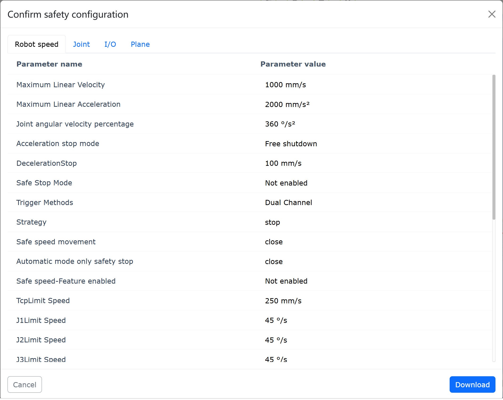

.. centered:: Figura 7.1-2 Parámetros de configuración de seguridad

Los parámetros de configuración de seguridad admiten la exportación de un informe PDF; hacer clic en descargar permite previsualizar el informe PDF y también exportarlo. Al hacer clic en el botón guardar, se descarga el informe PDF.

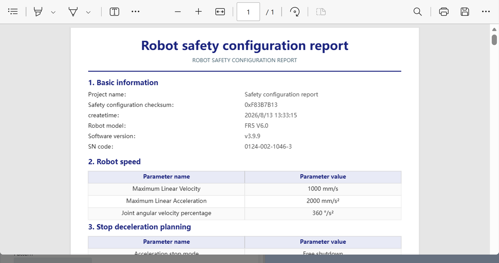

.. centered:: Figura 7.1-3 Vista previa del informe PDF de configuración de seguridad

Gestión de parámetros de configuración de seguridad
--------------------------------------------------------------

Todos los parámetros de configuración de seguridad relacionados con el robot se mantienen de forma unificada en la página web "Configuración inicial"-"Seguridad". Para modificar un parámetro de configuración de seguridad es necesario introducir primero la "Contraseña de configuración de seguridad" para su verificación; solo tras una verificación correcta se puede modificar la configuración de seguridad.

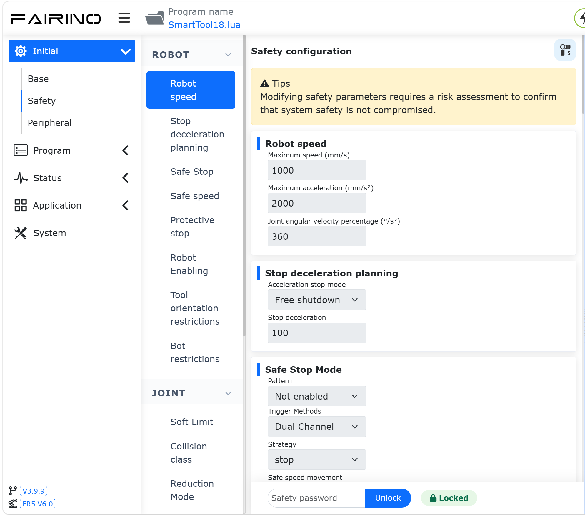

.. centered:: Figura 7.2-1 Verificación de la contraseña de configuración de seguridad

Tras modificar los parámetros de configuración de seguridad, hacer clic en "Aplicar"; es necesario confirmar por segunda vez los parámetros de configuración de seguridad modificados; hacer clic en "Confirmar" para aplicar los parámetros. Tras aplicar correctamente los parámetros, la suma de verificación de la configuración de seguridad se actualiza en consecuencia.

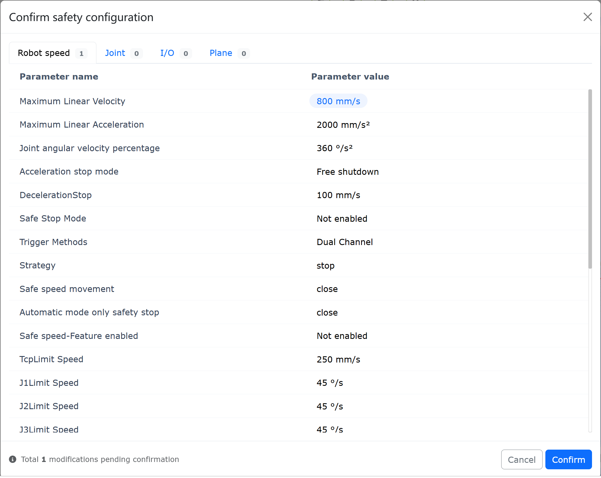

.. centered:: Figura 7.2-2 Segunda confirmación de los parámetros de configuración de seguridad

Funciones de seguridad de red
------------------------------------------------------------------------

Gestión de la contraseña de seguridad
~~~~~~~~~~~~~~~~~~~~~~~~~~~~~~~~~~~~~~~~~~~~~~~~~~~~~~~~~~~~~~~~~~~~~~~~~~~~~~

Modificación de la contraseña de seguridad
+++++++++++++++++++++++++++++++++++++++++++++++++++++++++++++++++++++

La contraseña de seguridad predeterminada es "12345678"; la contraseña de seguridad se puede modificar en la página "Seguridad"; hacer clic en el botón "Modificar contraseña de seguridad" para que aparezca la ventana de modificación de la contraseña de seguridad; introducir respectivamente la contraseña antigua y la nueva para completar la modificación de la contraseña de seguridad;

.. centered:: Figura 7.3-1 Botón de modificación de la contraseña de seguridad

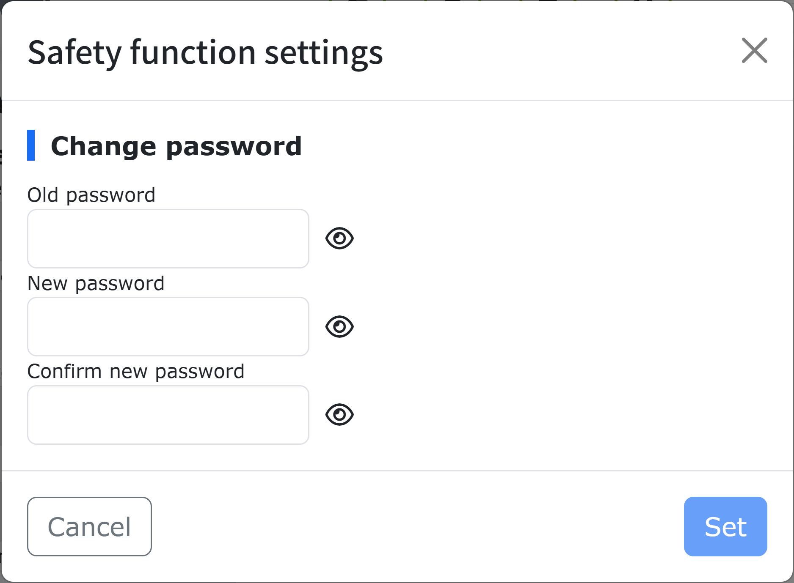

.. centered:: Figura 7.3-2 Ventana de modificación de la contraseña de seguridad

La nueva contraseña de seguridad y la antigua no pueden ser iguales; la longitud de la contraseña de seguridad debe ser de al menos 8 caracteres e incluir letras mayúsculas y minúsculas, números y caracteres especiales.

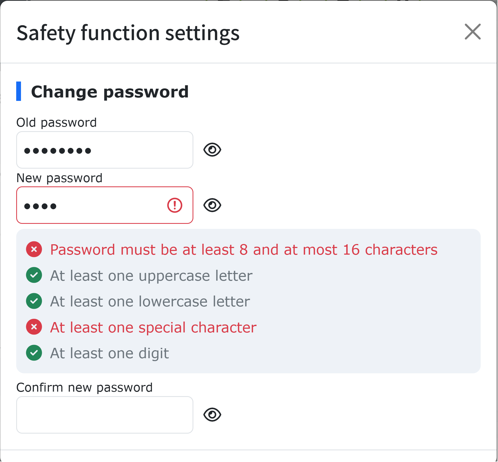

.. centered:: Figura 7.3-3 Verificación de la complejidad de la contraseña de seguridad

Protección de la contraseña de seguridad
+++++++++++++++++++++++++++++++++++++++++++++++++++++++++++++++++++++

La introducción de la contraseña de seguridad del robot dispone de una función de protección contra ataques de fuerza bruta; si se introduce la contraseña incorrecta de forma consecutiva 5 veces y el intervalo entre cada introducción es inferior a 1 min, se activará el bloqueo de la introducción de la contraseña de seguridad durante 1 min; durante ese minuto no se podrá introducir la contraseña para desbloquear, y en WebApp se muestra una cuenta atrás.

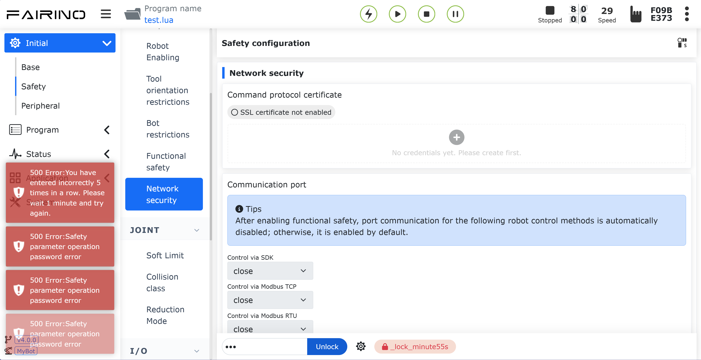

.. centered:: Figura 7.3-4 Bloqueo de protección contra fuerza bruta de la contraseña de seguridad

Seguridad de red
~~~~~~~~~~~~~~~~~~~~~~~~~~~~~~~~~~~~~~~~~~~~~~~~~~~~~~~~~~~~~~~~~~~~~~~~

Las funciones de seguridad de red del robot incluyen la comunicación cifrada del protocolo de instrucciones, la desactivación predeterminada de los puertos de comunicación no cifrada, la actualización de software y la verificación de integridad durante el arranque, etc., utilizadas para la autenticación de identidad, la prevención de escuchas y alteraciones, la resistencia a ataques de red y la garantía de una comunicación segura y controlable.

Información del entorno de seguridad de red
+++++++++++++++++++++++++++++++++++++++++++++++++++++++++++++++++++++

El usuario debe cumplir los siguientes requisitos de entorno para garantizar la eficacia de las funciones de seguridad de red del robot colaborativo; si el entorno no cumple los requisitos, la capacidad de protección de seguridad del robot colaborativo puede disminuir, existiendo riesgos de seguridad.

Entorno de seguridad física
*******************************************************************************

①El controlador del robot y los conmutadores por los que deba pasar deben instalarse en un armario de control equipado con dispositivo de bloqueo. Está estrictamente prohibido que personal no autorizado abra la puerta del armario; sin autorización, está prohibido tocar cualquier interfaz, como los puertos Ethernet del controlador y los puertos de E/S de seguridad. 

②El puerto Ethernet del controlador del robot solo se utiliza para conectar el ordenador industrial; está prohibido conectar directamente un ordenador privado o conectarlo al puerto de red del controlador a través de un conmutador. Está prohibido que personal no autorizado acceda al ordenador industrial que tiene conexión de red con el robot; configure una contraseña de inicio de sesión para el ordenador industrial.

③El teach pendant y la caja de botones del robot deben colocarse en una zona de trabajo segura; está prohibido que personal no autorizado acceda a dicha zona.

Configuración de seguridad del robot
*******************************************************************************

①Configurar para el personal con distintos permisos cuentas de inicio de sesión de WebApp con los permisos correspondientes, especialmente los permisos de actualización de software y firmware y de configuración de parámetros de seguridad;

②Modificar la contraseña de inicio de sesión del administrador de WebApp del robot y la contraseña de configuración de seguridad; y custodiar debidamente las contraseñas para evitar su filtración;

③Si se utiliza la comunicación mediante protocolo de instrucciones, activar el cifrado y custodiar debidamente cualquier certificado de cifrado de comunicación de red descargado del robot; está estrictamente prohibida la filtración del certificado.

④Mantener desactivados por defecto los puertos de comunicación no cifrada; no activarlos salvo que sea necesario.

Requisitos de versión de las funciones de seguridad de red
+++++++++++++++++++++++++++++++++++++++++++++++++++++++++++++++++++++

Las versiones de software del robot V4.0.0 y superiores admiten las funciones de seguridad de red; las versiones de software del robot inferiores a dicho número no admiten las funciones de seguridad de red.

Cifrado de comunicación de WebApp
+++++++++++++++++++++++++++++++++++++++++++++++++++++++++++++++++++++

La comunicación de WebApp del robot es una comunicación https cifrada con TLS1.2. Al utilizar WebApp es necesario instalar el certificado (si no se instala el certificado, el navegador mostrará una conexión no segura); los pasos concretos son los siguientes:

①Introducir en el navegador la dirección IP del robot, por ejemplo 192.168.58.2, y pulsar la tecla Intro para acceder a la página de WebApp del robot; en este momento el navegador mostrará el aviso de conexión no segura;

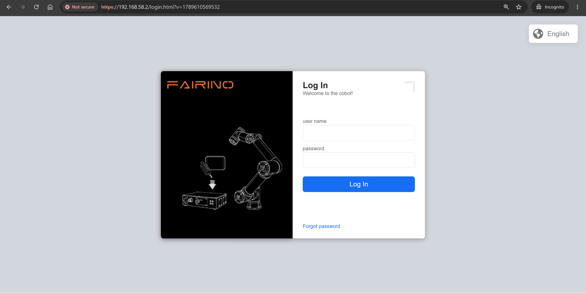

.. centered:: Figura 7.3-5 Visualización de conexión no segura

②Hacer clic en "No seguro" a la izquierda del cuadro de entrada de la dirección IP para que aparezca la ventana de detalles de la conexión;

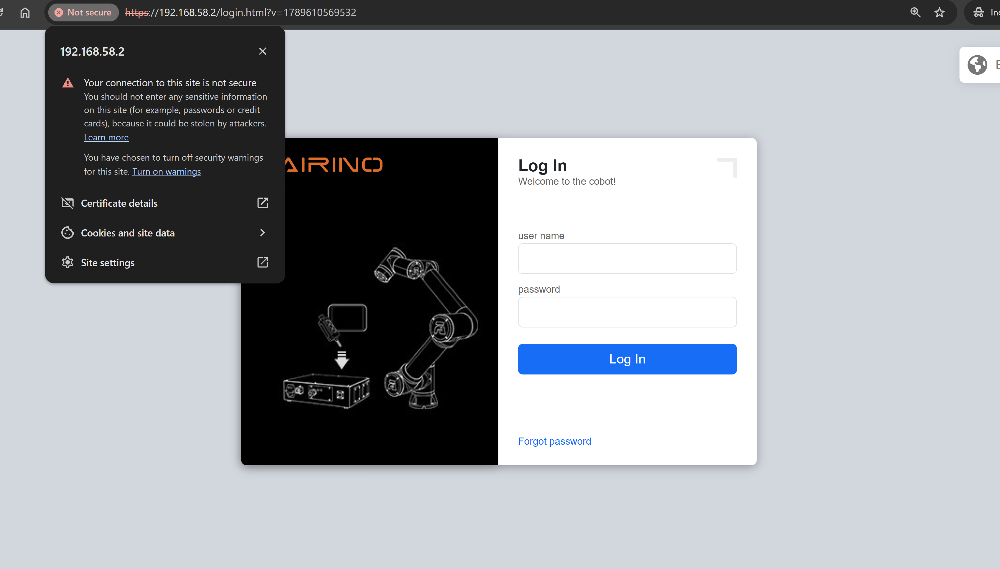

.. centered:: Figura 7.3-6 Aparición de la ventana de detalles de la conexión

③En la ventana, hacer clic en "Detalles del certificado" para que aparezca la ventana de detalles del certificado; en la pestaña superior seleccionar "Detalles" y hacer clic en el botón "Exportar" para descargar el certificado; el nombre del certificado descargado suele ser la dirección IP del robot; es necesario cambiar el nombre del archivo y añadir la extensión ".crt", por ejemplo, cambiar "192.168.58.2" por "192.168.58.2.crt".

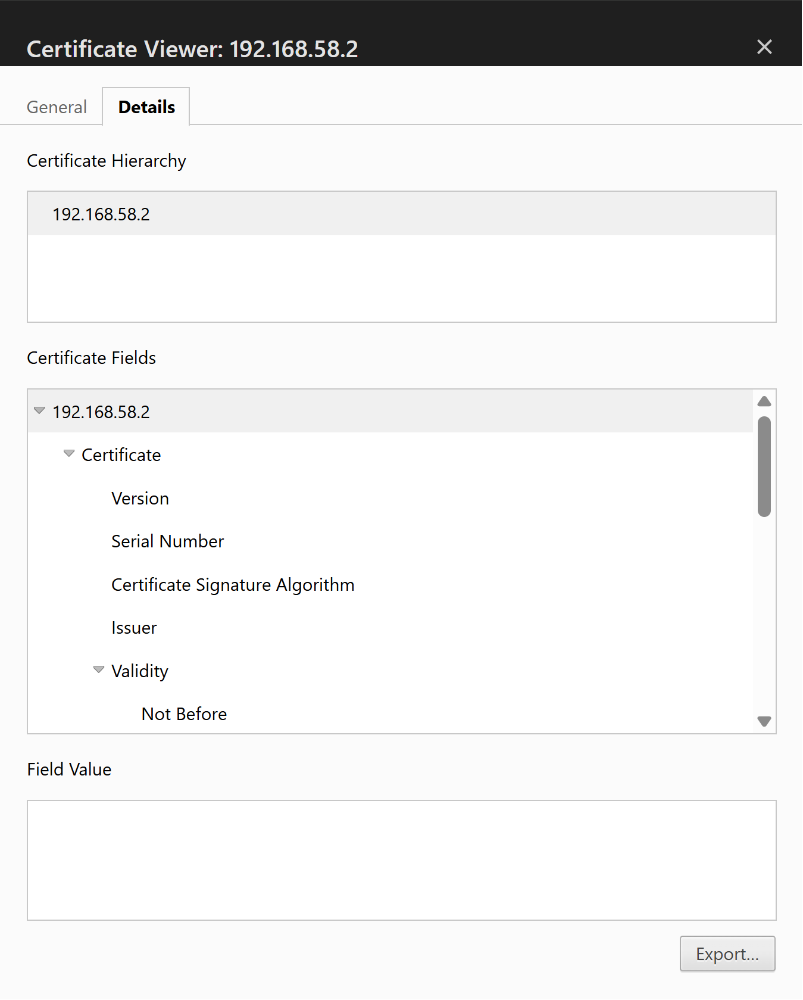

.. centered:: Figura 7.3-7 Ventana de detalles del certificado

.. centered:: Figura 7.3-8 Nombre del archivo de certificado

④Hacer doble clic en el archivo de certificado para que aparezca la ventana de instalación del certificado y hacer clic en "Instalar certificado".

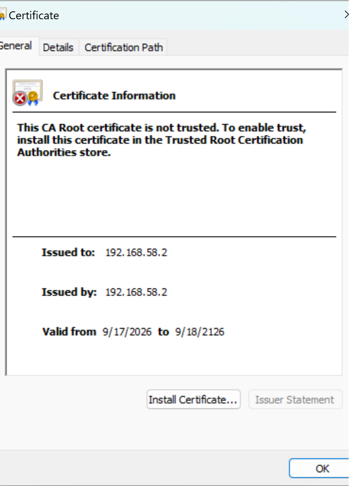

.. centered:: Figura 7.3-9 Ventana de instalación del certificado

⑤En el asistente de instalación del certificado que aparece, seleccionar la ubicación de almacenamiento como equipo local y hacer clic en siguiente;

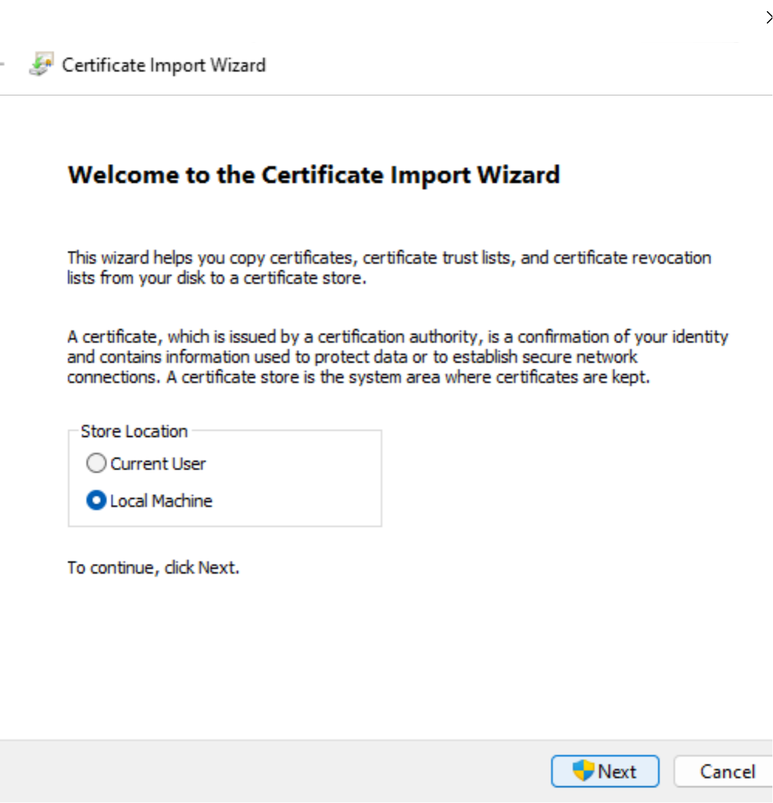

.. centered:: Figura 7.3-10 Selección de la ubicación de almacenamiento como equipo local

⑥En la ventana del asistente de certificados, seleccionar "Colocar todos los certificados en el siguiente almacén", hacer clic en el botón "Examinar" y seleccionar "Entidades de certificación raíz de confianza". Hacer clic en "Siguiente";

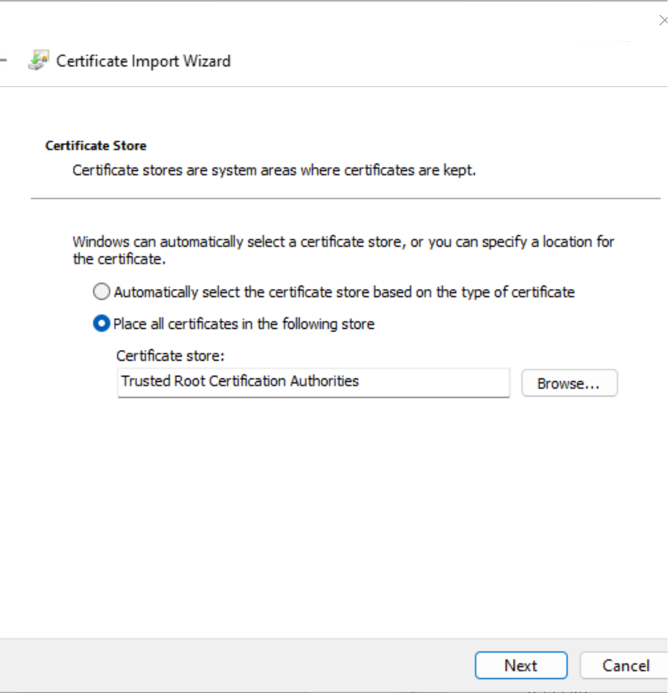

.. centered:: Figura 7.3-11 Selección de entidades de certificación raíz de confianza

⑦Hacer clic en "Finalizar";

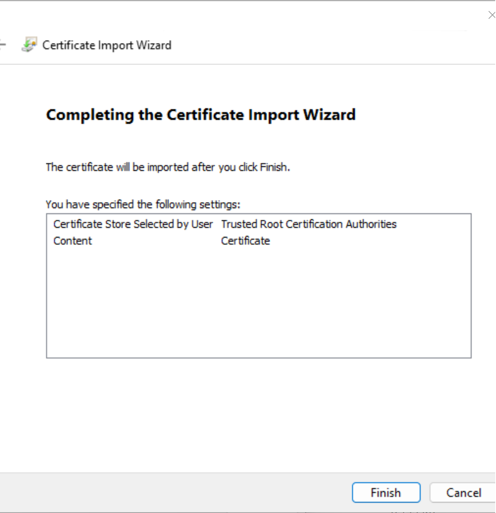

.. centered:: Figura 7.3-12 Instalación del certificado de WebApp completada

Reiniciar el navegador e iniciar sesión en WebApp; se mostrará como una conexión segura normal;

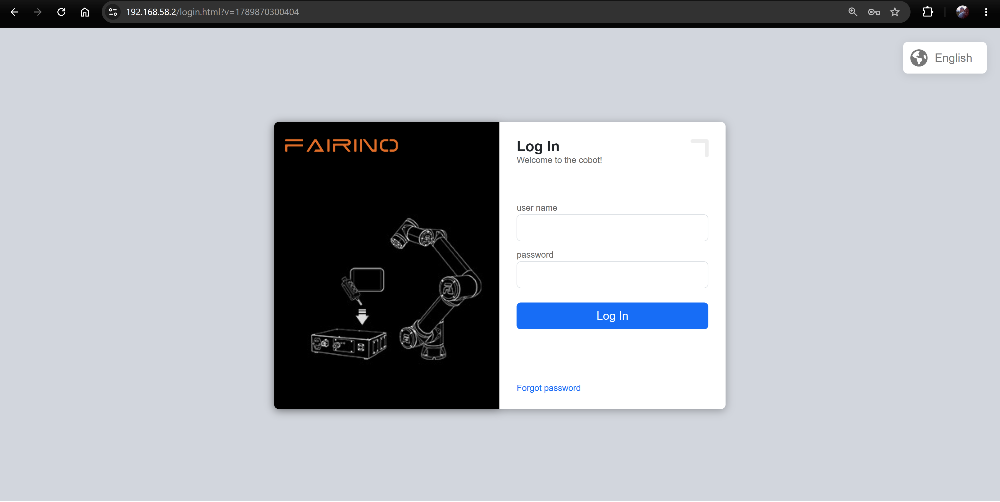

.. centered:: Figura 7.3-13 Visualización de conexión segura tras instalar el certificado de WebApp

Cifrado del protocolo de instrucciones
+++++++++++++++++++++++++++++++++++++++++++++++++++++++++++++++++++++

Los protocolos de instrucciones 8080-TCP y 20007-UDP del robot se pueden configurar para comunicarse mediante cifrado con autenticación mutua TLS1.2; el usuario descarga del robot el certificado raíz, el certificado de cliente y la clave privada del cliente; cada robot dispone de un certificado raíz independiente; los certificados de cliente y las claves privadas descargados de distintos robots no se pueden mezclar; un robot solo admite un conjunto de certificado de cliente y clave privada.

En WebApp del robot, hacer clic sucesivamente en "Configuración inicial", "Seguridad", "Seguridad de red", introducir la contraseña de seguridad para desbloquear y, en "Seguridad de red", encontrar "Certificado del protocolo de instrucciones";

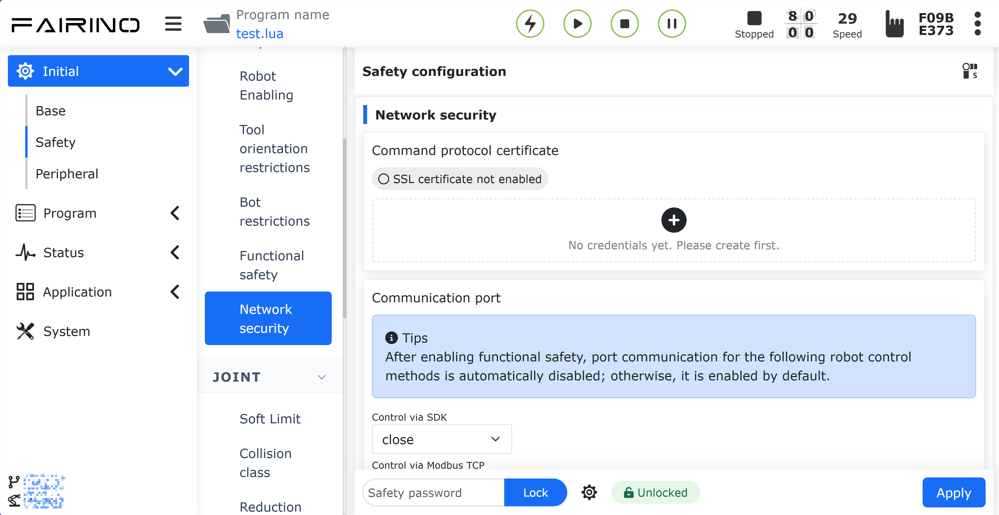

.. centered:: Figura 7.3-14 Página de configuración del certificado del protocolo de instrucciones

Hacer clic en el botón "No hay certificado, cree uno primero", introducir los días de validez del certificado del protocolo de instrucciones a partir de la fecha actual; hacer clic en el botón "Crear"; tras crear correctamente el certificado, se muestran el nombre del certificado de cliente, el número de serie y la fecha de vencimiento calculada según los días de validez.

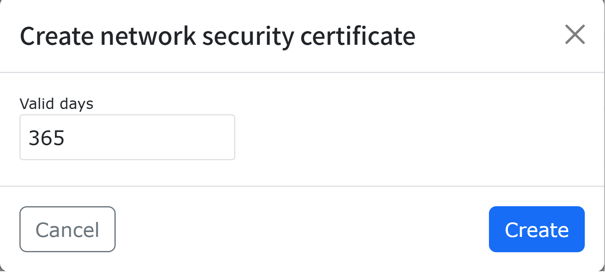

.. centered:: Figura 7.3-15 Configuración del período de validez del certificado del protocolo de instrucciones

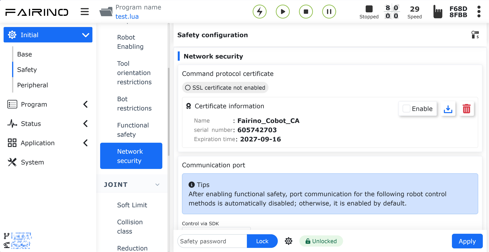

.. centered:: Figura 7.3-16 Información del certificado del protocolo de instrucciones

Hacer clic en el botón de descarga de la derecha para descargar el paquete comprimido "client_certs.tar.gz", que contiene tres archivos: "ca.crt": certificado raíz; "client.crt": certificado de cliente; "client.key": clave del cliente.

Hacer clic en "Activar" y hacer clic en el botón "Aplicar"; en la ventana de confirmación de la configuración de seguridad del robot que aparece, confirmar la activación del cifrado del certificado del protocolo de instrucciones y volver a hacer clic en el botón "Confirmar" para activar el cifrado del protocolo de instrucciones.

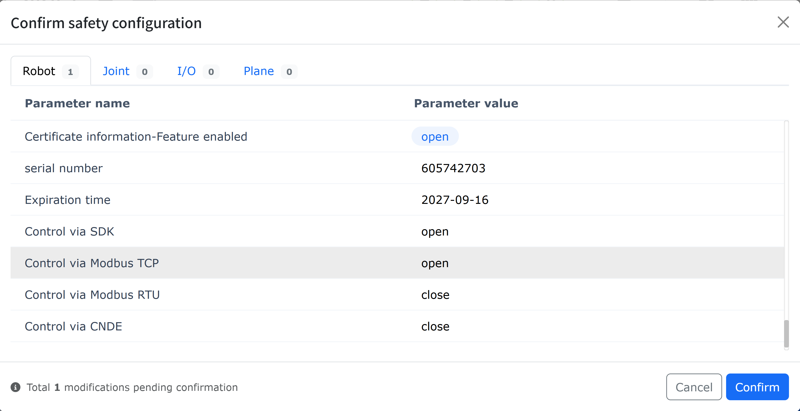

.. centered:: Figura 7.3-17 Confirmación de activación del certificado del protocolo de instrucciones

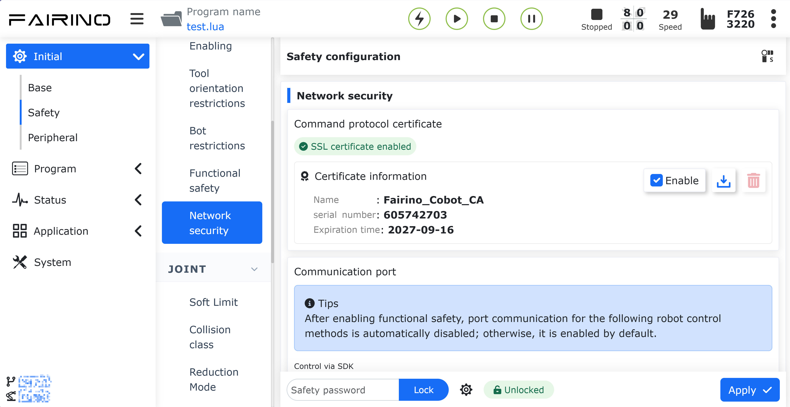

.. centered:: Figura 7.3-18 Activación del cifrado del certificado del protocolo de instrucciones

Hacer clic en el botón "Eliminar" de la derecha del cuadro de información del certificado para deshabilitar el certificado correspondiente a dicho número de serie. Antes de eliminar el certificado, es necesario configurar primero el cifrado del protocolo de instrucciones como no activado.

Configuración de activación de las funciones de comunicación de red no cifrada
+++++++++++++++++++++++++++++++++++++++++++++++++++++++++++++++++++++++++++++++++++

Algunas funciones de comunicación de red no cifrada del robot se pueden configurar para activarse o no; por defecto están desactivadas.

.. note:: Nota: la función de desactivación de puertos de comunicación del robot solo surte efecto cuando se activa la "Seguridad funcional"; ¡en modo de "Seguridad funcional" no activada, las funciones de comunicación de red del robot están todas activadas!

En WebApp del robot, hacer clic sucesivamente en "Configuración inicial", "Seguridad", "Seguridad de red" y encontrar "Puertos de comunicación"; la descripción de la función de cada puerto es la siguiente:

.. centered:: Figura 7.3-19 Configuración de activación de puertos de comunicación

- **Control mediante SDK**: controlar el robot mediante el puerto de comunicación XMLRPC del SDK del robot; si no está activado, no se puede controlar el robot mediante XMLRPC;
- **Control mediante ModbusTCP**: cuando el robot actúa como esclavo ModbusTCP, mediante las "entradas digitales funcionales (bobinas)" se puede controlar la salida DO del robot, el inicio y la parada del programa, la conmutación manual/automático, el modo reducido, etc.; tras desactivar "Control mediante ModbusTCP", todas las funciones de control anteriores mediante las "entradas digitales funcionales (bobinas)" quedan desactivadas.
- **Control mediante ModbusRTU**: cuando el robot actúa como esclavo ModbusRTU, mediante las "entradas digitales funcionales (bobinas)" se puede controlar la salida DO del robot, el inicio y la parada del programa, la conmutación manual/automático, el modo reducido, etc.; tras desactivar "Control mediante ModbusRTU", todas las funciones de control anteriores mediante las "entradas digitales funcionales (bobinas)" quedan desactivadas.
- **Control mediante CNDE**: las entradas CNDE del robot permiten configurar el control de la salida DO, la salida AO, la velocidad de funcionamiento, etc. del robot; tras desactivar "Control mediante CNDE", el cliente CNDE no puede controlar las funciones anteriores.
- **Función de restablecimiento de IP de la caja de botones**: la caja de botones V2.0 del robot dispone de un botón de restablecimiento de IP; tras desactivar la "Función de restablecimiento de IP de la caja de botones", no se podrá controlar el restablecimiento de IP del robot mediante la caja de botones.
- **Control mediante el puerto 8082**: el puerto 8082 del robot es el puerto de carga de archivos LUA y archivos de registro de trayectoria TPD; mediante este puerto se puede modificar el contenido y el nombre del archivo LUA del movimiento actual. Si se configura como no activado, el robot no responderá a las solicitudes de modificación de archivos del cliente.
- **Control mediante NTP**: la caja de control de la versión LA dispone del servicio de sincronización horaria NTP; desactivar esta función prohíbe la sincronización horaria NTP del robot.
- **Control mediante DHCP**: al desactivarse, el robot desactiva el servicio DHCP.

En la página de configuración de seguridad, introducir la contraseña de seguridad y desbloquear; configurar como "Activar" los puertos de comunicación que se deseen habilitar y hacer clic en "Aplicar"; en la ventana de confirmación de la configuración de seguridad que aparece, confirmar las funciones habilitadas y hacer clic en el botón "Confirmar".

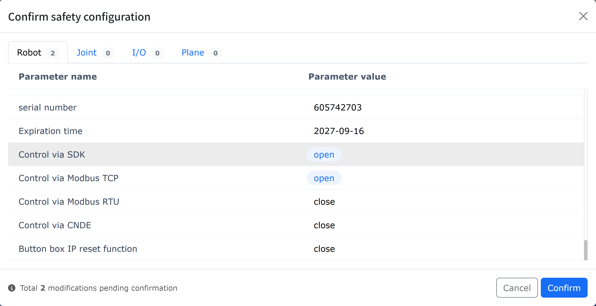

.. centered:: Figura 7.3-20 Confirmación de activación de puertos de comunicación

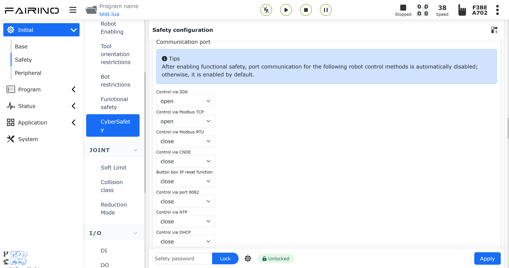

.. centered:: Figura 7.3-21 Puertos de comunicación activados

Configuración de activación del servicio de sincronización horaria PTP del robot
+++++++++++++++++++++++++++++++++++++++++++++++++++++++++++++++++++++++++++++++++++++++++++++++++++++++++++++
El servicio de sincronización horaria PTP del robot se puede configurar como no activado, sincronización de tiempo por software y sincronización de tiempo por hardware; se pueden configurar los puertos de red Eth0 y Eth1 de la caja de control del robot para el servicio de sincronización horaria PTP. Las funciones "Registro de log" y "Detección de precisión de sincronización" aún no están disponibles.

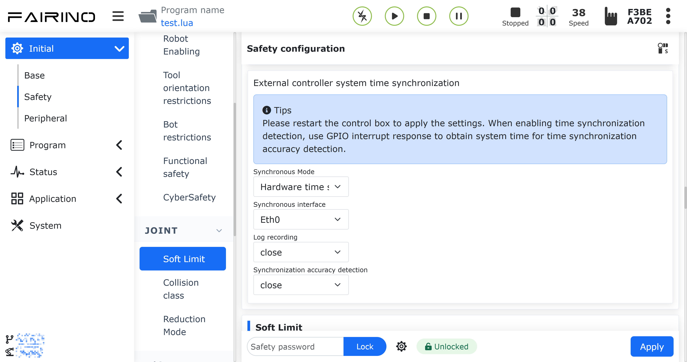

.. centered:: Figura 7.3-21-1 Configuración del servicio de sincronización horaria PTP del robot

Protección física contra manipulaciones de la caja de control del robot
+++++++++++++++++++++++++++++++++++++++++++++++++++++++++++++++++++++++++++++++++++++++++++++++++++++++++++++
La caja de control del robot dispone de etiquetas de protección física contra manipulaciones; el usuario debe comprobar periódicamente si las etiquetas de protección contra manipulaciones de la caja de control del robot están en buen estado.

Verificación de integridad del software del robot
+++++++++++++++++++++++++++++++++++++++++++++++++++++++++++++++++++++

Durante la actualización y el arranque del software del robot se realiza la verificación de integridad del paquete de software, para evitar que el paquete de software del robot sea manipulado;

Verificación de integridad en la actualización de software del robot: durante la actualización del software del robot se verifica si el paquete de software que se va a actualizar está completo; si el paquete de software no está completo, se muestra un mensaje de error durante la actualización y se detiene la actualización;

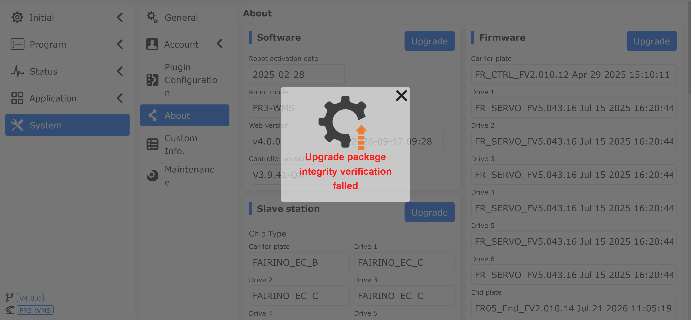

.. centered:: Figura 7.3-22 Error de fallo de la verificación de integridad en la actualización de software

Verificación de integridad en el arranque del software del robot: durante el arranque del software del robot se verifica si el paquete de software del sistema actual está completo; si el paquete de software está completo, el software del robot arranca con normalidad; de lo contrario, el software del robot no arranca y se muestra un aviso de error en WebApp;

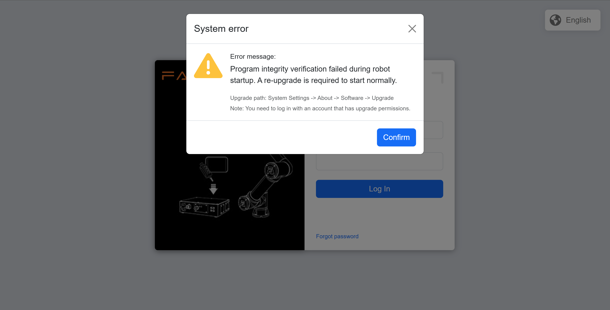

.. centered:: Figura 7.3-23 Error de fallo de la verificación de integridad durante el proceso de arranque del software

Declaración de riesgos residuales de seguridad de red
+++++++++++++++++++++++++++++++++++++++++++++++++++++++++++++++++++++

.. centered:: Tabla 2-1 Riesgos residuales de seguridad de red y medidas compensatorias del usuario

.. list-table::
   :widths: 10 20 25 45
   :header-rows: 0
   :align: center

   * - **Número**
     - **Riesgo residual**
     - **Medidas de mitigación adoptadas**
     - **Medidas compensatorias del usuario**

   * - 1
     - El protocolo de comunicación SDK - XMLRPC del robot transmite en texto plano
     - | ①La función de control del robot mediante SDK está desactivada por defecto;
       | ②En el SDK se integran de forma inherente los protocolos de instrucciones 8080-TCP y 20007-UDP, y el protocolo de instrucciones dispone de cifrado TLS1.2; cuando falla el handshake de cifrado del protocolo de instrucciones, el SDK no puede conectarse con normalidad al robot.	
     - | ①La comunicación SDK entre el ordenador superior y el robot debe limitarse a un entorno de red aislado y de confianza; no se permite la conexión a redes no confiables; el enlace de red y los puertos de red deben contar con protección física para evitar accesos no autorizados;
       | ②En el SDK se integra la comunicación mediante el protocolo de instrucciones 20007-UDP y se proporciona la interfaz SendUDPFrame() para enviar tramas de instrucciones personalizadas; además, la comunicación mediante el protocolo de instrucciones 20007-UDP dispone de cifrado DTLS; la información sensible debe enviarse al robot a través de dicha interfaz;
       | ③Salvo que sea necesario, desactivar la función de control del robot mediante SDK en el módulo "Seguridad", "Seguridad de red" de WebApp;

   * - 2
     - La comunicación CNDE de intercambio de datos configurable 20005 - TCP / 20006 - UDP del robot transmite en texto plano
     - | ①La función de control del robot mediante CNDE está desactivada por defecto;	
     - | ①La comunicación CNDE entre el ordenador superior y el robot debe limitarse a un entorno de red aislado y de confianza; no se permite la conexión a redes no confiables; el enlace de red y los puertos de red deben contar con protección física para evitar accesos no autorizados;
       | ②Salvo que sea necesario, desactivar la función de control del robot mediante CNDE en el módulo "Seguridad", "Seguridad de red" de WebApp;

   * - 3
     - La comunicación ModbusTCP del robot transmite en texto plano
     - | ①La función de control del robot mediante ModbusTCP está desactivada por defecto;	
     - | ①La comunicación ModbusTCP entre el ordenador superior y el robot debe limitarse a un entorno de red aislado y de confianza; no se permite la conexión a redes no confiables; el enlace de red y los puertos de red deben contar con protección física para evitar accesos no autorizados;
       | ②Salvo que sea necesario, desactivar la función de control del robot mediante ModbusTCP en el módulo "Seguridad", "Seguridad de red" de WebApp;
       
   * - 4
     - La comunicación ModbusRTU del robot transmite en texto plano
     - | ①La función de control del robot mediante ModbusRTU está desactivada por defecto;	
     - | ①La comunicación ModbusRTU entre el ordenador superior y el robot debe limitarse a un entorno de red aislado y de confianza; no se permite la conexión a redes no confiables; el enlace de red y los puertos de red deben contar con protección física para evitar accesos no autorizados;
       | ②Salvo que sea necesario, desactivar la función de control del robot mediante ModbusRTU en el módulo "Seguridad", "Seguridad de red" de WebApp;
    
   * - 5
     - Un atacante podría utilizar la cuenta y contraseña de inicio de sesión predeterminadas del administrador de WebApp para modificar los parámetros de configuración de seguridad del robot
     - No
     - | ①El usuario debe modificar la contraseña de inicio de sesión predeterminada del administrador de WebApp del robot y custodiar debidamente la contraseña;
       | ②El usuario debe configurar cuentas y contraseñas de inicio de sesión de WebApp correspondientes para el personal con distintos permisos de configuración de seguridad, y custodiar debidamente las contraseñas;
       
   * - 6
     - Un atacante podría utilizar la cuenta y contraseña de inicio de sesión predeterminadas de WebApp para modificar la versión de software y firmware del robot
     - No    
     - | ①El usuario debe modificar la contraseña de inicio de sesión predeterminada del administrador de WebApp del robot y custodiar debidamente la contraseña;
       | ②El usuario debe configurar cuentas y contraseñas de inicio de sesión de WebApp correspondientes para el personal con distintos permisos de actualización de software y firmware, y custodiar debidamente las contraseñas;
       
   * - 7
     - Un atacante podría utilizar la contraseña de seguridad predeterminada para modificar los parámetros de configuración de seguridad
     - No           
     - | ①El usuario debe modificar la contraseña de seguridad del robot y está prohibido utilizar la contraseña de seguridad predeterminada;
       
   * - 8
     - Un atacante podría dañar físicamente los puertos Ethernet LAN1 / LAN2 del robot, dejando inoperativa la comunicación Ethernet del robot
     - Ninguna       
     - | ①El usuario debe instalar la caja de control del robot en un armario de control equipado con dispositivo de bloqueo y prohibir el acceso de personal no autorizado a la caja de control del robot;
            
   * - 9
     - Un atacante podría dañar físicamente el puerto de comunicación RS-485 del robot, dejando inoperativos el control del eje extendido y la comunicación ModbusRTU del robot
     - Ninguna  
     - | ①El usuario debe instalar la caja de control del robot en un armario de control equipado con dispositivo de bloqueo y prohibir el acceso de personal no autorizado a la caja de control del robot;
                 
   * - 10
     - Un atacante podría dañar físicamente el botón de parada de emergencia de la caja de botones del robot, dejando inoperativo el botón de parada de emergencia del robot
     - Ninguna  
     - | ①El usuario debe colocar la caja de botones del robot en una zona de trabajo segura y prohibir el acceso de personal no autorizado a dicha zona;
                      
   * - 11
     - Un atacante podría dañar físicamente el botón de parada de emergencia del teach pendant del robot, dejando inoperativo el botón de parada de emergencia del robot
     - Ninguna  
     - | ①El usuario debe colocar el teach pendant del robot en una zona de trabajo segura y prohibir el acceso de personal no autorizado a dicha zona;

Parámetros de configuración de seguridad
--------------------------------------------------------------------------------------------------

Parámetros de seguridad del robot
~~~~~~~~~~~~~~~~~~~~~~~~~~~~~~~~~~~~~~~~~~~~~~~~~~~~~~~~~~~~~~~~~~~~~~~

Velocidad del robot
++++++++++++++++++++++++++++++++++++++++++++++++++++++++++++++

Hacer clic en el menú "Configuración inicial"->"Seguridad" y hacer clic en el submenú "Velocidad del robot" para entrar en la interfaz de configuración.

La velocidad del robot se utiliza para limitar la velocidad lineal máxima, la aceleración lineal y la aceleración angular articular del robot.

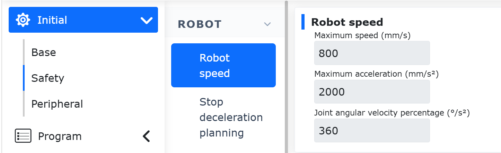

.. centered:: Figura 7.4-1 Velocidad del robot
 
Planificación de deceleración de parada
++++++++++++++++++++++++++++++++++++++++++++++++++++++++++++++

Hacer clic en el menú "Configuración inicial"->"Seguridad" y hacer clic en el submenú "Planificación de deceleración de parada" para entrar en la interfaz de configuración.

- Parada libre: al entrar en parada, la velocidad angular de cada eje se decelera hasta detenerse multiplicando el porcentaje de deceleración de parada configurado por la aceleración máxima de la articulación;
- Parada sincronizada: al entrar en parada, la velocidad de pose del TCP se decelera hasta detenerse multiplicando el porcentaje de deceleración de parada configurado por la aceleración máxima de la pose;

La deceleración de parada es el porcentaje de la aceleración.

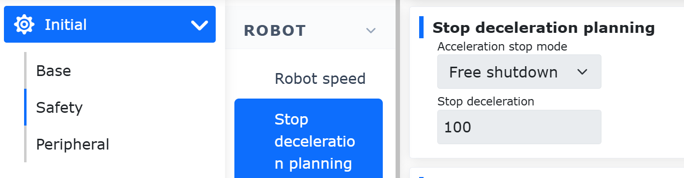

.. centered:: Figura 7.4-2 Planificación de deceleración de parada del robot

Parada de seguridad
++++++++++++++++++++++++++++++++++++++++++++++++++++++++++++++

Hacer clic en el menú "Configuración inicial"->"Seguridad" y hacer clic en "Parada de seguridad" para entrar en la interfaz de configuración, donde se configura la función del modo de parada de seguridad y de los parámetros de la estrategia de parada de seguridad.

Modo de parada de seguridad
**********************************************************************

Cuando el modo de parada de seguridad se selecciona como "Certificación CR", este modo satisface principalmente los requisitos de seguridad del sistema nacional de certificación de robots (certificación CR) y es aplicable a escenarios de aceptación de proyectos nacionales o de acceso al mercado. La certificación CR es una certificación autorizada de productos de robot de China promovida bajo la orientación de varios ministerios y comisiones del Estado, que evalúa principalmente la seguridad y la fiabilidad del robot.

En este modo, la función de parada de seguridad del sistema se configura y verifica según las normas sectoriales nacionales de robots colaborativos. En la práctica del sector de los robots colaborativos, este tipo de funciones de seguridad esenciales suele diseñarse y evaluarse con referencia a un nivel de seguridad funcional elevado, para garantizar la seguridad absoluta en la colaboración humano-máquina.

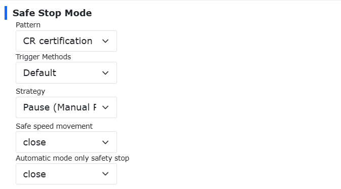

.. centered:: Figura 7.4-2-1 Modo de certificación CR

La seguridad funcional (Functional Safety) es un conjunto de metodologías de ingeniería de aplicación internacional cuyo objetivo central es garantizar que el sistema pueda entrar de forma fiable en un estado seguro cuando se produce un fallo. Para los robots colaborativos, la seguridad funcional se evalúa generalmente según ISO 13849-1 (partes relacionadas con la seguridad de los sistemas de control de seguridad de las máquinas) y 10218, entre otras, para determinar el nivel de prestaciones de los sistemas de control relacionados con la seguridad.

Al seleccionar el modo "Seguridad funcional", la implementación y verificación de la función de parada de seguridad sigue el sistema internacional de normas de seguridad funcional. Este modo es aplicable a la exportación de productos (por ejemplo, el cumplimiento de la Directiva de máquinas dentro de la certificación CE de la UE) o a escenarios en los que el cliente exige una base normativa internacional clara para la seguridad intrínseca.

.. note:: Tenga en cuenta que, tras configurar correctamente el modo de seguridad funcional, es necesario reiniciar la caja de control para que los cambios de parámetros del sistema de control de seguridad surtan efecto.

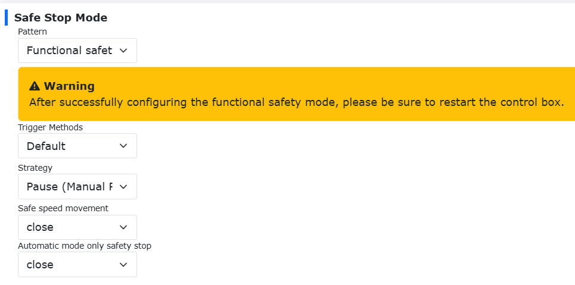

.. centered:: Figura 7.4-2-2 Modo de seguridad funcional

Modo de activación
**********************************************************************

Cuando el modo de activación de la parada de seguridad se configura como "Doble canal", es necesario que ambos canales garanticen el estado de borrado y que el operador borre manualmente la advertencia en la interfaz de operación para que el robot pueda restablecerse. Además, en la configuración de la estrategia se añade la opción de modo reducido; cuando el usuario selecciona esta estrategia, el robot entra en movimiento en modo reducido.

**Step1**: Hacer clic en "Configuración inicial"—>"Seguridad"—>botón "Parada de seguridad"; el modo de activación se puede seleccionar entre dos modos: "Predeterminado" y "Doble canal"; la diferencia entre ambos es que el modo "Predeterminado" borra automáticamente el error de la interfaz tras la activación y recuperación, mientras que el modo "Doble canal" requiere borrar manualmente el error de la interfaz tras la activación y recuperación. La "Estrategia de parada de seguridad" permite seleccionar tipos como "Parada", "Pausa", "Modo reducido de nivel uno" y "Modo reducido de nivel dos"; la descripción detallada es la siguiente: al seleccionar "Parada", el robot detiene el movimiento actual; al seleccionar "Pausa", el robot pausa el movimiento actual y, tras recuperar y borrar el error, se reanuda la pausa; al seleccionar "Modo reducido de nivel uno", el robot entra en movimiento en modo reducido de nivel uno; al seleccionar "Modo reducido de nivel dos", el robot entra en movimiento en modo reducido de nivel dos.

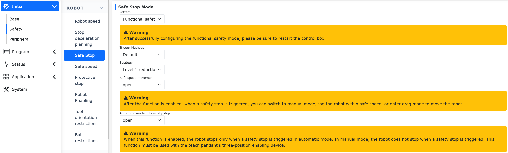

.. centered:: Figura 7.4-3 Planificación de deceleración de parada del robot

**Step2**: Dado que, cuando el modo de activación se selecciona como "Predeterminado", tras la recuperación de la activación se puede borrar automáticamente el error de la interfaz, cuando el modo de activación se selecciona como "Doble canal" la operación es la siguiente: tras la recuperación de la activación, es necesario hacer clic manualmente en la operación "Borrar" de la esquina superior derecha para que el robot pueda restablecerse.

Velocidad de seguridad
++++++++++++++++++++++++++++++++++++++++++++++++++++++++++++++

Hacer clic en el menú "Configuración inicial"->"Seguridad" y hacer clic en "Velocidad de seguridad" para entrar en la interfaz de configuración y configurar la velocidad de seguridad. El rango de velocidad manual del TCP es de 1-1500 mm/s.

La función de velocidad de seguridad del robot consiste en, en entornos de colaboración humano-máquina o dinámicos, limitar de forma activa la velocidad de funcionamiento del robot para controlar la energía cinética y la fuerza de impacto dentro de los umbrales de seguridad, evitando así lesiones personales en caso de contacto accidental y protegiendo eficazmente el equipo y las piezas frente a daños por colisión.

**Step1**: Hacer clic en el botón "Configuración inicial"-"Seguridad"-"Velocidad de seguridad" para configurar los parámetros de velocidad de seguridad, que incluyen principalmente tres partes: "Activación de función", "Velocidad límite" y "Modo tras sobrevelocidad".

Entre ellas, en la activación de función se pueden seleccionar tres tipos: "No activar", "Activar en modo manual" y "Activar en todos los modos";

En la velocidad límite se configura la velocidad límite; cuando la velocidad lineal del robot alcanza dicha velocidad límite, se procesa según los parámetros establecidos en "Modo tras sobrevelocidad". El "Modo tras sobrevelocidad" permite seleccionar tres modos: "Parada con alarma", "Limitación automática de velocidad" y "Deshabilitar tras parada con alarma"; la limitación automática de velocidad solo puede utilizarse en "Activar en modo manual".

Tras configurar los parámetros necesarios, sin necesidad de operaciones adicionales, el movimiento del robot se procesará según los parámetros establecidos; la configuración de parámetros se muestra en la figura.

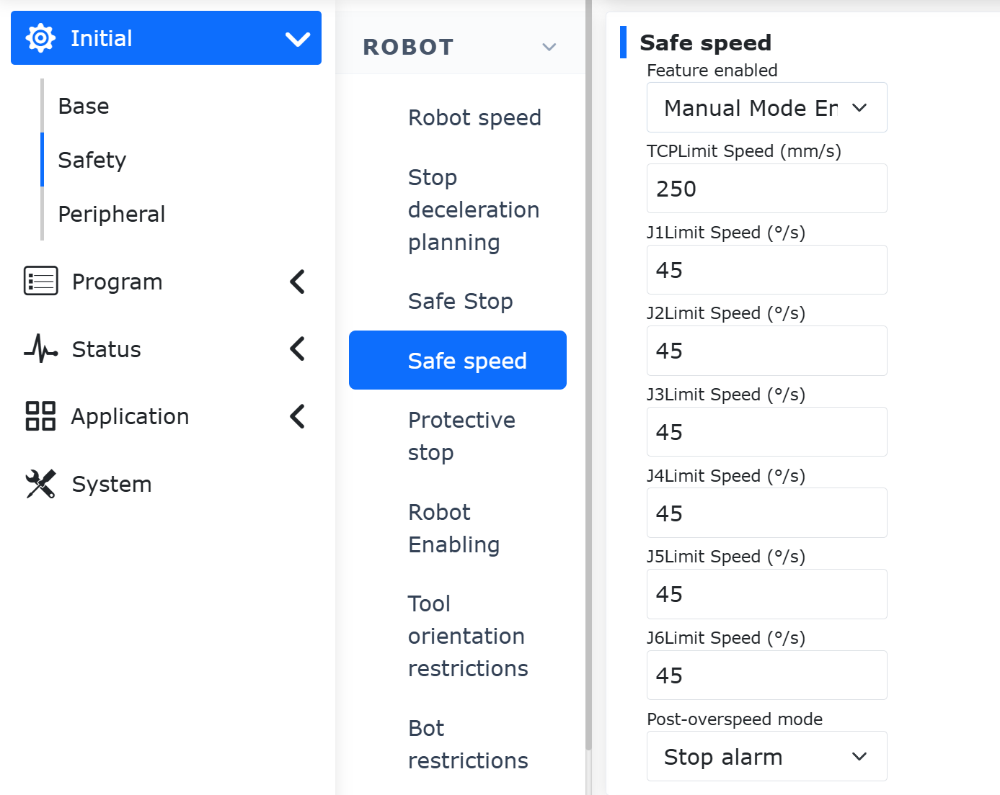

.. centered:: Figura 7.4-4 Configuración de parámetros de velocidad de seguridad

Parada de emergencia
++++++++++++++++++++++++++++++++++++++++++++++++++++++++++++++

Hacer clic en el menú "Configuración inicial"->"Seguridad" y hacer clic en "Parada de emergencia" para entrar en la interfaz de configuración.

Se pueden configurar los tipos de parada de emergencia 0, 1a, 1b y 2; se puede configurar el límite de tiempo de parada; se puede configurar el límite de distancia de parada.

Mediante la señal del controlador a la placa de la caja de control, la parada de emergencia de tipo 0 corta directamente la alimentación de la placa de la caja de control;

- La parada de emergencia de tipo 1a consiste en decelerar hasta detenerse y, a continuación, cortar la alimentación del cuerpo;
- La parada de emergencia de tipo 1b consiste en decelerar hasta detenerse sin cortar la alimentación del cuerpo, deshabilitando el cuerpo;
- La parada de emergencia de tipo 2 significa que, al pulsar la parada de emergencia, el robot decelera hasta detenerse y mantiene la habilitación; tras soltar la parada de emergencia, el robot debe poder funcionar con normalidad.

.. note:: Nota: la parada de emergencia solo es compatible con el hardware de tensión amplia.

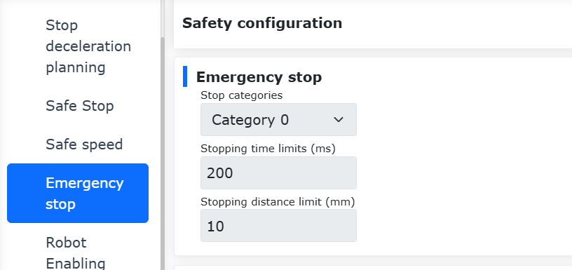

.. centered:: Figura 7.4-5 Configuración de la parada de emergencia

Parada protectora
++++++++++++++++++++++++++++++++++++++++++++++++++++++++++++++

Hacer clic en el menú "Configuración inicial"->"Seguridad" y hacer clic en el submenú "Parada protectora" para entrar en la interfaz de configuración.

Los tipos de parada protectora son 0, 1 y 2. En cualquier modo, la función de parada de seguridad se activa según la señal de parada de seguridad de la caja de control y, según el nivel de parada de seguridad configurado, se ejecuta la función de parada Cat.0, Cat.1 o Cat.2 correspondiente. La parada protectora de tipo 0 corta directamente la alimentación de la placa de la caja de control; la parada protectora de tipo 1 hace que la placa de la caja de control notifique primero al controlador que controle la parada del robot y, a continuación, el controlador realimenta el corte de alimentación de la placa de la caja de control; la parada protectora de tipo 2 hace que la placa de la caja de control notifique al controlador que controle la parada del robot.

- Si el tipo de parada es 0, se corta la alimentación del cuerpo y las articulaciones aplican el freno de seguridad;
- Si el tipo de parada es 1, se decelera hasta detenerse, se corta la alimentación del cuerpo y las articulaciones aplican el freno de seguridad;
- Si el tipo de parada es 2, se decelera hasta detenerse, se mantiene la alimentación del cuerpo y las articulaciones no aplican el freno de seguridad;

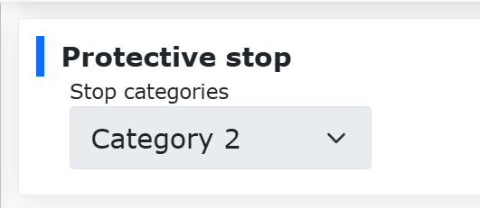

.. centered:: Figura 7.4-6 Configuración de la parada protectora

Habilitación automática al encender
++++++++++++++++++++++++++++++++++++++++++++++++++++++++++++++

Hacer clic en el menú "Configuración inicial"->"Seguridad" y hacer clic en el submenú "Habilitación del robot" para entrar en la interfaz de configuración. Se puede seleccionar la habilitación automática del robot al encender o la no habilitación.

.. centered:: Figura 7.4-7 Habilitación automática al encender

Limitación de la dirección de la herramienta (solo se utiliza en el sistema LA)
++++++++++++++++++++++++++++++++++++++++++++++++++++++++++++++++++++++++++++++++++++++++

Hacer clic en el menú "Configuración inicial"->"Seguridad" y hacer clic en el submenú "Limitación de la dirección de la herramienta" para entrar en la interfaz de configuración.

La limitación de la dirección de la herramienta es una función de protección que actúa sobre el espacio cartesiano del extremo de la herramienta del robot para limitar el rango de movimiento de la actitud del extremo del robot; incluye la configuración de activación de la función, el establecimiento de la dirección de la herramienta de referencia y la configuración del ángulo de desviación máximo. El ángulo de desviación máximo define el valor del ángulo límite máximo entre el eje Z del sistema de coordenadas cartesiano del extremo de la herramienta y la dirección de la herramienta de referencia, que normalmente puede entenderse como un espacio cónico.

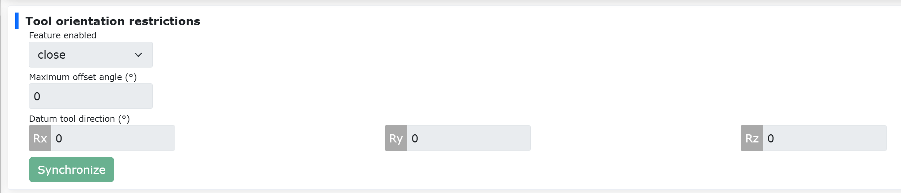

.. centered:: Figura 7.4-8 Limitación de la dirección de la herramienta

Límites del robot (solo se utiliza en el sistema LA)
++++++++++++++++++++++++++++++++++++++++++++++++++++++++++++++

Hacer clic en el menú "Configuración inicial"->"Seguridad" y hacer clic en el submenú "Límites del robot" para entrar en la interfaz de configuración.

Los límites del robot incluyen el momento y la potencia; el límite de momento se utiliza para limitar el momento máximo del robot y el límite de potencia se utiliza para limitar el trabajo mecánico realizado por el robot.

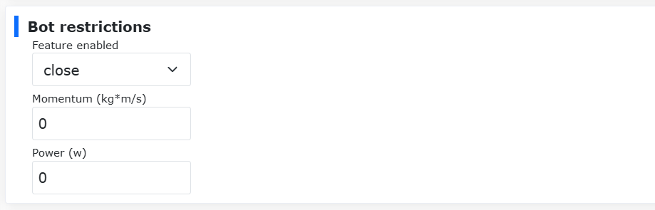

.. centered:: Figura 7.4-9 Límites del robot

Articulación
~~~~~~~~~~~~~~~~~~~~~~~~~~~~~~~~~~~~~~~~~~~~~

Límite suave de articulación
++++++++++++++++++++++++++++++++++++++++++++++++++++++++++++++

En la barra de menú "Configuración inicial"->"Seguridad"->"Articulación", hacer clic en "Límite suave de articulación" para entrar en la interfaz de límite suave.

Dentro del recorrido del robot pueden existir otros equipos; el ángulo de límite puede aplicar un límite suave al robot, de modo que el movimiento del robot no supere un determinado valor de coordenadas, evitando colisiones del robot. La parada del robot al activarse el límite suave se activa automáticamente por el robot, sin distancia de parada.

El administrador puede utilizar los valores por defecto o introducir valores de ángulo. Al introducir valores de ángulo, se pueden limitar respectivamente los ángulos positivo y negativo de las articulaciones del robot; cuando el valor introducido supere los valores de ángulo de límite suave de las articulaciones del robot enumerados en la tabla de parámetros básicos del robot de 2.1-Parámetros básicos, el ángulo de límite se ajustará al valor máximo configurable. Cuando el robot informe de superación del límite de instrucción articular, será necesario entrar en el modo de arrastre y arrastrar las articulaciones del robot hasta situarlas dentro del ángulo de límite.

La función de protección de límite suave de articulación es un mecanismo de protección activa que, mediante la monitorización en tiempo real del estado de movimiento de las articulaciones del brazo mecánico, limita dinámicamente que el operador supere el rango de límite suave configurado durante la enseñanza por arrastre. Esta función hace que el límite suave tenga también sentido en la enseñanza por arrastre, mejorando así la seguridad de la colaboración humano-máquina.

- **Step1**: Iniciar sesión en la interfaz web y hacer clic sucesivamente en "Configuración inicial"->"Seguridad"->"Articulación"->"Límite suave de articulación" para entrar en el módulo de configuración del límite suave del robot.
- **Step2**: Basándose en el rango de trabajo real del robot, configurar razonablemente el límite suave de cada articulación. En este momento, es necesario comprobar si la posición angular actual de cada articulación del robot está dentro del rango de límite suave preestablecido; si lo está, se puede hacer clic en "Aplicar" para enviar el límite suave preestablecido; si no lo está, será necesario desplazar cada articulación hasta el rango preestablecido; de lo contrario, al hacer clic en "Aplicar" se mostrará el aviso de superación del límite, como se muestra en la figura siguiente. En este momento, se puede hacer jog de un solo eje en la dirección de entrada al rango de límite suave o arrastrar las articulaciones que superan el límite, para borrar el error.
- **Step3**: Una vez configurado correctamente el rango de límite suave, seleccionar "Activar" en "Protección de límite suave de articulación" para activar esta función, como se muestra concretamente en la figura siguiente. En este momento, en el modo de arrastre, el límite suave configurado ejercerá una función limitante y, además, al arrastrar cerca del límite suave se percibirá resistencia.
- **Step4**: Si es necesario desactivar la función de protección de límite suave de articulación, se puede hacer clic en "Desactivar" en "Protección de límite suave de articulación".

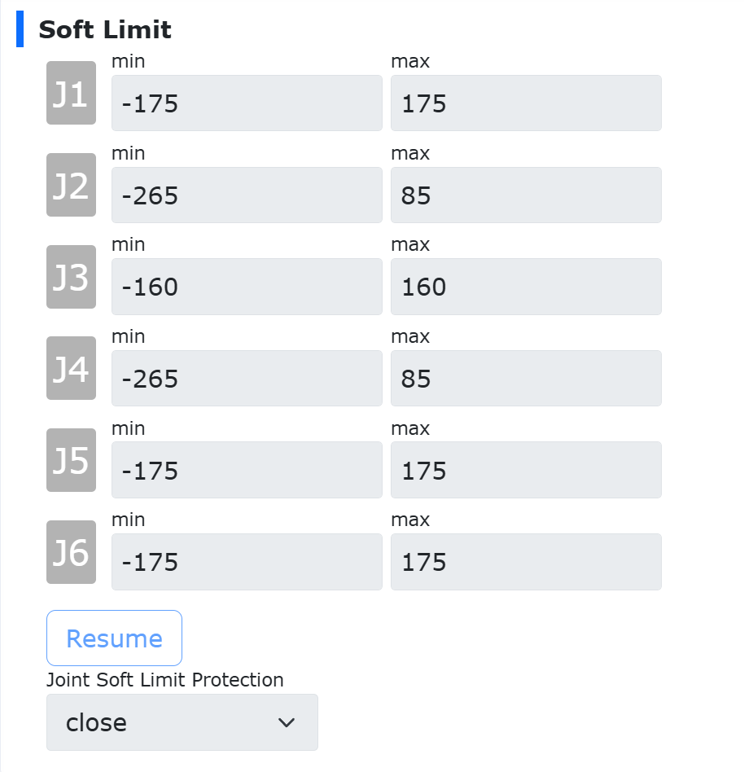

.. centered:: Figura 7.4-10 Límite suave de articulación

Nivel de colisión
++++++++++++++++++++++++++++++++++++++++++++++++++++++++++++++

En la barra de menú "Configuración inicial"->"Seguridad"->"Articulación", hacer clic en "Nivel de colisión" para entrar en la interfaz de nivel de colisión.
El nivel de colisión se divide en diez niveles; los niveles uno a tres tienen una detección más sensible y el robot debe funcionar a la velocidad recomendada. Asimismo, se puede seleccionar la configuración personalizada en porcentaje; el 100% corresponde al nivel diez. Como se muestra en la figura siguiente:

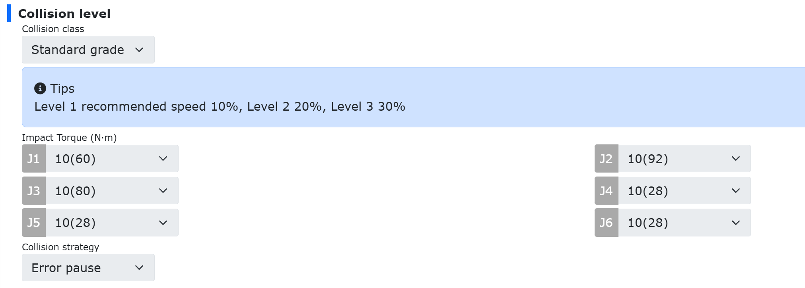

.. centered:: Figura 7.4-11 Esquema del nivel de colisión

Las estrategias de colisión son "Parada por colisión", "Pausa por colisión" y "Continuar movimiento". Para evitar que tras la colisión el robot y el objeto generen una fuerza de compresión, se añaden las estrategias "Modo de par gravitatorio", "Modo de respuesta oscilante" y "Modo de rebote por colisión". Las tres estrategias, al activarse, pasan del modo automático o del modo manual al modo de arrastre y, posteriormente, al modo manual. El modo de par gravitatorio se aleja del punto de colisión según la magnitud y la dirección de la fuerza de colisión; el modo de respuesta oscilante, tras alejarse del punto de colisión, regresa a la posición de colisión; el modo de rebote por colisión se aleja del punto de colisión acelerando según los parámetros configurados.

En la columna "Estrategia de colisión", hacer clic en el cuadro desplegable y seleccionar "Modo de rebote por colisión"; configurar sucesivamente el tiempo de seguridad en 1000ms, la distancia de seguridad en 150mm, la velocidad de seguridad en 150mm/s y el coeficiente de seguridad de cada articulación en 5; la interfaz concreta se muestra en la figura siguiente.

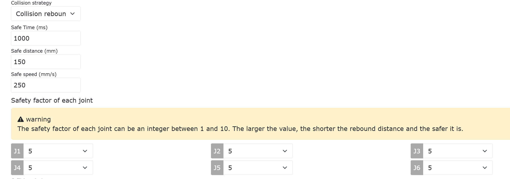

.. centered:: Figura 7.4-12 Modo de rebote por colisión de la estrategia de colisión

Significado de cada parámetro:

- Tiempo de seguridad: indica el tiempo de duración en el modo de arrastre tras pasar del modo automático al modo de arrastre; el rango es [1000-2000]ms;
- Distancia de seguridad: indica la posición a la que el robot se aleja del punto de colisión tras la colisión; el rango es [150-200]mm;
- Velocidad de seguridad: indica la velocidad máxima del TCP a la que el robot se aleja del punto de colisión tras la colisión; tras superar el límite de velocidad, se restringe la fuerza de rebote; el rango es [50-250]mm/s;
- Coeficiente de seguridad: indica la velocidad de atenuación de la fuerza de rebote; cuanto menor es el coeficiente, más rápida es la atenuación y más rápida es la velocidad de rebote, y viceversa; el rango es [1-10], adimensional.
- Antes de que el robot entre en el modo de arrastre, es necesario realizar la detección de par. La función de esta función es evitar que, debido a que el operador haya configurado parámetros de carga erróneos o haya seleccionado un modo de instalación erróneo, el robot presente fenómenos anómalos como elevación o caída tras entrar en el modo de arrastre. Si se detecta que el par articular supera el rango permitido, el controlador informará inmediatamente de un error y prohibirá que el robot entre en el modo de arrastre.

Los pasos para activar la función de detección de colisiones del riel guía de cremallera recta son los siguientes:

- Step1: Asegurarse de que tanto el riel como el robot tienen un modo de instalación de montaje normal. Antes de activar la función de detección de colisiones del riel guía de cremallera recta, es necesario comprobar si el modo de instalación es de montaje normal. En concreto, asegurarse primero de que el modo de instalación del riel y del robot es de montaje normal y, a continuación, hacer clic sucesivamente en "Configuración inicial"→"Básico"→"Instalación" para entrar en la página de instalación libre; si "Rotación de la base" e "Inclinación de la base" son ambos 0, el software está configurado como montaje normal; de lo contrario, deben cambiarse a 0; si no son 0, la interfaz mostrará un error.
- Step2: Activar la función de detección de colisiones del riel guía de cremallera recta y configurar los parámetros. Hacer clic sucesivamente en "Configuración inicial"→"Seguridad"→"Articulación"→"Nivel de colisión" para entrar en la página de configuración del nivel de colisión. Hacer clic en el deslizador de la función "Detección de colisiones del riel guía de cremallera recta" y configurar el radio del engranaje y la masa del carro; el radio del engranaje se puede calcular a partir del paso y la relación de reducción, y la masa del carro no incluye el robot ni la carga del extremo que transporta. El nivel del riel tiene un total de 11 opciones; el Level1 es el que activa la colisión con mayor facilidad y el Level10 el que más difícilmente. Cuando el controlador acaba de encenderse y antes de ejecutar el programa de adaptación, el nivel de colisión debe configurarse primero como "Desactivado".

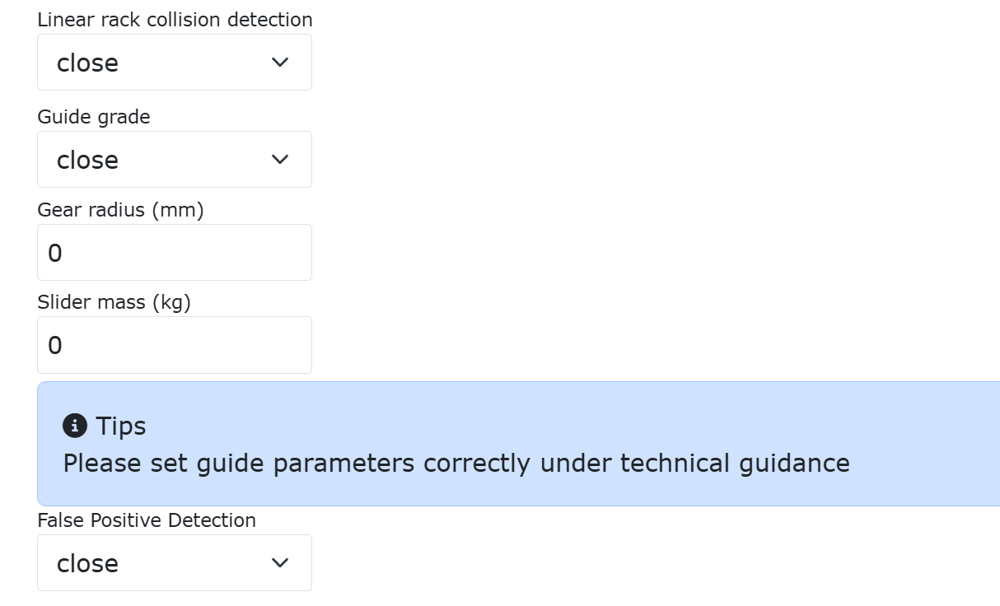

.. centered:: Figura 7.4-13 Función de detección de colisiones del riel guía de cremallera recta

- Step3: Ejecutar el programa "Rail_Adaptation_Program.lua" para adaptar el riel actual. Tras reiniciar el controlador, es necesario ejecutar el programa "Rail_Adaptation_Program.lua" (el objetivo es evitar que factores como el cambio de tipo de robot afecten a las características dinámicas del riel). Antes de ejecutar el programa, es necesario asegurarse de que el nivel de colisión del riel está "Desactivado"; en modo automático, ejecutar el programa lua con la velocidad de la interfaz al 100%; tras ejecutar un ciclo del programa, la adaptación habrá finalizado y se podrá detener la ejecución.

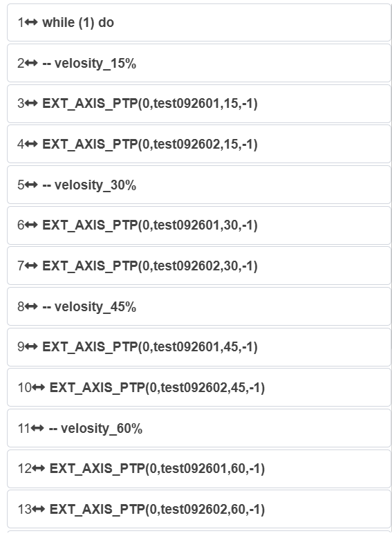

.. centered:: Figura 7.4-14 Ejecución del programa "Rail_Adaptation_Program.lua" para adaptar el riel actual

- Step4: Configurar razonablemente el nivel de colisión del riel y ejecutar la tarea. El usuario puede configurar razonablemente el nivel de colisión del riel según el rendimiento del accionamiento del motor y la velocidad de ejecución de la tarea. Si el riel y el robot funcionan de forma asíncrona, al colisionar con el robot o el riel se puede activar el "Fallo de colisión del eje 8, reajustable"; en este momento, el riel detiene el funcionamiento, como se muestra concretamente en la Figura 2-9. Si el riel y el robot funcionan de forma síncrona, la colisión con el robot puede activar la alarma y hacer que el riel detenga el funcionamiento, mientras que el robot reacciona según la estrategia de colisión configurada.

Modo reducido
++++++++++++++++++++++++++++++++++++++++++++++++++++++++++++++

Hacer clic en el menú "Configuración inicial"->"Seguridad" y hacer clic en el submenú "Modo reducido" para entrar en la interfaz de configuración; seleccionar "Modo de nivel uno/nivel dos" para configurar la velocidad articular y la velocidad del TCP del extremo.

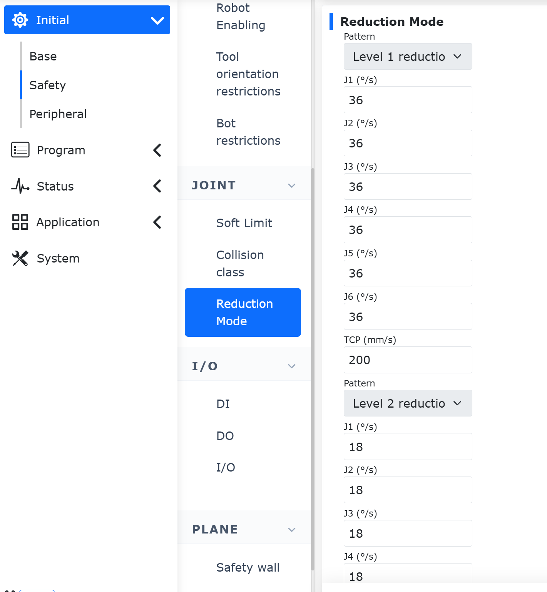

.. centered:: Figura 7.4-15 Modo reducido

I/O
~~~~~~~~~~~~~~~~~~~~~~~~~~~~~~~~~~~~~~~~~~~~~~~~~~~
Hacer clic en el menú "Configuración inicial"->"Seguridad" y hacer clic en el submenú "I/O" para entrar en la interfaz de configuración.

HMI permite configurar el estado de seguridad de 16 entradas digitales y 16 salidas digitales, que se pueden establecer como válido o no válido; cuando el controlador determina que se encuentra en estado de seguridad, las 16 entradas digitales y las 16 salidas digitales se establecen en estado de seguridad.

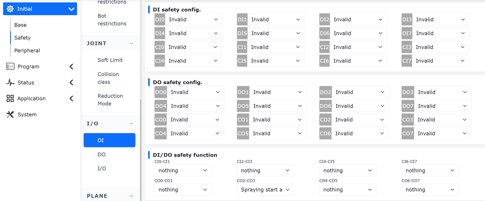

.. centered:: Figura 7.4-16 Configuración del estado de seguridad de I/O

En el sistema LA:

En "Seguridad de I/O" se ofrece la función de seguridad DIO; la función de seguridad es DI o DO de doble canal; cuando se detecta la señal DI de seguridad o la activación del indicador de estado de seguridad, se emite DO.

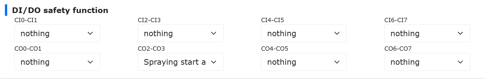

.. centered:: Figura 7.4-17 Configuración de la función de seguridad de I/O

Hardware
~~~~~~~~~~~~~~~~~~~~~~~~~~~~~~~~~~~~~~~~~~~~~~~~~~~

Detección de potencia ServoJT (solo se utiliza en el sistema QX)
+++++++++++++++++++++++++++++++++++++++++++++++++++++++++++++++++++++++++++++++++++++++++++++++++++++++++++++++
Hacer clic en el menú "Configuración inicial"->"Seguridad" y hacer clic en el submenú "Detección de potencia" para entrar en la interfaz de configuración.

Se aplica directamente al bucle de corriente del robot (solo con la instrucción servoJT) y se utiliza para limitar la potencia máxima del robot. Cuando se detecta que la potencia del robot supera el límite, se realiza la protección de potencia.

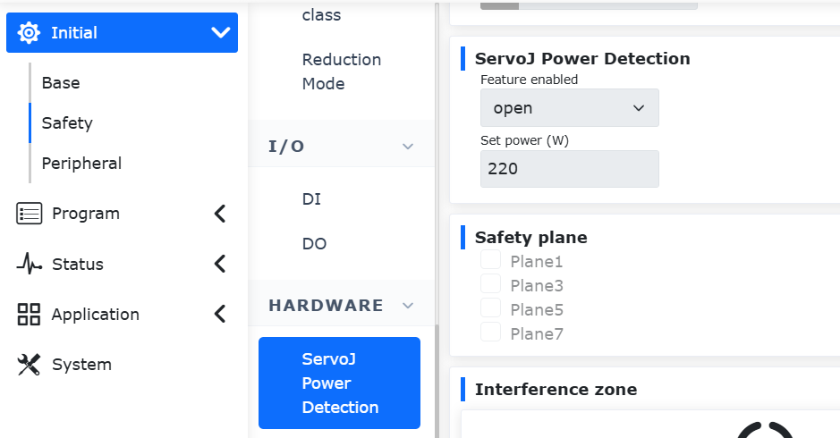

.. centered:: Figura 7.4-18 Detección de potencia ServoJT

Plano
~~~~~~~~~~~~~~~~~~~~~~~~~~~~~~~~~~~~~~~~~~~

Muro de seguridad
+++++++++++++++++++++++++++++++++++++++++++++++++++++++++++++++++++++++++++++++++++++++++++++++++++++++++++++++

Hacer clic en el menú "Configuración inicial"->"Seguridad" y hacer clic en el submenú "Configuración de muro de seguridad" para entrar en la interfaz de configuración.

- Configuración del muro de seguridad: hacer clic en el botón de activación para activar el muro de seguridad correspondiente. Cuando el muro de seguridad no tiene configurado el rango de seguridad, se muestra un aviso de error. Hacer clic en el botón de configuración de la esquina superior derecha, seleccionar el muro de seguridad que se desea establecer, se mostrará automáticamente la distancia de seguridad (no es necesario establecerla; por defecto es 0) y, a continuación, hacer clic en el botón "Configurar"; la configuración se realiza correctamente.
- Configuración del punto de referencia del muro de seguridad: tras seleccionar el muro de seguridad, se pueden configurar cuatro puntos de referencia. Los tres primeros puntos son puntos de referencia del plano, utilizados para confirmar el plano del muro de seguridad configurado. El cuarto punto es el punto de referencia del rango de seguridad, utilizado para confirmar el rango de seguridad del muro de seguridad configurado.

Si el punto de referencia se configura correctamente, se muestra una luz verde. De lo contrario, se muestra una luz amarilla. Hasta que el punto de referencia se configure correctamente, no cambia a luz verde. Cuando los cuatro puntos de referencia se han configurado correctamente, se puede calcular su rango de seguridad; tras un cálculo correcto, el estado de los puntos de parámetros del rango de seguridad vuelve al valor predeterminado.

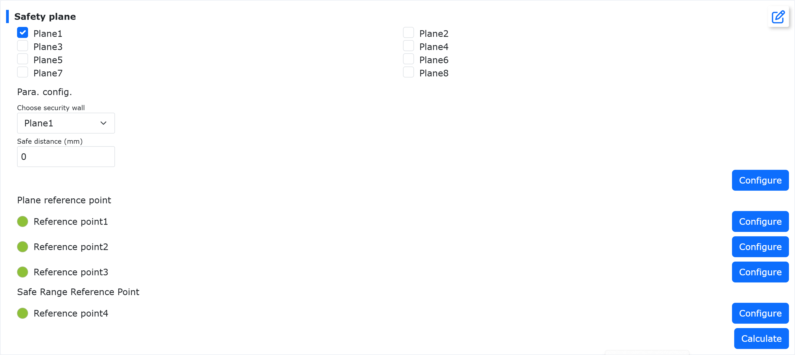

.. centered:: Figura 7.4-19 Configuración del punto de referencia del rango de seguridad

- Efecto de aplicación: activar el muro de seguridad configurado correctamente. Arrastrar el robot; si el TCP del extremo del robot se encuentra dentro del rango de seguridad establecido, el sistema es normal. Si se encuentra fuera del rango de seguridad establecido, se muestra un aviso de error.

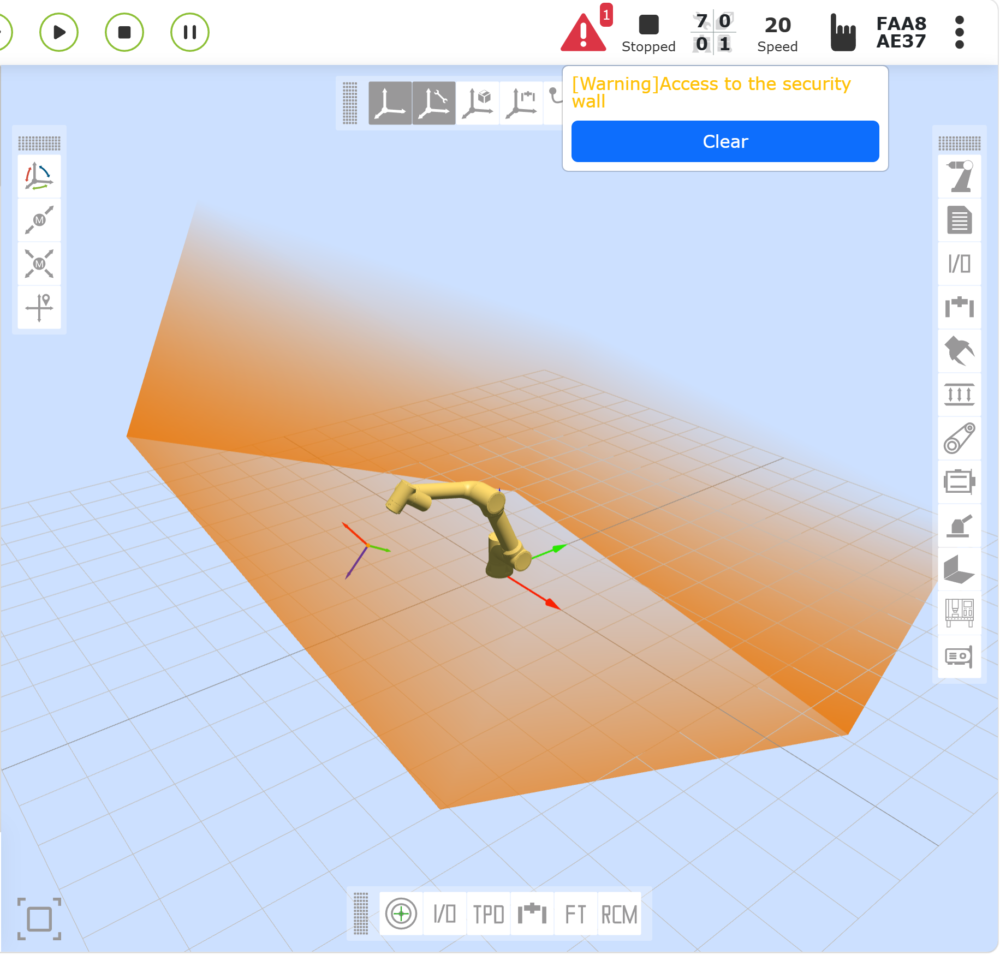

.. centered:: Figura 7.4-20 Imagen del efecto tras configurar correctamente el rango de seguridad

Zona de interferencia
+++++++++++++++++++++++++++++++++++++++++++++++++++++++++++++++++++++++++++++++++++++++++++++++++++++++++++++++

En la barra de menú "Configuración inicial"->"Seguridad"->"Zona de interferencia", hacer clic en el submenú "Individual" para entrar en la interfaz de la función de configuración de la zona de interferencia.

Es necesario configurar el modo de interferencia y la operación de entrada en la zona de interferencia; el modo de interferencia se divide en "Interferencia de eje" e "Interferencia de cubo".

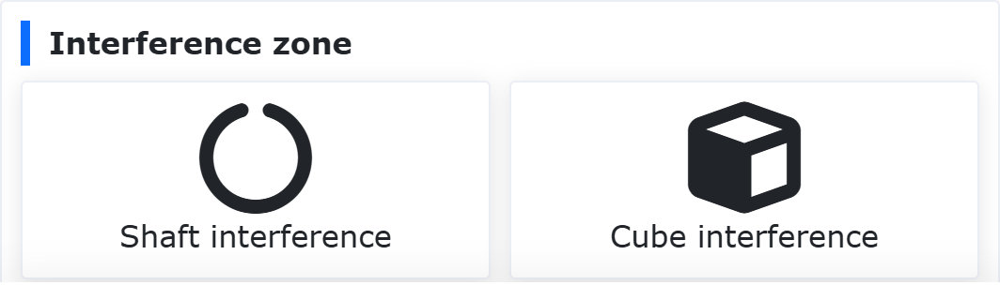

.. centered:: Figura 7.4-21 Modo de la zona de interferencia

Hacer clic en el icono de la zona de interferencia, controlar mediante el interruptor si se activa y hacer clic en el botón de configuración de la esquina superior derecha para configurar los parámetros.

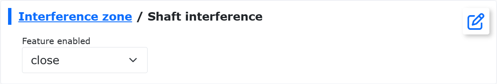

.. centered:: Figura 7.4-22 Configuración de la zona de interferencia

En primer lugar, configurar el movimiento de la zona de interferencia como "Continuar movimiento" o "Detener". A continuación, configurar la entrada en la zona de interferencia en modo de arrastre; el usuario puede configurar según sus necesidades la estrategia tras entrar en la zona de interferencia en modo de arrastre: no limitar el arrastre, retorno de impedancia y conmutación al modo manual.

Al seleccionar interferencia de eje, es necesario configurar los parámetros de la interferencia de eje; el método de detección se divide en "Posición de instrucción" y "Posición de realimentación"; el modo de la zona de interferencia se divide en "Interferencia dentro del rango" e "Interferencia fuera del rango"; a continuación, configurar el rango de cada articulación y si el rango de cada articulación está habilitado; se pueden introducir valores o, mediante el "icono de actualización" situado después de "Valor mínimo" y "Valor máximo", registrar la posición actual del robot en ellos; por último, hacer clic en configurar.

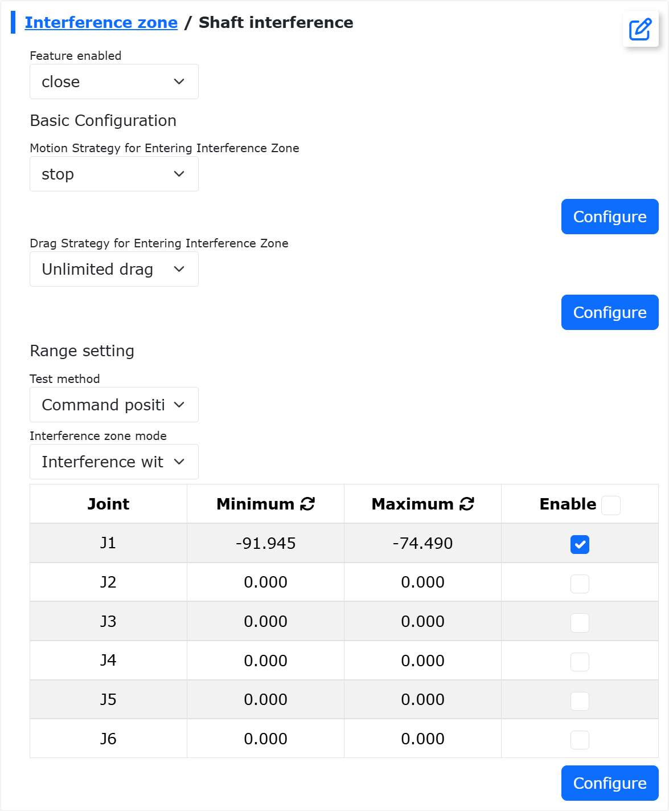

.. centered:: Figura 7.4-23 Configuración de la interferencia de eje

Al seleccionar interferencia de cubo, es necesario configurar los parámetros de la interferencia de cubo; el método de detección se divide en "Posición de instrucción" y "Posición de realimentación"; el modo de la zona de interferencia se divide en "Interferencia dentro del rango" e "Interferencia fuera del rango"; el sistema de coordenadas de referencia se divide en "Sistema de coordenadas base" y "Sistema de coordenadas de pieza"; configurar según el uso real. A continuación, realizar la configuración del rango; la configuración del rango se divide en dos métodos; en primer lugar, ver el primer método "Método de dos puntos", es decir, el cubo está formado por los dos vértices de esquinas opuestas; se puede introducir o registrar la posición mediante la enseñanza del robot. Por último, hacer clic en aplicar.

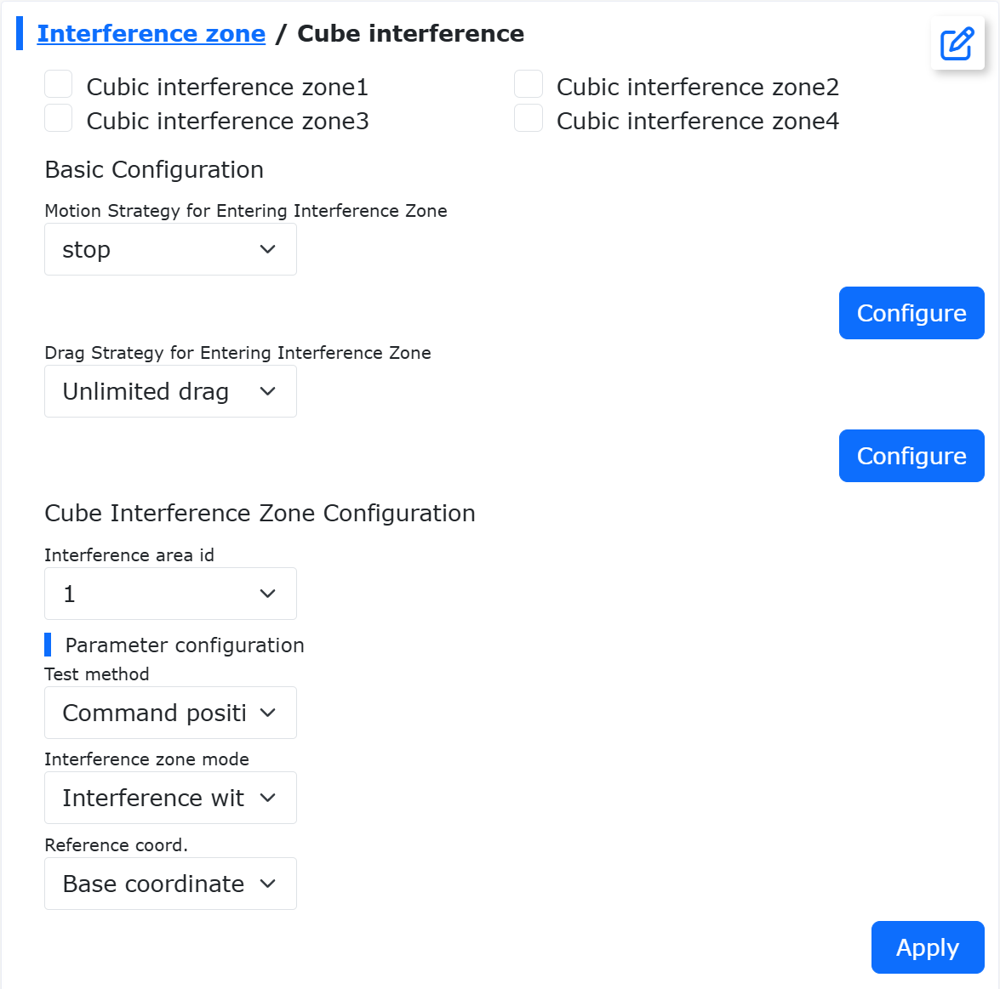

.. centered:: Figura 7.4-24 Configuración de la interferencia de cubo

A continuación, ver el segundo método "Centro + longitud de lado", es decir, la zona de interferencia está formada por el punto de posición central del cubo y la longitud del lado del cubo; se puede introducir o registrar la posición mediante la enseñanza del robot. Por último, hacer clic en aplicar.

.. centered:: Figura 7.4-25 Configuración de la interferencia de cubo

Función de guardado del registro de seguridad
~~~~~~~~~~~~~~~~~~~~~~~~~~~~~~~~~~~~~~~~~~~~~~~~~~~~~~~~~~~~~~~~~~~~~~~~~~~~~~~~~~~~~~~~~~~~~~~

Antecedentes
+++++++++++++++++++++++++++++++++++++++++++++++++++++++++

La certificación CE de los robots de la serie FR exige que todos los registros relacionados con operaciones de seguridad del equipo se mantengan registrados de forma independiente, y exige expresamente que el almacenamiento de registros contenga al menos la evidencia de la última intervención de cada tipo de intervención, que los datos de registro de seguimiento de cada intervención se conserven durante al menos 5 años y que los registros estén protegidos contra manipulaciones.

Gestión del registro de seguridad
+++++++++++++++++++++++++++++++++++++++++++++++++++++++++

La gestión del registro de seguridad se mantiene en la página web "Configuración inicial"->"Seguridad". Es necesario introducir primero la "Contraseña de configuración de seguridad" para su verificación; solo tras una verificación correcta se puede realizar la gestión del registro de seguridad.

.. centered:: Figura 7.4-26 Gestión del registro de seguridad

Los registros de seguridad se gestionan de forma unificada; para evitar un volumen de registro excesivo debido a operaciones anómalas, se puede ver intuitivamente en la página el volumen de almacenamiento de registro actual; los registros de seguridad solo conservan los de los últimos 5 años, y los registros de cada año se almacenan de forma unificada en un archivo independiente según el tipo de registro. Hacer clic en exportar permite exportar todos los registros.

Los tipos de registro se dividen en los tres siguientes:

.. centered:: Tabla 1-2 Clasificación del registro de seguridad

.. list-table::
   :widths: 30 30 40
   :header-rows: 0
   :align: center

   * - **Clasificación del registro**
     - **Nombre del archivo de registro**
     - **Descripción**

   * - Tipo de modificación de parámetros
     - safetylog_params_2026.log
     - Modificación de parámetros de configuración de seguridad del robot, modificación de la contraseña de seguridad del robot

   * - Tipo de versión de software y firmware
     - safetylog_version_2026.log
     - Actualización de versión de software y firmware

   * - Tipo de operación de registro
     - safetylog_operate_2026.log
     - Eliminación y exportación del registro de seguridad

Dado que el registro de seguridad debe conservarse durante 5 años y no puede eliminarse, para evitar que las escrituras anómalas provoquen anomalías en la memoria de almacenamiento que afecten al funcionamiento del sistema, el registro de seguridad adopta una estrategia de limitación por niveles basada en la capacidad utilizada; antes de escribir se comprueba el espacio utilizado actual del registro y se ajusta dinámicamente la frecuencia de escritura.

.. centered:: Tabla 1-3 Estrategia de limitación del registro de seguridad

.. list-table::
   :widths: 20 30 20 30
   :header-rows: 0
   :align: center

   * - **Fase**
     - **Capacidad utilizada**
     - **Frecuencia de escritura**
     - **Descripción**

   * - 1
     - <500M
     - Sin limitación
     - Uso normal (5 años aproximadamente 200M)

   * - 2
     - 500M-1G
     - 1 segundo/entrada
     - Limitación ligera, no afecta a la experiencia

   * - 3
     - 1G-2.5G
     - 5 segundos/entrada
     - Anomalía evidente, reducción activa de velocidad

   * - 4
     - 2.5G-4G
     - 30 segundos/entrada
     - Anomalía grave, tiempo de retardo límite

   * - 5
     - >4G
     - Detener escritura
     - Cuota agotada, no se realizan más escrituras de registro

En uso normal, con una cantidad de escritura de 1000 entradas diarias, se estima un uso inferior a 200M en 5 años; por lo tanto, cuando la memoria supera 1G existe claramente una situación anómala; tras superar 1G el controlador emite activamente una advertencia. Es necesario realizar activamente la exportación de respaldo del registro y se recomienda limpiar el registro a tiempo.

.. centered:: Figura 7.4-27 Advertencia de anomalía del registro de seguridad

El tiempo de exportación del registro depende del tamaño total del registro; teóricamente el total de registro de 5 años no supera 200M; cuando el registro supera 1G, el tiempo de descarga supera 1 minuto, y el límite superior de 4G tiene un tiempo de descarga de aproximadamente 5 minutos. Tras la exportación se puede realizar la limpieza del registro; para garantizar que las pruebas de anomalías no se eliminen, la función de eliminación de registro actual solo elimina los registros de años distintos al año actual.

.. centered:: Figura 7.4-28 Eliminación del registro de seguridad

Función de seguridad funcional
----------------------------------------------------------------

Descripción de la seguridad funcional
~~~~~~~~~~~~~~~~~~~~~~~~~~~~~~~~~~~~~~~~~~~~~~~~~~~~~~~~~~~~~~~~~

Este equipo está equipado con un sistema de control relacionado con la seguridad, utilizado para ejecutar automáticamente acciones de seguridad (como parada de emergencia, enclavamiento de puerta de protección, etc.) cuando se detecta una situación peligrosa. Estas funciones de seguridad han sido diseñadas y verificadas conforme a las normas EN ISO 13849-1 / EN IEC 62061, y son una parte importante para lograr la conformidad CE.

Para garantizar la eficacia continua de las funciones de seguridad, tenga en cuenta:

- No puentee ni anule ningún dispositivo de seguridad (como desmontar el interruptor de enclavamiento, cortocircuitar el circuito de seguridad, bloquear la cortina de luz, etc.), de lo contrario podría provocar lesiones personales graves.
- No modifique por su cuenta componentes relacionados con la seguridad ni programas de software. Cualquier modificación, cambio de parámetros o actualización de software del sistema de control de seguridad debe ser realizada por el fabricante o su personal autorizado, y debe realizarse una nueva evaluación de riesgos.
- Seguridad de red: no conecte el sistema de control de seguridad de este equipo a redes no autorizadas; el acceso digital no autorizado puede provocar el fallo de las funciones de seguridad.
- Mantenimiento y fallos: si se detecta un funcionamiento anómalo o un fallo de los dispositivos de seguridad, detenga inmediatamente el equipo y póngase en contacto con el fabricante o el personal de servicio autorizado. Solo el personal formado y autorizado puede realizar el mantenimiento.

Este equipo realiza la evaluación de conformidad según el Reglamento de Máquinas de la UE (EU) 2023/1230. Los componentes de las funciones de seguridad se incluyen en la documentación técnica para su consulta. A continuación se muestra la lista concreta de funciones de seguridad.

.. centered:: Tabla 1-1  Lista de funciones de seguridad

.. list-table::
   :widths: 20 20 10 40 10
   :header-rows: 0
   :align: center

   * - **Número de identificación SF**
     - **Nombre de la función**
     - **Nivel**
     - **Descripción**
     - **MTTFd***

   * - SF01
     - E-STOP on TPU-Parada de emergencia del teach pendant
     - PL d
     - | Execution monitoring of the emergency stop-Monitorización de la ejecución de la parada de emergencia
       | Incluye la lógica de activación de distintas fuentes de activación:
       | 1. En cualquier modo, se activa el interruptor de parada de emergencia del teach pendant, se convierte en señal de parada de emergencia de la caja de control y, según el tipo configurado, se ejecuta la acción de parada Cat.0 o Cat.1, con función de mantenimiento de posición enclavada
       | 2. En cualquier modo, se activa la DI de seguridad de la caja de control, se convierte en señal de parada de emergencia de la caja de control y, según el tipo configurado, se ejecuta la acción de parada Cat.0 o Cat.1, con función de mantenimiento de posición enclavada
       | 【Evento de activación】: activación de la señal de parada de emergencia
       | 【Respuesta del robot】:
       | Si el tipo de parada es 0, se corta la alimentación del cuerpo, las articulaciones aplican el freno de seguridad y se monitoriza el mantenimiento de posición
       | Si el tipo de parada es 1, se decelera hasta detenerse, se corta la alimentación del cuerpo, las articulaciones aplican el freno de seguridad y se monitoriza el mantenimiento de posición	
     - 202.051

   * - SF02
     - Safeguard Stop-Parada protectora
     - PL d
     - | Execution monitoring of the safeguard stop-Monitorización de la ejecución de la parada protectora
       | En cualquier modo, la función de parada de seguridad se activa según la señal de parada de seguridad de la caja de control y, según el nivel de parada de seguridad configurado, se ejecuta la función de parada Cat.0, Cat.1 o Cat.2 correspondiente y la detección de la función de mantenimiento de posición enclavada correspondiente (Cat.0, Cat.1) o la detección de reposo + distancia de parada + tiempo de parada (Cat.2).
       | 【Evento de activación】: activación de la señal de parada de seguridad;
       | 【Respuesta del robot】:
       | Si el tipo de parada es 0, se corta la alimentación del cuerpo, las articulaciones aplican el freno de seguridad y se monitoriza el mantenimiento de posición;
       | Si el tipo de parada es 1, se decelera hasta detenerse, se corta la alimentación del cuerpo, las articulaciones aplican el freno de seguridad y se monitoriza el mantenimiento de posición;
       | Si el tipo de parada es 2, se decelera hasta detenerse, se mantiene la alimentación del cuerpo, las articulaciones no aplican el freno de seguridad, se mantiene el estado habilitado y se realiza la detección de reposo + distancia de parada + tiempo de parada;	
     - 191.317

   * - SF03
     - Joint Position Limit-Limitación de posición articular
     - PL d
     - | Monitoring of the joint position limit-Monitorización de la limitación de posición articular
       | 【Se puede configurar el límite suave articular para cada articulación; la placa de seguridad detecta en tiempo real la posición articular y, si se supera el límite, ejecuta la acción de parada Cat.2, con detección de reposo enclavada + distancia de parada + tiempo de parada.
       | 【Evento de activación】: la articulación se desplaza fuera del rango de posición límite;
       | 【Respuesta del robot】: alarma de fallo- superación del límite suave, ejecución de la acción de parada Cat.2, con detección de reposo enclavada + distancia de parada + tiempo de parada;
     - 158.530

   * - SF04
     - Joint Speed Limit-Limitación de velocidad articular
     - PL d
     - | Monitoring of the joint speed limit-Monitorización de la limitación de velocidad articular	
       | Se puede configurar el límite de velocidad articular para cada articulación; el circuito de seguridad, según la velocidad de seguridad correspondiente del controlador, detecta si la velocidad en tiempo real de cada articulación del robot supera el límite; si se supera, se realiza la parada Cat.1 con monitorización de mantenimiento de posición enclavada, o la parada Cat.2 con detección de reposo + distancia de parada + tiempo de parada.
       | 【Evento de activación】: la velocidad articular supera el valor establecido;
       | 【Respuesta del robot】: alarma de fallo- superación de velocidad, opcionalmente parada Cat.1 con monitorización de mantenimiento de posición enclavada, o por defecto parada Cat.2 con detección de reposo + distancia de parada + tiempo de parada;	
     - 158.530
          
   * - SF05
     - Joint Torque Limit-Limitación de par articular
     - PL d
     - | Monitoring of the joint torque limit-Monitorización de la limitación de par articular
       | Se puede configurar el límite de par articular para cada articulación; el circuito de seguridad, según el par de seguridad correspondiente del controlador, detecta si el par en tiempo real de cada articulación del robot supera el límite; si se supera, se realiza la parada Cat.2 con detección de reposo + distancia de parada + tiempo de parada
       | 【Evento de activación】: el par articular supera el valor de par establecido
       | 【Respuesta del robot】: alarma de fallo- superación del par de la articulación x, ejecución de la parada Cat.2 con detección de reposo + distancia de parada + tiempo de parada
     - 62.808
     	          
   * - SF06
     - | TCP Pose Limit-Limitación de pose del TCP (plano de seguridad, dirección de herramienta)
       | (Puede ajustar dinámicamente Dynamic Limit, no se exige tipo de parada)
       | (Ajuste dinámico del límite correspondiente mediante IO configurable, doble circuito)
     - PL d
     - | Monitoring of the TCP pose limit-Monitorización de la limitación de pose del TCP
       | En la página correspondiente del controlador se establece previamente el rango límite del TCP y la DI correspondiente (se pueden configurar hasta 8); cuando la DI se activa, se activa el límite correspondiente; cuando el TCP supera el rango límite, se realiza la parada Cat.2 con detección de reposo + distancia de parada + tiempo de parada
       | 【Evento de activación】: la pose del TCP supera el rango establecido
       | 【Respuesta del robot】: alarma de fallo- superación del plano de seguridad/dirección de herramienta, ejecución de la acción de parada Cat.2 con detección de reposo + distancia de parada + tiempo de parada	
     - 70.072
          	          
   * - SF07
     - manual mode, reduced-speed-Monitorización de velocidad manual baja
     - PL d
     - | Monitoring of reduced-speed manual mode-Monitorización de velocidad manual baja
       | Cuando el modo del controlador se encuentra en modo manual de baja velocidad, se detecta si la velocidad del TCP es ≤250mm/s; si se supera la velocidad, se ejecuta la acción de parada Cat.0 o Cat.1 con monitorización de mantenimiento de posición enclavada.
       | 【Evento de activación】: la velocidad del TCP supera la velocidad establecida
       | 【Respuesta del robot】: alarma de fallo- sobrevelocidad del TCP, ejecución de la acción de parada Cat.0 o Cat.1 con monitorización de mantenimiento de posición enclavada.	
     - 70.072
             	          
   * - SF08
     - TCP Force Limit-Limitación de fuerza del TCP
     - PL d
     - | Monitoring of the TCP force limit-Monitorización de la limitación de fuerza del TCP  
       | El controlador puede configurar el límite de fuerza del TCP; el circuito de seguridad monitoriza en tiempo real la fuerza del TCP del robot; si la fuerza del TCP supera el valor límite, se ejecuta la parada Cat.2 con detección de reposo + distancia de parada + tiempo de parada
       | 【Evento de activación】: la fuerza del TCP supera el valor límite establecido
       | 【Respuesta del robot】: alarma de fallo- fallo de colisión de la articulación x, ejecución de la parada Cat.2 con detección de reposo + distancia de parada + tiempo de parada	
     - 62.808
             	          
   * - SF09
     - Momentum Limit-Limitación de momento
     - PL d
     - | Monitoring of the momentum limit-Monitorización de la limitación de momento
       | El controlador puede configurar el límite de momento del robot; el circuito de seguridad monitoriza en tiempo real el momento del robot; si el momento del robot supera el valor límite, se ejecuta la parada Cat.2 con detección de reposo + distancia de parada + tiempo de parada
       | 【Evento de activación】: el momento supera el valor límite de momento establecido
       | 【Respuesta del robot】: alarma de fallo- superación de momento, ejecución de la parada Cat.2 con detección de reposo + distancia de parada + tiempo de parada	
     - 62.808
                	          
   * - SF10
     - Power Limit-Limitación de potencia
     - PL d
     - | Monitoring of the power limit-Monitorización de la limitación de potencia    
       | El controlador puede configurar el límite de potencia del robot; el circuito de seguridad monitoriza en tiempo real la potencia del robot; si la potencia del robot supera el valor límite, se ejecuta la parada Cat.2 con detección de reposo + distancia de parada + tiempo de parada
       | 【Evento de activación】: la potencia supera el valor límite de potencia establecido
       | 【Respuesta del robot】: alarma de fallo- superación de potencia, ejecución de la parada Cat.2 con detección de reposo + distancia de parada + tiempo de parada
     - 62.808
                	          
   * - SF11
     - System Emergency Stop Output-Salida de parada de emergencia del sistema
     - PL d
     - | Monitoring of the System EmergencyStop Output-Monitorización de la salida de parada de emergencia del sistema
       | Cuando se activa la señal de parada de emergencia, el controlador emite la señal DO de parada de emergencia.
       | 【Evento de activación】: activación de la señal de parada de emergencia
       | 【Respuesta del robot】:
       | Tipo de parada de emergencia 0: salida de señal de parada de emergencia del sistema
       | Tipo de parada de emergencia 1: salida de señal de parada de emergencia del sistema	
     - 191.317
                   	          
   * - SF12
     - Robot Moving State Output-Salida de estado de robot en movimiento
     - PL d
     - | Monitoring of the Robot Moving State Output-Monitorización de la salida de robot en movimiento
       | Cuando el robot se encuentra en estado de funcionamiento, el controlador emite la señal DO de movimiento
       | 【Evento de activación】: el robot se encuentra en estado de funcionamiento
       | 【Respuesta del robot】: salida de señal de robot en movimiento	
     - 68.728
                	          
   * - SF13
     - Robot Not Stopping State Output-Salida de estado de robot no detenido
     - PL d
     - | Monitoring of the Robot Not Stopping State Output-Monitorización de la salida de estado de robot no detenido
       | Cuando el robot se encuentra en estado no detenido, el controlador emite la señal DO de no detenido
       | 【Evento de activación】: el robot se encuentra en estado no detenido
       | 【Respuesta del robot】: salida de señal de robot no detenido	
     - 68.728

   * - SF14
     - Reduced Mode State Output-Salida de estado de modo reducido
     - PL d
     - | Monitoring of the Reduced Mode State  Output-Monitorización de la salida de modo reducido del robot
       | Cuando el robot se encuentra en estado reducido, el controlador emite la señal DO de reducido
       | 【Evento de activación】: el robot se encuentra en modo reducido
       | 【Respuesta del robot】: salida de señal de modo reducido	
     - 68.728
    
   * - SF15
     - Not Reduced Mode State Output-Salida de estado de modo no reducido
     - PL d
     - | Monitoring of the Not Reduced Mode State Output-Monitorización de la salida de modo no reducido del robot
       | Cuando el robot se encuentra en estado no reducido, el controlador emite la señal DO de no reducido
       | 【Evento de activación】: el robot se encuentra en modo no reducido
       | 【Respuesta del robot】: salida de señal de modo no reducido	
     - 68.728
    
   * - SF16
     - 3P enabling function-Habilitación de tres posiciones
     - PL d
     - | 3P enabling function-Habilitación de tres posiciones
       | En las posiciones 1 y 3 de la habilitación de tres posiciones, el robot ejecuta la parada Cat.2 con detección de reposo + distancia de parada + tiempo de parada
       | En la posición 2 de la habilitación de tres posiciones, el robot está habilitado y se activa el modo manual de baja velocidad y la detección de velocidad manual baja
       | 【Evento de activación】: con el modo de teach pendant físico habilitado, el botón de habilitación de tres posiciones se pulsa hasta la posición intermedia (posición 2)
       | 【Respuesta del robot】: habilitación de las articulaciones, liberación del freno de seguridad articular, entrada del robot en modo manual de baja velocidad y activación del modo manual de baja velocidad y de la detección de velocidad manual baja	
     - 68.728
         
   * - SF17
     - monitored-standstill-Monitorización de reposo (tras la parada Cat.2)
     - PL d
     - | Monitored standstill-Monitorización de reposo
       | Tras completarse la parada Cat.2, el circuito de seguridad detecta la variación de posición articular según la instrucción del robot y la posición real; si se supera la desviación, se ejecuta la parada Cat.0 o Cat.1
       | 【Evento de activación】: en reposo y sin funcionamiento, variación de posición del robot
       | 【Respuesta del robot】: el rango de variación de posición del robot supera el valor establecido, ejecución de la acción de parada Cat.0 o Cat.1	
     - 47.515
            
   * - SF18
     - stopping time limiting-Monitorización del tiempo de parada (tras la parada Cat.2)
     - PL d
     - | Monitoring of stopping time limit-Monitorización del tiempo de parada
       | Tras activarse la señal de parada Cat.2, el circuito de seguridad detecta el tiempo de parada según el tiempo de la señal de finalización de parada del robot; si se supera la desviación, se ejecuta la parada Cat.0 o Cat.1
       | 【Evento de activación】: cuando el robot activa la parada
       | 【Respuesta del robot】: cuando el robot activa la parada, si el tiempo de parada supera el tiempo establecido, se ejecuta la acción de parada Cat.0 o Cat.1	
     - 47.515
            
   * - SF19
     - stopping distance limiting-Monitorización de la distancia de parada (tras la parada Cat.2)
     - PL d
     - | Monitoring of stopping distance limit-Monitorización de la distancia de parada
       | Al activarse la señal de parada Cat.2 se registra la posición del robot; el circuito de seguridad obtiene la distancia de parada según la diferencia entre la posición real en tiempo real del robot y la posición registrada; si se supera la desviación, se ejecuta la parada Cat.0 o Cat.1
       | 【Evento de activación】: cuando el robot activa la parada
       | 【Respuesta del robot】: cuando el robot activa la parada, si la distancia de parada supera la distancia de parada establecida, se ejecuta la acción de parada Cat.0 o Cat.1	
     - 47.515
                  
   * - SF20
     - hold-to-run control-Enseñanza por arrastre
     - PL d
     - | Hold-to-run control-Enseñanza por arrastre
       | Cuando el interruptor de habilitación de tres posiciones entra en la posición intermedia, el controlador se encuentra en modo manual y se pulsa el botón del extremo, el robot entra en estado de arrastre
       | Cuando el interruptor de habilitación de tres posiciones entra en la posición intermedia, el controlador se encuentra en modo manual y se suelta el botón del extremo, el robot entra en parada Cat.2 con detección de reposo + distancia de parada + tiempo de parada
       | 【Evento de activación】: el interruptor de habilitación de tres posiciones entra en la posición intermedia, el controlador está en modo manual y se pulsa el botón del extremo
       | 【Respuesta del robot】: el robot entra en estado de arrastre
       | 【Evento de activación】: el interruptor de habilitación de tres posiciones entra en la posición intermedia, el controlador está en modo manual y se suelta el botón del extremo
       | 【Respuesta del robot】: el robot entra en parada Cat.2 con detección de reposo + distancia de parada + tiempo de parada
     - 68.699
                      
   * - SF21
     - start/restart interlock-Enclavamiento de arranque/reinicio con parada de seguridad
     - PL d
     - | Start/restart interlock-Enclavamiento de arranque/reinicio con parada de seguridad
       | Arranque/reinicio/cambio de modo: se activa el estado de parada de seguridad Cat.2; tras ejecutar la parada, el controlador no puede moverse; se enclava la detección de reposo; es necesario restablecer el estado de parada mediante la DI de restablecimiento de parada de seguridad y, a continuación, realizar la operación
       | 【Evento de activación】: arranque/reinicio/cambio de modo del controlador
       | 【Respuesta del robot】: se activa el enclavamiento y se entra en parada de seguridad Cat.2	
     - 191.317
                      
   * - SF22
     - reset safety-Restablecimiento del estado de parada de seguridad
     - PL d
     - | Reset safety-Restablecimiento del estado de parada de seguridad
       | Cuando se encuentra en estado de activación de parada de seguridad, primero se realiza el restablecimiento de errores/fallos mediante DI; tras un restablecimiento correcto de errores/fallos, se realiza de nuevo el restablecimiento del estado de parada mediante DI, tras lo cual el robot puede salir del estado de parada
       | 【Evento de activación】: activación de la DI de restablecimiento del estado de parada de seguridad
       | 【Respuesta del robot】: el robot sale de la parada de seguridad	
     - 191.317
                         
   * - SF23
     - normal stop-Parada normal
     - PL d
     - | Normal stop-Parada normal
       | Durante el movimiento del robot se activa la parada normal mediante la señal DI; según el tipo de parada de seguridad configurado, se ejecuta la acción de parada Cat.0 o Cat.1
       | 【Evento de activación】: activación de la detención del movimiento
       | 【Respuesta del robot】: el robot ejecuta la acción de parada Cat.0 o Cat.1 con monitorización de mantenimiento de posición enclavada	
     - 191.317
                         
   * - SF24
     - mode activation-Selección de modo
     - PL d
     - | Mode activation-Selección de modo
       | El modo del controlador puede entrar en distintos modos mediante el interruptor de cambio de modo de la interfaz de software y el interruptor del botón del extremo, incluidos manual de baja velocidad/manual de alta velocidad/automático/arrastre
       | 【Evento de activación】: conmutación del interruptor de la interfaz de software
       | 【Respuesta del robot】: el robot puede conmutar entre modo manual de baja velocidad/manual de alta velocidad/automático, con monitorización de velocidad manual baja/monitorización de velocidad manual alta + monitorización del tiempo de velocidad manual alta/monitorización de velocidad manual baja/monitorización de velocidad articular enclavadas
       | 【Evento de activación】: conmutación del interruptor de arrastre del extremo
       | 【Respuesta del robot】: el robot puede conmutar entre modo manual de baja velocidad/modo de arrastre, con monitorización de velocidad manual baja/monitorización de velocidad de arrastre/monitorización de reposo enclavadas	
     - 191.317
                             
   * - SF25
     - Position Holding Monitoring-Monitorización del mantenimiento de posición
     - PL d
     - | Monitoring of the Position Holding-Monitorización del mantenimiento de posición
       | Cuando el controlador pasa del estado habilitado al estado deshabilitado, se registra la posición al aplicar el freno y se detecta de forma continua si la diferencia entre la posición articular del robot y la posición registrada supera el umbral límite; si se supera el umbral, se ejecuta la operación Cat.0
       | 【Evento de activación】: durante el proceso de aplicación del freno, la variación de posición de las articulaciones del robot supera el umbral
       | 【Respuesta del robot】: ejecución de la operación Cat.0	
     - 47.515
                                
   * - SF26
     - single-point-of-control-Único punto de control (modo de control local/remoto)
     - PL a
     - | single-point-of-control-Único punto de control
       | El modo local y el modo de control remoto del controlador son mutuamente excluyentes; el cambio de modo se realiza manualmente mediante el interruptor de la interfaz del controlador y solo se puede seleccionar uno para el control
       | 【Evento de activación】: conmutación manual del modo de control en la interfaz del controlador
       | 【Respuesta del robot】: el controlador solo puede seleccionar un modo a la vez y bloquea la operación de la otra fuente de control	
     - 10.6
                                   
   * - SF27
     - external control enable-Fuente de control externa
     - PL a
     - | external control enable-Fuente de control externa
       | El controlador dispone de modo de control remoto; la entrada y salida del modo remoto se realizan manualmente de forma local en la interfaz del controlador; en este modo se bloquean las demás funciones de control locales
       | 【Evento de activación】: conmutación del modo de control remoto en la interfaz local
       | 【Respuesta del robot】: el controlador entra en modo remoto y bloquea la operación de la fuente de control local	
     - 10.6
                                   
   * - SF28
     - manual mode, high-speed-Monitorización de velocidad manual alta
     - PL d
     - | Monitoring of high-speed manual mode-Manual de alta velocidad
       | Al hacer clic en el botón de conmutación a manual de alta velocidad de la página de manual de baja velocidad, el controlador puede conmutar del modo manual de baja velocidad al modo manual de alta velocidad; el circuito de seguridad detecta si la velocidad del TCP es ≤1000mm/s; si se supera la velocidad, se ejecuta la acción de parada Cat.0 o Cat.1 con monitorización de mantenimiento de posición enclavada
       | 【Evento de activación】: en modo de alta velocidad, la velocidad del TCP supera el límite establecido
       | 【Respuesta del robot】: se decelera hasta detenerse, alarma de fallo- sobrevelocidad del TCP, ejecución de la acción de parada Cat.0 o Cat.1 con monitorización de mantenimiento de posición enclavada	
     - 47.515

   * - SF29
     - manual mode, high-speed time limitation-Monitorización del tiempo en manual de alta velocidad
     - PL d
     - | Monitoring of high-speed manual mode time limitation-Manual de alta velocidad + monitorización del tiempo
       | Cuando el modo del controlador se encuentra en modo manual de alta velocidad y el interruptor de tres posiciones sale de la posición intermedia, el circuito de seguridad detecta la duración continua; si supera 5min, la caja de control reduce la velocidad global del manual de alta velocidad al 25% (velocidad del TCP 250mm/s) y se enclava la monitorización de velocidad correspondiente (velocidad del TCP ≤250mm/s)
       | 【Evento de activación】: en modo manual de alta velocidad, el tiempo transcurrido desde la liberación del interruptor 3P supera 5min
       | 【Respuesta del robot】: la caja de control reduce la velocidad del manual de alta velocidad a 250mm/s y se enclava la monitorización de 250mm/s	
     - 68.728
   
   * - SF30
     - hand-guided control-Monitorización de velocidad de arrastre
     - PL d
     - | Monitoring of hand-guided control-Monitorización de velocidad de arrastre
       | Cuando el interruptor de tres posiciones se encuentra en la posición intermedia y se pulsa el botón de arrastre del extremo, el modo del controlador entra en modo de arrastre; el circuito de seguridad detecta si la velocidad del TCP es ≤250mm/s (límite de velocidad configurable), la velocidad de cada articulación es ≤45°/s (monitorizada mediante SF04, límite de velocidad configurable, Cat.0/Cat.1 configurable), la limitación de posición de cada articulación (monitorizada mediante SF03, rango configurable, Cat.2) y la limitación de pose del TCP (monitorizada mediante SF06, rango configurable, Cat.2); si se supera la velocidad, se ejecuta la acción de parada Cat.0 o Cat.1 con monitorización de mantenimiento de posición enclavada
       | 【Evento de activación】: la velocidad del TCP supera la velocidad límite de arrastre (por defecto 250mm/s, ajustable)
       | 【Respuesta del robot】: se decelera hasta detenerse, alarma de fallo- sobrevelocidad del TCP, ejecución de la acción de parada Cat.0 o Cat.1 con monitorización de mantenimiento de posición enclavada
     - 68.699
   
   * - SF31
     - Speed and separation monitoring (SSM)-Monitorización de velocidad y separación
     - PL d
     - | Speed and separation monitoring-Monitorización de velocidad y separación
       | Cuando el modo del controlador se encuentra en modo automático, mediante el interruptor fotoeléctrico/interruptor de detección de distancia conectado externamente a la DI de la caja de control se detecta la posición relativa entre el robot y las personas; cuando la DI de distancia correspondiente recibe la señal, la caja de control realiza la respuesta de seguridad: según la distancia correspondiente entra en reducción de nivel uno (velocidad configurable, por defecto 200mm/s), reducción de nivel dos (velocidad configurable, por defecto 100mm/s) y reducción de nivel tres (detención del movimiento); al mismo tiempo, el circuito de seguridad entra en la monitorización de velocidad y separación; si tras entrar en la reducción la velocidad supera la velocidad correspondiente al nivel de reducción correspondiente, se ejecuta la acción de parada Cat.0 o Cat.1 con monitorización de mantenimiento de posición enclavada
       | 【Evento de activación】: la velocidad del TCP supera la velocidad establecida
       | 【Respuesta del robot】: se decelera hasta detenerse, alarma de fallo- sobrevelocidad del TCP, ejecución de la acción de parada Cat.0 o Cat.1 con monitorización de mantenimiento de posición enclavada	
     - 47.515

.. note:: Nota: ***MTTFd**: tiempo medio hasta el fallo peligroso (unidad: años).

Limitación de velocidad articular
~~~~~~~~~~~~~~~~~~~~~~~~~~~~~~~~~~~~~~~~~~~~~~~~~~~~~~~~~~~~~~~~~
Esta función, tras activar la seguridad funcional, monitoriza la velocidad de realimentación de las articulaciones del robot; cuando la velocidad de movimiento supera el valor establecido, ejecuta la parada de seguridad.

El rango de velocidad límite articular establecido es de 1-180°/s; por defecto 45°/s.

.. centered:: Figura 7.5-1 Monitorización de la limitación de velocidad articular

.. note:: Nota: cuando se selecciona no activar, la función no surte efecto; tras activarla, la función surte efecto y comienza la monitorización.

Modo manual - baja velocidad
~~~~~~~~~~~~~~~~~~~~~~~~~~~~~~~~~~~~~~~~~~~~~~~~~~~~~~~~~~~~~~~~~

Esta función, tras activar la seguridad funcional, monitoriza la velocidad de realimentación del TCP en el modo manual de baja velocidad del robot; cuando la velocidad de movimiento supera el valor establecido, ejecuta la parada de seguridad.

El rango de velocidad límite del TCP establecido es de 1-1000mm/s; por defecto 250mm/s.

.. centered:: Figura 7.5-2 Monitorización del modo manual - baja velocidad

Modo manual - alta velocidad
~~~~~~~~~~~~~~~~~~~~~~~~~~~~~~~~~~~~~~~~~~~~~~~~~~~~~~~~~~~~~~~~~

Esta función, tras activar la seguridad funcional, monitoriza la velocidad de realimentación del TCP en el modo manual de alta velocidad del robot (tomando como límite la velocidad del TCP correspondiente a la velocidad global de la interfaz); cuando la velocidad de movimiento supera el valor establecido, ejecuta la parada de seguridad; además, tras establecer una velocidad superior a 250mm/s, monitoriza el tiempo de deshabilitación en el modo manual de alta velocidad; cuando el tiempo de deshabilitación supera el valor establecido, reduce la velocidad manual a 250mm/s.

El rango del tiempo de espera de superación de velocidad establecido es de 1-1000min; por defecto 5min.

.. centered:: Figura 7.5-3 Monitorización del modo manual - alta velocidad

Monitorización de la velocidad de arrastre
~~~~~~~~~~~~~~~~~~~~~~~~~~~~~~~~~~~~~~~~~~~~~~~~~~~~~~~~~~~~~~~~~

Esta función, tras activar la seguridad funcional, monitoriza la velocidad de realimentación del TCP en el modo de arrastre del robot; cuando la velocidad de arrastre supera el valor establecido, ejecuta la parada de seguridad.

El rango de velocidad límite del TCP establecido es de 1-1000mm/s; por defecto 250mm/s.

.. centered:: Figura 7.5-4 Monitorización de la velocidad de arrastre

Monitorización del mantenimiento de posición
~~~~~~~~~~~~~~~~~~~~~~~~~~~~~~~~~~~~~~~~~~~~~~~~~~~~~~~~~~~~~~~~~

Esta función, tras activar la seguridad funcional, se utiliza para monitorizar la posición del robot tras deshabilitarlo; cuando la variación de cada articulación supera el valor establecido, ejecuta la parada de seguridad.

El rango de velocidad límite del TCP establecido es de 1-1000mm/s.

.. centered:: Figura 7.5-5 Monitorización del mantenimiento de posición

Modo manual de alta velocidad
~~~~~~~~~~~~~~~~~~~~~~~~~~~~~~~~~~~~~~~~~~~~~~~~~~~~~~~~~~~~~~~~~

Esta función, tras activar la seguridad funcional, en la interfaz de manual de baja velocidad, permite hacer clic en el botón "Entrar en manual de alta velocidad" para entrar en el modo manual de alta velocidad; en este modo, el movimiento JOG y la velocidad de las instrucciones de movimiento no se reducen.

.. centered:: Figura 7.5-6 Modo manual de alta velocidad

Parada normal
~~~~~~~~~~~~~~~~~~~~~~~~~~~~~~~~~~~~~~~~~~~~~~~~~~~~~~~~~~~~~~~~~

Esta función, tras activar la seguridad funcional, en la página de CI de seguridad permite seleccionar la opción de entrada digital "Parada normal". Cuando se activa la CI correspondiente, el robot realiza la parada según el nivel de parada protectora configurado.

.. centered:: Figura 7.5-7 Parada normal

Muro de seguridad
~~~~~~~~~~~~~~~~~~~~~~~~~~~~~~~~~~~~~~~~~~~~~~~~~~~~~~~~~~~~~~~~~

Esta función, tras activar la seguridad funcional, en la página de CI de seguridad permite seleccionar las opciones de entrada digital "Muro de seguridad 1" a "Muro de seguridad 8". Cuando se activa la CI correspondiente, el robot activa la monitorización del muro de seguridad correspondiente; si entra en el rango límite del muro de seguridad, el robot realiza la parada según el nivel de parada protectora configurado.

.. centered:: Figura 7.5-8 Muro de seguridad

Restablecimiento del estado de parada de seguridad
~~~~~~~~~~~~~~~~~~~~~~~~~~~~~~~~~~~~~~~~~~~~~~~~~~~~~~~~~~~~~~~~~

Esta función, tras activar la seguridad funcional, en la página de CI de seguridad permite seleccionar la opción de entrada digital "Restablecer estado de parada de seguridad". Cuando se activa la CI correspondiente, el robot borra el código de error de parada de seguridad y el controlador puede ejecutar operaciones.

.. centered:: Figura 7.5-8 Restablecimiento del estado de parada de seguridad

Limitación de par articular
~~~~~~~~~~~~~~~~~~~~~~~~~~~~~~~~~~~~~~~~~~~~~~~~~~~~~~~~~~~~~~~~~

La limitación de par articular es una función de monitorización de seguridad. Tras activarla, el sistema monitoriza en tiempo real el par de cada articulación. Cuando el par real de cualquier articulación supera el porcentaje de limitación de par establecido, el robot detiene inmediatamente el funcionamiento y la interfaz muestra el fallo de superación del par articular.

El rango del porcentaje establecido es de 1%-100%; por defecto 100%;

.. centered:: Figura 7.5-9 Porcentaje de limitación de par articular

Recomendaciones de tratamiento del fallo correspondiente:

1. Si con la limitación al 100% se sigue activando con frecuencia el fallo de superación del límite, indica que la condición de trabajo actual se acerca al límite de rendimiento del robot. Se recomienda reducir primero la velocidad de funcionamiento o disminuir la carga/inercia.
2. Si tras el ajuste el fallo sigue apareciendo, indica que los requisitos de la tarea pueden superar la capacidad física del robot y es necesario reevaluar la planificación de la operación.