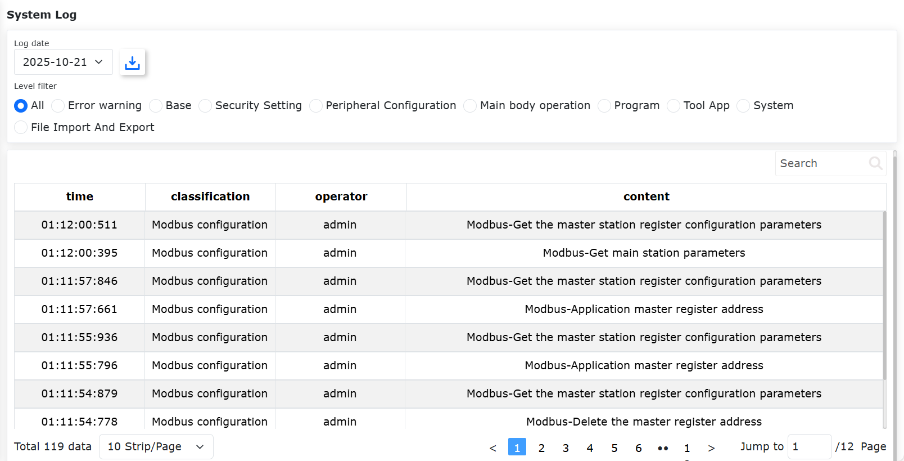
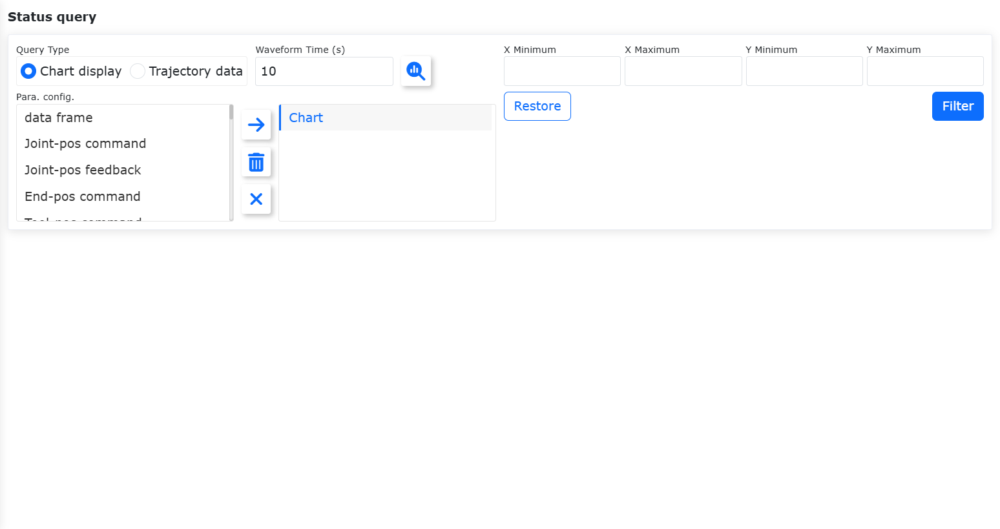
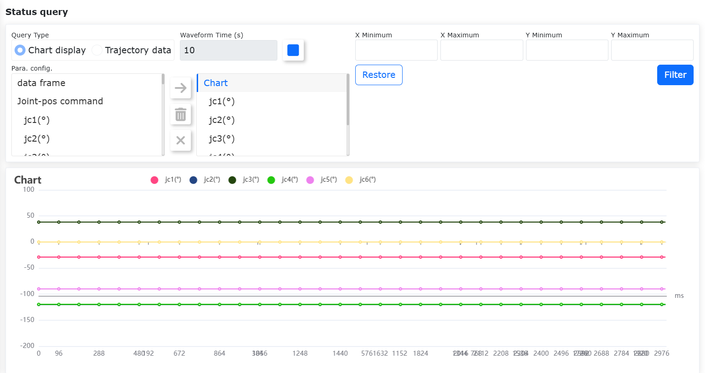
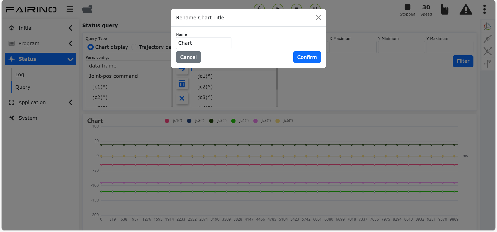
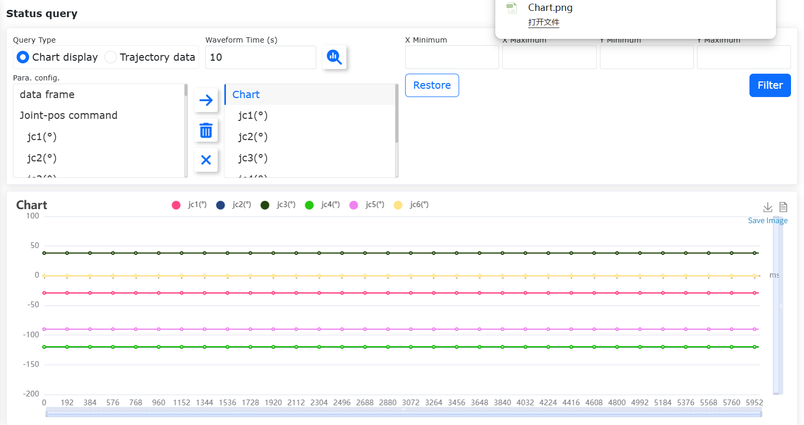
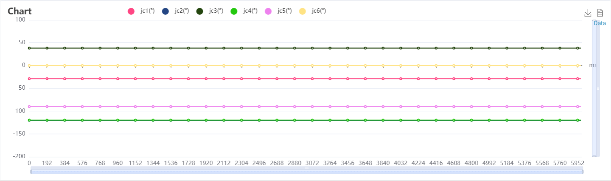
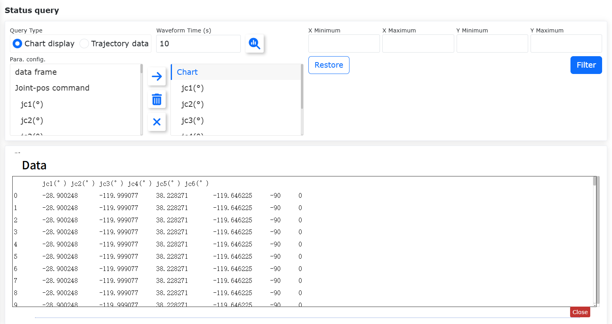
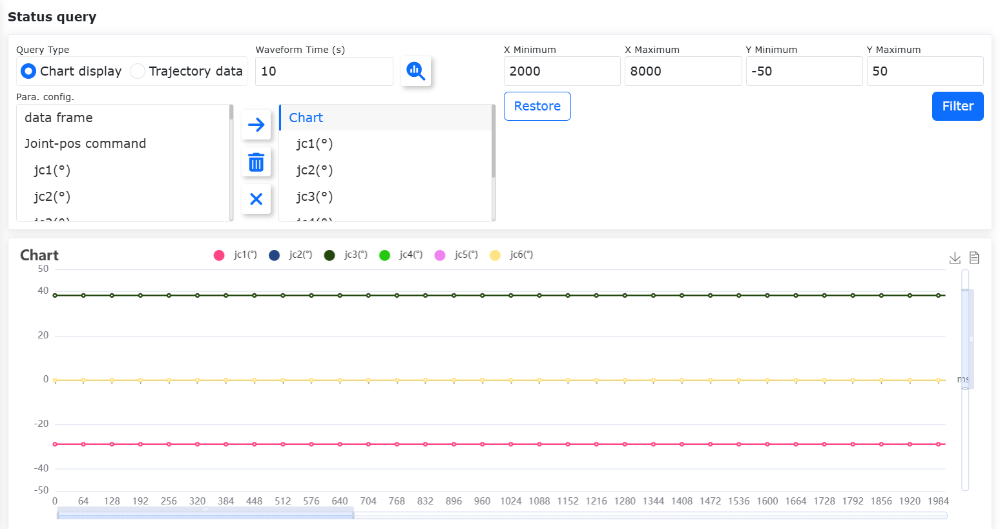
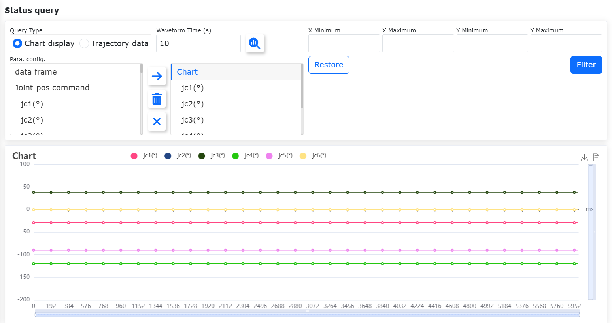

Información de estado
=====================

.. toctree:: 
   :maxdepth: 6

Registro del sistema
--------------------

La primera vez que se entra en la interfaz "Información de estado——Registro del sistema", se muestran por defecto todos los tipos de datos de registro del día.

Los datos de registro se distinguen por niveles y actualmente se dividen en: Todos, Error y advertencia, Configuración básica, Configuración de seguridad, Configuración de periféricos, Operación del cuerpo, Programa de enseñanza, Aplicación de herramientas, Configuración del sistema e Importación y exportación de archivos.

En la esquina superior derecha de la tabla de datos hay un cuadro de entrada de búsqueda; el usuario introduce el contenido de filtrado según sus necesidades de búsqueda para filtrar. La interfaz es la siguiente:

.. centered:: Figura 13.1‑1 Interfaz del registro del sistema

Consulta de estado
------------------

Uso de la función
~~~~~~~~~~~~~~~~~

1. Encender la caja de control y conectar el cable de red al PC;
2. Abrir el navegador en el PC y acceder a la dirección de destino 192.168.58.2, iniciar sesión con la cuenta admin y la contraseña 123, y entrar en la página;
3. Hacer clic en el menú "Información de estado"-"Consulta de estado" de la barra de menú de la izquierda para entrar en la interfaz de consulta de estado, como se muestra en la figura siguiente;

.. centered:: Figura 13.2‑1 Consulta de estado

.. note:: 
   .. image:: status/006.png
      :width: 0.75in
      :height: 0.75in
      :align: left

   Nombre: **Botón Consultar**
   
   Función: hacer clic para enviar la instrucción de consulta de datos de gráfico/trayectoria; representa el estado no consultado

.. note:: 
   .. image:: status/007.png
      :width: 0.75in
      :height: 0.75in
      :align: left

   Nombre: **Botón Mover a la derecha**
   
   Función: hacer clic para añadir el elemento seleccionado de la izquierda a los subelementos de la derecha

.. note:: 
   .. image:: status/008.png
      :width: 0.75in
      :height: 0.75in
      :align: left

   Nombre: **Botón Eliminar**
   
   Función: hacer clic para eliminar el subelemento seleccionado de la derecha

.. note:: 
   .. image:: status/009.png
      :width: 0.75in
      :height: 0.75in
      :align: left

   Nombre: **Botón Vaciar**
   
   Función: hacer clic para vaciar todos los subelementos de la derecha

4. Seleccionar la visualización de gráfico, rellenar el tiempo de forma de onda y, en la configuración de parámetros, seleccionar a la izquierda los parámetros que se desea consultar y hacer clic en el botón "Mover a la derecha" para configurar los parámetros en la lista de la derecha;

.. note:: El tiempo de forma de onda puede personalizarse en un rango (10-30s); en la configuración de parámetros se pueden seleccionar como máximo 6.

5. Hacer clic en el botón "Consultar" para iniciar la consulta; según la configuración de parámetros, se muestra en tiempo real el gráfico de líneas de datos, como se muestra en la figura siguiente;

.. centered:: Figura 13.2‑2 Visualización del gráfico

Exportación del gráfico
~~~~~~~~~~~~~~~~~~~~~~~

1. Hacer clic en el título del gráfico para que aparezca la ventana emergente y poder modificar directamente el título del gráfico, como se muestra en la figura siguiente:

.. centered:: Figura 13.2‑3 Cambio de nombre del título del gráfico

2. Tras hacer clic en el botón de detener consulta y detener correctamente la consulta, se muestra el botón de descarga; hacer clic en descargar y el navegador mostrará el archivo de gráfico con el nombre del título del gráfico. Como se muestra en la figura siguiente:

.. centered:: Figura 13.2‑4 Exportación del gráfico

Visualización de la vista de datos
~~~~~~~~~~~~~~~~~~~~~~~~~~~~~~~~~~

1. Tras detener la consulta, hacer clic en el botón de visualización de la vista de datos de la esquina superior derecha del gráfico, como se muestra en la figura siguiente:

.. centered:: Figura 13.2‑5 Botón de vista de datos

2. Los datos de la vista se muestran en la figura; el contenido de los datos admite copia.

.. centered:: Figura 13.2‑6 Visualización de la vista de datos

Filtrado de datos
~~~~~~~~~~~~~~~~~

1. Tras detener la consulta, introducir los valores mínimo/máximo de x/y; el rango de datos del gráfico también cambiará en consecuencia, como se muestra en la figura siguiente:

.. centered:: Figura 13.2‑7 Interfaz de filtrado de datos

2. Hacer clic en el botón de restablecer y el rango de datos del gráfico vuelve al valor predeterminado, como se muestra en la figura siguiente:

.. centered:: Figura 13.2‑8 Restablecimiento de datos