Configuración del sistema
=========================

.. toctree:: 
   :maxdepth: 6

Configuración general
---------------------

Hacer clic en "Configuración del sistema" de la barra de menú de la izquierda y hacer clic en "Configuración general" de la barra de menú de segundo nivel para entrar en la interfaz de configuración general. La configuración general puede actualizar la hora del sistema del robot según la hora actual del ordenador, para que la hora registrada en los registros sea precisa.

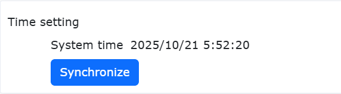

.. centered:: Figura 15.1‑1 Configuración de la hora

La configuración de red permite configurar la IP del controlador, la máscara de subred, la puerta de enlace predeterminada, el servidor DNS y la IP del teach pendant (esta IP es válida cuando se utiliza nuestro teach pendant FR-HMI; cuando se utiliza el teach pendant FR-HMI es necesario configurar el estado de habilitación del teach pendant como habilitado), facilitando los escenarios de uso del cliente.

Configuración de red
~~~~~~~~~~~~~~~~~~~~

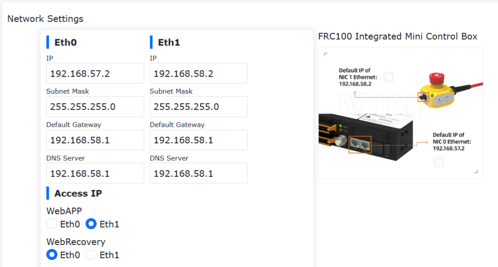

.. centered:: Figura 15.1‑2 Esquema de configuración de red

-  **Configurar tarjeta de red**: introducir la IP de la tarjeta de red con la que se desea comunicar, la máscara de subred (vinculada a la IP, se rellena automáticamente), la puerta de enlace predeterminada y el servidor DNS. La IP predeterminada de fábrica del puerto de la tarjeta de red 0 es: 192.168.57.2, y la IP predeterminada de fábrica del puerto de la tarjeta de red 1 es: 192.168.58.2.

-  **Habilitación del teach pendant**: controla si se habilita el teach pendant. Por defecto el teach pendant está desactivado y no se puede utilizar el teach pendant para operar el equipo. Al hacer clic en el botón deslizante se habilita la operación del equipo mediante el teach pendant.
  
-  **IP de acceso**: seleccionar la tarjeta de red asociada a WebAPP y WebRecovery; cuando el teach pendant está habilitado, WebAPP selecciona por defecto la tarjeta de red 1, y la tarjeta de red 0 no es seleccionable.
  
-  **Configurar red**: hacer clic en el botón "Configurar red" y se mostrará el aviso de que se está configurando. Tras completar la configuración, es necesario reiniciar el equipo.

Operación sin inicio de sesión
++++++++++++++++++++++++++++++

Descripción general de la función
*********************************

Tras activar la función de operación sin inicio de sesión del teach pendant físico, se pueden realizar las siguientes funciones:

- Cuando el usuario no ha iniciado sesión en la interfaz de enseñanza, al girar el interruptor físico de llave, el robot puede conmutar entre modo manual y automático, y el color del LED del extremo cambia en consecuencia;
- Cuando el usuario no ha iniciado sesión en la interfaz de enseñanza, en modo automático, al pulsar el interruptor físico de inicio, el robot puede comenzar a ejecutar el programa cargado actualmente;
- Cuando el usuario no ha iniciado sesión en la interfaz de enseñanza, en modo automático, al pulsar el interruptor físico de parada, el robot puede detener la ejecución;
  
Instrucciones de uso
********************

Iniciar sesión en la página webapp, hacer clic en "Configuración del sistema", hacer clic en "Configuración general" y, en el módulo de red-sección del teach pendant, activar el interruptor "Habilitación del teach pendant" y el interruptor "Operación sin inicio de sesión"; tras activar la función, se puede operar con los botones físicos la conmutación del robot entre modo manual/automático y el control de ejecución/parada del programa sin haber iniciado sesión en la página del teach pendant. Esta configuración se mantiene tras el corte de energía y el reinicio.

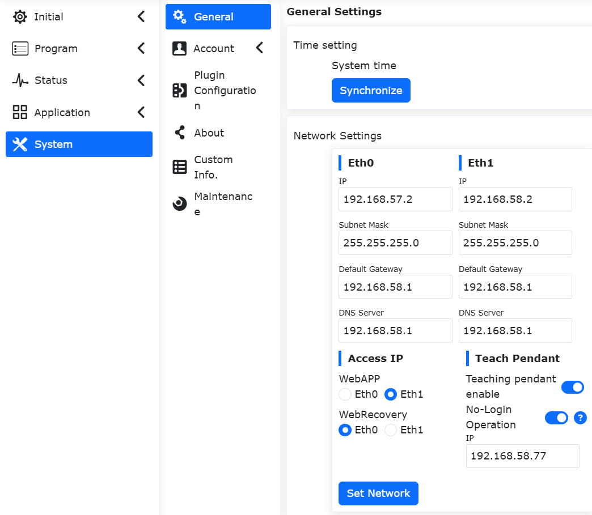

.. centered:: Figura 15.1‑2-1 Activación de la función de operación sin inicio de sesión
  
Calibración de la pantalla táctil del teach pendant
~~~~~~~~~~~~~~~~~~~~~~~~~~~~~~~~~~~~~~~~~~~~~~~~~~~

Tras habilitar el teach pendant, se puede realizar la calibración del teach pendant.

.. centered:: Figura 15.1‑3 Calibración de la pantalla táctil del teach pendant
  
Configuración del ordenador industrial periférico
~~~~~~~~~~~~~~~~~~~~~~~~~~~~~~~~~~~~~~~~~~~~~~~~~

Para habilitar el ordenador industrial periférico es necesario introducir la dirección IP. Tras una configuración correcta, es necesario reiniciar la caja de control y el ordenador industrial.

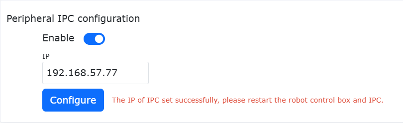

.. centered:: Figura 15.1‑4 Configuración del ordenador industrial periférico
  
Idioma del sistema
~~~~~~~~~~~~~~~~~~

Importación de idioma
+++++++++++++++++++++

Seleccionar el paquete de idioma para realizar la operación de importación (nota: el formato del archivo importado es [código de idioma].json). Si la importación se realiza correctamente y el paquete de idioma no es un idioma ya existente en el sistema, el sistema añade un nuevo registro de datos del paquete de idioma importado.

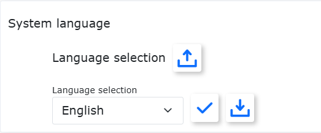

.. centered:: Figura 15.1‑5 Interfaz del idioma del sistema

Exportación de idioma
+++++++++++++++++++++
Seleccionar el idioma del sistema; tomando como ejemplo el inglés, hacer clic en el botón "Exportar" y la página mostrará el archivo de descarga exportado.

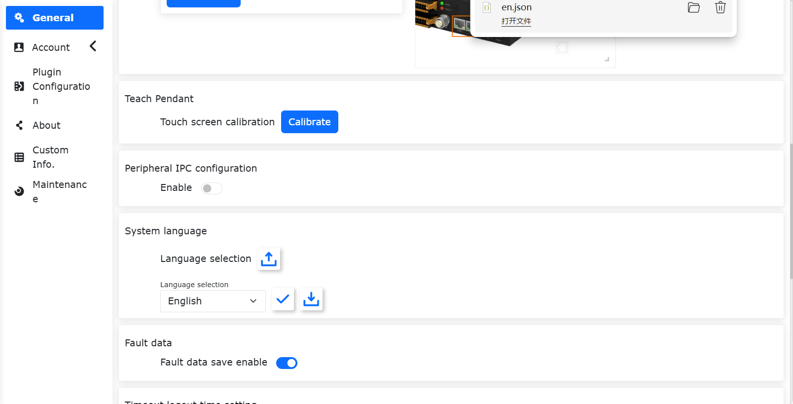

.. centered:: Figura 15.1‑6 Exportación del idioma del sistema
   
Aplicación de idioma
++++++++++++++++++++

Seleccionar el idioma del sistema y hacer clic en el botón "Aplicar" para conmutar el idioma del sistema. Tras aplicar correctamente el idioma, el sistema cierra automáticamente la sesión y vuelve a la página de inicio de sesión, y el idioma del sistema se conmuta sincronizadamente al idioma actual. Tomando como ejemplo el inglés:

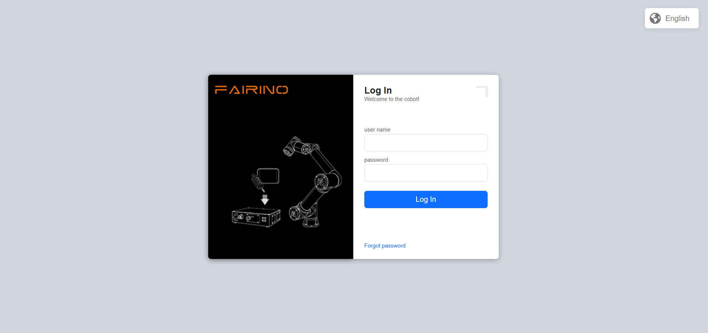

.. centered:: Figura 15.1‑7 Interfaz tras aplicar correctamente el idioma del sistema

Recuperación del modo de seguridad del sistema
++++++++++++++++++++++++++++++++++++++++++++++

Cuando el sistema necesite realizar operaciones de actualización o degradación de versión, o cuando la importación del paquete de idioma del sistema sea anómala y el sistema no pueda entrar con normalidad, es necesario entrar en la interfaz "Recuperación del modo de seguridad del sistema"; las operaciones concretas son las siguientes:
1. Entrar en Configuración del sistema -> Configuración general -> Configuración de red, ajustar la IP de acceso de WebRecovery a la posición de la tarjeta de red 0 y hacer clic en "Configurar red".

.. image:: system/037.png
   :width: 6in
   :align: center

.. centered:: Figura 15.1‑8 Interfaz de configuración de la tarjeta de red de WebRecovery

2. Tras una configuración de red correcta, reiniciar la caja de control, conmutar la dirección IP a 192.168.57.xxx y conectar el cable de red a la tarjeta de red 0 de la caja de control.
3. Acceder a la dirección web "192.168.57.2:8050" para entrar en la interfaz "Recuperación del modo de seguridad del sistema".

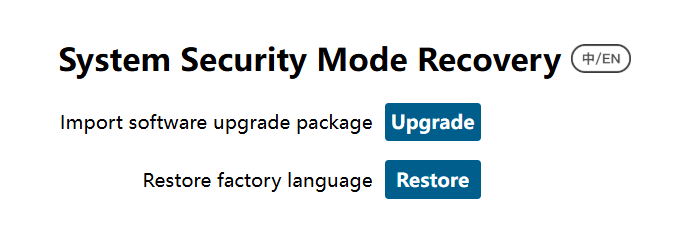

.. centered:: Figura 15.1‑9 Interfaz de recuperación del modo de seguridad del sistema

- Importación del paquete de actualización de software: actualización o degradación del paquete de software del sistema;
- Restaurar idioma de fábrica: borrar los datos del paquete de idioma de aplicación importado, restaurar los datos del paquete de idioma de fábrica y establecer el idioma predeterminado en inglés;
  
Datos de fallo
~~~~~~~~~~~~~~

Al hacer clic para activar el botón "Habilitación del guardado de datos de fallo", cuando se produzca un fallo en el controlador se generará un archivo de datos de fallo, que guarda los datos de los 15 segundos anteriores y posteriores al momento del fallo.

Tras completar el guardado, se puede seleccionar en la configuración del sistema la exportación de todas las fuentes de datos; descomprimir error_data.tar.gz para consultar el archivo de datos de fallo.

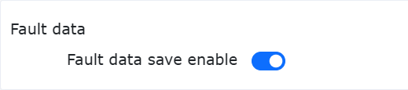

.. centered:: Figura 15.1‑10 Datos de fallo
  
Configuración del tiempo de cierre de sesión por inactividad
~~~~~~~~~~~~~~~~~~~~~~~~~~~~~~~~~~~~~~~~~~~~~~~~~~~~~~~~~~~~~~~~~~~~~~~~~

El usuario puede configurar el tiempo de cierre de sesión por inactividad; si se alcanza dicho tiempo, se cierra la sesión automáticamente, en unidades de min.

.. centered:: Figura 15.1‑11 Configuración del tiempo de cierre de sesión por inactividad
  
Configuración del sistema
~~~~~~~~~~~~~~~~~~~~~~~~~

La restauración de la configuración de fábrica dentro de la recuperación del sistema permite borrar los datos del usuario y devolver el robot a la configuración de fábrica.

Las funciones de generación del registro del esclavo y exportación del registro del controlador sirven para descargar archivos de registro de algunos estados o errores importantes del controlador, facilitando la resolución de problemas del robot.

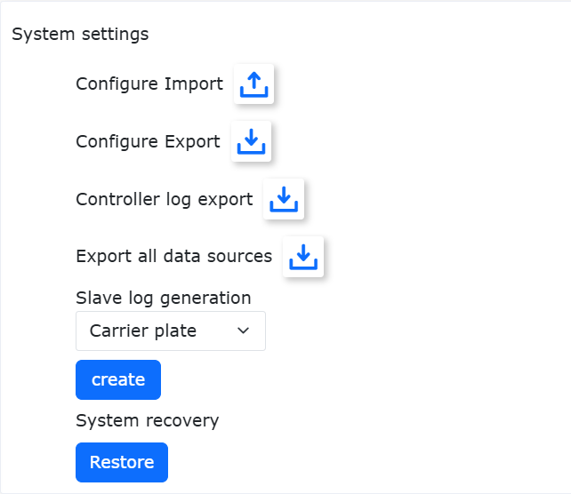

.. centered:: Figura 15.1‑12 Configuración del sistema

Configuración de cuentas
------------------------

Hacer clic en "Configuración de cuentas" de la barra de menú de segundo nivel para entrar en la interfaz de configuración de cuentas. La función de gestión de cuentas solo está disponible para el administrador. La función se divide en los tres módulos siguientes:

Gestión de usuarios
~~~~~~~~~~~~~~~~~~~

La página de gestión de usuarios se utiliza para guardar la información de los usuarios; se puede añadir el número de empleado, la función, etc. de los usuarios. El usuario puede iniciar sesión introduciendo el nombre de usuario y la contraseña existentes en la lista de usuarios.

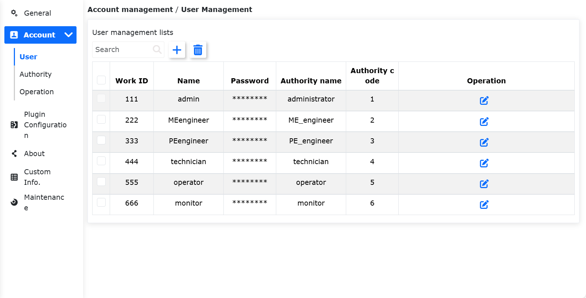

.. centered:: Figura 15.2‑1 Gestión de usuarios

-  **Añadir usuario**: hacer clic en el botón "Añadir", introducir el número de empleado, el nombre y la contraseña, y seleccionar la función.

.. important::
   El número de empleado tiene un máximo de 10 dígitos de tipo entero; tanto el número de empleado como la contraseña tienen verificación de unicidad, y la contraseña se muestra en modo oculto. Tras añadir correctamente el usuario, se puede iniciar sesión de nuevo introduciendo el nombre y la contraseña.
  
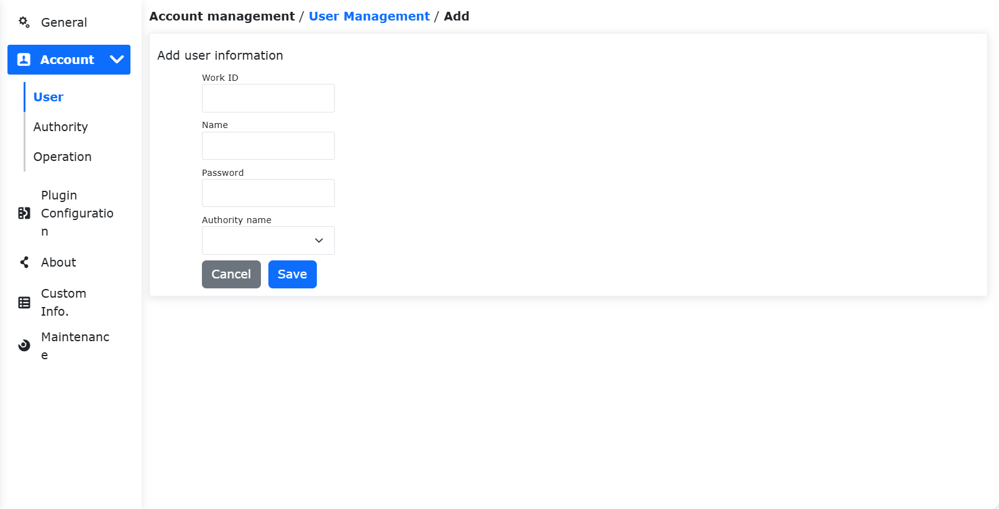

.. centered:: Figura 15.2‑2 Añadir gestión
  
-  **Editar usuario**: cuando existe una lista de usuarios, hacer clic en el botón "Editar" de la derecha; el número de empleado y el nombre no se pueden modificar; se pueden modificar la contraseña y la función; la contraseña también requiere verificación de unicidad.
  
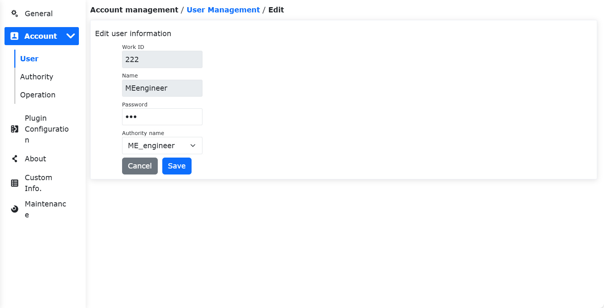

.. centered:: Figura 15.2‑3 Editar usuario

-  **Eliminar usuario**: el método de eliminación se divide en eliminación individual y eliminación por lotes.
  
  1. Hacer clic en el botón "Eliminar" individual de la derecha de la lista; se muestra el aviso "Vuelva a hacer clic en el botón Eliminar para confirmar la eliminación"; al volver a hacer clic, la eliminación de dicha lista se realiza correctamente.

  2. Marcar la casilla de verificación de la izquierda, seleccionar los usuarios que se desean eliminar y hacer clic dos veces en el botón "Eliminar" por lotes de la parte superior de la lista para eliminarlos.

.. important::
   El usuario inicial 111 y el usuario con la sesión iniciada actualmente no se pueden eliminar.

.. centered:: Figura 15.2‑4 Eliminar usuario

Gestión de permisos
~~~~~~~~~~~~~~~~~~~

.. important:: 
   Los datos de función predeterminados (código de función 1-6) no se pueden eliminar; el código de función no se puede modificar; se pueden modificar el nombre y la descripción de la función, así como configurar los permisos de la función.

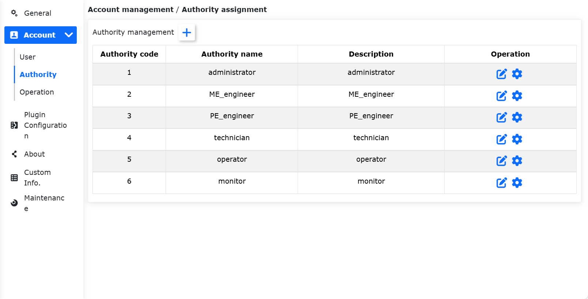

.. centered:: Figura 15.2‑5 Gestión de permisos

Hay seis funciones predeterminadas: el administrador no tiene limitaciones de funciones; el operador y el monitor pueden utilizar una minoría de funciones; el ingeniero ME, el ingeniero PE&PQE y el técnico&jefe de equipo tienen algunas funciones limitadas; el administrador no tiene limitaciones de funciones. Los permisos predeterminados concretos se muestran en la tabla siguiente:

.. important:: 
   Los permisos predeterminados se pueden modificar.

.. centered:: Tabla 15.2‑1 Detalle de permisos

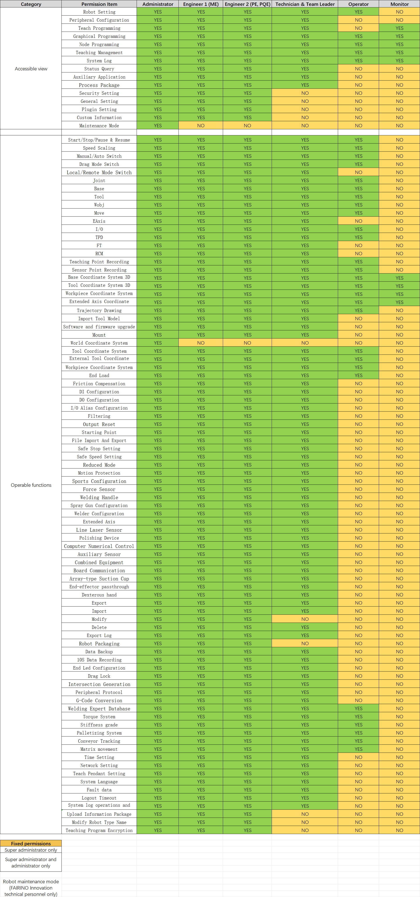

-  **Añadir función**: hacer clic en el botón "Añadir", introducir el código de función, el nombre de la función y la descripción de la función, y hacer clic en el botón "Guardar"; tras realizarlo correctamente, se vuelve a la página de la lista. El código de función solo puede ser un número entero mayor que 0 y no puede coincidir con un código de función ya existente; todos los campos de entrada son obligatorios.

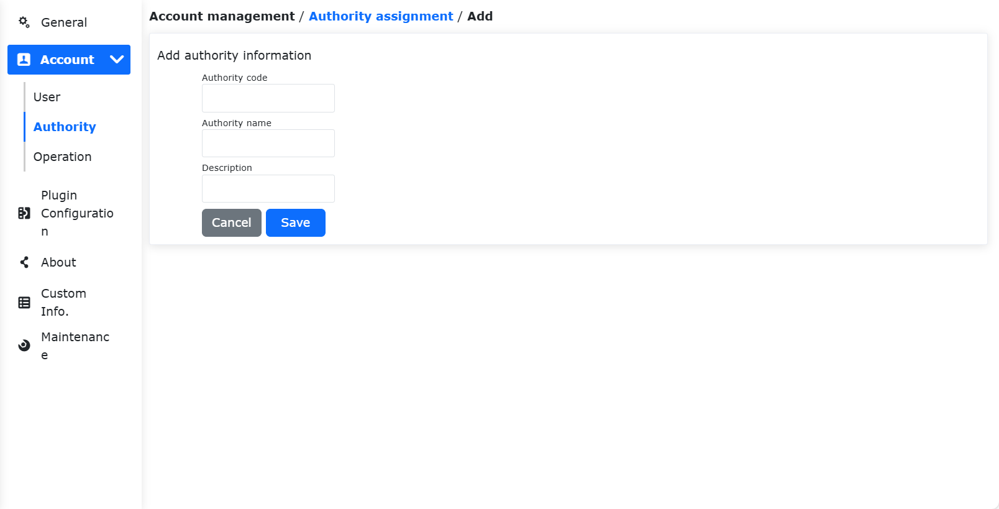

.. centered:: Figura 15.2‑6 Añadir función

-  **Editar el nombre y la descripción de la función**: hacer clic en el icono "Editar" de la barra de operaciones de la tabla para modificar el nombre y la descripción de la función actual; tras completar la modificación, hacer clic en el botón "Guardar" de la parte inferior para confirmar la modificación.

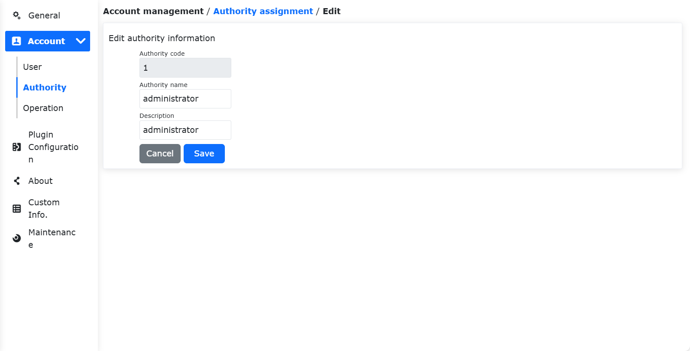

.. centered:: Figura 15.2‑7 Editar función

-  **Configurar los permisos de la función**: hacer clic en el icono "Configurar" de la barra de operaciones de la tabla para configurar los permisos de la función actual; tras completar la configuración, hacer clic en el botón "Guardar" de la parte inferior para confirmar la configuración.

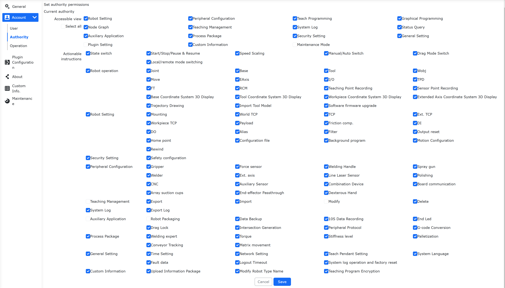

.. centered:: Figura 15.2‑8 Configurar los permisos de la función

-  **Eliminar función**: hacer clic en el icono "Eliminar" de la barra de operaciones de la tabla; en primer lugar se verificará si la función actual está siendo utilizada por algún usuario; si ningún usuario la utiliza, se puede eliminar la función actual; de lo contrario, no se puede eliminar.

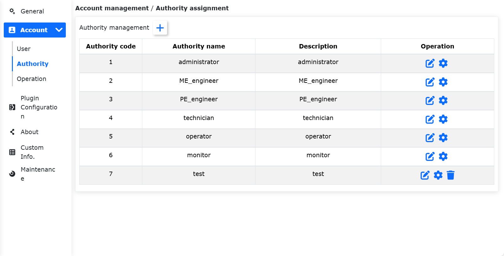

.. centered:: Figura 15.2‑9 Eliminar función

Importación/Exportación
~~~~~~~~~~~~~~~~~~~~~~~

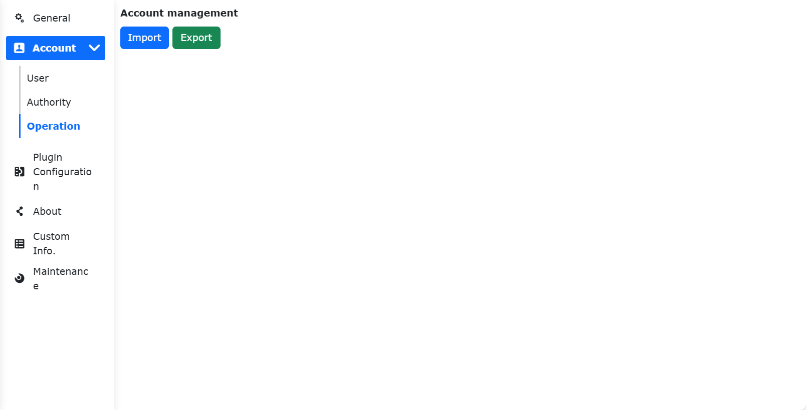

.. centered:: Figura 15.2‑10 Importación/Exportación de la configuración de cuentas

-  **Importar**: hacer clic en el botón "Importar" para importar por lotes los datos de gestión de usuarios y gestión de permisos.

-  **Exportar**: hacer clic en el botón "Exportar" para exportar por lotes los datos de gestión de usuarios y gestión de permisos.

Acerca de
---------

Hacer clic en "Acerca de" de la barra de menú de segundo nivel para entrar en la interfaz Acerca de. Esta página muestra el modelo y el número de serie del robot, la versión Web y la versión de la caja de control utilizadas en el funcionamiento del robot, la versión de hardware y la versión de firmware.

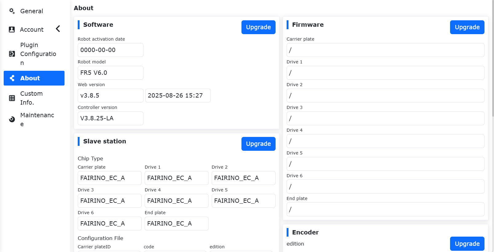

.. centered:: Figura 15.3‑1 Esquema de Acerca de

Actualización de software
~~~~~~~~~~~~~~~~~~~~~~~~~

Preparación de la operación
+++++++++++++++++++++++++++

1. Antes de la actualización, consultar y confirmar la versión de software actual en «Configuración del sistema-Acerca de».
2. Paquete de actualización de software; la dirección de descarga se encuentra en la documentación FAIRINO de la versión correspondiente «Descarga de materiales-Descarga de software del robot»; tras descomprimirlo, el contenido incluye el paquete de actualización de software de la versión correspondiente software.tar.gz.

Precauciones
+++++++++++++++++++++++++++

1. Copia de seguridad de datos: se recomienda realizar una copia de seguridad antes de la actualización; el método se describe en la sección 3.2.1, para evitar la pérdida de datos debida a anomalías durante la actualización.
2. Limitaciones de versión:

.. centered:: Figura 15.3‑1 Limitaciones de actualización de versión

.. list-table::
   :widths: 50 50
   :header-rows: 0
   :align: center

   * - **Versión actual** 
     - **Versión máxima actualizable**

   * - <v3.6.1
     - v3.6.1

   * - v3.6.1-v3.6.4
     - v3.6.5

   * - v3.6.5-v3.6.8
     - v3.6.9

   * - v3.6.9 - v3.7.4
     - v3.7.5

   * - v3.7.5
     - v3.7.6

   * - ≥ v3.7.6
     - Sin limitación

3. Limpieza de caché: tras cada actualización (especialmente en actualizaciones entre versiones), se recomienda borrar la caché del navegador para garantizar el funcionamiento normal del sistema.

Pasos de operación
******************

**Actualización de software**:

1. En la barra de menú "Configuración del sistema"->"Acerca de", hacer clic en el botón "Actualizar" para entrar en la actualización de software;

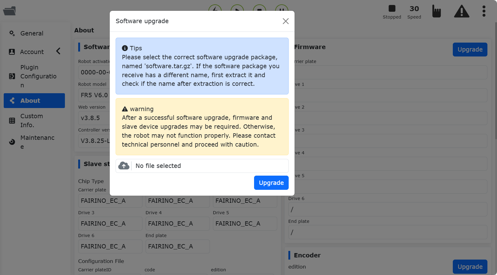

.. centered:: Figura 15.3‑2 Interfaz de actualización del sistema

2. Hacer clic en "Seleccionar archivo" y seleccionar el paquete de software software.tar.gz descargado del sitio web oficial;

.. important:: 
   El nombre del paquete de actualización de software debe ser exactamente software.tar.gz; si el nombre del paquete de actualización no coincide, se producirá un fallo de actualización; basta con modificarlo al nombre de paquete de actualización exacto.

3. Hacer clic en cargar paquete de actualización para iniciar la actualización; durante el proceso de actualización se muestra la barra de progreso;

4. Cuando la barra de progreso de la actualización llegue a 100, la interfaz mostrará "Actualización correcta, reinicie la caja de control";

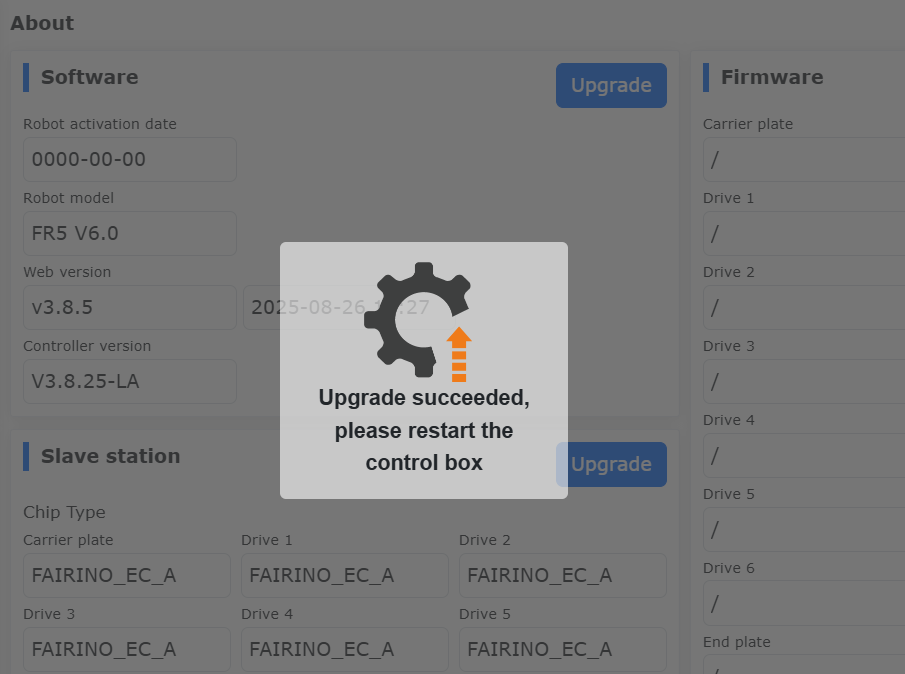

.. centered:: Figura 15.3‑3 Actualización de software correcta

5. Tras reiniciar la caja de control, la actualización habrá finalizado; confirmar la información de versión en Acerca de.

**Actualización de firmware**: tras entrar el robot en modo BOOT, cargar el paquete comprimido de actualización, seleccionar el esclavo que se desea actualizar (esclavo de la caja de control, esclavos de los accionamientos del cuerpo 1~6, esclavo del extremo), realizar la operación de actualización y mostrar el estado de la actualización.

.. centered:: Figura 15.3‑4 Actualización de firmware

**Actualización del archivo de configuración del esclavo**: tras deshabilitar el robot, cargar el archivo de actualización, seleccionar el esclavo que se desea actualizar (esclavo de la caja de control, esclavos de los accionamientos del cuerpo 1~6, esclavo del extremo), realizar la operación de actualización y mostrar el estado de la actualización.

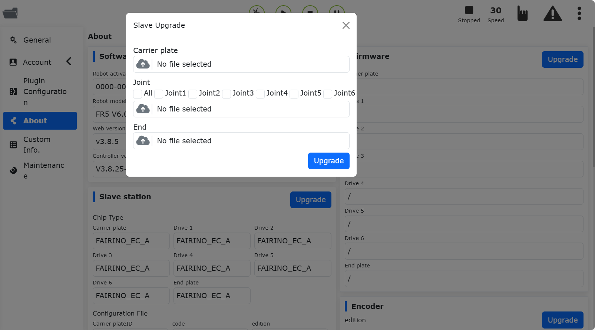

.. centered:: Figura 15.3-5 Actualización del archivo de configuración del esclavo

**Actualización del codificador**: tras deshabilitar el robot, cargar el archivo de actualización, seleccionar las articulaciones Joint1~Joint6 que se desean actualizar y configurar el modo del codificador.

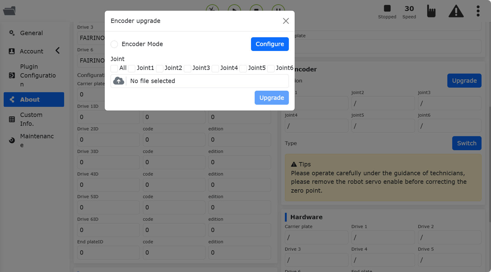

.. centered:: Figura 15.3-6 Actualización del codificador

Información personalizada
-------------------------

Hacer clic en "Información personalizada" de la barra de menú de segundo nivel para entrar en la interfaz de información personalizada. La función de información personalizada solo está disponible para el administrador. Esta página permite cargar el paquete de información del usuario, el modelo del robot y configurar el estado de cifrado de los programas de enseñanza, etc.

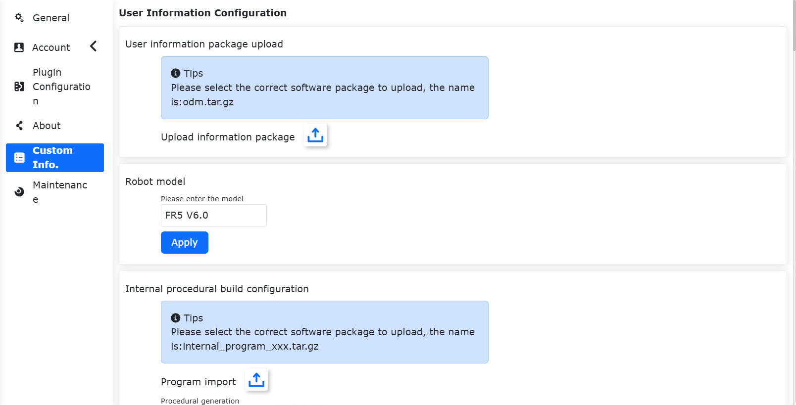

.. centered:: Figura 15.4‑1 Esquema de información personalizada

Modelo del robot
~~~~~~~~~~~~~~~~

.. important::
   1. Configurar aquí el modelo del robot es un nombre de modelo de robot personalizado y no es coherente con la función del modelo de robot configurado en "Configuración del sistema"->"Modo de mantenimiento"->"Compatibilidad del controlador";
   2. No se recomienda utilizar nombres que comiencen por "FR" y "ART". Si se introduce un modelo de robot personalizado que comienza por "FR" y "ART", el nombre del modelo introducido debe coincidir con el "abreviado del modelo" de la tabla de catálogo de modelos de robot (la tabla de catálogo de modelos de robot se detalla en el capítulo "Configuración del modelo del robot").

Configuración del rango de parámetros
~~~~~~~~~~~~~~~~~~~~~~~~~~~~~~~~~~~~~~

En la configuración del rango de parámetros, solo el administrador puede ajustar el rango de parámetros; los parámetros de los demás miembros con permisos solo se pueden configurar dentro del rango de parámetros establecido por el administrador.

El modo de establecimiento de parámetros se divide en dos: arrastre del control deslizante e introducción manual.

.. important::
   El valor máximo del rango de parámetros debe ser mayor que el mínimo. Tras configurar correctamente el rango de parámetros, a los 3 segundos se salta automáticamente a la página de inicio de sesión y es necesario volver a iniciar sesión.

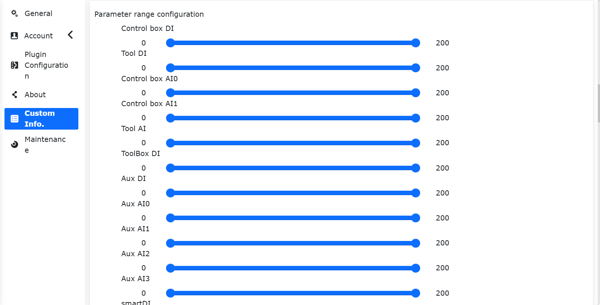

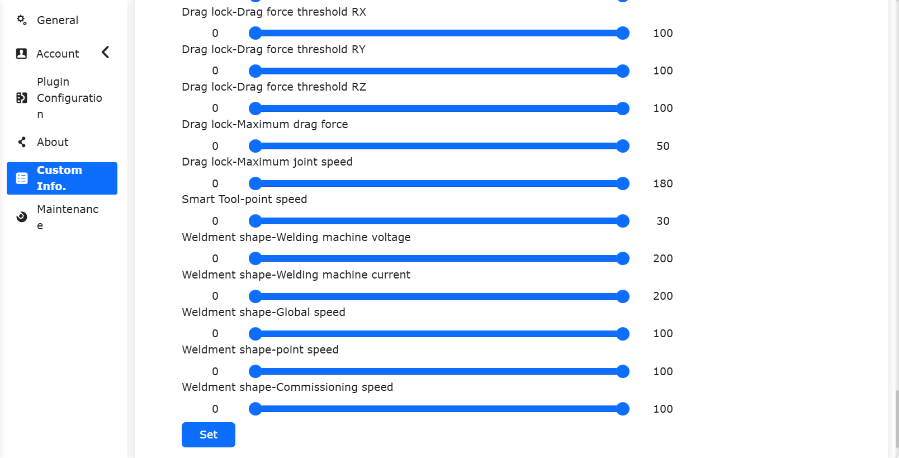

.. centered:: Figura 15.4‑2 Esquema de configuración del rango de parámetros

Tiempo de uso autorizado del robot
~~~~~~~~~~~~~~~~~~~~~~~~~~~~~~~~~~

1. Configuración de bloqueo de pantalla

En "Información personalizada", consultar el tiempo de uso autorizado del robot y configurar si se activa esta función. Al seleccionar la activación de esta función, seleccionar el plazo de uso; si no se selecciona, se muestra el aviso "El plazo de uso no puede estar vacío".

.. note:: Si ya se ha activado la función de bloqueo de pantalla, no se puede realizar una segunda configuración y tampoco se puede actualizar la hora del sistema.

Tras seleccionar el plazo de uso, hacer clic en el botón "Configurar".

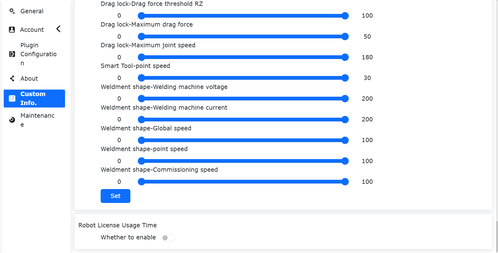

.. centered:: Figura 15.4‑3 Configuración de desactivación del tiempo de uso autorizado del robot

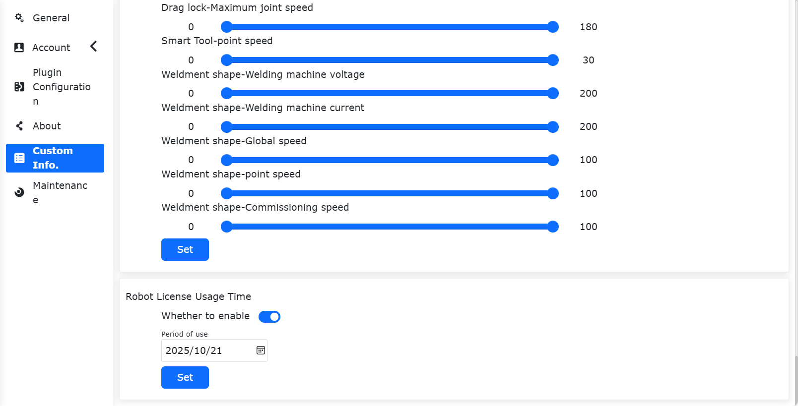

.. centered:: Figura 15.4‑4 Configuración de activación del tiempo de uso autorizado del robot

2. Aviso de vencimiento

Cuando la función de tiempo de uso autorizado del robot está activada, tras el inicio de sesión se muestran los siguientes avisos:

1) 5 días antes del vencimiento del equipo, al encender e iniciar sesión correctamente, aparece una ventana emergente que indica los días restantes de plazo de uso; se puede eliminar con restablecer.

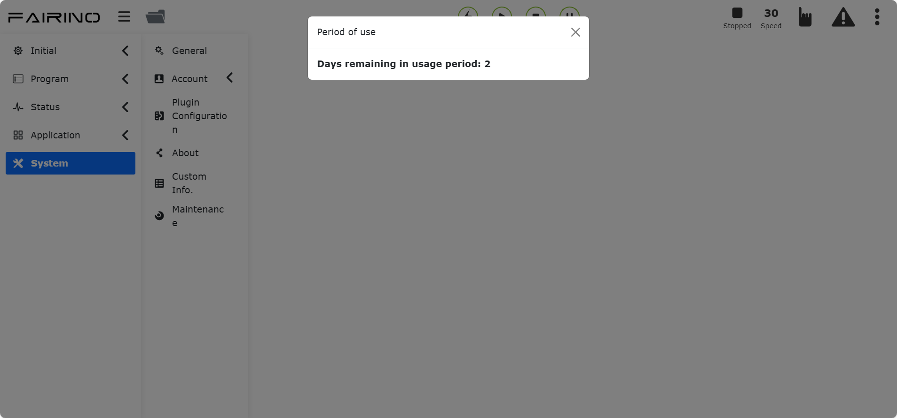

.. centered:: Figura 15.4‑5 Aviso al encender

2) Si el equipo sigue en funcionamiento, 5 días antes del vencimiento del equipo, a medianoche aparece automáticamente una ventana emergente que indica los días restantes de plazo de uso; se puede eliminar con restablecer.

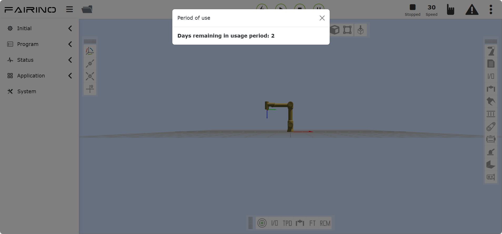

.. centered:: Figura 15.4‑6 Aviso de funcionamiento continuo

3. Desbloqueo e inicio de sesión

Cuando la función de tiempo de uso autorizado del robot está activada, tras el vencimiento del equipo, el primer inicio de sesión en webApp entra directamente en la interfaz de bloqueo de pantalla. Si el equipo sigue en funcionamiento, tras obtener los datos de bloqueo de pantalla a medianoche, se cierra la sesión automáticamente y se entra en la interfaz de bloqueo de pantalla. En este momento, tras introducir el código de desbloqueo, se desbloquea y se entra en la interfaz de inicio de sesión; introducir la información de inicio de sesión para acceder.

.. note:: El integrador genera el código de desbloqueo cifrado.
 
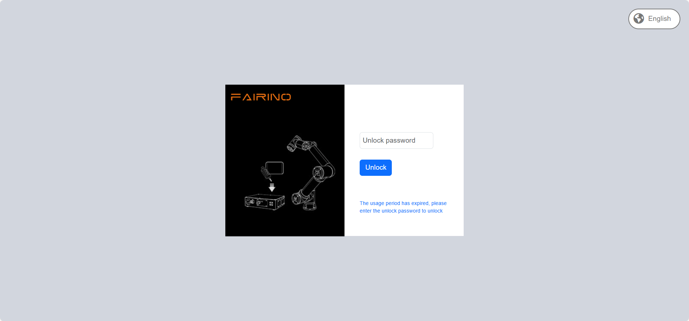

.. centered:: Figura 15.4‑7 Interfaz de bloqueo de pantalla  

Configuración del modelo del robot
----------------------------------

.. important:: Si necesita modificar el modelo del robot, póngase en contacto con nuestro ingeniero técnico y realícelo bajo su orientación.

Tras iniciar sesión en la consola Web del robot colaborativo, en el elemento de configuración "Configuración del sistema"->"Modo de mantenimiento"->"Compatibilidad del controlador", seleccionar el modelo correspondiente para modificarlo; consulte la tabla siguiente para el modelo del robot.

La tabla de modelos de robot es la siguiente:

.. list-table::
   :widths: 10 58 32
   :header-rows: 0
   :align: center

   * - **Valor**
     - **Modelo (modelo principal-número de versión principal-número de versión secundaria)**
     - **Abreviado del modelo**

   * - 0
     - Sin configurar
     - /

   * - 1
     - FR3-V1-000(V5.0)
     - FR3 V5.0

   * - 2
     - FR3-V1-001(V6.0)
     - FR3 V6.0

   * - 3
     - FR3-V1-002(V6.0 Mirror)
     - FR3 V6.0(Mirror)

   * - ...
     - Reservado
     - /

   * - 101
     - FR5-V1-000
     - FR5 V4.0

   * - 102
     - FR5-V1-001(V5.0)
     - FR5 V5.0

   * - 103
     - FR5-V1-002(V6.0)
     - FR5 V6.0
     
   * - ...
     - Reservado
     - /
   
   * - 201
     - FR10-V1-000(V5.0)
     - FR10 V5.0

   * - 202
     - FR10-V1-001(V6.0)
     - FR10 V6.0
     
   * - ...
     - Reservado
     - /
   
   * - 301
     - FR16-V1-000(V5.0)
     - FR16 V5.0

   * - 302
     - FR16-V1-001(V6.0)
     - FR16 V6.0
     
   * - ...
     - Reservado
     - /
   
   * - 401
     - FR20-V1-000(V5.0)
     - FR20 V5.0

   * - 402
     - FR20-V1-001(V6.0)
     - FR20 V6.0
     
   * - ...
     - Reservado
     - /

   * - 501
     - ART3-V1-000
     - ART3
     
   * - ...
     - Reservado
     - /

   * - 601
     - ART5-V1-000
     - ART5
     
   * - ...
     - Reservado
     - /

   * - 702
     - FRCustom(7)-V1-001(FR3-WML)
     - FR3-WML

   * - 703
     - FRCustom(7)-V1-001(FR3-WMS)
     - FR3-WMS
     
   * - ...
     - Reservado
     - /
  
   * - 802
     - FRCustom(8)-V1-001(FR5WM)
     - FR5WM
  
   * - 803
     - FRCustom(8)-V1-002(FR5-WML)
     - FR5-WML
  
   * - 804
     - FRCustom(8)-V1-003(FR5-C)
     - FR5-C
     
   * - ...
     - Reservado
     - /

   * - 901
     - FRCustom(9)-V1-001(FR3MT)
     - FR3MT

   * - 902
     - FRCustom(9)-V1-001(FR10YD)
     - FR10YD

   * - 904
     - FRCustom(9)-V1-001(FR3-C)
     - FR3-C

   * - 905
     - FRCustom(9)-V01-001(FR30L)
     - FR30L

   * - 906
     - FRCustom(9)-V01-001(FR3(C))
     - FR3(C)

   * - 907
     - FRCustom(9)-V01-001(ART3-R6-XM)
     - ART3-R6-XM

   * - 908
     - FRCustom(9)-V01-001(FC3-R6-B)
     - FC3-R6-B
     
   * - ...
     - Reservado
     - /

   * - 1001
     - FR30-V1-001(V6.0)
     - FR30 V6.0
     
   * - ...
     - Reservado
     - /

.. note:: Entre ellos, el número de versión principal reserva 10 (1-10) y el número de versión secundaria reserva 10 (1-10).