Teach pendant
=============

.. toctree:: 
   :maxdepth: 6

Habilitación del teach pendant
------------------------------

1. Conectar el teach pendant a la caja de control y arrancarla.

2. Iniciar sesión con la cuenta admin y la contraseña 123. Entrar en la página, hacer clic en Configuración del sistema-Configuración general y confirmar que el teach pendant se encuentra en estado habilitado.

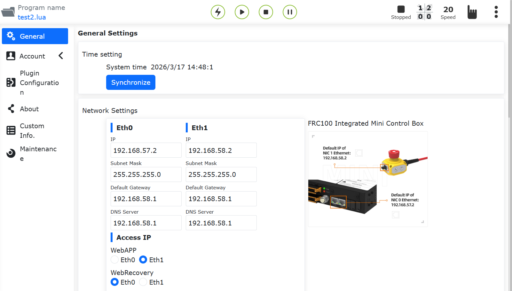

.. centered:: Figura 16.1‑1 Estado de habilitación del teach pendant

Configuración multilingüe del teach pendant
-------------------------------------------

1. En la interfaz de inicio de sesión (o en la interfaz de primera activación, en cualquiera de las dos se puede configurar), realizar la selección de idioma en la esquina superior derecha.

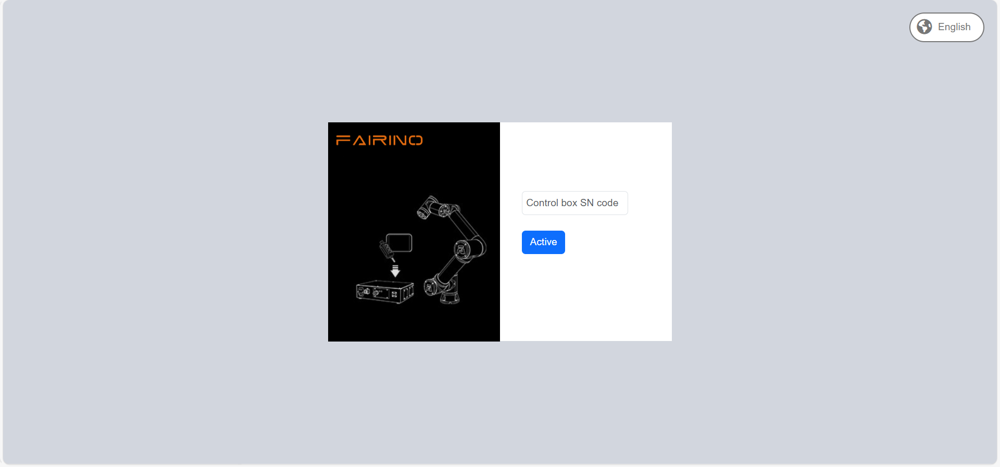

.. centered:: Figura 16.2‑1 Configuración del idioma en la interfaz de activación

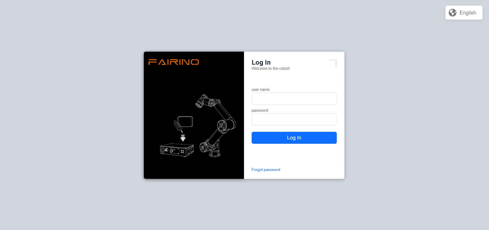

.. centered:: Figura 16.2‑2 Configuración del idioma en la interfaz de inicio de sesión

2. Tomando como ejemplo la configuración multilingüe en la interfaz de inicio de sesión, seleccionar el idioma. Si aparece el siguiente aviso (correspondiente a cada idioma), la configuración se ha realizado correctamente; reiniciar la caja de control para completar la configuración del idioma.

.. centered:: Figura 16.2‑3 Configuración del chino

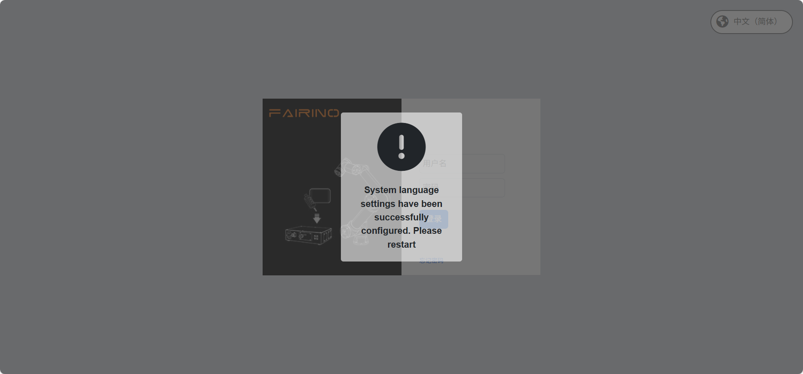

.. centered:: Figura 16.2‑4 Configuración del inglés

Cambio de método de entrada
~~~~~~~~~~~~~~~~~~~~~~~~~~~

El método de entrada predeterminado es el método de entrada en inglés.

1. Abrir el teclado virtual de la esquina inferior derecha y hacer clic en el cuadro de entrada, por ejemplo, en el cuadro de entrada del nombre de usuario.

2. Cambiar al método de entrada pinyin chino.

Hacer clic dos veces en la tecla CTRL; el estado de la tecla se vuelve rojo; hacer clic en la barra espaciadora para seleccionar el método de entrada; a continuación se muestra el método de entrada en chino.

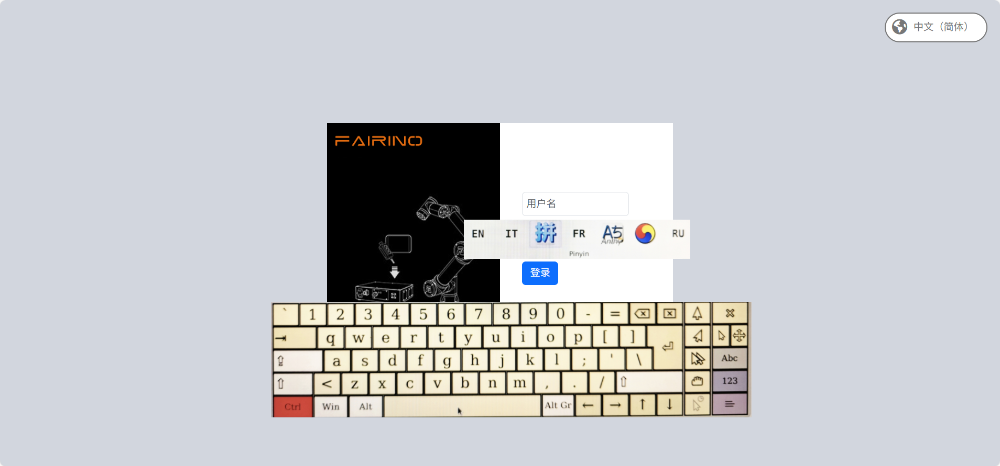

.. centered:: Figura 16.2‑5 Método de entrada pinyin chino

3. Cambiar al método de entrada en inglés

Hacer clic dos veces en la tecla CTRL; el estado de la tecla se vuelve rojo; hacer clic en la barra espaciadora para seleccionar el método de entrada; a continuación se muestra el método de entrada en inglés.

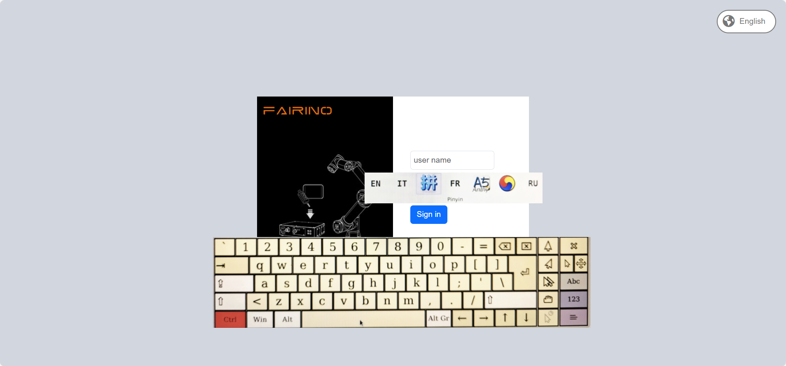

.. centered:: Figura 16.2‑6 Método de entrada en inglés

Tras iniciar sesión correctamente, el sistema carga los datos del modelo, etc.; una vez completada la carga, entra en la página inicial.

Idioma del teach pendant inconsistente con el de webApp
~~~~~~~~~~~~~~~~~~~~~~~~~~~~~~~~~~~~~~~~~~~~~~~~~~~~~~~

Tras habilitar el teach pendant, en la interfaz de inicio de sesión se activa la verificación del idioma del teach pendant y del idioma de webApp; cuando el idioma del teach pendant y el de webApp no coinciden, aparece el siguiente aviso.

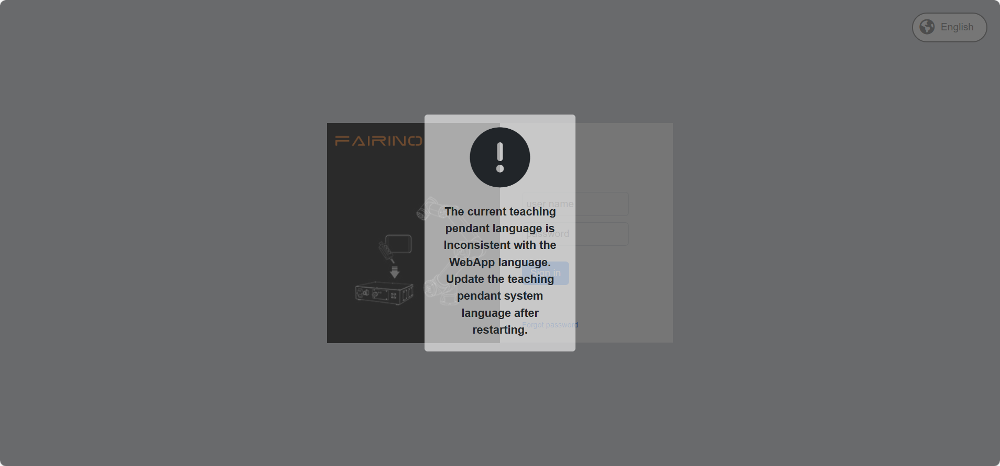

.. centered:: Figura 16.2‑7 Aviso de inconsistencia entre el idioma del teach pendant y el de webApp

Función de restablecimiento de IP del controlador y del teach pendant físico
----------------------------------------------------------------------------------

Descripción general de la función
~~~~~~~~~~~~~~~~~~~~~~~~~~~~~~~~~

Esta optimización añade la función de restablecimiento de IP del controlador y del teach pendant físico por distintas vías; mediante las siguientes operaciones se pueden realizar las siguientes funciones:

- 1. Mediante la interfaz webrecovery se puede restablecer la IP de la tarjeta de red 0 y de la tarjeta de red 1 de la caja de control;
- 2. Mediante la configuración de la función de restablecimiento de IP en la tecla personalizada F1 del teach pendant físico (pulsación larga de 10 segundos) se puede restablecer la IP de la tarjeta de red 0, de la tarjeta de red 1 y del teach pendant físico de la caja de control;
- 3. Mediante la combinación de teclas F2 y F4 del teach pendant físico, manteniéndolas pulsadas simultáneamente durante 10 segundos, se puede restablecer la IP del dispositivo teach pendant físico cuando el teach pendant físico no ha iniciado sesión.

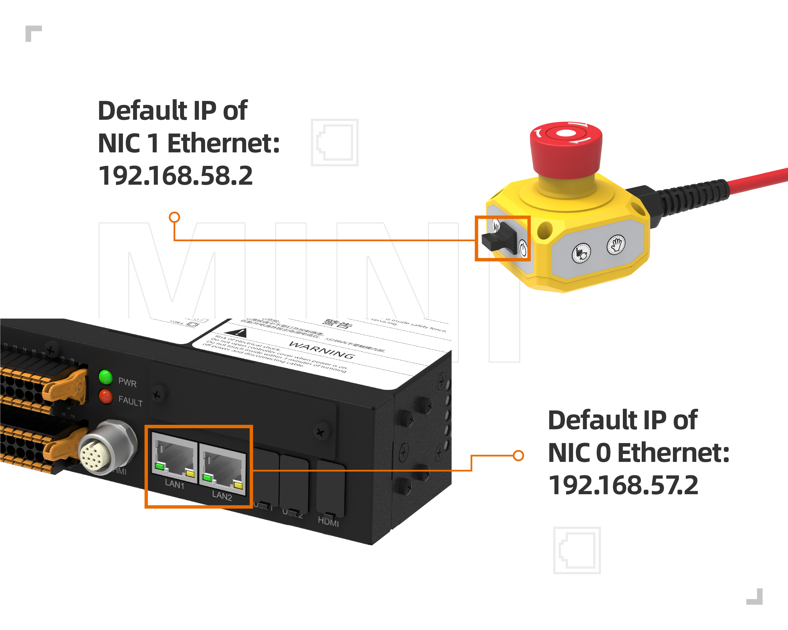

.. centered:: Figura 16.3‑1 Esquema de los puertos de red de la caja de control mini

Restablecimiento de IP en la interfaz Webrecovery
~~~~~~~~~~~~~~~~~~~~~~~~~~~~~~~~~~~~~~~~~~~~~~~~~

Acceder a la interfaz webrecovery mediante el puerto 8050, por ejemplo, iniciando sesión en la ip predeterminada: 192.168.57.2:8050; hacer clic en el botón "Restablecer" de restablecer la IP del controlador; la página mostrará una ventana emergente de segunda confirmación; tras hacer clic en aceptar, volver a hacer clic en el botón de restablecer la IP del controlador para confirmar el restablecimiento.

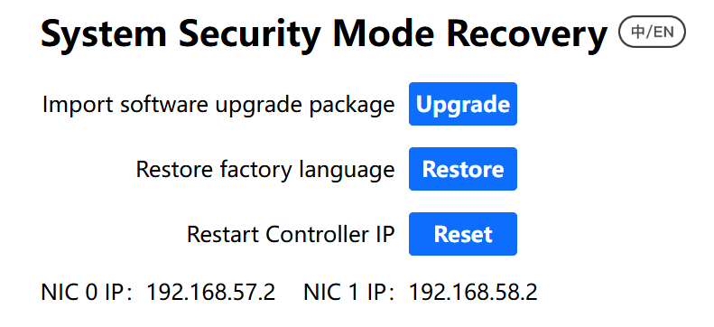

.. centered:: Figura 16.3‑2 Función de restablecimiento de IP en la interfaz Webrecovery

Tras la segunda confirmación se mostrará el aviso de que es necesario reiniciar para que surta efecto. Tras el reinicio, la IP de la tarjeta de red 0 del controlador se restablece a la predeterminada 192.168.57.2, y la IP de la tarjeta de red 1 se restablece a la predeterminada 192.168.58.2.

Restablecimiento de IP personalizado mediante la tecla F1 del teach pendant físico
~~~~~~~~~~~~~~~~~~~~~~~~~~~~~~~~~~~~~~~~~~~~~~~~~~~~~~~~~~~~~~~~~~~~~~~~~~~~~~~~~~~~~~~~~~~~~~~

Para utilizar la función personalizada de la tecla F1 del teach pendant físico es necesario iniciar sesión primero en la interfaz del teach pendant para configurar la función personalizada de la tecla F; hacer clic en "Configuración del sistema", hacer clic en "Configuración general", seleccionar el módulo del teach pendant, activar el interruptor de habilitación del teach pendant, configurar la tecla F1 como restablecer IP (pulsación larga de 10 segundos) y hacer clic en configurar.

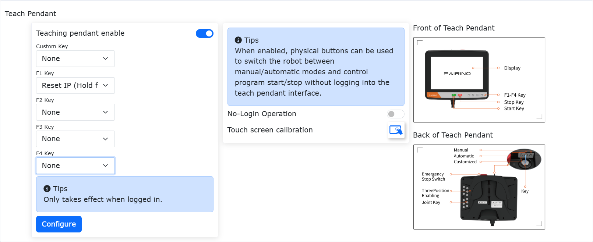

.. centered:: Figura 16.3‑4 Restablecimiento de IP personalizado mediante la tecla F1 del teach pendant físico

Esta función solo surte efecto cuando el teach pendant físico ha iniciado sesión en webapp; tras mantener pulsada la tecla F1 durante 10 segundos se mostrará el aviso de que es necesario reiniciar para que surta efecto. Tras el reinicio, la IP de la tarjeta de red 0 del controlador se restablece a la predeterminada 192.168.57.2, la IP de la tarjeta de red 1 se restablece a la predeterminada 192.168.58.2, y la IP del teach pendant físico se restablece a la predeterminada 192.168.58.77.

Restablecimiento de IP mediante la combinación de teclas F2 y F4 del teach pendant físico
~~~~~~~~~~~~~~~~~~~~~~~~~~~~~~~~~~~~~~~~~~~~~~~~~~~~~~~~~~~~~~~~~~~~~~~~~~~~~~~~~~~~~~~~~~~~~~~~~~~~~~

El dispositivo teach pendant físico ofrece la función de restablecimiento de IP; también se puede restablecer la IP del teach pendant físico cuando no está conectado a webapp. Mantener pulsadas simultáneamente las teclas F2 y F4 durante 10 segundos para restablecer la IP del teach pendant físico; la IP se restablece por defecto a 192.168.58.77. Tras el restablecimiento es necesario volver a iniciar sesión en webapp y, en Configuración del sistema-Configuración general, configurar la IP del teach pendant físico como 192.168.58.77; tras el reinicio, volver a establecer la conexión con el teach pendant.

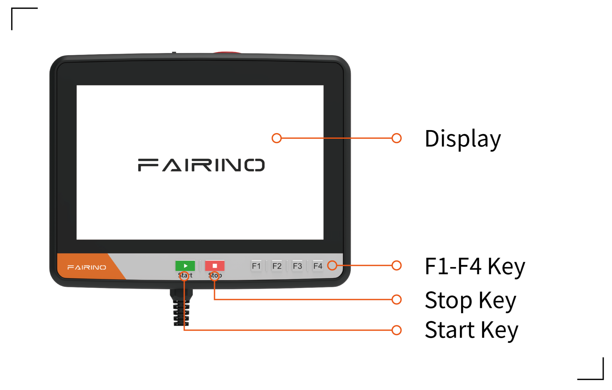

.. centered:: Figura 16.3‑6 Restablecimiento de IP mediante la combinación de teclas F2 y F4 del teach pendant físico

Función de personalización de las teclas del teach pendant
----------------------------------------------------------------------------------

Descripción general de la función
~~~~~~~~~~~~~~~~~~~~~~~~~~~~~~~~~

Este documento tiene como objetivo presentar cómo utilizar la función de personalización de las teclas del teach pendant.

Instrucciones de uso
~~~~~~~~~~~~~~~~~~~~

Configuración de la función
+++++++++++++++++++++++++++

1. Abrir el acceso e iniciar sesión en webApp;
   
2. Hacer clic en el menú "Configuración del sistema"-"Configuración general" de la barra de menú de la izquierda para entrar en la interfaz del módulo de configuración del teach pendant;

.. centered:: Figura 16.4‑1 Interfaz de configuración de las funciones de las teclas del teach pendant

3. Tras habilitar el teach pendant, se incluye la función personalizada de la llave y la configuración de las funciones de las teclas F1-F4. Entre ellas, la función personalizada de la llave se puede configurar como modo de arrastre, y las teclas F1-F4 se pueden configurar para restablecer IP (pulsación larga de 10 segundos), borrar errores con un clic, emitir DO, conmutar la habilitación e iniciar un programa Lua especificado.

Configuración de la llave personalizada como arrastre
+++++++++++++++++++++++++++++++++++++++++++++++++++++++++++++++++

1. Cuando la función personalizada de la llave está configurada como modo de arrastre y se ha iniciado sesión en WebApp, al girar la llave del teach pendant a la posición personalizada, la ventana emergente de la interfaz solicita confirmar la carga actual, para evitar caídas debidas a una carga incorrecta;

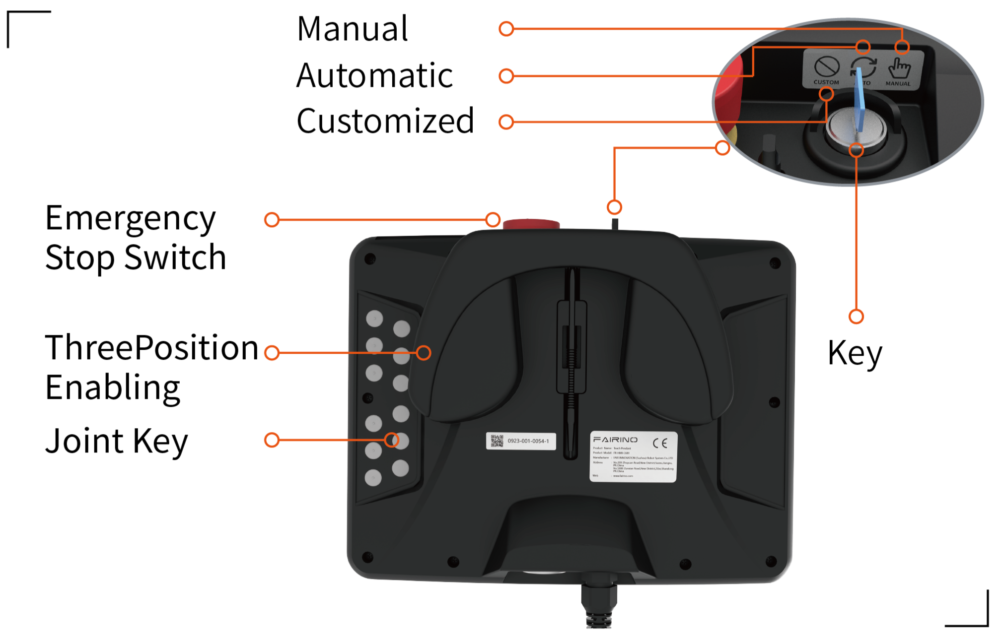

.. centered:: Figura 16.4‑2 Ejemplo del modo del teach pendant

2. Tras confirmar que la configuración de la carga es correcta, hacer clic en confirmar y el robot entra en el modo de arrastre.

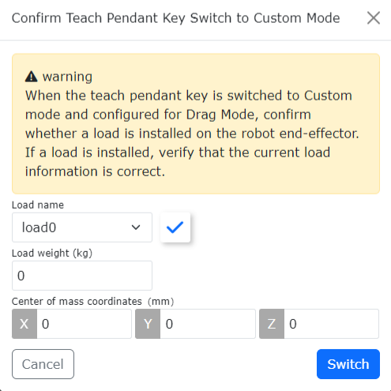

.. centered:: Figura 16.4‑3 Confirmación de la carga antes de configurar el modo de arrastre

Personalización de las funciones de las teclas F1-F4
++++++++++++++++++++++++++++++++++++++++++++++++++++

   
.. centered:: Figura 16.4‑4 Ejemplo de las teclas del teach pendant

1. **Función de restablecer IP (pulsación larga de 10 segundos)**: tras la configuración, al mantener pulsada la tecla durante 10 segundos se mostrará el aviso de que es necesario reiniciar para que surta efecto. Tras el reinicio, la IP de la tarjeta de red 0 del controlador se restablece a la predeterminada 192.168.57.2, la IP de la tarjeta de red 1 se restablece a la predeterminada 192.168.58.2, y la IP del teach pendant físico se restablece a la predeterminada 192.168.58.77.
   
2. **Función de borrado de errores con un clic**: cuando en la interfaz aparece un aviso de error, pulsar la tecla de función F correspondiente para borrar el error.
   
3. **Función de emisión de DO**: tras configurar esta función y establecer el número de DO, pulsar la tecla de función F correspondiente para conmutar el estado correspondiente al número de DO actual.
   
4. **Función de conmutación de habilitación**: tras configurar esta función, pulsar la tecla de función F correspondiente para conmutar el estado de habilitación actual.
   
5. **Inicio de programa Lua**: tras configurar esta función y establecer el programa Lua, pulsar la tecla de función F correspondiente y, con el robot en modo automático, se ejecutará automáticamente el programa Lua configurado.