Funciones básicas del software del teach pendant
================================================

.. toctree:: 
   :maxdepth: 6

Información básica
------------------

Introducción al sistema
~~~~~~~~~~~~~~~~~~~~~~~

El software del teach pendant es un software complementario desarrollado para el robot, que se ejecuta en el sistema operativo del teach pendant; sus funciones y características técnicas principales son las siguientes:

-  Permite la escritura de programas de enseñanza para el robot;
-  Permite mostrar en tiempo real las coordenadas de posición del robot, simular el robot físico en 3D y controlar el movimiento del robot;
-  Permite realizar el jog de un solo eje y el movimiento coordinado de varios ejes del robot;
-  Permite consultar el estado de las IO de control;
-  El usuario puede modificar la contraseña, consultar la información del sistema, etc.

Primera activación del robot
~~~~~~~~~~~~~~~~~~~~~~~~~~~~

1. Encender la caja de control y conectar el cable de red al PC.

2. Abrir el navegador en el PC y acceder a la dirección de destino 192.168.58.2; al encender el robot por primera vez se entra en la página de activación.

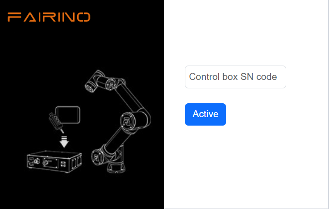

.. centered:: Figura 5.1‑1 Interfaz de activación

3. Introducir correctamente el código SN de la caja del equipo y, tras introducirlo, hacer clic en el botón "Activar".
   
4. El sistema verificará el código SN. Si la introducción es correcta, se completará automáticamente el proceso de activación.

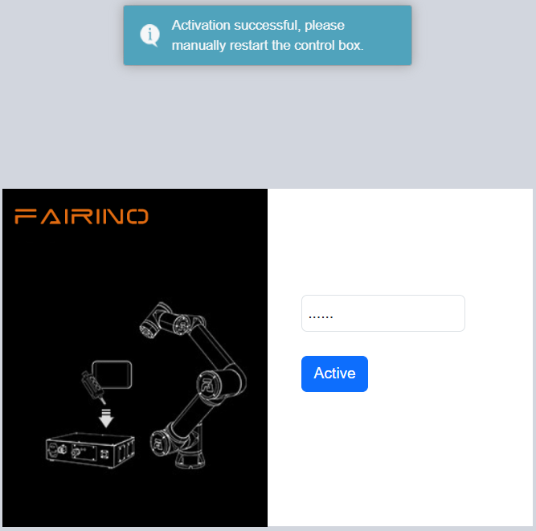

.. centered:: Figura 5.1‑2 Interfaz de activación correcta

5. Activación correcta; reiniciar manualmente la caja de control.
   
6. Al volver a encender y acceder a la dirección de destino 192.168.58.2 se entra en la página de inicio de sesión.

Inicio del software
~~~~~~~~~~~~~~~~~~~~~~~~~~~~~~~

1. Encender la caja de control;
2. Abrir el navegador en el teach pendant y acceder a la dirección de destino 192.168.58.2;
3. Introducir el nombre de usuario y la contraseña y hacer clic en iniciar sesión para acceder al sistema.

Inicio de sesión del usuario y actualización de permisos
~~~~~~~~~~~~~~~~~~~~~~~~~~~~~~~~~~~~~~~~~~~~~~~~~~~~~~~~~~~~~~~~~~~

.. centered:: Tabla 5.1-1 Usuarios iniciales

.. list-table::
   :widths: 70 70 70 70
   :header-rows: 0
   :align: center

   * - **Número de empleado**
     - **Nombre de usuario inicial**
     - **Contraseña**
     - **Código de función**

   * - 111
     - admin
     - 123
     - 1

   * - 222
     - MEenginer
     - 222
     - 2

   * - 333
     - PEenginer
     - 333
     - 3
   
   * - 444
     - programmer
     - 444
     - 4
   
   * - 555
     - operator
     - 555
     - 5

   * - 666
     - monitor
     - 666
     - 6

Los usuarios (para la gestión de usuarios, consulte 15.2.1 Gestión de usuarios) se dividen por defecto en seis niveles: el administrador no tiene limitaciones de funciones; el operador y el monitor pueden utilizar una minoría de funciones; el ingeniero ME, el ingeniero PE&PQE y el técnico&jefe de equipo tienen algunas funciones limitadas; el administrador no tiene limitaciones de funciones. Para los permisos predeterminados concretos de los códigos de función, consulte 15.2.2 Gestión de permisos.

La interfaz de inicio de sesión se muestra en la figura siguiente:

.. centered:: Figura 5.1‑3 Interfaz de inicio de sesión

Configuración multilingüe
~~~~~~~~~~~~~~~~~~~~~~~~~

- El sistema incorpora actualmente 11 idiomas: chino (simplificado), chino (tradicional), inglés (English), francés (français), coreano (한국어), japonés (日本語), ruso (Русский), italiano (italiano), alemán (Deutsch), portugués (Português) y polaco (Polski).

- El nombre del paquete de idioma debe ser: [código de idioma].json, por ejemplo: es.json, donde el código de idioma sigue la norma ISO 639-1.
  
- A continuación se muestra la tabla de correspondencia de idiomas

.. list-table::
   :widths: 70 70 70 70
   :header-rows: 0
   :align: center

   * - **Idioma**
     - **Nombre del idioma local**
     - **Código de idioma (ISO 639-1)**
     - **¿Incluido en el sistema?**

   * - Chino
     - 中文（汉语）
     - zh
     - Sí

   * - Chino
     - 中文（繁體）
     - tc
     - Sí

   * - Inglés
     - English
     - en
     - Sí

   * - Francés
     - français
     - fr
     - Sí
   
   * - Japonés
     - 日本語
     - ja 
     - Sí

   * - Coreano
     - 한국어
     - ko
     - Sí

   * - Ruso
     - Русский
     - ru
     - Sí

   * - Italiano
     - italiano
     - it
     - Sí

   * - Alemán
     - Deutsch
     - de
     - Sí

   * - Portugués
     - Português
     - pt
     - Sí

   * - Polaco
     - Polski
     - pl
     - Sí

1. En la interfaz de inicio de sesión (o en la interfaz de primera activación, en cualquiera de las dos se puede configurar), realizar la selección de idioma en la esquina superior derecha;

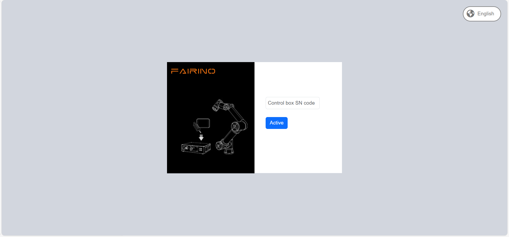

.. centered:: Figura 5.1‑5 Configuración del idioma en la interfaz de activación

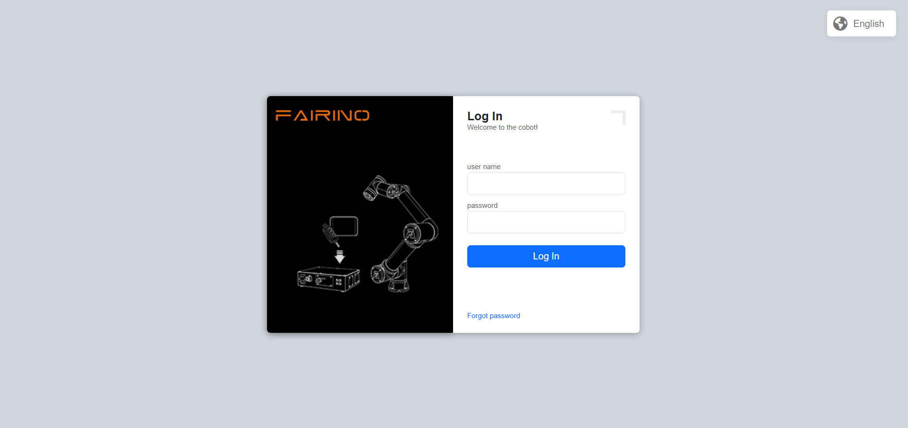

.. centered:: Figura 5.1‑6 Configuración del idioma en la interfaz de inicio de sesión

2. Tomando como ejemplo la configuración multilingüe en la interfaz de inicio de sesión, si se selecciona un idioma, el contenido del idioma de la página actual se conmuta al idioma seleccionado, por ejemplo:

.. centered:: Figura 5.1‑7 Página de inicio de sesión en chino

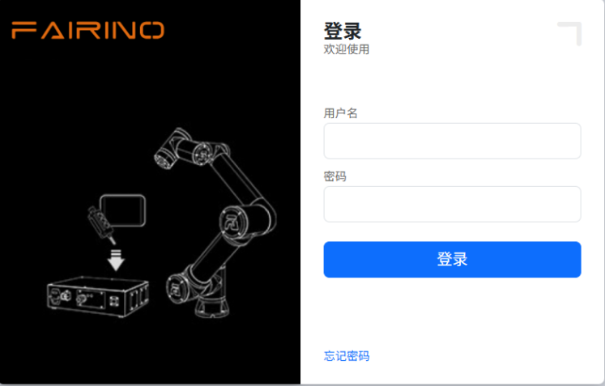

.. centered:: Figura 5.1‑8 Página de inicio de sesión en inglés

Tras iniciar sesión correctamente, el sistema carga los datos del modelo, etc.; una vez completada la carga, entra en la página inicial.

Interfaz inicial del sistema
----------------------------

Tras iniciar sesión correctamente, el sistema entra en la "interfaz inicial", que contiene principalmente:

1. LOGO de FAIRINO;
2. Botón de zoom de la barra de menú;
3. Barra de menú;
4. Área de control del robot
5. Área de estado del robot;
6. Robot simulado en 3D——operación de la escena 3D;
7. Robot simulado en 3D——operación del cuerpo del robot;
8. Funciones complementarias del robot;
9. Estado del robot y de las funciones complementarias.

Como se muestra en la figura siguiente del esquema de la interfaz inicial del sistema:

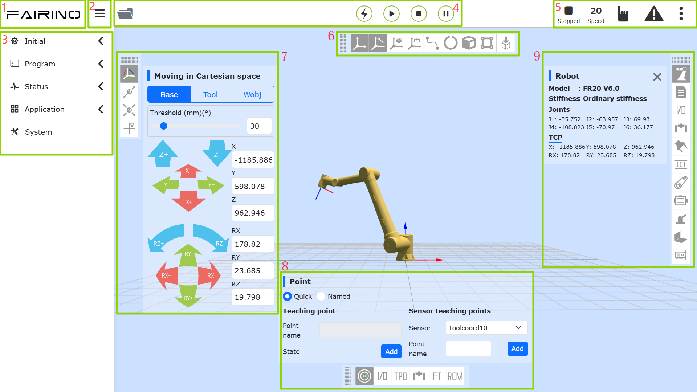

.. centered:: Figura 5.2‑1 Esquema de la interfaz inicial del sistema

Al entrar en "Configuración inicial", en "Programa de enseñanza"->"Programación de programas", en "Programa de enseñanza"->"Programación gráfica" y en las aplicaciones auxiliares de WebApp, la página del modelo del robot simulado en 3D se encuentra semiexpandida; hacer clic en el icono de expansión para volver a entrar en la interfaz inicial del sistema.

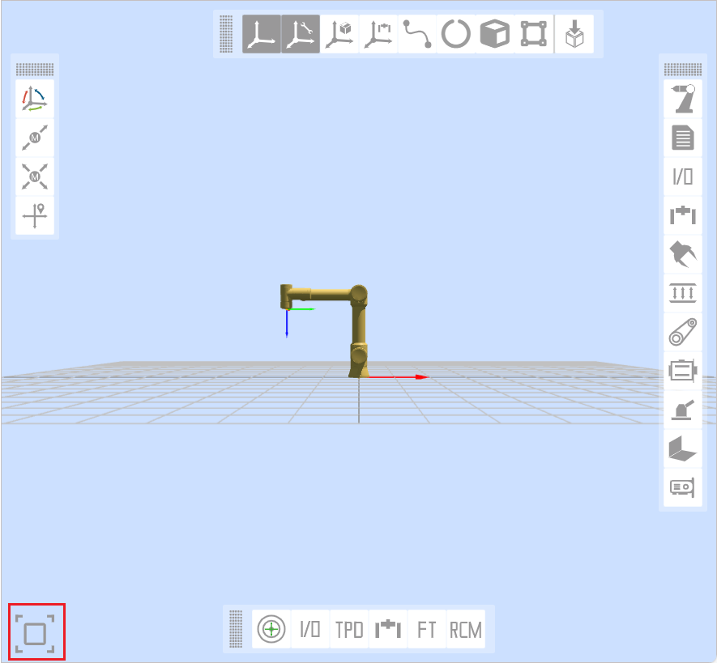

.. centered:: Figura 5.2‑2 Icono de expansión de la página del modelo del robot simulado en 3D

Área de control
~~~~~~~~~~~~~~~

.. note:: 
   .. image:: teaching_pendant_software/003.png
      :width: 0.75in
      :height: 0.75in
      :align: left

   Nombre: **Botón de habilitación**
   
   Función: habilitar el robot

.. note:: 
   .. image:: teaching_pendant_software/004.png
      :width: 0.75in
      :height: 0.75in
      :align: left

   Nombre: **Botón de inicio**
   
   Función: cargar e iniciar la ejecución del programa de enseñanza

.. note:: 
   .. image:: teaching_pendant_software/005.png
      :width: 0.75in
      :height: 0.75in
      :align: left

   Nombre: **Botón de parada**
   
   Función: detener la ejecución del programa de enseñanza actual

.. note:: 
   .. image:: teaching_pendant_software/006.png
      :width: 0.75in
      :height: 0.75in
      :align: left

   Nombre: **Botón de pausa/reanudación**
   
   Función: pausar y reanudar el programa de enseñanza actual
   
.. important::
   La instrucción de pausa está al final del programa, no se puede realizar la comprobación

Barra de estado
~~~~~~~~~~~~~~~

.. note:: 
   .. image:: teaching_pendant_software/011.png
      :width: 0.75in
      :height: 0.75in
      :align: left

   Nombre: **Estado de error de ejecución del robot**
   
   Función: el robot actual tiene un error de ejecución; se oculta cuando no hay error

.. note:: 
   .. image:: teaching_pendant_software/007.png
      :width: 0.75in
      :height: 0.75in
      :align: left

   Nombre: **Estado del robot**
   
   Función: Stopped-detenido, Running-en ejecución, Pause-pausado, Drag-arrastre

.. note:: 
   .. image:: teaching_pendant_software/010.png
      :width: 0.75in
      :height: 0.75in
      :align: left

   Nombre: **Sistema de coordenadas de herramienta del robot, sistema de coordenadas de pieza, sistema de coordenadas de eje extendido y número de carga**
   
   Función: arriba a la izquierda——número del sistema de coordenadas de herramienta actual, arriba a la derecha——número del sistema de coordenadas de pieza actual, abajo a la izquierda——número del sistema de coordenadas de eje extendido actual, abajo a la derecha——número de carga actual

.. note:: 
   .. image:: teaching_pendant_software/009.png
      :width: 0.75in
      :height: 0.75in
      :align: left

   Nombre: **Porcentaje de velocidad de ejecución**
   
   Función: velocidad de ejecución del robot en el modo actual

.. note:: 
   .. image:: teaching_pendant_software/012.png
      :width: 0.75in
      :height: 0.75in
      :align: left

   Nombre: **Modo automático**
   
   Función: modo de funcionamiento automático del robot; al activar el ajuste de velocidad global del cambio de modo manual a automático y especificar la velocidad, la velocidad global se ajustará automáticamente a la velocidad especificada

.. note:: 
   .. image:: teaching_pendant_software/013.png
      :width: 0.75in
      :height: 0.75in
      :align: left

   Nombre: **Modo manual**
   
   Función: modo manual del robot, para realizar operaciones de enseñanza del robot

.. note:: 
   .. image:: teaching_pendant_software/065.png
      :width: 0.75in
      :height: 0.75in
      :align: left

   Nombre: **Botón de plegado/despliegue del estado del robot**
   
   Función: plegar/desplegar el sistema de coordenadas de herramienta, el sistema de coordenadas de pieza, el sistema de coordenadas de eje extendido, la carga, el estado de arrastre del robot, el modo local/remoto, el estado de conexión del robot, el modo BOOT y el contenido de la información de la cuenta

Hacer clic en el botón de plegado para ver el siguiente contenido de información de estado.

.. note:: 
   .. image:: teaching_pendant_software/008.png
      :width: 0.75in
      :height: 0.75in
      :align: left

   Nombre: **Número del sistema de coordenadas de herramienta**
   
   Función: mostrar el número del sistema de coordenadas de herramienta aplicado actualmente

.. note:: 
   .. image:: teaching_pendant_software/027.png
      :width: 0.75in
      :height: 0.75in
      :align: left

   Nombre: **Número del sistema de coordenadas de pieza**
   
   Función: mostrar el número del sistema de coordenadas de pieza aplicado actualmente
   
.. note:: 
   .. image:: teaching_pendant_software/028.png
      :width: 0.75in
      :height: 0.75in
      :align: left

   Nombre: **Número del sistema de coordenadas de eje extendido**
   
   Función: mostrar el número del sistema de coordenadas de eje extendido aplicado actualmente

.. note:: 
   .. image:: teaching_pendant_software/066.png
      :width: 0.75in
      :height: 0.75in
      :align: left

   Nombre: **Carga**
   
   Función: mostrar el peso de la carga aplicada actualmente y las coordenadas del centro de masa X, Y, Z

.. note:: 
   .. image:: teaching_pendant_software/014.png
      :width: 0.75in
      :height: 0.75in
      :align: left

   Nombre: **Estado de arrastre del robot**
   
   Función: el robot actual se puede arrastrar

.. note:: 
   .. image:: teaching_pendant_software/015.png
      :width: 0.75in
      :height: 0.75in
      :align: left

   Nombre: **Estado de arrastre del robot**
   
   Función: el robot actual no se puede arrastrar

.. note:: 
   .. image:: teaching_pendant_software/068.png
      :width: 0.75in
      :height: 0.75in
      :align: left

   Nombre: **Modo local del robot**
   
   Función: el robot actual se controla a través de la caja de control

.. note:: 
   .. image:: teaching_pendant_software/067.png
      :width: 0.75in
      :height: 0.75in
      :align: left

   Nombre: **Modo remoto del robot**
   
   Función: el robot actual solo se puede controlar a través del PLC

.. note:: 
   .. image:: teaching_pendant_software/017.png
      :width: 0.75in
      :height: 0.75in
      :align: left

   Nombre: **Estado de conexión**
   
   Función: robot conectado

.. note:: 
   .. image:: teaching_pendant_software/016.png
      :width: 0.75in
      :height: 0.75in
      :align: left

   Nombre: **Estado de no conexión**
   
   Función: robot no conectado

.. note:: 
   .. image:: teaching_pendant_software/018.png
      :width: 0.75in
      :height: 0.75in
      :align: left

   Nombre: **Información de la cuenta**
   
   Función: mostrar el nombre de usuario y los permisos y cerrar la sesión del usuario

Barra de menú
~~~~~~~~~~~~~

La barra de menú se muestra en la tabla siguiente:

.. centered:: Tabla 5.2‑1 Distribución de la barra de menú del teach pendant

+---------------------------+--------------------------------+
|  Primer nivel             |  Segundo nivel                 |
+===========================+================================+
| Configuración inicial     | Básico                         |
+                           +--------------------------------+
|                           | Seguridad                      |
+                           +--------------------------------+
|                           | Periféricos                    |
+---------------------------+--------------------------------+
| Programa de enseñanza     | Programación de programas      |
+                           +--------------------------------+
|                           | Programación gráfica           |
+                           +--------------------------------+
|                           | Programación por grafo de nodos|
+                           +--------------------------------+
|                           | Puntos de enseñanza            |
+---------------------------+--------------------------------+
| Información de estado     | Registro del sistema           |
+                           +--------------------------------+
|                           | Consulta de estado             |
+---------------------------+--------------------------------+
| Aplicaciones auxiliares   | Aplicación de herramientas     |
+                           +--------------------------------+
|                           | Paquete de proceso             |
+---------------------------+--------------------------------+
| Configuración del sistema | /                              |
+---------------------------+--------------------------------+

Robot simulado en 3D
--------------------

Barra de operación de la escena 3D
~~~~~~~~~~~~~~~~~~~~~~~~~~~~~~~~~~

Visualización tridimensional del sistema de coordenadas del robot
++++++++++++++++++++++++++++++++++++++++++++++++++++++++++++++++++

En el área virtual 3D del robot de WebAPP se crean diversos sistemas de coordenadas virtuales 3D; tomando como ejemplo la visualización del sistema de coordenadas base, se muestra en la figura siguiente. El eje X es rojo, el eje Y es verde y el eje Z es azul.

.. note:: 
   .. image:: teaching_pendant_software/021.png
      :width: 0.75in
      :height: 0.75in
      :align: left

   Nombre: **Sistema de coordenadas base**
   
   Descripción: el sistema de coordenadas base se muestra activado por defecto en el área virtual 3D del robot del sistema en WebAPP, fijado en el centro de la parte inferior de la base del robot. El sistema de coordenadas base virtual 3D se puede desactivar manualmente.

.. note:: 
   .. image:: teaching_pendant_software/022.png
      :width: 0.75in
      :height: 0.75in
      :align: left

   Nombre: **Sistema de coordenadas de herramienta**
   
   Descripción: el sistema de coordenadas de herramienta se muestra activado por defecto y se puede desactivar manualmente. Tras iniciar WebAPP e iniciar sesión correctamente el usuario, se obtiene el nombre del sistema de coordenadas de herramienta aplicado actualmente y los datos de parámetros correspondientes, y se inicializa el sistema de coordenadas de herramienta actual.

.. important::
   Al aplicar otros sistemas de coordenadas de herramienta durante el uso, tras aplicar correctamente la instrucción del sistema de coordenadas de herramienta, se borra primero el sistema de coordenadas de herramienta existente en el área virtual 3D del robot y, a continuación, se pasan los datos de parámetros del sistema de coordenadas de herramienta recién aplicado a la API de generación de sistemas de coordenadas 3D para generar el sistema de coordenadas de herramienta; tras la generación se completa la visualización correspondiente en el área virtual 3D del robot.

.. note:: 
   .. image:: teaching_pendant_software/023.png
      :width: 0.75in
      :height: 0.75in
      :align: left

   Nombre: **Sistema de coordenadas de pieza**
   
   Descripción: el sistema de coordenadas de pieza está desactivado por defecto y se puede activar manualmente para su visualización. El proceso es idéntico al del sistema de coordenadas de herramienta.

.. note:: 
   .. image:: teaching_pendant_software/024.png
      :width: 0.75in
      :height: 0.75in
      :align: left

   Nombre: **Sistema de coordenadas de eje externo**
   
   Descripción: el sistema de coordenadas de eje externo está desactivado por defecto y se puede activar manualmente para su visualización. El proceso es idéntico al del sistema de coordenadas de herramienta.

Trayectoria virtual 3D y modelo de herramienta
+++++++++++++++++++++++++++++++++++++++++++++++++++++++++

.. note:: 
   .. image:: teaching_pendant_software/020.png
      :width: 0.75in
      :height: 0.75in
      :align: left

   Nombre: **Dibujo de trayectoria**
   
   Descripción: hacer clic en el botón para activar la función de dibujo de trayectoria. Durante la ejecución del programa de enseñanza, el modelo 3D del robot dibuja la ruta de la trayectoria del movimiento del robot.

.. note:: 
   .. image:: teaching_pendant_software/029.png
      :width: 0.75in
      :height: 0.75in
      :align: left

   Nombre: **Modelo de herramienta**
   
   Descripción: hacer clic en el botón para activar/desactivar el modelo de herramienta.

Barra de operación del cuerpo del robot
~~~~~~~~~~~~~~~~~~~~~~~~~~~~~~~~~~~~~~~

TCP
+++

**Jog Base**: en el sistema de coordenadas base, se puede controlar el robot manteniendo pulsado el botón del sistema de coordenadas correspondiente para desplazarlo en línea recta a lo largo de los ejes X, Y, Z o girar alrededor de RX, RY, RZ. La función del jog Base es similar a la del jog de un solo eje en el movimiento Joint. La interfaz se muestra en la figura siguiente:

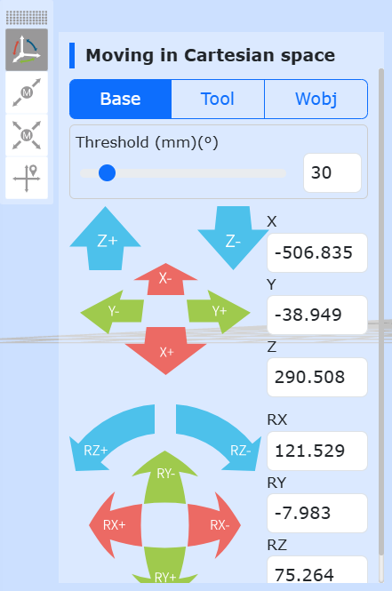

.. centered:: Figura 5.3-1 Esquema del jog Base

.. important:: 
   El botón se puede soltar en cualquier momento para detener el movimiento del robot. En caso necesario, pulsar el botón de parada de emergencia para detener el robot.

**Jog Tool**: seleccionar el sistema de coordenadas de herramienta; se puede controlar el robot manteniendo pulsado el botón del sistema de coordenadas correspondiente para desplazarlo en línea recta a lo largo de los ejes X, Y, Z o girar alrededor de RX, RY, RZ. La función del jog Tool es similar a la del jog de un solo eje en el movimiento Joint. La interfaz se muestra en la figura siguiente:

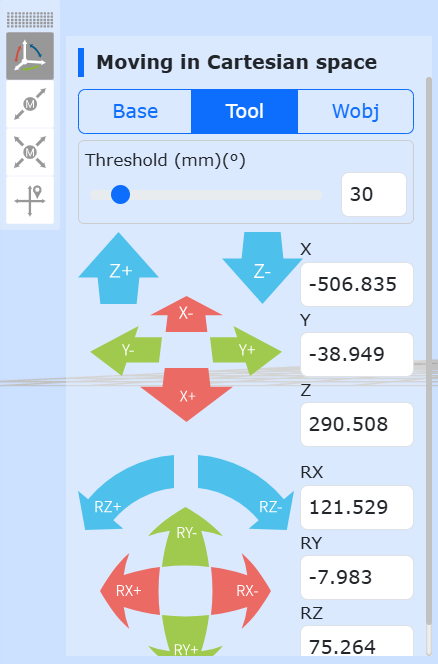

.. centered:: Figura 5.3-2 Esquema del jog Tool

**Jog Wobj**: seleccionar el jog de pieza; se puede controlar el robot manteniendo pulsado el botón del sistema de coordenadas correspondiente para desplazarlo en línea recta a lo largo de los ejes X, Y, Z o girar alrededor de RX, RY, RZ bajo el sistema de coordenadas de pieza. La función del jog Wobj es similar a la del jog de un solo eje en el movimiento Joint. La interfaz se muestra en la figura siguiente:

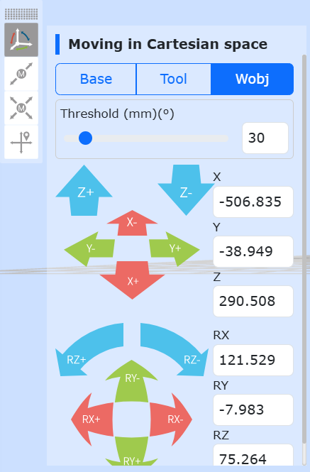

.. centered:: Figura 5.3-3 Esquema del jog Wobj

Movimiento Joint
++++++++++++++++

En el funcionamiento Joint, las 6 barras deslizantes centrales representan respectivamente el ángulo del eje correspondiente; el movimiento joint se divide en jog de un solo eje y movimiento coordinado de varios ejes.

**Jog de un solo eje**: el usuario puede controlar el movimiento del robot operando los botones circulares de ambos lados, como se muestra en la figura siguiente. En modo manual y con el sistema de coordenadas articular, realizar la operación de rotación de una articulación del robot. Cuando el robot se detiene por superar el rango de movimiento (límite suave), se puede utilizar el jog de un solo eje para realizar la operación manual y sacar el robot de la posición fuera de límite. El jog de un solo eje resulta más rápido y cómodo que otros modos de operación al realizar un posicionamiento aproximado y desplazamientos de mayor amplitud.

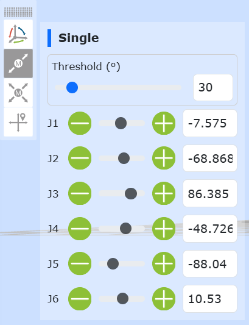

.. centered:: Figura 5.3-4 Esquema del jog de un solo eje

.. important::
   Configurar el parámetro "Umbral de movimiento por pulsación larga" (distancia máxima de funcionamiento del robot al mantener pulsado el botón; el rango de valores de entrada es 0~300); mantener pulsado el botón circular para controlar el funcionamiento del robot; si se suelta el botón durante el funcionamiento del robot, este se detiene inmediatamente; si se mantiene pulsado el botón sin soltarlo, el robot se detiene tras recorrer el valor establecido en el umbral de movimiento por pulsación larga.

**Movimiento coordinado de varios ejes**: el usuario puede operar las seis barras deslizantes centrales para ajustar la posición objetivo correspondiente del robot, como se muestra en la figura siguiente. Se puede determinar la posición objetivo observando el robot virtual 3D; si la posición ajustada no cumple las expectativas, hacer clic en el botón "Restablecer" para que el robot virtual 3D vuelva a la posición inicial. Cuando el usuario determine la posición objetivo, puede hacer clic en el botón "Aplicar" y el robot físico realizará el movimiento correspondiente.

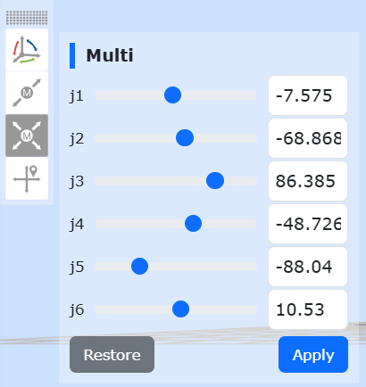

.. centered:: Figura 5.3-5 Esquema del movimiento coordinado de varios ejes

.. important:: 
   En el movimiento coordinado de varios ejes, el valor configurado para la quinta articulación j5 no puede ser inferior a 0.01 grados; si el valor esperado es inferior a 0.01 grados, se puede configurar primero en 0.011 grados y, a continuación, ajustar finamente la quinta articulación j5 mediante el jog de un solo eje.

Movimiento Move
+++++++++++++++

Al seleccionar el movimiento Move, se pueden introducir directamente los valores de coordenadas cartesianas; hacer clic en "Calcular posición articular" y la posición articular se mostrará como el resultado del cálculo; tras confirmar que no hay peligro, se puede hacer clic en "Mover a este punto" para controlar el movimiento del robot hasta la pose cartesiana introducida.

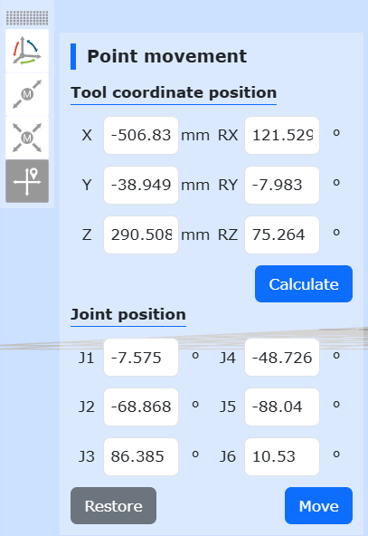

.. centered:: Figura 5.3‑6 Esquema del movimiento Move

.. important:: 
   Cuando la pose dada no se pueda alcanzar, comprobar primero si la pose en el espacio cartesiano supera el rango de trabajo del robot y, a continuación, comprobar si existe una pose singular en el proceso desde la pose actual hasta la pose objetivo; si existe una posición singular, ajustar la actitud actual o insertar una nueva pose en el proceso para evitar la pose singular.

Barra de funciones complementarias del robot
~~~~~~~~~~~~~~~~~~~~~~~~~~~~~~~~~~~~~~~~~~~~

Registro de puntos de enseñanza
+++++++++++++++++++++++++++++++

El área de control de la enseñanza manual se utiliza principalmente para configurar el sistema de coordenadas de referencia en el modo de enseñanza y mostrar en tiempo real los ángulos de cada eje y los valores de coordenadas del robot, y permite nombrar y guardar los puntos de enseñanza.

Al guardar el punto de enseñanza, el sistema de coordenadas de dicho punto de enseñanza es el sistema de coordenadas aplicado actualmente por el robot.

El registro de puntos de enseñanza se divide en dos modos: "Registro rápido de punto" y "Registro con nombre de punto".

- Registro rápido de punto: el punto de enseñanza se registra automáticamente y el nombre se genera automáticamente;
- Registro con nombre de punto: el nombre del punto de enseñanza se personaliza y se compone del prefijo del punto de enseñanza + el nombre del punto de enseñanza;

Punto de enseñanza de sensor: seleccionar la herramienta de tipo sensor ya calibrada, introducir el nombre del punto y hacer clic en añadir; la posición del punto guardado es la posición del punto identificado por el sensor.

.. centered:: Figura 5.3‑7 Esquema del área de operación manual

.. important:: 
   La primera vez que se utilice, configurar un valor de velocidad pequeño como 30 para familiarizarse con el movimiento del robot y evitar situaciones accidentales.

I/O
+++

En esta interfaz se puede realizar el control manual de las salidas digitales, las salidas analógicas (0-10v) de la caja de control del robot y las salidas digitales y analógicas (0-10v) de la herramienta del extremo. Como se muestra en la figura siguiente:

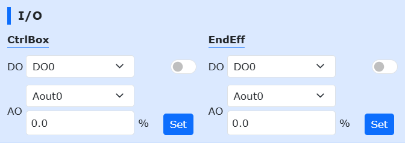

.. centered:: Figura 5.3‑8 Esquema de configuración de I/O

TPD (enseñanza y programación)
++++++++++++++++++++++++++++++

Los pasos de operación de la función de enseñanza y programación (TPD) son los siguientes:

- **Step1 Registrar la posición inicial**: entrar en el área de operación de la parte izquierda del modelo 3D y registrar la posición actual del robot. Configurar el nombre del punto en el cuadro de edición y hacer clic en el botón "Guardar"; si el guardado es correcto, se mostrará el aviso "Punto guardado correctamente";

- **Step2 Configurar los parámetros de registro de trayectoria**: hacer clic en TPD para entrar en el elemento de función "TPD" y configurar los parámetros de registro de trayectoria: establecer el nombre del archivo de trayectoria, el tipo de pose y el período de muestreo, y configurar DI y DO; durante el proceso de registro de la trayectoria TPD se puede registrar, mediante la activación de DI, el DO correspondiente que se necesita emitir;

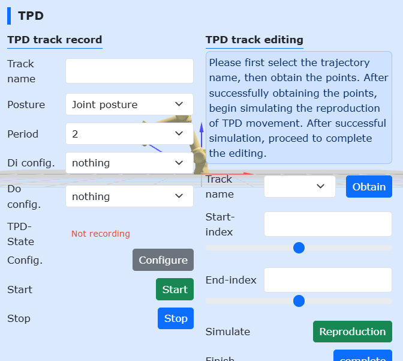

.. centered:: Figura 5.3‑9 Registro de trayectoria TPD

- **Step3 Comprobar el modo del robot**: comprobar si el robot se encuentra en modo manual; si no es así, cambiar al modo manual. En el modo manual se puede cambiar al modo de enseñanza por arrastre de dos formas: una manteniendo pulsado el botón del extremo y otra mediante el botón de cambio al modo de arrastre de la interfaz; en el registro TPD se recomienda cambiar el robot al modo de enseñanza por arrastre desde la interfaz.

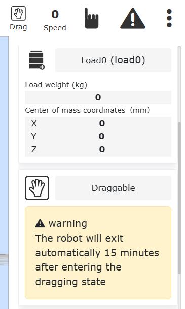

.. centered:: Figura 5.3‑10 Modo del robot

.. important:: 
   Al entrar en el modo de arrastre desde la interfaz, confirmar primero si la carga de la herramienta del extremo y el centro de masa están configurados correctamente y si el coeficiente de compensación de fricción está configurado razonablemente; a continuación, confirmar mediante la pulsación larga del botón del extremo si el arrastre es normal; tras confirmarlo, entrar en el modo de arrastre desde la interfaz.

- **Step4 Iniciar el registro**: hacer clic en el botón "Iniciar registro" para comenzar el registro de trayectoria y arrastrar el robot para realizar la enseñanza de movimientos. Además, en la configuración de DI del extremo existe la opción de configuración "Inicio/detención del registro TPD"; mediante la configuración de esta función, el usuario puede activar por señal externa la función de registro de trayectoria "Iniciar registro"; tenga en cuenta que para iniciar el registro de trayectoria mediante señal externa es necesario configurar primero en la página la información de la trayectoria TPD.

- **Step5 Detener el registro**: tras completar la enseñanza de movimientos, hacer clic en el botón "Detener registro" para detener el registro de trayectoria y, a continuación, mediante el botón de cambio de la enseñanza por arrastre, hacer que el robot salga del modo de enseñanza por arrastre. El teach pendant recibe "Registro de trayectoria detenido correctamente", lo que indica que el registro de trayectoria se ha realizado correctamente. Igual que en el paso 4, tras configurar la función "Inicio/detención del registro TPD", se puede activar la detención del registro mediante señal externa.

- **Step6 Enseñanza y programación**: hacer clic en nuevo, seleccionar la plantilla en blanco, hacer clic para entrar en el elemento de programación de la función PTP, seleccionar el punto de posición inicial recién guardado y hacer clic en el botón "Añadir"; tras aplicar, en el archivo de programa se mostrará una instrucción PTP; a continuación, hacer clic para entrar en el elemento de programación de la función TPD, seleccionar la trayectoria recién registrada, configurar si hay suavizado y la proporción de escala de velocidad, y hacer clic en el botón "Añadir"; tras aplicar, en el archivo de programa se mostrará una instrucción MoveTPD, como se muestra en la figura siguiente;

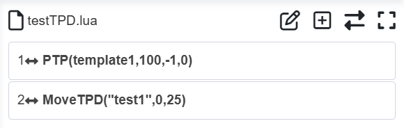

.. centered:: Figura 5.3‑11 Programación TPD

- **Step7 Reproducción de trayectoria**: tras completar la edición del programa de enseñanza, cambiar al modo de funcionamiento automático y hacer clic en el icono "Iniciar ejecución" de la parte superior de la interfaz para iniciar la ejecución del programa; el robot comienza a reproducir el movimiento enseñado.

- **Step8 Edición de trayectoria**: el área de edición de trayectoria TPD permite la visualización y la edición y recorte de la trayectoria, para lograr el preanálisis y la simplificación de la trayectoria TPD. Seleccionar el punto de obtención de la trayectoria correspondiente y los puntos de trayectoria registrados por el usuario se mostrarán en el espacio 3D del robot; a continuación, el usuario puede arrastrar las barras deslizantes "Start" y "End" para simular la reproducción y recortar el punto inicial y el punto final de la trayectoria.

Eliminación de archivos TPD y tratamiento de anomalías:

- **Eliminación de archivo de trayectoria**: hacer clic para entrar en el elemento de función TPD, seleccionar el archivo de trayectoria que se desea eliminar y hacer clic en el botón "Eliminar trayectoria"; si la eliminación es correcta, se recibirá el aviso de eliminación correcta.

- **Tratamiento de anomalías:**

  +  **Número de puntos de instrucción fuera de límite**: una trayectoria puede registrar como máximo 20.000 puntos; cuando se superan los 20.000 puntos, el controlador deja de registrar los puntos excedentes y envía al teach pendant el aviso de alarma "Número de puntos de instrucción fuera de límite"; en este momento es necesario hacer clic en detener registro;

  +  **Intervalo de instrucción TPD demasiado grande**: si el teach pendant informa del error de intervalo de instrucción TPD demasiado grande, debe comprobarse si el robot ha vuelto a la posición inicial previa al registro; si el robot ha vuelto a la posición inicial y sigue informando del error de intervalo de instrucción TPD demasiado grande, eliminar la trayectoria actual y volver a registrar una nueva trayectoria;

  +  Si durante la operación TPD se producen otras situaciones anómalas, debe detenerse inmediatamente la operación del robot mediante el teach pendant o el botón de parada de emergencia y comprobar la causa.

.. important:: 
   Durante la operación de la función TPD deben seguirse estrictamente las indicaciones correspondientes del teach pendant.

Movimiento Eaxis
++++++++++++++++

Seleccionar el movimiento Eaxis; esta función es la función de jog del eje extendido; es necesario, con el eje extendido ya configurado, utilizar esta función de jog para controlar el eje extendido; consulte "Capítulo 4-Periféricos del robot-Configuración de periféricos de eje extendido".

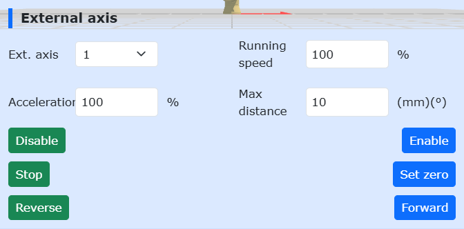

.. centered:: Figura 5.3‑12 Esquema del movimiento Eaxis

FT
++

Seleccionar el sistema de coordenadas de referencia como referencia para el arrastre del sensor de fuerza.

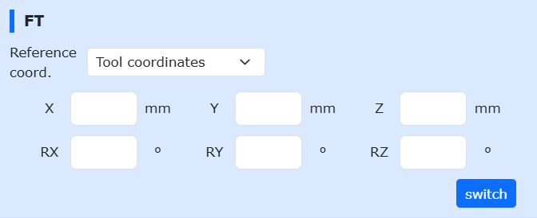

.. centered:: Figura 5.3‑12 Esquema de FT

Punto fijo remoto
+++++++++++++++++

Esta función se aplica principalmente a la penetración médica; tras configurar el punto fijo remoto, el extremo del robot se mueve siempre en dicho punto.

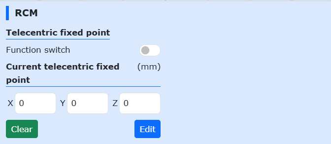

.. centered:: Figura 5.3‑13 Esquema del punto fijo remoto

Barra de estado del robot y de las funciones complementarias
~~~~~~~~~~~~~~~~~~~~~~~~~~~~~~~~~~~~~~~~~~~~~~~~~~~~~~~~~~~~~~~~~~~~~~~~

Robot
+++++

Mostrar el modelo actual del robot, la rigidez, las articulaciones y la información de datos de coordenadas.

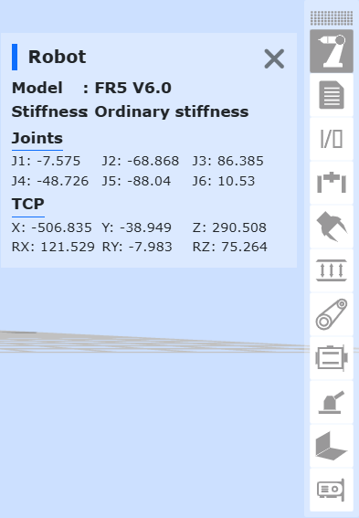

.. centered:: Figura 5.3‑14 Estado del robot

Program
+++++++

Mostrar la información del programa en ejecución actual y de los subprogramas.

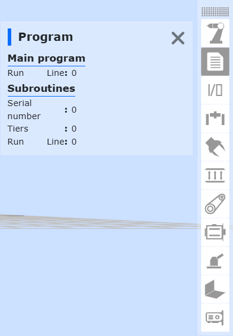

.. centered:: Figura 5.3‑15 Estado del programa

I/O
+++

Mostrar el estado actual de las IO; en las entradas y salidas digitales, si el nivel del puerto es alto, el punto se muestra en verde; si es bajo, se muestra en blanco; las entradas y salidas analógicas muestran valores de 0-100, donde 100 representa 10v.

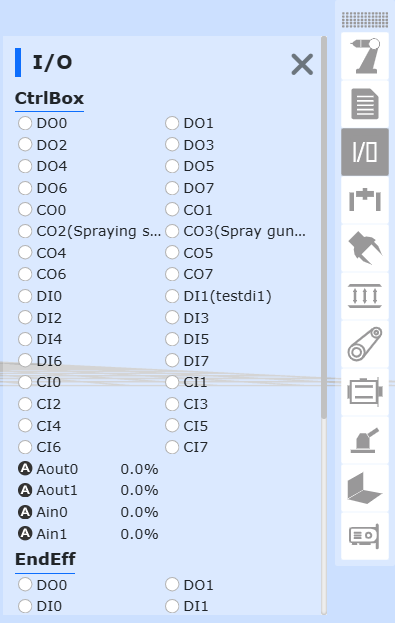

.. centered:: Figura 5.3‑16 Estado de IO

ExAxis
++++++

Mostrar la información del estado del servo del eje extendido actual (controlador + PLC).

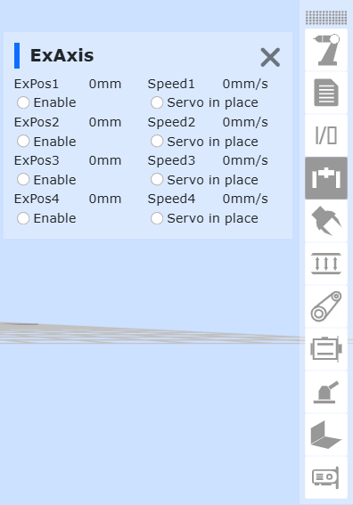

.. centered:: Figura 5.3‑17 Estado del eje extendido (controlador + PLC)

Gripper
+++++++

Mostrar la información del estado actual de la pinza.

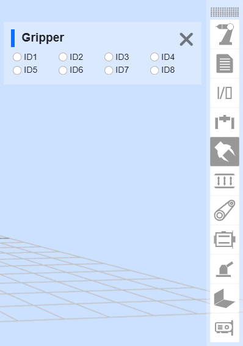

.. centered:: Figura 5.3‑18 Estado de la pinza

FT
++

Mostrar la información del estado actual del control de fuerza.

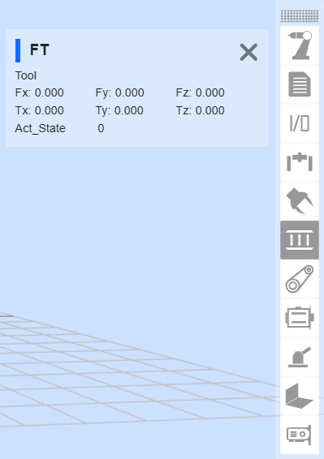

.. centered:: Figura 5.3‑19 Estado del control de fuerza

Convery
+++++++

Mostrar la información del estado actual de la cinta transportadora.

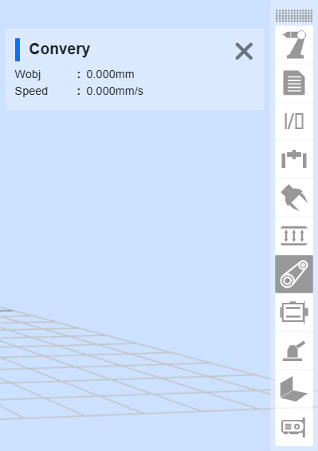

.. centered:: Figura 5.3‑20 Estado de la cinta transportadora

Servo
+++++

Mostrar la información del estado actual del eje extendido (controlador + controlador de servo).

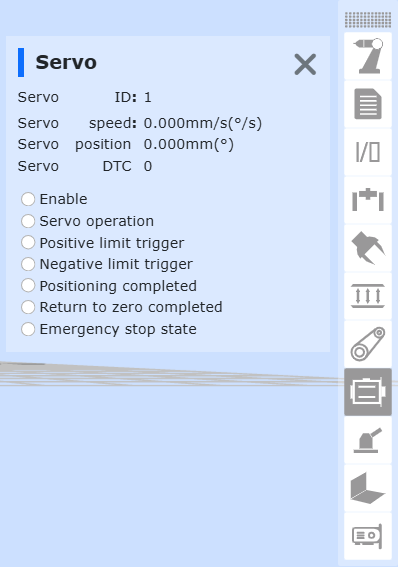

.. centered:: Figura 5.3‑21 Estado del eje extendido (controlador + controlador de servo)

Polish
++++++

Mostrar la información del estado actual del pulido.

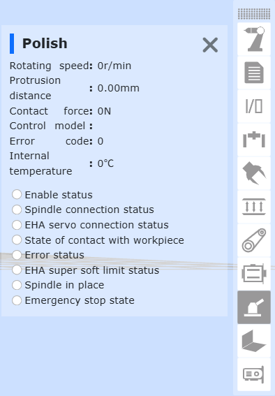

.. centered:: Figura 5.3‑22 Estado del pulido

Weld
++++

Mostrar la información del estado actual de la soldadura.

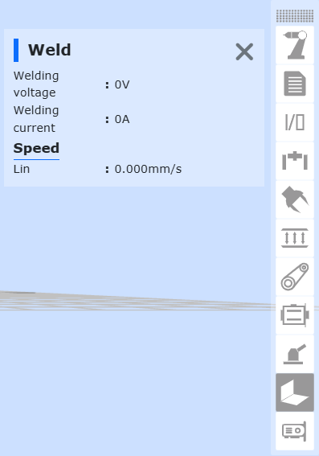

.. centered:: Figura 5.3‑23 Estado de la soldadura

Board I/O
+++++++++

Mostrar la información del estado actual de la tarjeta.

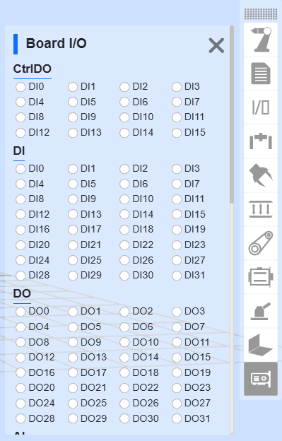

.. centered:: Figura 5.3‑24 Estado de la tarjeta