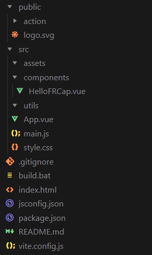

Guía de desarrollo
=========================

.. toctree:: 
   :maxdepth: 6

Entorno y condiciones de desarrollo
---------------------------------------------

El entorno de desarrollo debe cumplir como mínimo la siguiente configuración:

- CPU: procesador de 1.6 GHz o superior;
- RAM: >=1 GB (se recomienda 2 GB o más);
- ROM: >=128GB;
- SO: se requiere Windows 10 o superior, macOS 10.15 o superior, o sistema Linux (x64) (Ubuntu, Debian, etc.).
- Versión del controlador: consultar en WebApp «Configuración del sistema-Acerca de»; el entorno de desarrollo debe distinguir entre QX y LA; en el entorno de instrucciones QX debe evitarse el uso de sintaxis moderna de JavaScript como ES6+.

Hemos encapsulado algunas interfaces y módulos, pero para lograr un buen efecto de desarrollo se recomienda tener ciertos conocimientos de desarrollo Web, y preferiblemente estar familiarizado con las siguientes tecnologías:

- HTML, JavaScript/TypeScript, CSS;
- Vue3;
- Vite;
- Node.js.

Herramientas de desarrollo
-------------------------------------------
Recomendamos utilizar el software Visual Studio Code (VSCode) más reciente para el desarrollo. Para descargarlo, acceda a la página oficial de descarga de VSCode y seleccione la descarga correspondiente a su sistema.

Asimismo, en el ordenador local es necesario tener instalado el entorno de ejecución Node.js; al instalar Node.js se instalan también herramientas como npm, lo que facilita la gestión de paquetes. Acceda a la página oficial de descarga de Node.js y seleccione la descarga correspondiente a su sistema de la versión v20.

Durante el desarrollo en VSCode también es posible que se utilicen los siguientes plugins de VSCode, que se pueden instalar y configurar según sea necesario.

- Vue;
- ESlint;
- npm Intellisense;
- Vue Language Features (Volar);
- TypeScript Vue Plugin (Volar) o Vue.volar;
- Tailwind CSS IntelliSense.

Estructura del proyecto FRCap
-------------------------------------------

La estructura de archivos del proyecto FRCap:

.. centered:: Figura 5-1  Estructura del proyecto FRCap

- Public:

Carpeta de recursos públicos; durante el proceso de construcción no se procesan los archivos internos, sino que se copian íntegramente al directorio de construcción.

Internamente incluye por defecto la carpeta action y logo.svg.

La carpeta action se utiliza para almacenar los archivos de lógica de la interfaz de backend de las instrucciones personalizadas.

Logo.svg es el icono del plugin.

- Src:

La carpeta Assets se utiliza principalmente para colocar recursos estáticos.

La carpeta Components se utiliza principalmente para colocar componentes.

La carpeta Utils se utiliza principalmente para colocar clases de utilidad.

App.vue es el código de la página principal.

Main.js se encarga principalmente de la introducción global de recursos, la creación del framework Vue, etc.

Style.css es el archivo de estilos básicos del proyecto.

- Build.bat: script de construcción para la plataforma Windows.
- Index.html: marco principal de la UI de la página.
- Package.json: archivo de descripción del paquete y estrategia de compilación, etc.
- Vite.config.js: archivo de configuración de Vite.

Uso de frcap-ui y frcap-api en el frontend
-------------------------------------------

Frcap-ui proporciona algunos controles HTML ya encapsulados mediante componentes Vue, que se pueden importar al proyecto para su uso, reduciendo la dificultad de desarrollo de la UI de la página y la cantidad de código, y mejorando la legibilidad del código. Por supuesto, también puede optar por algunas bibliotecas de componentes UI de código abierto excelentes, como Element plus, etc.

En primer lugar, abra la terminal en la ruta de su proyecto e instale frcap-ui.

.. code-block:: c++
   :linenos:

   npm install frcap-ui -s

Tras una instalación correcta, impórtelo en el componente que necesite utilizar frcap-ui; tomando como ejemplo el control de botón.

.. code-block:: javascript
   :linenos:

   import { AppButton } from 'frcap-ui'

A continuación, utilícelo en el elemento <template> del componente.

.. code-block:: c++
   :linenos:

   <AppButton button-text="Start" button-type="primary"></AppButton>

Previsualice el efecto del proyecto de desarrollo en el navegador.

.. centered:: Figura 5-2  Efecto de AppButton

Actualmente ofrecemos 4 componentes de control relativamente comunes.

- AppButton: componente de botón.
  
  - buttonType: tipo de botón, String, corresponde a distintos estilos de botón; por defecto primary.
  
    - primary: azul;
    - secondery: gris;
    - safety: verde;
    - warning: amarillo;
    - serious: rojo.
  
  - buttonText: texto del botón, String, valor por defecto "primary".

- AppInput: componente de entrada.
  
  - Type: campo necesario, String, valor por defecto text. Indica el tipo de cuadro de entrada.
  
    - Number: cuadro de entrada numérico;
    - Text: cuadro de entrada de texto.
  
  - inputLabel: campo necesario, String, texto de la etiqueta del cuadro de entrada.
  - inputUnit: String, texto de la unidad del cuadro de entrada.
  - hasUnit: Boolean, por defecto false; indica si se necesita el texto de la unidad.
  - isEmptyErr: Boolean, indica si el cuadro de entrada está vacío.
  - isReadonly: Boolean, indica si el cuadro de entrada es de solo lectura.

- AppSelect: componente de cuadro de selección.
  
  - selectionLabel: campo necesario, String, texto de la etiqueta del cuadro de selección.
  - optionsData: campo necesario, Array, datos de las opciones.

- Modal: componente de ventana modal.
  
  - show: Boolean, indica si se muestra la ventana modal.
  - title: String, título de la ventana modal.

Para facilitar el desarrollo de instrucciones personalizadas que puedan crearse en FRCap, hemos integrado las solicitudes Http y la API en el proyecto FRCap inicial descargado desde el "Asistente de creación". De este modo, tanto las instrucciones personalizadas como las instrucciones proporcionadas por defecto se pueden colocar en el archivo api.js de frcap-api. La ruta concreta de api.js es "./src/api/api.js".

El uso de Frcap-api es similar al de frcap-ui, concretamente como sigue:

1. Importar api en el archivo que necesite utilizarla, como un componente.

.. code-block:: javascript
   :linenos:

   import api from '@/api/api';

2. Llamar a la instrucción proporcionada por defecto en la interfaz.

.. code-block:: c++
   :linenos:

   api.getRobotStatus()

3. Escribir la lógica de tratamiento en el promise devuelto.

.. code-block:: c++
   :linenos:

    api. getRobotStatus ()
    .then((res) => {
    console.log(res.data);
    })
    .catch((err) => {
        console.error(err);
    });

Desarrollo de instrucciones personalizadas en el backend
-------------------------------------------------------------------------

Ejemplo de operación de base de datos (LA)
+++++++++++++++++++++++++++++++++++++++++++++++++

1. Importar el módulo de base de datos

.. code-block:: javascript
   :linenos:

    var node = "/usr/local/etc/node/sys"
    var Sqlite3_Action = require(node + '/better-sqlite3/better-sqlite3.js');
    var sqlite = new Sqlite3_Action();

2. Obtener el contenido de la base de datos de puntos
   
.. code-block:: javascript
   :linenos:

    // coincidir con cmd
    case 'get_points':
    // escribir la sentencia sql; devolver los datos a la página del frontend para su visualización ordenando por número ascendente + inicial alfabética ascendente + inicial en chino ascendente
    var sql = "select * from points order by name ASC"; 
    var sql_data = sqlite.queryall(DB_POINTS, sql); 
    // formateo de los datos json
    for (var i = 0; i < sql_data.length; i++) {
        response_data[sql_data[i].name] = sql_data[i];
    }
    // devolver los datos json al frontend
    event_socket.emit('response', res, response_status, response_data);
    break;  

Ejemplo de operación de base de datos (QX)
+++++++++++++++++++++++++++++++++++++++++++++++++

.. note:: La versión QX utiliza archivos en formato JSON para almacenar los datos.

1. Importar el módulo de base de datos

.. code-block:: javascript
   :linenos:

   var node = "/usr/local/etc/node/sys"
   var sqlite_adapter = require(node + '/jsdb/sqlite_adapter');
   var db = new sqlite_adapter.Database(palletizing_db);

2. Ejemplo de uso de la base de datos
   
.. code-block:: javascript
   :linenos:

   // ejecutar una consulta SELECT y obtener todas las filas
   var rows = db.queryall('SELECT * FROM box_cfg');
   console.log('result:', rows);

   //ejecutar una consulta SELECT y obtener una única fila
   var row = db.queryget('SELECT * FROM box_cfg WHERE flag=1');
   console.log('result:', row);

   // ejecutar una sentencia UPDATE
   db.run('UPDATE box_cfg SET height=100 WHERE flag=1', function(err) {
      if (err) {
         console.error('Update failed:', err);
      } else {
         console.log('Update success');
      }
   });

   // ejecutar una consulta parametrizada
   var params = [100, 200, 300, 1];
   db.run('UPDATE box_cfg SET height=?, width=?, length=? WHERE flag=?', params, function(err) {
      if (err) {
         console.error('update failed:', err);
      } else {
         console.log('update success');
      }
   });

   // cerrar la conexión de la base de datos
   db.close();

Ejemplo de operación de comunicación socket
+++++++++++++++++++++++++++++++++++++++++++++++++

- Importar el módulo de comunicación socket
   
.. code-block:: javascript
   :linenos:

    var node = "/usr/local/etc/node/sys"
    var Socket_Cmd = require(node + '/socket/socket_cmd');
    var socket_cmd = new Socket_Cmd();

- Enviar la instrucción de establecimiento de variable del sistema
  
.. code-block:: javascript
   :linenos:

   // coincidir con cmd
   case 511:
   //obtener el contenido de los datos a enviar
   content = data_json.content;
   //obtener la longitud de los datos a enviar
   len = data_json.content.length;
   //componer los datos a enviar
   send_content = '/f/bIII1III511III' + len + 'III' + content + 'III/b/f'
   //socket send
   socket_cmd.send(send_content);
   //socket recv(prestar atención a distinguir LA/QX)
   // LA Version:
   socket_cmd.recv().then((recv_data)=>{
      response_data = recv_data;
   event_socket.emit('response', res, response_status, response_data);
   }).catch((err)=>{
      console.log(err);
   })
   // QX Version 
   // socket_cmd.recv().then(function(recv_data){
   //     response_data = recv_data;
   // event_socket.emit('response', res, response_status, response_data);
   // }).catch (function(err){
   //     console.log(err);
   // })
   break;