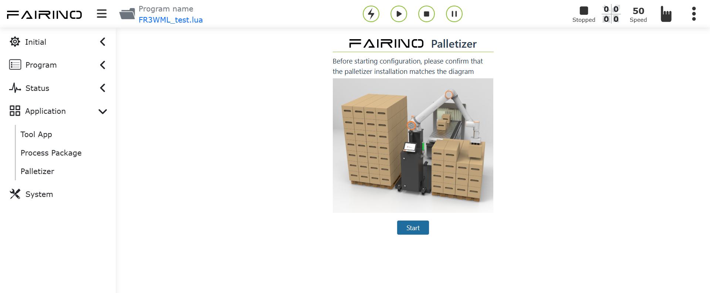

Casos de FRCap
=========================

.. toctree:: 
   :maxdepth: 6

FAIRINO Palletizer (Paletizadora)
---------------------------------------------------

Una vez cargado, registrado y habilitado en WebApp el archivo "Paletizadora Palletizer.plugin" de la carpeta build del proyecto, se puede utilizar.

.. centered:: Figura 7.1 Uso de FRCap de paletizado

Configuración de la pieza de paletizado
++++++++++++++++++++++++++++++++++++++++++++++++++++++++++++++++++

Nombre de la instrucción: palletizing_config_box. 

Parámetros de la instrucción:

.. code-block:: c++
   :linenos:

   /** 
   * @param  int length longitud de la pieza
   * @param  int width velocidad de la pieza
   * @param  int height altura de la pieza
   * @param  int payload carga de la pieza
   * @param  string grip_point punto de agarre de la pieza
   * /

Ejemplo de instrucción:

.. code-block:: c++
   :linenos:

   {
      cmd: "palletizing_config_box",
      data: {
         length: 800,
         width: 615,
         height: 312,
         payload: 2.34,
         grip_point: "grippoint"
      }
   } 

Respuesta de la instrucción:

.. code-block:: c++
   :linenos:

   /** 
   * @return status:200 "success"
   * @return status:404 "fail"
   */

Configuración del palé de paletizado
++++++++++++++++++++++++++++++++++++++++++++++++++++++++++++++++++

Nombre de la instrucción: palletizing_config_pallet.

Parámetros de la instrucción:

.. code-block:: c++
   :linenos:

   /** 
   * @param  int front borde frontal del palé
   * @param  int side borde lateral del palé
   * @param  int height altura del palé
   * @param  int left_pallet activación del palé izquierdo
   * @param  int right_pallet activación del palé derecho
   */

Ejemplo de instrucción:

.. code-block:: c++
   :linenos:

   {
      cmd: "palletizing_config_pallet",
      data: {
            front: 1200,
            side: 1000,
            height: 110,
            left_pallet: 0,
            right_pallet: 1
         }
   }

Respuesta de la instrucción:

.. code-block:: c++
   :linenos:

   /** 
   * @return status:200 "success"
   * @return status:404 "fail"
   */ 

Configuración avanzada de paletizado
++++++++++++++++++++++++++++++++++++++++++++++++++++++++++++++++++

Nombre de la instrucción: palletizing_advanced_cfg.

Parámetros de la instrucción:

.. code-block:: c++
   :linenos:

   /** 
   * @param  string height altura de elevación del punto de agarre del paletizado
   * @param  string x1 punto progresivo 1 del paletizado: desplazamiento en la dirección x, en mm
   * @param  string y1 punto progresivo 1 del paletizado: desplazamiento en la dirección y, en mm
   * @param  string z1 punto progresivo 1 del paletizado: desplazamiento en la dirección z, en mm
   * @param  string x2 punto progresivo 2 del paletizado: desplazamiento en la dirección x, en mm
   * @param  string y2 punto progresivo 2 del paletizado: desplazamiento en la dirección y, en mm
   * @param  string z2 punto progresivo 2 del paletizado: desplazamiento en la dirección z, en mm
   * @param  string time tiempo de espera de aspiración del material, en ms
   */ 

Ejemplo de instrucción:

.. code-block:: c++
   :linenos:

   {
      cmd: "palletizing_advanced_cfg",
      data: {
      height: "1000",
            x1: "100",
            y1: "100",
            z1: "100",
            x2: "10",
            y2: "10",
            z2: "10",
            time: "1"
         }
   }

Respuesta de la instrucción:

.. code-block:: c++
   :linenos:

   /** 
   * @return status:200 "success"
   * @return status:404 "fail"
   */

Configuración de dimensiones del equipo de paletizado
++++++++++++++++++++++++++++++++++++++++++++++++++++++++++++++++++++

Nombre de la instrucción: palletizing_config_device.

Parámetros de la instrucción:

.. code-block:: c++
   :linenos:

   /** 
   * @param  int x valor absoluto en la dirección x del punto de la esquina superior derecha del palé izquierdo respecto a los ejes del sistema de coordenadas base del robot
   * @param  int y valor absoluto en la dirección y del punto de la esquina superior derecha del palé izquierdo respecto a los ejes del sistema de coordenadas base del robot
   * @param  int z valor absoluto en la dirección z del punto de la esquina superior derecha del palé izquierdo respecto a los ejes del sistema de coordenadas base del robot
   * @param  int angle ángulo de rotación en el momento de la instalación del robot
   */ 

Ejemplo de instrucción:

.. code-block:: c++
   :linenos:

   {
      cmd: "palletizing_config_device",
      data: {
         x: 2400,
         y: 1800,
         z: 120,
         angle: 0   
      }
   }

Respuesta de la instrucción:

.. code-block:: c++
   :linenos:

   /** 
   * @return status:200 "success"
   * @return status:404 "fail"
   */

Configuración del modo de paletizado
+++++++++++++++++++++++++++++++++++++++++++++++++

Nombre de la instrucción: palletizing_config_pattern.

Parámetros de la instrucción:

.. code-block:: c++
   :linenos:

   /** 
   * @param  int layers número de capas de paletizado
   * @param  int box_gap intervalo de puntos de píxeles de la pieza, en mm
   * @param  string sequence modo de trabajo del paletizado
   * @param  int pattern_b_enable si el modo b está activado, 1: activado, 0: no activado
   * @param  string left_pattern_a coordenadas cartesianas del modo a de la estación izquierda
   * @param  string left_pattern_b coordenadas cartesianas del modo b de la estación izquierda
   * @param  string right_pattern_a coordenadas cartesianas del modo a de la estación derecha
   * @param  string right_pattern_b coordenadas cartesianas del modo b de la estación derecha
   * @param  string origin_pattern_a coordenadas cartesianas del modo a inicial
   * @param  string origin_pattern_b coordenadas cartesianas del modo b inicial
   */

Ejemplo de instrucción:

.. code-block:: c++
   :linenos:

   {
      cmd: "palletizing_config_pattern",
      data: {
         layers: 8,
         box_gap: 0,
         sequence: "a,b,a,b,a,b,a,b",
         pattern_b_enable: 1,
         left_pattern_a: "{\"1\": [[1,2,3,0.1,0.2,0.3],[1,2,3,0.1,0.2,0.3],[1,2,3,0.1,0.2,0.3]]}",
         "left_pattern_b": "{\"1\": [[1,2,3,0.1,0.2,0.3],[1,2,3,0.1,0.2,0.3],[1,2,3,0.1,0.2,0.3]]}",
         "right_pattern_a": "{\"1\": [[1,2,3,0.1,0.2,0.3],[1,2,3,0.1,0.2,0.3],[1,2,3,0.1,0.2,0.3]]}",
         "right_pattern_b": "{\"1\": [[1,2,3,0.1,0.2,0.3],[1,2,3,0.1,0.2,0.3],[1,2,3,0.1,0.2,0.3]]}",
         "origin_pattern_a": "[]",
         "origin_pattern_b": "[]"
      }
   }

Respuesta de la instrucción:

.. code-block:: c++
   :linenos:

   /** 
   * @return status:200 "success"
   * @return status:404 "fail"
   */

Generación del programa de paletizado
++++++++++++++++++++++++++++++++++++++++++++++++++++++++++++++++++

Nombre de la instrucción: generate_palletizing_program.

Parámetros de la instrucción:

.. code-block:: c++
   :linenos:

   /**
   * @param  string palletizing_name nombre del paletizado
   * @param  string depalletizing_name nombre del despaletizado
   * @param  string flag si se genera el programa de paletizado o despaletizado, 0-no se genera, 1 se genera
   */ 

Ejemplo de instrucción:

.. code-block:: c++
   :linenos:

   {
      cmd: "generate_palletizing_program",
      data: {
         palletizing_name: "palletizing_1",
         depalletizing_name:"depalletizing_1",
         flag:"[0,1]"
      }
   }

Respuesta de la instrucción:

.. code-block:: c++
   :linenos:

   /** 
   * @return status:200 "success"
   * @return status:404 "fail"
   */

Obtener la receta de paletizado
+++++++++++++++++++++++++++++++++++++++++++++++++

Nombre de la instrucción: get_palletizing_formula.

Parámetros de la instrucción:

.. code-block:: c++
   :linenos:

   /** 
   * @param  string name nombre de la receta de paletizado
   */ 

Ejemplo de instrucción:

.. code-block:: c++
   :linenos:

   {
      cmd: "get_palletizing_formula",
      data: {
         name: "palletizing_1"
      }
   }

Respuesta de la instrucción:

.. code-block:: c++
   :linenos:

   /** 
   * @return status:200 
   * @param  object box_config configuración de la pieza
   * @param  object pallet_config configuración del palé
   * @param  object device_config posición del equipo de instalación
   * @param  object pattern_config configuración de modos
   * @param  object program_config configuración de generación del programa
   * @param  object lefttransitionpoint coordenadas cartesianas del punto de transición izquierdo
   * @param  object righttransitionpoint coordenadas cartesianas del punto de transición derecho
   * @param  object advanced_config configuración avanzada
   * @return status:404 "fail"
   */

Ejemplo de respuesta de la instrucción:

.. code-block:: c++
   :linenos:

   {
      "box_config": {
        "flag": 1,
        "length": 200,
        "width": 400,
        "height": 300,
        "payload": 2.34,
        "grip_point": "grippoint"
      },
      "pallet_config": {
        "flag": 1,
        "front": 1000,
        "side": 1200,
        "height": 110,
         "left_pallet": 0,
         "right_pallet": 1
      },
      "device_config": {
      "flag": 1,
      "x": 2400,
      "y": 1800,
      "z": 120,
      "angle": 0
      },
      "pattern_config": {
      "flag": 1,
      "layers": 8,
      "box_gap": 0,
      "sequence": "a,b,a,b,a,b,a,b",
      "pattern_b_enable": 1,
      "left_pattern_a": "{\"1\": [[1,2,3,0.1,0.2,0.3],[1,2,3,0.1,0.2,0.3],[1,2,3,0.1,0.2,0.3]]}",
      "left_pattern_b": "{\"1\": [[1,2,3,0.1,0.2,0.3],[1,2,3,0.1,0.2,0.3],[1,2,3,0.1,0.2,0.3]]}",
      "right_pattern_a": "{\"1\": [[1,2,3,0.1,0.2,0.3],[1,2,3,0.1,0.2,0.3],[1,2,3,0.1,0.2,0.3]]}",
      "right_pattern_b": "{\"1\": [[1,2,3,0.1,0.2,0.3],[1,2,3,0.1,0.2,0.3],[1,2,3,0.1,0.2,0.3]]}",
      "origin_pattern_a": "[]",
      "origin_pattern_b": "[]"
      },
      "program_config": {
      "palletizing_name": "palletizing_1",
      "depalletizing_name":"depalletizing_1",
      "flag":"[0,1]"   
      },
      "lefttransitionpoint":{
      "j1":"120",
      "j2":"120",
      "j3":"120",
      "j4":"120",
      "j5":"120",
      "j6":"120"
      },
      "righttransitionpoint":{
      "j1":"120",
      "j2":"120",
      "j3":"120",
      "j4":"120",
      "j5":"120",
      "j6":"120"
      },
      "advanced_config":{
      "height": "1000",
      "x1": "100",
      "y1": "100",
      "z1": "100",
      "x2": "10",
      "y2": "10",
      "z2": "10",
      "time": "1"
      }
   }

Obtener la lista de nombres de recetas de paletizado existentes
++++++++++++++++++++++++++++++++++++++++++++++++++++++++++++++++++++++++++++++++++++++++++++++++

Nombre de la instrucción: get_palletizing_formula_list.

Parámetros de la instrucción: ninguno.

Ejemplo de instrucción:

.. code-block:: c++
   :linenos:

   {
      cmd: "get_palletizing_formula_list"
   }

Respuesta de la instrucción:

.. code-block:: c++
   :linenos:

   /** 
   * @return status:200 
   * @param  Array ${name} lista de nombres de paletizado
   * @return status:404 "fail"
   */

Ejemplo de respuesta de la instrucción:

.. code-block:: c++
   :linenos:

   ["palletizing1"]