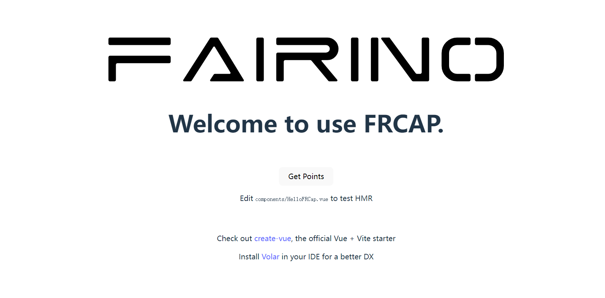

Introducción
===================

FRCap es un plugin basado en Web que puede integrarse en WebApp del robot colaborativo. FRCap, mediante los módulos Element plus, frcap-ui y frcap-api basados en Node.js y Vue3, construye una página de configuración o una aplicación de WebApp del robot colaborativo para ampliar las funciones y los escenarios de aplicación del robot.

En esencia, FRCap es una aplicación Web que se ejecuta en el entorno Node.js, independiente de WebApp; WebApp proporciona los servicios de gestión y acceso. FRCap puede interactuar con el controlador del robot mediante las interfaces oficiales proporcionadas, o el cliente puede desarrollar personalizadamente escribiendo instrucciones de interfaz y lógica de tratamiento según sus necesidades reales.

.. centered:: Figura 1.1 Esquema de WebApp + FRCap