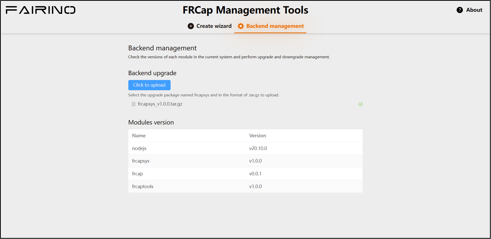

Gestión en segundo plano
=========================

.. toctree:: 
   :maxdepth: 6

Actualización en segundo plano
-------------------------------------
En la sección "Descarga de software" de este documento se puede descargar el paquete de actualización más reciente del sistema en segundo plano de FRCap. Tras cargar correctamente el paquete de actualización descargado, el sistema en segundo plano se actualiza automáticamente.

La actualización correcta se muestra en la figura siguiente.

.. centered:: Figura 4-1  Actualización correcta del sistema en segundo plano de FRCap

.. note:: Tras una actualización correcta es necesario reiniciar la caja de control del robot para que surta efecto.

Versiones de los módulos
-------------------------------------

Versiones de los módulos de la primera versión inicial del sistema en segundo plano de FRCap:

- Node.js: v20.10.0.
- FRCapSys: v1.0.0.
- FRCap: v0.0.1.
- FRCapTools: v1.0.0.

Para conocer el contenido concreto de las actualizaciones de versión, consulte la descripción de la actualización de versión.

.. note:: Actualmente Node.js no se actualiza con las versiones.