Paletizado FRCap
================

Gestión de paquetes de plugins
----------------------------------------

En la WebApp del robot colaborativo, vaya a "Configuración del sistema" -> "Configuración de plugins", haga clic en el botón "Importar" y seleccione el paquete de plugin Paletizado FRCap (formato de nombre: nombre del paquete de plugin + número de versión.plugin, ejemplo: Paletizadora Palletizer-v0.0.0.plugin) para cargarlo. Una vez cargado correctamente, la lista mostrará el paquete de plugin Paletizado FRCap importado correctamente, incluyendo el estado de activación/desactivación, nombre, número de versión, descripción y autor, entre otros. En la columna de operaciones se puede "Desactivar", "Activar" y "Eliminar" el paquete de plugin Paletizado FRCap.

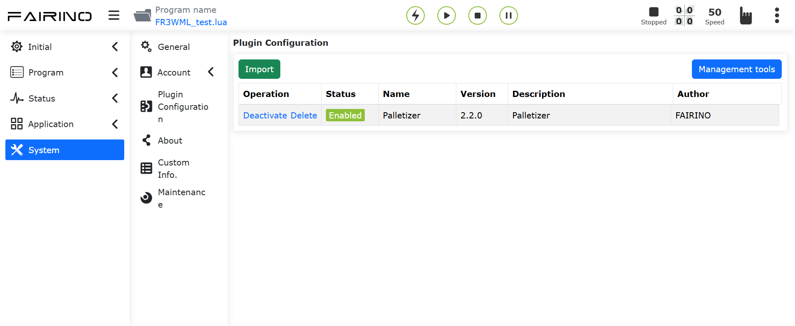

.. centered:: Figura 10-1-1 Interfaz de configuración de plugins de la WebApp

Después de importar correctamente el paquete de plugin Paletizado FRCap por primera vez, el estado del paquete de plugin es "Desactivado". Haga clic en el botón "Activar". Una vez activado correctamente, el módulo "Aplicaciones auxiliares" de la WebApp del robot colaborativo añadirá la página de inicio del paquete de plugin Paletizado FRCap (por ejemplo: el nombre del módulo de página correspondiente a Paletizadora Palletizer-v0.0.0.plugin es "Paletizadora Palletizer"). Haga clic en el botón "Iniciar" para entrar en la página principal y ver las recetas de paletizado ya configuradas, y utilizarlas según sea necesario.

.. note:: 
   Si la receta está vacía, primero añada/importe una receta.

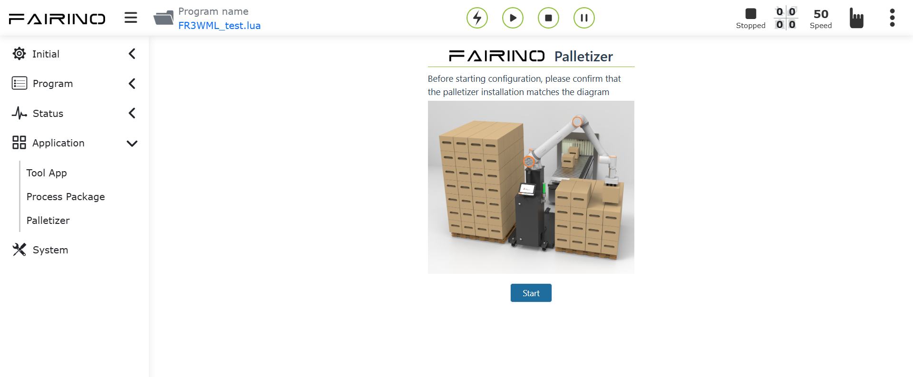

.. centered:: Figura 10-1-2 WebApp + Paletizado FRCap visualización

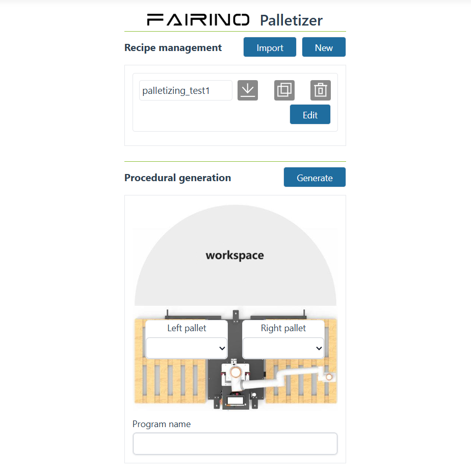

.. centered:: Figura 10-1-3 Página principal de Paletizado FRCap

Gestión de recetas
------------------

Cada receta se divide en tres áreas principales: nombre de la receta, operaciones de la receta y edición de la receta. Los botones del área de operaciones son, en orden: renombrar, exportar, copiar y eliminar.

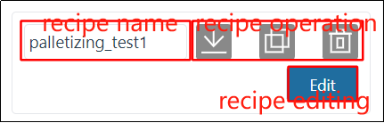

.. centered:: Figura 10-2-1 División del área de recetas

.. note:: 
   .. image:: frcap_pictures/045.png
      :width: 0.5in
      :height: 0.5in
      :align: left

   | Nombre: **Exportar receta**
   | Función: Exportar los datos de la receta actual

.. note:: 
   .. image:: frcap_pictures/046.png
      :width: 0.5in
      :height: 0.5in
      :align: left

   | Nombre: **Copiar receta**
   | Función: Copiar los datos de la receta actual

.. note:: 
   .. image:: frcap_pictures/047.png
      :width: 0.5in
      :height: 0.5in
      :align: left

   | Nombre: **Eliminar receta**
   | Función: Eliminar la receta actual

Obtener
~~~~~~~

Después de entrar en la página principal del paquete de plugin de paletizado, se obtienen todas las recetas actuales. Cuando el número de recetas es mayor que cuatro, aparece una barra de desplazamiento en el área de visualización de recetas, y el usuario puede desplazarse hacia arriba y hacia abajo para ver las recetas.

.. note:: 
   Todos los nombres de recetas comienzan con "palletizing", por ejemplo "palletizing_test1".

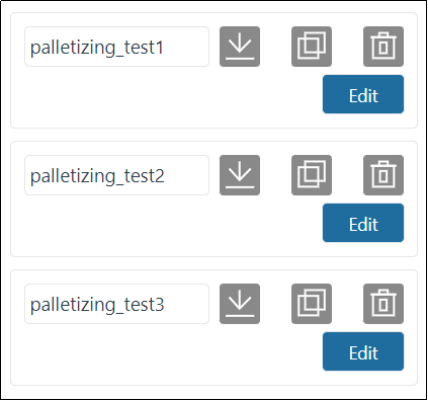

.. centered:: Figura 10-2-2 Obtención de recetas

Añadir
~~~~~~

En el área de operaciones de cualquier receta, haga clic en el botón "Añadir" para entrar en la ventana emergente "Añadir receta", introduzca el nombre de la receta de paletizado y haga clic en el botón "Confirmar". Una vez añadida correctamente, el área de visualización de recetas mostrará la receta de paletizado añadida.

.. note:: 
   Todos los nombres de recetas comienzan con "palletizing", no es necesario introducir "palletizing", solo es necesario introducir el nombre después de "_". Por ejemplo, para "palletizing_add", basta con introducir "add".

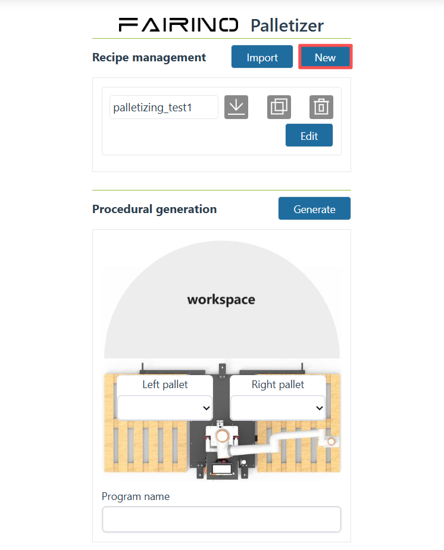

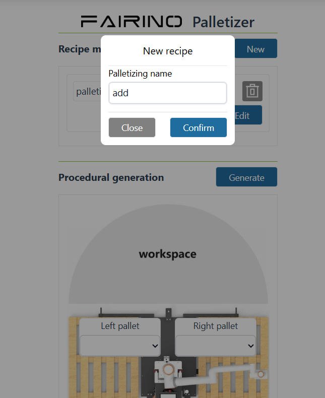

.. centered:: Figura 10-2-3 Añadir receta

Renombrar
~~~~~~~~~~

En el área de operaciones de cualquier receta, haga clic en el campo de entrada que muestra el nombre de la receta para entrar en la ventana emergente "Renombrar receta de paletizado", introduzca el nombre de la receta de paletizado y haga clic en el botón "Confirmar". Una vez renombrada correctamente, el nombre original de la receta de paletizado en el área de visualización de recetas se actualizará con el nuevo nombre.

.. note::
   Todos los nombres de recetas comienzan con "palletizing", no es necesario introducir "palletizing", la ventana modal muestra automáticamente el nombre después de "_". Por ejemplo, para "palletizing_rename", se muestra automáticamente "rename".

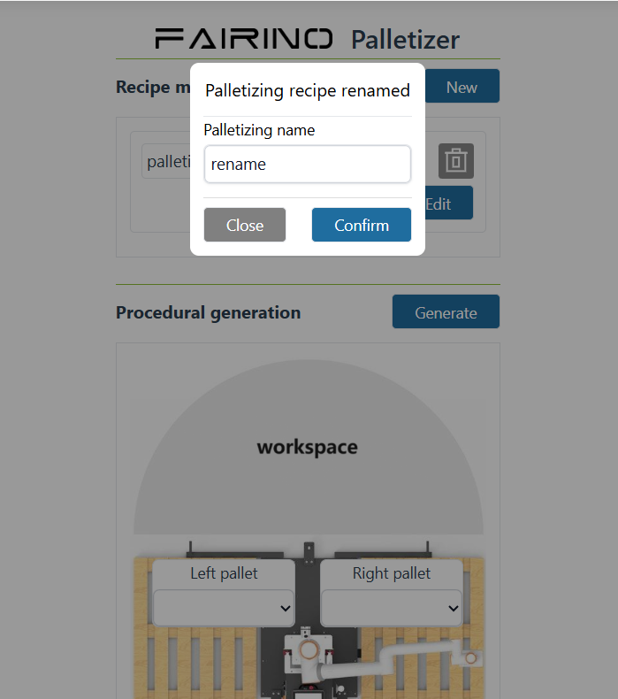

.. centered:: Figura 10-2-4 Renombrar receta

Exportar
~~~~~~~~~~~~~

En el área de operaciones de cualquier receta, haga clic en el icono "Exportar" para descargar todos los datos de la receta actual.

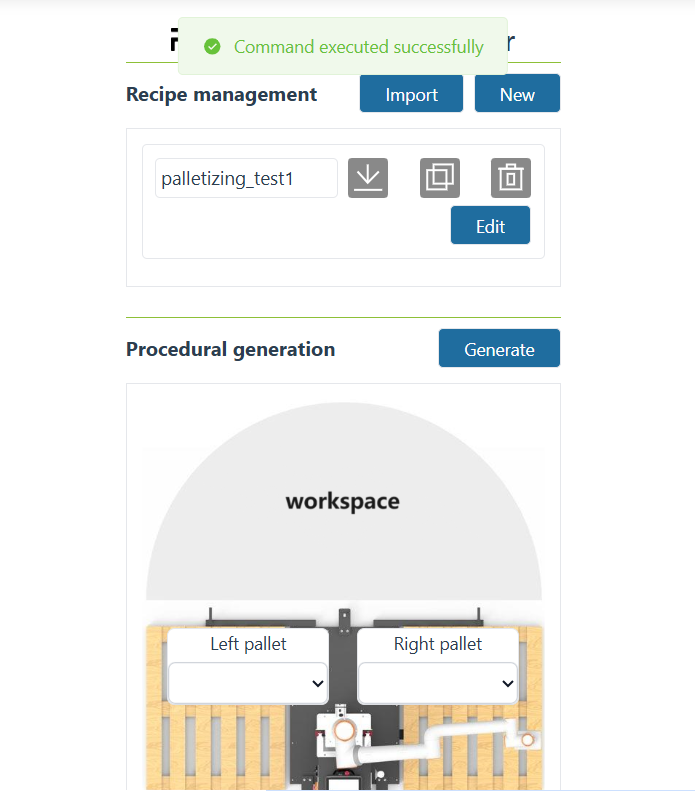

.. centered:: Figura 10-2-5 Exportar receta

Copiar
~~~~~~~~~

En el área de operaciones de cualquier receta, haga clic en el icono "Copiar" para entrar en la ventana emergente "Copiar receta de paletizado", introduzca el nombre de la receta de paletizado y haga clic en el botón "Confirmar". Una vez copiada correctamente, el área de visualización de recetas mostrará la receta de paletizado copiada.

.. note:: 
   Todos los nombres de recetas comienzan con "palletizing", no es necesario introducir "palletizing", la ventana modal muestra automáticamente el nombre después de "_". Por ejemplo, para "palletizing_copy", se muestra automáticamente "copy".

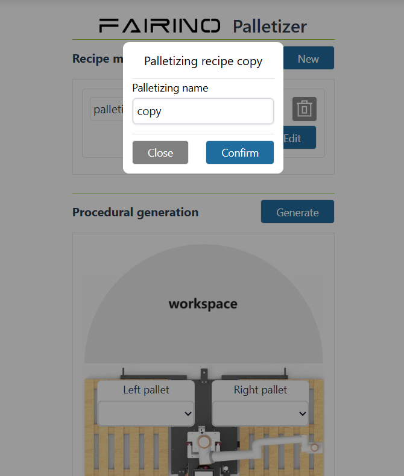

.. centered:: Figura 10-2-6 Copiar receta

Eliminar
~~~~~~~~~

En el área de operaciones de cualquier receta, haga clic en el icono "Eliminar" para eliminar la receta actual.

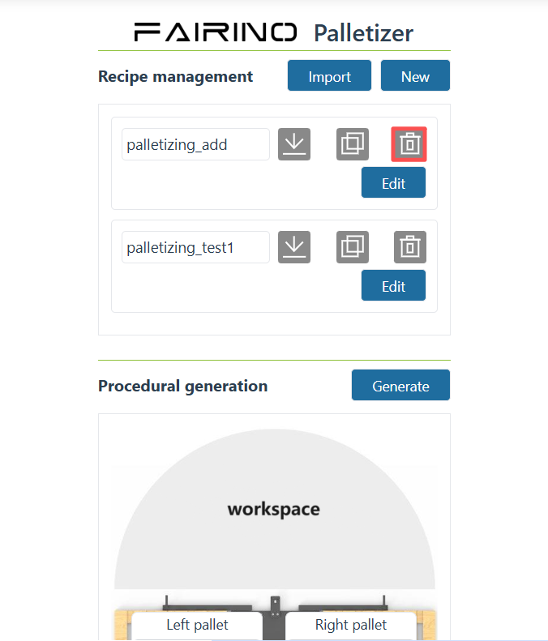

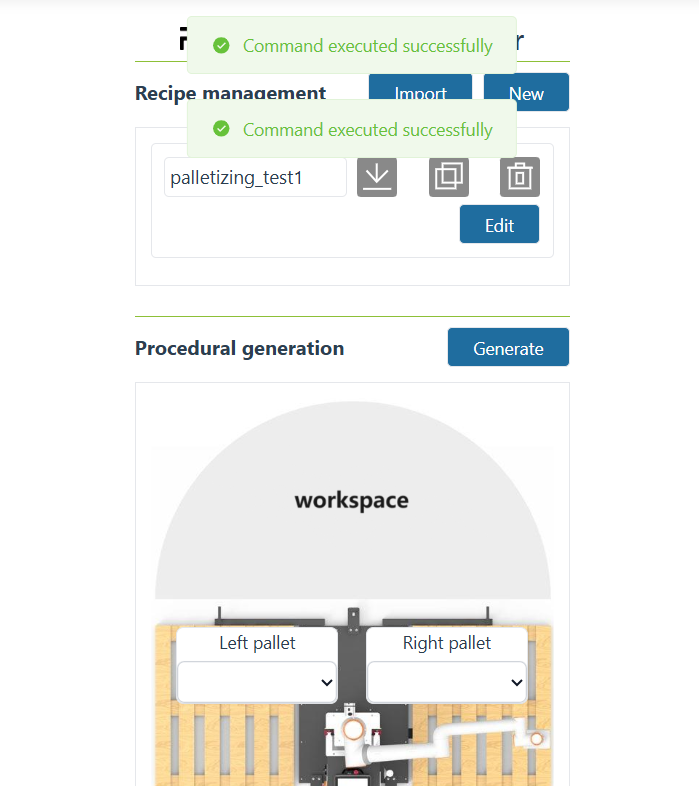

.. centered:: Figura 10-2-7 Eliminar receta

Editar
~~~~~~~~

En cualquier receta, haga clic en el botón "Editar" para entrar en la interfaz de configuración de la receta actual.

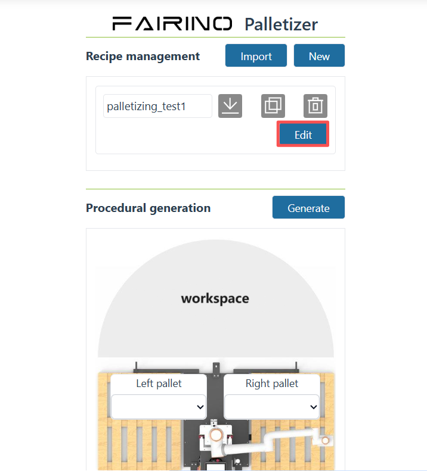

.. centered:: Figura 10-2-8 Edición de receta de paletizado

Importar
~~~~~~~~

Haga clic en el botón "Importar", seleccione el paquete comprimido de la receta de paletizado y cárguelo. Una vez importado correctamente, la receta de paletizado añadirá la receta importada.

.. note:: 
   Todos los nombres de los paquetes comprimidos de recetas comienzan con "palletizing" y terminan con ".tar.gz", por ejemplo "palletizing_import.tar.gz".

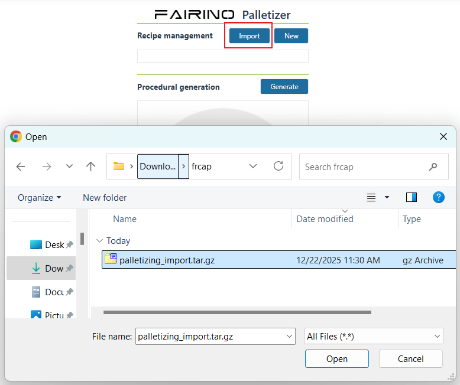

.. centered:: Figura 10-2-9 Importar receta

.. important:: 
   En las operaciones "Añadir", "Renombrar" y "Copiar" de recetas de paletizado, si se introduce un nombre de receta que ya existe, se mostrará el mensaje "Ya existe una receta con el mismo nombre".

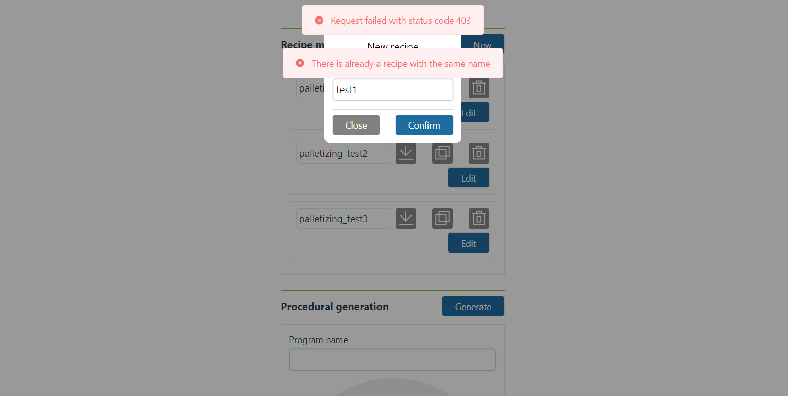

.. centered:: Figura 10-2-10 Aviso de receta con el mismo nombre

Configuración de recetas
------------------------

En la interfaz de configuración de cualquier receta se muestra la información básica de cajas, palés, modos y configuración avanzada, y se configuran los parámetros específicos en la sección de configuración correspondiente.

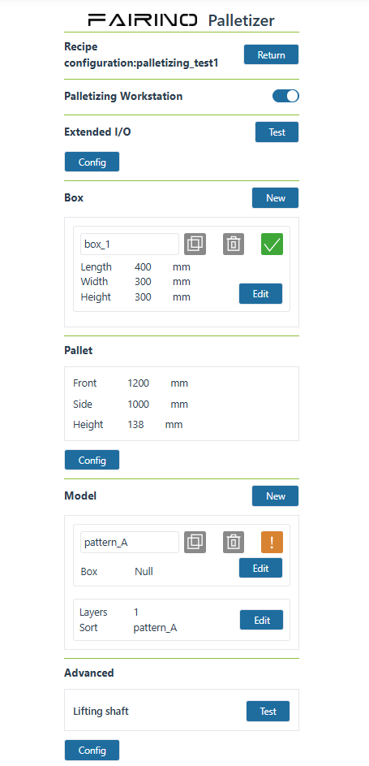

.. centered:: Figura 10-3-1 Interfaz de edición de receta de paletizado

Configuración de la estación de trabajo
~~~~~~~~~~~~~~~~~~~~~~~~~~~~~~~~~~~~~~~~~~~

En la edición de la receta, se puede seleccionar si se utiliza la estación de trabajo de paletizado. Si se utiliza la estación de trabajo de paletizado, la función de paletizado correspondiente se completará mediante las señales de E/S del PLC de la estación de trabajo; si se selecciona sin estación de trabajo de paletizado, por defecto se utilizarán las señales de E/S del armario de control para completar la función de paletizado.

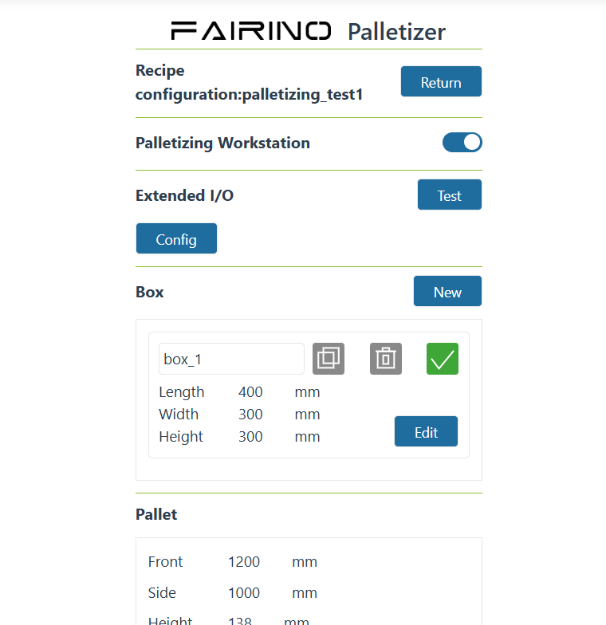

.. centered:: Figura 10-3-1-1 Página de edición de receta

Configuración del cableado de E/S de la función de paletizado
~~~~~~~~~~~~~~~~~~~~~~~~~~~~~~~~~~~~~~~~~~~~~~~~~~~~~~~~~~~~~~~~

(1) Después de seleccionar el uso de la estación de trabajo de paletizado, haga clic en la configuración de E/S de expansión. Según la función correspondiente y el cableado real con la interfaz de E/S del PLC, se puede personalizar la selección de la configuración de señales de E/S de la función de paletizado. La siguiente figura muestra la configuración de cableado predeterminada de la estación de trabajo de paletizado.

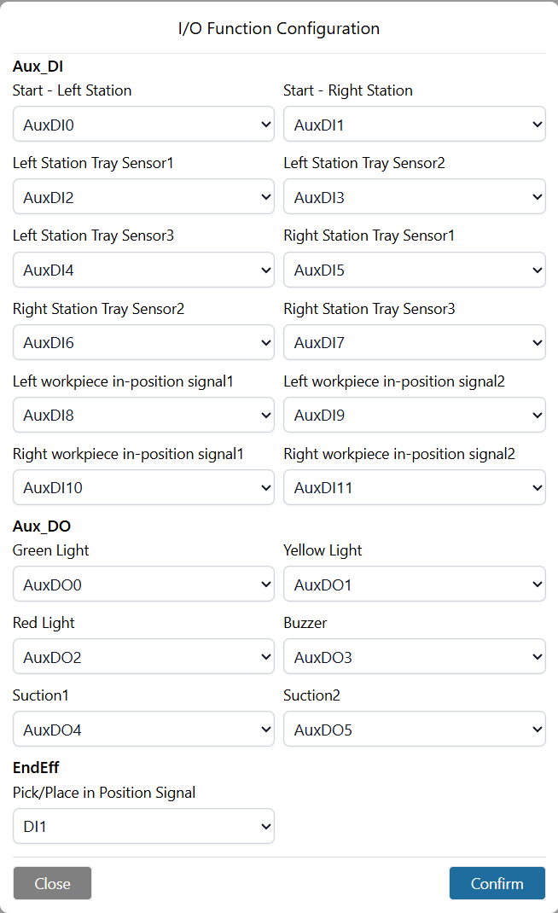

.. centered:: Figura 10-3-1-2 Configuración de cableado predeterminada de la estación de trabajo de paletizado

(2) Si se selecciona no utilizar la estación de trabajo de paletizado, por defecto se utilizarán las señales de E/S del armario de control. Según la función correspondiente y el cableado real con la interfaz de E/S del armario de control, se puede personalizar la selección de la configuración de señales de E/S de la función de paletizado. La siguiente figura muestra la configuración de cableado predeterminada sin estación de trabajo de paletizado (usando E/S del armario de control).

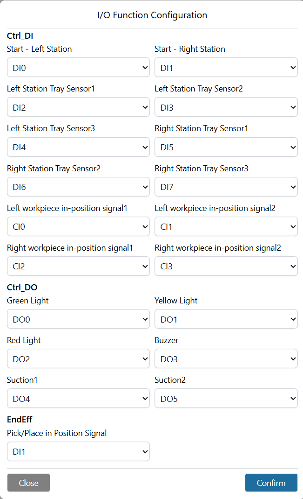

.. centered:: Figura 10-3-1-3 Configuración de cableado predeterminada sin estación de trabajo de paletizado (E/S del armario de control)

Prueba de comunicación de E/S de la función de paletizado
~~~~~~~~~~~~~~~~~~~~~~~~~~~~~~~~~~~~~~~~~~~~~~~~~~~~~~~~~~~~~~~~

(1) Al seleccionar el uso de la estación de trabajo de paletizado, después de configurar las señales de E/S de expansión de la estación de trabajo de paletizado, se puede hacer clic en "Probar" para verificar y validar las funciones de E/S cableadas.

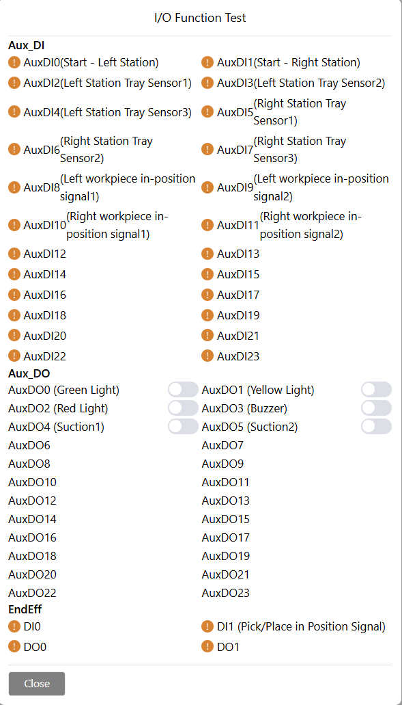

.. centered:: Figura 10-3-1-4 Prueba de cableado de E/S de la estación de trabajo de paletizado

(2) Al seleccionar sin estación de trabajo de paletizado, después de configurar las señales de E/S del armario de control correspondientes a la función de paletizado, se puede hacer clic en "Probar" para verificar y validar las funciones de E/S cableadas.

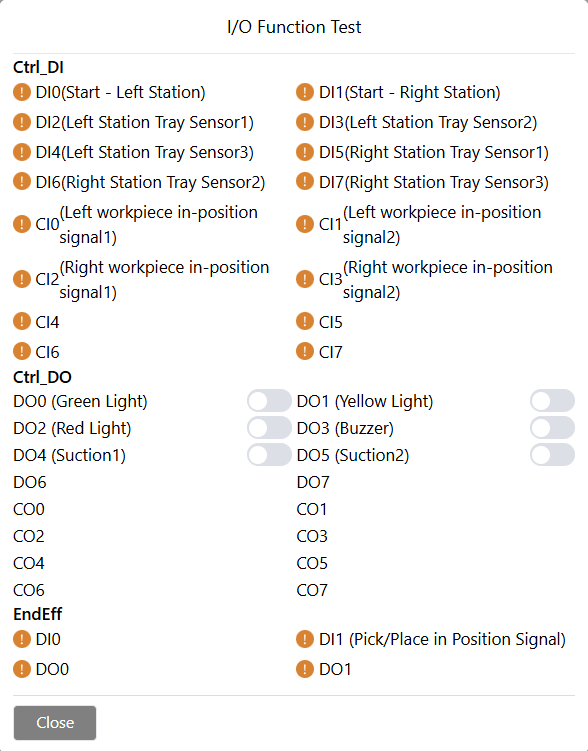

.. centered:: Figura 10-3-1-5 Prueba de cableado sin estación de trabajo de paletizado (E/S del armario de control)

Configuración de cajas
~~~~~~~~~~~~~~~~~~~~~~~~~~~~~~~~~

Operaciones de cajas
++++++++++++++++++++++++++++++++

Se pueden configurar múltiples cajas de diferentes tipos.

Haga clic en el botón "Añadir". Una vez añadida correctamente, se añadirá una caja en el orden actual.

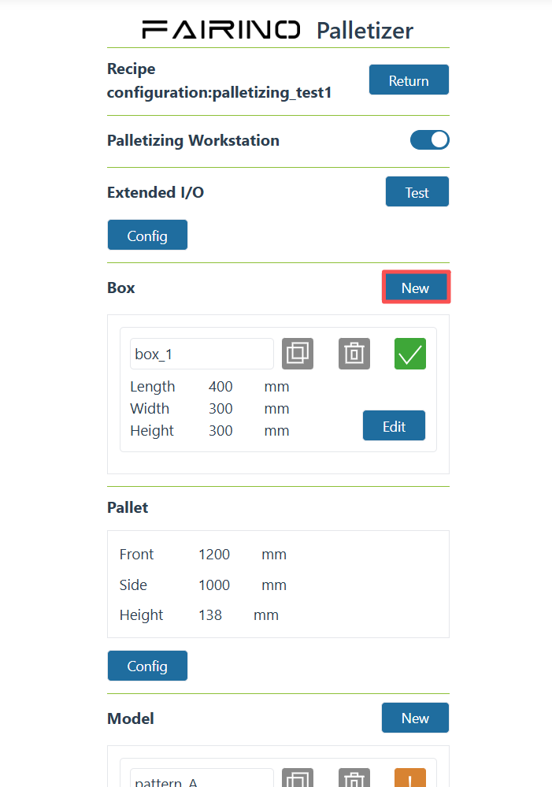

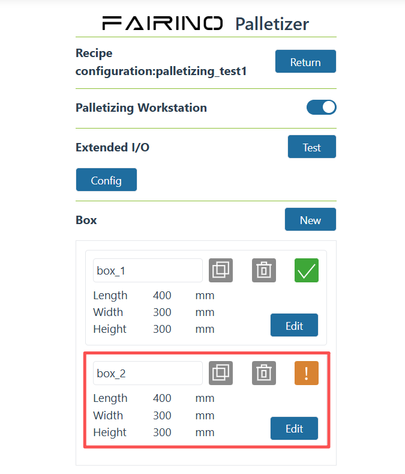

.. centered:: Figura 10-3-2 Añadir caja

Haga clic en el área del campo de entrada que muestra el nombre de la caja para que aparezca la ventana modal "Renombrar caja", introduzca el nombre y haga clic en el botón "Confirmar" para confirmar el cambio de nombre.

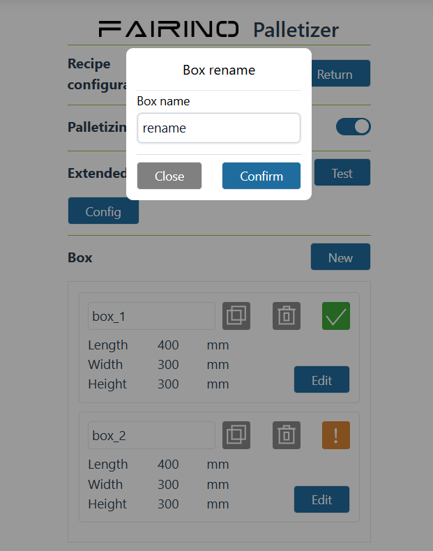

.. centered:: Figura 10-3-3 Renombrar caja

Haga clic en el icono "Copiar". Una vez copiada correctamente, se copiará una caja según el nombre de la caja actual.

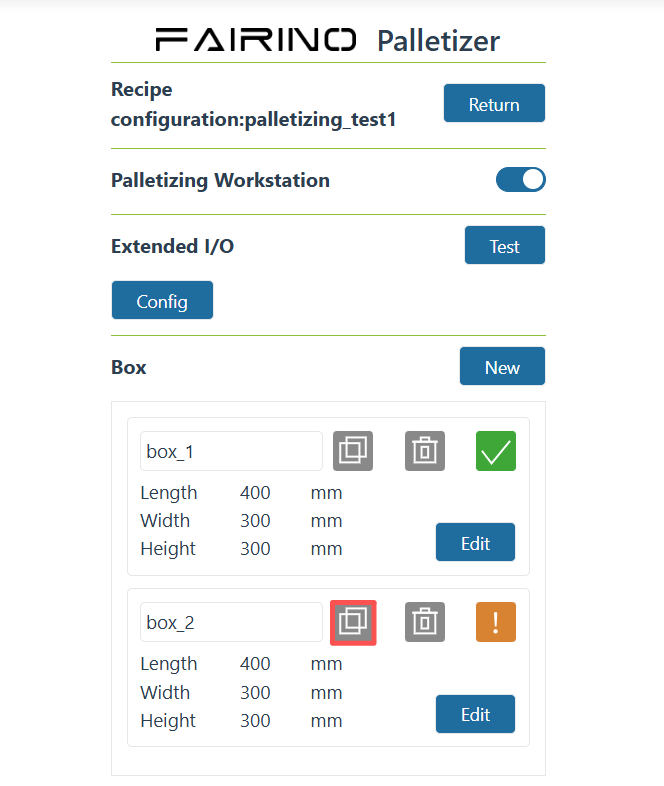

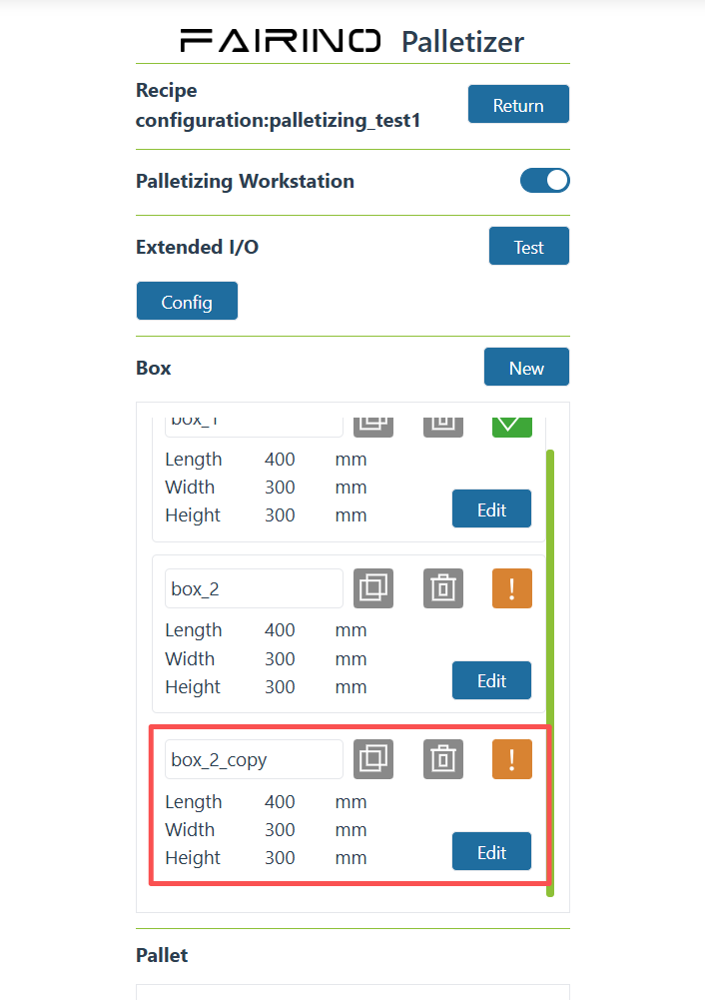

.. centered:: Figura 10-3-4 Copiar caja

Haga clic en el icono "Eliminar" para eliminar los datos de la caja.

.. note:: 
   No elimine cajas que ya estén configuradas en la configuración de modos.

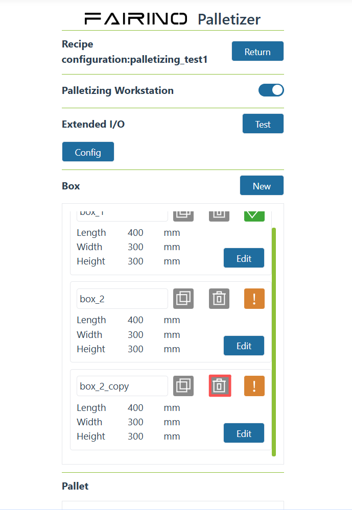

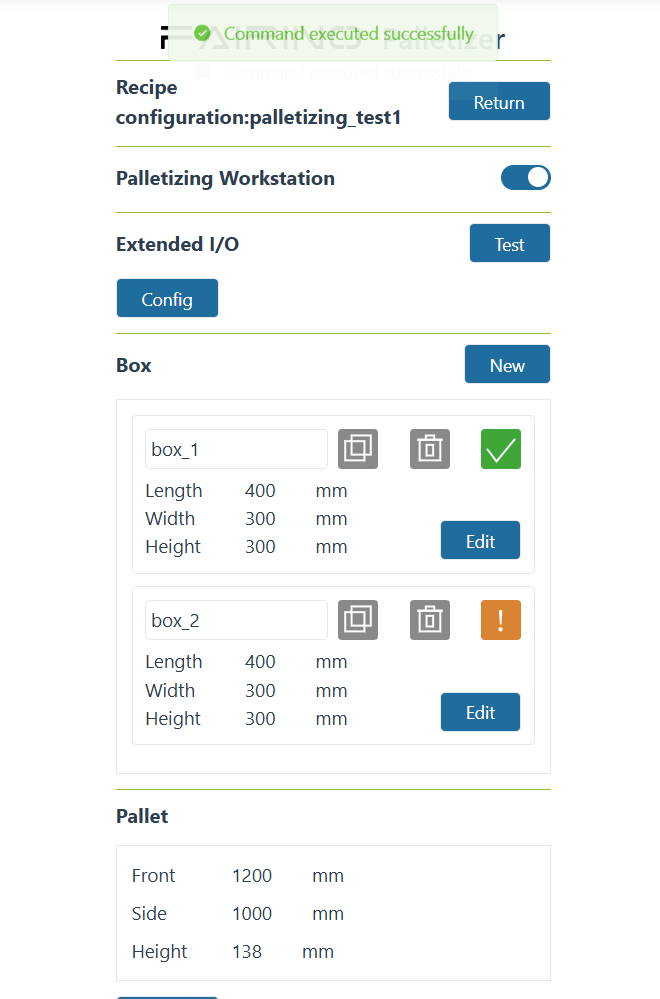

.. centered:: Figura 10-3-5 Eliminar caja

En cualquier caja, haga clic en el botón "Editar" para entrar en la interfaz de configuración de parámetros de la caja. Una vez configurada correctamente, el icono de estado de configuración de la caja será verde; si la configuración no está completa, el icono de estado de configuración de la caja será amarillo.

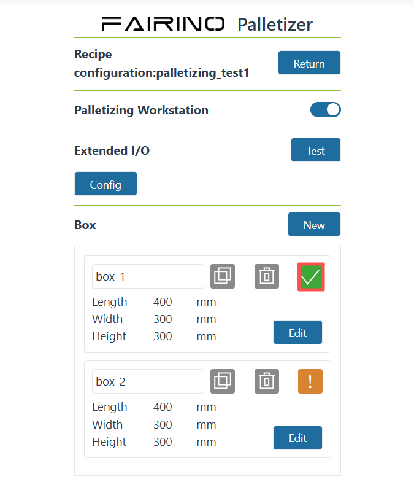

.. centered:: Figura 10-3-6 Configuración de parámetros de caja completada

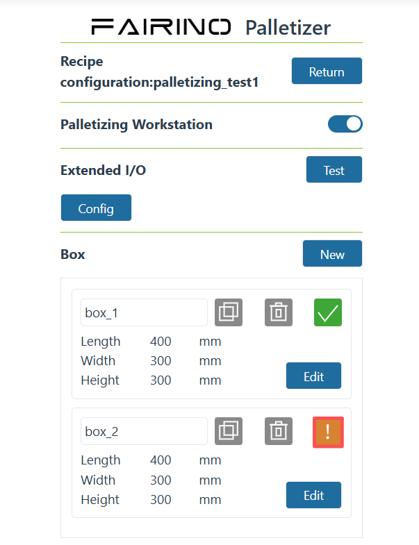

.. centered:: Figura 10-3-7 Configuración de parámetros de caja no completada

Parámetros de caja
++++++++++++++++++++++++++++++++

.. note:: 
   .. image:: frcap_pictures/057.png
      :width: 0.5in
      :height: 0.5in
      :align: left

   | Nombre: **Caja anterior**
   | Función: Cambiar a la caja anterior; cuando se selecciona la primera caja, al cambiar de nuevo se selecciona la última caja.

.. note:: 
   .. image:: frcap_pictures/058.png
      :width: 0.5in
      :height: 0.5in
      :align: left

   | Nombre: **Caja siguiente**
   | Función: Cambiar a la caja siguiente; cuando se selecciona la última caja, al cambiar de nuevo se selecciona la primera caja.

En la sección de configuración de cajas, haga clic en "Editar" para entrar en la ventana emergente "Configuración de caja", establezca la "Longitud", "Anchura", "Altura", "Carga" y "Orientación de la etiqueta de la pieza" de la caja, y haga clic en el botón "Confirmar" para completar la configuración de la información de la caja; establezca el punto de agarre de la caja (mantenga el punto de agarre en el centro de la caja, con la parte inferior de la ventosa en estado de compresión al contacto con la caja), y haga clic en el botón "Registrar" para completar la configuración.

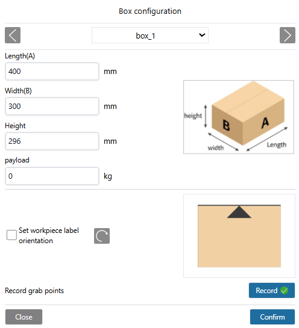

.. centered:: Figura 10-3-8 Configuración de caja

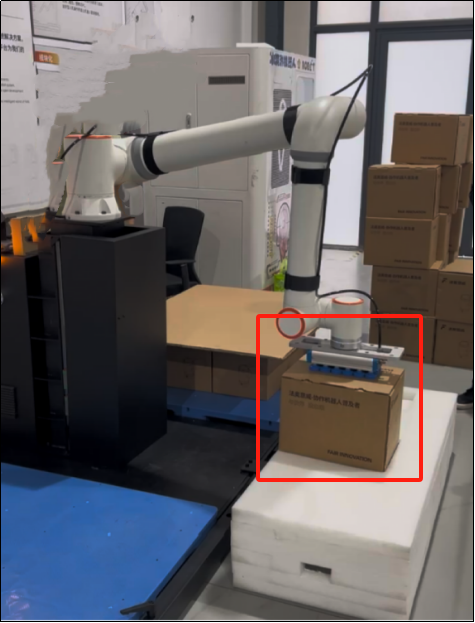

.. centered:: Figura 10-3-9 Punto de agarre de caja

.. important:: Es obligatorio registrar el punto de agarre de la caja; de lo contrario, no se podrán configurar la longitud, la anchura y la altura de la caja.

Configuración de palés
+++++++++++++++++++++++++++++++++

En la sección de configuración de palés, haga clic en "Configurar" para entrar en la ventana emergente "Configuración de palé", establezca el "Borde frontal", el "Borde lateral" y la "Altura" del palé, a continuación establezca el punto de transición de la estación de trabajo y haga clic en "Confirmar configuración" para completar la configuración de la información del palé.

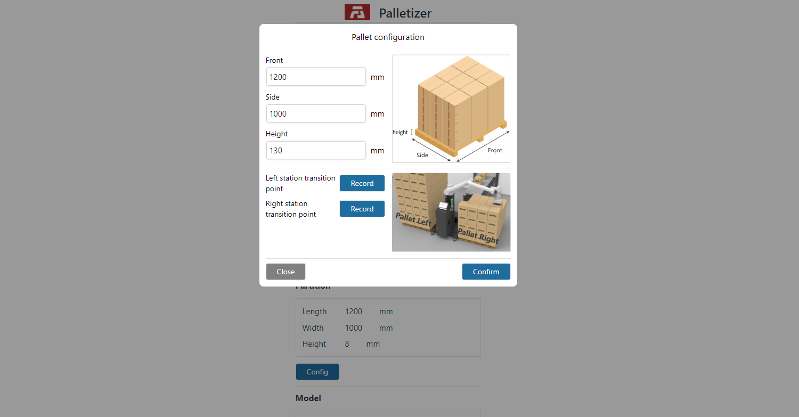

.. centered:: Figura 10-3-10 Configuración de palé

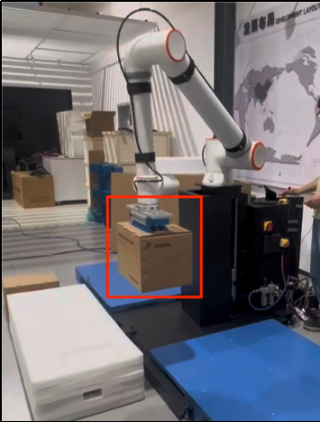

.. centered:: Figura 10-3-11 Punto de transición de la estación de trabajo izquierda

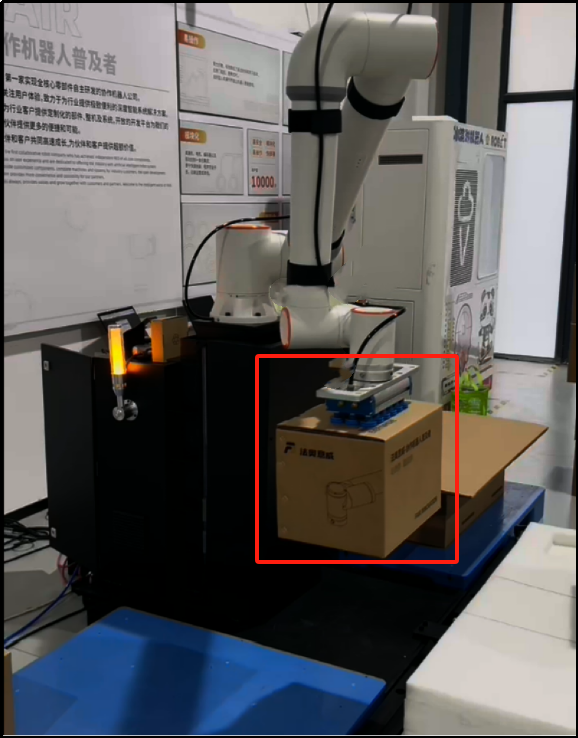

.. centered:: Figura 10-3-12 Punto de transición de la estación de trabajo derecha

.. important:: Es obligatorio registrar el punto de transición de la estación de trabajo; de lo contrario, el programa generado no se podrá guardar.

Configuración de modos
~~~~~~~~~~~~~~~~~~~~~~~~~~~~~~

Operaciones de modos
++++++++++++++++++++++++++++++

Al seleccionar cajas en la configuración de modos, se pueden seleccionar cajas de la misma altura pero diferente longitud y anchura. El área de visualización de modos se divide en: adición de modos (configuración del patrón de paletizado) y configuración del número de capas de paletizado.

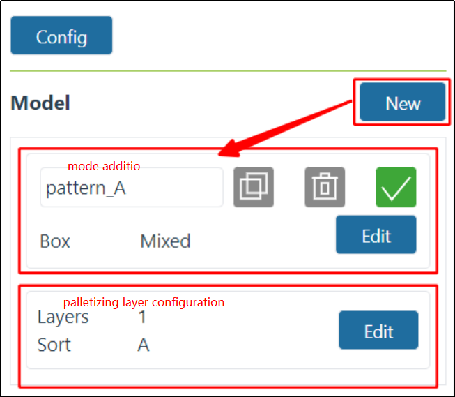

.. centered:: Figura 10-3-13 Área de visualización de modos

Haga clic en el botón "Añadir". Una vez añadido correctamente, se añadirá un modo en el orden actual.

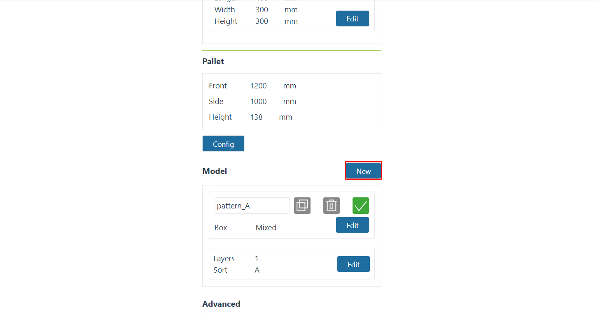

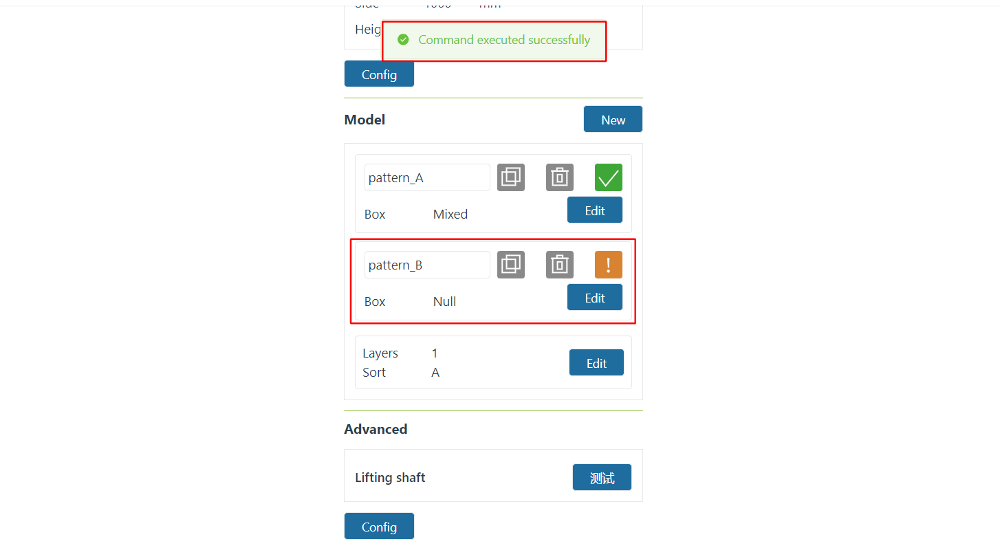

.. centered:: Figura 10-3-14 Añadir modo

En cualquier modo del área de adición de modos, haga clic en el área del campo de entrada que muestra el nombre del modo para que aparezca la ventana modal "Renombrar modo", introduzca el nombre y haga clic en el botón "Confirmar" para confirmar el cambio de nombre.

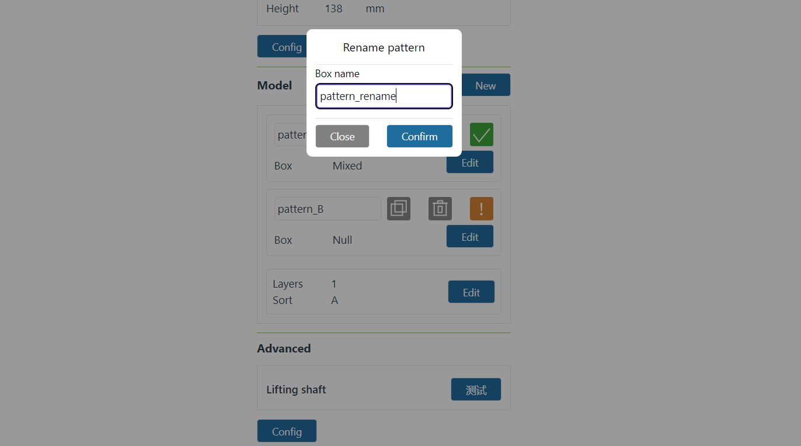

.. centered:: Figura 10-3-15 Renombrar modo

En cualquier modo del área de adición de modos, haga clic en el icono "Copiar". Una vez copiado correctamente, se copiará un modo según el nombre del modo actual.

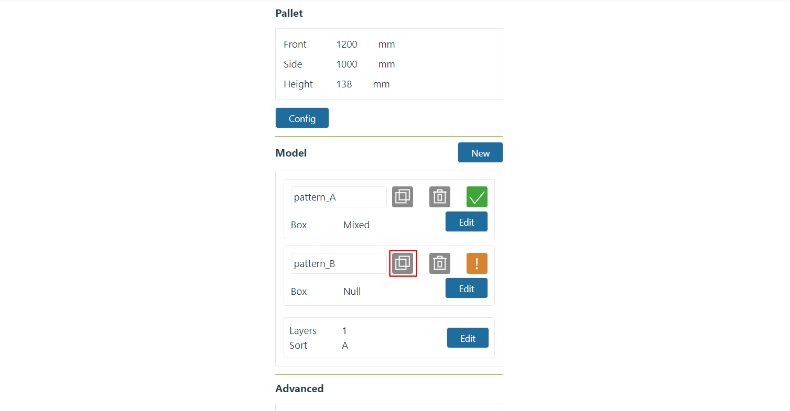

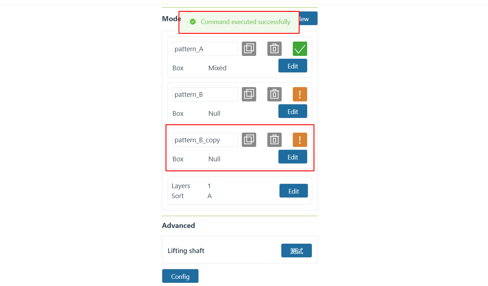

.. centered:: Figura 10-3-16 Copiar modo

En cualquier modo del área de adición de modos, haga clic en el icono "Eliminar" para eliminar los datos del modo actual.

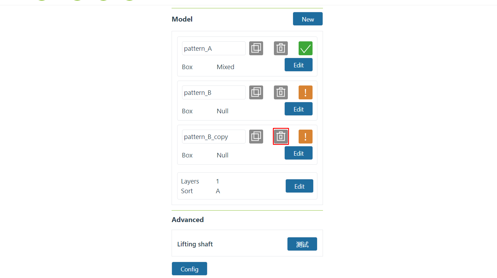

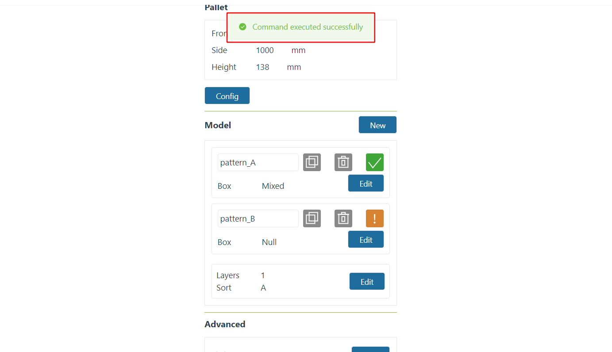

.. centered:: Figura 10-3-17 Eliminar modo

En cualquier modo del área de adición de modos, haga clic en el botón "Editar" para entrar en la ventana modal "Configuración de modo" y configurar el patrón de paletizado del modo actual. Una vez configurado correctamente, el icono de estado de configuración de la caja será verde; si la configuración no está completa, el icono de estado de configuración de la caja será amarillo.

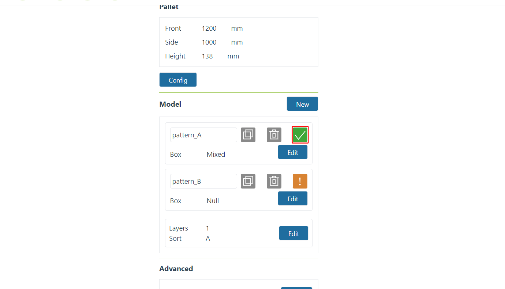

.. centered:: Figura 10-3-18 Configuración de parámetros de modo completada

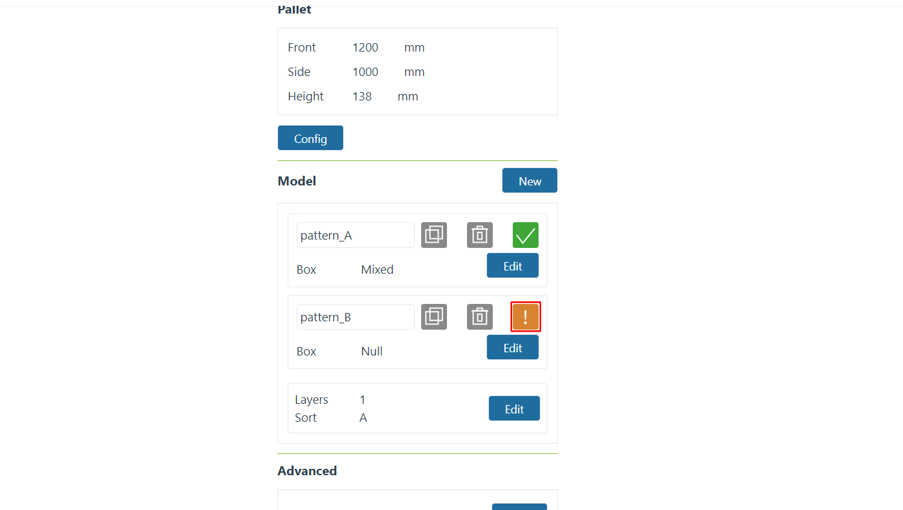

.. centered:: Figura 10-3-19 Configuración de parámetros de modo no completada

En el área de configuración del número de capas de paletizado se muestra el número de capas de paletizado y su orden. Haga clic en el botón "Editar" para entrar en la ventana modal "Configuración de la secuencia del patrón de paletizado", introduzca el "Número de capas de paletizado", seleccione el modo de cada capa y haga clic en el botón "Confirmar" para completar la configuración.

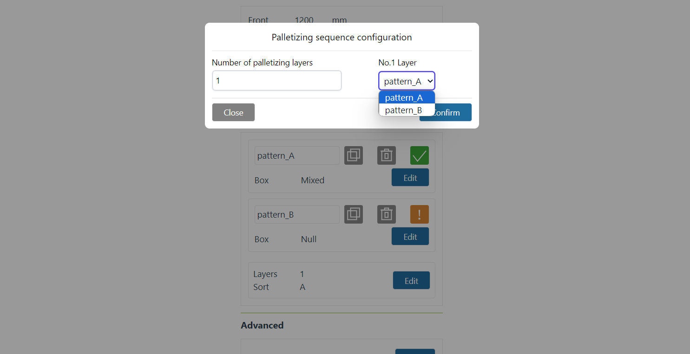

.. centered:: Figura 10-3-20 Configuración del número de capas de paletizado

Parámetros de modo
++++++++++++++++++++

.. note:: 
   .. image:: frcap_pictures/057.png
      :width: 0.5in
      :height: 0.5in
      :align: left

   | Nombre: **Modo anterior**
   | Función: Cambiar al modo anterior; cuando se selecciona el primer modo, al cambiar de nuevo se selecciona el último modo.

.. note:: 
   .. image:: frcap_pictures/058.png
      :width: 0.5in
      :height: 0.5in
      :align: left

   | Nombre: **Modo siguiente**
   | Función: Cambiar al modo siguiente; cuando se selecciona el último modo, al cambiar de nuevo se selecciona el primer modo.

En la sección de configuración de modos, haga clic en "Configurar" para entrar en la ventana emergente "Configuración de modo". Se divide principalmente en cuatro áreas: selección de modo, operaciones de cajas, simulación del patrón de paletizado y vista previa.

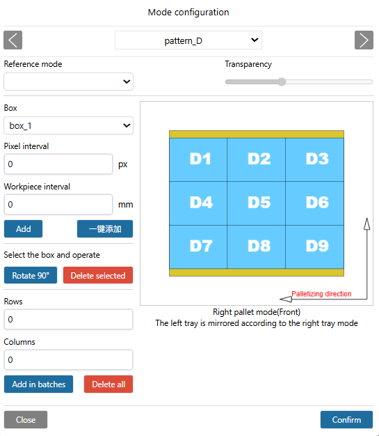

.. centered:: Figura 10-3-21 Configuración de modo

.. important:: 
   Al añadir cajas, si hay colisión entre cajas, el color de fondo de la pieza se vuelve rojo y las operaciones anteriores no se pueden realizar. Si es necesario operar, ajuste las cajas para que no haya colisión.

En la cabecera de la ventana emergente se selecciona el modo. En el área de operaciones de cajas se seleccionan las cajas para añadirlas a ese modo; se puede seleccionar la adición con un solo clic, que por defecto llena el palé centrado sin separación entre cajas. Se puede personalizar la separación entre cajas y añadir cajas individualmente o en lote, y hacer clic en "Confirmar" para completar la configuración de la información del modo. Cuando la altura de las cajas seleccionadas no es uniforme, no se puede completar la configuración y se mostrará el mensaje "Los tipos de caja tienen alturas inconsistentes y no se pueden añadir en el mismo modo".

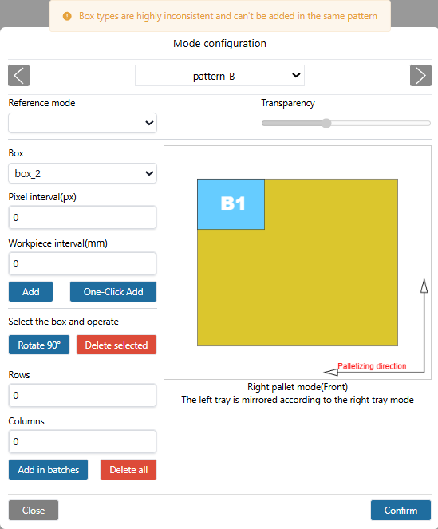

.. centered:: Figura 10-3-22 Aviso de alturas inconsistentes de las cajas seleccionadas

Seleccione un modo de referencia (no se puede seleccionar un modo ya seleccionado) para comparar y ver si la configuración del modo actual se puede paletizar sobre la base de ese modo de referencia, lo que facilita al cliente ver de forma intuitiva los patrones de paletizado de cajas en diferentes modos.

.. important:: 
   Dirección de paletizado: tomando como ejemplo el palé derecho, la esquina inferior derecha es el punto más lejano; se coloca una fila de piezas en vertical u horizontal desde la esquina inferior derecha, y luego se coloca otra fila de piezas en horizontal o vertical hacia arriba, y así sucesivamente (la página Web ya indica la dirección de paletizado, preste atención). El palé izquierdo coloca las piezas en espejo según el modo del palé derecho.

Configuración avanzada
~~~~~~~~~~~~~~~~~~~~~~~~~~~~~~~~~

En la sección de configuración avanzada, haga clic en "Configurar" para entrar en la ventana emergente "Configuración avanzada". Los elementos de configuración son los siguientes:

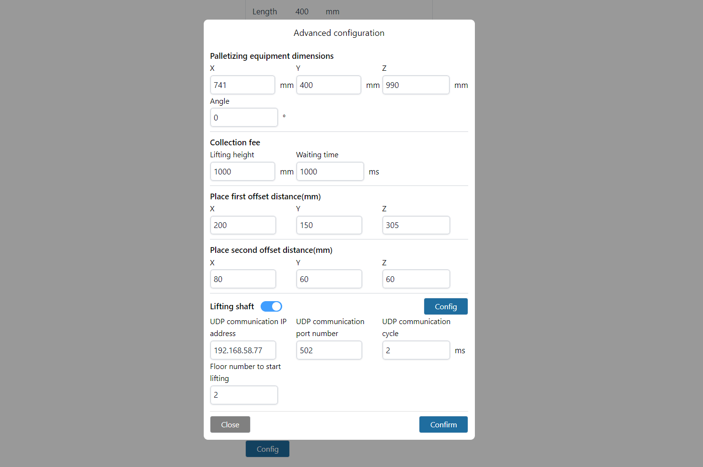

.. centered:: Figura 10-3-23 Configuración avanzada

1) Dimensiones del equipo de paletizado: las dimensiones de la mesa de trabajo de paletizado.

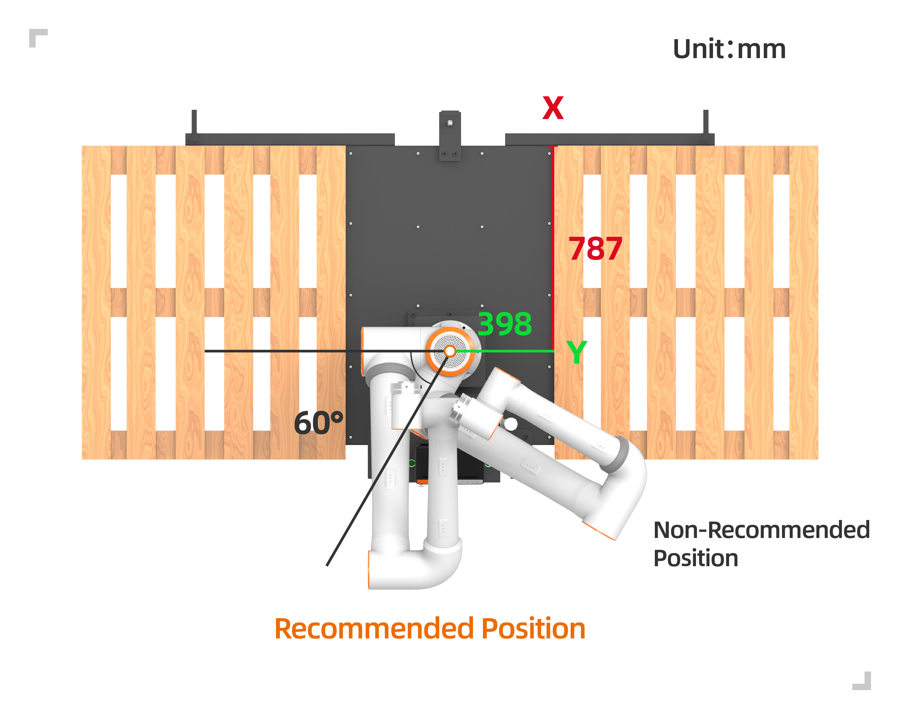

.. centered:: Figura 10-3-24 Mesa de trabajo de paletizado

.. important::
   X, Y, Z son los valores absolutos de las coordenadas del punto de la esquina superior derecha del palé izquierdo o de la esquina superior izquierda del palé derecho respecto al sistema de coordenadas base del robot. Angle es el ángulo de rotación durante la instalación del robot; se recomienda que sea 0 durante la instalación.

2) Altura de elevación tras la toma de material: la altura que el usuario define para elevar después de tomar el material correctamente desde el punto de agarre.

3) Tiempo de espera de toma de material: el tiempo de espera que el usuario define para monitorizar la señal de vacío alcanzado tras la succión del material; si no se alcanza, se repite la acción de succión.

4) Distancia de desplazamiento primera/segunda: la distancia de desplazamiento que el usuario define para que el robot apile inclinado hasta el punto objetivo.

.. note::
   El parámetro Z del primer desplazamiento debe ser mayor que la altura de la caja; de lo contrario, durante el apilado se producirá una colisión con las cajas ya colocadas.

5) Configuración de separadores: establecer la "Longitud", "Anchura" y "Altura" del separador, así como activar o desactivar el separador.

.. note::
   Cuando se activa la función de separadores, el contenido de la configuración avanzada que se muestra en la gestión de recetas muestra los parámetros básicos de la configuración de separadores.

.. centered:: Figura 10-3-25 Configuración de separadores

.. centered:: Figura 10-3-26 Gestión de recetas — La configuración avanzada muestra la configuración de separadores

A continuación, establezca los puntos de transición de los separadores. Los puntos de transición de los separadores son tres; el objetivo de establecerlos es planificar aproximadamente una trayectoria de movimiento tras agarrar el separador, evitando colisiones que impidan completar la acción de colocación del separador.

.. note:: El punto de transición 1 se enseña después de que el robot se mueva una cierta distancia desde el punto de agarre de la caja; el punto de transición 2 se enseña después de que el robot se mueva una cierta distancia desde el punto de transición 1, y también puede ser el punto intermedio de transición; el punto de transición 3 se enseña después de que el robot se mueva una cierta distancia desde el punto de transición 2, y es el último punto antes de colocar el separador.

.. centered:: Figura 10-3-27 Punto de transición 1 del separador (tomando como ejemplo la estación de trabajo derecha)

.. centered:: Figura 10-3-28 Punto de transición 2 del separador (tomando como ejemplo la estación de trabajo derecha)

.. centered:: Figura 10-3-29 Punto de transición 3 del separador (tomando como ejemplo la estación de trabajo derecha)

A continuación, establezca el punto de agarre (mantenga el punto de agarre en el centro del separador, con la parte inferior de la ventosa en estado de compresión al contacto con el separador) y el punto de colocación, y haga clic en "Confirmar" para completar la configuración de la información del separador.

.. centered:: Figura 10-3-30 Punto de agarre del separador (tomando como ejemplo la estación de trabajo derecha)

.. centered:: Figura 10-3-31 Punto de colocación del separador (tomando como ejemplo la estación de trabajo derecha)

6) Eje de elevación: el usuario define la activación/desactivación del eje de elevación, los parámetros de comunicación (dirección IP, número de puerto y período de comunicación), el número de capa en la que comienza la elevación y la activación/desactivación del eje de elevación.

.. note::
   - La altura de elevación del eje de elevación en cada operación es la altura de la caja.
   - Cuando se activa la función del eje de elevación, el contenido de la configuración avanzada que se muestra en la página principal incluye el botón de prueba del eje de elevación. Al hacer clic en el botón "Probar" se entra en la ventana emergente "Prueba del eje de elevación", donde se puede probar la precisión de la carga de comunicación, el ascenso y el descenso del eje de elevación, evitando problemas de funcionamiento incorrecto y grandes errores si se utiliza directamente.

.. centered:: Figura 10-3-32 Configuración del eje de elevación

.. centered:: Figura 10-3-33 Gestión de recetas — La configuración avanzada muestra el eje de elevación

.. centered:: Figura 10-3-34 Prueba del eje de elevación

Generación de programas
------------------------------------

En la parte inferior del área de visualización de recetas, consulte "Generación de programas" y seleccione la receta según la receta y las necesidades. Cuando se seleccionan recetas tanto para la estación de trabajo izquierda como para la derecha, es necesario seleccionar la prioridad de inicio; cuando solo se selecciona la receta de la estación de trabajo izquierda o derecha, no es necesario seleccionar la prioridad de inicio. Introduzca el nombre del programa y haga clic en el botón "Generar".

.. note:: Todos los nombres de programas comienzan con "palletizing", no es necesario introducir "palletizing", solo es necesario introducir el nombre después de "_". Por ejemplo, para "palletizing_program", basta con introducir "program".

.. centered:: Figura 10-4-1 Generación de programas — Selección de recetas en ambas estaciones de trabajo izquierda y derecha

.. centered:: Figura 10-4-2 Generación de programas — Selección de receta en la estación de trabajo izquierda, sin selección de receta en la derecha

.. important:: 
    1. Si no se selecciona una receta de paletizado para la estación de trabajo izquierda o derecha, significa que esa estación de trabajo no está habilitada.
    2. Una vez generado el programa correctamente, asegúrese de guardar manualmente todos los subprogramas y el programa principal en la enseñanza de programas.
    3. Los programas de despaletizado comienzan con "de", por ejemplo, si el programa de paletizado es "palletizing_program", el programa de despaletizado será "depalletizing_program".
    4. Al ejecutar un programa con recetas configuradas en ambas estaciones de trabajo izquierda y derecha, si se reciben simultáneamente las señales de pieza en posición de ambas estaciones, se trabajará según la prioridad de inicio configurada.

Programa de punto de toma único
~~~~~~~~~~~~~~~~~~~~~~~~~~~~~~~~~~~~~~~~~~~~~~~~~~~

El programa de punto de toma único tiene los dos casos siguientes:

(1) Las estaciones de trabajo izquierda y derecha seleccionan la misma receta;
(2) Las estaciones de trabajo izquierda y derecha seleccionan recetas diferentes, pero la pose del punto de agarre de la caja configurada en las recetas es la misma.

.. centered:: Figura 10-4-3 Punto de agarre de caja con punto de toma único

Programa de doble punto de toma
~~~~~~~~~~~~~~~~~~~~~~~~~~~~~~~~~~~~~~~~~~~~~~~~~~~

La configuración del programa de doble punto de toma requiere que las estaciones de trabajo izquierda y derecha seleccionen recetas diferentes y que la pose del punto de agarre de la caja configurada en las recetas sea diferente.

.. centered:: Figura 10-4-4 Punto de agarre de caja con doble punto de toma