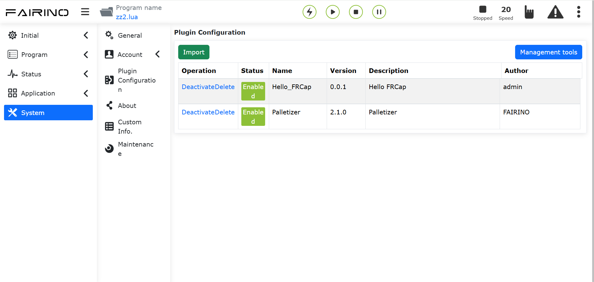
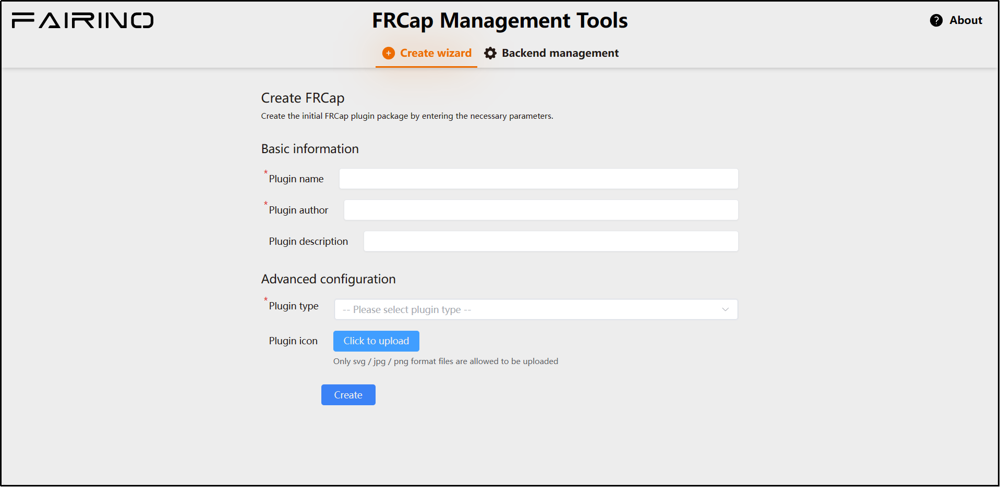
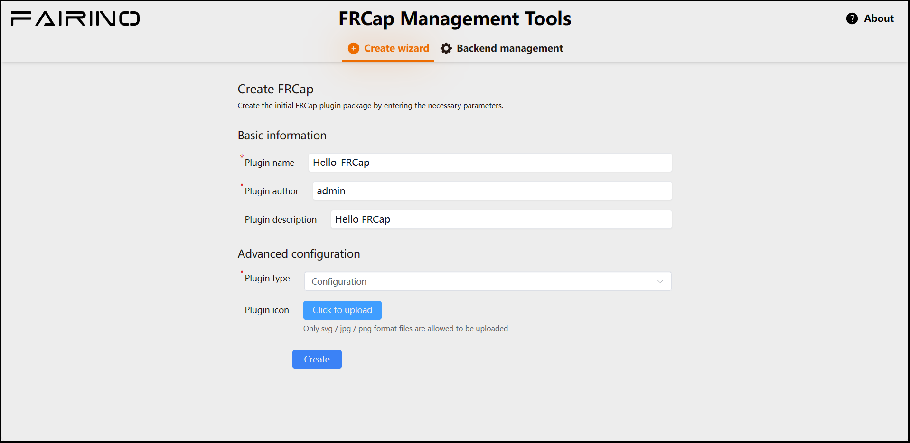
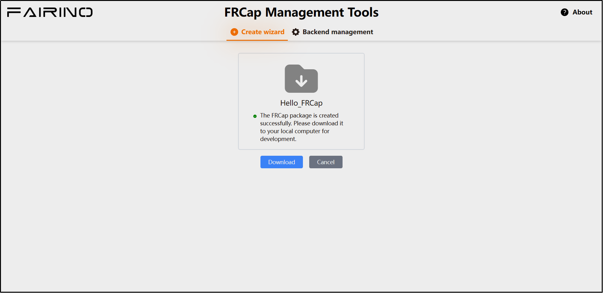
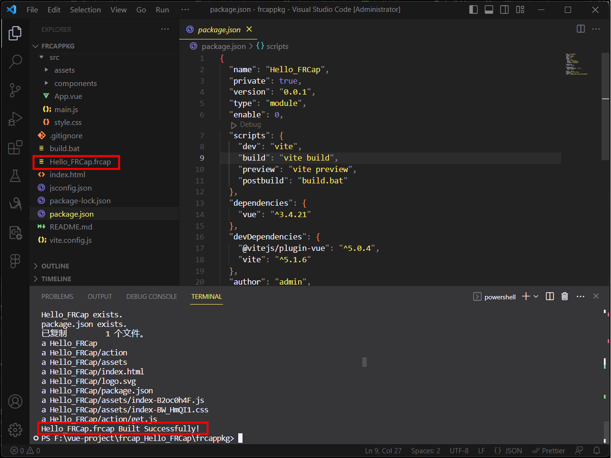
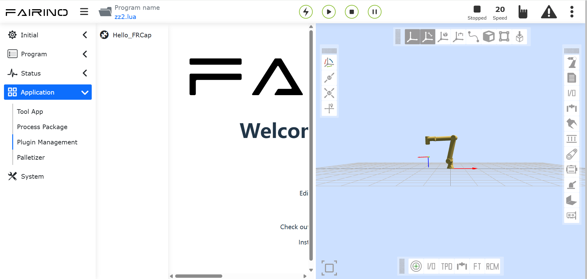

Inicio rápido
=========================

.. toctree:: 
   :maxdepth: 6

No tengo FRCap
---------------------

Si actualmente no tiene un FRCap, puede crear rápidamente un FRCap en esta sección.

Primero, necesitamos conectar el robot y acceder a la WebApp. Abra un navegador en el ordenador local, introduzca la dirección IP predeterminada del robot (http://192.168.58.2) e inicie sesión para entrar en la WebApp.

.. centered:: Figura 2-1  Página "Gestión de FRCap" de la WebApp

En la WebApp, haga clic sucesivamente en "Configuración del sistema" -> "Gestión de FRCap" -> "Herramienta de gestión"; se abrirá una nueva pestaña en el navegador y se accederá a la "Herramienta de gestión de FRCap".

.. centered:: Figura 2-2  Herramienta de gestión de FRCap

En la herramienta de gestión de FRCap, seleccione "Asistente de creación" e introduzca o seleccione sucesivamente el siguiente contenido del plugin:

- Nombre del plugin: Hello_FRCap。
- Autor del plugin: admin。
- Descripción del plugin: Hello FRCap。
- Tipo de plugin: Configuración。

El icono del plugin no es necesario cargarlo. Una vez introducidos o seleccionados los parámetros, haga clic en "Crear" para completar la creación del FRCap.

.. centered:: Figura 2-3  Asistente de creación de FRCap

Una vez creado correctamente, se redirige a la página de creación correcta y se muestra el nombre del FRCap creado correctamente. Haga clic en "Descargar" para descargar el FRCap creado al ordenador local.

.. centered:: Figura 2-4  Descargar el paquete de plugin Hello FRCap

Ya tengo FRCap
-------------------------

Si ya dispone de una carpeta de proyecto FRCap y cumple con la estructura del proyecto FRCap, lea directamente\ `Construir FRCap <frcap_quick_start.html#id3>`__\。

Si ya dispone de un paquete de plugin completo con extensión de archivo ".plugin", lea directamente\ `Hello FRCap <frcap_quick_start.html#hello-frcap>`__\。

Construir FRCap
-------------------------

Abra el proyecto FRCap descargado en la sección 2.1, o su propio proyecto FRCap existente.

Según el sistema que esté utilizando actualmente, primero abra el script build, modifique el parámetro buildName con el nombre que desee, luego guárdelo y ciérrelo, y ejecute el script correspondiente en la terminal.

- En Windows, inicie la terminal y ejecute el siguiente comando:

.. code-block:: c++
   :linenos:

   ./build.bat

- En Linux, inicie la terminal y ejecute el siguiente comando:
  
.. code-block:: c++
   :linenos:

   ./build.sh

Una vez completada la construcción, se generará en el directorio del proyecto FRCap un archivo de paquete con el nombre del FRCap y extensión ".plugin".

.. centered:: Figura 2-5  Archivo de paquete FRCap construido

Hello FRCap
-------------

Una vez construido el proyecto FRCap, abra un navegador en el ordenador local, introduzca la dirección IP predeterminada del robot (http://192.168.58.2) e inicie sesión para entrar en la WebApp. Haga clic sucesivamente en "Configuración del sistema" -> "Gestión de FRCap" -> "Importar". Seleccione el archivo de paquete FRCap con extensión ".plugin" construido y ábralo para cargarlo. Una vez cargado correctamente, la información del FRCap importado se mostrará en la lista de información de plugins situada debajo.

Mediante la columna de operaciones de la lista se controla la activación o no del FRCap y su eliminación, y en la columna de estado de activación/desactivación se consulta el estado de activación del FRCap.

Una vez activado Hello FRCap, se puede utilizar en "Aplicaciones auxiliares" -> "FRCap" -> "Hello FRCap". Esta página aloja FRCap de tipo configuración, y puede mostrarse a pantalla completa o a media pantalla; por defecto se muestra a media pantalla.

Con esto, ha completado todo el flujo de creación y uso rápido del plugin.

.. centered:: Figura 2-6  Contenido de Hello FRCap

Si desea conocer una guía detallada del asistente de creación, puede seguir consultando\ `Asistente de creación <frcap_create.html#id1>`__\。

Si desea conocer el entorno de herramientas y la guía necesarios para desarrollar FRCap, consulte\ `Guía de desarrollo <frcap_development_guidance.html#id1>`__\。

Si desea conocer la guía de uso específica de FRCap en la WebApp, consulte\ `Uso de FRCap en la WebApp <frcap_use.html#webappfrcap>`__\。