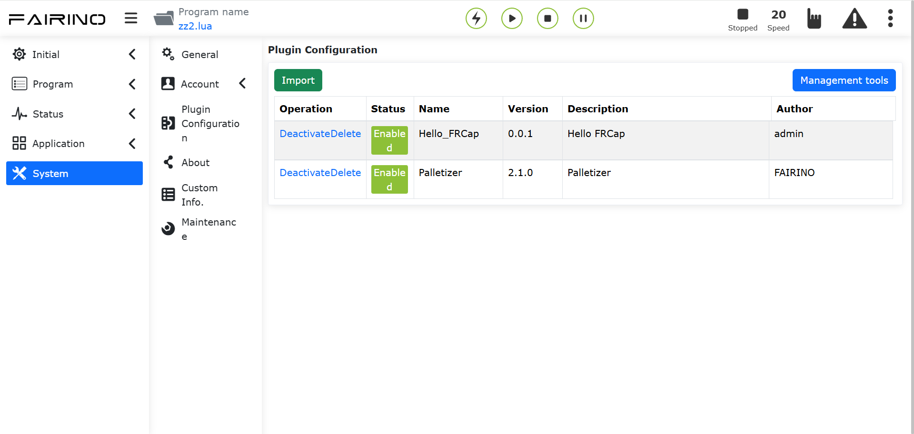

Uso de FRCap en la WebApp
==============================

.. toctree:: 
   :maxdepth: 6

Gestión de FRCap
-----------------------------
En la WebApp, seleccione sucesivamente "Configuración del sistema" -> "Gestión de FRCap". El área funcional de la página incluye:

1. Importación de FRCap: haga clic en el botón "Importar" para cargar;

2. Gestión de backend: incluye las herramientas "Asistente de creación" y "Gestión de backend";

3. Lista de información de FRCaps y operaciones.

.. centered:: Figura 6-1  Área funcional de la página de gestión de FRCap

Uso de tipo configuración
---------------------------------------------
La ruta de uso de FRCap de tipo configuración es "Aplicaciones auxiliares" -> "FRCap" -> "[Nombre del FRCap]" en la WebApp del robot.

Uso de tipo aplicación
---------------------------------------------
La ruta de uso de FRCap de tipo aplicación es "Aplicaciones auxiliares" -> "[Nombre del FRCap]" en la WebApp del robot.