Introducción al plugin
++++++++++++++++++++++++++++++
El plugin MoveIt2 de FAIRINO es un plugin que proporciona soporte para el control de movimiento y la planificación de trayectorias de los robots FAIRINO. Con el plugin MoveIt2 de FAIRINO se pueden realizar funciones como el control complejo del movimiento del robot, la planificación de trayectorias, la resolución de cinemática inversa y la detección de colisiones en tiempo real, y es aplicable a diversos escenarios de aplicación de brazos robóticos, como escenarios industriales, de soldadura, de fabricación, de carga y descarga automatizada, de paletizado, médicos, etc.

Uso rápido
++++++++++++++++++++++++++++++
Este capítulo explica cómo configurar el entorno de ejecución de la APP.

Se recomienda utilizarlo en Ubuntu 22.04 LTS (Jammy). Una vez instalado el sistema, se puede instalar ROS2; se recomienda ros2-humble. Para la instalación de ROS2 puede consultar el tutorial: https://docs.ros.org/en/humble/index.html.

Instalación y configuración del paquete del plugin MoveIt2 de FAIRINO
------------------------------------------------------------------------------
Clonar el plugin MoveIt2 de FAIRINO
""""""""""""""""""""""""""""""""""""
Clone el plugin MoveIt2 de FAIRINO en local y luego ejecute cd al directorio de destino. Los archivos principales incluyen el paquete de funciones de tipos de datos de transmisión de datos del robot FAIRINO fairino_msgs; el paquete de funciones del plugin fairino_hardware del robot FAIRINO fairino_hardware;

el paquete de funciones de archivos urdf y apariencia del robot FAIRINO fairino_robot/fairino_description;

los paquetes de configuración moveit2 del robot FAIRINO fairino_robot/fairino3mt_v6_moveit2_config, fairino_robot/fairino3_v6_moveit2_config, fairino_robot/fairino5_v6_moveit2_config, fairino_robot/fairino10_v6_moveit2_config, fairino_robot/fairino16_v6_moveit2_config, fairino_robot/fairino20_v6_moveit2_config, fairino_robot/fairino30_v6_moveit2_config, y el paquete de código de ejemplo mtc de FAIRINO fairino_robot/fairino_mtc_demo.

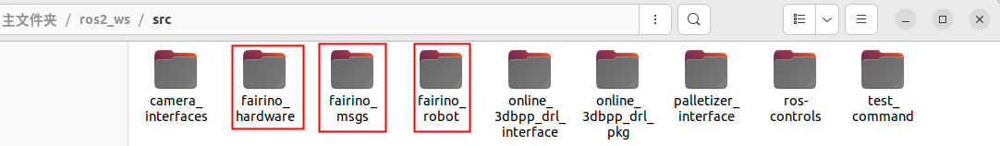
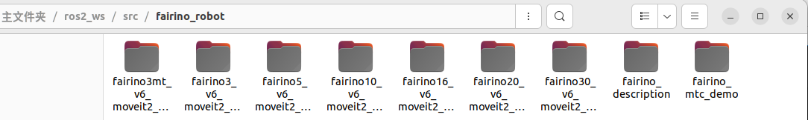

Compilar los paquetes de funciones
""""""""""""""""""""""""""""""""""""

Compilar el paquete de funciones fairino_msgs

.. code-block:: shell
    :linenos:

    cd ros2_ws
    colcon build --packages-select fairino_msgs
    source install/setup.bash

Compilar el paquete de funciones fairino_hardware

.. code-block:: shell
    :linenos:

    cd ros2_ws
    colcon build --packages-select fairino_hardware
    source install/setup.bash

Compilar el paquete de funciones fairino_description

.. code-block:: shell
    :linenos:

    cd ros2_ws
    colcon build --packages-select fairino_description
    source install/setup.bash

Compilar el paquete de configuración moveit2 del robot FAIRINO, tomando como ejemplo fairino5_v6_moveit2_config

.. code-block:: shell
    :linenos:

    cd ros2_ws
    colcon build --packages-select fairino5_v6_moveit2_config
    source install/setup.bash

Compilar el paquete de código de ejemplo fairino_mtc_demo del robot FAIRINO; si este paquete de código de ejemplo no aparece en el espacio de trabajo oficial ros2_ws, puede contactar con el servicio posventa para obtenerlo

.. code-block:: shell
    :linenos:

    cd ros2_ws
    colcon build --packages-select fairino_mtc_demo
    source install/setup.bash

Configurar el modelo Moveit2 del brazo robótico FAIRINO
------------------------------------------------------------------------------
Si no desea utilizar el paquete de configuración moveit2_config del robot proporcionado oficialmente, puede configurar un paquete de configuración moveit2_config personalizado del robot mediante moveit_setup_assistant.

Crear el espacio de trabajo
""""""""""""""""""""""""""""""""""""
Crear el espacio de trabajo y crear el paquete de funciones

.. code-block:: shell
    :linenos:

    mkdir -p test_fa_ws/src
    cd test_fa_w/src
    mkdir fairino5_v6_robot_moveit_config
    cd ..
    cd ..

Compilar el paquete de funciones y hacer source

.. code-block:: shell
    :linenos:

    colcon build
    source install/setup.bash

Iniciar moveit_setup_assistant para la configuración del robot

.. code-block:: shell
    :linenos:

    ros2 launch moveit_setup_assistant setup_assistant.launch.py

Configurar el robot
""""""""""""""""""""""""""""""""""""
Iniciar la interfaz de configuración
^^^^^^^^^^^^^^^^^^^^^^^^^^^^^^^^^^^^^^^^
Abra un terminal en el directorio test_fa_ws y, en la interfaz de configuración, seleccione "Create New Moveit Configuration Package" para crear un nuevo paquete de funciones de configuración moveit.

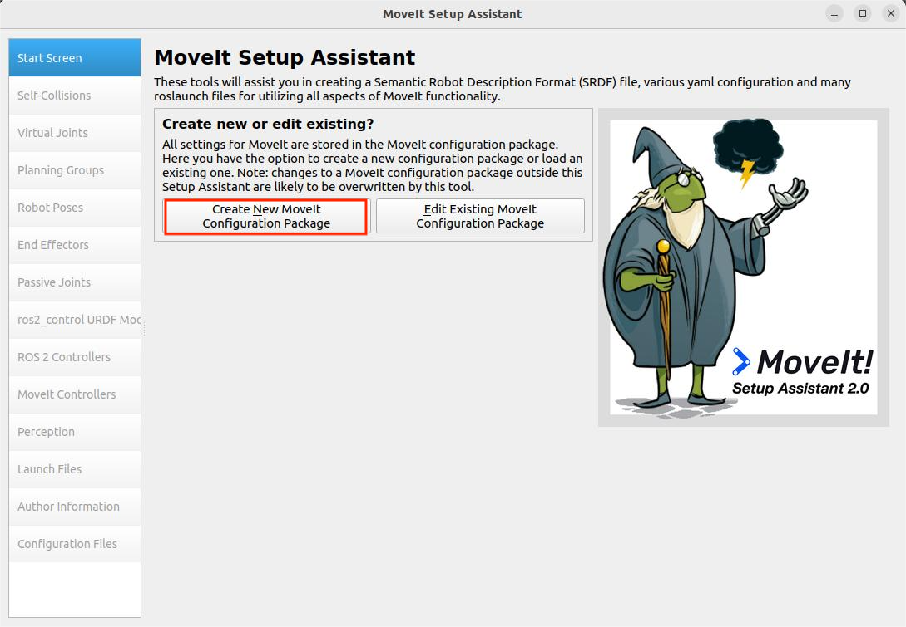

A continuación, seleccione el archivo de descripción del robot, es decir, el archivo .urdf, y seleccione Load Files para cargar el modelo del robot; podrá ver que el modelo del robot se carga a la derecha.

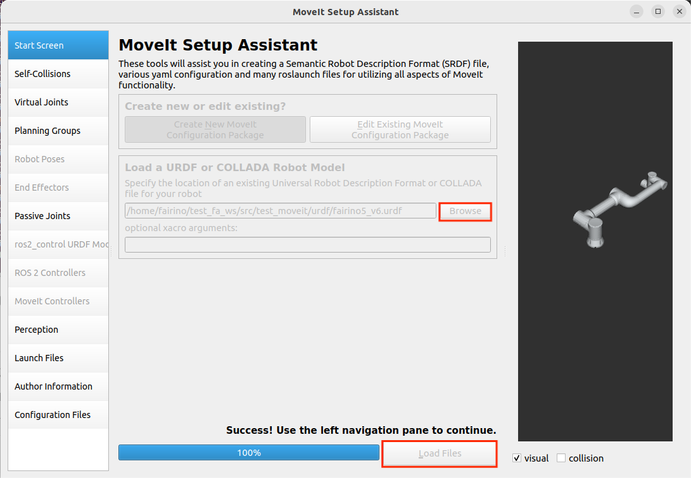

Configurar Self-Collisions
^^^^^^^^^^^^^^^^^^^^^^^^^^^^^^^^^^^^^^^^
Self-Collisions es la configuración de colisiones del robot. Al hacer clic en Generate Collision Matrix se genera automáticamente la matriz de colisiones de las articulaciones, que cancela las colisiones entre dos eslabones en contacto y entre eslabones que nunca pueden entrar en contacto, configurando así la matriz de colisiones de las articulaciones del robot y evitando el cálculo de colisiones entre dos superficies en contacto. Basta con hacer clic en Generate Collision Matrix para generarla automáticamente.

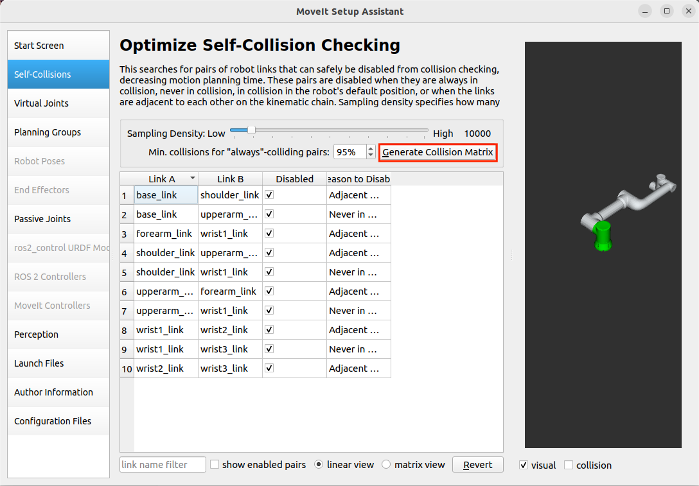

Configurar Virtual Joints
^^^^^^^^^^^^^^^^^^^^^^^^^^^^^^^^^^^^^^^^
Virtual Joints son los ejes virtuales del robot. Cuando el robot está instalado sobre una plataforma móvil, es necesario configurar ejes virtuales para el robot, estableciendo el name, el eslabón hijo, el tipo de articulación, etc. Cuando la plataforma móvil se mueve, los ejes virtuales también se mueven de forma sincronizada, arrastrando así el movimiento del robot y realizando la función de que el robot se mueva con la plataforma móvil. En esta ocasión, el robot se coloca directamente en el sistema de coordenadas world, con el nombre virtual_joints.

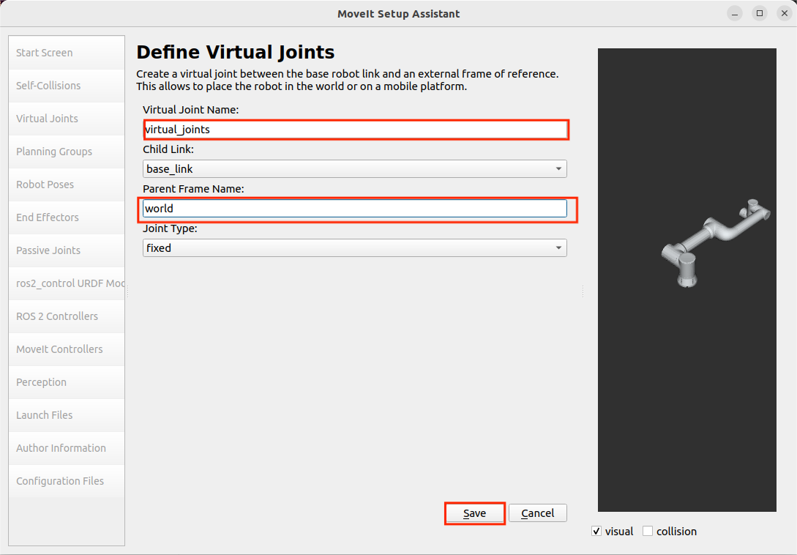

Configurar Planning Groups
^^^^^^^^^^^^^^^^^^^^^^^^^^^^^^^^^^^^^^^^
Planning Groups son los grupos de planificación del robot. Agrupa en un mismo grupo de planificación las articulaciones que deben considerarse conjuntamente al realizar cálculos cinemáticos, realizando un cálculo unificado de cinemática directa e inversa. Por ejemplo, si se coloca un robot sobre un vehículo AGV y se instala una pinza en el extremo del robot, en la prueba se agrupan las cuatro articulaciones del AGV en un grupo de planificación, las seis articulaciones del robot en otro grupo de planificación y una articulación de la pinza en otro grupo de planificación para realizar los cálculos cinemáticos.

Como en esta ocasión no se incluye pinza, solo se añade el grupo de articulaciones del robot, es decir, el grupo arm. Primero añada el grupo arm; en Kinematic Solver seleccione kdl_kinematics_plugin/KDLKinematicsPlugin, y en el Group Default Planner predeterminado seleccione TRRT; a continuación haga clic en Add Joints para añadir articulaciones a este grupo de planificación.

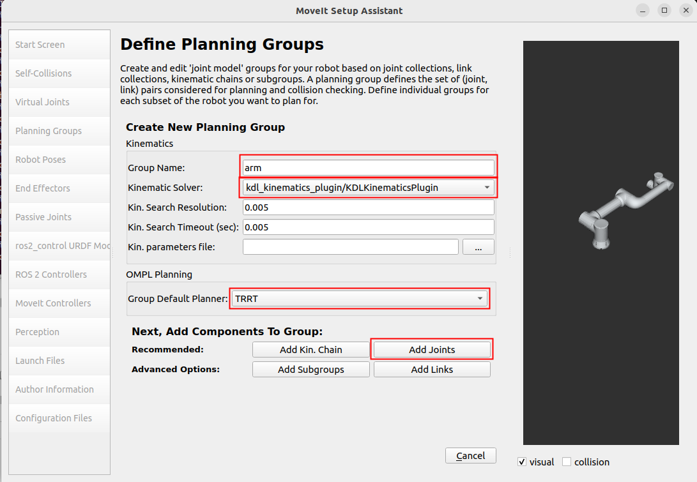

Las articulaciones de arm se pueden seleccionar múltiples manteniendo pulsada la tecla shift; haga clic en '>' para añadirlas y luego haga clic en save para guardar.

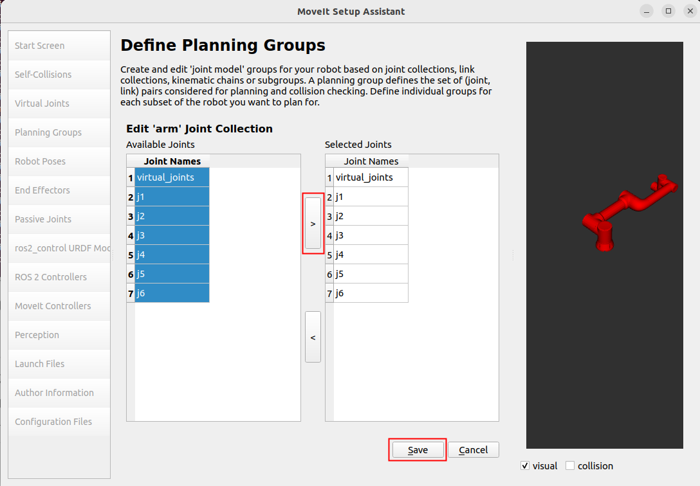

El grupo de planificación definido es el siguiente:

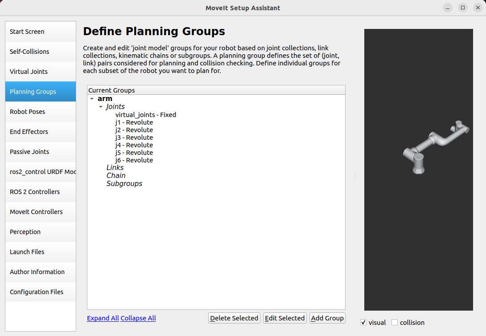

Configurar Robot Poses
^^^^^^^^^^^^^^^^^^^^^^^^^^^^^^^^^^^^^^^^
Robot Poses son las poses predefinidas del robot. Define algunas poses predefinidas para cada grupo de planificación; defina una pose home para arm, y esta pose puede elegirse libremente.

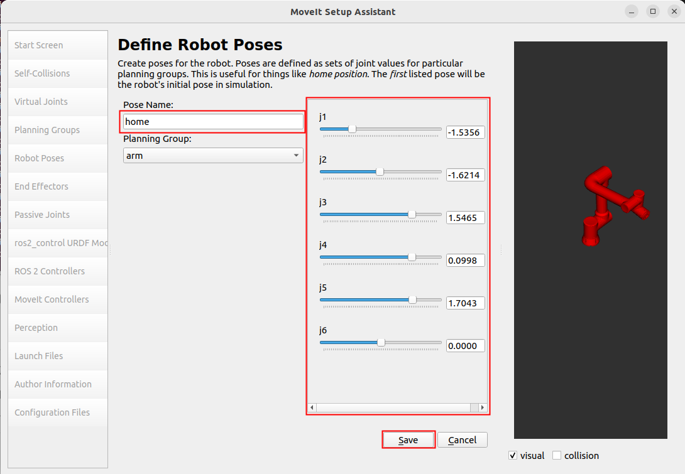

Robot Poses puede definir poses predefinidas para cada grupo de planificación. Cuando el robot tenga una pinza, se puede añadir el grupo de planificación de la pinza en la sección Planning Groups y luego, al configurar las poses en Robot Poses, se podrán establecer poses predefinidas para la pinza.

Configurar End Effectors
^^^^^^^^^^^^^^^^^^^^^^^^^^^^^^^^^^^^^^^^
End Effectors son los mecanismos de ejecución del extremo del robot. El grupo de planificación del mecanismo de ejecución del extremo es hand, y el parent_link predeterminado conectado es panda_link8. Como en esta ocasión no hay efector final, este paso se puede omitir.

ros2_control URDF Modifications
^^^^^^^^^^^^^^^^^^^^^^^^^^^^^^^^^^^^^^^^
ros2_control URDF Modifications se utiliza principalmente para establecer los tipos de datos de las articulaciones que se envían y se retroalimentan; se puede elegir entre posición, velocidad y par. En esta ocasión se selecciona que tanto los datos de articulación enviados como los retroalimentados sean de control de posición; a continuación basta con hacer clic en Add interfaces.

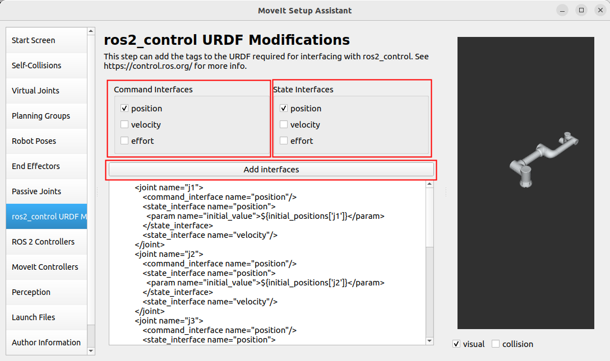

.. important:: 

   - Nota:

    El tipo de datos de las articulaciones seleccionado debe coincidir con el plugin fairino_hardware posterior; seleccione los tipos de datos de articulación enviados y retroalimentados según los datos transmitidos por el plugin fairino_hardware. Como en esta ocasión el plugin fairino_hardware que controla el movimiento del robot real utiliza el tipo de datos position, se selecciona que tanto los datos de articulación enviados como los retroalimentados sean de control de posición.

ROS 2 Controllers
^^^^^^^^^^^^^^^^^^^^^^^^^^^^^^^^^^^^^^^^
ROS 2 Controllers se utiliza principalmente para generar el archivo ros2_controllers.yaml, que establece la frecuencia de publicación, los nombres de las articulaciones, los nombres de los controladores, los tipos de controladores, etc. Para configurar ROS 2 Controllers, configure un controlador para cada grupo de planificación; basta con hacer clic en Auto Add JointTrajectoryController Controllers For Each Planning Group.

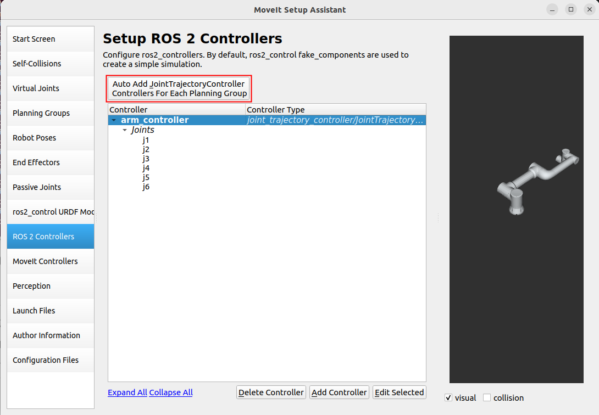

Moveit Controllers
^^^^^^^^^^^^^^^^^^^^^^^^^^^^^^^^^^^^^^^^
Moveit Controllers se utiliza principalmente para generar el archivo moveit_controllers, que establece los nombres de los controladores, los tipos de controladores, etc. Cabe señalar que los nombres de los controladores en moveit_controllers deben ser iguales a los nombres de los controladores en ros2_controllers; de lo contrario, no se podrá ejecutar correctamente.

Además, cuando los nombres de los controladores en moveit_controllers son iguales a los nombres de los controladores en ros2_controllers, los tipos de controladores en moveit_controllers se asignan automáticamente a los tipos de controladores en ros2_controllers, de modo que los datos de control enviados se envían a través de moveit_controllers a ros2_controllers y, a continuación, mediante el plugin de ros2_controllers, se acciona el movimiento del robot real.

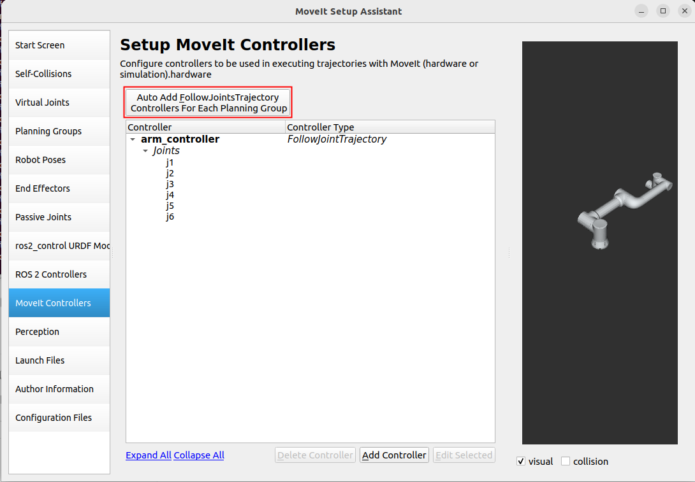

Launch Files
^^^^^^^^^^^^^^^^^^^^^^^^^^^^^^^^^^^^^^^^
Configure Launch Files; basta con utilizar la configuración predeterminada.

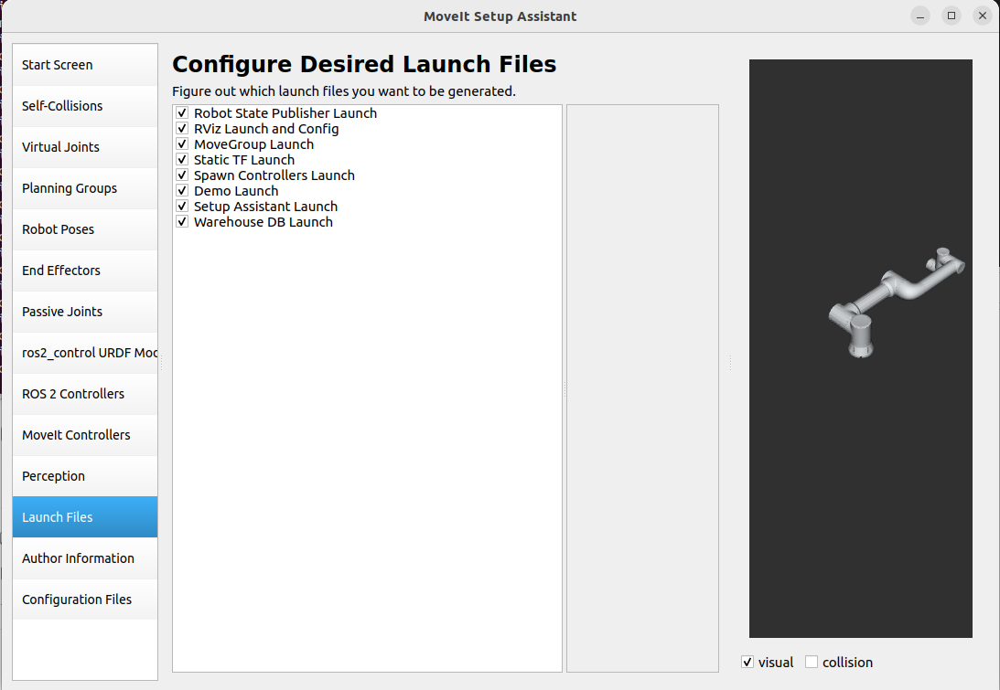

Información del autor
^^^^^^^^^^^^^^^^^^^^^^^^^^^^^^^^^^^^^^^^
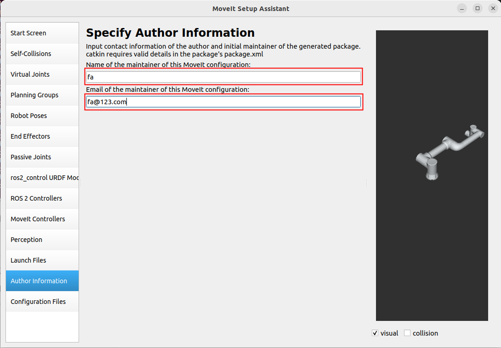

Generar el archivo Launch
^^^^^^^^^^^^^^^^^^^^^^^^^^^^^^^^^^^^^^^^
Genere el archivo Launch y seleccione la ubicación de generación. En esta ocasión, cree una carpeta fairino5_v6_robot_moveit_config en la ruta test_fa_ws/src para almacenar los archivos de configuración y, a continuación, seleccione generar.

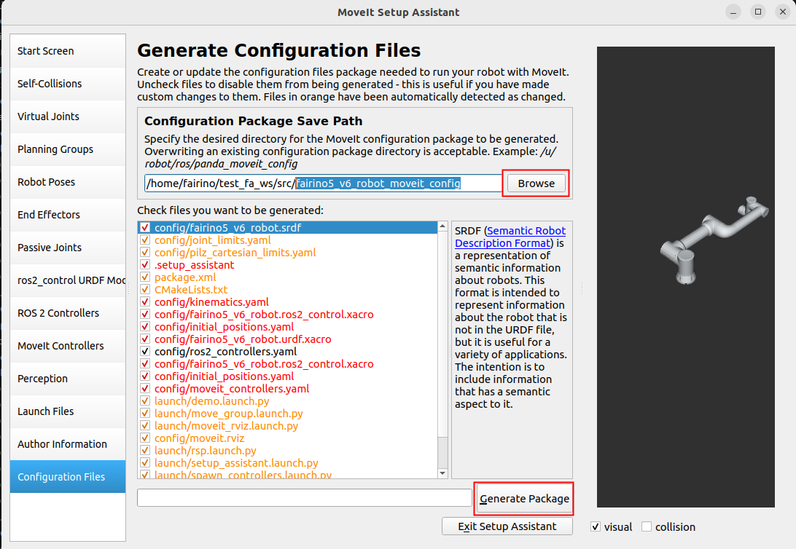

Como en esta ocasión ya se había configurado anteriormente, si es la primera configuración, el contenido de la sección Check files you want to be generated aparecerá en negro, lo que indica que se puede generar el archivo Launch.

Iniciar Launch
""""""""""""""""""""""""""""""""""""
Una vez completada la configuración, se puede compilar el paquete de funciones. Se puede utilizar el paquete de configuración moveit2 personalizado del robot para sustituir el paquete de configuración moveit2 del robot FAIRINO, logrando el uso compatible del plugin con el robot personalizado del usuario.

.. code-block:: shell
    :linenos:

    colcon build --packages-select fairino5_v6_robot_moveit_config
    source install/setup.bash

A continuación, ejecute directamente el archivo Launch recién configurado

.. code-block:: shell
    :linenos:

    ros2 launch fairino5_v6_robot_moveit_config demo.launch.py

y podrá ver la interfaz rviz2 ya configurada.

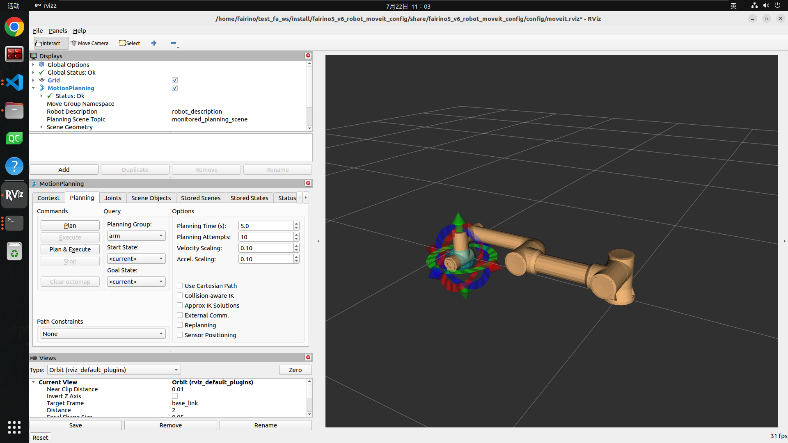

Uso de Moveit2
""""""""""""""""""""""""""""""""""""
Tras abrir el paquete configurado, se puede establecer la posición objetivo del robot arrastrando la esfera azul del extremo del robot en la interfaz 3D de la derecha, y luego cambiar la orientación del extremo del robot mediante los tres anillos rojo, verde y azul del extremo del robot.

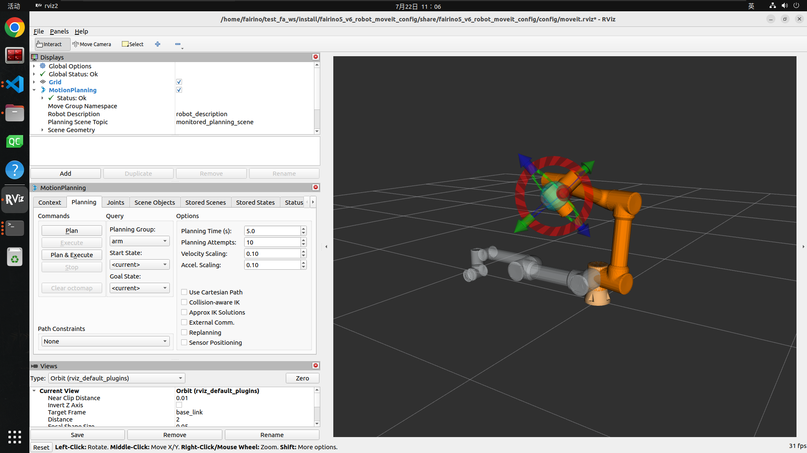

Haga clic en el botón Plan de la izquierda para planificar la trayectoria de movimiento del robot.

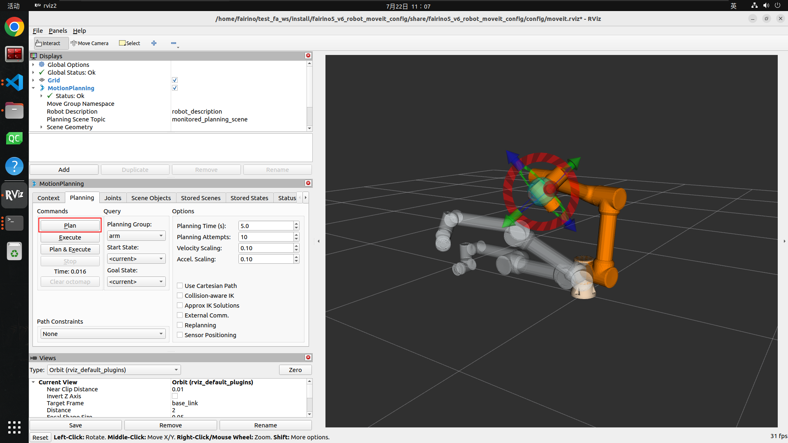

Haga clic en el botón Execute de la izquierda para accionar el robot y que se mueva según la trayectoria planificada hasta la pose objetivo.

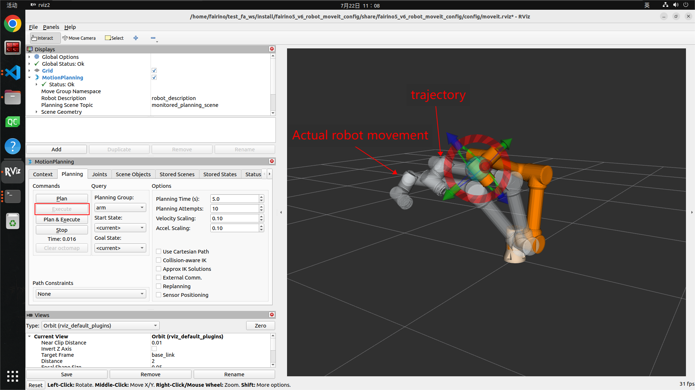

El botón Plan&Execute controla automáticamente el movimiento del robot tras planificar la trayectoria.

A continuación, haga clic en la pestaña Joints para cambiar la pose objetivo del robot modificando los ángulos de cada articulación, y luego accione el movimiento del robot mediante los botones Plan, Execute y Plan&Execute.

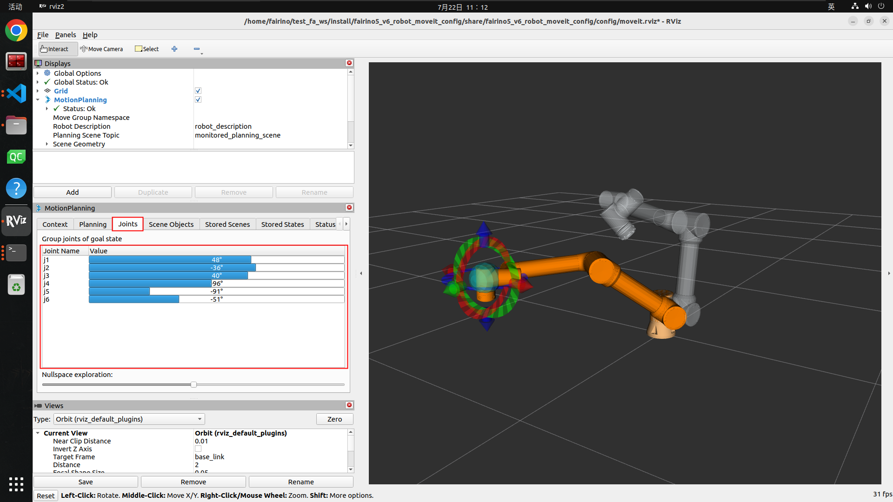

Paquete de adaptación de robots de producción en serie para el entorno de simulación Gazebo
++++++++++++++++++++++++++++++++++++++++++++++++++++++++++++++++++++++++++++++++++++++++++++++++++++++++++++++++++++++++

Introducción
------------------------------------------------------------

Este proyecto proporciona paquetes de funciones de simulación en el entorno de simulación Gazebo Classic para los robots colaborativos de 6 grados de libertad de la serie FR de producción en serie, implementados sobre ROS2 Humble y la arquitectura ros2_control. Cada robot corresponde a un paquete de funciones ROS2 independiente, que utiliza la interfaz de hardware GazeboSystem estándar de ros2_control y admite el control de articulaciones y la retroalimentación de estado de las articulaciones. El espacio de trabajo de este manual se denomina por defecto FR_Gazebo_ws; si utiliza un nombre personalizado, sustitúyalo usted mismo.

Modelos compatibles (11 paquetes de funciones)
""""""""""""""""""""""""""""""""""""""""""""""""""""""""""""""""""""""""""""""""""""""""""""""""""""""""

Tabla 1-1  Tabla de correspondencia entre modelos compatibles y paquetes de funciones

.. list-table::
   :widths: 50 50
   :header-rows: 0
   :align: center

   * - **Modelo** 
     - **Paquete de funciones**

   * - FR3
     - fr3v6_ros2_control

   * - FR5
     - fr5v6_ros2_control

   * - FR10
     - fr10v6_ros2_control

   * - FR16
     - fr16v6_ros2_control

   * - FR20
     - fr20v6_ros2_control

   * - FR30
     - fr30v6_ros2_control

   * - FR3C
     - fr3c_ros2_control

   * - FR5C
     - fr5c_ros2_control

   * - FR5WML
     - fr5l_ros2_control

   * - FR3WML
     - fr3wml_ros2_control

   * - FR3WMS
     - fr3wms_ros2_control

Características principales
""""""""""""""""""""""""""""""""""""""""""""""""""""""""""""""""""""""""""""""""""""""""""""""""""""""""

- Nomenclatura unificada de articulaciones: todos los modelos tienen 6 articulaciones rotativas, denominadas j1 ~ j6, en el orden base→hombro→codo→muñeca 1→muñeca 2→muñeca 3.
- Interfaz de control unificada: las instrucciones trajectory_msgs/msg/JointTrajectory se envían a través del tema /joint_trajectory_controller/joint_trajectory (control de posición).
- Retroalimentación de estado de las articulaciones: los ángulos de las articulaciones se retroalimentan en tiempo real a través del tema joint_states bajo el espacio de nombres de cada modelo.
- Script de demostración: cada paquete de funciones incluye `*_demo.py`, que espera automáticamente a que el controlador esté listo y luego demuestra el movimiento de cada articulación.

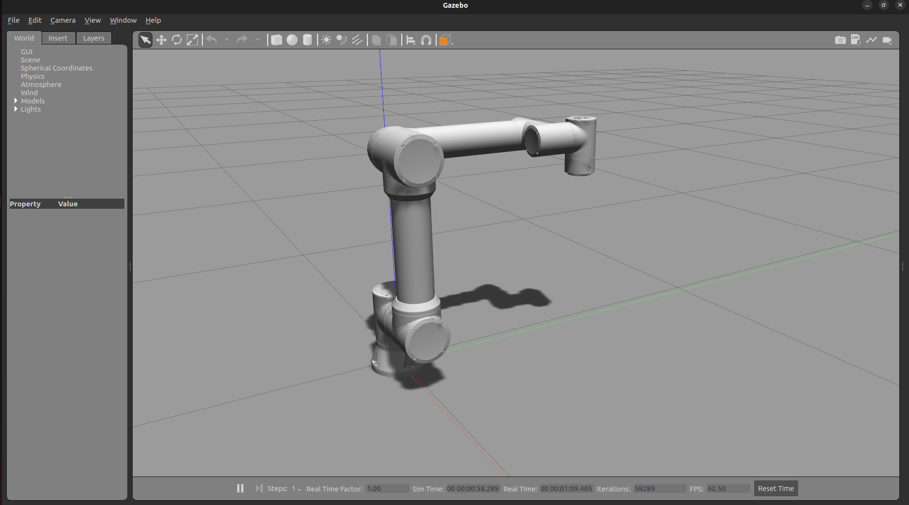

.. centered:: Figura 1-1  Efecto de carga del robot en el entorno de simulación Gazebo

Requisitos del entorno
------------------------------

Sistema operativo
""""""""""""""""""""""""""""""""""""""""""""""""""""""""""""""""""""""""""""""""""""""""""""""""""""""""

Ubuntu 22.04 LTS (versión oficialmente compatible con ROS 2 Humble).

Dependencias de software
""""""""""""""""""""""""""""""""""""""""""""""""""""""""""""""""""""""""""""""""""""""""""""""""""""""""

Tabla 2-1  Lista de dependencias de software

.. list-table::
   :widths: 30 30 40
   :header-rows: 0
   :align: center

   * - **Software/Componente** 
     - **Versión/Descripción**
     - **Ubicación de instalación**

   * - ROS 2
     - Humble
     - /opt/ros/humble

   * - Gazebo
     - Gazebo Classic 11 (gzserver / gzclient)
     - Se instala con gazebo_ros

   * - Espacio de trabajo del código fuente de ros2_control
     - Incluye ros2_control, gazebo_ros2_control, ros2_controllers, controller_manager, joint_trajectory_controller, joint_state_broadcaster, etc.
     - ~/ros2_control_ws

   * - Python 3
     - Ejecución de scripts launch y demo
     - Incluido en el sistema
		
.. note:: Los paquetes gazebo_ros2_control, joint_trajectory_controller, joint_state_broadcaster, etc. de los que depende este proyecto provienen del espacio de trabajo ~/ros2_control_ws compilado desde código fuente (repositorio ros-controls). Antes de iniciar/compilar es obligatorio hacer source de ese espacio de trabajo; de lo contrario aparecerá el error "no se encuentra el controlador/plugin". Además, se recomienda utilizar el tipo de compilación predeterminado para evitar anomalías en la carga de plugins debidas a los símbolos de depuración.

Pasos de instalación y compilación de los paquetes de funciones
------------------------------------------------------------------------------------------

Preparación previa: confirmar el espacio de trabajo ros2_control
""""""""""""""""""""""""""""""""""""""""""""""""""""""""""""""""""""""""""""""""""""""""""""""""""""""""

Confirme que ~/ros2_control_ws existe y está compilado (contiene el repositorio ros-controls). Si ya existe, pase directamente a la sección 3.2. Si necesita crearlo, puede ejecutar los siguientes comandos:

.. centered:: Código 3-1  Crear el espacio de trabajo ros2_control
    
.. code-block:: console

    # 1. Crear el espacio de trabajo y obtener el código fuente de ros-controls
    mkdir -p ~/ros2_control_ws/src
    cd ~/ros2_control_ws/src
    git clone https://github.com/ros-controls/ros2_control -b humble

    # 2. Compilar (requiere haber hecho source de ROS 2 Humble)
    source /opt/ros/humble/setup.bash
    cd ~/ros2_control_ws
    rosdep install --from-paths src --ignore-src -r -y
    colcon build
    source ~/ros2_control_ws/install/setup.bash

Clonar el repositorio
""""""""""""""""""""""""""""""""""""""""""""""""""""""""""""""""""""""""""""""""""""""""""""""""""""""""

En primer lugar, clone los paquetes de funciones de adaptación de Gazebo en local. Los paquetes de funciones incluyen fr3c_ros2_control, fr3v6_ros2_control, fr3wml_ros2_control, fr3wms_ros2_control, fr5c_ros2_control, fr5l_ros2_control, fr5v6_ros2_control, fr10v6_ros2_control, fr16v6_ros2_control, fr20v6_ros2_control, fr30v6_ros2_control. Cree la carpeta FR_Gazebo_ws/src y clone los paquetes de funciones anteriores en el directorio src.

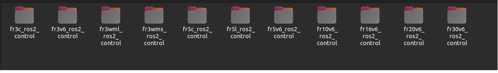

.. centered:: Figura 3-1  Paquetes de funciones de adaptación del robot en el directorio src

Compilar este espacio de trabajo
""""""""""""""""""""""""""""""""""""""""""""""""""""""""""""""""""""""""""""""""""""""""""""""""""""""""

Todos los paquetes de funciones de este proyecto son paquetes de tipo archivo (solo instalan URDF/launch/config/meshes).

.. centered:: Código 3-2  Compilar el espacio de trabajo FR_Gazebo_ws
    
.. code-block:: console

    # 1. Cargar los entornos en orden (el orden no puede invertirse)
    source /opt/ros/humble/setup.bash
    source ~/ros2_control_ws/install/setup.bash

    # 2. Entrar en el espacio de trabajo y compilar
    cd ~/FR_Gazebo_ws
    colcon build

    # 3. Una vez completada la compilación, cargar el entorno de este espacio de trabajo
    source ~/FR_Gazebo_ws/install/setup.bash

Verificar el resultado de la compilación
""""""""""""""""""""""""""""""""""""""""""""""""""""""""""""""""""""""""""""""""""""""""""""""""""""""""

Si la compilación se realiza correctamente, en el directorio install/ deberán aparecer los 11 paquetes de funciones:

Código 3-3  Verificar el resultado de la compilación
    
.. code-block:: console

    ls ~/FR_Gazebo_ws/install
    # Debería ver: fr3v6_ros2_control  fr5v6_ros2_control  fr10v6_ros2_control  ...  un total de 11

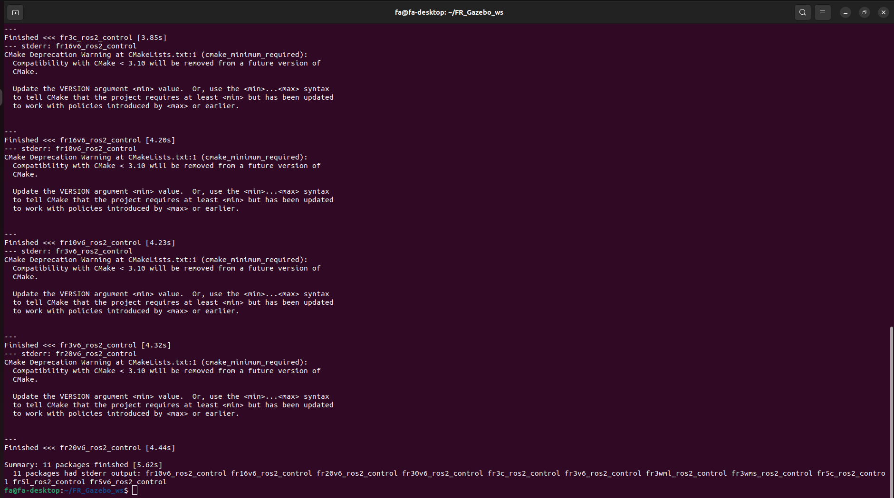

.. centered:: Figura 3-2  Salida de terminal de compilación correcta

Método de uso
------------------------------------------------------------------------------------------

Iniciar la simulación (tomando FR5 como ejemplo)
""""""""""""""""""""""""""""""""""""""""""""""""""""""""""""""""""""""""""""""""""""""""""""""""""""""""

.. centered:: Código 4-1  Iniciar la simulación de FR5
    
.. code-block:: console

    # 1. Cargar los entornos en orden
    cd ~/FR_Gazebo_ws
    source /opt/ros/humble/setup.bash
    source ~/ros2_control_ws/install/setup.bash
    source ~/FR_Gazebo_ws/install/setup.bash

    # 2. Iniciar (launch iniciará automáticamente gzserver/gzclient, generará el robot y cargará el controlador; si necesita limpiar procesos antiguos, consulte la indicación al final de la sección 4.2)
    ros2 launch fr5v6_ros2_control spawn_fr5v6.launch.py
    
Durante el inicio, launch consulta automáticamente y espera a que controller_manager esté listo para cargar el controlador. Cuando aparezca el siguiente registro significa que está listo; si tras más de 3 minutos de espera todavía no aparece "Successfully loaded", consulte la sección 5.2 para comprobar el orden de source del entorno:

.. centered:: Código 4-2  Registro de carga correcta del controlador
    
.. code-block:: console

    Successfully loaded controller joint_trajectory_controller into state active

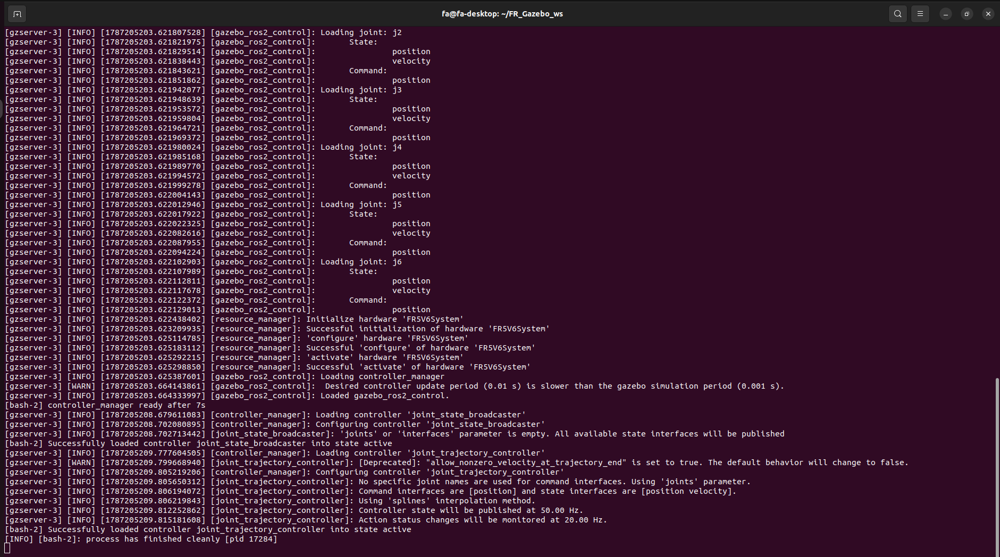

.. centered:: Figura 4-1  Registro de terminal de carga correcta del controlador

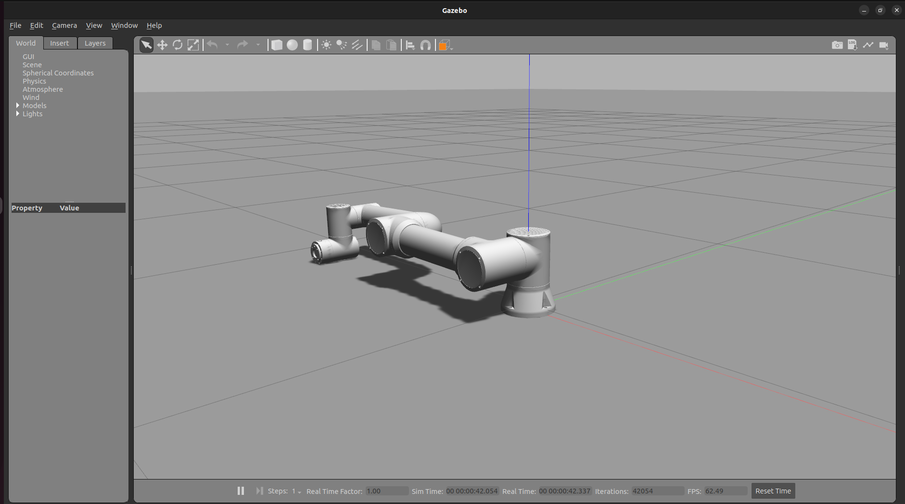

.. centered:: Figura 4-2  Pose inicial del robot en la interfaz de Gazebo

Tabla de correspondencia de comandos de inicio para todos los modelos
""""""""""""""""""""""""""""""""""""""""""""""""""""""""""""""""""""""""""""""""""""""""""""""""""""""""

El flujo de operación es el mismo para todos los modelos; solo cambian el nombre del paquete de funciones, el nombre del archivo launch y el espacio de nombres:

Tabla 4-1  Tabla de correspondencia de comandos de inicio para todos los modelos

.. list-table::
   :widths: 20 40 20 20
   :header-rows: 0
   :align: center

   * - **Modelo** 
     - **Comando de inicio**
     - **Espacio de nombres**
     - **Tema de estado de articulaciones**

   * - FR3 
     - ros2 launch fr3v6_ros2_control spawn_fr3v6.launch.py
     - fr3v6
     - /fr3v6/joint_states

   * - FR5 
     - ros2 launch fr5v6_ros2_control spawn_fr5v6.launch.py
     - fr5v6
     - /fr5v6/joint_states

   * - FR10 
     - ros2 launch fr10v6_ros2_control spawn_fr10v6.launch.py
     - fr10v6
     - /fr10v6/joint_states

   * - FR16 
     - ros2 launch fr16v6_ros2_control spawn_fr16v6.launch.py
     - fr16v6
     - /fr16v6/joint_states

   * - FR20 
     - ros2 launch fr20v6_ros2_control spawn_fr20v6.launch.py
     - fr20v6
     - /fr20v6/joint_states

   * - FR30 
     - ros2 launch fr30v6_ros2_control spawn_fr30v6.launch.py
     - fr30v6
     - /fr30v6/joint_states

   * - FR3C 
     - ros2 launch fr3c_ros2_control spawn_fr3c.launch.py
     - fr3c
     - /fr3c/joint_states

   * - FR3WML 
     - ros2 launch fr3wml_ros2_control spawn_FR3WML.launch.py
     - fr3wml
     - /fr3wml/joint_states

   * - FR3WMS 
     - ros2 launch fr3wms_ros2_control spawn_FR3WMS.launch.py
     - fr3wms
     - /fr3wms/joint_states

   * - FR5C 
     - ros2 launch fr5c_ros2_control spawn_fr5c.launch.py
     - fr5c
     - /fr5c/joint_states

   * - FR5WML 
     - ros2 launch fr5l_ros2_control spawn_fr5l.launch.py
     - fr5l
     - /fr5l/joint_states
			
.. note:: Solo se puede iniciar un modelo a la vez. Si necesita cambiar, primero debe cerrar el proceso Gazebo actual (pkill -9 gzserver; pkill -9 gzclient); de lo contrario, la nueva instancia fallará debido a conflictos de puertos.

Control manual (envío de articulaciones objetivo)
""""""""""""""""""""""""""""""""""""""""""""""""""""""""""""""""""""""""""""""""""""""""""""""""""""""""

Una vez que el controlador esté listo, envíe las articulaciones objetivo (6 valores en radianes de las articulaciones) a /joint_trajectory_controller/joint_trajectory:

.. centered:: Código 4-3  Envío manual de instrucciones de trayectoria de articulaciones
    
.. code-block:: console

    # Moverse a las articulaciones objetivo [1.57, -0.78, -1.57, -1.2, 1.57, 1.3] (unidad: radianes)
    ros2 topic pub --once /joint_trajectory_controller/joint_trajectory \
    trajectory_msgs/msg/JointTrajectory \
    "{joint_names: [j1,j2,j3,j4,j5,j6],
        points: [{positions: [1.57, -0.78, -1.57, -1.2, 1.57, 1.3],
                time_from_start: {sec: 2, nanosec: 0}}]}"

    # Volver a la posición cero
    ros2 topic pub --once /joint_trajectory_controller/joint_trajectory \
    trajectory_msgs/msg/JointTrajectory \
    "{joint_names: [j1,j2,j3,j4,j5,j6],
        points: [{positions: [0.0, 0.0, 0.0, 0.0, 0.0, 0.0],
                time_from_start: {sec: 2, nanosec: 0}}]}"

.. note:: La fórmula de conversión de ángulos es radianes = ángulo × π / 180. Valores habituales: 90° ≈ 1.5708, −90° ≈ −1.5708, 100° ≈ 1.7453.

Ejecutar el script de demostración
""""""""""""""""""""""""""""""""""""""""""""""""""""""""""""""""""""""""""""""""""""""""""""""""""""""""

Cada paquete de funciones incluye un script de demostración, que espera automáticamente a que controller_manager esté listo y luego realiza el movimiento alternativo de 0→±90° articulación por articulación:

.. centered:: Código 4-4  Ejecutar el script de demostración
    
.. code-block:: console

    # Tomando FR5 como ejemplo (para otros modelos, basta con sustituir el nombre del paquete en la ruta del script)
    python3 ~/FR_Gazebo_ws/src/fr5v6_ros2_control/scripts/fr5v6_demo.py

Tabla 4-2  Tabla de correspondencia de rutas de los scripts de demostración para todos los modelos

.. list-table::
   :widths: 30 70
   :header-rows: 0
   :align: center

   * - **Modelo** 
     - **Ruta del script de demostración**

   * - FR3
     - ~/FR_Gazebo_ws/src/fr3v6_ros2_control/scripts/fr3v6_demo.py

   * - FR5
     - ~/FR_Gazebo_ws/src/fr5v6_ros2_control/scripts/fr5v6_demo.py

   * - FR10
     - ~/FR_Gazebo_ws/src/fr10v6_ros2_control/scripts/fr10v6_demo.py

   * - FR16
     - ~/FR_Gazebo_ws/src/fr16v6_ros2_control/scripts/fr16v6_demo.py

   * - FR20
     - ~/FR_Gazebo_ws/src/fr20v6_ros2_control/scripts/fr20v6_demo.py

   * - FR30
     - ~/FR_Gazebo_ws/src/fr30v6_ros2_control/scripts/fr30v6_demo.py

   * - FR3C
     - ~/FR_Gazebo_ws/src/fr3c_ros2_control/scripts/fr3c_demo.py

   * - FR3WML
     - ~/FR_Gazebo_ws/src/fr3wml_ros2_control/scripts/fr3wml_demo.py

   * - FR3WMS
     - ~/FR_Gazebo_ws/src/fr3wms_ros2_control/scripts/fr3wms_demo.py

   * - FR5C
     - ~/FR_Gazebo_ws/src/fr5c_ros2_control/scripts/fr5c_demo.py

   * - FR5WML
     - ~/FR_Gazebo_ws/src/fr5l_ros2_control/scripts/fr5l_demo.py

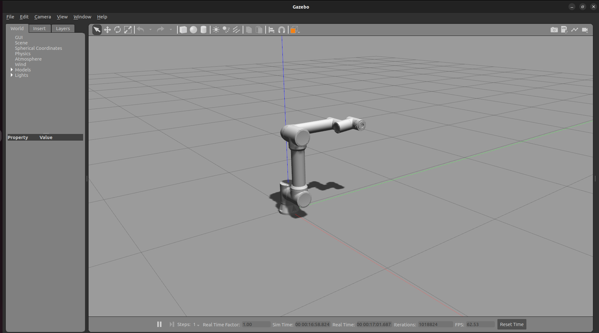

.. centered:: Figura 4-3  Pose de movimiento del robot durante la ejecución del script de demostración

Monitorizar el estado de las articulaciones
""""""""""""""""""""""""""""""""""""""""""""""""""""""""""""""""""""""""""""""""""""""""""""""""""""""""

.. centered:: Código 4-5  Monitorizar el estado de las articulaciones
    
.. code-block:: console
        
    # Ver los ángulos de las articulaciones en tiempo real
    ros2 topic echo /joint_states

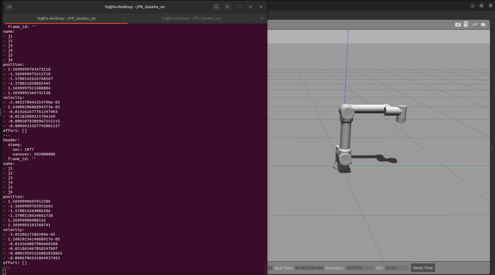

.. centered:: Figura 4-4  Salida en tiempo real del estado de las articulaciones

Preguntas frecuentes
------------------------------------------------------------------------------------------

Error de conflicto de puertos al iniciar / Gazebo no se abre
""""""""""""""""""""""""""""""""""""""""""""""""""""""""""""""""""""""""""""""""""""""""""""""""""""""""

- Causa: el proceso Gazebo anterior no ha finalizado y ocupa el puerto.
- Solución: limpiar los procesos residuales antes de iniciar: pkill -9 gzserver; pkill -9 gzclient

Se queda bloqueado en Waiting for controller_manager... durante más de 2 minutos
""""""""""""""""""""""""""""""""""""""""""""""""""""""""""""""""""""""""""""""""""""""""""""""""""""""""

- Causa: controller_manager no está listo, algo habitual cuando no se ha hecho source de ~/ros2_control_ws/install/setup.bash, o cuando la carga de mallas es demasiado lenta.
- Solución: salir primero con Ctrl+C; confirmar que se han hecho source de los tres entornos en orden (ros2→ros2_control_ws→FR_Gazebo_ws).

Se envían instrucciones manualmente pero el robot no se mueve
""""""""""""""""""""""""""""""""""""""""""""""""""""""""""""""""""""""""""""""""""""""""""""""""""""""""

- Causa: en la mayoría de los casos se trata de un problema de temporización; se enviaron instrucciones antes de que el controlador entrara completamente en estado active y las instrucciones se descartaron.
- Solución: confirmar que el terminal imprime Successfully loaded controller joint_trajectory_controller into state active antes de enviar instrucciones de control; o utilizar directamente el script demo de la sección 4.4.

Aparece el mensaje de que no existe el plugin joint_trajectory_controller/gazebo_ros2_control
""""""""""""""""""""""""""""""""""""""""""""""""""""""""""""""""""""""""""""""""""""""""""""""""""""""""

- Causa: las dependencias relacionadas con ros2_control no se han cargado.
- Solución: confirmar que se ha hecho source de ~/ros2_control_ws/install/setup.bash; y confirmar que el orden de carga en ~/.bashrc o en el terminal actual es ROS→ros2_control_ws→este espacio de trabajo.

Faltan piezas tras cargar el robot / las articulaciones no se muestran completas
""""""""""""""""""""""""""""""""""""""""""""""""""""""""""""""""""""""""""""""""""""""""""""""""""""""""

- Causa: faltan los archivos de malla a los que hace referencia el URDF.
- Solución: confirmar que el directorio meshes/ del paquete de funciones correspondiente existe y está completo.

¿Se pueden iniciar dos modelos al mismo tiempo?
""""""""""""""""""""""""""""""""""""""""""""""""""""""""""""""""""""""""""""""""""""""""""""""""""""""""

- No. Varias instancias de simulación competirán por el mismo puerto de Gazebo; debe iniciarse solo un modelo a la vez.

Plugin fairino_hardware (paquete de configuración moveit personalizado del robot)
++++++++++++++++++++++++++++++++++++++++++++++++++++++++++++++++++++++++++++++++++++++++++
El plugin fairino_hardware es la capa intermedia que conecta moveit con el robot. A través del plugin fairino_hardware, move_group envía la planificación de movimiento a moveit_control, que la reenvía a ros2_control; ros2_control acciona el movimiento del robot real mediante el plugin fairino_hardware, y el plugin fairino_hardware también recibe los datos de retroalimentación del robot real, logrando así la sincronización entre el modelo del robot en la interfaz de simulación rviz2 y el robot real, y permitiendo que el usuario accione el movimiento del robot real a través de la interfaz rviz2.

Además, gracias a la implementación del plugin fairino_hardware, el robot FAIRINO puede integrarse en el marco de control ros2_control, lo que permite que el robot FAIRINO sea compatible con paquetes de funciones de terceros basados en ros2_control.

En el plugin fairino_hardware adaptado a la versión de software del brazo robótico V3.8.3 se han añadido el modo de par y la interfaz de par de instrucción, lo que permite que el brazo robótico entre en modo de par y reciba el par de instrucción.

Compilación del plugin fairino_hardware
------------------------------------------------------------------------------------------------
Compile el paquete de funciones del plugin fairino_hardware del espacio de trabajo oficial ros2_ws. Tras compilar el paquete de funciones del plugin fairino_hardware en la sección anterior, se verá en

.. code-block:: shell
    :linenos:

    ros2_ws/install/fairino_hardware/lib/fairino_hardware
    
el archivo .so generado por el plugin libfairino_hardware.so, lo que indica que la compilación del plugin se ha realizado correctamente.

Cabe señalar que es necesario que la nomenclatura de las articulaciones del robot por parte del plugin fairino_hardware coincida con la nomenclatura de las articulaciones del robot configurada en moveit2. Este plugin fairino_hardware nombra las seis articulaciones del robot, desde la posición de la base hasta el extremo del robot, como j1, j2, j3, j4, j5, j6, por lo que al configurar el robot en moveit2 es necesario nombrar las articulaciones del robot como j1, j2, j3, j4, j5, j6.

Uso del plugin fairino_hardware
------------------------------------------------------------------------------------------------

Si se utiliza el paquete de configuración moveit personalizado del robot, entre en el directorio

.. code-block:: shell
    :linenos:

    /home/fairino/test_fa_ws/install/fairino5_v6_robot_moveit_config/share/fairino5_v6_robot_moveit_config/config

y busque el archivo fairino5_v6_robot.ros2_control.xacro; sustituya el parámetro de la línea 3 del archivo

.. code-block:: shell
    :linenos:

    use_fake_hardware:=false

por

.. code-block:: shell
    :linenos:

    use_fake_hardware:=true

Según la comprobación if posterior se puede ver que establecer use_fake_hardware en true es habilitar el plugin fairino_hardware/FairinoHardwareInterface. Guarde el archivo y salga.

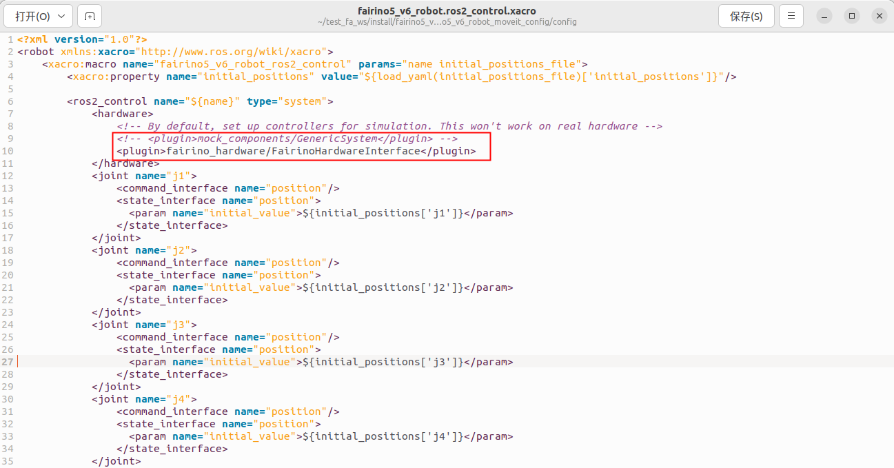

El nombre del plugin establecido por el plugin de hardware "fairino_hardware/FairinoHardwareInterface" se puede consultar en el archivo "fairino_hardware.xml" del directorio "/home/fairino/ros2_ws/src/fairino_hardware".

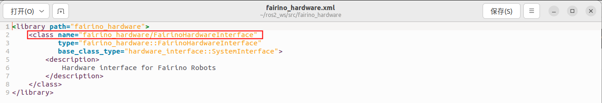

Tenga en cuenta que el parámetro robot_control_mode de la línea 3 del archivo determina la interfaz de instrucción expuesta al cargar el plugin, es decir, el parámetro representa el modo de control: 0 es el modo de control de posición y el plugin expone la interfaz position; 1 es el modo de control de par y el plugin expone la interfaz effort. Está previsto que el demo para la interfaz de control de par se lance en el paquete de funciones fairino_hardware adaptado a la versión de software del brazo robótico V3.8.5.

El controlador Moveit2 actual solo admite el modo de control de posición; no establezca robot_control_mode en 1.

Ejecutar el plugin
------------------------------------------------------------------------------------------------

Abra un terminal, vaya al espacio de trabajo ros2_ws y haga source del espacio de trabajo con el objetivo de añadir el plugin fairino_hardware; también se puede cargar esta ruta en el archivo "~/.bashrc", pero no se recomienda

.. code-block:: shell
    :linenos:

    cd ros2_ws
    source install/setup.bash

A continuación, vuelva al directorio principal, vaya al espacio de trabajo test_fa_ws, haga source del espacio de trabajo y ejecute el archivo demo.launch.py

.. code-block:: shell
    :linenos:

    cd ..
    cd test_fa_ws
    source install/setup.bash
    ros2 launch fairino5_v6_robot_moveit_config demo.launch.py

Resultado de la ejecución
------------------------------------------------------------------------------------------------

Tras iniciar el archivo demo.launch.py, la interfaz rviz2 se muestra como sigue:

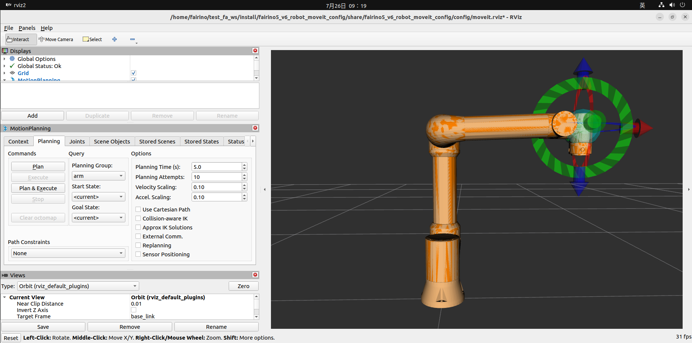

En este momento, la mayor diferencia de la interfaz de inicio de rviz2 respecto a la sección 3.3.1 es la pose inicial del robot. Ahora, al haberse añadido el plugin fairino_hardware, este plugin recibe en tiempo real el estado de las articulaciones del robot real y lo retroalimenta a move_group a través de ros2_control, controlando así la pose del robot simulado en la interfaz rviz2 y logrando la sincronización entre el robot real y el robot simulado en rviz2.

En este momento, la pose del robot real es la siguiente:

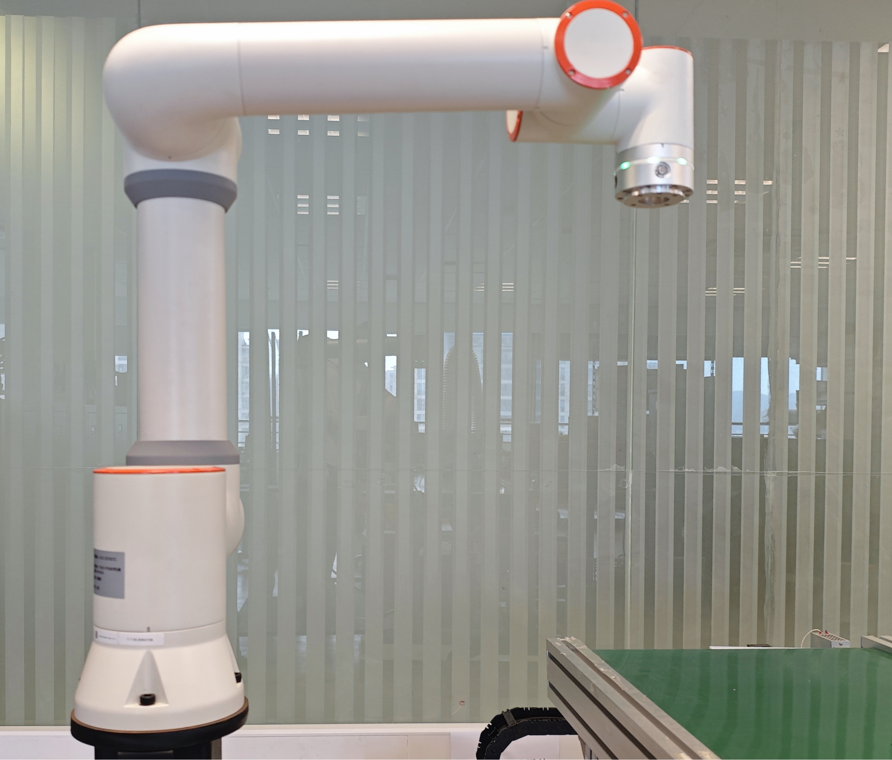

Ahora se puede accionar el movimiento del robot real a través de la interfaz rviz2. Arrastre la esfera azul del extremo del robot en la interfaz rviz2 para mover el extremo del robot a la posición objetivo, y luego arrastre los anillos de los tres colores rojo, verde y azul del extremo del robot para cambiar la orientación del extremo del robot; a continuación haga clic en el botón Planning&Execute de la izquierda para planificar la trayectoria de movimiento y accionar el movimiento del robot. Se observará que el robot real y el robot simulado en la interfaz rviz2 se mueven de forma sincronizada y se detienen al alcanzar la pose objetivo.

La siguiente figura muestra el control del robot real y del robot simulado en la interfaz rviz2 a través de la interfaz rviz2 para que se muevan hasta la pose objetivo:

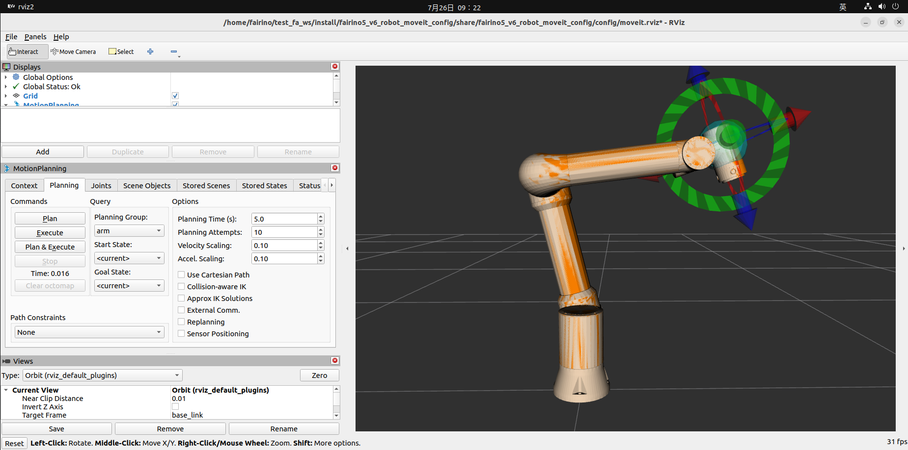

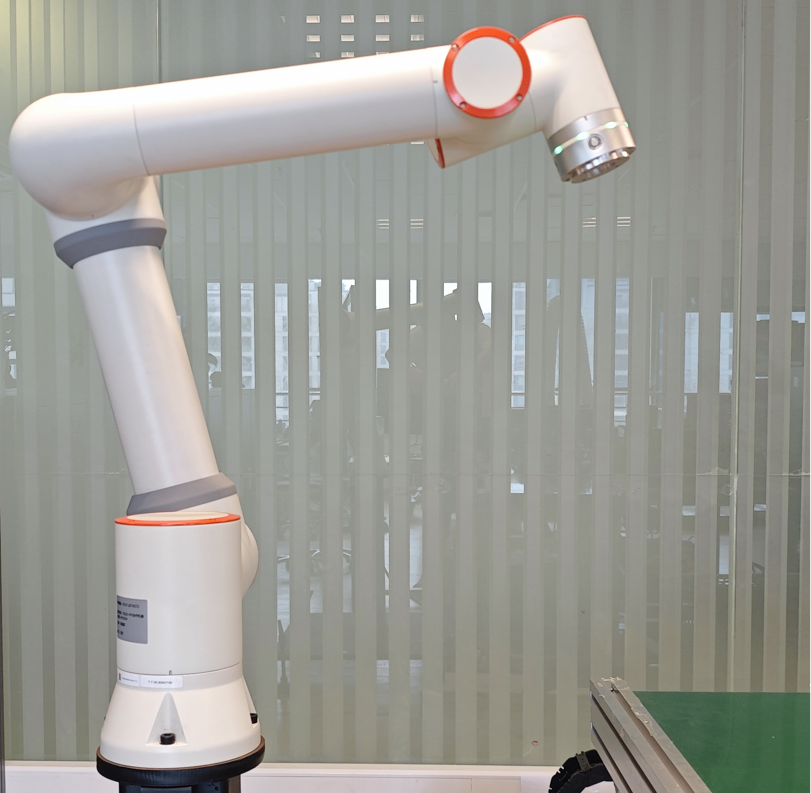

Con esto, se puede controlar mediante moveit2 el movimiento sincronizado del robot real y del robot simulado en la interfaz rviz2.

Paquete de código de ejemplo mtc
++++++++++++++++++++++++++++++++++++++++++++++++++

Introducción al paquete de código de ejemplo mtc
---------------------------------------------------
El paquete de código de ejemplo mtc proporciona una interfaz rviz2 reconstruida utilizando moveit2 y el plugin fairino_hardware, que sustituye la pestaña original MotionPlanning por la pestaña Motion Planning Tasks, utilizada para mostrar las distintas fases del movimiento del robot. La interfaz rviz2 se puede editar mediante el archivo

.. code-block:: shell
    :linenos:

    ros2_ws/install/fairino_mtc_demo/share/fairino_mtc_demo/launch

"mtc.rviz" de esa ruta; el usuario puede editar el archivo "mtc.rviz" para personalizar la interfaz rviz2 según sus necesidades funcionales.

Además, el paquete de código de ejemplo mtc también proporciona un ejemplo de agarre cíclico de objetivos accionado por el robot mediante moveit2 y el plugin fairino_hardware. A través de este ejemplo, el usuario puede aprender a utilizar mejor moveit2 y el plugin fairino_hardware para interactuar con el robot real mediante código; sobre esta base, el usuario puede realizar personalizaciones según sus necesidades.

Compilación del paquete de código de ejemplo mtc
---------------------------------------------------

Clonar el paquete de código de ejemplo mtc
"""""""""""""""""""""""""""""""""""""""""""""""
Clone el paquete de código de ejemplo mtc "fairino_robot" proporcionado oficialmente en el directorio src del espacio de trabajo "ros2_ws".

Selección del modelo de robot
""""""""""""""""""""""""""""""""""""
En el archivo mtc_demo_env.launch.py del directorio

.. code-block:: shell
    :linenos:

    ros2_ws/src/fairino_robot/fairino_mtc_demo/launch

del paquete de código de ejemplo mtc proporcionado oficialmente, seleccione el modelo de robot; modifique las líneas 9, 10 y 11 de ese archivo para que coincidan con el robot que se desea configurar.

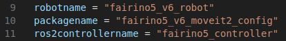

Para la nomenclatura específica de los modelos de robot puede consultar los paquetes de funciones de cada modelo de robot del directorio

.. code-block:: shell
    :linenos:

    ros2_ws/src/fairino_robot/

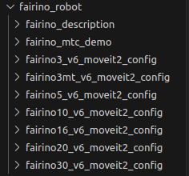

Compilación del paquete de código de ejemplo mtc
""""""""""""""""""""""""""""""""""""""""""""""""""""""""""""""
Compilar el paquete de funciones fairino_description
^^^^^^^^^^^^^^^^^^^^^^^^^^^^^^^^^^^^^^^^^^^^^^^^^^^^^^^^^^^^^^^^^^^
Abra un terminal, vaya al directorio ros2_ws, compile el paquete de funciones fairino_description y luego haga source

.. code-block:: shell
    :linenos:

    cd ros2_ws
    colcon build --packages-select fairino_description
    source install/setup.bash

Compilar el paquete de funciones del robot
^^^^^^^^^^^^^^^^^^^^^^^^^^^^^^^^^^^^^^^^^^^^^^^^^^^
En el directorio ros2_ws, compile el paquete de funciones del robot correspondiente al modelo, tomando como ejemplo el robot fairino5

.. code-block:: shell
    :linenos:

    colcon build --packages-select fairino5_v6_moveit2_config
    source install/setup.bash

A continuación es necesario añadir el plugin fairino_hardware, para sincronizar el movimiento con el robot real. Vaya al directorio

.. code-block:: shell
    :linenos:

    ros2_ws/install/fairino5_v6_moveit2_config/share/fairino5_v6_moveit2_config/config
    
y busque fairino5_v6_robot.ros2_control.xacro; sustituya la línea 9 del archivo

.. code-block:: shell
    :linenos:

    <plugin>mock_components/GenericSystem</plugin>
    
por

.. code-block:: shell
    :linenos:

    <plugin>fairino_hardware/FairinoHardwareInterface</plugin>
    
Guarde y salga.

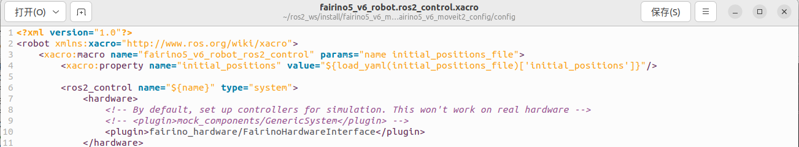

Compilar el paquete de funciones fairino_mtc_demo
^^^^^^^^^^^^^^^^^^^^^^^^^^^^^^^^^^^^^^^^^^^^^^^^^^^^^^^^^^^^^^
Compile el paquete de funciones fairino_mtc_demo y haga source

.. code-block:: shell
    :linenos:

    colcon build --packages-select fairino_mtc_demo
    source install/setup.bash

Ejecución del paquete de código de ejemplo mtc
---------------------------------------------------
Interfaz rviz2
""""""""""""""""""""""""""""""""""""
Ejecute el archivo mtc_demo_env.launch.py para abrir la interfaz rviz2 personalizada, en la que la pestaña Motion Planning Tasks se utiliza para mostrar los distintos procesos de movimiento personalizados del robot

.. code-block:: shell
    :linenos:

    cd ros2_ws
    source install/setup.bash
    ros2 launch fairino_mtc_demo mtc_demo_env.launch.py

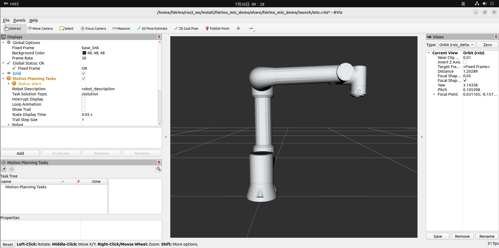

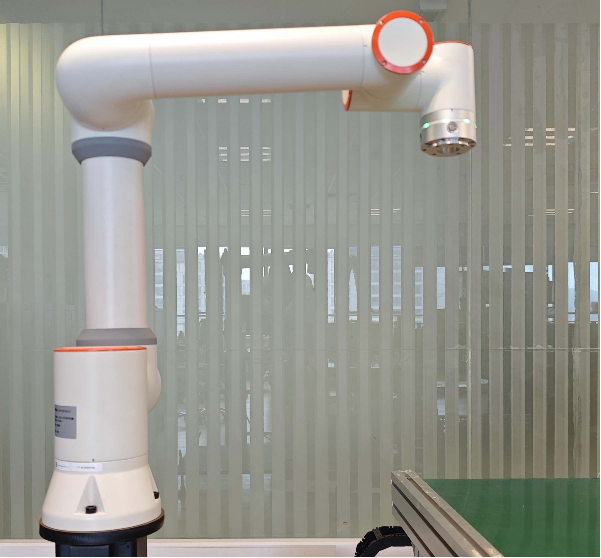

Movimiento del robot
""""""""""""""""""""""""""""""""""""
Abra un nuevo terminal, vaya al directorio ros2_ws, haga source del archivo y ejecute el archivo mtc_demo_app.launch.py para ejecutar el movimiento del robot

.. code-block:: shell
    :linenos:

    cd ros2_ws
    source install/setup.bash
    ros2 launch fairino_mtc_demo mtc_demo_app.launch.py

A continuación, en la pestaña Motion Planning Tasks de la interfaz rviz2 se mostrarán las distintas fases del movimiento del robot, y el robot real y el robot simulado en la interfaz rviz2 se moverán de forma sincronizada.

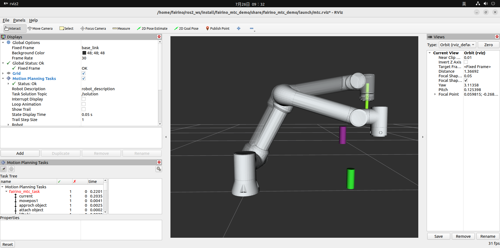

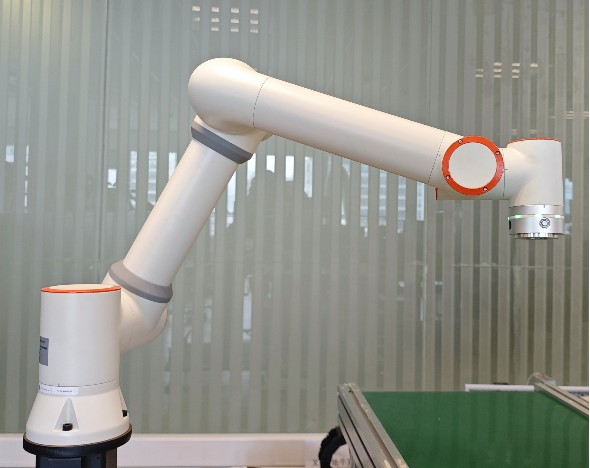

Notas
++++++++++++++++++++++++++++++

Sincronización de versiones del plugin fairino_hardware
----------------------------------------------------------------
El requisito previo para utilizar el plugin fairino_hardware es que la versión del plugin fairino_hardware coincida con la versión del robot FAIRINO;

El plugin fairino_hardware recibe los datos retroalimentados por el robot FAIRINO y los convierte en los tipos de datos de instrucción especificados por ros2_control, y luego convierte los datos de movimiento del robot enviados por ros2_control en tramas de datos específicas del robot FAIRINO;

En vista de ello, es fundamental que los tipos de datos del plugin fairino_hardware y los del robot FAIRINO coincidan, y las diferentes versiones del plugin y del robot pueden dar lugar a tipos de datos diferentes. Por lo tanto, antes de depurar formalmente el plugin fairino_hardware, es necesario confirmar si la versión del robot FAIRINO y la versión del plugin fairino_hardware coinciden; si no coinciden, es necesario actualizar el robot FAIRINO.

- En primer lugar, puede consultar los modelos de las distintas versiones actuales del robot en la interfaz "Interfaz WebAPP->Configuración del sistema->Acerca de" del robot FAIRINO.

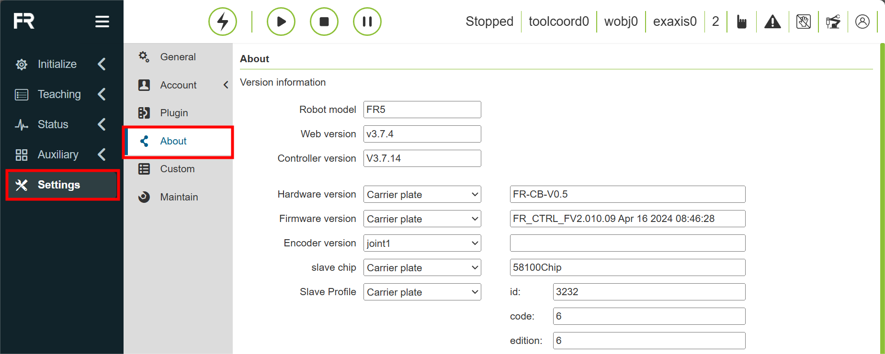

- A continuación, prepare el paquete de software del robot proporcionado oficialmente y entre en la interfaz "Interfaz WebAPP->Aplicaciones auxiliares->Cuerpo del robot->Actualización del sistema" del robot FAIRINO; haga clic en el botón "Seleccionar archivo", seleccione el paquete de actualización de software del robot preparado correspondiente a la versión del plugin fairino_hardware, seleccione "Cargar paquete de actualización" y espere a que finalice la actualización del software.

- Una vez completada la actualización, el sistema indicará que es necesario reiniciar el robot. Coloque el interruptor del armario de control del robot en la posición de apagado, espere unos 25 segundos y luego encienda el robot. Con esto finaliza la actualización de la versión del software del robot y se puede proceder a la compilación y uso posteriores del plugin fairino_hardware.

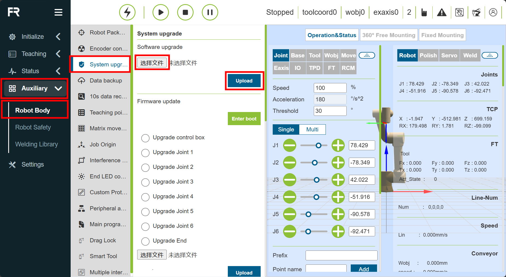

Problemas que pueden surgir
---------------------------------------------------
Es posible que al configurar el paquete de funciones del robot no se cargue el modelo del robot a la derecha.
"""""""""""""""""""""""""""""""""""""""""""""""""""""""""""""""""""""""""""""""""""""""""""""""""""""""""""""""""""
Solución: este error puede deberse a que la ruta del archivo .urdf no está escrita correctamente. Se puede solucionar modificando la ruta del archivo .urdf y copiando la carpeta meshes en install/test_moveit/share/test_moveit del espacio de trabajo.

Error de ejecución tras generar el package.
""""""""""""""""""""""""""""""""""""""""""""""""""""""""""""""""""""
Solución: basta con eliminar "["capabilities"]" de la línea 203 del archivo launches.py, "default_value=moveit_config.move_gro-up_capabilities["capabilities"],", para solucionarlo.

Resumen
++++++++++++++++++++++++++++++
Este manual describe la instalación, configuración y uso del plugin MoveIt2; la instalación y uso del plugin fairino_hardware, que permite la sincronización del movimiento entre el robot simulado en rviz2 y el robot real; así como la compilación y ejecución del paquete de código de ejemplo mtc, que permite realizar funciones personalizadas con ayuda de moveit2 y el plugin fairino_hardware.

Se espera que la exposición de este tutorial permita al usuario tener un conocimiento más completo de MoveIt2 y del plugin fairino_hardware, y que ayude al usuario a personalizar mejor los servicios y funciones del robot FAIRINO.