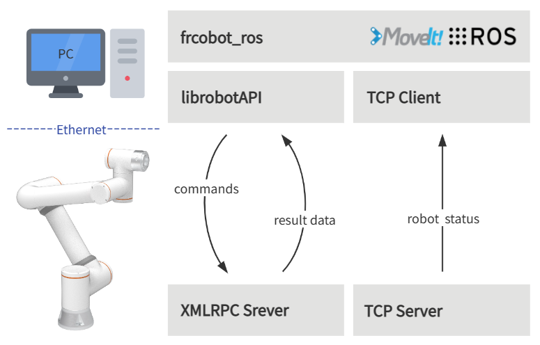

Descripción general
++++++++++++++++++++++
La arquitectura resumida de frcobot_ros se muestra en la siguiente figura. El lado del robot colaborativo proporciona un servidor XMLRPC y un servidor TCP.

- El servidor XMLRPC proporciona principalmente la API de instrucciones del robot para realizar el movimiento del robot y la obtención de valores de estado.
- El servidor TCP de retroalimentación de estado proporciona la retroalimentación en tiempo real del estado del robot, con un período de retroalimentación de 8 ms.

En el PC del usuario se han instalado ROS y Moveit!, y se ha compilado frcobot_ros. En frcobot_ros, cada paquete de funciones incluye la librería lib de la API del robot, así como, en frcobot_hw, un cliente TCP que establece comunicación con el servidor de retroalimentación de estado del robot para obtener los datos de retroalimentación de estado del robot.

Instalación
++++++++++++++++++++++
Este capítulo describe cómo construir frcobot_ros y el entorno de instalación necesario.

Requisitos del entorno
---------------------------------

El entorno recomendado para frcobot_ros es el siguiente:

.. note:: 
    -	Ubuntu 18.04 LTS Bionic Beaver y ROS Melodic Morenia
    -	Ubuntu 20.04 LTS Focal Fossa y ROS Noetic Ninjemys

Las siguientes instrucciones son aplicables al sistema Ubuntu 20.04 LTS y ROS Noetic Ninjemys. Si se utiliza Melodic, sustituya ``noetic`` por ``melodic`` en las líneas de comando indicadas a continuación.

Requisitos de instalación de ROS
----------------------------------------
Tras instalar el sistema Ubuntu, `instale y configure el entorno ROS Noetic <https://wiki.ros.org/noetic/Installation/Ubuntu>`__.

Una vez configurado ROS Noetic, instale el siguiente entorno necesario:

.. code-block:: shell
    :linenos:

    echo "source /opt/ros/noetic/setup.bash" >> ~/.bashrc
    source ~/.bashrc
    sudo apt-get install -y \
        ros-noetic-rosparam-shortcuts \
        ros-noetic-ros-control \
        ros-noetic-ros-controllers \
        ros-noetic-moveit \
        libxmlrpcpp-dev

Compilación del paquete ROS
---------------------------------------
Tras instalar y configurar correctamente ROS Noetic, cree un espacio de trabajo Catkin en el directorio que elija.

.. code-block:: shell
    :linenos:

    mkdir -p ~/catkin_ws/src
    cd ~/catkin_ws
    catkin_init_workspace src

A continuación, clone el repositorio frcobot_ros desde Gitee.

.. code-block:: shell
    :linenos:

    cd ~/catkin_ws/src
    git clone https://gitee.com/fair-innovation/frcobot_ros.git

Construya el paquete frcobot_ros

.. code-block::  shell
    :linenos:

    cd ~/catkin_ws
    catkin_make
    echo "source ~/catkin_ws/devel/setup.bash" >> ~/.bashrc
    source ~/.bashrc

Si aparece un error, compruebe si todos los paquetes de los requisitos de instalación de ROS se han instalado correctamente. Una vez completada la compilación, copie la librería lib en el entorno lib de ROS (ruta: /opt/ros/noetic/lib) para que el programa pueda ejecutarse correctamente.

.. code-block:: shell
    :linenos:

    # Aquí la ruta predeterminada de catkin_ws es "~"; si es diferente, sustituya "~" por la ruta real
    sudo cp ~/catkin_ws/src/frcobot_ros/frcobot_hw/lib/* /opt/ros/noetic/lib

Inicio rápido
++++++++++++++++++

frcobot_hw
-----------------
frcobot_hw proporciona principalmente las funciones básicas de comunicación con el robot colaborativo.

.. note:: 
    - Incluye el msg de retroalimentación de estado del robot colaborativo
    - Proporciona un demo de instrucciones para controlar el robot colaborativo
    - Proporciona el nodo y el Topic de retroalimentación de estado del robot colaborativo
    - Permite iniciar rápidamente el nodo de estado y el demo de instrucciones mediante un archivo launch

El contenido de frcobot_hw.launch es el siguiente:

.. code-block:: xml
    :linenos:

    <launch>

        <!-- params -->
        <param name="robot_ip" type="string" value="192.168.58.2"/>
        <param name="robot_port" type="int" value="8083"/>

        <!-- frcobot status node -->
        <node pkg="frcobot_hw" type="frcobot_status_node" name="frcobot_status_node" output="screen" />

        <!-- frcobot control demo -->
        <node pkg="frcobot_hw" type="frcobot_cmd_demo" name="frcobot_cmd_demo" output="screen" />
        
    </launch>

.. important:: 

    - ``robot_ip`` y ``robot_port`` deben coincidir con la IP y el puerto del robot colaborativo que se va a controlar
    - La IP predeterminada del robot de fábrica es 192.168.58.2, y el puerto de retroalimentación de estado del usuario es 8083

Mediante la siguiente instrucción se pueden iniciar rápidamente el nodo de retroalimentación de estado del robot y la función de demo de instrucciones.

.. code-block:: shell
    :linenos:

    roslaunch frcobot_hw frcobot_hw.launch

Abra un nuevo terminal y, mediante la siguiente instrucción, podrá imprimir y consultar los datos de retroalimentación de estado en tiempo real.

.. code-block:: shell
    :linenos:

    rostopic ehco /frcobot_status

.. frcobot_camera
.. -----------------
.. frcobot_camera proporciona la función de calibración mano-ojo con la cámara RVS de Figureys y la función de Bin-Picking (agarre desordenado).

.. frcobot_gripper
.. -------------------

.. frcobot_description
.. ----------------------

.. frcobot moveit!
.. -----------------------