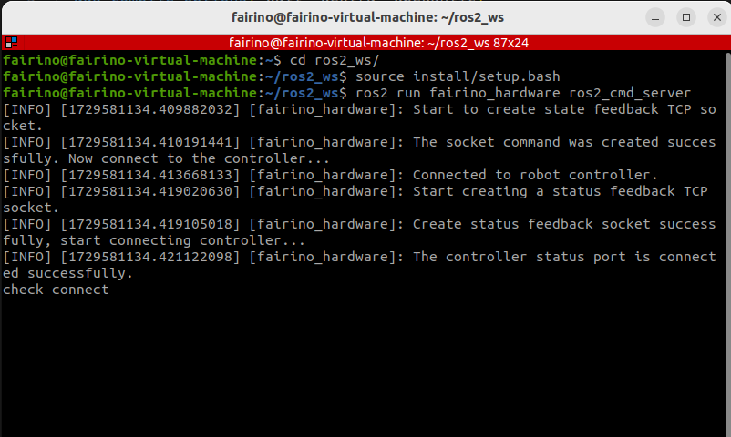
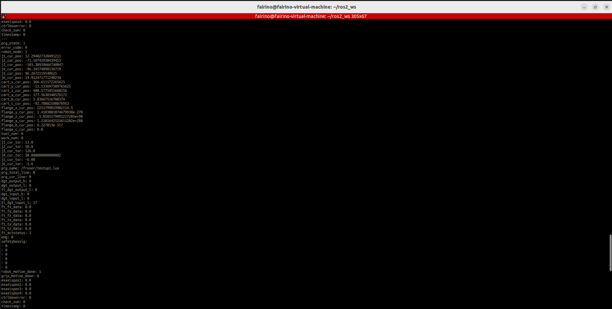
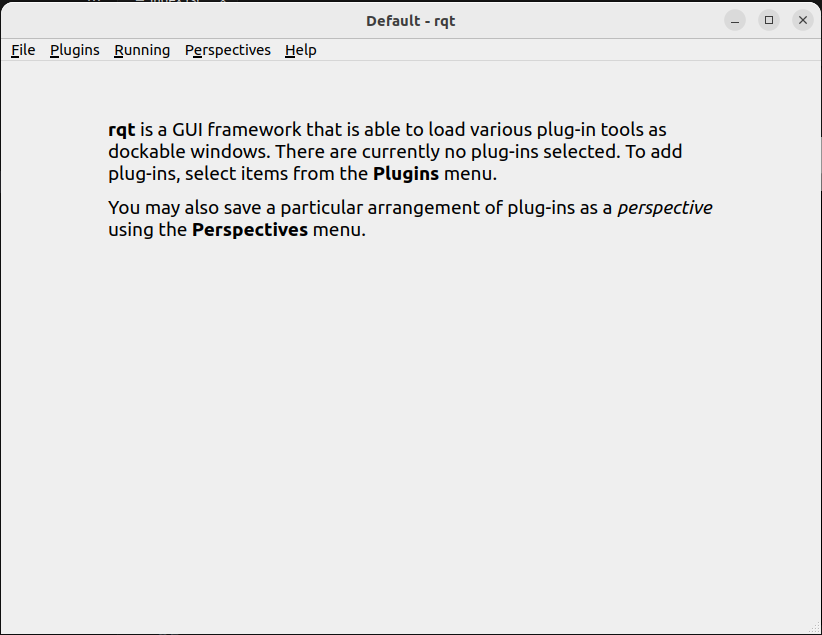
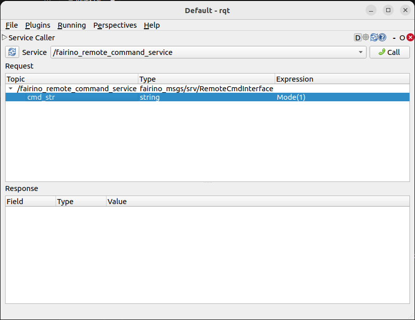

Prefacio
++++++++++
fairino_hardware es la interfaz API desarrollada sobre ROS2 para el robot colaborativo FAIRINO, cuyo objetivo es que los usuarios principiantes puedan utilizar el SDK de FAIRINO de forma más cómoda. Mediante la configuración de los parámetros predeterminados a través del archivo de configuración de parámetros, se pueden satisfacer las distintas necesidades de los clientes.

fairino_hardware
++++++++++++++++++++++++++++++
Este capítulo explica cómo configurar el entorno de ejecución de la APP.

Instalación del entorno básico
----------------------------------------

Se recomienda utilizarlo en Ubuntu 22.04 LTS (Jammy). Una vez instalado el sistema, es necesario instalar ROS2; se recomienda ros2-humble. Para la instalación completa de ROS2 puede consultar el tutorial: https://docs.ros.org/en/humble/index.html.
Antes de compilar formalmente fairino_hardware, también es necesario instalar el paquete oficial ros2_control. Para la instalación completa de ros2_control puede consultar el tutorial: https://control.ros.org/humble/index.html. Oficialmente se proporcionan dos métodos de instalación de ros2_control: instalación mediante instrucciones e instalación compilando desde código fuente. Dado que la instalación mediante instrucciones puede provocar que los paquetes de funciones no se instalen completamente, se recomienda utilizar el método de instalación compilando desde código fuente.

A continuación se detalla el proceso de ROS2 (humble):

1. Abra una ventana de shell

.. code-block:: shell
    :linenos:

    locale  # check for UTF-8

    sudo apt update && sudo apt install locales
    sudo locale-gen en_US en_US.UTF-8
    sudo update-locale LC_ALL=en_US.UTF-8 LANG=en_US.UTF-8
    export LANG=en_US.UTF-8

    locale  # verify settings

2. Configurar los repositorios

.. code-block:: shell
    :linenos:
    
    sudo apt install software-properties-common
    sudo add-apt-repository universe

    sudo apt update && sudo apt install curl -y
    sudo curl -sSL https://raw.githubusercontent.com/ros/rosdistro/master/ros.key -o /usr/share/keyrings/ros-archive-keyring.gpg

    echo "deb [arch=$(dpkg --print-architecture) signed-by=/usr/share/keyrings/ros-archive-keyring.gpg] http://packages.ros.org/ros2/ubuntu $(. /etc/os-release && echo $UBUNTU_CODENAME) main" | sudo tee /etc/apt/sources.list.d/ros2.list > /dev/null

3. Instalar ROS2

.. code-block:: shell
    :linenos:

    sudo apt update
    sudo apt upgrade
    sudo apt install ros-humble-desktop

4. Por último, instalar las herramientas de desarrollo

.. code-block:: shell
    :linenos:

    sudo apt install ros-dev-tools

A continuación se detalla el proceso de instalación de ros2_control:

1. En primer lugar, haga source de los recursos de ROS2

.. code-block:: shell
    :linenos:

    source /opt/ros/humble/setup.bash

2. Crear el espacio de trabajo de ros2_control y descargar los recursos

.. code-block:: shell
    :linenos:

    mkdir -p ~/ros2_control_ws/src
    cd ~/ros2_control_ws/
    wget https://raw.githubusercontent.com/ros-controls/ros2_control_ci/master/ros_controls.$ROS_DISTRO.repos
    vcs import src < ros_controls.$ROS_DISTRO.repos

3. Instalar los paquetes de dependencias

.. code-block:: shell
    :linenos:

    rosdep update --rosdistro=$ROS_DISTRO
    sudo apt-get update
    rosdep install --from-paths src --ignore-src -r -y

4. Compilar ros2_control

.. code-block:: shell
    :linenos:

    . /opt/ros/${ROS_DISTRO}/setup.sh
    colcon build --symlink-install

Compilación y construcción de fairino_hardware
-------------------------------------------------------
1. Crear el espacio de trabajo colcon
fairino_hardware está compuesto por dos paquetes de funciones: uno es el paquete de funciones de estructura de datos personalizada fairino_msgs, y el otro es el paquete de funciones del cuerpo principal del programa fairino_hardware. Tras instalar el entorno básico, cree primero un espacio de trabajo colcon, por ejemplo:

En primer lugar es obligatorio hacer source de los recursos de ROS2 y ros2_control

.. code-block:: shell
    :linenos:

    source /opt/ros/humble/setup.bash
    source ~/ros2_control_ws/install/setup.bash

A continuación, cree el espacio de trabajo

.. code-block:: shell
    :linenos:

    cd ~/
    mkdir -p ros2_ws/src

2. Compilar los paquetes de funciones
Copie el código del paquete de instalación en el directorio ros2_ws/src y, a continuación, ejecute el siguiente comando en el directorio ros2_ws:

.. code-block:: shell
    :linenos:

    source ~/ros2_control_ws/install/setup.bash

Una vez completada la instrucción, ejecute el siguiente comando:

.. code-block:: shell
    :linenos:

    colcon build --packages-select fairino_msgs

Tras esperar a que finalice la compilación del comando anterior, utilice el siguiente comando para compilar fairino_hardware:

.. code-block::  shell
    :linenos:

    colcon build --packages-select fairino_hardware

Inicio rápido
++++++++++++++

Flujo de inicio
-----------------
Abra una línea de comandos en Ubuntu e introduzca:

.. code-block::  shell
    :linenos:

    cd ros2_ws
    source install/setup.bash
    ros2 run fairino_hardware ros2_cmd_server

Flujo de consulta de la retroalimentación de estado del brazo robótico
------------------------------------------------------------------------------
La retroalimentación de estado del brazo robótico se publica a través de un topic. El usuario puede observar la actualización de los datos de estado mediante los comandos propios de ros2, o escribir un programa para obtener dichos datos. A continuación se muestra cómo observar los datos de estado del brazo robótico mediante comandos de ros2.

Abra una línea de comandos en Ubuntu e introduzca:

.. code-block:: shell
    :linenos:

    cd ros2_ws
    source install/setup.bash
    ros2 topic echo /nonrt_state_data

Se puede ver que los datos de estado se actualizan continuamente en la ventana de línea de comandos, como se muestra en la siguiente figura.

Flujo de envío de instrucciones
----------------------------------------------------
Abra una línea de comandos en Ubuntu e introduzca:

.. code-block:: shell
    :linenos:

    cd ros2_ws
    source install/setup.bash
    rqt

Tras ejecutar el comando anterior, se abrirá una interfaz gráfica rqt, como se muestra en la siguiente figura.

En la interfaz gráfica, seleccione plugins->serivce->serivce caller; aparecerá la siguiente interfaz. Seleccione el elemento /fairino_remote_command_service, introduzca la cadena de instrucción en el campo expression de la interfaz y haga clic en call para ver el mensaje de respuesta en el cuadro de diálogo inferior.

.. important:: 

   - Explicación de las reglas de la cadena de entrada:

   El programa filtra internamente el formato de la cadena de entrada. El formato de entrada de la función debe ser de la forma [nombre de función]() y la cadena de parámetros entre paréntesis debe estar compuesta por letras, números, comas y signos negativos. La aparición de otros caracteres o espacios provocará un error.

   - Explicación del valor de retroalimentación de la instrucción:

   Excepto la instrucción GET, que devuelve una cadena, los valores de retroalimentación del resto de funciones son de tipo int. Generalmente, 0 indica que se ha producido un error y 1 indica una ejecución correcta. Si aparece otro valor, consulte el error correspondiente al código de error definido en el SDK xmlrpc.

Flujo de modificación de parámetros
----------------------------------------------------
Dado que el SDK simplificado es una mejora de la interfaz del SDK nativo, la simplificación se debe a que se han asignado valores predeterminados a algunos parámetros. En el uso real también se pueden encontrar casos en los que los parámetros predeterminados no satisfagan los requisitos; en tal caso, se pueden modificar los valores de los parámetros predeterminados correspondientes y luego cargarlos en el nodo.

En el archivo de código fuente existe un archivo de parámetros fairino_remotecmdinterface_para.yaml. Los parámetros del archivo son los parámetros predeterminados preestablecidos, utilizados para simplificar los parámetros de entrada de las instrucciones. Se pueden modificar los parámetros según las necesidades concretas de cada uno y luego modificar dinámicamente los parámetros con el comando: ros2 param load fr_command_server ~/ros2_ws/src/fairino_hardware/fairino_remotecmdinterface_para.yaml.

Descripción de la API
++++++++++++++++++++++++++++++++++++++++

.. code-block:: c++
    :linenos:

    /*
    Descripción de la función: almacenar la información de un punto de articulación
    id - número de id del punto almacenado, comenzando desde 1; tenga en cuenta que este id es independiente del número de id de punto de CARTPoint
    double j1-j6 - 6 posiciones de articulación, en grados
    */
    int JNTPoint(int id, double j1, double j2, double j3, double j4, double j5, double j6)
    // Ejemplo
    JNTPoint(1,10,11,12,13,14,15)

    /*
    Descripción de la función: almacenar la información de un punto cartesiano
    id - número de id del punto almacenado, comenzando desde 1; tenga en cuenta que este id es independiente del número de id de punto de JNTPoint
    double x,y,z,rx,ry,yz - información del punto cartesiano, unidad de posición mm, unidad de ángulo grados
    */
    int CARTPoint(int id, double x,y,z,rx,ry,rz)//almacenar un punto del espacio cartesiano
    // Ejemplo
    CARTPoint(1,100,110,200,0,0,0)

    /*
    Descripción de la función: obtener la información de posición de articulación o cartesiana del punto con el número especificado
    string name - 'JNT' o 'CART'; JNT representa obtener la información del punto de articulación, 'CART' representa obtener la información del punto cartesiano
    int id - id del punto, comenzando desde 1
    */
    string GET(string name, int id)//obtener el contenido del punto con el número de id correspondiente; name puede ser JNT o CART
    // Ejemplo
    GET(JNT,1)

    /*
    Descripción de la función: interruptor del modo de arrastre
    uint8_t state - 1-activar el modo de arrastre, 0-desactivar el modo de arrastre
    */
    int DragTeachSwitch(uint8_t state)
    // Ejemplo
    DragTeachSwitch(0)

    /*
    Descripción de la función: interruptor de habilitación del brazo robótico
    uint8_t state - 1-habilitar el brazo robótico, 0-deshabilitar el brazo robótico
    */
    int RobotEnable(uint8_t state)
    // Ejemplo
    RobotEnable(1)

    /*
    Descripción de la función: cambio de modo
    uint8_t state - 1-modo manual, 0-modo automático
    */
    int Mode(uint8_t state)
    // Ejemplo
    Mode(1)

    /*
    Descripción de la función: establecer la velocidad del brazo robótico en el modo actual
    float vel - porcentaje de velocidad, rango de 1-100
    */
    int SetSpeed(float vel)
    // Ejemplo
    SetSpeed(10)

    /*
    Descripción de la función: establecer y cargar el sistema de coordenadas de herramienta con el número especificado
    int id - número del sistema de coordenadas de herramienta, rango 1-15
    float x,y,z,rx,ry,rz - información del desplazamiento del sistema de coordenadas de herramienta
    */
    int SetToolCoord(int id, float x,float y, float z,float rx,float ry,float rz)
    // Ejemplo
    SetToolCoord(1,0,0,0,0,0,0)

    /*
    Descripción de la función: establecer la lista de sistemas de coordenadas de herramienta
    int id - número del sistema de coordenadas de herramienta, rango 1-15
    float x,y,z,rx,ry,rz - información del desplazamiento del sistema de coordenadas de herramienta
    */
    int SetToolList(int id, float x,float y, float z,float rx,float ry,float rz );
    // Ejemplo
    SetToolList(1,0,0,0,0,0,0)

    /*
    Descripción de la función: establecer el sistema de coordenadas de herramienta externa
    int id - número del sistema de coordenadas de herramienta, rango 1-15
    float x,y,z,rx,ry,rz - información del desplazamiento del sistema de coordenadas de herramienta externa
    */
    int SetExToolCoord(int id, float x,float y, float z,float rx,float ry,float rz);	
    // Ejemplo
    SetExToolCoord(1,0,0,0,0,0,0)

    /*
    Descripción de la función: establecer la lista de sistemas de coordenadas de herramienta externa
    int id - número del sistema de coordenadas de herramienta, rango 1-15
    float x,y,z,rx,ry,rz - información del desplazamiento del sistema de coordenadas de herramienta externa
    */
    int SetExToolList(int id, float x,float y, float z,float rx,float ry,float rz);
    // Ejemplo
    SetExToolList(1,0,0,0,0,0,0)

    /*
    Descripción de la función: establecer el sistema de coordenadas de pieza
    int id - número del sistema de coordenadas de pieza, rango 1-15
    float x,y,z,rx,ry,rz - información del desplazamiento del sistema de coordenadas de pieza
    */
    int SetWObjCoord(int id, float x,float y, float z,float rx,float ry,float rz);
    // Ejemplo
    SetWObjCoord(1,0,0,0,0,0,0)

    /*
    Descripción de la función: establecer la lista de sistemas de coordenadas de pieza
    int id - número del sistema de coordenadas de pieza, rango 1-15
    float x,y,z,rx,ry,rz - información del desplazamiento del sistema de coordenadas de pieza
    */
    int SetWObjList(int id, float x,float y, float z,float rx,float ry,float rz);
    // Ejemplo
    SetWObjList(1,0,0,0,0,0,0)

    /*
    Descripción de la función: establecer el peso de la carga del extremo
    float weight - peso de la carga, unidad kg
    */
    int SetLoadWeight(float weight);
    // Ejemplo
    SetLoadWeight(3.5)

    /*
    Descripción de la función: establecer las coordenadas del centro de gravedad de la carga del extremo
    float x,y,z - coordenadas del centro de gravedad, unidad mm
    */
    int SetLoadCoord(float x,float y,float z);
    // Ejemplo
    SetLoadCoord(10,20,30)

    /*
    Descripción de la función: establecer el modo de instalación del robot
    uint8_t install - modo de instalación, 0-instalación vertical, 1-instalación lateral, 2-instalación invertida
    */
    int SetRobotInstallPos(uint8_t install);
    // Ejemplo
    SetRobotInstallPos(0)

    /*
    Descripción de la función: establecer el ángulo de instalación del robot, instalación libre
    double yangle - ángulo de inclinación
    double zangle - ángulo de rotación
    */
    int SetRobotInstallAngle(double yangle,double zangle);
    // Ejemplo
    SetRobotInstallAngle(90,0)

    //Configuración de seguridad
    /*
    Descripción de la función: establecer el nivel de colisión del robot
    float level1-level6 - nivel de colisión de los ejes 1-6, rango de 1-10
    */
    int SetAnticollision(float level1, float level2, float level3, float level4, float level5, folat level6);
    // Ejemplo
    SetAnticollision(1,1,1,1,1,1)

    /*
	 * @brief  Establecer la estrategia tras una colisión
	 * @param  [in] strategy  0-detener con error, 1-continuar en ejecución
	 * @param  [in] safeTime  tiempo de parada segura [1000 - 2000]ms
	 * @param  [in] safeDistance  distancia de parada segura [1-150]mm
	 * @param  [in] safeVel velocidad segura [50-250] mm/s
	 * @param  [in] safetyMargin  coeficiente de seguridad j1-j6 [1-10]
	 * @return  código de error
    */
	int SetCollisionStrategy(int strategy, int safeTime, int safeDistance, int safeVel, int safetyMargin[])
    // Ejemplo
    SetCollisionStrategy(1)

    /*
	 * @brief Establecer el método de detección de colisiones del robot
	 * @param [in] method método de detección de colisiones: 0-modo de corriente; 1-doble codificador; 2-corriente y doble codificador activados simultáneamente
     * @param [in] thresholdMode modo de umbral del nivel de colisión; 0-modo de umbral fijo del nivel de colisión; 1-umbral de detección de colisión personalizado
	 * @return  código de error
    */
	int SetCollisionDetectionMethod(int method, int thresholdMode);
    // Ejemplo
    SetCollisionDetectionMethod(0,0)

    /*
	 * @brief Establecer la activación/desactivación de la detección de colisiones en estado estático
	 * @param  [in] status 0-desactivar; 1-activar
	 * @return  código de error
    */
	int SetStaticCollisionOnOff(int status);
    // Ejemplo
    SetStaticCollisionOnOff(1)

    /*
	 * @brief Detección de potencia y par de las articulaciones
	 * @param  [in] status 0-desactivar; 1-activar
	 * @param  [in] power establecer la potencia máxima (W);
	 * @return  código de error
    */
	int SetPowerLimit(int status, double power);
    //Ejemplo
    SetPowerLimit(1,100)

    /*
	 * @brief  Configurar el sensor de fuerza
	 * @param  [in] company  fabricante del sensor de fuerza, 17-Kunwei Technology, 19-Instituto 11 de Aeroespacial, 20-sensor ATI, 21-Zhongke Midian, 22-Weihang Minxin, 23-NBIT, 24-Xinjingcheng (XJC), 26-NSR
	 * @param  [in] device  número de dispositivo, Kunwei (0-KWR75B), Instituto 11 de Aeroespacial (0-MCS6A-200-4), ATI (0-AXIA80-M8), Zhongke Midian (0-MST2010), Weihang Minxin (0-WHC6L-YB-10A), NBIT (0-XLH93003ACS), Xinjingcheng XJC (0-XJC-6F-D82), NSR (0-NSR-FTSensorA)
	 * @param  [in] softvesion  número de versión del software, no se utiliza por ahora, por defecto 0
	 * @param  [in] bus posición del bus del extremo donde está conectado el dispositivo, no se utiliza por ahora, por defecto 0
	 * @return  código de error
    */
	int FT_SetConfig(int company, int device, int softvesion, int bus);
    // Ejemplo
    FT_SetConfig(0,1,0,0)

    /*
	 * @brief  Obtener la configuración del sensor de fuerza
	 * @param  [out] company  fabricante del sensor de fuerza, por determinar
	 * @param  [out] device  número de dispositivo, no se utiliza por ahora, por defecto 0
	 * @param  [out] softvesion  número de versión del software, no se utiliza por ahora, por defecto 0
	 * @param  [out] bus posición del bus del extremo donde está conectado el dispositivo, no se utiliza por ahora, por defecto 0
	 * @return  código de error
    */
	int FT_GetConfig(int *company, int *device, int *softvesion, int *bus);
    // Ejemplo
    FT_GetConfig()

    /*
	 * @brief  Activación del sensor de fuerza
	 * @param  [in] act  0-restablecer, 1-activar
	 * @return  código de error
    */
	int FT_Activate(uint8_t act);
    // Ejemplo
    FT_Activate(1)

    /*
	 * @brief  Puesta a cero del sensor de fuerza
	 * @param  [in] act  0-eliminar el cero, 1-corrección del cero
	 * @return  código de error
    */
	int FT_SetZero(uint8_t act);
    // Ejemplo
    FT_SetZero(1)

    /*
	 * @brief  Protección contra colisiones
	 * @param  [in] flag 0-desactivar la protección contra colisiones, 1-activar la protección contra colisiones
	 * @param  [in] sensor_id número del sensor de fuerza
	 * @param  [in] select  seleccionar si se detectan colisiones en los seis grados de libertad, 0-no detectar, 1-detectar
	 * @param  [in] ft  fuerza/par de colisión, fx,fy,fz,tx,ty,tz
	 * @param  [in] max_threshold umbral máximo
	 * @param  [in] min_threshold umbral mínimo
	 * @note   rango de detección de fuerza/par: (ft-min_threshold, ft+max_threshold)
	 * @return  código de error
    */
	int FT_Guard(uint8_t flag, int sensor_id, uint8_t select[6], ForceTorque *ft, float max_threshold[6], float min_threshold[6]);
    // Ejemplo
    FT_Guard(1,1,0,0,1,0,0,0,0,0,100,0,0,0,0,0,200,0,0,0,0,0,50,0,0,0)

    /*
	 * @brief  Control de fuerza constante
	 * @param  [in] flag 0-desactivar el control de fuerza constante, 1-activar el control de fuerza constante
	 * @param  [in] sensor_id número del sensor de fuerza
	 * @param  [in] select  seleccionar si se detectan colisiones en los seis grados de libertad, 0-no detectar, 1-detectar
	 * @param  [in] ft  fuerza/par de colisión, fx,fy,fz,tx,ty,tz
	 * @param  [in] ft_pid parámetros pid de fuerza, parámetros pid de par
	 * @param  [in] adj_sign control de inicio/parada adaptativo, 0-desactivar, 1-activar
	 * @param  [in] ILC_sign control de inicio/parada ILC, 0-detener, 1-entrenamiento, 2-operación real
	 * @param  [in] max_dis distancia máxima de ajuste, unidad mm
	 * @param  [in] max_ang ángulo máximo de ajuste, unidad deg
	 * @param  [in] filter_Sign indicador de activación del filtro 0-desactivado; 1-activado, desactivado por defecto
     * @param  [in] posAdapt_sign indicador de activación de adaptación de orientación 0-desactivado; 1-activado, desactivado por defecto
     * @param  [in] isNoBlock indicador de bloqueo, 0-bloqueante; 1-no bloqueante
	 * @return  código de error
    */
	int FT_Control(uint8_t flag, int sensor_id, uint8_t select[6], ForceTorque *ft, float ft_pid[6], uint8_t adj_sign, uint8_t ILC_sign, float max_dis, float max_ang, int filter_Sign = 0, int posAdapt_sign = 0, int isNoBlock = 0);
    // Ejemplo
    FT_Control(1,1,0,0,1,0,0,0,0,0,-10,0,0,0,0.0005,0,0,0,0,0,0,0,100,10,0,0,0) 

    /*
	 * @brief  Inicio del control de compliance
	 * @param  [in] p coeficiente de ajuste de posición o coeficiente de compliance
	 * @param  [in] force umbral de fuerza de activación del compliance, unidad N
	 * @return  código de error
    */
	int FT_ComplianceStart(float p, float force);
    // Ejemplo
    FT_ComplianceStart(0.005,20)

    /**
	 * @brief  Fin del control de compliance
	 * @return  código de error
    */
	int FT_ComplianceStop();
    // Ejemplo
    FT_ComplianceStop()

    /*
    Descripción de la función: establecer el límite positivo; tenga en cuenta que el valor establecido debe estar dentro del rango del límite físico
    float limit1-limit6 - valores de límite de las 6 articulaciones
    */
    int SetLimitPositive(float limit1, float limit2, float limit3, float limit4, float limit5, float limit6);
    // Ejemplo
    SetLimitPositve(100,90,90,90,90,90)

    /*
    Descripción de la función: establecer el límite negativo; tenga en cuenta que el valor establecido debe estar dentro del rango del límite físico
    float limit1-limit6 - valores de límite de las 6 articulaciones
    */
    int SetLimitNegative(float limit1, float limit2, float limit3, float limit4, float limit5, float limit6);
    // Ejemplo
    SetLimitNegative(-100,-90,-90,-90,-90,-90)

    /*
    Descripción de la función: borrado del estado de error
    */
    int ResetAllError();

    /*
    Descripción de la función: interruptor de compensación de fricción de las articulaciones
    uint8_t state - 0-desactivado, 1-activado
    */
    int FrictionCompensationOnOff(uint8_t state);
    // Ejemplo
    FrictionCompensationOnOff(1)

    /*
    Descripción de la función: establecer el coeficiente de compensación de fricción de las articulaciones - instalación vertical
    float coeff1-coeff6 - coeficientes de compensación de las 6 articulaciones, rango de 0-1
    */
    int SetFrictionValue_level(float coeff1,float coeff1,float coeff3,float coeff4,float coeff5,float coeff6);
    // Ejemplo
    SetFrictionValue_level(1,1,1,1,1,1)

    /*
    Descripción de la función: establecer el coeficiente de compensación de fricción de las articulaciones - instalación lateral
    float coeff1-coeff6 - coeficientes de compensación de las 6 articulaciones, rango de 0-1
    */
    int SetFrictionValue_wall(float coeff1,float coeff1,float coeff3,float coeff4,float coeff5,float coeff6);
    // Ejemplo
    SetFrictionValue_wall(0.5,0.5,0.5,0.5,0.5,0.5)

    /*
    Descripción de la función: establecer el coeficiente de compensación de fricción de las articulaciones - instalación invertida
    float coeff1-coeff6 - coeficientes de compensación de las 6 articulaciones, rango de 0-1
    */
    int SetFrictionValue_ceiling(float coeff1,float coeff1,float coeff3,float coeff4,float coeff5,float coeff6);
    // Ejemplo
    SetFrictionValue_ceiling(0.5,0.5,0.5,0.5,0.5,0.5)

    //Control de periféricos
    /*
    Descripción de la función: activar la pinza
    int index - número de la pinza
    uint8_t act - 0-restablecer, 1-activar
    */
    int ActGripper(int index,uint8_t act);
    // Ejemplo
    ActGripper(1,1)

    /*
    Descripción de la función: controlar la pinza
    int index - número de la pinza
    int pos - porcentaje de posición, rango 0-100
    */
    int MoveGripper(int index,int pos);
    // Ejemplo
    MoveGripper(1,10)

    //Control de IO
    /*
    Descripción de la función: establecer la salida digital del armario de control
    int id - número de io, rango 0-15
    uint_t status - 0-desactivado, 1-activado
    */
    int SetDO(int id,uint8_t status);
    // Ejemplo
    SetDO(1,1)

    /*
    Descripción de la función: establecer la salida digital de la herramienta
    int id - número de io, rango 0-1
    uint_t status - 0-desactivado, 1-activado
    */
    int SetToolDO(int id,uint8_t status);
    // Ejemplo
    SetToolDO(0,1)

    /*
    Descripción de la función: establecer la salida analógica del armario de control
    int id - número de io, rango 0-1
    float vlaue - porcentaje del valor de corriente o tensión, rango 0-100
    */
    int SetAO(int id,float value);
    // Ejemplo
    SetAO(1,100)

    /*
    Descripción de la función: establecer la salida analógica de la herramienta
    int id - número de io, rango 0
    float vlaue - porcentaje del valor de corriente o tensión, rango 0-100
    */
    int SetToolAO(int id,float value);
    // Ejemplo
    SetToolAO(0,100)

    //Instrucciones de movimiento
    /*
    Descripción de la función: jog del robot
    uint8_t ref - 0-jog de articulaciones, 2-jog en el sistema de coordenadas base, 4-jog en el sistema de coordenadas de herramienta, 8-jog en el sistema de coordenadas de pieza
    uint8_t nb - 1-articulación 1 (o eje x), 2-articulación 2 (o eje y), 3-articulación 3 (o eje z), 4-articulación 4 (o rotación alrededor del eje x), 5-articulación 5 (o rotación alrededor del eje y), 6-articulación 6 (o rotación alrededor del eje z)
    uint8_t dir - 0-dirección negativa, 1-dirección positiva
    float vel - porcentaje de velocidad, rango de 0-100
    */
    int StartJOG(uint8_t ref, uin8_t nb, uint8_t dir, float vel);
    // Ejemplo
    StartJOG(1,1,1,10)

    /*
    Descripción de la función: parada del jog del robot
    uint8_t ref - 0-parada del jog de articulaciones, 2-parada del jog en el sistema de coordenadas base, 4-parada del jog en el sistema de coordenadas de herramienta, 8-parada del jog en el sistema de coordenadas de pieza
    */
    int StopJOG(uint8_t ref);
    // Ejemplo
    StopJOG(1)

    /*
    Descripción de la función: parada inmediata del jog del robot
    */
    int ImmStopJOG();

    /*
    Descripción de la función: movimiento en el espacio de articulaciones
    string point_name - nombre del punto prealmacenado; por ejemplo, JNT1 es el punto con número de secuencia 1 de la información de punto de articulación, CART1 es el punto con número de secuencia 1 de la información de punto cartesiano. La instrucción MoveJ admite la introducción de puntos de articulación o puntos cartesianos. Cabe señalar que, dado que la instrucción MoveJ tiene en sus parámetros predeterminados los sistemas de coordenadas de herramienta y de pieza especificados, cuando el número de estos dos sistemas de coordenadas no coincide con el cargado actualmente, la instrucción provocará un error; es necesario modificar los parámetros del sistema de coordenadas en los parámetros predeterminados y cargar los parámetros antes de ejecutar esta instrucción de movimiento.
    float vel - porcentaje de velocidad de la instrucción, rango 0-100
    int tool - número de secuencia del sistema de coordenadas de herramienta
    int user - número de secuencia del sistema de coordenadas de pieza
    double expos1 - posición del eje externo 1
    double expos2 - posición del eje externo 2
    double expos3 - posición del eje externo 3
    double expos4 - posición del eje externo 4
    */
    int MoveJ(string point_name, float vel,int tool, int user,double expos1,double expos2,double expos3,double expos4);//point_name es la información del punto prealmacenado introducida,
    // Ejemplo
    MoveJ(JNT1,10,1,1,0,0,0,0)

    /*
    Descripción de la función: movimiento lineal en el espacio cartesiano
    string point_name - nombre del punto prealmacenado; por ejemplo, JNT1 es el punto con número de secuencia 1 de la información de punto de articulación, CART1 es el punto con número de secuencia 1 de la información de punto cartesiano. La instrucción MoveL admite la introducción de puntos de articulación o puntos cartesianos. Cabe señalar que, dado que la instrucción MoveL tiene en sus parámetros predeterminados los sistemas de coordenadas de herramienta y de pieza especificados, cuando el número de estos dos sistemas de coordenadas no coincide con el cargado actualmente, la instrucción provocará un error; es necesario modificar los parámetros del sistema de coordenadas en los parámetros predeterminados y cargar los parámetros antes de ejecutar esta instrucción de movimiento.
    float vel - porcentaje de velocidad de la instrucción, rango 0-100
    int tool - número de secuencia del sistema de coordenadas de herramienta
    int user - número de secuencia del sistema de coordenadas de pieza
    double expos1 - posición del eje externo 1
    double expos2 - posición del eje externo 2
    double expos3 - posición del eje externo 3
    double expos4 - posición del eje externo 4
    */
    int MoveL(string point_name,float vel,int tool,int user,double expos1,double expos2,double expos3,double expos4);
    // Ejemplo
    MoveL(CART1,10,1,1,0,0,0,0)

    /*
    Descripción de la función: movimiento en arco en el espacio cartesiano
    string point1_name point2_name - nombres de puntos prealmacenados; por ejemplo, JNT1 es el punto con número de secuencia 1 de la información de punto de articulación, CART1 es el punto con número de secuencia 1 de la información de punto cartesiano. La instrucción MoveC admite la introducción de puntos de articulación o puntos cartesianos, pero los dos puntos deben ser del mismo tipo, es decir, no se admite introducir un punto del espacio de articulaciones como primer punto y un punto cartesiano como segundo punto. Cabe señalar que, dado que la instrucción MoveC tiene en sus parámetros predeterminados los sistemas de coordenadas de herramienta y de pieza especificados, cuando el número de estos dos sistemas de coordenadas no coincide con el cargado actualmente, la instrucción provocará un error; es necesario modificar los parámetros del sistema de coordenadas en los parámetros predeterminados y cargar los parámetros antes de ejecutar esta instrucción de movimiento.
    float vel - porcentaje de velocidad de la instrucción, rango 0-100
    int tool - número de secuencia del sistema de coordenadas de herramienta
    int user - número de secuencia del sistema de coordenadas de pieza
    double expos1 - posición del eje externo 1 del punto 1
    double expos2 - posición del eje externo 2 del punto 1
    double expos3 - posición del eje externo 3 del punto 1
    double expos4 - posición del eje externo 4 del punto 1
    double expos1 - posición del eje externo 1 del punto 2
    double expos2 - posición del eje externo 2 del punto 2
    double expos3 - posición del eje externo 3 del punto 2
    double expos4 - posición del eje externo 4 del punto 2
    */
    int MoveC(string point1_name,string point2_name, float vel, int tool,int user,double expos1,double expos2,double expos3,double expos4,double expos1,double expos2,double expos3,double expos4);
    // Ejemplo
    MoveC(JNT1,JNT2,10,1,1,0,0,0,0,0,0,0,0)

    /*
    Descripción de la función: inicio del movimiento de spline
    */
    int SplineStart();

    /*
    Descripción de la función: movimiento de spline en el espacio de articulaciones; esta instrucción solo admite la introducción de datos de articulación como JNT1; la introducción de puntos cartesianos provocará un error
    string point_name - nombre del punto prealmacenado; por ejemplo, JNT1 es el punto con número de secuencia 1 de la información de punto de articulación.
    float vel - porcentaje de velocidad, rango 0-100
    */
    int SplinePTP(string point_name, float vel);
    // Ejemplo
    SplinePTP(JNT2,10)

    /*
    Descripción de la función: fin del movimiento de spline
    */
    int SplineEnd();

    /*
    Descripción de la función: inicio del movimiento de spline en el espacio cartesiano
    uint8_t ctlpoint - 0-la trayectoria pasa por los puntos de ruta, 1-la trayectoria no pasa por los puntos de control, al menos 4 puntos
    */
    int NewSplineStart(uint8_t ctlpoint);
    // Ejemplo
    NewSplineStrart(1)

    /*
    Descripción de la función: movimiento de spline en el espacio cartesiano; solo se pueden introducir puntos del espacio cartesiano como CART1; la introducción de puntos del espacio de articulaciones provocará un error
    string point_name - nombre del punto prealmacenado; por ejemplo, CART1 es el punto con número de secuencia 1 de la información de punto del espacio cartesiano.
    float vel - porcentaje de velocidad, rango 0-100
    int lastflag - 0-no es el último punto, 1-es el último punto
    */
    int NewSplinePoint(string point_name, float vel, int lastflag);
    // Ejemplo
    NewSplinePoint(JNT2,20,0)

    /*
    Descripción de la función: fin del movimiento de spline en el espacio cartesiano
    */
    int NewSplineEnd();

    /*
    Descripción de la función: detener el movimiento
    */
    int StopMotion();

    /*
    Descripción de la función: inicio del desplazamiento global de puntos
    int flag - 0-desplazamiento en el sistema de coordenadas base/sistema de coordenadas de pieza, 2-desplazamiento en el sistema de coordenadas de herramienta
    double x,y,z,rx,ry,rz - magnitud del desplazamiento de pose
    */
    int PointsOffsetEnable(int flag,double x,double y,double z,double rx,double ry,double rz);
    // Ejemplo
    PointsOffsetEnable(1,10,10,10,0,0,0)

    /*
    Descripción de la función: fin del desplazamiento global de puntos
    */
    int PointsOffsetDisable();