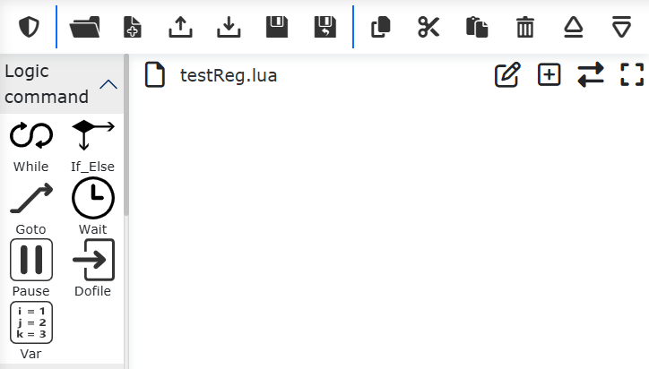
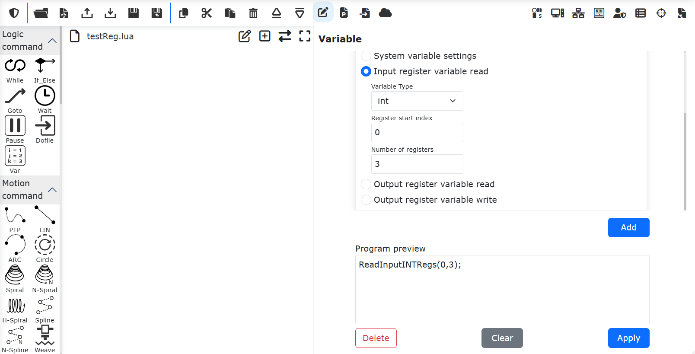
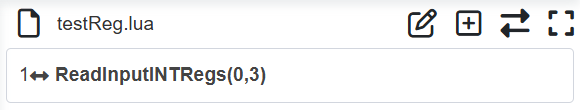
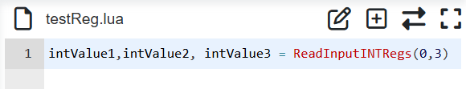
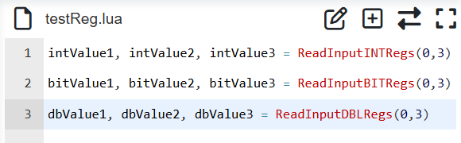
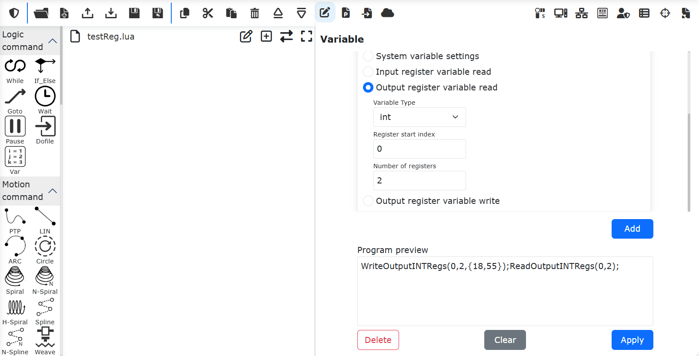
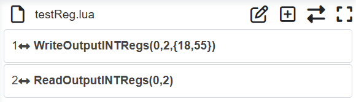
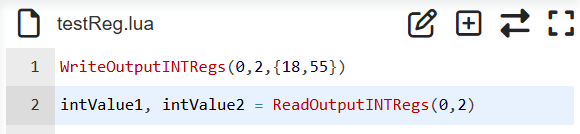
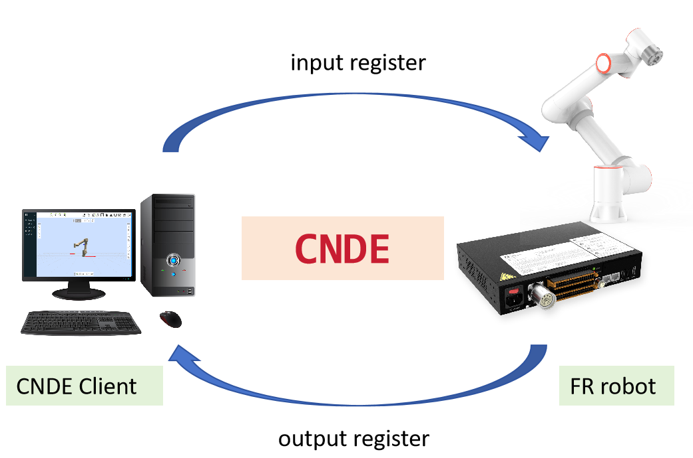

Registros de entrada y salida del robot
================================================

El cliente CNDE y el robot pueden intercambiar datos mediante los registros de entrada y salida, lo que incluye concretamente dos procesos:

① La configuración de entrada del cliente CNDE incluye registros de entrada; al introducir datos se modifican los valores de los registros de entrada. En el programa LUA del robot se añade la instrucción de lectura de registros de entrada; al ejecutar el programa LUA se pueden leer los valores de los registros de entrada modificados por el cliente CNDE.

② En el programa LUA del robot se añade la instrucción de escritura de registros de salida; al ejecutar el programa LUA se escriben valores en los registros de salida. La configuración de salida del cliente CNDE incluye registros de salida; al iniciar la retroalimentación de estado CNDE del robot, el cliente puede leer, al recibir los datos de salida CNDE, los valores de los registros de salida escritos en el programa LUA.

Lectura de registros de entrada
~~~~~~~~~~~~~~~~~~~~~~~~~~~~~~~~~~~~~~~~

Abra la WebApp y haga clic sucesivamente en "Programa de enseñanza", "Programación de programas" para crear un nuevo programa de usuario "testReg.lua".

.. centered:: Figura 4-1 Crear el programa "testReg.lua"

Haga clic en "Variable", en el cuadro de adición de instrucciones de la derecha seleccione "Lectura de variable de registro de entrada", seleccione el tipo de variable "int", el índice inicial del registro 0, la cantidad de registros 3, y haga clic en el botón "Añadir" y en el botón "Aplicar".

.. centered:: Figura 4-2 Añadir la instrucción de lectura de registros de entrada

En este momento, en "testReg.lua" ya se ha añadido una instrucción de lectura de registros de entrada de tipo "int".

.. centered:: Figura 4-3 Instrucción de lectura de registros de entrada de tipo "int" añadida

Haga clic en el botón de cambio de modo para cambiar al modo editable del programa, y añada tres variables de programa lua antes de la instrucción de lectura de registros de entrada, para recibir los tres valores de registros de entrada leídos.

.. centered:: Figura 4-4 Añadir la lectura de los valores de los registros de entrada

Del mismo modo, se puede añadir la lectura de datos de registros de tipo "bit" y de tipo "double".

.. centered:: Figura 4-5 Añadir la lectura de registros de entrada de tipo "bit" y "double"

Guarde el programa anterior y cambie el robot al modo automático; al ejecutar este programa, los valores de los registros de entrada se leerán en las variables del programa lua.

Escritura de registros de salida
~~~~~~~~~~~~~~~~~~~~~~~~~~~~~~~~~~~~~

Abra la WebApp y haga clic sucesivamente en "Programa de enseñanza", "Programación de programas" para crear un nuevo programa de usuario "testReg.lua".

.. image:: cnde/017.png
   :width: 6in
   :align: center

.. centered:: Figura 4-6 Crear el programa "testReg.lua" 

Haga clic en "Variable", en el cuadro de adición de instrucciones de la derecha seleccione "Escritura de variable de registro de salida", seleccione el tipo de variable "int", el índice inicial del registro 0, la cantidad de registros 2, el valor de los registros "18,55", y haga clic en el botón "Añadir"; vuelva a seleccionar "Lectura de variable de registro de salida", seleccione el tipo de variable "int", el índice inicial del registro 0, la cantidad de registros 2, y haga clic en los botones "Añadir" y "Aplicar".

.. centered:: Figura 4-7 Añadir las instrucciones de lectura y escritura de registros de salida

En este momento, en "testReg.lua" ya se han añadido las instrucciones de escritura y lectura de registros de salida de tipo "int".

.. centered:: Figura 4-8 Instrucciones de escritura y lectura de registros de salida de tipo "int" añadidas

Haga clic en el botón de cambio de modo para cambiar al modo editable del programa, y añada dos variables de programa lua antes de la instrucción de lectura de registros de salida, para recibir los dos valores de registros de salida leídos.

.. centered:: Figura 4-9 Añadir la lectura de los valores de los registros de entrada

Guarde el programa anterior y cambie el robot al modo automático; al ejecutar este programa, los valores de las variables del programa LUA "intValue1" e "intValue2" serán 18 y 55 respectivamente. Las operaciones con registros de tipo "bit" y "double" son iguales que con los registros de tipo "int".

Aplicación de interacción de registros de entrada y salida CNDE
~~~~~~~~~~~~~~~~~~~~~~~~~~~~~~~~~~~~~~~~~~~~~~~~~~~~~~~~~~~~~~~~~~~~~~~~

.. centered:: Figura 4-10 Interacción de datos de registros de entrada y salida

Los escenarios de interacción de datos entre el robot y el cliente CNDE mediante registros de entrada y salida incluyen, entre otros, los siguientes tipos:

① Los registros de entrada controlan el movimiento del robot: el cliente CNDE planifica la posición objetivo del robot y escribe la posición objetivo del robot en los registros de entrada; en el programa LUA del robot se leen los valores de los registros de entrada para obtener la posición objetivo del robot, y a continuación, mediante instrucciones de movimiento como PTP, LIN, ServoJ, etc., se controla el robot para que se mueva a la posición objetivo. El programa de ejemplo LUA es el siguiente:

.. code-block:: lua
    :linenos:

    i = 0;
    oldFlag = 0
    while(1) do
        startFlag = ReadInputINTRegs(0,1)
        if(startFlag ~= oldFlag) then
        oldFlag = startFlag
        x, y, z, a, b, c = ReadInputDBLRegs(0,6)
        ServoJ({x, y, z, a, b, c}, {0, 0, 0, 0}, 10, 10, 0.008, 0, 0)
        end	
    end

② Los registros de entrada controlan las acciones del robot: el cliente CNDE escribe valores diferentes en un determinado registro de entrada para controlar que el robot realice acciones diferentes; en el programa LUA del robot se obtienen cíclicamente los valores del registro de entrada correspondiente y, según los diferentes valores del registro, se realizan acciones diferentes. El programa de ejemplo es el siguiente:

.. code-block:: lua
    :linenos:

    runFlag = ReadInputINTRegs(0,1)
    while(runFlag > 0) do
        motion,target = ReadInputINTRegs(1,2)
        if(motion > 0) then
            if(target == 1)then 
                Lin(a1,100,-1,0,0)
            else if(target == 2) then
                Lin(a2,100,-1,0,0)
            else
                Lin(safety,100,-1,0,0)
            end
            end
        else
            sleep_ms(100)
        end
    end

③ El robot escribe el estado actual del programa en los registros de salida durante su funcionamiento, y el cliente CNDE, al leer el estado de los registros de salida, monitoriza la ejecución del programa del robot. El programa de ejemplo es el siguiente:

.. code-block:: lua
    :linenos:

    local weldCount = 0
    runFlag = ReadInputINTRegs(0,1)
    while(runFlag > 0) do
        Lin(safety,100,-1,0,0)
        Lin(a1,100,-1,0,0)
        ARCStart(0, 0, 3000)
        Lin(a2,100,-1,0,0)
        ARCEnd(0, 0, 3000)
        runFlag = ReadInputINTRegs(0,1)
        weldCount = weldCount + 1
        WriteOutputINTRegs(0,1,{weldCount})
    end