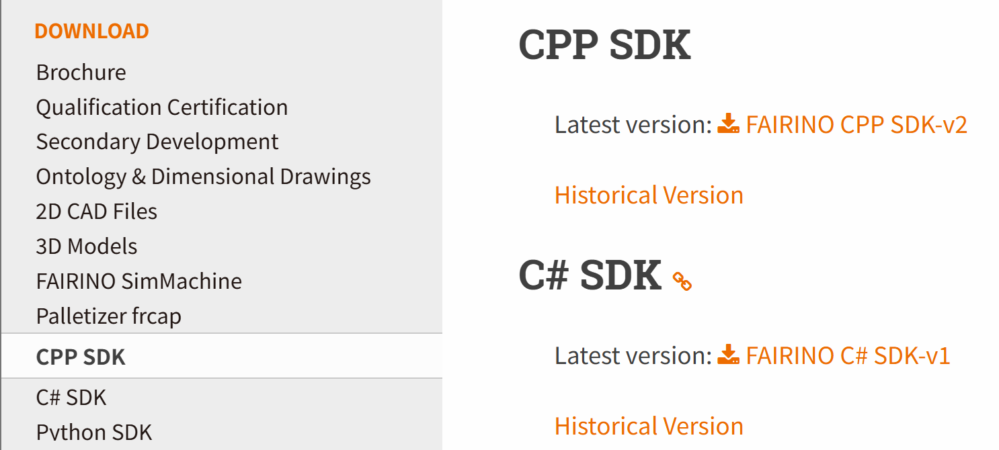
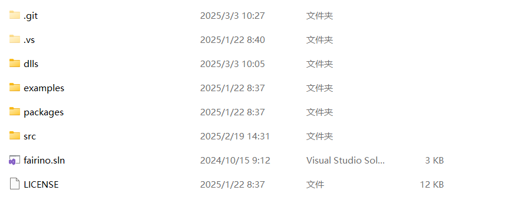
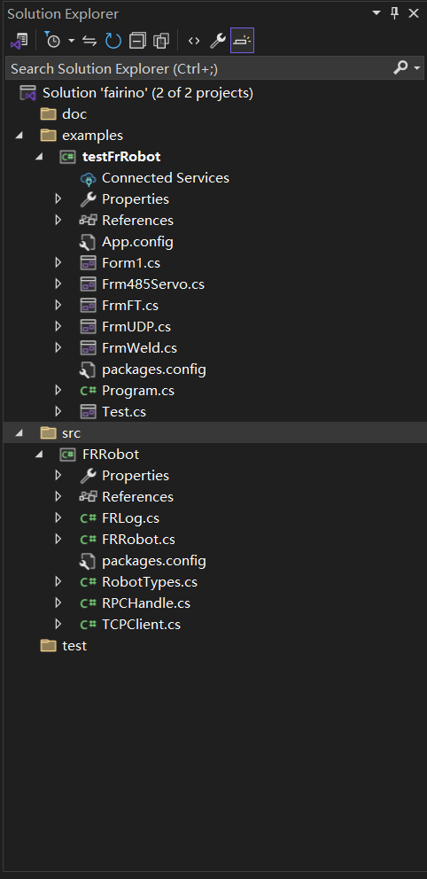
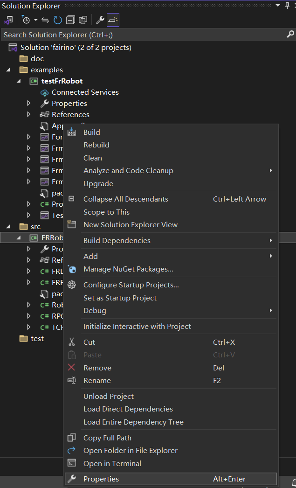
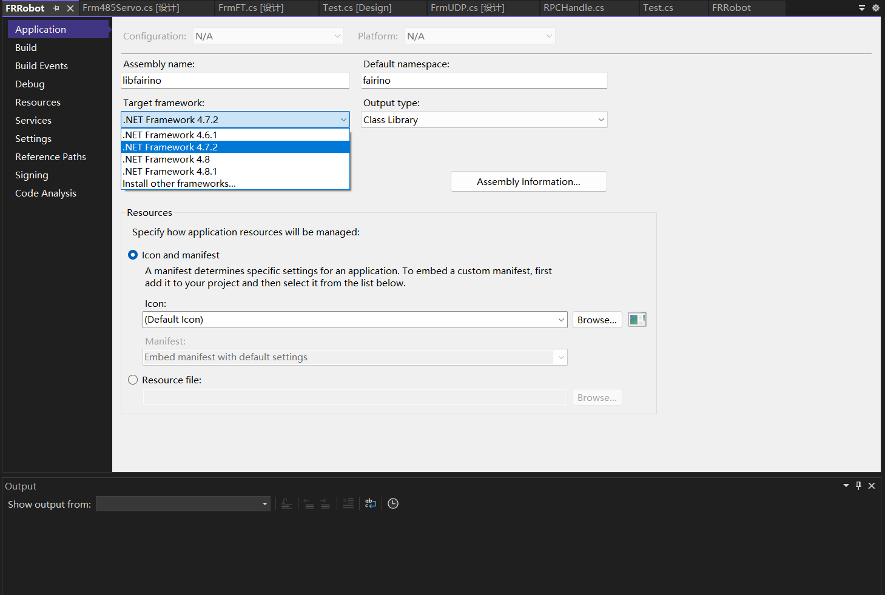
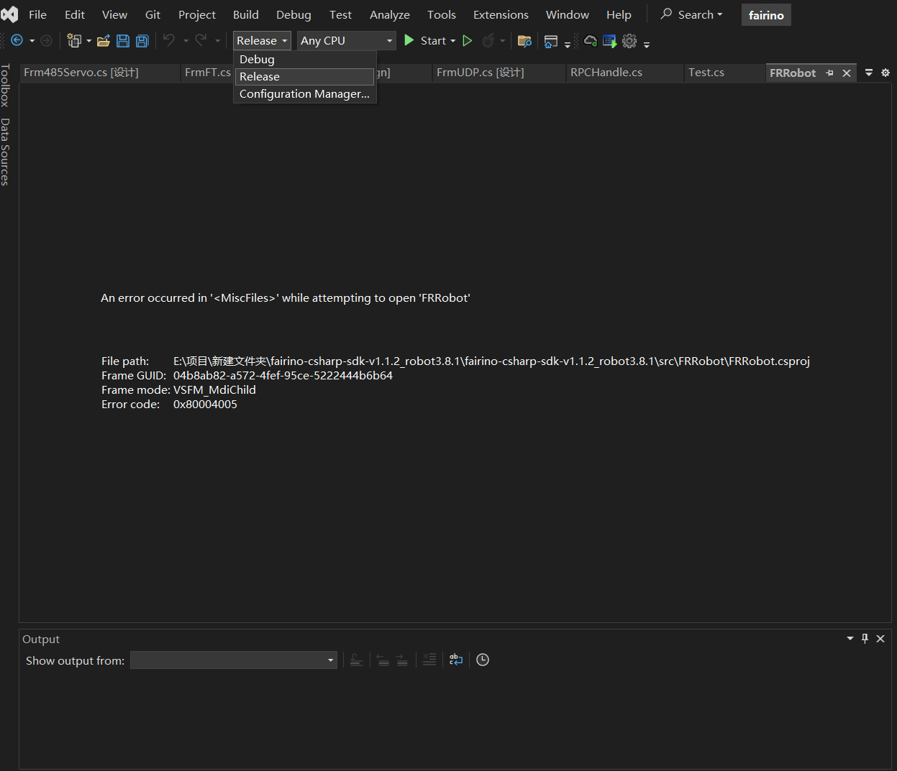
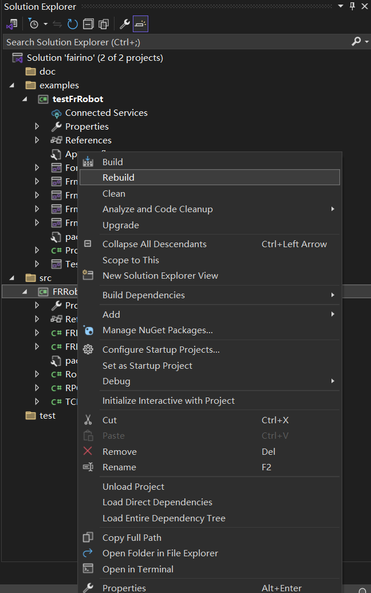
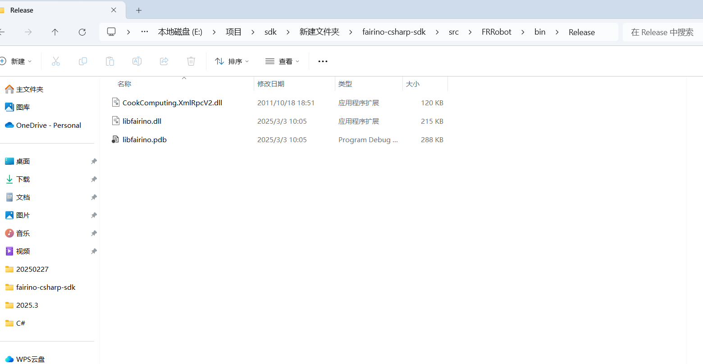
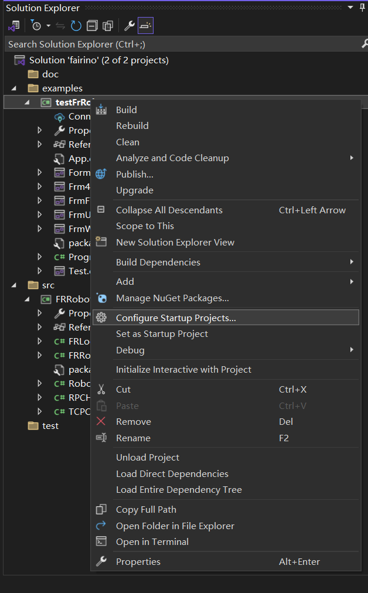
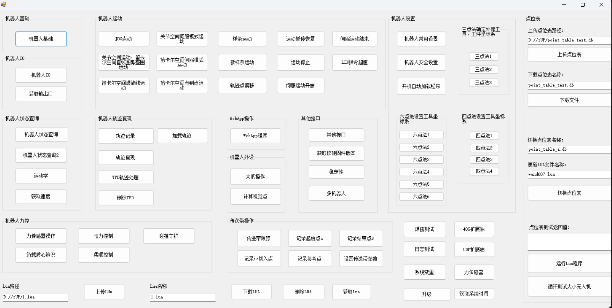

Apéndice
=================

.. toctree:: 
    :maxdepth: 5

Descarga del código fuente
------------------------------------------------
En la documentación de FAIRINO (https://fairino-doc-es.readthedocs.io/latest/) busque el módulo "Descarga de materiales", haga clic en el botón "C#SDK" y, en la página de la derecha, haga clic en "FAIRINOC#SDK"; espere a que el navegador complete la descarga.

.. centered:: Figura 15.1‑1 Descarga del código fuente del #SDK
    
Descargue y descomprima el SDK de C#. El directorio del proyecto se muestra en la siguiente figura. En él, la carpeta examples contiene ejemplos de prueba, la carpeta src contiene el SDK de C#, Fairino.sln es la solución del proyecto y Dlls contiene los archivos de librería.

.. centered:: Figura 15.1‑2 Ejemplo de estructura de archivos del SDK de C#

Localice el archivo de solución llamado fairino.sln y haga doble clic para abrirlo; la estructura de archivos se muestra en la siguiente figura.

.. centered:: Figura 15.1‑3 Ejemplo de estructura de archivos del proyecto en Visual Studio 2022

Compilación del código fuente en la plataforma Windows
-----------------------------------------------------------------------

Compilación del SDK de C#
~~~~~~~~~~~~~~~~~~~~~~~~~~~~~~~~~~~~~~~~~~~~
Haga clic en el proyecto FRRobot, haga clic con el botón derecho y seleccione propiedades; a continuación, seleccione la versión del marco .net.

.. centered:: Figura 15.2‑1 Establecer propiedades

.. centered:: Figura 15.2‑2 Seleccionar el marco .net

.. centered:: Figura 15.2‑3 Generar el proyecto FRRobot en Release

Cambie Visual Studio 2022 al modo Release y vuelva a generar el proyecto FRRobot; en la carpeta \bin\Release se generará la librería de enlace dinámico dll.

.. centered:: Figura 15.2‑4 Establecer el modo Release

.. centered:: Figura 15.2‑5 Volver a generar el proyecto FRRobot en Release

.. centered:: Figura 15.2‑6 Generar la librería de enlace dinámico dll

Uso del SDK de C#
~~~~~~~~~~~~~~~~~~~~~~~~~~~~~~~~~~~~~~~~~~~~~
Haga clic con el botón derecho y seleccione el proyecto testFrRobot como proyecto de inicio.

.. centered:: Figura 15.2‑7 Establecer como proyecto de inicio
 
La interfaz de prueba del SDK de C# se muestra en la siguiente figura.

.. centered:: Figura 15.2‑8 Interfaz de prueba del SDK de C#

Notas
---------------------------------------

Problemas que pueden surgir
~~~~~~~~~~~~~~~~~~~~~~~~~~~~~~~~~~~~~~~~~~~~~~~~~~

Tratamiento cuando la actualización del código no surte efecto
+++++++++++++++++++++++++++++++++++++++++++++++++++++++++++++++++++++++++++++
Tras intentar reescribir el código y reiniciar el proyecto, si observa que el proyecto sigue ejecutando el código antiguo, considere los siguientes pasos:

Volver a generar el proyecto: siguiendo las indicaciones de la sección 3.2, vuelva a generar o actualice la configuración y los archivos del proyecto.

Códigos de error
+++++++++++++++++++++++++++++++++++++++++++++++++++++++++++
Cuando el valor de retorno es 0, indica un funcionamiento normal; si el valor de retorno no es 0, consulte la tabla de correspondencia de códigos de error.