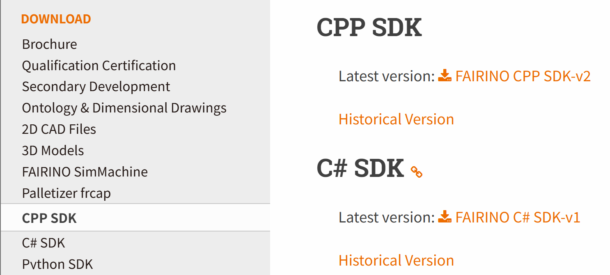
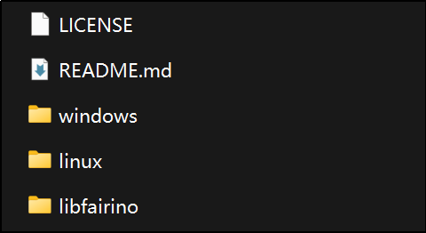
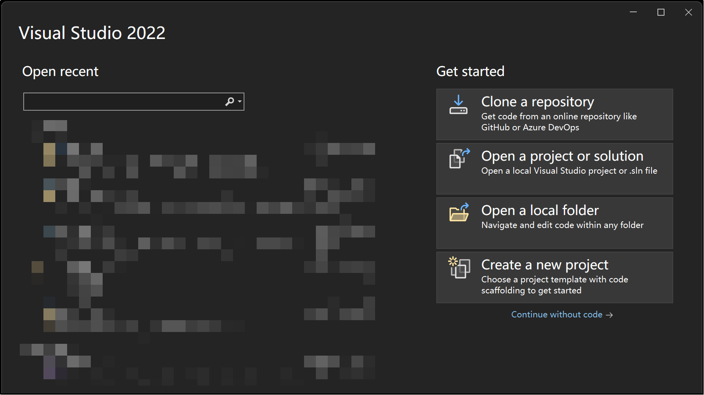
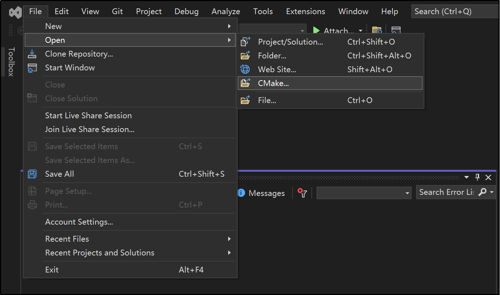
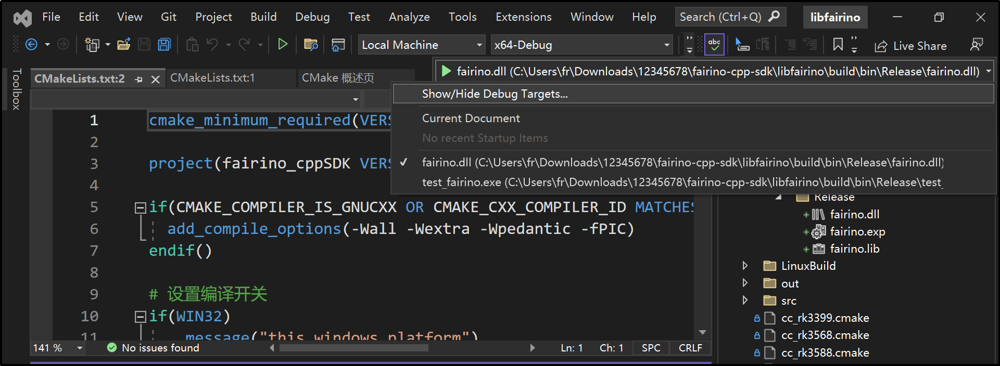
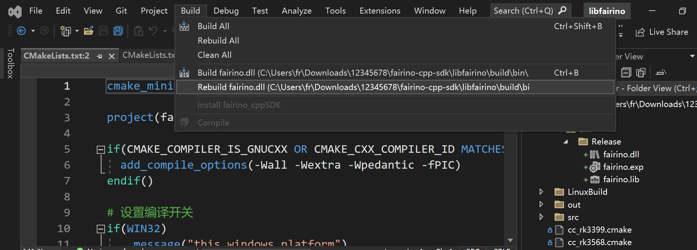
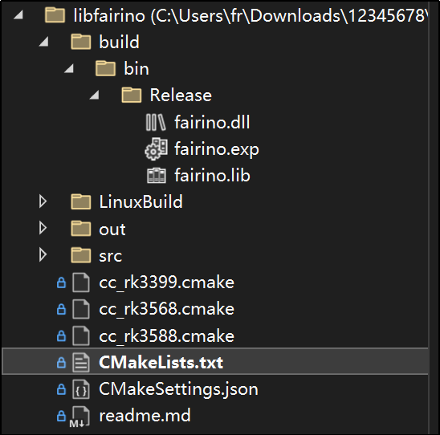
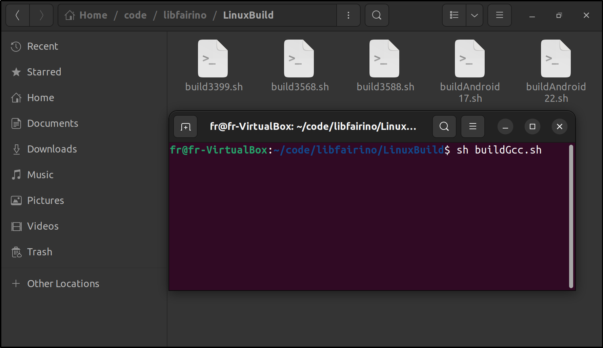
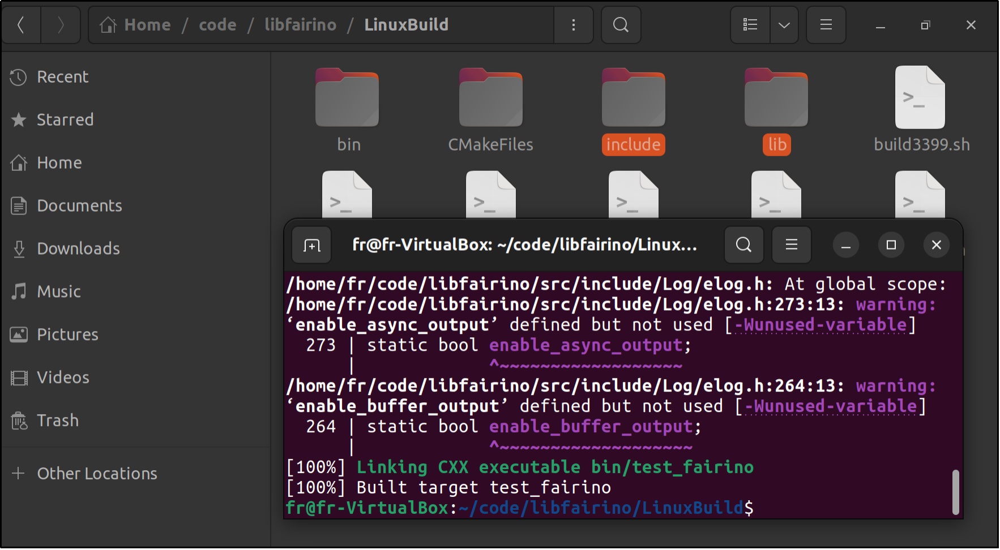

Apéndice
=================

.. toctree:: 
    :maxdepth: 5

Descarga del código fuente
------------------------------------------------

En la documentación de FAIRINO (https://fairino-doc-es.readthedocs.io/latest/) busque el módulo "Descarga de materiales", haga clic en el botón "CPP SDK" y, en la página de la derecha, haga clic en "FAIRINO CPP SDK"; espere a que el navegador complete la descarga.

.. centered:: Figura 15.1‑1 Descarga del código fuente del SDK de C++

Descomprima el paquete; el directorio de archivos de puntos descargado se muestra en la figura, donde:

- windows: archivos de encabezado y de librería (.lib y .dll) compilados con el compilador en entornos habituales como VS2015~VS2019, incluyendo los modos Debug y Release;
- linux: archivos de encabezado y de librería (.so) en entornos habituales como gcc, rk3399, rk3568;
- libfairino: código fuente del SDK de C++;

.. centered:: Figura 15.1‑2 Directorio del código fuente del SDK de C++

Compilación del código fuente en la plataforma Windows
---------------------------------------------------------
①Abra Visual Studio y haga clic en "Continuar sin código (W)" en la esquina inferior derecha;

.. centered:: Figura 15.2‑1 Abrir Visual Studio

②Haga clic sucesivamente en "Archivo", "Abrir", "CMake(M)"; aparecerá un cuadro de selección de archivos. Seleccione el archivo "\libfairino\CMakeLists.txt" del código fuente del SDK de C++ descargado; Visual Studio cargará automáticamente el proyecto según la definición de CMakeLists.txt.

.. centered:: Figura 15.2‑2 Abrir el proyecto CMake

③Seleccione según sea necesario la plataforma de compilación "x64-Debug" o "x64-Release", etc., y seleccione como elemento de inicio "fairino.dll".

.. centered:: Figura 15.2‑3 Seleccionar el elemento de inicio

④En la barra de menús, haga clic sucesivamente en "Generar", "Regenerar fairino.dll"; el compilador comenzará a compilar automáticamente.

.. centered:: Figura 15.2‑4 Generar fairino.dll

⑤En el directorio del proyecto de la derecha, localice la carpeta "build" y dentro de ella encuentre los archivos fairino.dll y fairino.lib obtenidos de la compilación.

.. centered:: Figura 15.2‑5 Localizar fairino.lib y fairino.dll

⑥Al utilizar el SDK de C++ del robot colaborativo, primero localice en el directorio del proyecto de la derecha los archivos de encabezado compilados del SDK del robot /libfairino/src/include/Robot-CN/; copie los tres archivos de encabezado "robot.h", "robot_error.h" y "robot_type.h" de esa carpeta al directorio del proyecto, añada fairino.lib a la librería de enlace y, por último, coloque fairino.dll en el directorio del ejecutable para poder utilizarlo.

Compilación del código fuente en la plataforma Linux
---------------------------------------------------------

Antes de compilar el código fuente en Linux, asegúrese de que el sistema tiene instalados los compiladores gcc y g++ y el sistema de compilación cmake (versión 3.10 o superior).

El script "buildGcc.sh" de la carpeta \libfairino\linuxBuild\ del directorio del código fuente de C++ contiene las instrucciones "cmake..", "make", y la copia de los archivos de encabezado y de librería finales a la carpeta \linuxBuild\, entre otras; ejecute este script para completar la compilación del código fuente del SDK de C++.

①Abra un terminal, acceda al directorio \libfairino\linuxBuild\, introduzca el comando: "sh buildGcc.sh" y pulse Intro; el SDK comenzará a compilarse; espere a que finalice la compilación.

.. centered:: Figura 15.3‑1 Introducir la instrucción del script de compilación

②Una vez completada la compilación, acceda de nuevo al directorio \libfairino\linuxBuild\ y localice las carpetas \include\ y \lib\, que son los directorios de los archivos de encabezado y de librería necesarios, respectivamente.

.. centered:: Figura 15.3‑2 Resultado de la compilación