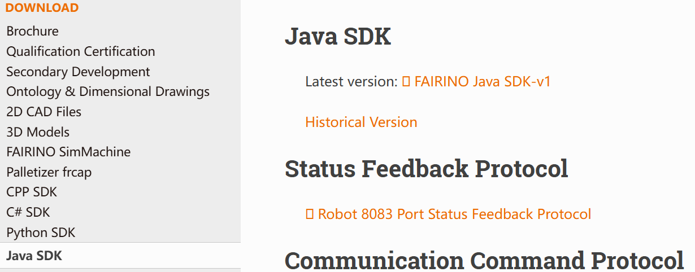
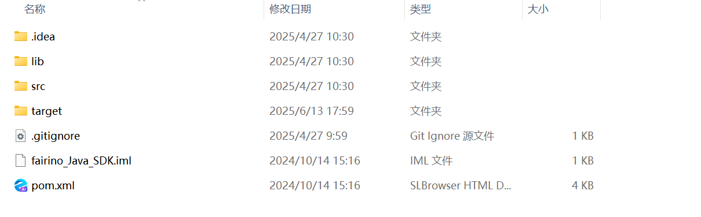
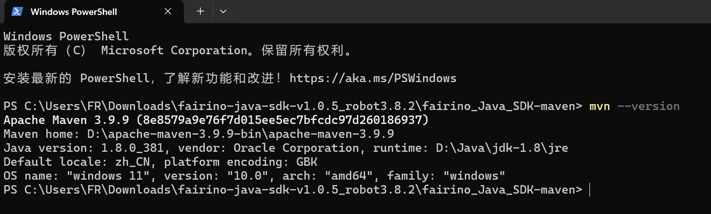
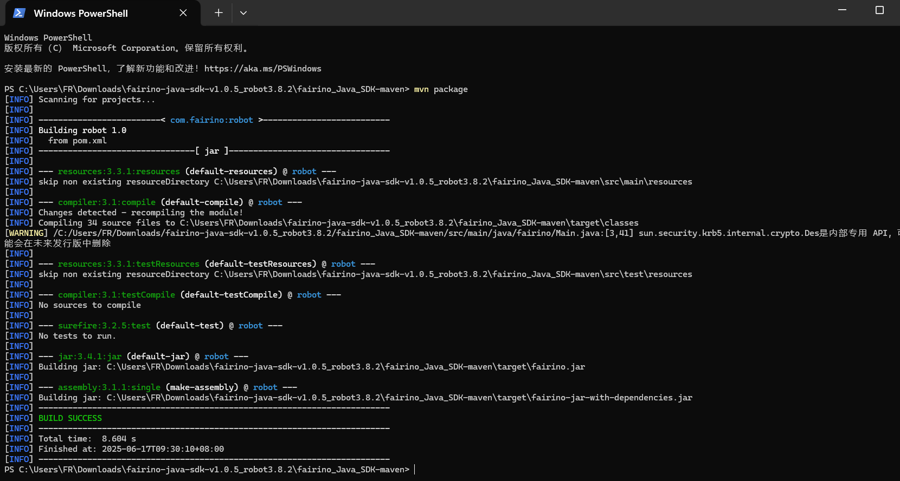
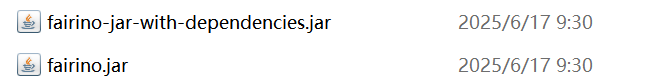

Apéndice
=================

.. toctree:: 
    :maxdepth: 5

Descarga del código fuente
------------------------------------------------

En la documentación de FAIRINO (https://fairino-doc-es.readthedocs.io/latest/) busque el módulo "Descarga de materiales", haga clic en el botón "Java SDK" y, en la página de la derecha, haga clic en "FAIRINOJavaSDK", y espere a que el navegador complete la descarga.

.. centered:: Figura 16.1‑1 Descarga del código fuente del Java SDK

Descomprima el paquete comprimido; el directorio de archivos se muestra en la figura, donde:

fairino_Java_SDK_maven: código fuente (.java) y archivos de biblioteca (.jar) compilados por el compilador en entorno del sistema Windows;

.. centered:: Figura 16.1‑2 Directorio de archivos del Java SDK

Acceda a la carpeta fairino_Java_SDK_maven; contiene los directorios que se muestran en la figura, donde:

- lib: paquetes jar de dependencias utilizados en el código fuente;
- src: archivos de código fuente del Java SDK;
- target: archivos de biblioteca (.jar) generados a partir del código fuente del Java SDK;

.. centered:: Figura 16.1‑3 Directorio de código fuente y archivos de biblioteca del Java SDK

Compilación del código fuente en plataforma Windows
-------------------------------------------------------------
①Instalar y configurar la herramienta de construcción——Maven

Sitio web de descarga e instalación de Maven: Welcome to Apache Maven – Maven

Tras la instalación y configuración, como se muestra a continuación, al introducir maven --version en el terminal se mostrará la siguiente información

.. centered:: Figura 16.2‑1 Instalación y configuración de Maven

②Abra un terminal en el directorio del código fuente del Java SDK e introduzca mvn package para generar el archivo de biblioteca (.jar),

.. centered:: Figura 16.2‑2 Compilación del Java SDK en archivo de biblioteca
 
③En el directorio del código fuente busque la carpeta "target" y dentro de la carpeta encuentre los archivos fairino-jar-with-dependencies.jar y fairino.jar obtenidos de la compilación, como se muestra en la figura

.. centered:: Figura 16.2‑3 Generación del archivo jar

④Al usar el Java SDK del robot colaborativo, primero en el proyecto de idea haga clic sucesivamente en File->Project Structure->Libraries, añada el archivo .jar generado en los pasos anteriores; en el archivo utilice import fairino.*; para poder usar el archivo .jar generado.