Apéndice
=================

.. toctree:: 
    :maxdepth: 5

Descarga del código fuente
------------------------------------------------

En la documentación de FAIRINO (https://fairino-doc-es.readthedocs.io/latest/) busque el módulo "Descarga de materiales", haga clic en el botón "Python SDK" y, en la página de la derecha, haga clic en "FAIRINO Python SDK", y espere a que el navegador complete la descarga.

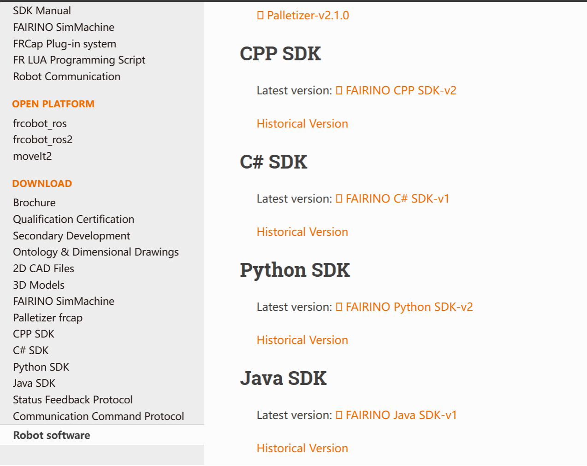

.. centered:: Figura 16.1‑1 Descarga del código fuente del Python SDK

Descargue y descomprima el Python SDK. El directorio del proyecto se muestra en la figura. Donde la carpeta windows es el Python SDK para el sistema Windows; la carpeta linux es el Python SDK para el sistema Linux.

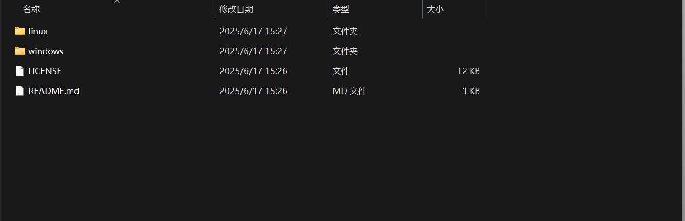

.. centered:: Figura 16.1‑2 Ejemplo de estructura de archivos del Python SDK

Tomando como ejemplo el sistema Windows, abra la carpeta windows; el directorio se muestra en la figura, donde el archivo example es un ejemplo de prueba, fairino es el código fuente del Python SDK y libfairino es el archivo de biblioteca.

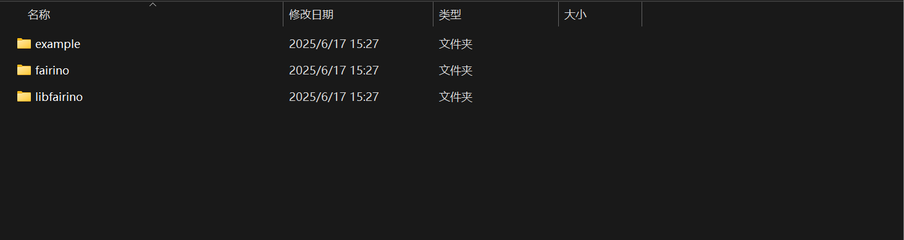

.. centered:: Figura 16.1‑3 Ejemplo de estructura de archivos del Python SDK en el sistema Windows

Abra la carpeta windows con el software Pycharm; la estructura se muestra en la figura.

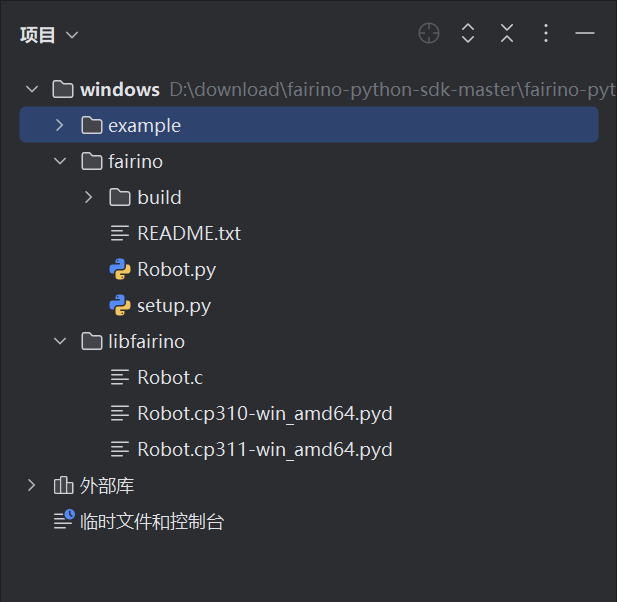

.. centered:: Figura 16.1‑4 Ejemplo de estructura de archivos del proyecto en Pycharm
 
Compilación del código fuente
----------------------------------------
La generación de la biblioteca dinámica de Python producirá bibliotecas dinámicas diferentes según el tipo de sistema y la versión de Python; por ejemplo, en la plataforma Windows el archivo de biblioteca generado tiene el sufijo ".pyd", en la plataforma Linux el archivo de biblioteca generado tiene el sufijo ".so", y las bibliotecas dinámicas generadas por diferentes versiones de Python no se pueden mezclar, por lo que antes de generar la biblioteca dinámica es necesario determinar la versión de Python y la plataforma de uso, entre otros aspectos. Este manual utiliza las versiones python3.10, windows11 y ubuntu22.04 para la explicación de la compilación.

Compilación del Python SDK en la plataforma Windows
~~~~~~~~~~~~~~~~~~~~~~~~~~~~~~~~~~~~~~~~~~~~~~~~~~~~~~~~~~~~~~~~~~~~~~~~
Primero, use pycharm para abrir el archivo del Python SDK descargado y abra el archivo setup.py;

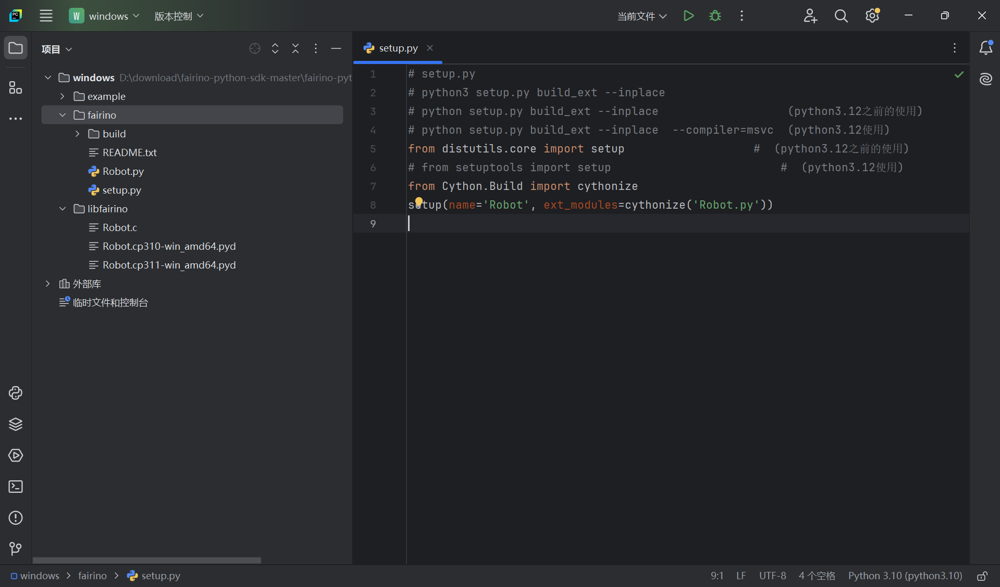

.. centered:: Figura 16.2‑1 Abrir el archivo del proyecto

Luego, haga clic en la esquina inferior derecha para seleccionar el intérprete de Python; en este caso se toma python3.10 como ejemplo;

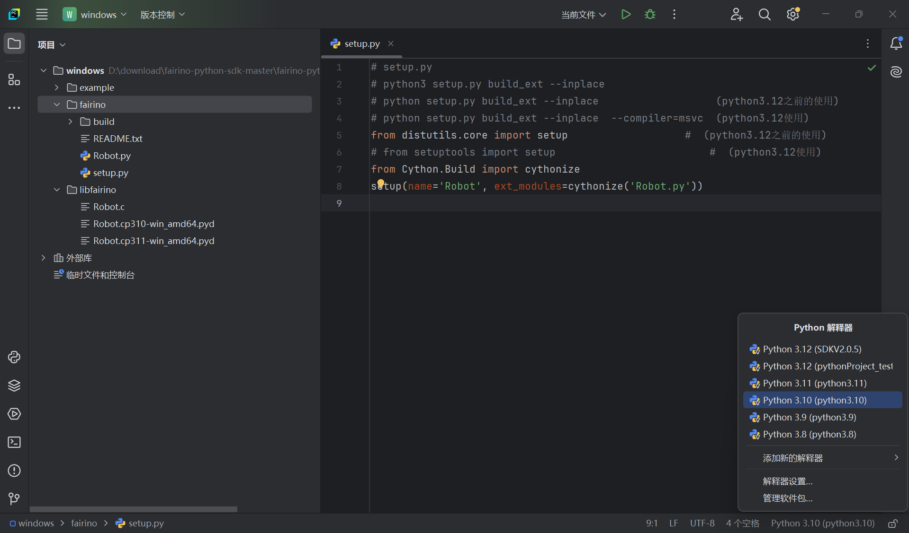

.. centered:: Figura 16.2‑2 Seleccionar la versión de Python
 
Haga clic derecho en la carpeta fairino, haga clic en "Abrir en" y luego haga clic en "Terminal";

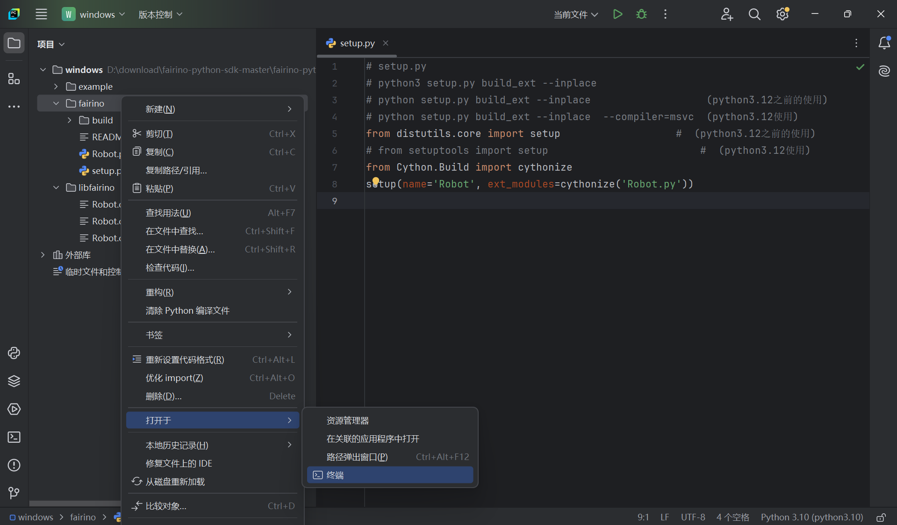

.. centered:: Figura 16.2‑3 Abrir el terminal

A continuación, en la interfaz del terminal introduzca "python setup.py build_ext --inplace" y haga clic en "Intro" para generar la biblioteca dinámica del Python SDK;

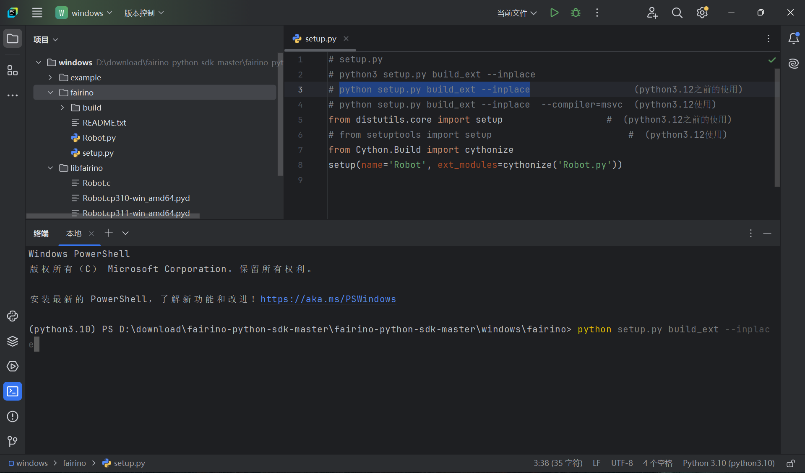

.. centered:: Figura 16.2‑4 Ejecutar el comando de generación de la biblioteca dinámica

Una vez generada la biblioteca dinámica, en la carpeta fairino se generan Robot.c y Robot.cp310-win_amd64.pyd, donde Robot.c es la conversión de Robot.py a archivo de lenguaje C; Robot.cp310-win_amd64.pyd es la biblioteca dinámica del Python SDK, donde "cp310" indica que es aplicable a la versión python3.10 y "win_amd64" indica que es aplicable a la plataforma Windows

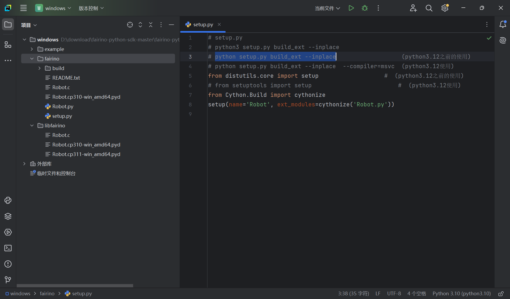

.. centered:: Figura 16.2‑5 Generación de la biblioteca dinámica .pyd
 
Compilación del Python SDK en la plataforma Linux
~~~~~~~~~~~~~~~~~~~~~~~~~~~~~~~~~~~~~~~~~~~~~~~~~~~~~~~~~~~~~~~
Primero consulte la versión de Python; en este manual se utiliza la herramienta pyenv para gestionar la versión de Python en el sistema Linux; ejecute el comando "pyenv versions" para consultar la versión actual de Python;

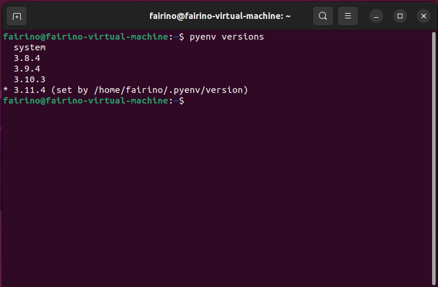

.. centered:: Figura 16.2‑6 Consultar la versión de Python

Luego cambie a la versión de Python objetivo; tomando python3.10 como ejemplo, ejecute el comando "pyenv global 3.10.3" para cambiar a la versión python3.10;

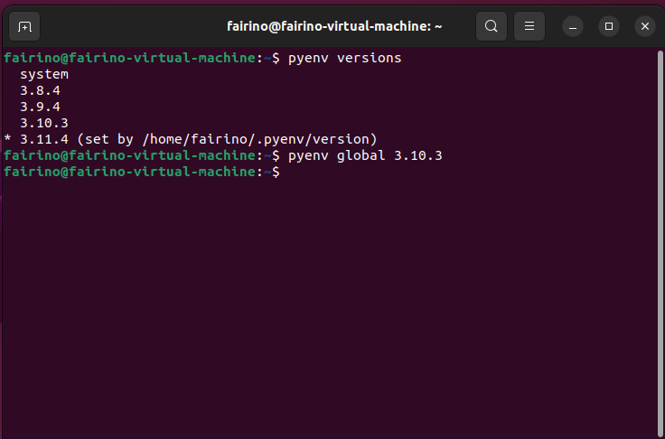

.. centered:: Figura 16.2‑7 Seleccionar la versión de Python

Cambie al directorio del mismo nivel que el archivo Robot.py; ejecute el comando "cd /home/fairino/fairino-python-sdk-master/fairino-python-sdk-master/linux/fairino" para cambiar el directorio al de Robot.py.

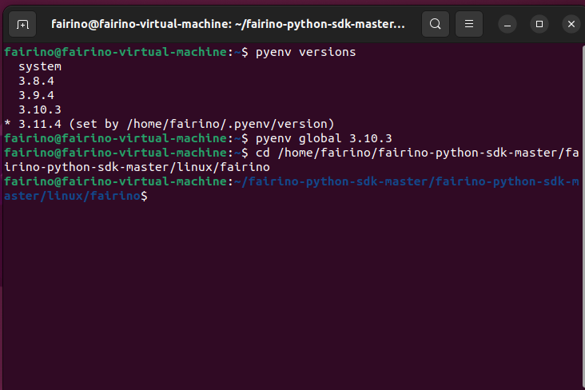

.. centered:: Figura 16.2‑8 Cambiar al directorio del mismo nivel que el archivo Robot.py

Confirme la versión de Python; ejecute el comando "python --version" para consultar la versión actual de Python;

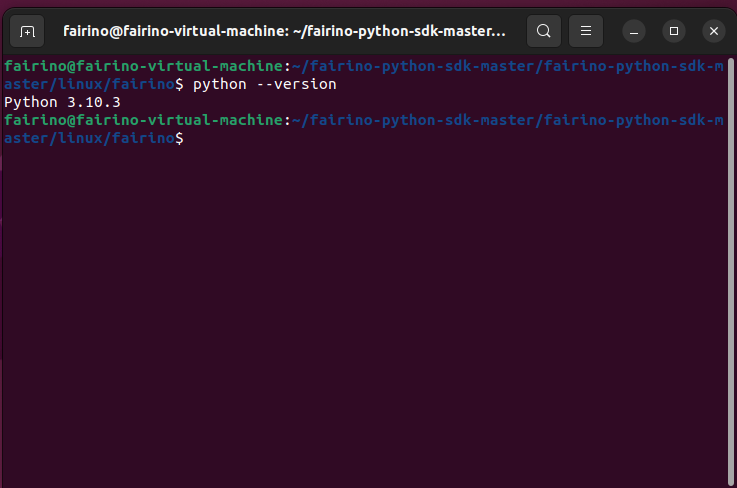

.. centered:: Figura 16.2‑9 Consultar la versión de Python
 
En la interfaz del terminal introduzca "python setup.py build_ext --inplace" y haga clic en "Intro" para generar la biblioteca dinámica del Python SDK;

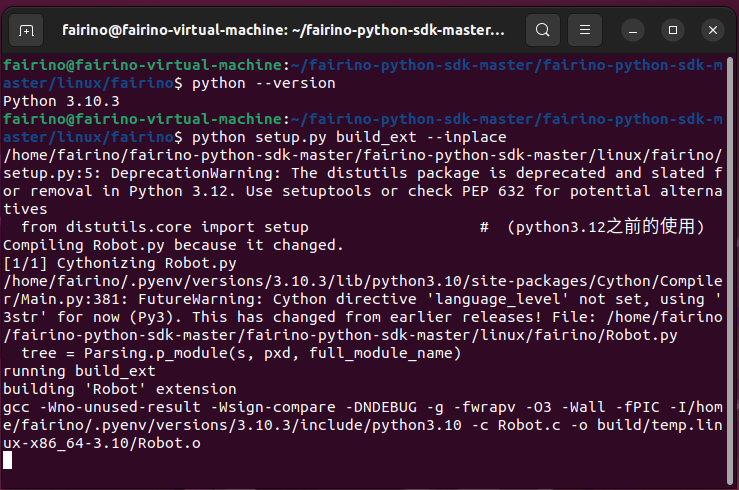

.. centered:: Figura 16.2‑10 Ejecutar el comando de generación de la biblioteca dinámica

Una vez generada la biblioteca dinámica, en la carpeta fairino se generan Robot.c y Robot.cpython-310-x86_64-linux-gnu.so, donde Robot.c es la conversión de Robot.py a archivo de lenguaje C y "Robot.cpython-310-x86_64-linux-gnu.so" es la biblioteca dinámica del Python SDK, donde "python-310" indica que es aplicable a la versión python3.10 y "linux-gnu" indica que es aplicable a la plataforma Linux

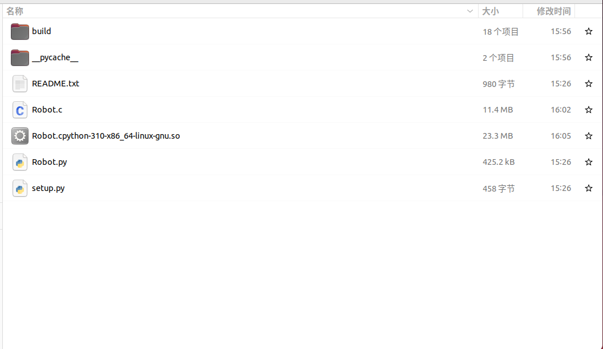

.. centered:: Figura 16.2‑11 Generación de la biblioteca dinámica .so

Notas
----------------------------------

Problemas que pueden surgir
~~~~~~~~~~~~~~~~~~~~~~~~~~~~~~~~~~~~~~~~

Correspondencia de versiones
++++++++++++++++++++++++++++++
La biblioteca dinámica de Python depende del entorno de generación y de la versión de Python, por lo que al utilizar la biblioteca dinámica de Python es necesario comprobar si la biblioteca dinámica coincide con el tipo de sistema y si la biblioteca dinámica coincide con la versión de Python

Códigos de error
++++++++++++++++++++++++++++++
Cuando el valor de retorno es 0, significa que el funcionamiento es normal; si el valor de retorno no es 0, consulte la tabla de referencia de códigos de error.