Máquina virtual-Docker
=================================

Despliegue de imagen Docker en Linux
------------------------------------------------

Entorno de operación
~~~~~~~~~~~~~~~~~~~~~~~~~~~~~~

Sistema del entorno de ejecución de la máquina virtual：Ubuntu 18.04.6；

Sistema del entorno de ejecución de la máquina virtual：RAM 4G，ROM 50G，CPU de 6 núcleos ；

Permisos de operación：utilizar permisos de superadministrador root，el método de configuración se muestra en el apéndice 3；

Archivo de instalación de docker：fr_docker.tar.gz；

Imagen FAIRINO SimMachine：FAIRINOSimMachine.tar；

Instalar docker
~~~~~~~~~~~~~~~~~~~~~~~~~~~~~~

Si el usuario ya ha instalado y desplegado docker，omita esta sección y continúe con el despliegue de la imagen en 1.3.

1.Descargar fr_docker.tar.gz，colocarlo en la ruta de archivo de Ubuntu /opt/.

2.Descomprimir fr_docker.tar.gz.，tomando como ejemplo el directorio /opt/：

.. code-block:: console
   :linenos:

   cd /opt/ && tar -zxvf fr_docker.tar.gz

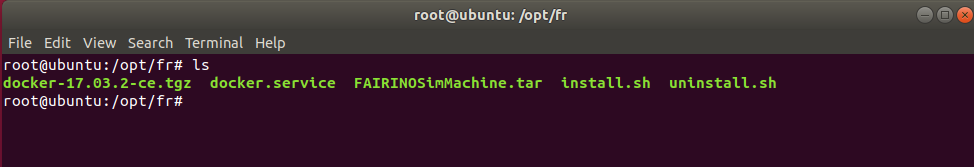

3.Ejecutar el script de instalación de docker：

.. code-block:: console
   :linenos:

   sh install.sh docker-27.0.3.tgz

Cuando el script termine de ejecutarse y aparezca el número de versión，significa que la instalación fue exitosa.

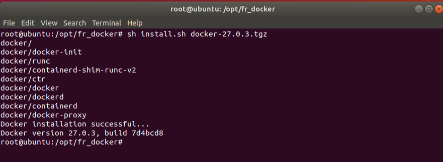

Configuración de la imagen
~~~~~~~~~~~~~~~~~~~~~~~~~~~~~~

Importar la imagen docker
++++++++++++++++++++++++++++++++++++++++

1. Descargar la imagen de la máquina virtual FAIRINOSimMachine.tar y descomprimirla.

2. Verificar la versión de docker para confirmar que está instalado.

.. code-block:: console
   :linenos:

   docker -v

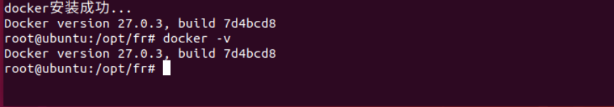

3. Importar la imagen   

.. code-block:: console
   :linenos:

   docker load -i ./FAIRINOSimMachine.tar

Cuando aparezca fairno_simmachine:latest significa que la importación se completó.

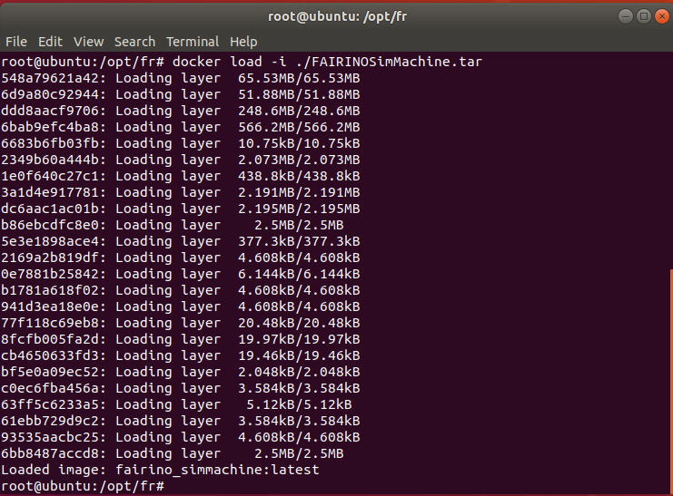

4. Ejecutar docker images para verificar si la importación fue exitosa.

Crear una red puente personalizada
++++++++++++++++++++++++++++++++++++++++

1. Ejecutar el siguiente comando para crear una red puente llamada fairino-net con segmento de red 192.168.58.0/24.

.. code-block:: console
   :linenos:

   docker network create --driver bridge --subnet 192.168.58.0/24 --gateway 192.168.58.1 fairino-net

2. Ver la red

.. code-block:: console
   :linenos:

   docker network ls

La existencia de la red fairino-net indica que la creación fue exitosa.

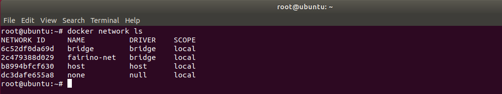

Primer inicio del contenedor docker
++++++++++++++++++++++++++++++++++++++++

1. Crear el contenedor e iniciarlo

Utilizar la red fairino-net y la imagen fairino_simmachine para iniciar el contenedor.

.. code-block:: console
   :linenos:

   docker run -d -P --name fairino-container --privileged -u root --net fairino-net fairino_simmachine

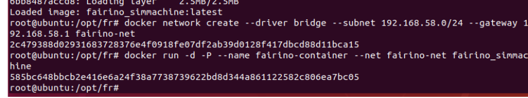

.. code-block:: console
   :linenos:

   docker ps 

Verificar si el contenedor se inició correctamente，la aparición de fairino-container indica que el inicio fue exitoso.

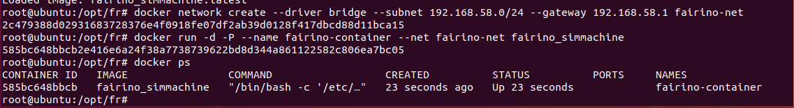

Operar el robot virtual vía web
---------------------------------------

El contenedor se inicia correctamente
~~~~~~~~~~~~~~~~~~~~~~~~~~~~~~~~~~~~~~~~~~~~~~~~~~~~

Esta subsección está dirigida a los casos en que el contenedor no es de primer inicio，y debido a razones como el reinicio del ordenador o el cierre de docker el contenedor no se está ejecutando en segundo plano.

1. Iniciar docker： 

.. code-block:: console
   :linenos:

   systemctl start docker

2. Ver el estado de docker：

.. code-block:: console
   :linenos:

   systemctl status docker
   
El color verde active(running) indica que el inicio fue exitoso.

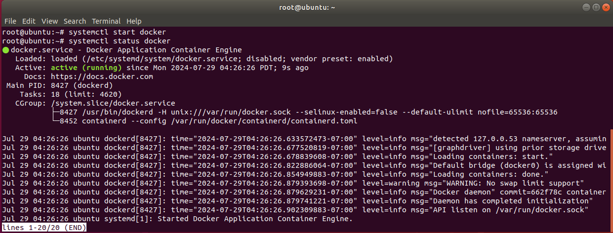

3. Ejecutar docker ps -a para ver el ID del contenedor.

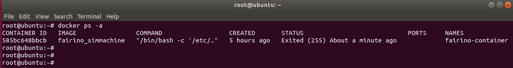

4. Ejecutar docker start [ID del contenedor].

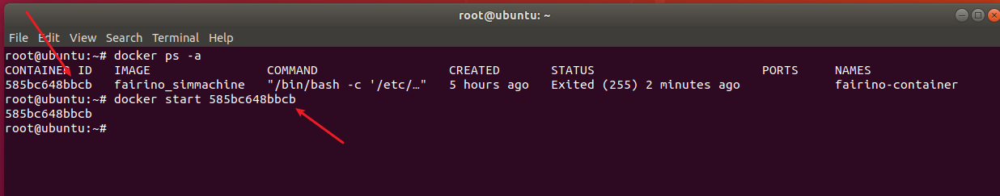

5. Ejecución exitosa，ejecutar de nuevo docker ps para ver que el contenedor está en ejecución.

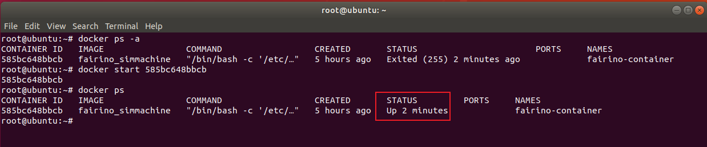

Operar el robot virtual
~~~~~~~~~~~~~~~~~~~~~~~~~~~~~~

1. Confirmar que el contenedor docker está en ejecución.

.. code-block:: console
   :linenos:

   docker ps 

La aparición de fairino-container indica que está en ejecución.

.. image:: controller_virtual_machine/047.png
   :width: 6in
   :align: center 

2. Abrir el navegador，introducir la IP predeterminada：192.168.58.2，para acceder a la interfaz web y operar el robot virtual.

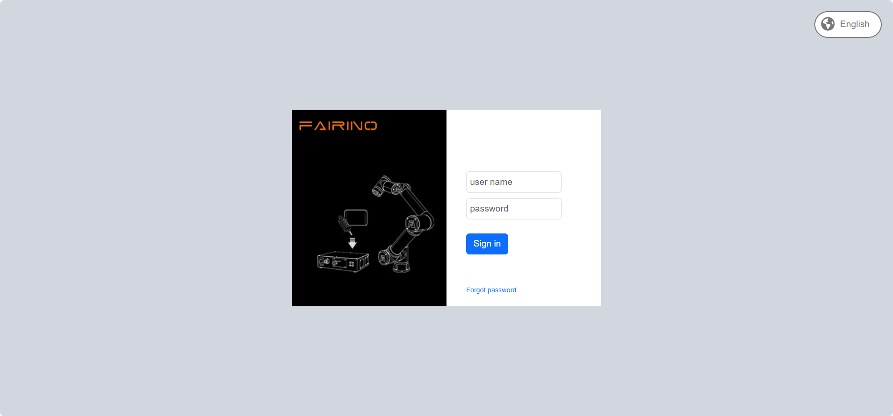

3. Iniciar sesión con la cuenta admin，contraseña：123。

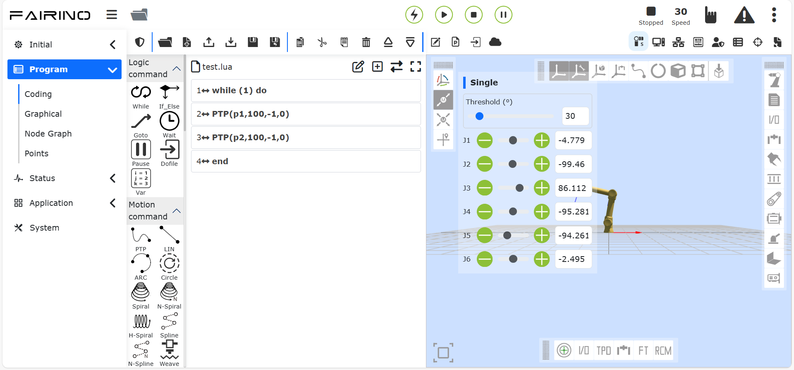

El usuario modifica la dirección IP
~~~~~~~~~~~~~~~~~~~~~~~~~~~~~~~~~~~~~~~~~~~~

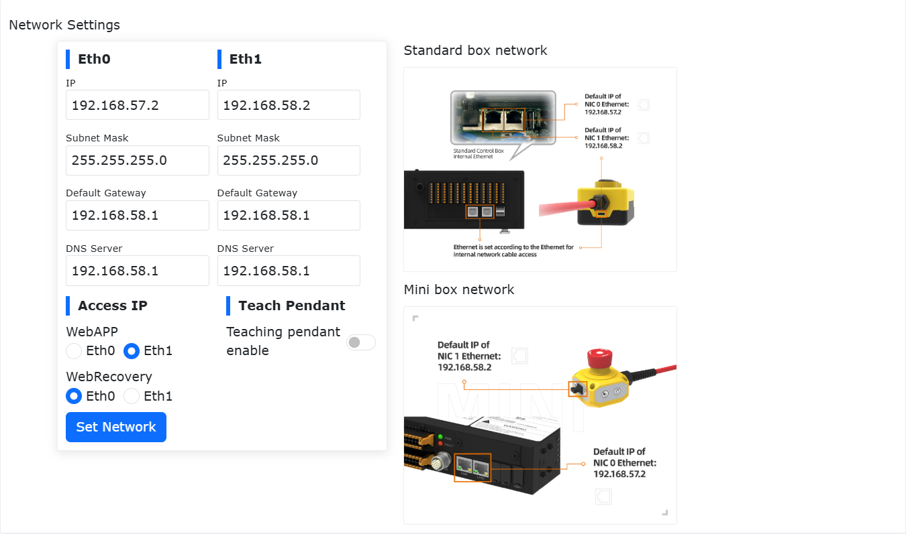

1. Abrir el navegador，introducir la IP predeterminada： 192.168.58.2，abrir la página web；
2. Iniciar sesión con la cuenta admin，contraseña： 123；
3. Entrar en “Configuración del sistema” → “Configuración general” → “Configuración de red”，modificar la IP a la dirección IP objetivo，máscara y puerta de enlace. Hacer clic en “Configurar red”；
4. Abrir la terminal，detener el contenedor；
 	
Ver el ID del contenedor：

.. code-block:: console
   :linenos:
      
   docker ps -a

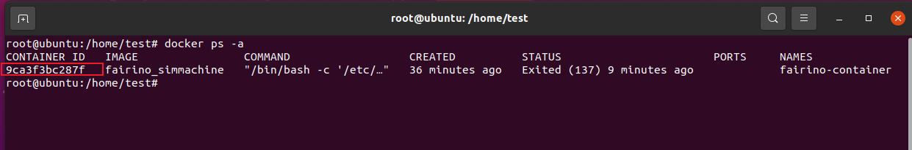

Detener el contenedor：

.. code-block:: console
   :linenos:
   
   docker stop [ID del contenedor]

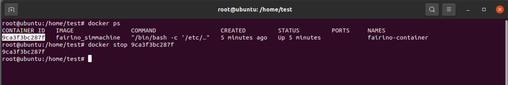

5. Reconfigurar la red del contenedor；
   
Eliminar la red original：

.. code-block:: console
   :linenos:
   
   docker network rm fairino-net

Crear una nueva red：

.. code-block:: console
   :linenos:
   
   docker network create --driver bridge --subnet [IP objetivo/máscara de subred] --gateway [IP de puerta de enlace] fairino-net

Tomando como ejemplo 192.168.56.0/24：docker network create --driver bridge --subnet 192.168.56.0/24 --gateway 192.168.56.1 fairino-net

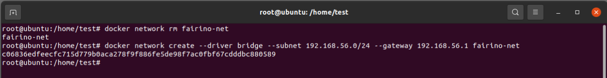

6. Reconectar el contenedor a la red recién creada；

.. code-block:: console
   :linenos:

   docker network connect fairino-net [ID del contenedor]

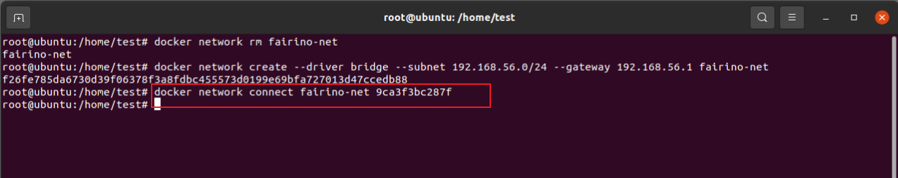

7. Reiniciar el contenedor；

.. code-block:: console
   :linenos:
   
   docker start [ID del contenedor]

8. En este momento，abrir el navegador，introducir la dirección IP modificada，para acceder a la interfaz web y operar el robot virtual.

Actualización y degradación de versión de la máquina virtual
------------------------------------------------------------------------------------

Descripción general
~~~~~~~~~~~~~~~~~~~~~~~~~~~~~~

Este manual describe en detalle el proceso estándar para realizar operaciones de actualización y degradación de software al utilizar la máquina virtual Docker FAIRINO SimMachine，y organiza sistemáticamente los puntos de atención clave durante el proceso de cambio de versión.

Preparación y puntos de atención para la actualización/degradación
~~~~~~~~~~~~~~~~~~~~~~~~~~~~~~~~~~~~~~~~~~~~~~~~~~~~~~~~~~~~~~~~~~~~~~~~~~~~~~~~~~~~~~~

Preparación de la operación
++++++++++++++++++++++++++++++++++++++++++++

1. Máquina virtual Docker FAIRINO SimMachine desplegada y en uso normal. El tutorial de despliegue se encuentra en《Manual de usuario-Despliegue de imagen Docker en Linux》；
2. Paquete de actualización de software de la versión de la máquina virtual Docker，la dirección de descarga se encuentra en《Descarga de materiales-FAIRINO SimMachine Docker》，tras descomprimirlo，el contenido incluye la imagen docker de la última versión FAIRINOSimMachine.tar y el paquete de actualización de software software.tar.gz.

Puntos de atención
++++++++++++++++++++++++++++++++++++

1. Copia de seguridad de datos：se recomienda realizar una copia de seguridad antes de la actualización，el método se muestra en el capítulo “Copia de seguridad de datos”，para evitar la pérdida de datos debido a anomalías durante la actualización.
2. Limitaciones de versión：

.. centered:: Gráfico 2.3-1 Limitaciones de versión para actualización/degradación

.. list-table::
   :widths: 50 50 50
   :header-rows: 0
   :align: center

   * - **Tipo de operación** 
     - **Condición/Limitación**
     - **Descripción de los pasos**

   * - **Actualización de versión** 
     - Versión actual>= 3.7.8
     - Se puede actualizar directamente

   * - **Actualización de versión** 
     - Versión actual< 3.7.8
     - Es necesario actualizar primero a la versión 3.7.5 o utilizar la solución compatible

   * - **Degradación de versión**
     - Versión actual y objetivo>= 3.7.8
     - Se puede degradar directamente

   * - **Degradación de versión**
     - Versión actual u objetivo<3.7.8
     - Utilizar la solución compatible

   * - **Solución compatible**
     - Aplicable tanto a situaciones de actualización/degradación anómalas
     - Ver los pasos detallados en el capítulo “Solución compatible”