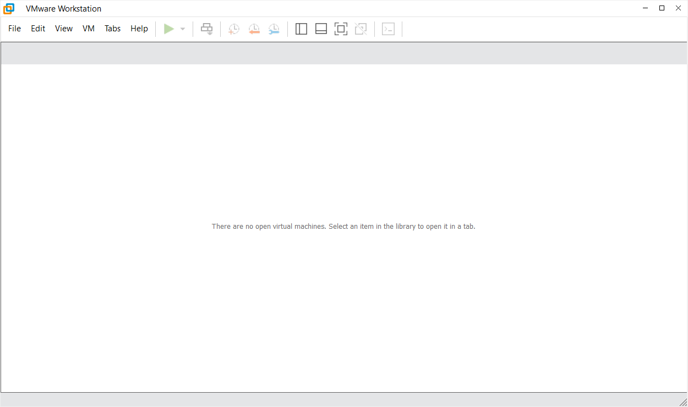
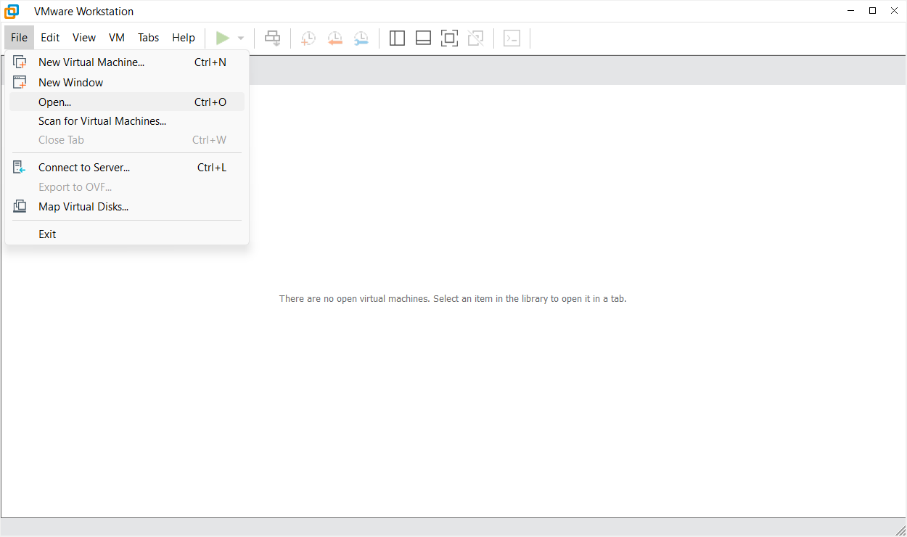
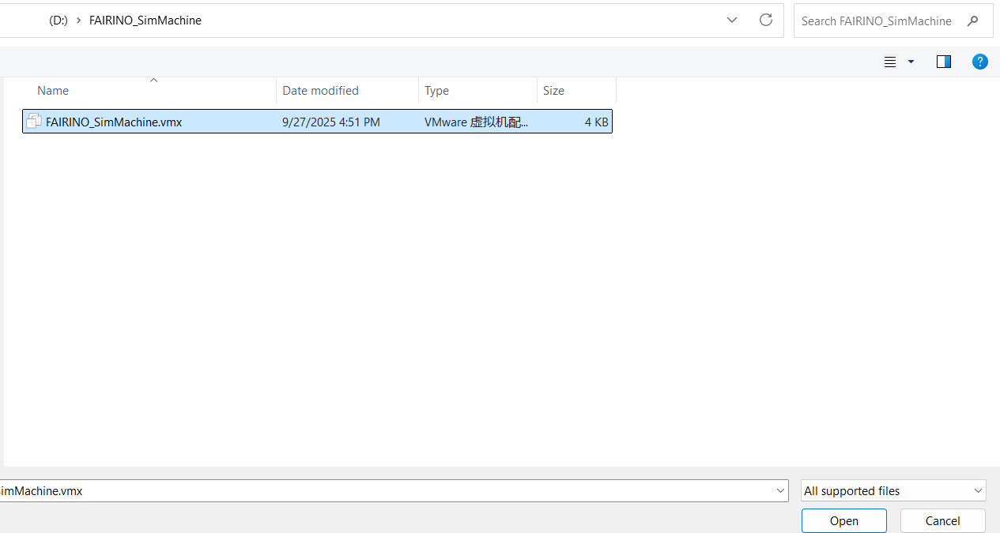
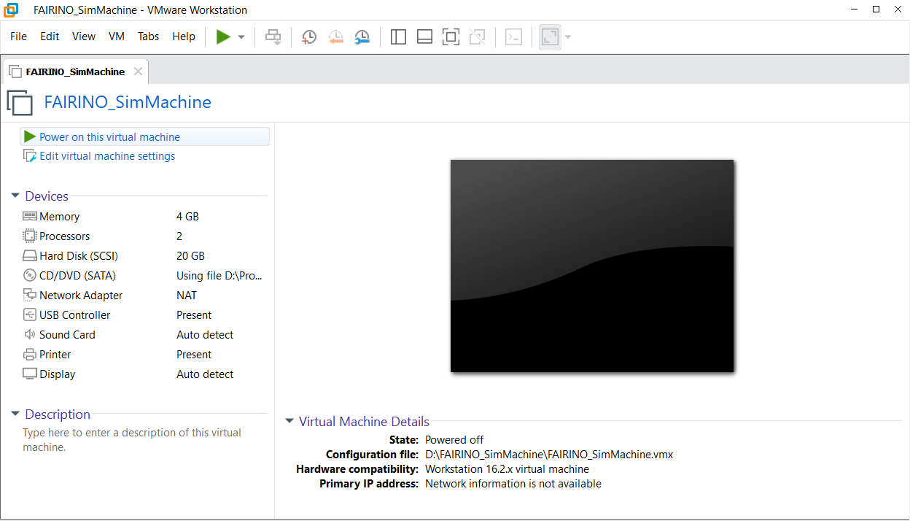
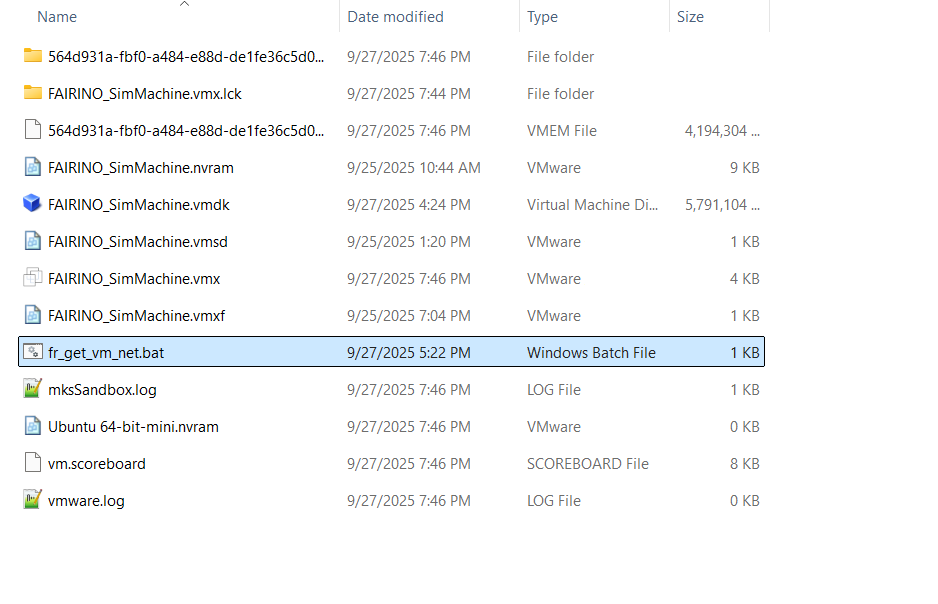
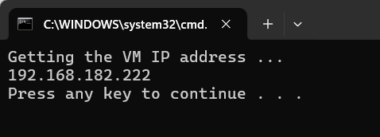
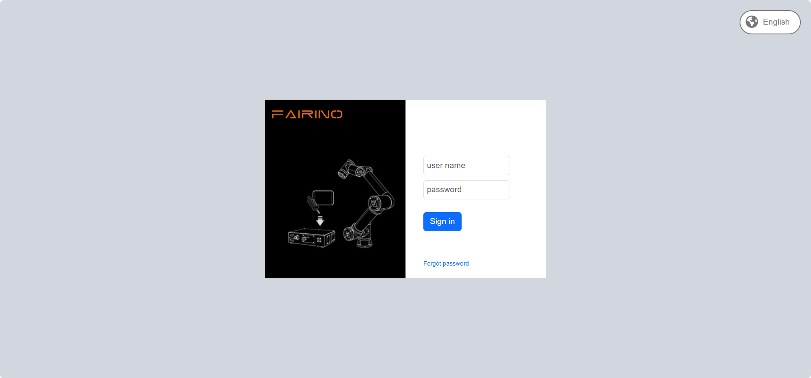

Máquina virtual-VMware
===============================================

Descripción general
-------------------------------
Este manual tiene como objetivo presentar cómo utilizar la máquina virtual FAIRINO SimMachine.

Instrucciones de operación
------------------------------------

Instalar VMware Workstation
~~~~~~~~~~~~~~~~~~~~~~~~~~~~~~~~~~~~~~~~~~~~~~~~~~~~~~~~~~~~

Versión de demostración de VMware Workstation：17.6.3 (si ya está instalado, omita este paso).

Buscar directamente en el navegador el sitio web oficial de VMware o hacer clic directamente en la dirección \ `<https://www.vmware.com>`__\ , tras descargar el paquete de instalación, seleccionar la ruta predeterminada para instalarlo.

.. centered:: Gráfico 6.2-1 Interfaz de VMWare

Abrir la imagen
~~~~~~~~~~~~~~~~~~~~~~~~~~~~~~~~~~~~~~~~~~~~~~~~~~~~~~~~~~~~

1. Descargar la imagen de la máquina virtual FAIRINO_SimMachine.zip y descomprimirla
   
2. Abrir VMware, hacer clic en File->Open. Como se muestra en la siguiente figura 2-2：

.. centered:: Gráfico 6.2-2 Abrir la imagen

3. Encontrar la carpeta descomprimida, seleccionar el archivo con extensión vmx. Como se muestra en la siguiente figura 2-3：
   

.. centered:: Gráfico 6.2-3 Seleccionar el archivo

4. Hacer clic en “Power on this virtul machine” para abrir la máquina virtual. Como se muestra en la siguiente figura 2-4：
   

.. centered:: Gráfico 6.2-4 Encender la máquina virtual

5. En la carpeta descomprimida, encontrar “fr_get_vm_net” y hacer doble clic para abrirlo, como se muestra en la siguiente figura 2-5, el contenido de salida es la IP de la máquina virtual. Como se muestra en la siguiente figura 2-6.

.. note:: Si falla la obtención, diríjase a la máquina virtual y obténgala ejecutando el comando “ifconfig”.
      

.. centered:: Gráfico 6.2-5 fr_get_vm_net.bat
      

.. centered:: Gráfico 6.2-6 IP de la máquina virtual

Acceso a WebApp desde Windows
~~~~~~~~~~~~~~~~~~~~~~~~~~~~~~~~~~~~~~~~~~~~~~~~~~~~~~~~~~~~

1. Una vez obtenida la IP de la máquina virtual, acceder directamente desde el navegador de Windows a la IP de la máquina virtual para entrar en WebApp, por ejemplo, introducir：192.168.182.222, como se muestra en la figura 2-7：
         

.. centered:: Gráfico 6.2-7 Acceso a WebApp mediante la IP de la máquina virtual