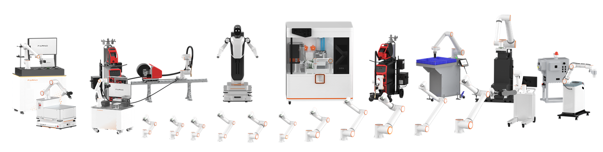

¡Bienvenido a la documentación de FAIRINO!
=================================================

Cambio de idioma

    \ `简体中文 <https://fairino-doc-zhs.readthedocs.io/latest/>`__\

    \ `繁體中文 <https://fairino-doc-zht.readthedocs.io/latest/>`__\

    \ `English <https://fairino-doc-en.readthedocs.io/latest/>`__\ 

    \ `日本語 <https://fairino-doc-ja.readthedocs.io/latest/>`__\ 

    \ `Italiano <https://fairino-doc-it.readthedocs.io/latest/>`__\ 

    \ `Deutsch <https://fairino-doc-de.readthedocs.io/latest/>`__\ 

    \ `Protugues <https://fairino-doc-pt.readthedocs.io/latest/>`__\ 

    \ `Polski <https://fairino-doc-pl.readthedocs.io/latest/>`__\ 

.. toctree::
   :maxdepth: 6
   :caption: Manual de usuario

   CobotsManual/intro
   SDKManual/index
   VMMachine/vm_intro
   FRCap/frcap_intro
   LuaProgram/lua_intro
   RobotCommunication/cnde_intro

.. toctree:: 
   :maxdepth: 6
   :caption: Tienda de complementos

   CapSoftware
   
.. toctree:: 
   :maxdepth: 6
   :caption: Plataforma abierta

   ROSGuide/index

.. toctree:: 
   :maxdepth: 6
   :caption: Descarga de materiales

   download